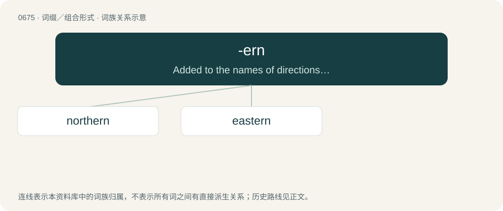

# 0751 · -ern — Added to the names of directions to form adjectives.

[总目录](../00_总目录_按常用程度.md)

**类型**：词缀／组合形式　｜　**来源语言**：见词源记录

## 核心含义与来源

- 核心含义：Added to the names of directions to form adjectives.
- 英文含义：Added to the names of directions to form adjectives.
- 词形：-ern

**来源记录 1**（后缀／后置成分；Added to the names of directions to form adjectives.）

In form, from Middle English -erne, -ern, -ren, -ron (northern(e), northron, so(u)thern(e), sothron, etc), from Old English -erne (norþerne, etc), from Proto-Germanic \*-r- (probably from rebracketing of \*nurþrōnijaz etc) + \*-ōnijaz, whence also Old High German -rōni, Old Saxon -rōni, Old Norse -rǿnn / Old Norse -ǿnn. In practice, possibly a back-formation from northern, southern, etc. (Contrast the -ern in hāliġern, etc., which is related to ærn (“place”).)

## 词族图

## 单词速览（常用到不常用）

| 单词 | 音标 | 释义 |
|---|---|---|
| [northern](#w-1) | 英 /ˈnɔː.ðən/；美 /ˈnɔɹ.ðɚn/ | n. 北方人；a. 北方的, 向北的, 自北方来的 |
| [eastern](#w-2) | 英 /ˈiː.stən/；美 /ˈi.stɚn/ | n. 东方人, 东正教徒；a. 东方的, 向东的, 自东的 |

## 逐词详解

### 1. northern

**词性**：形容词　｜　**音标**：英 /ˈnɔː.ðən/；美 /ˈnɔɹ.ðɚn/

**中文释义**：n. 北方人；a. 北方的, 向北的, 自北方来的

**英文义项**：Of, facing, situated in, or related to the north; northerly. / Blowing from the north; northerly.

**构词拆分**：north + -ern

**词源与演化**：

From Middle English northerne, from Old English norþerne, from Proto-West Germanic \*norþrōnī, from Proto-Germanic \*nurþrōnijaz. Cognate with Old High German nordrōni and Old Norse norrœnn. Morphologically north + -ern.

**例句**：

> Les Dawson was a famous northern comedian.

该用例对应义项：Characteristic of the North of England (usually capitalised)

### 2. eastern

**词性**：形容词　｜　**音标**：英 /ˈiː.stən/；美 /ˈi.stɚn/

**中文释义**：n. 东方人, 东正教徒；a. 东方的, 向东的, 自东的

**英文义项**：Of, facing, situated in, or related to the east. / Blowing from the east; easterly.

**构词拆分**：east + -ern

**词源与演化**：

From Middle English esturne, esterne, from Old English ēasterne (“eastern”), from Proto-Germanic \*austrōnijaz (“eastern”), from Proto-Indo-European \*h₂ews-ro- (“eastern”), from Proto-Indo-European \*h₂ews- (“dawn, east”). Cognate with Old Saxon and Old High German ōstrōni (“eastern”), Old Norse austrœnn (“eastern”). Morphologically east + -ern.

**例句**：

> The eastern end of the island.

该用例对应义项：lying toward or situated in the east
