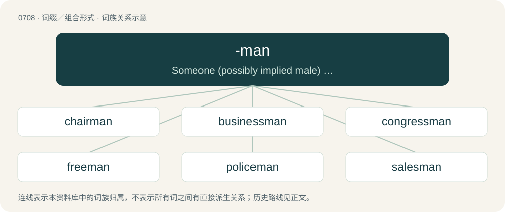

# 0778 · -man — Someone (possibly implied male) who is an expert in an area or who takes part in an activity.

[总目录](../00_总目录_按常用程度.md)

**类型**：词缀／组合形式　｜　**来源语言**：见词源记录

## 核心含义与来源

- 核心含义：Someone (possibly implied male) who is an expert in an area or who takes part in an activity.
- 英文含义：Someone (possibly implied male) who is an expert in an area or who takes part in an activity.
- 词形：-man

**来源记录 1**（后缀／后置成分；Someone (possibly implied male) who is an expert in an area or who takes part in an activity.）

From Middle English -man, from the noun man.

## 词族图

## 单词速览（常用到不常用）

| 单词 | 音标 | 释义 |
|---|---|---|
| [chairman](#w-1) | 英 /ˈtʃɛːmən/；美 /ˈtʃɛɹ.mən/ | n. 主席, 会长；\[经\] 主席 |
| [businessman](#w-2) | 英 /ˈbɪznəsmən/；美 /ˈbɪznəsmæn/ | n. 商人, 实业家, 工商业家 |
| [congressman](#w-3) | /ˈkɒŋgresmən/ | n. 国会议员, 众议院议员；\[法\] 国会议会 |
| [freeman](#w-4) | /ˈfɹiː.mən/ | n. 自由民, 公民, 正会员；\[法\] 自由民, 公民, 有公民权的人 |
| [policeman](#w-5) | /pəˈliːsmən/ | n. 警察；\[化\] 淀帚 |
| [salesman](#w-6) | /ˈseilzmən/ | n. 售货员, 推销员；\[经\] 售货员, 店员, 推销员 |
| [fisherman](#w-7) | 英 /ˈfɪʃ.ə.mən/；美 /ˈfɪʃ.ɚ.mən/ | n. 渔夫, 钓鱼者, 渔船 |
| [bowman](#w-8) | 英 /ˈbəʊmən/；美 /ˈboʊmən/ | n. 弓射手, 持弓的兵, 船首的划手 |
| [statesman](#w-9) | /ˈsteɪtsmən/ | n. 政治家 |
| [batsman](#w-10) | /ˈbætsmən/ | n. 击球手 |
| [gunman](#w-11) | /ˈɡʌnmən/ | n. 枪手, 持枪的歹徒, 制造枪械者；\[法\] 持枪歹徒, 持枪抢劫或杀人者, 枪炮工人 |
| [cameraman](#w-12) | /ˈkæm(ə)ɹəˌmæn/ | n. 照相师, 摄影师 |
| [hitman](#w-13) | /ˈhɪtmæːn/ | n. 职业杀手 |
| [craftsman](#w-14) | 英 /ˈkɹɑːftsmən/；美 /ˈkɹæftsmən/ | n. 工匠, 技工, 手艺人 |
| [lineman](#w-15) | /ˈlainmən/ | n. 线务员, 线路工人, 护路工, 养路工 |
| [fireman](#w-16) | 英 /ˈfaɪəmən/；美 /ˈfaɪɹmən/ | n. 救火队员, 消防队员；\[机\] 司炉 |
| [seaman](#w-17) | /ˈsiːmən/ | n. 船员, 海员, 水兵；\[法\] 海员, 水手, 精通海事者 |
| [clergyman](#w-18) | 英 /ˈklɜːdʒimən/；美 /ˈklɝd͡ʒimən/ | n. 牧师 |
| [councilman](#w-19) | /ˈkaunslmən/ | n. 委员, 市议会议员；\[法\] 议会议员, 市议员 |
| [letterman](#w-20) | /ˈletəmæn/ | n. (得奖的)运动员 |
| [snowman](#w-21) | 英 /ˈsnəʊ.mæn/；美 /ˈsnoʊ.mæn/ | n. 雪人 |
| [sportsman](#w-22) | /ˈspɒːtsmən/ | n. 运动员, 冒险家 |
| [postman](#w-23) | 英 /ˈpəʊs(t)mən/ | n. 邮递员；\[法\] 邮递员, 理财法庭的高级律师 |
| [silverman](#w-24) |  | 【英文】A butler responsible for the silverware. |
| [jackman](#w-25) |  | 【英文】A member of the pit crew responsible for lifting the car with a jack. |
| [watchman](#w-26) | /ˈwɒtʃmən/ | n. 巡夜者, 看守人；\[法\] 看守人, 门警, 哨兵 |
| [huntsman](#w-27) | /ˈhʌntsmən/ | n. 猎人, 管猎犬者 |
| [sandman](#w-28) | 英 /ˈsænd.mæn/ | n. 睡魔 |
| [workman](#w-29) | 英 /ˈwɜːkmən/；美 /ˈwɝkmən/ | n. 工人, 工匠, 男工 |
| [rodman](#w-30) | /ˈrɔdmən,-mæn/ | n. 钓鱼人, 司尺员, 标杆员 |
| [journeyman](#w-31) | 英 /ˈd͡ʒɜːnimən/；美 /ˈd͡ʒɝnimən/ | n. 雇工, 熟练工人, 短工 |
| [waterman](#w-32) | /ˈwɔːtəmən/ | n. 船工, 船家, 船夫, 划手 |
| [assemblyman](#w-33) | /əˈsemblimən/ | n. 议员 |
| [countryman](#w-34) | /ˈkʌntɹimən/ | n. 同胞, 乡下人, 国民 |
| [wingman](#w-35) | /ˈwɪŋmæn/ | n. 僚机驾驶员, 僚机 |
| [airman](#w-36) | 英 /ˈɛə.mən/；美 /ˈɛɹ.mən/ | n. 飞行员, 空军士兵 |
| [strongman](#w-37) | /ˈstrɒŋmæn/ | n. 大力士 |
| [handyman](#w-38) | /ˈhændimæn/ | n. 杂务工, 手巧的人, 水手 |
| [doorman](#w-39) | /ˈdɒːmæn/ | n. 看门人 |
| [defenceman](#w-40) |  | 【英文】In ice hockey and lacrosse, a player position with a primary responsibility to prevent the opposing team from scoring goals; same as defender in many other ballgames. |
| [barman](#w-41) | 英 /ˈbɑːmən/；美 /ˈbɑɹmæn/ | n. 酒吧间男招待 |
| [showman](#w-42) | /ˈʃəʊ.mən/ | n. 演出主持人, 玩杂耍的人 |
| [cartman](#w-43) | /ˈkɑːtmæn/ | n. 赶大车(或轻型二轮车)的人,卡车司机 |
| [woodman](#w-44) | /ˈwʊdmən/ | n. 樵夫, 林区人 |
| [fishman](#w-45) |  | n. 捕鱼人, 捕鱼船 |
| [iceman](#w-46) | /ˈaismæn/ | n. 零售冰的人, 制冰的人 |
| [pitman](#w-47) | /ˈpɪt.mən/ | n. 矿工, 煤矿工, 连杆；\[化\] 连杆 |
| [weatherman](#w-48) | /ˈweðəmæn/ | n. 气象员；天气预报员 |
| [hangman](#w-49) | /ˈhæŋˌmæn/ | n. 绞刑吏, 刽子手；\[法\] 执行绞刑者 |
| [kinsman](#w-50) | /ˈkinzmən/ | n. 男亲戚, 亲属 |
| [stockman](#w-51) | /ˈstɔkmən/ | n. 牧场主, 牧场工人, 饲养员, 仓库管理员；\[经\] 仓库管理员 |
| [stuntman](#w-52) | 英 /ˈstʌnt.mæn/ | n. 特技人, 特技替身演员；表演者 |
| [conman](#w-53) |  | \[法\] 骗子 |
| [crewman](#w-54) | /ˈkruːmən/ | n. 机组乘员 |
| [tradesman](#w-55) | /ˈtreidzmən/ | n. 零售商, 工匠；\[经\] 商人, 店主, 零售商 |
| [serviceman](#w-56) | /ˈs\\\\ːvismən/ | n. 军人, 维修人员；\[化\] 机械师; 维修人员 |
| [stillman](#w-57) |  | n. (Stillman)人名；(英、芬、瑞典)斯蒂尔曼 |
| [linesman](#w-58) | /ˈlainzmən/ | n. 常备步兵, 线路保养工, 边线裁判员 |
| [patrolman](#w-59) | /pəˈtrəulmən/ | n. 巡视者, 巡逻者, 巡警；\[法\] 巡逻人, 巡逻警察 |
| [repairman](#w-60) | /riˈpєəmæn/ | n. 修理工 |
| [guardsman](#w-61) | /ˈgɑːdzmən/ | n. 卫兵, (英)近卫兵, (美)国民警卫队士兵 |
| [coachman](#w-62) | 英 /ˈkəʊt͡ʃmən/；美 /ˈkoʊt͡ʃmən/ | n. 马车夫 |
| [draftsman](#w-63) | /ˈdræftsmən/ | n. 起草者, 制图员, 图案工；\[机\] 绘图员 |
| [kirkman](#w-64) | /ˈkəːkmən/ | n. 苏格兰教会教徒 |
| [milkman](#w-65) | /ˈmɪlkmən/ | n. 牛奶商, 送奶工, 挤奶的男人 |
| [rifleman](#w-66) | 英 /ˈɹaɪ̯fəlmən/；/ˈɹɐɪ̯fəlmən/ | n. 步枪射手, 步兵 |
| [shipman](#w-67) | /ˈʃipmən/ | n. 船员, 水手, 船长 |
| [bannerman](#w-68) | /ˈbænəmən/ | n. 旗手, &lt;美&gt;海军少校 |
| [boatman](#w-69) | /ˈbəʊt.mən/ | n. 出租船者, 船夫 |
| [bogeyman](#w-70) | 英 /ˈbəʊ.ɡɪˌmæn/；美 /ˈboʊ.ɡiˌmæn/ | n. 可怕(或可憎)的人或物,妖怪,精灵 |
| [bushman](#w-71) | /ˈbjʃmən/ | n. 澳大利亚丛林中的居民,林区(或边远地区)的人 |
| [lawman](#w-72) | 英 /ˈlɔːmæn/；美 /ˈlɔmæn/ | n. \[律\] 执法官, 警察, 警官 |
| [spaceman](#w-73) | 美 /ˈspeɪsˌmæn/ | n. 航天专家, 宇航员 |
| [spearman](#w-74) | /ˈspiəmən/ | n. 持矛士兵 |
| [draughtsman](#w-75) | 英 /ˈdɹɑːftsmən/ | n. 起草人, 打样人, 制图员, (正式)制图能手 |
| [eggman](#w-76) |  | 【英文】A man who delivers eggs. |
| [newsman](#w-77) | /ˈn(j)uːzmæn/ | n. 报童, 送报人, 新闻记者 |
| [hackman](#w-78) | /ˈhækmən/ | n. 出租马车夫, 出租车司机 |
| [newspaperman](#w-79) | 美 /ˈn(j)uspeɪpəɹˌmæn/ | n. 新闻记者 |
| [bondsman](#w-80) | 英 /ˈbɒndzmən/；美 /ˈbɑndzmən/ | n. 奴隶；\[经\] 保证人 |
| [corpsman](#w-81) | /ˈkɔː(ɹ)mən/ | n. 战地医护兵 |
| [millman](#w-82) | /ˈmilmən/ | 炼胶工 |
| [bridgeman](#w-83) |  | 【英文】A worker who operates a moving bridge. |
| [houseman](#w-84) | 英 /ˈhaʊsmən/ | n. 实习医生；\[化\] 石油炼厂控制室操作者 |
| [woodsman](#w-85) | /ˈwudzmən/ | n. 住在森林中的人, 熟悉森林的人, 樵夫, 伐木工 |
| [candyman](#w-86) |  | n. 杀人蜂（或译追命传说, 电影名）；甜心宝贝（或译甜蜜爱人, 歌曲名） |
| [ferryman](#w-87) | 英 /ˈfɛɹ.i.mən/ | n. 渡船工人 |
| [glassman](#w-88) | /ˈ^lɑːsmən;ˈ^læs-/ | n. 卖玻璃制品的人, 玻璃制造者, 装玻璃的工人 |
| [outdoorsman](#w-89) | /.autˈdɔːzmən/ | n. 常在野外活动的人 |
| [ruckman](#w-90) |  | 【英文】A ruck; a player who contests rucks. |
| [committeeman](#w-91) | /kəˈmitimən/ | n. 委员 |
| [bomberman](#w-92) | 英 /ˈbɒməmən/；美 /ˈbɑmɚmən/ | 【英文】A male bomber (person who sets bombs) |
| [oilman](#w-93) | /ˈɒilmən/ | n. 石油工人, 石油商 |
| [penman](#w-94) | /ˈpenmən/ | n. 笔者, 画家, 抄写员, 书法家 |
| [brickman](#w-95) |  | \[人名\] 布里克曼 |
| [stallman](#w-96) | /ˈstɔːlmən/ | n. 摊贩 |
| [sugarman](#w-97) |  | \[人名\] 休格曼 |
| [brinkman](#w-98) | /ˈbriŋk(s)mən/ | n. 边缘主义者；n. (Brinkman)人名；(英、荷、瑞典)布林克曼 |
| [selectman](#w-99) | /siˈlektmən/ | n. 市政管理委员；\[法\] 成员, 行政委员 |
| [starman](#w-100) | 英 /ˈstɑːˌmæn/；美 /ˈstɑɹˌmæn/ | \[人名\] 斯塔曼; \[电影\]外星恋 |
| [stickman](#w-101) | /sˈtɪkmæn/ | n. &lt;俚&gt;赌场筹码管理人, 曲棍球手 |
| [lightman](#w-102) |  | \[人名\] \[英格兰人姓氏\] 莱特曼 Light的变体 |
| [beeman](#w-103) |  | n. (Beeman)人名；(英)比曼 |
| [brakeman](#w-104) | /ˈbreikmən/ | n. 司闸员, 制动手 |
| [herdsman](#w-105) | /ˈhəːdzmən/ | n. 牧人, 牧主 |
| [tribesman](#w-106) | /ˈtraibzmən/ | n. 部落男子 |
| [yachtsman](#w-107) | /ˈjɒtsmən/ | n. 游艇驾驶者, 游艇所有者 |
| [sideman](#w-108) | /ˈsaidmæn/ | n. 伴奏者 |
| [clubman](#w-109) | /ˈklʌbmən/ | n. 俱乐部的会员, 爱好俱乐部活动的人 |
| [shearman](#w-110) |  | 【英文】One whose occupation is to shear cloth. |
| [topman](#w-111) | /ˈtɔpmən/ | n. 地面上做杂务的建筑工人 |
| [bagman](#w-112) | /ˈbægmən/ | n. 推销员, 中间人 |
| [cheeseman](#w-113) |  | \[人名\] \[英格兰人姓氏\] 奇斯曼职业名称，干酪制作者或销售者，来源于古英语，含义是“干酪+人”(cheese+man) |
| [signalman](#w-114) | /ˈsɪɡnəl.mən/ | n. 信号手 |
| [moorman](#w-115) |  | 【英文】A man who lives on or around the moors. |
| [godman](#w-116) |  | 【英文】A charismatic male guru. |

## 逐词详解

### 1. chairman

**词性**：名词　｜　**音标**：英 /ˈtʃɛːmən/；美 /ˈtʃɛɹ.mən/

**中文释义**：n. 主席, 会长；\[经\] 主席

**英文义项**：A person presiding over a meeting, sometimes especially a man. (Compare chairwoman, chairperson, chair.) / The head of a corporate or governmental board of directors, a committee, or other formal entity.

**构词拆分**：chair + -man

**词源与演化**：

From chair + -man.

**例句**：

> Barry Taylor's name has been put forward for the post of chairman.

### 2. businessman

**词性**：名词　｜　**音标**：英 /ˈbɪznəsmən/；美 /ˈbɪznəsmæn/

**中文释义**：n. 商人, 实业家, 工商业家

**英文义项**：A man in business, one who works at a commercial institution.

**构词拆分**：business + -man

**词源与演化**：

From business + -man. Displaced earlier merchant, ultimately from Latin mercāns (“merchant, buyer”).

**例句**：

> Learning Klingon will be of great use for his career as a businessman.

### 3. congressman

**词性**：名词　｜　**音标**：/ˈkɒŋgresmən/

**中文释义**：n. 国会议员, 众议院议员；\[法\] 国会议会

**英文义项**：A male member of congress. / A male member of the House of Representatives.

**构词拆分**：From congress + -man.

**词源与演化**：

From congress + -man.

**例句**：

> The congressman has been in the spotlight ever since his untoward remarks about African Americans.

### 4. freeman

**词性**：名词　｜　**音标**：/ˈfɹiː.mən/

**中文释义**：n. 自由民, 公民, 正会员；\[法\] 自由民, 公民, 有公民权的人

**英文义项**：A person who has received an honorary freedom of a city. / A person who is a citizen of a free country, as opposed to a subject of a tyranny or totalitarian dictatorship.

**构词拆分**：free + -man

**词源与演化**：

From Old English frēomann, equivalent to free + -man and paralleled by similar constructions in other Germanic languages. Doublet of preman.

**例句**：

> The narrator of the documentary was Morgan Freeman.

### 5. policeman

**词性**：名词　｜　**音标**：/pəˈliːsmən/

**中文释义**：n. 警察；\[化\] 淀帚

**英文义项**：A police officer, usually a male. / A glass rod capped at one end with rubber, used in a chemistry laboratory for gravimetric analysis.

**构词拆分**：police + -man

**词源与演化**：

From police + -man.

**例句**：

> A Californian policeman pulled a car over and spoke to the driver.

### 6. salesman

**词性**：名词　｜　**音标**：/ˈseilzmən/

**中文释义**：n. 售货员, 推销员；\[经\] 售货员, 店员, 推销员

**英文义项**：A man whose job it is to sell things, either in a shop / store or elsewhere.

**构词拆分**：sales + -man

**词源与演化**：

From sales + -man.

**例句**：

> Making such a large sale is a feather in the salesman's cap.

### 7. fisherman

**词性**：名词　｜　**音标**：英 /ˈfɪʃ.ə.mən/；美 /ˈfɪʃ.ɚ.mən/

**中文释义**：n. 渔夫, 钓鱼者, 渔船

**英文义项**：Any person who attempts to catch fish. / A person whose profession is catching fish.

**构词拆分**：fisher + -man

**词源与演化**：

From fisher + -man.

**例句**：

> He is a fisherman, out on a trawler for days at a time.

该用例对应义项：A person whose profession is catching fish.

### 8. bowman

**词性**：名词　｜　**音标**：英 /ˈbəʊmən/；美 /ˈboʊmən/

**中文释义**：n. 弓射手, 持弓的兵, 船首的划手

**英文义项**：A man who uses a bow; an archer.

**构词拆分**：bow + -man

**词源与演化**：

From Middle English boweman, bouman, boughman, equivalent to bow + -man.

### 9. statesman

**词性**：名词　｜　**音标**：/ˈsteɪtsmən/

**中文释义**：n. 政治家

**英文义项**：A man who is a leader in national or international affairs. / A male political leader who promotes the public good or who is recognized for probity, leadership, or the qualities necessary to govern a state.

**构词拆分**：state + -s- + -man

**词源与演化**：

From state + -s- + -man, modelled after French homme d'État.

**例句**：

> In addition to being a great statesman, Churchill was a great writer.

### 10. batsman

**词性**：名词　｜　**音标**：/ˈbætsmən/

**中文释义**：n. 击球手

**英文义项**：A player of the batting side now on the field. / The player now receiving strike; the striker.

**构词拆分**：bat + -s- + -man

**词源与演化**：

From bat + -s- + -man.

**例句**：

> Bangladesh national cricket team batsman Nasir Hossain said this.

### 11. gunman

**词性**：名词　｜　**音标**：/ˈɡʌnmən/

**中文释义**：n. 枪手, 持枪的歹徒, 制造枪械者；\[法\] 持枪歹徒, 持枪抢劫或杀人者, 枪炮工人

**英文义项**：A person armed with a gun, especially a gunned evildoer. / An American.

**构词拆分**：From gun + -man.

**词源与演化**：

From gun + -man.

**例句**：

> When she saw the gunman, Soraya nearly had a fit.

### 12. cameraman

**词性**：名词　｜　**音标**：/ˈkæm(ə)ɹəˌmæn/

**中文释义**：n. 照相师, 摄影师

**英文义项**：Somebody who operates a movie camera or television camera.

**构词拆分**：camera + -man

**词源与演化**：

From camera + -man.

**例句**：

> What is the nationality of that cameraman over there?

### 13. hitman

**词性**：名词　｜　**音标**：/ˈhɪtmæːn/

**中文释义**：n. 职业杀手

**英文义项**：A male contract killer, especially one paid by a mafia. / A goalscorer; someone who scores goals.

**构词拆分**：From hit (“to murder”) + -man.

**词源与演化**：

From hit (“to murder”) + -man.

**例句**：

> Layla hired a hitman to kill her former husband.

### 14. craftsman

**词性**：名词　｜　**音标**：英 /ˈkɹɑːftsmən/；美 /ˈkɹæftsmən/

**中文释义**：n. 工匠, 技工, 手艺人

**英文义项**：One who is highly skilled at one's trade; an artisan or artificer. / A person who makes or creates material objects partly or entirely by hand.

**构词拆分**：craft + -s- + -man

**词源与演化**：

From craft + -s- + -man.

**例句**：

> Tom composed sentences like a master craftsman building furniture for a king.

### 15. lineman

**词性**：名词　｜　**音标**：/ˈlainmən/

**中文释义**：n. 线务员, 线路工人, 护路工, 养路工

**英文义项**：A person who installs and repairs overhead cables (either power or telephone); a linesman. / A player who specializes in play at the line of scrimmage.

**构词拆分**：From line + -man.

**词源与演化**：

From line + -man.

**例句**：

> Ziri asked Yazid if he could borrow his Lineman's pliers.

### 16. fireman

**词性**：名词　｜　**音标**：英 /ˈfaɪəmən/；美 /ˈfaɪɹmən/

**中文释义**：n. 救火队员, 消防队员；\[机\] 司炉

**英文义项**：Someone (especially male) who is skilled in the work of fighting fire. / A person (originally a man) who keeps the fire going underneath a steam boiler (originally, shoveling coal by hand), particularly on a railroad locomotive or steamship.

**构词拆分**：fire + -man

**词源与演化**：

From fire + -man.

**例句**：

> The fireman's job was about to get very interesting; they had just run out of coal!

该用例对应义项：A person (originally a man) who keeps the fire going underneath a steam boiler (originally, shoveling coal by hand), particularly on a railroad locomotive or steamship.

### 17. seaman

**词性**：名词　｜　**音标**：/ˈsiːmən/

**中文释义**：n. 船员, 海员, 水兵；\[法\] 海员, 水手, 精通海事者

**英文义项**：Synonym of sailor, particularly on a maritime vessel. / A person of the lowest rank in the Navy, below able seaman.

**构词拆分**：sea + -man

**词源与演化**：

From Middle English seeman, seman, from Old English sǣmann. Cognate with Saterland Frisian Seemon (“seaman, sailor”), West Frisian seeman (“seaman, sailor”), Dutch zeeman (“seaman, sailor”), German Low German Seemann (“seaman, sailor”), German Seemann (“seaman, sailor”), Swedish sjöman (“seaman, sailor”), Norwegian sjømann (“seaman, sailor”). Equivalent to sea + -man.

**例句**：

> The seaman had to clean the ship down to the copper bolts.

### 18. clergyman

**词性**：名词　｜　**音标**：英 /ˈklɜːdʒimən/；美 /ˈklɝd͡ʒimən/

**中文释义**：n. 牧师

**英文义项**：A male member of a clergy; especially, an ordained (male) Christian minister.

**构词拆分**：clergy + -man

**词源与演化**：

From clergy + -man.

**例句**：

> At first they rejected the proposal, but a clergyman urged them to accept.

### 19. councilman

**词性**：名词　｜　**音标**：/ˈkaunslmən/

**中文释义**：n. 委员, 市议会议员；\[法\] 议会议员, 市议员

**英文义项**：A male member of a council, often a city council or town council.

**构词拆分**：council + -man

**词源与演化**：

From council + -man.

### 20. letterman

**词性**：名词　｜　**音标**：/ˈletəmæn/

**中文释义**：n. (得奖的)运动员

**英文义项**：A student who has attained a specified level of participation in a sporting or other activity, and is awarded a cloth “letter” to be affixed to an item of clothing.

**构词拆分**：letter + -man

**词源与演化**：

From letter + -man.

### 21. snowman

**词性**：名词　｜　**音标**：英 /ˈsnəʊ.mæn/；美 /ˈsnoʊ.mæn/

**中文释义**：n. 雪人

**英文义项**：A humanoid figure made with large snowballs stacked on each other. Human traits like a face and arms may be fashioned with sticks (arms), a carrot (nose), and stones or coal (eyes, mouth). / A score of eight, especially within one inning (in baseball) or on one hole (in golf, where it is also known as dogballs).

**构词拆分**：snow + -man

**词源与演化**：

\* snow + -man. \* (score of eight; card ranked eight): A typical snowman, built from two balls of snow, resembles a figure eight.

**例句**：

> All I need to know about life, I learned from a snowman.

### 22. sportsman

**词性**：名词　｜　**音标**：/ˈspɒːtsmən/

**中文释义**：n. 运动员, 冒险家

**英文义项**：A man who engages in sports; an athlete. / A man who engages in country sports, such as hunting or fishing.

**构词拆分**：sports + -man

**词源与演化**：

From sports + -man.

**例句**：

> Poor eyesight is a handicap to a sportsman.

### 23. postman

**词性**：名词　｜　**音标**：英 /ˈpəʊs(t)mən/

**中文释义**：n. 邮递员；\[法\] 邮递员, 理财法庭的高级律师

**英文义项**：Someone who delivers the post (mail) to, and/or collects the post from, residential or commercial addresses, or from public mailboxes.

**构词拆分**：post + -man

**词源与演化**：

From post + -man.

**例句**：

> I suspect that his wife is cheating on him with the postman.

### 24. silverman

**词性**：名词

**英文义项**：A butler responsible for the silverware.

**构词拆分**：silver + -man

**词源与演化**：

silver + -man

### 25. jackman

**词性**：名词

**英文义项**：A member of the pit crew responsible for lifting the car with a jack. / A six-pointed playing piece in the game of jacks; a jackstone.

**构词拆分**：jack + -man

**词源与演化**：

From jack + -man.

### 26. watchman

**词性**：名词　｜　**音标**：/ˈwɒtʃmən/

**中文释义**：n. 巡夜者, 看守人；\[法\] 看守人, 门警, 哨兵

**英文义项**：A man set to watch: a man who keeps guard, especially one who guards a building, or the streets of a city, by night; (loosely) any such person of any sex or gender.

**构词拆分**：By surface analysis, watch + -man

**词源与演化**：

From Middle English waccheman. By surface analysis, watch + -man.

**例句**：

> The watchman assured me that there was nothing unusual out there.

### 27. huntsman

**词性**：名词　｜　**音标**：/ˈhʌntsmən/

**中文释义**：n. 猎人, 管猎犬者

**英文义项**：A hunter. / A fox hunter.

**构词拆分**：hunt + -s- + -man

**词源与演化**：

From hunt + -s- + -man.

**例句**：

> He was the kind of huntsman who could never successfully catch even a single animal.

### 28. sandman

**词性**：名词　｜　**音标**：英 /ˈsænd.mæn/

**中文释义**：n. 睡魔

**英文义项**：A figure that brings sleep and dreams by sprinkling magical sand into people's eyes. / Used as a symbol of the passage of time toward death.

**构词拆分**：sand + -man

**词源与演化**：

From sand + -man. The mythological sense may be from German Sandmann, Sandmännchen, as it is apparently first attested in English in the context of E.T.A. Hoffmann’s novella The Sandman (1816). The German is attested in the relevant sense since at least the mid-18th century.

### 29. workman

**词性**：名词　｜　**音标**：英 /ˈwɜːkmən/；美 /ˈwɝkmən/

**中文释义**：n. 工人, 工匠, 男工

**英文义项**：A man who labours for wages. / An artisan or craftsman.

**构词拆分**：work + -man

**词源与演化**：

From Middle English werkman, from Old English weorcmann (“workman”), from Proto-West Germanic \*werkamann, from Proto-Germanic \*werkamann- (“workman”), equivalent to work + -man. Compare Dutch werkman (“workman”), German Werkmann (“labourer, workman”), Icelandic verkamaður (“workman”).

**例句**：

> I'm waiting for a workman who's coming to lay some carpets in my house.

### 30. rodman

**词性**：名词　｜　**音标**：/ˈrɔdmən,-mæn/

**中文释义**：n. 钓鱼人, 司尺员, 标杆员

**英文义项**：Synonym of rodsman.

**构词拆分**：rod + -man

**词源与演化**：

From rod + -man.

### 31. journeyman

**词性**：名词　｜　**音标**：英 /ˈd͡ʒɜːnimən/；美 /ˈd͡ʒɝnimən/

**中文释义**：n. 雇工, 熟练工人, 短工

**英文义项**：A tradesman who has completed an apprenticeship or equivalent educational path in a trade. / A competent but undistinguished tradesman, especially one who works, and is paid by the day.

**构词拆分**：journey + -man

**词源与演化**：

From Middle English jorneman; from journe (from Old French jornee (“a day's work, a journey”)) and mon; equivalent to journey + -man.

**例句**：

> Everyone must follow safety guidelines whether you're an apprentice, journeyman, or even master electrician.

该用例对应义项：A tradesman who has completed an apprenticeship or equivalent educational path in a trade.

### 32. waterman

**词性**：名词　｜　**音标**：/ˈwɔːtəmən/

**中文释义**：n. 船工, 船家, 船夫, 划手

**英文义项**：A man who lives or works on the water; a boatman. / Someone who distributes or supplies water for a living; a water-carrier.

**构词拆分**：water + -man

**词源与演化**：

From Middle English waterman, equivalent to water + -man.

### 33. assemblyman

**词性**：名词　｜　**音标**：/əˈsemblimən/

**中文释义**：n. 议员

**英文义项**：A male member of an assembly. / A member of the lower house of certain US state legislatures.

**构词拆分**：From assembly + -man.

**词源与演化**：

From assembly + -man.

**例句**：

> The assemblyman spent most of the time hearing about potholes, bad landlords, and noise complaints.

### 34. countryman

**词性**：名词　｜　**音标**：/ˈkʌntɹimən/

**中文释义**：n. 同胞, 乡下人, 国民

**英文义项**：Somebody from a certain country. / Somebody from one's own country; a fellow countryman.

**构词拆分**：From country + -man.

**词源与演化**：

From country + -man.

**例句**：

> After the activities of the second day she stayed the night with a countryman.

### 35. wingman

**词性**：名词　｜　**音标**：/ˈwɪŋmæn/

**中文释义**：n. 僚机驾驶员, 僚机

**英文义项**：A pilot partner of another; a pilot who flies in the same wing or squadron. / A friend or associate who accompanies one to offer (or receive) support, especially in flirting with love interests.

**构词拆分**：wing + -man

**词源与演化**：

From wing + -man.

### 36. airman

**词性**：名词　｜　**音标**：英 /ˈɛə.mən/；美 /ˈɛɹ.mən/

**中文释义**：n. 飞行员, 空军士兵

**英文义项**：A pilot of an aircraft. / A person employed in one of several aviation-adjacent professions other than flight crew, such as a mechanic or air traffic controller.

**构词拆分**：air + -man

**词源与演化**：

From air + -man.

**例句**：

> When the engines failed, the airman panicked and failed to properly follow the emergency checklist.

### 37. strongman

**词性**：名词　｜　**音标**：/ˈstrɒŋmæn/

**中文释义**：n. 大力士

**英文义项**：A man who performs feats of strength, as in competitions or as an attraction in a circus. / A forceful or brutal person, usually a ruler or tyrant.

**构词拆分**：strong + -man

**词源与演化**：

From strong + -man.

**例句**：

> He is determined to bring down the Iraqi strongman.

该用例对应义项：a powerful political figure who rules by the exercise of force or violence

### 38. handyman

**词性**：名词　｜　**音标**：/ˈhændimæn/

**中文释义**：n. 杂务工, 手巧的人, 水手

**英文义项**：A person who does small tasks and odd jobs, especially building repairs and the like.

**构词拆分**：handy + -man

**词源与演化**：

From handy + -man.

**例句**：

> I complained that the heat was not working, and the landlord sent the handyman to fix it.

该用例对应义项：A person who does small tasks and odd jobs, especially building repairs and the like.

### 39. doorman

**词性**：名词　｜　**音标**：/ˈdɒːmæn/

**中文释义**：n. 看门人

**英文义项**：A person who holds open the door at the entryway (entrance) to a building, summons taxicabs, and provides an element of security; in apartment buildings, he also accepts deliveries and may perform certain concierge type services.

**构词拆分**：door + -man

**词源与演化**：

From door + -man.

**例句**：

> I showed my ticket to the doorman and went into the theatre.

### 40. defenceman

**词性**：名词

**英文义项**：In ice hockey and lacrosse, a player position with a primary responsibility to prevent the opposing team from scoring goals; same as defender in many other ballgames.

**构词拆分**：From defence + -man.

**词源与演化**：

From defence + -man.

### 41. barman

**词性**：名词　｜　**音标**：英 /ˈbɑːmən/；美 /ˈbɑɹmæn/

**中文释义**：n. 酒吧间男招待

**英文义项**：A man who works in a bar.

**构词拆分**：bar + -man

**词源与演化**：

From bar + -man.

### 42. showman

**词性**：名词　｜　**音标**：/ˈʃəʊ.mən/

**中文释义**：n. 演出主持人, 玩杂耍的人

**英文义项**：A person (usually a man) involved in putting on shows (of various types); especially, one who plays a central role in doing so. / One who produces or presents shows as a profession, especially the proprietor, manager, or MC of a circus or variety show.

**构词拆分**：show + -man

**词源与演化**：

From show + -man.

**例句**：

> David is a showman above all else. His showroom is more than merely a sales floor: it is a spectacle.

该用例对应义项：A person (usually a man) involved in putting on shows (of various types); especially, one who plays a central role in doing so.

### 43. cartman

**词性**：名词　｜　**音标**：/ˈkɑːtmæn/

**中文释义**：n. 赶大车(或轻型二轮车)的人,卡车司机

**英文义项**：A person who transports goods or people by horse and cart; a carman. / A private garbage collection and haulage worker or contractor.

**构词拆分**：cart + -man

**词源与演化**：

From cart + -man.

### 44. woodman

**词性**：名词　｜　**音标**：/ˈwʊdmən/

**中文释义**：n. 樵夫, 林区人

**英文义项**：Someone who cuts down trees or cuts up, splits, and sells wood. / Someone who lives in the wood and manages it; (by extension) someone who spends time in the woods and has a strong familiarity with that environment.

**构词拆分**：wood + -man

**词源与演化**：

From Middle English woodeman, wodeman, from Old English wudemann, wudumann (“woodman”), equivalent to wood + -man.

### 45. fishman

**词性**：名词

**中文释义**：n. 捕鱼人, 捕鱼船

**英文义项**：A man who sells fish. / A mythic or fictional being that is part man, part fish.

**构词拆分**：fish + -man

**词源与演化**：

From Middle English fisscheman; equivalent to fish + -man.

### 46. iceman

**词性**：名词　｜　**音标**：/ˈaismæn/

**中文释义**：n. 零售冰的人, 制冰的人

**英文义项**：A man who is skilled in travelling upon ice, as among glaciers. / A human figure carved out of ice.

**构词拆分**：ice + -man

**词源与演化**：

From ice + -man.

### 47. pitman

**词性**：名词　｜　**音标**：/ˈpɪt.mən/

**中文释义**：n. 矿工, 煤矿工, 连杆；\[化\] 连杆

**英文义项**：One who works in a pit, as in mining, in sawing timber, etc. / A connecting rod in machinery, especially in a sawmill.

**构词拆分**：pit + -man

**词源与演化**：

From pit + -man.

### 48. weatherman

**词性**：名词　｜　**音标**：/ˈweðəmæn/

**中文释义**：n. 气象员；天气预报员

**英文义项**：A person, especially a male one, who reports the weather conditions or forecasts.

**构词拆分**：weather + -man

**词源与演化**：

From weather + -man.

**例句**：

> A weatherman is someone with whom the weather does not always agree.

### 49. hangman

**词性**：名词　｜　**音标**：/ˈhæŋˌmæn/

**中文释义**：n. 绞刑吏, 刽子手；\[法\] 执行绞刑者

**英文义项**：An executioner responsible for hanging criminals. / Someone responsible for hanging pictures and other artworks in a gallery, museum etc.

**构词拆分**：hang + -man

**词源与演化**：

Inherited from Middle English hangman, hongman, hangeman, equivalent to hang + -man.

**例句**：

> I'd rather be hanged than be a hangman.

### 50. kinsman

**词性**：名词　｜　**音标**：/ˈkinzmən/

**中文释义**：n. 男亲戚, 亲属

**英文义项**：A male relative.

**构词拆分**：kin + -s- + -man

**词源与演化**：

From Middle English kynnesman, equivalent to kin + -s- + -man.

**例句**：

> And he let his kinsman depart: and he returned and went into his own country.

### 51. stockman

**词性**：名词　｜　**音标**：/ˈstɔkmən/

**中文释义**：n. 牧场主, 牧场工人, 饲养员, 仓库管理员；\[经\] 仓库管理员

**英文义项**：A man who raises or looks after livestock. / A man who works in a stockroom.

**构词拆分**：stock + -man

**词源与演化**：

From stock + -man.

### 52. stuntman

**词性**：名词　｜　**音标**：英 /ˈstʌnt.mæn/

**中文释义**：n. 特技人, 特技替身演员；表演者

**英文义项**：In films, someone who performs stunts that are deemed too dangerous or physically difficult for the main actors to attempt.

**构词拆分**：stunt + -man

**词源与演化**：

From stunt + -man.

**例句**：

> During filming a stuntman was injured as he jumped from a railway bridge onto the roof of a train passing below.

该用例对应义项：In films, someone who performs stunts that are deemed too dangerous or physically difficult for the main actors to attempt.

### 53. conman

**词性**：名词

**中文释义**：\[法\] 骗子

**英文义项**：A confidence trickster.

**构词拆分**：con + -man

**词源与演化**：

From con + -man.

**例句**：

> Tom is an international conman with a string of false identities.

### 54. crewman

**词性**：名词　｜　**音标**：/ˈkruːmən/

**中文释义**：n. 机组乘员

**英文义项**：A member of a crew, especially the crew of a ship. / Synonym of armoured crewman.

**构词拆分**：crew + -man

**词源与演化**：

From crew + -man.

**例句**：

> At the age of 29, Haibin Liang became a crewman on international cargo ships.

### 55. tradesman

**词性**：名词　｜　**音标**：/ˈtreidzmən/

**中文释义**：n. 零售商, 工匠；\[经\] 商人, 店主, 零售商

**英文义项**：A skilled manual worker (implied male). / A manual worker (implied male) who visits private premises to perform his job.

**构词拆分**：trade + -s- + -man

**词源与演化**：

From trade + -s- + -man.

**例句**：

> The tradesman has the same religion all over the world.

### 56. serviceman

**词性**：名词　｜　**音标**：/ˈs\\\\ːvismən/

**中文释义**：n. 军人, 维修人员；\[化\] 机械师; 维修人员

**英文义项**：A man who serves in the armed forces. / A person, especially a man, employed in service and maintenance of equipment.

**构词拆分**：From service + -man.

**词源与演化**：

From service + -man.

**例句**：

> The winner of the race was a retired US serviceman.

### 57. stillman

**词性**：名词

**中文释义**：n. (Stillman)人名；(英、芬、瑞典)斯蒂尔曼

**英文义项**：The person who operates a still (device for distilling liquids).

**构词拆分**：still + -man

**词源与演化**：

From still + -man.

### 58. linesman

**词性**：名词　｜　**音标**：/ˈlainzmən/

**中文释义**：n. 常备步兵, 线路保养工, 边线裁判员

**英文义项**：An assistant referee. / A male line judge.

**构词拆分**：From line + -s- + -man.

**词源与演化**：

From line + -s- + -man.

**例句**：

> Neither the referee nor linesman saw the ball cross the goal line.

### 59. patrolman

**词性**：名词　｜　**音标**：/pəˈtrəulmən/

**中文释义**：n. 巡视者, 巡逻者, 巡警；\[法\] 巡逻人, 巡逻警察

**英文义项**：A police officer, especially a junior officer assigned patrol duty instead of detection or supervision.

**构词拆分**：From patrol + -man.

**词源与演化**：

From patrol + -man.

**例句**：

> The patrolman motioned me to pull over.

### 60. repairman

**词性**：名词　｜　**音标**：/riˈpєəmæn/

**中文释义**：n. 修理工

**英文义项**：A male repairer, a man who repairs things.

**构词拆分**：repair + -man

**词源与演化**：

From repair + -man.

**例句**：

> The fridge is not empty, unless the repairman took the last beer.

### 61. guardsman

**词性**：名词　｜　**音标**：/ˈgɑːdzmən/

**中文释义**：n. 卫兵, (英)近卫兵, (美)国民警卫队士兵

**英文义项**：A person, especially a soldier, who is on guard; especially, a masculine one. / A member of the National Guard; especially, a masculine one.

**构词拆分**：From guard + -s- + -man.

**词源与演化**：

From guard + -s- + -man.

**例句**：

> The guardsman was assaulted by a robber.

### 62. coachman

**词性**：名词　｜　**音标**：英 /ˈkəʊt͡ʃmən/；美 /ˈkoʊt͡ʃmən/

**中文释义**：n. 马车夫

**英文义项**：A man who drives a horse-drawn coach: a male coach driver. / A fish in the genus Heniochus, especially Heniochus acuminatus or Heniochus diphreutes.

**构词拆分**：coach + -man

**词源与演化**：

From coach + -man.

**例句**：

> It was William, the coachman. He was shot through the heart.

### 63. draftsman

**词性**：名词　｜　**音标**：/ˈdræftsmən/

**中文释义**：n. 起草者, 制图员, 图案工；\[机\] 绘图员

**英文义项**：A person who drafts legal documents.

**构词拆分**：draft + -s- + -man

**词源与演化**：

From draft + -s- + -man.

**例句**：

> We got a draftsman to design our house instead of an architect.

### 64. kirkman

**词性**：名词　｜　**音标**：/ˈkəːkmən/

**中文释义**：n. 苏格兰教会教徒

**英文义项**：A clergyman or officer in a kirk. / A member of the Church of Scotland.

**构词拆分**：kirk + -man

**词源与演化**：

From kirk + -man.

### 65. milkman

**词性**：名词　｜　**音标**：/ˈmɪlkmən/

**中文释义**：n. 牛奶商, 送奶工, 挤奶的男人

**英文义项**：A man who delivers milk to households and sometimes businesses early in the morning. / A black man who prefers dating white women.

**构词拆分**：milk + -man

**词源与演化**：

From milk + -man.

**例句**：

> Did you know that his wife was cheating on him with the milkman?

### 66. rifleman

**词性**：名词　｜　**音标**：英 /ˈɹaɪ̯fəlmən/；/ˈɹɐɪ̯fəlmən/

**中文释义**：n. 步枪射手, 步兵

**英文义项**：A soldier trained to use a rifle as a primary weapon. / A person especially skilled in the use of a rifle.

**构词拆分**：rifle + -man

**词源与演化**：

From rifle + -man.

**例句**：

> She was quite the rifleman and could pick off a squirrels with a .22 from across the field with amazing accuracy.

该用例对应义项：A person especially skilled in the use of a rifle.

### 67. shipman

**词性**：名词　｜　**音标**：/ˈʃipmən/

**中文释义**：n. 船员, 水手, 船长

**英文义项**：Synonym of sailor. / A labourer on a ship.

**构词拆分**：ship + -man

**词源与演化**：

From Middle English schipman, from Old English scipmann (“shipman, mariner, sailor, rower; one who goes on trading voyages; pirate”). Cognate with Icelandic skipmaður, skipamaður (“shipman”). Equivalent to ship + -man. Compare English boatman.

### 68. bannerman

**词性**：名词　｜　**音标**：/ˈbænəmən/

**中文释义**：n. 旗手, &lt;美&gt;海军少校

**英文义项**：A person assigned to carry the colours, standards or guidons of a military unit. / A man who belonged to the Eight Banners of the Qing Dynasty.

**构词拆分**：banner + -man

**词源与演化**：

From banner + -man.

### 69. boatman

**词性**：名词　｜　**音标**：/ˈbəʊt.mən/

**中文释义**：n. 出租船者, 船夫

**英文义项**：A sailor on a small vessel (boat), particularly its captain.

**构词拆分**：boat + -man

**词源与演化**：

From Middle English boteman, botman, bateman. Equivalent to boat + -man.

**例句**：

> When there are no tourists, the Lao boatman just fishes in the area to feed his family.

### 70. bogeyman

**词性**：名词　｜　**音标**：英 /ˈbəʊ.ɡɪˌmæn/；美 /ˈboʊ.ɡiˌmæn/

**中文释义**：n. 可怕(或可憎)的人或物,妖怪,精灵

**英文义项**：A menacing, ghost-like monster in children's stories. / Any make-believe threat, especially one used to intimidate or distract, or a real threat greatly exaggerated for those purposes; often taking the form of a notorious historical personage suggested to return as a revenant to punish for wrongdoing.

**构词拆分**：bogey + -man

**词源与演化**：

From bogey + -man.

**例句**：

> The specter of an election-vote recount is this year's political bogeyman.

该用例对应义项：Any make-believe threat, especially one used to intimidate or distract, or a real threat greatly exaggerated for those purposes; often taking the form of a notorious historical personage suggested to return as a revenant to punish for wrongdoing.

### 71. bushman

**词性**：名词　｜　**音标**：/ˈbjʃmən/

**中文释义**：n. 澳大利亚丛林中的居民,林区(或边远地区)的人

**英文义项**：A man who lives in or has extensive experience of the Australian bush or outback.

**构词拆分**：bush + -man

**词源与演化**：

From bush + -man.

### 72. lawman

**词性**：名词　｜　**音标**：英 /ˈlɔːmæn/；美 /ˈlɔmæn/

**中文释义**：n. \[律\] 执法官, 警察, 警官

**英文义项**：The presiding justice of the supreme court. / A man of the law: a lawyer.

**构词拆分**：law + -man

**词源与演化**：

From Middle English laweman, laȝaman (as a man's name, Laȝamon, Layamon), from Old English lahmann, borrowed from Old Norse lǫgmaðr. In present use as a law-enforcement officer, law + -man.

### 73. spaceman

**词性**：名词　｜　**音标**：美 /ˈspeɪsˌmæn/

**中文释义**：n. 航天专家, 宇航员

**英文义项**：An astronaut, often a male astronaut. / A humanoid extraterrestrial.

**构词拆分**：space + -man

**词源与演化**：

From space + -man.

**例句**：

> I want to be a spaceman when I grow up.

该用例对应义项：An astronaut, often a male astronaut.

### 74. spearman

**词性**：名词　｜　**音标**：/ˈspiəmən/

**中文释义**：n. 持矛士兵

**英文义项**：One who uses a spear; a soldier or warrior who fights with a spear; a person who hunts with a spear.

**构词拆分**：spear + -man

**词源与演化**：

From spear + -man.

### 75. draughtsman

**词性**：名词　｜　**音标**：英 /ˈdɹɑːftsmən/

**中文释义**：n. 起草人, 打样人, 制图员, (正式)制图能手

**英文义项**：A person skilled at drawing engineering or architectural plans.

**构词拆分**：draught + -s- + -man

**词源与演化**：

From draught + -s- + -man.

**例句**：

> Tom asked his friend, who is a draughtsman, to draw up some plans for his extension.

### 76. eggman

**词性**：名词

**英文义项**：A man who delivers eggs.

**构词拆分**：egg + -man

**词源与演化**：

From egg + -man.

### 77. newsman

**词性**：名词　｜　**音标**：/ˈn(j)uːzmæn/

**中文释义**：n. 报童, 送报人, 新闻记者

**英文义项**：A male reporter; a male person in the profession of providing news.

**构词拆分**：From news + -man.

**词源与演化**：

From news + -man.

**例句**：

> Radio listeners heard wailing and then silence, indicating the newsman was now dead.

### 78. hackman

**词性**：名词　｜　**音标**：/ˈhækmən/

**中文释义**：n. 出租马车夫, 出租车司机

**英文义项**：The driver of a hack (a carriage, cab, or taxi).

**构词拆分**：hack + -man

**词源与演化**：

From hack + -man.

### 79. newspaperman

**词性**：名词　｜　**音标**：美 /ˈn(j)uspeɪpəɹˌmæn/

**中文释义**：n. 新闻记者

**英文义项**：A man who works in the production of the text of a newspaper; a reporter, editor, etc.

**构词拆分**：newspaper + -man

**词源与演化**：

From newspaper + -man. Compare paperboy.

**例句**：

> If you want to be a newspaperman, you have to be observant.

### 80. bondsman

**词性**：名词　｜　**音标**：英 /ˈbɒndzmən/；美 /ˈbɑndzmən/

**中文释义**：n. 奴隶；\[经\] 保证人

**英文义项**：A male slave. / A male indentured servant.

**构词拆分**：bond + -s- + -man

**词源与演化**：

From bond + -s- + -man.

### 81. corpsman

**词性**：名词　｜　**音标**：/ˈkɔː(ɹ)mən/

**中文释义**：n. 战地医护兵

**英文义项**：A hospital corpsman.

**构词拆分**：From corps + -man.

**词源与演化**：

From corps + -man.

**例句**：

> The corpsman prescribed Motrin to the sick marine for his symptoms.

该用例对应义项：A hospital corpsman.

### 82. millman

**词性**：名词　｜　**音标**：/ˈmilmən/

**中文释义**：炼胶工

**英文义项**：A male worker in a mill.

**构词拆分**：mill + -man

**词源与演化**：

From mill + -man.

### 83. bridgeman

**词性**：名词

**英文义项**：A worker who operates a moving bridge.

**构词拆分**：bridge + -man

**词源与演化**：

From bridge + -man.

### 84. houseman

**词性**：名词　｜　**音标**：英 /ˈhaʊsmən/

**中文释义**：n. 实习医生；\[化\] 石油炼厂控制室操作者

**英文义项**：A male follower or retainer; a male domestic worker or servant. / A medical graduate gaining practical experience in a hospital; a house officer.

**构词拆分**：house + -man

**词源与演化**：

From house + -man.

### 85. woodsman

**词性**：名词　｜　**音标**：/ˈwudzmən/

**中文释义**：n. 住在森林中的人, 熟悉森林的人, 樵夫, 伐木工

**英文义项**：A man who lives and works in woodland; a forester or woodman. / Designating a group of sports related to forestry culture, including axe throwing, wood splitting, wood chopping, axe cutting, chainsaw cutting, pulpwood tossing, log rolling and decking, pole climbing, and firemaking.

**构词拆分**：woods + -man

**词源与演化**：

From woods + -man. Compare earlier woodman.

**例句**：

> Ak is the Master Woodsman of the world; he sees everything, and knows more than the sons of men.

### 86. candyman

**词性**：名词

**中文释义**：n. 杀人蜂（或译追命传说, 电影名）；甜心宝贝（或译甜蜜爱人, 歌曲名）

**英文义项**：A male confectioner. / A male drug dealer.

**构词拆分**：From candy + -man.

**词源与演化**：

From candy + -man.

### 87. ferryman

**词性**：名词　｜　**音标**：英 /ˈfɛɹ.i.mən/

**中文释义**：n. 渡船工人

**英文义项**：A man who operates a ferry. / Charon.

**构词拆分**：From ferry + -man.

**词源与演化**：

From ferry + -man.

**例句**：

> Antonio convinced the ferryman to turn around.

### 88. glassman

**词性**：名词　｜　**音标**：/ˈ^lɑːsmən;ˈ^læs-/

**中文释义**：n. 卖玻璃制品的人, 玻璃制造者, 装玻璃的工人

**英文义项**：A person who manufactures glass.

**构词拆分**：glass + -man

**词源与演化**：

From glass + -man.

### 89. outdoorsman

**词性**：名词　｜　**音标**：/.autˈdɔːzmən/

**中文释义**：n. 常在野外活动的人

**英文义项**：A man who spends time in outdoor pursuits or sports.

**构词拆分**：outdoors + -man

**词源与演化**：

From outdoors + -man.

**例句**：

> I'm something of an outdoorsman, in that I occasionally go out of doors.

### 90. ruckman

**词性**：名词

**英文义项**：A ruck; a player who contests rucks.

**构词拆分**：From ruck + -man.

**词源与演化**：

From ruck + -man.

### 91. committeeman

**词性**：名词　｜　**音标**：/kəˈmitimən/

**中文释义**：n. 委员

**英文义项**：A man who is a member of a committee / A man who is a local leader of a political party

**构词拆分**：From committee + -man.

**词源与演化**：

From committee + -man.

### 92. bomberman

**词性**：名词　｜　**音标**：英 /ˈbɒməmən/；美 /ˈbɑmɚmən/

**英文义项**：A male bomber (person who sets bombs)

**构词拆分**：bomber + -man

**词源与演化**：

From bomber + -man.

### 93. oilman

**词性**：名词　｜　**音标**：/ˈɒilmən/

**中文释义**：n. 石油工人, 石油商

**英文义项**：Somebody (especially a man) involved in the production, refinement or delivery of oil; such as an oil field worker or executive, or the owner of an oil well. / A retailer who sells vegetable oils, and food preserved in oil

**构词拆分**：oil + -man

**词源与演化**：

From oil + -man.

### 94. penman

**词性**：名词　｜　**音标**：/ˈpenmən/

**中文释义**：n. 笔者, 画家, 抄写员, 书法家

**英文义项**：A scribe, or a person who copies texts. / A person with writing skills; a journalist or other author.

**构词拆分**：From pen + -man.

**词源与演化**：

From pen + -man.

### 95. brickman

**词性**：名词

**中文释义**：\[人名\] 布里克曼

**英文义项**：A brickmaker. / A bricklayer.

**构词拆分**：brick + -man

**词源与演化**：

From brick + -man.

### 96. stallman

**词性**：名词　｜　**音标**：/ˈstɔːlmən/

**中文释义**：n. 摊贩

**英文义项**：A male stallholder, especially one who sells books.

**构词拆分**：stall + -man

**词源与演化**：

From stall + -man.

### 97. sugarman

**词性**：名词

**中文释义**：\[人名\] 休格曼

**英文义项**：A worker in sugar production.

**构词拆分**：sugar + -man

**词源与演化**：

From sugar + -man.

### 98. brinkman

**词性**：名词　｜　**音标**：/ˈbriŋk(s)mən/

**中文释义**：n. 边缘主义者；n. (Brinkman)人名；(英、荷、瑞典)布林克曼

**英文义项**：One who advocates for brinkmanship.

**构词拆分**：brink + -man

**词源与演化**：

Back-formation from brinkmanship, equivlent to brink + -man.

### 99. selectman

**词性**：名词　｜　**音标**：/siˈlektmən/

**中文释义**：n. 市政管理委员；\[法\] 成员, 行政委员

**英文义项**：Any of a board of municipal officers elected to manage some New England towns.

**构词拆分**：From select + -man.

**词源与演化**：

From select + -man.

### 100. starman

**词性**：名词　｜　**音标**：英 /ˈstɑːˌmæn/；美 /ˈstɑɹˌmæn/

**中文释义**：\[人名\] 斯塔曼; \[电影\]外星恋

**英文义项**：A spaceman. / An alien; a person who comes from another star system.

**构词拆分**：star + -man

**词源与演化**：

From star + -man.

### 101. stickman

**词性**：名词　｜　**音标**：/sˈtɪkmæn/

**中文释义**：n. &lt;俚&gt;赌场筹码管理人, 曲棍球手

**英文义项**：A simple drawing of a man with lines to represent limbs and torso. / A dealer in gambling who gathers the dice with a stick.

**构词拆分**：stick + -man

**词源与演化**：

From stick + -man.

### 102. lightman

**词性**：名词

**中文释义**：\[人名\] \[英格兰人姓氏\] 莱特曼 Light的变体

**英文义项**：A man who carries or takes care of a light.

**构词拆分**：light (noun) + -man

**词源与演化**：

From light (noun) + -man.

### 103. beeman

**词性**：名词

**中文释义**：n. (Beeman)人名；(英)比曼

**英文义项**：One who tends bees, usually as an occupation; beekeeper.

**构词拆分**：bee + -man

**词源与演化**：

From Middle English beman, bemon, perhaps a partial calque of Old English bēoċeorl (“beekeeper”), equivalent to bee + -man. Old English bēoċeorl may be an alteration of bēocere (“beekeeper”).

### 104. brakeman

**词性**：名词　｜　**音标**：/ˈbreikmən/

**中文释义**：n. 司闸员, 制动手

**英文义项**：A railroad employee responsible for a train's brakes, couplings etc. / A person who pulls the brake lever in the sport of bobsleigh.

**构词拆分**：brake + -man

**词源与演化**：

From brake + -man.

### 105. herdsman

**词性**：名词　｜　**音标**：/ˈhəːdzmən/

**中文释义**：n. 牧人, 牧主

**英文义项**：A person who tends livestock, especially cows and sheep; especially, the foreman among a group of such farmworkers, usually with more knowledge and experience.

**构词拆分**：From herd + -s- + -man.

**词源与演化**：

From herd + -s- + -man.

**例句**：

> After inspecting the farm, he went to see the goats and their young herdsman.

### 106. tribesman

**词性**：名词　｜　**音标**：/ˈtraibzmən/

**中文释义**：n. 部落男子

**英文义项**：A (usually male) member of a tribe.

**构词拆分**：tribe + -s- + -man

**词源与演化**：

From tribe + -s- + -man.

**例句**：

> Tom explains to the Amazonian tribesman that jars, bottles, and cans are different containers for preserving food.

### 107. yachtsman

**词性**：名词　｜　**音标**：/ˈjɒtsmən/

**中文释义**：n. 游艇驾驶者, 游艇所有者

**英文义项**：A man who sails a yacht.

**构词拆分**：yacht + -s- + -man

**词源与演化**：

From yacht + -s- + -man.

### 108. sideman

**词性**：名词　｜　**音标**：/ˈsaidmæn/

**中文释义**：n. 伴奏者

**英文义项**：A soloist playing with a band or group of which he is not a regular member. / Somebody who is unimportant or irrelevant.

**构词拆分**：side + -man

**词源与演化**：

From side + -man.

### 109. clubman

**词性**：名词　｜　**音标**：/ˈklʌbmən/

**中文释义**：n. 俱乐部的会员, 爱好俱乐部活动的人

**英文义项**：A man who attends a social club. / A warrior who uses a club as a weapon.

**构词拆分**：club + -man

**词源与演化**：

From club + -man.

### 110. shearman

**词性**：名词

**英文义项**：One whose occupation is to shear cloth. / One whose occupation is to shear sheep.

**构词拆分**：shear + -man

**词源与演化**：

From Middle English schereman, scherman; equivalent to shear + -man.

### 111. topman

**词性**：名词　｜　**音标**：/ˈtɔpmən/

**中文释义**：n. 地面上做杂务的建筑工人

**英文义项**：The man stationed in the top on a sailing vessel, responsible for the setting of the sails / The uppermost sawyer in a sawpit; a topsman.

**构词拆分**：top + -man

**词源与演化**：

From top + -man.

### 112. bagman

**词性**：名词　｜　**音标**：/ˈbægmən/

**中文释义**：n. 推销员, 中间人

**英文义项**：A person who collects, transports, or distributes illicit money, especially for the purpose of bribery, extortion, or the making of other improper payments. / A caddy.

**构词拆分**：bag + -man

**词源与演化**：

From bag + -man.

### 113. cheeseman

**词性**：名词

**中文释义**：\[人名\] \[英格兰人姓氏\] 奇斯曼职业名称，干酪制作者或销售者，来源于古英语，含义是“干酪+人”(cheese+man)

**英文义项**：A man who makes cheese.

**构词拆分**：cheese + -man

**词源与演化**：

From cheese + -man.

### 114. signalman

**词性**：名词　｜　**音标**：/ˈsɪɡnəl.mən/

**中文释义**：n. 信号手

**英文义项**：Somebody employed to operate the signals and points of a railway. / A member of the armed forces responsible for signalling.

**构词拆分**：signal + -man

**词源与演化**：

From signal + -man.

**例句**：

> He is a railway signalman and his job is to change the points.

### 115. moorman

**词性**：名词

**英文义项**：A man who lives on or around the moors.

**构词拆分**：moor + -man

**词源与演化**：

From moor + -man.

### 116. godman

**词性**：名词

**英文义项**：A charismatic male guru.

**构词拆分**：god + -man

**词源与演化**：

From god + -man.
