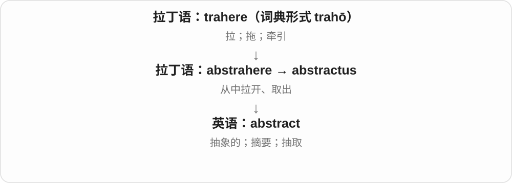
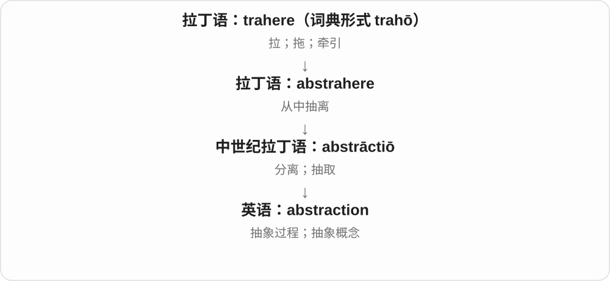
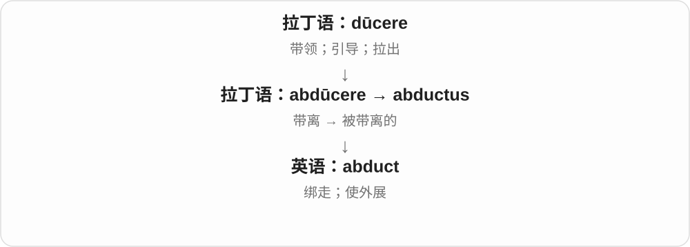
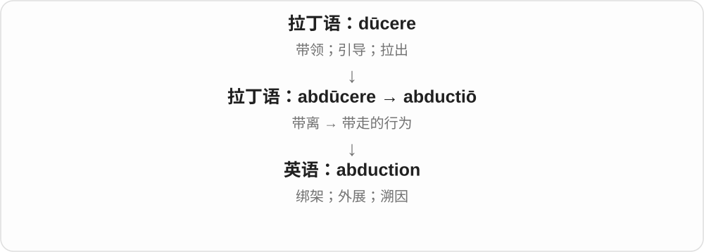
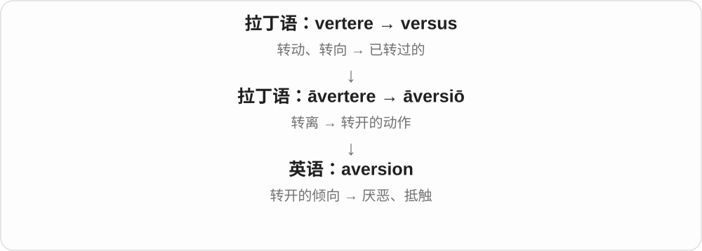
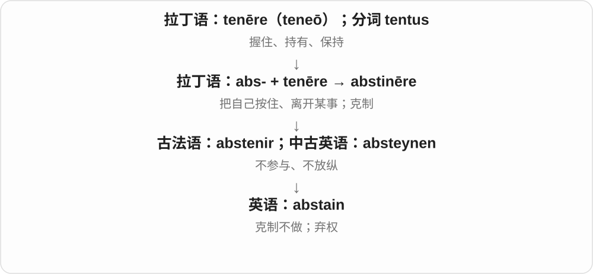
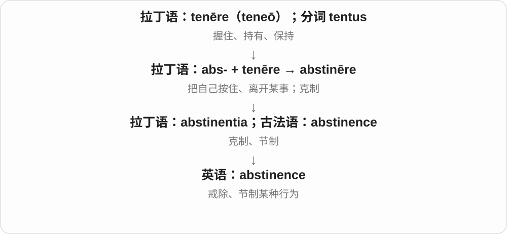
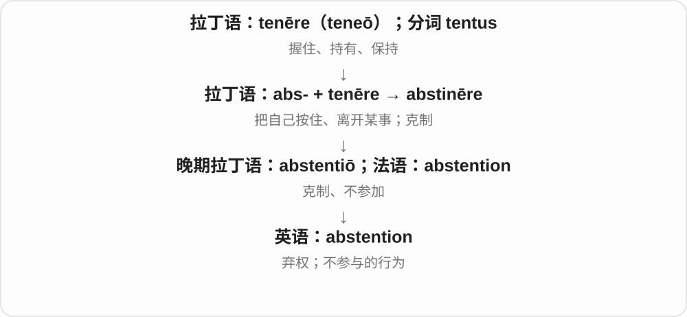
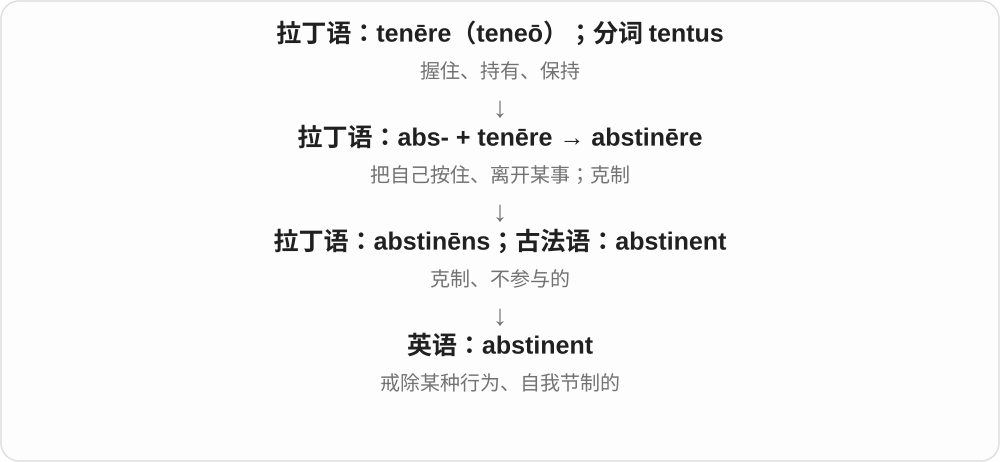

# 0779 · ab-, a-, abs-, au- — 离开；从……分离；去掉

[逐词精讲目录](../00_逐词精讲目录.md) · [总目录](../00_总目录_按常用程度.md)

## 核心词根与来源

这个前缀非常常见，但整个词的意思还要看它和哪个词干结合。absorb 是把东西吸收掉，并不是向外吸；abhor 是厌恶得退避。先抓住具体动作，再理解缺席、专注、承担成本和推卸职责等现代场景。

**ab- 的起点是离开某处、与某物分开。人不在场是 absent，脚步偏离通常路线是 aberrant，宣告放下王位是 abdicate。**

离开原来的位置 → 不在场；远离通常路线 → 偏离；把表面刮去 → 磨蚀；把自己留在参与之外 → 克制。

- **人在别处，心思也可以在别处**：absent, absence, absentee, absenteeism, absently, absentminded
- **把外面的东西接进来**：absorb, absorbed, absorbing, absorption, absorber, absorbent, absorbable
- **刮掉表面；说话像砂纸**：abrade, abrasion, abrasive, abrasively, abrasiveness
- **放下王位或职责**：abdicate, abdication
- **偏离通常路线或标准**：aberrant, aberration, abnormal, abnormally, abnormality
- **保持距离，不参加或有节制**：abstain, abstinence, abstinent, abstention, abstainer, abstemious
- **强烈反感、转身退避**：abhor, abhorrent, aversion
- **带走、抽离、解开与抛下**：abduction, abduct, abstract, abstraction, absolute, absolve, abject

## 词形与演化规律

拉丁 ab- 有 abs-、a-、au- 等历史变体：absent、abstain 保留 abs-，aversion 的远祖 avertere 用 a-。这些变化有历史条件，不能见到英语开头 a-、au- 就认作本族；auto- 的“自己”另属希腊来源。

## 单词速览（按词族由简到繁）

同一基础词的相关扩展放在一起，先读基础形式，再读扩展；各组之间优先读常用的。具体词源关系见各词讲解。

| 单词 | 音标 | 核心意思 |
|---|---|---|
| [absolute](#w-1) | 英、美 /ˈæbsəluːt/ | 完全的；不受限制的；绝对的 |
| [absent](#w-4) | 形容词 /ˈæbsənt/；动词 /æbˈsent/ | 缺席的；不存在的；心不在焉的；使自己缺席 |
| [absence](#w-2) | /ˈæbsəns/ | 缺席；不在；缺乏、不存在 |
| [absentee](#w-15) | /ˌæbsənˈtiː/ | 缺席者；不在场的人 |
| [absenteeism](#w-31) | /ˌæbsənˈtiːɪzəm/ | 经常缺勤、缺课；缺勤现象 |
| [absently](#w-35) | /ˈæbsəntli/ | 心不在焉地；无意识地 |
| [abstract](#w-3) | 名词、形容词 /ˈæbstrækt/；动词 /əbˈstrækt/ | 抽象的；摘要；抽取 |
| [abstraction](#w-11) | /əbˈstrækʃən/ | 抽象；抽象概念；提炼共同点 |
| [absorb](#w-6) | 英 /əbˈzɔːb/；美 /əbˈzɔːrb/；也读 /s/ 音版本 | 吸收；理解、消化；使专注；承担〔费用、损失〕；并入 |
| [absorbed](#w-5) | 英 /əbˈzɔːbd/；美 /əbˈzɔːrbd/；也读 /s/ 音版本 | 被吸收的；全神贯注的、入迷的 |
| [absorption](#w-8) | 英 /əbˈzɔːpʃən/；美 /əbˈzɔːrpʃən/；也读 /s/ 音版本 | 吸收；并入；专注、入迷 |
| [absorbing](#w-9) | 英 /əbˈzɔːbɪŋ/；美 /əbˈzɔːrbɪŋ/；也读 /s/ 音版本 | 引人入胜的；十分吸引注意的；正在吸收的 |
| [absorbent](#w-24) | 英 /əbˈzɔːbənt/；美 /əbˈzɔːrbənt/；也读 /s/ 音版本 | 吸水的、能吸收的；吸收材料 |
| [absorber](#w-27) | 英 /əbˈzɔːbə/；美 /əbˈzɔːrbər/；也读 /s/ 音版本 | 吸收器；吸收材料；减震器〔shock absorber〕 |
| [absorbable](#w-33) | 英 /əbˈzɔːbəbl/；美 /əbˈzɔːrbəbl/；也读 /s/ 音版本 | 可被吸收的 |
| [abnormal](#w-7) | 英 /æbˈnɔːməl/；美 /æbˈnɔːrməl/ | 异常的；偏离通常范围的 |
| [abnormally](#w-16) | 英 /æbˈnɔːməli/；美 /æbˈnɔːrməli/ | 异常地；反常地 |
| [abnormality](#w-22) | 英 /ˌæbnɔːˈmæləti/；美 /ˌæbnɔːrˈmæləti/ | 异常；异常之处 |
| [abduct](#w-26) | /əbˈdʌkt/ | 绑架；劫走；使外展 |
| [abduction](#w-10) | /əbˈdʌkʃən/ | 绑架；外展；溯因推理 |
| [aversion](#w-12) | 英 /əˈvɜːʃən/、/əˈvɜːʒən/；美 /əˈvɜːrʒən/ | 厌恶；强烈的不愿接受 |
| [abrasive](#w-13) | /əˈbreɪsɪv/ | 磨蚀的；粗糙刺人的、生硬无礼的；磨料 |
| [abrasiveness](#w-39) | /əˈbreɪsɪvnəs/ | 磨蚀性；生硬刺人的特质 |
| [abrasively](#w-40) | /əˈbreɪsɪvli/ | 生硬刺人地；粗暴无礼地；以磨蚀方式 |
| [abstain](#w-17) | /əbˈsteɪn/ | 克制不做；戒除；弃权 |
| [abstinence](#w-14) | /ˈæbstɪnəns/ | 戒除；节制；禁欲 |
| [abstention](#w-32) | /əbˈstenʃən/ | 弃权；不参与；克制不做 |
| [abstainer](#w-41) | 英 /əbˈsteɪnə/；美 /əbˈsteɪnər/ | 自愿不参与者；戒酒者；弃权者 |
| [abject](#w-18) | 英、美 /ˈæbdʒekt/ | 极其悲惨的；卑躬屈膝的；彻底失败的 |
| [aberration](#w-19) | /ˌæbəˈreɪʃən/ | 异常；偏离常态的现象；像差 |
| [abhor](#w-30) | 英 /əbˈhɔː/；美 /əbˈhɔːr/ | 憎恶；极其厌恶 |
| [abhorrent](#w-20) | 英 /əbˈhɒrənt/；美 /əbˈhɔːrənt/ | 令人憎恶的；令人强烈反感的 |
| [abrasion](#w-21) | /əˈbreɪʒən/ | 磨蚀、磨损；擦伤、擦痕 |
| [absolve](#w-23) | 英 /əbˈzɒlv/；美 /əbˈzɑːlv/，也读 /əbˈsɑːlv/ | 免除责任；赦免 |
| [abdicate](#w-29) | /ˈæbdɪkeɪt/ | 退位；放弃〔权力或职责〕 |
| [abdication](#w-25) | /ˌæbdɪˈkeɪʃən/ | 退位；放弃权力；职责的放弃或推卸 |
| [aberrant](#w-28) | /əˈberənt/；也读 /ˈæbərənt/ | 偏离常态的；反常的、异常的 |
| [abstinent](#w-34) | /ˈæbstɪnənt/ | 戒除某种行为的；自我节制的 |
| [abstemious](#w-36) | /æbˈstiːmiəs/；也读 /əbˈstiːmiəs/ | 饮食有节制的；生活克制的 |
| [abrade](#w-37) | /əˈbreɪd/ | 磨损；磨去、擦掉表层 |
| [absentminded](#w-38) | /ˌæbsəntˈmaɪndɪd/ | 心不在焉的；因走神而健忘的 |

## 逐词讲解

### 1. absolute — 完全的；不受限制的；绝对的

**音标**：英、美 /ˈæbsəluːt/

**先抓住这个画面**

把附带条件和限制拿掉：完全信任是不留保留，绝对权力是不受限制，绝对数值不靠比较对象来定。

**怎么拆**

来自拉丁语 absolutus，即 absolvere 的分词：ab-“离开” + solvere“解开”。它与英语 absolve 同源，却不是先有现代 absolve 再变出来。

**怎么变成今天的意思**

**拉丁语 solvere；分词 solutus**  
松开、解开；清偿、解释

↓

**拉丁语 ab- + solvere → absolvere；absolutus**  
解除、放开；不受束缚、完成的

↓

**拉丁语及法语相关形式 → 中古英语 absolut → absolute**  
不受限制的；完全的；非相对的

an absolute beginner 是完全的新手；absolute power 是不受限制的权力。与 relative 相对时，强调不依某个比较基准；数学 absolute value 表示实数离零的距离。

**常见搭配与例句**

absolute confidence；an absolute beginner；absolute value。

> I’m an absolute beginner at chess.

下国际象棋，我完全是个新手。

> The absolute value of minus five is five.

负五的绝对值是五。

**别混淆**

absolute 说程度完整或不相对；certain 说有把握。absolute power 不等于权力使用得好。

### 2. absent — 缺席的；不存在的；心不在焉的；使自己缺席

**音标**：形容词 /ˈæbsənt/；动词 /æbˈsent/

**先抓住这个画面**

人没在应在的位置，叫 absent；视线虽然在眼前，心思却飘走了，也可以借这个画面来说。

**怎么拆**

形容词接拉丁 absens、absent-，是 abesse“在别处、不在场”的分词，经法语或直接借入。动词另经晚期拉丁 absentare、法语 absenter，现代常用 absent oneself。

**怎么变成今天的意思**

**拉丁 ab，构词中也有 abs-、a- 等形式**  
离开、从……分离、去掉

↓

**拉丁 ab- + esse → abesse；分词 absens／absent-**  
存在于别处 → 不在场

↓

**形容词路线：古法语 absent／ausent → 英语 absent**  
不在场、缺席；缺乏注意

↓

**并行的动词路线：晚期拉丁 absentare → 古法语 absenter → 英语 absent**  
使自己不在场、退出

be absent from class 是缺课；an absent smile 是心不在焉的一笑。absent yourself from a meeting 表示让自己不出席；作动词时重音后移。

**常见搭配与例句**

be absent from；conspicuously absent；an absent look；absent oneself from。

> Two students were absent from class this morning.

今天上午有两名学生缺课。

> She gave an absent smile while reading the message.

她看着消息，心不在焉地笑了一下。

> He absented himself from the discussion because it concerned his own application.

由于讨论涉及他本人的申请，他没有参加这场讨论。

**别混淆**

missing 强调该有却找不到；absent 强调在某处或某场合没有出现。absence 是名词，不能说 he is absence。

### 3. absence — 缺席；不在；缺乏、不存在

**音标**：/ˈæbsəns/

**先抓住这个画面**

原本可以有个人、一件东西或一种条件的位置，现在是空的；既能说人没来，也能说某种证据或特点根本没有。

**怎么拆**

拉丁 absentia 接 absens“缺席的”，经古法语 absence 进入英语。现代可与 absent 对照记忆，但名词有独立的拉丁、法语路线。

**怎么变成今天的意思**

**拉丁 ab，构词中也有 abs-、a- 等形式**  
离开、从……分离、去掉

↓

**拉丁 ab- + esse → abesse；分词 absens／absent-**  
存在于别处 → 不在场

↓

**拉丁 absentia → 古法语 absence → 中古英语 absence**  
不在场这一状态

↓

**英语 absence**  
缺席；缺乏、不存在

in someone’s absence 是在某人不在的时候；in the absence of evidence 是缺乏证据的情况下。a leave of absence 是获准的一段请假时间。

**常见搭配与例句**

absence from work；in someone’s absence；in the absence of；a leave of absence。

> Nora handled the orders in her colleague’s absence.

同事不在时，诺拉负责处理订单。

> The absence of labels made the old photographs difficult to identify.

旧照片没有标签，很难辨认其中的内容。

**别混淆**

absence 本身不说明是否获准或为什么缺席。absenteeism 常谈反复缺席的现象，absence 可以只是一回或一种状态。

### 4. absentee — 缺席者；不在场的人

**音标**：/ˌæbsənˈtiː/

**先抓住这个画面**

把“缺席”从一种状态变成一个人：应该出席却没来的人，或者人在别处的所有者、选民等。

**怎么拆**

英语 absent + -ee；历史构词可接动词 absent“使自己离开”。-ee 在这里标记这个处于缺席状态的人，不是动词结束或过去式。

**怎么变成今天的意思**

**拉丁 ab，构词中也有 abs-、a- 等形式**  
离开、从……分离、去掉

↓

**拉丁 ab- + esse → abesse；分词 absens／absent-**  
存在于别处 → 不在场

↓

**晚期拉丁 absentare → 古法语 absenter → 英语 absent〔动词〕**  
使离开、让自己不在场

↓

**英语 absent + -ee → absentee**  
缺席者；人不在应在的位置

the list of absentees 是缺席名单；an absentee landlord 是不在当地居住的房东或地主。absentee ballot 是无法亲临相应投票地点时使用的选票，具体规则依制度而定。

**常见搭配与例句**

a list of absentees；an absentee landlord；an absentee voter；an absentee ballot。

> The teacher checked the names of the absentees.

老师核对了缺席学生的姓名。

> The novel describes a village owned by an absentee landlord.

小说描写了一座由不在当地居住的地主拥有的村庄。

**别混淆**

absence 是缺席这件事；absentee 是缺席的人。an absentee 不自动说明此人擅自逃避职责。

### 5. absenteeism — 经常缺勤、缺课；缺勤现象

**音标**：/ˌæbsənˈtiːɪzəm/

**先抓住这个画面**

关注的不是某人今天没来这一回，而是一段时间里反复不在岗、不上课的现象。

**怎么拆**

absentee + -ism，英语名词；早期常谈地主远离庄园居住的制度，后来扩展到工人、学生的经常缺席。今天的学校、职场义不是唯一的历史起点。

**怎么变成今天的意思**

**拉丁 ab，构词中也有 abs-、a- 等形式**  
离开、从……分离、去掉

↓

**拉丁 ab- + esse → abesse；分词 absens／absent-**  
存在于别处 → 不在场

↓

**晚期拉丁 absentare → 古法语 absenter → 英语 absent〔动词〕**  
使离开、让自己不在场

↓

**英语 absent + -ee → absentee**  
缺席者；人不在应在的位置

↓

**英语 absentee + -ism → absenteeism**  
早期指地主不在当地居住；后广指反复缺勤、缺课

high absenteeism 是缺勤较多；reduce absenteeism 是减少缺勤。统计这个现象可以涉及疾病、通勤、工作条件等，不能单凭词本身就认定都是偷懒。

**常见搭配与例句**

high absenteeism；reduce absenteeism；school absenteeism；rates of absenteeism。

> The school studied the reasons behind rising absenteeism.

学校研究了缺课现象增加的原因。

> Better transport helped reduce absenteeism at the factory.

交通条件改善后，工厂的缺勤减少了。

**别混淆**

absence 可指单次缺席；absenteeism 常指长期模式或组织层面的现象。truancy 更具体地指未经许可逃学。

### 6. absently — 心不在焉地；无意识地

**音标**：/ˈæbsəntli/

**先抓住这个画面**

嘴上在回应，手上在动作，注意力却在另一个地方；像心思暂时离开了现场。

**怎么拆**

absent + -ly，接形容词 absent 的不留心、走神义。不是把“物理上不在场”机械变成一种动作方式。

**怎么变成今天的意思**

**拉丁 ab，构词中也有 abs-、a- 等形式**  
离开、从……分离、去掉

↓

**拉丁 ab- + esse → abesse；分词 absens／absent-**  
存在于别处 → 不在场

↓

**古法语 absent／ausent 与直接拉丁借入 → 中古英语 absent**  
不在场、缺席的

↓

**英语 absent〔形容词〕**  
缺席；没有；也可指心不在焉

↓

**英语 absent + -ly → absently**  
以注意力不在眼前事情上的方式

nod absently 是心不在焉地点头；absently turn a ring 是没特别留意地转着戒指。它常描述小动作与内心关注点分离。

**常见搭配与例句**

nod absently；reply absently；smile absently；stare absently。

> She nodded absently while studying the map.

她研究着地图，心不在焉地点了点头。

> He absently folded the corner of the receipt as he waited.

等候时，他无意识地把收据一角折了起来。

**别混淆**

deliberately 是有意地；absently 通常没有专注于这个动作。它也不一定是无礼，可能只是正在想别的事。

### 7. abstract — 抽象的；摘要；抽取

**音标**：名词、形容词 /ˈæbstrækt/；动词 /əbˈstrækt/

**先抓住这个画面**

abstract 像从许多具体东西里抽出共同点：不再讨论这把椅子的颜色，而是讨论“家具”这个概念。

**怎么拆**

abs-（离开）+ trahere（拉）形成 abstrahere；其分词 abstractus 进入英语。abstract 的词尾不是英语 act“行动”。

**怎么变成今天的意思**

抽象思考是离开具体个体，保留关系或概念；论文摘要则从长文抽取要点。抽象画也不以照搬可辨认的具体物象为主要目标。

**常见搭配与例句**

an abstract idea；abstract art；read the abstract；abstract information from… 。

> The teacher used coins to explain an abstract idea.

老师用硬币来解释一个抽象概念。

> Read the abstract before deciding whether to study the full paper.

先读摘要，再决定是否研究整篇论文。

**别混淆**

abstract 是脱离具体个体或形象；vague 是说不清楚。一个抽象概念仍然可以定义得很清楚。

### 8. abstraction — 抽象；抽象概念；提炼共同点

**音标**：/əbˈstrækʃən/

**先抓住这个画面**

abstraction 就是把不需要的细节暂时拿走，留下你眼下要研究的那一层。

**怎么拆**

来自中古法语 abstraction 或中世纪拉丁语 abstrāctiō“分离”，现代可对照 abstract + -ion。

**怎么变成今天的意思**

它可以指抽离细节的过程，也可以指得到的概念。地图省掉每棵树，保留道路关系，就是容易理解的抽象画面。

**常见搭配与例句**

a level of abstraction；an abstract concept / an abstraction；abstraction from detail。

> A subway map is a useful abstraction of the city’s transport network.

地铁图是对城市交通网络的一种有用抽象。

> The discussion stayed at a high level of abstraction.

讨论一直停留在很抽象的层面。

**别混淆**

abstraction 是有选择地忽略细节；oversimplification 是省略得过头，导致判断失真。抽象并不必然错误。

### 9. absorb — 吸收；理解、消化；使专注；承担〔费用、损失〕；并入

**音标**：英 /əbˈzɔːb/；美 /əbˈzɔːrb/；也读 /s/ 音版本

**先抓住这个画面**

把外面的东西接进来：海绵接进水，头脑接进信息；注意力全被接过去，人就入了迷；成本自己接下来，就是承担它。

**怎么拆**

拉丁 ab- 与 sorbere“吸、吞”组成 absorbere“吞下、吸收掉”，经法语 absorbir、assorbir、absorber 等进入英语。ab- 的去除意味与整个吞吸动作相连，不能硬译成“向外吸”。

**怎么变成今天的意思**

**拉丁 ab，构词中也有 abs-、a- 等形式**  
离开、从……分离、去掉

↓

**拉丁 ab- + sorbere → absorbere**  
吸吮、吞咽 → 吞下、吸收掉

↓

**古法语 absorbir／assorbir；法语 absorber → 英语 absorb**  
吸进去、吞没

↓

**英语 absorb 的扩展**  
吸收材料或能量；理解信息；占住注意力；承担成本

absorb water 是吸水；absorb information 是理解吸收信息；absorb the cost 是自行承担成本。a company absorbed another company 表示把另一家公司并入自身。

**常见搭配与例句**

absorb water；absorb heat；absorb information；absorb the cost；absorb into。

> The towel quickly absorbed the water on the floor.

毛巾很快吸走了地板上的水。

> Give me a moment to absorb all that information.

给我一点时间消化这些信息。

> The company absorbed the extra shipping cost.

公司自行承担了额外运费。

**别混淆**

learn 不一定强调大量信息逐步消化；absorb 常有接进来、慢慢理解的意味。说材料吸收能量也不意味着能量凭空消失。

### 10. absorbed — 被吸收的；全神贯注的、入迷的

**音标**：英 /əbˈzɔːbd/；美 /əbˈzɔːrbd/；也读 /s/ 音版本

**先抓住这个画面**

注意力已经被某件事整个吸过去，以至于周围的声响和变化暂时退到了背景里。

**怎么拆**

absorb + -ed，过去式、过去分词与形容词；-ed 读 /d/。专注义是吸收动作的比喻结果，不是说人真的被吞入书本。

**怎么变成今天的意思**

**拉丁 ab，构词中也有 abs-、a- 等形式**  
离开、从……分离、去掉

↓

**拉丁 ab- + sorbere → absorbere**  
吸吮、吞咽 → 吞下、吸收掉

↓

**古法语 absorbir／assorbir；法语 absorber → 英语 absorb**  
吸进去、吞没

↓

**英语 absorb 的扩展**  
吸收材料或能量；理解信息；占住注意力；承担成本

↓

**英语 absorb + -ed → absorbed**  
已被吸收；注意力完全投入的

be absorbed in a book 是看书入迷；be absorbed by a task 也可说任务吸住注意。材料语境里的 absorbed water 则仍是已经吸进去的水。

**常见搭配与例句**

be absorbed in；deeply absorbed；absorbed by；absorbed energy。

> She was so absorbed in the puzzle that she missed the announcement.

她解谜太入神，没听见广播通知。

> The report estimates how much heat was absorbed by the material.

报告估算了材料吸收了多少热量。

**别混淆**

absorbed 描写人的状态；absorbing 评价事物很吸引人。an absorbed reader 是入迷的读者，an absorbing book 是引人入胜的书。

### 11. absorption — 吸收；并入；专注、入迷

**音标**：英 /əbˈzɔːpʃən/；美 /əbˈzɔːrpʃən/；也读 /s/ 音版本

**先抓住这个画面**

把“接进来”作为一个过程来看：水进入材料、能量转给物质、信息进入理解，或注意力完全沉进一件事。

**怎么拆**

借入拉丁 absorptio、absorptionem，来自动词 absorbere 的分词词干 absorpt-。现代与 absorb 配套，但名词是自己的拉丁借入支线；b 变成 p 与分词词干相关，不是随意换字母。

**怎么变成今天的意思**

**拉丁 ab，构词中也有 abs-、a- 等形式**  
离开、从……分离、去掉

↓

**拉丁 ab- + sorbere → absorbere**  
吸吮、吞咽 → 吞下、吸收掉

↓

**拉丁分词词干 absorpt- → absorptio／absorptionem**  
吞吸这一动作

↓

**英语 absorption**  
吸收过程；并入；注意力完全投入

water absorption 是吸水；light absorption 是光能被物质吸收；absorption in work 是全神贯注工作。具体机制随领域变化，日常“吸进去”的画面只是起点。

**常见搭配与例句**

water absorption；heat absorption；the absorption of；complete absorption in。

> The test compares the water absorption of three fabrics.

测试比较了三种织物的吸水性能。

> His complete absorption in the painting made him forget the time.

他完全沉浸在那幅画中，忘了时间。

**别混淆**

adsorption 是吸附，术语重点落在表面或界面聚集；absorption 的常用物质吸收义强调被材料接纳，光学用法则涉及能量转移，不要把两词拼错。

### 12. absorbing — 引人入胜的；十分吸引注意的；正在吸收的

**音标**：英 /əbˈzɔːbɪŋ/；美 /əbˈzɔːrbɪŋ/；也读 /s/ 音版本

**先抓住这个画面**

好像把读者或观众的注意力吸住，让人愿意一直看下去、做下去。

**怎么拆**

absorb + -ing；既可表示正在吸收，也可作形容词，形容能够持续吸引注意的事情。

**怎么变成今天的意思**

**拉丁 ab，构词中也有 abs-、a- 等形式**  
离开、从……分离、去掉

↓

**拉丁 ab- + sorbere → absorbere**  
吸吮、吞咽 → 吞下、吸收掉

↓

**古法语 absorbir／assorbir；法语 absorber → 英语 absorb**  
吸进去、吞没

↓

**英语 absorb 的扩展**  
吸收材料或能量；理解信息；占住注意力；承担成本

↓

**英语 absorb + -ing → absorbing**  
正在吸收；发展为引人入胜的形容词

an absorbing story 是引人入胜的故事；an absorbing hobby 是让人投入的爱好。物理语境中的 absorbing moisture 则直接表示正在吸收水分。

**常见搭配与例句**

an absorbing story；an absorbing book；an absorbing task；find something absorbing。

> The book offers an absorbing account of life in a small theatre.

这本书对一家小剧院生活的描写十分引人入胜。

> Restoring old radios became an absorbing hobby for him.

修复旧收音机成了一个让他十分投入的爱好。

**别混淆**

interesting 表示有趣，程度范围很宽；absorbing 往往更强调让人投入得难以分心。不要用它描述那个已经入迷的人。

### 13. absorbent — 吸水的、能吸收的；吸收材料

**音标**：英 /əbˈzɔːbənt/；美 /əbˈzɔːrbənt/；也读 /s/ 音版本

**先抓住这个画面**

像海绵或纸巾那样，遇到液体会把它接进去，而不是只让它留在表面滑走。

**怎么拆**

借拉丁 absorbens、absorbent-，是 absorbere“吸收”的现在分词。现代可按 absorb + -ent 理解能力，但它不是一定从现代英语动词临时造出的。

**怎么变成今天的意思**

**拉丁 ab，构词中也有 abs-、a- 等形式**  
离开、从……分离、去掉

↓

**拉丁 ab- + sorbere → absorbere**  
吸吮、吞咽 → 吞下、吸收掉

↓

**拉丁分词 absorbens／absorbentem → 英语 absorbent**  
能够吸收的

↓

**英语名词 absorbent**  
用于吸收的材料

absorbent paper 是吸水纸；highly absorbent material 是吸收能力很强的材料。名词 an absorbent 表示一种吸收材料，通常会说明它吸收什么。

**常见搭配与例句**

absorbent paper；an absorbent towel；highly absorbent；an absorbent material。

> The cleaner used an absorbent cloth to dry the spill.

清洁人员用吸水布擦干了洒出的液体。

> The package contains an absorbent pad to collect excess moisture.

包装内有一块吸水垫，用来吸收多余水分。

**别混淆**

absorbent 是能吸收别人的东西；absorbable 是自身能被吸收。海绵通常 absorbent，而可被身体分解吸收的材料可称 absorbable。

### 14. absorber — 吸收器；吸收材料；减震器〔shock absorber〕

**音标**：英 /əbˈzɔːbə/；美 /əbˈzɔːrbər/；也读 /s/ 音版本

**先抓住这个画面**

强调承担吸收工作的是哪个东西：把声音、冲击、热或某种物质接住，减小它往别处传递的影响。

**怎么拆**

absorb + -er，英语施事或工具名词。-er 不只表示人，也经常表示做某种工作的装置。

**怎么变成今天的意思**

**拉丁 ab，构词中也有 abs-、a- 等形式**  
离开、从……分离、去掉

↓

**拉丁 ab- + sorbere → absorbere**  
吸吮、吞咽 → 吞下、吸收掉

↓

**古法语 absorbir／assorbir；法语 absorber → 英语 absorb**  
吸进去、吞没

↓

**英语 absorb 的扩展**  
吸收材料或能量；理解信息；占住注意力；承担成本

↓

**英语 absorb + -er → absorber**  
负责吸收的材料或装置

shock absorber 是减震器，sound absorber 是吸声材料或装置。具体“吸收”的对象由前面或后面的搭配说明，不能只看一个 absorber 猜出设备用途。

**常见搭配与例句**

a shock absorber；a sound absorber；an energy absorber。

> The mechanic replaced a worn shock absorber.

机修师更换了一只磨损的减震器。

> The panel acts as a sound absorber in the recording room.

这块板在录音室里起吸声作用。

**别混淆**

absorbent 常强调材料有吸收能力；absorber 常把它作为一个承担吸收功能的东西或装置来命名。两者在材料语境也会重叠。

### 15. absorbable — 可被吸收的

**音标**：英 /əbˈzɔːbəbl/；美 /əbˈzɔːrbəbl/；也读 /s/ 音版本

**先抓住这个画面**

主语换了位置：这里说的东西不是去吸别人，而是能被另一种材料或身体接纳、吸收。

**怎么拆**

absorb + -able，英语形容词，表示能够被吸收。-able 在这里表达被动能力，与 absorbent“具有吸收能力的”方向不同。

**怎么变成今天的意思**

**拉丁 ab，构词中也有 abs-、a- 等形式**  
离开、从……分离、去掉

↓

**拉丁 ab- + sorbere → absorbere**  
吸吮、吞咽 → 吞下、吸收掉

↓

**古法语 absorbir／assorbir；法语 absorber → 英语 absorb**  
吸进去、吞没

↓

**英语 absorb 的扩展**  
吸收材料或能量；理解信息；占住注意力；承担成本

↓

**英语 absorb + -able → absorbable**  
能够被另一对象吸收的

absorbable nutrients 是可被吸收的营养物质；absorbable sutures 是可在体内逐渐分解吸收的缝线。这个词不说明某个具体产品需要多长时间。

**常见搭配与例句**

absorbable nutrients；absorbable material；absorbable sutures；readily absorbable。

> The chapter explains how food is broken down into absorbable nutrients.

这一章解释了食物怎样被分解成可吸收的营养物质。

> The surgeon explained that the procedure would use absorbable sutures.

外科医生说明，这项手术会使用可吸收缝线。

**别混淆**

absorbent 形容吸收者，absorbable 形容被吸收的对象。a towel is absorbent，不是要表达毛巾本身会被身体吸收。

### 16. abnormal — 异常的；偏离通常范围的

**音标**：英 /æbˈnɔːməl/；美 /æbˈnɔːrməl/

**先抓住这个画面**

仪表上的指针离开平时那一段范围，观察者因此说“这次不寻常”；是否严重，还要看具体情形。

**怎么拆**

现代可拆 ab- 离开 + normal。历史上较早 anormal 受到拉丁 abnormalis 的影响改形；anormal 本身又有经法语通向希腊 anomalos 的路线，不能全按现代拆分反推。

**怎么变成今天的意思**

**拉丁 norma**  
木工直角尺；由此指规则、标准

↓

**拉丁 abnormalis 的形态影响；另有较早英语 anormal**  
ab- 离开标准；anormal 经法语接希腊 anomalos“不平整”的另一支

↓

**英语 abnormal**  
早期 anormal 在拉丁形式影响下改形；偏离常态的

abnormal noise 指机器发出异于平常的噪声，abnormal weather 是反常天气。它往往提示值得留意的偏差，但单凭这个词还不知道偏差原因或后果。

**常见搭配与例句**

abnormal behaviour；an abnormal reading；abnormal weather conditions。

> The engine made an abnormal noise during the test.

测试时，发动机发出了异常噪声。

> Abnormal rainfall delayed the harvest.

反常的降雨推迟了收割。

**别混淆**

unusual 只强调少见；abnormal 通常意味着偏离某个预期标准，在技术或检查报告中更常见。

### 17. abnormally — 异常地；反常地

**音标**：英 /æbˈnɔːməli/；美 /æbˈnɔːrməli/

**先抓住这个画面**

温度不是简单地高，而是高出了这个季节通常该有的范围；abnormally 指出“偏离基准”这一层。

**怎么拆**

英语 abnormal + -ly，描述异常的程度、方式或状态。

**怎么变成今天的意思**

**拉丁 norma**  
木工直角尺；由此指规则、标准

↓

**拉丁 abnormalis 的形态影响；另有较早英语 anormal**  
ab- 离开标准；anormal 经法语接希腊 anomalos“不平整”的另一支

↓

**英语 abnormal**  
早期 anormal 在拉丁形式影响下改形；偏离常态的

↓

**英语 abnormal + -ly → abnormally**  
偏离通常范围地

abnormally high 和 abnormally low 都常用：重点不是单纯高低，而是相对正常范围有偏离。abnormally quiet 也可能说一个平常热闹的地方忽然安静。

**常见搭配与例句**

abnormally warm；abnormally low；behave abnormally。

> The river was abnormally low for this time of year.

对一年中的这个时节来说，河流水位低得反常。

> The hall was abnormally quiet after the children left.

孩子们离开后，大厅安静得异乎寻常。

**别混淆**

very hot 只是很热；abnormally hot 表示按当地、当季等标准来看热得反常。

### 18. abnormality — 异常；异常之处

**音标**：英 /ˌæbnɔːˈmæləti/；美 /ˌæbnɔːrˈmæləti/

**先抓住这个画面**

先有一套通常的形状或范围，再在其中发现一个偏离的地方；这个状态或具体偏差都可叫 abnormality。

**怎么拆**

英语 abnormal + -ity，表示异常的状态或表现；词尾变化带来重音移动。

**怎么变成今天的意思**

**拉丁 norma**  
木工直角尺；由此指规则、标准

↓

**拉丁 abnormalis 的形态影响；另有较早英语 anormal**  
ab- 离开标准；anormal 经法语接希腊 anomalos“不平整”的另一支

↓

**英语 abnormal**  
早期 anormal 在拉丁形式影响下改形；偏离常态的

↓

**英语 abnormal + -ity → abnormality**  
偏离正常的状态；一个异常特征

不可数时说异常这一性质，可数时说具体异常：an abnormality，several abnormalities。它常见于技术检查、医学检查描述，但“有异常”本身并不交代原因和严重程度。

**常见搭配与例句**

detect an abnormality；a structural abnormality；show no abnormalities。

> The inspection revealed an abnormality in the metal surface.

检查发现了金属表面的一处异常。

> The team investigated the abnormality before restarting the system.

团队调查了那处异常后，才重新启动系统。

**别混淆**

abnormal 是形容词；abnormality 是状态或一处问题。anomaly 与它常有重叠，也可强调出乎规则预料的个别现象。

### 19. abduct — 绑架；劫走；使外展

**音标**：/əbˈdʌkt/

**先抓住这个画面**

abduct 是把人强行带离原处；在解剖学里，则是让身体部位远离身体中线。共同的方向是“向外、离开”。

**怎么拆**

来自拉丁语 abductus，与 ab-（离开）+ dūcere（带领）相连。解剖学的动词用法也受 abduction 影响。

**怎么变成今天的意思**

一般叙事中的 abduct 常等于绑走；身体动作中的 abduct 是方向描述，本身不表示绑架。

**常见搭配与例句**

abduct a person（绑架某人）；be abducted（被绑走）；abduct the arm（使手臂外展）。

> In the story, the scientist is abducted on her way home.

故事中，那位科学家在回家路上被绑架。

> The model shows which muscles abduct the arm.

模型展示了哪些肌肉使手臂外展。

**别混淆**

abduct 与 kidnap 在绑架义上接近；adduct 只有 a 而没有 b，表示向身体中线靠拢。

### 20. abduction — 绑架；外展；溯因推理

**音标**：/əbˈdʌkʃən/

**先抓住这个画面**

abduction 的字面画面是“带离”。人被强行带走，是绑架；手臂离开身体中线，是外展。

**怎么拆**

拉丁语 ab-（离开）+ dūcere（带领），形成 abdūctiō 等词形。现代与 abduct 对照记忆。

**怎么变成今天的意思**

推理中的 abduction 是根据现象提出较能解释它的假设，常译“溯因推理”。这是专门术语，不能理解为结论已经得到必然证明。

**常见搭配与例句**

an abduction case（绑架案件）；arm abduction（手臂外展）；abductive reasoning / abduction（溯因推理）。

> The novel begins with an abduction.

小说以一起绑架事件开场。

> The diagram illustrates abduction of the arm.

图中展示了手臂外展。

**别混淆**

abduction 是离开身体中线；adduction 是靠近身体中线。绑架与关节动作是不同语境，不要混在一起。

### 21. aversion — 厌恶；强烈的不愿接受

**音标**：英 /əˈvɜːʃən/、/əˈvɜːʒən/；美 /əˈvɜːrʒən/

**先抓住这个画面**

一想到某件事，心里就想转身躲开；把这种抵触感叫作 aversion。

**怎么拆**

直接借自拉丁语 āversiō“转离”；现代与 averse 对应，不是英语 averse 随意换个词尾。

**怎么变成今天的意思**

常用 an aversion to。可以是对味道的强烈厌恶，也可以是对冒险、冲突等的抵触。

**常见搭配与例句**

an aversion to crowds；a strong aversion；risk aversion。

> He has a strong aversion to the smell of boiled cabbage.

他很讨厌煮卷心菜的气味。

> Her aversion to conflict sometimes makes decisions difficult.

她对冲突的抵触有时让决策变得困难。

**别混淆**

dislike 是不喜欢；aversion 常更强，带主动回避的倾向。

### 22. abrasive — 磨蚀的；粗糙刺人的、生硬无礼的；磨料

**音标**：/əˈbreɪsɪv/

**先抓住这个画面**

砂纸能把表面磨掉；一种说话方式如果像砂纸一样扎人，也叫 abrasive。它指出接触时令人不舒服的粗硬感。

**怎么拆**

接拉丁分词词干 abras- 与形容词结尾 -ive；另有借中世纪拉丁 abrasivus 的分析。今天与 abrade、abrasion 同族，但不是从名词 abrasion 简单删几个字母得到。

**怎么变成今天的意思**

**拉丁 ab，构词中也有 abs-、a- 等形式**  
离开、从……分离、去掉

↓

**拉丁 ab- + radere → abradere，分词 abrasus**  
刮 → 刮掉、磨去

↓

**拉丁分词词干 abras- 与 -ive；另有中世纪拉丁 abrasivus 的借入分析**  
能刮磨表面的

↓

**英语 abrasive**  
磨蚀的；磨料；引申态度生硬刺人的

an abrasive cleaner 是含磨料的清洁剂；an abrasive manner 是生硬刺人的态度。a mild abrasive 作名词，是一种作用较温和的磨料或磨蚀性清洁物。

**常见搭配与例句**

an abrasive surface；an abrasive cleaner；an abrasive manner；a mild abrasive。

> The surface is too delicate for an abrasive cleaner.

这个表面太娇贵，不适合使用磨蚀性清洁剂。

> His abrasive manner made a simple discussion unnecessarily tense.

他生硬刺人的态度，让一次简单讨论变得不必要地紧张。

**别混淆**

assertive 是坚定表达自己的意见，不必伤人；abrasive 更强调粗硬态度使别人不舒服。直接不等于 abrasive。

### 23. abrasiveness — 磨蚀性；生硬刺人的特质

**音标**：/əˈbreɪsɪvnəs/

**先抓住这个画面**

把砂纸般的摩擦作用当作一种性质来衡量：材料会磨掉多少表层，一个人说话又有多扎人。

**怎么拆**

abrasive + -ness，英语性质名词。物理义与人际态度义都保留，不应只翻成表面触感的“粗糙”。

**怎么变成今天的意思**

**拉丁 ab，构词中也有 abs-、a- 等形式**  
离开、从……分离、去掉

↓

**拉丁 ab- + radere → abradere，分词 abrasus**  
刮 → 刮掉、磨去

↓

**拉丁分词词干 abras- 与 -ive；另有中世纪拉丁 abrasivus 的借入分析**  
能刮磨表面的

↓

**英语 abrasive**  
磨蚀的；磨料；引申态度生硬刺人的

↓

**英语 abrasive + -ness → abrasiveness**  
磨蚀的性质；行为或语气刺人的程度

the abrasiveness of a cleaner 是清洁剂的磨蚀性；his abrasiveness 是他处事生硬的特质。后一种通常带负面评价。

**常见搭配与例句**

the abrasiveness of；reduce abrasiveness；personal abrasiveness。

> The test measures the abrasiveness of the cleaning powder.

这项测试测量清洁粉的磨蚀性。

> Her expertise was respected, but her abrasiveness made collaboration difficult.

大家尊重她的专业能力，但她生硬的处事方式让合作变得困难。

**别混淆**

roughness 可以只是表面不平；abrasiveness 更关心接触时磨擦、磨去东西的作用。性格语境里也突出给别人造成的不适。

### 24. abrasively — 生硬刺人地；粗暴无礼地；以磨蚀方式

**音标**：/əˈbreɪsɪvli/

**先抓住这个画面**

说明一句话是怎样说出来的：即使内容有道理，表达方式仍像在刮人，让对方感到受冒犯。

**怎么拆**

abrasive + -ly，英语副词。既可继承磨蚀的物理义，也可描述粗硬、惹人不快的沟通方式；通用阅读中后者尤其容易遇到。

**怎么变成今天的意思**

**拉丁 ab，构词中也有 abs-、a- 等形式**  
离开、从……分离、去掉

↓

**拉丁 ab- + radere → abradere，分词 abrasus**  
刮 → 刮掉、磨去

↓

**拉丁分词词干 abras- 与 -ive；另有中世纪拉丁 abrasivus 的借入分析**  
能刮磨表面的

↓

**英语 abrasive**  
磨蚀的；磨料；引申态度生硬刺人的

↓

**英语 abrasive + -ly → abrasively**  
以磨蚀或刺人的方式

speak abrasively、respond abrasively 都说语气、态度过于粗硬。不是只说音量大；很轻的一句话也可能说得尖刻。

**常见搭配与例句**

speak abrasively；respond abrasively；behave abrasively。

> He responded abrasively to a perfectly reasonable question.

面对一个完全合理的问题，他却回答得十分生硬刺人。

> The editor asked her to make the criticism without speaking so abrasively.

编辑请她提出批评时不要说得那么尖刻。

**别混淆**

firmly 表示坚定，politely 表示礼貌；两者可以同时存在。abrasively 则强调处理方式让人不舒服，与是否坚持立场不是一回事。

### 25. abstain — 克制不做；戒除；弃权

**音标**：/əbˈsteɪn/

**先抓住这个画面**

abstain 像主动把自己的手收回来：不拿酒杯、不参加某个行为，或者投票时不投赞成也不投反对。

**怎么拆**

经古法语 abstenir 来自拉丁语 abstinēre，abs- 表离开，tenēre 表保持、克制。

**怎么变成今天的意思**

通常是有意识不做。弃权不等于投反对票，也不一定表示人没有到场。

**常见搭配与例句**

abstain from alcohol；abstain from doing…；abstain from voting。

> She decided to abstain from alcohol during the trip.

她决定旅行期间不喝酒。

> Two members abstained from voting.

两名成员投票时弃权。

**别混淆**

refrain 也说克制不做，范围广；abstain 特别常用于酒食、投票等明确的选择。

### 26. abstinence — 戒除；节制；禁欲

**音标**：/ˈæbstɪnəns/

**先抓住这个画面**

abstinence 像面对想做的事，持续给自己设一道“不做”的边界，常说不喝酒、禁食某物或不发生性行为。

**怎么拆**

经古法语 abstinence 来自拉丁语 abstinentia，联系 abstinēre“把自己克制住”。

**怎么变成今天的意思**

不是简单少一点，而常指在所说的范围或期间内不做。具体戒除什么，要看 from 后面的内容。

**常见搭配与例句**

abstinence from alcohol；a period of abstinence；total abstinence。

> He chose a month of abstinence from alcohol.

他决定一个月不喝酒。

> The article discusses voluntary abstinence from certain foods.

文章讨论了自愿不吃某些食物的做法。

**别混淆**

moderation 是适量、有节制地做；abstinence 通常是在某个范围内完全不做。

### 27. abstention — 弃权；不参与；克制不做

**音标**：/əbˈstenʃən/

**先抓住这个画面**

abstention 像投票表格里留出的第三种选择：这次不投赞成，也不投反对。

**怎么拆**

经法语 abstention 来自晚期拉丁语 abstentiō，与 abstinēre 同族；不是只能由英语 abstain 临时加后缀解释。

**怎么变成今天的意思**

在会议、表决中非常常见。它可以是有意不投票，不能一律理解成没有出席。

**常见搭配与例句**

three abstentions；record an abstention；abstention from voting。

> The motion passed with two abstentions.

这项动议获得通过，有两人弃权。

> Her abstention did not count as a vote against the proposal.

她的弃权不算作反对该提案的一票。

**别混淆**

abstinence 更常是持续戒除某类行为；abstention 常是某次不参与或弃权。

### 28. abstainer — 自愿不参与者；戒酒者；弃权者

**音标**：英 /əbˈsteɪnə/；美 /əbˈsteɪnər/

**先抓住这个画面**

明明可以做，却选择不做；具体不做什么，要由饮酒、饮食或表决等语境来补全。

**怎么拆**

abstain + -er，英语表示人的名词；abstain 远接拉丁 abs- + tenere“把自己保持在外”。不是 abstemious 的删短形式。

**怎么变成今天的意思**

**拉丁 ab，构词中也有 abs-、a- 等形式**  
离开、从……分离、去掉

↓

**拉丁 abs- + tenere → abstinere**  
把自己保持在外 → 克制、不参与

↓

**古法语 abstenir／abstiner → 中古英语 abstain**  
自愿避免、克制

↓

**英语 abstain**  
不做某事；戒用某物；投票时弃权

↓

**英语 abstain + -er → abstainer**  
选择不参与或不使用某物的人

a total abstainer 常特指完全不饮酒的人；投票语境里的 abstainers 则指既没投赞成、也没投反对的人。两种人不必是同一群。

**常见搭配与例句**

a total abstainer；a lifelong abstainer；voters and abstainers。

> As a total abstainer, she chose a sparkling apple drink.

她完全不饮酒，因此选了一杯气泡苹果饮料。

> The minutes recorded twelve votes in favour, two against, and three abstainers.

会议记录记下了十二票赞成、两票反对，以及三名弃权者。

**别混淆**

non-drinker 直接表示不饮酒者；abstainer 更突出主动克制或不参加，且也可用于投票等别的事情。

### 29. abject — 极其悲惨的；卑躬屈膝的；彻底失败的

**音标**：英、美 /ˈæbdʒekt/

**先抓住这个画面**

像被扔到最下面，处境低到几乎没有体面或希望。

**怎么拆**

经法语和拉丁语 abiectus“被抛弃、被贬低的”借入，来自 ab-“离开” + iacere“扔”。

**怎么变成今天的意思**

**拉丁语：iacere；分词 iactus**  
投掷、抛出

↓

**拉丁语：ab- + iacere → abicere / abiectus**  
丢弃、抛开 → 被遗弃、被贬低的

↓

**法语及拉丁语 → 英语 abject**  
极其悲惨、卑下的

abject poverty 是极度贫困；an abject apology 带低声下气的意味；abject failure 是惨败。

**常见搭配与例句**

abject poverty；an abject failure。

> Many families were living in abject poverty.

许多家庭生活在极度贫困中。

> The attempt ended in abject failure.

这次尝试以惨败告终。

**别混淆**

poor 是贫困或质量差；abject 常把悲惨、卑下程度推得很重。

### 30. aberration — 异常；偏离常态的现象；像差

**音标**：/ˌæbəˈreɪʃən/

**先抓住这个画面**

平常轨迹一直这样走，这一次突然偏了出去。

**怎么拆**

借拉丁 aberrātiō，接 aberrāre：ab-“离开” + errāre“游移、走偏”。不是从英语 aberrant 简单换尾就能代表全部历史。

**怎么变成今天的意思**

**拉丁 errāre**  
走偏、漫游；引申为判断或行为出错

↓

**拉丁 ab- + errāre → aberrāre → aberrātiō**  
离开通常路线；偏离

↓

**英语 aberration**  
异常、偏离常态；科学中的特定偏差

把一次糟糕表现称为 an aberration，是说它偏离了平时水平，不能代表常态。光学的 aberration 则是成像偏离理想情况的像差。

**常见搭配与例句**

an isolated aberration；a temporary aberration；an aberration from the norm。

> The coach called the heavy defeat an aberration.

教练说这场惨败只是一次反常表现。

> The unusually warm week was an aberration in an otherwise cold winter.

那个异常温暖的星期，是这个寒冬里的一次反常现象。

**别混淆**

error 直接说错；aberration 先强调偏离平常模式，未必都是有人犯错。

### 31. abhor — 憎恶；极其厌恶

**音标**：英 /əbˈhɔː/；美 /əbˈhɔːr/

**先抓住这个画面**

不是普通的不喜欢，而是强烈到内心想退开、拒绝与它沾边；常针对残酷、欺骗等行为。

**怎么拆**

拉丁 ab- 加 horrere“战栗、毛发竖起”形成 abhorrere“厌恶得退避”，经法语 abhorrer 或直接拉丁借入英语。可以用“厌恶得缩回去”理解，不等于必须真的发抖。

**怎么变成今天的意思**

**拉丁 ab，构词中也有 abs-、a- 等形式**  
离开、从……分离、去掉

↓

**拉丁 ab- + horrere → abhorrere**  
战栗、毛发竖起 → 厌恶得退避

↓

**法语 abhorrer／直接拉丁借入 → 中古英语 abhorren**  
强烈厌恶、退避

↓

**英语 abhor**  
憎恶、非常反感

abhor cruelty 是憎恶残酷行为；abhor doing something 也可用。词语较正式、分量很重，往往表达原则上的反感。

**常见搭配与例句**

abhor cruelty；abhor violence；abhor deception；abhor the idea of。

> She abhors cruelty to animals.

她憎恶虐待动物的行为。

> He abhorred the idea of taking credit for someone else’s work.

他极其反感把别人的功劳据为己有的想法。

**别混淆**

dislike 可以是口味不合；abhor 通常远强于普通不喜欢。不要只为了显得高级，就拿它说不爱某种零食。

### 32. abhorrent — 令人憎恶的；令人强烈反感的

**音标**：英 /əbˈhɒrənt/；美 /əbˈhɔːrənt/

**先抓住这个画面**

把视角从“我憎恶它”换到“它令人憎恶”：形容某种做法、观念或行为本身使人强烈排斥。

**怎么拆**

借拉丁 abhorrens、abhorrent-，是 abhorrere 的现在分词，原有相悖、退避等用法；英语后来突出令人厌恶。现代可联系 abhor，但保留分词借入路线。

**怎么变成今天的意思**

**拉丁 ab，构词中也有 abs-、a- 等形式**  
离开、从……分离、去掉

↓

**拉丁 ab- + horrere → abhorrere**  
战栗、毛发竖起 → 厌恶得退避

↓

**拉丁分词 abhorrens／abhorrentem → 英语 abhorrent**  
相悖、不相容、退避的

↓

**英语 abhorrent 的常用义**  
令人强烈憎恶的

morally abhorrent 是道德上令人憎恶；abhorrent to someone 是令某人强烈反感。它通常评价对象，而不是简单说某个人正处于憎恶的情绪中。

**常见搭配与例句**

morally abhorrent；abhorrent behaviour；abhorrent to；find something abhorrent。

> The committee called the deliberate deception morally abhorrent.

委员会称这种蓄意欺骗在道德上令人憎恶。

> The idea of exploiting vulnerable people is abhorrent to her.

利用弱势者的想法令她深感厌恶。

**别混淆**

abhor 是动词，abhorrent 是形容词。I abhor the practice 与 I find the practice abhorrent 表达相近意思，但句法不同。

### 33. abrasion — 磨蚀、磨损；擦伤、擦痕

**音标**：/əˈbreɪʒən/

**先抓住这个画面**

表面被反复摩擦掉一层，既可以说这个过程，也可以说留下的一片损伤或痕迹。

**怎么拆**

接中世纪拉丁 abrasio、abrasionem，来自 abradere 的分词词干 abras-；英语有法语 abrasion 与拉丁借入背景。名词在英语中比 abrade 的常见早期记录更早，不必画成现代动词加尾。

**怎么变成今天的意思**

**拉丁 ab，构词中也有 abs-、a- 等形式**  
离开、从……分离、去掉

↓

**拉丁 ab- + radere → abradere，分词 abrasus**  
刮 → 刮掉、磨去

↓

**中世纪拉丁 abrasio／abrasionem；法语 abrasion**  
刮磨这一过程

↓

**英语 abrasion**  
磨损过程；擦伤或表面擦痕

resistance to abrasion 是耐磨性；a minor abrasion 是轻微擦伤。工业语境常不可数地说磨损，身体或表面的一处痕迹则可以数。

**常见搭配与例句**

abrasion resistance；surface abrasion；a minor abrasion；protect against abrasion。

> The coating protects the metal from abrasion.

这层涂层能保护金属，减少磨损。

> The cyclist had a small abrasion on one knee after the fall.

骑车者摔倒后，一侧膝盖有一小块擦伤。

**别混淆**

bruise 是皮下瘀伤；abrasion 通常涉及表面被擦破或磨去。只说 skin injury 不能分辨两者。

### 34. absolve — 免除责任；赦免

**音标**：英 /əbˈzɒlv/；美 /əbˈzɑːlv/，也读 /əbˈsɑːlv/

**先抓住这个画面**

把本来系在人身上的责任、责备或罪解除，让他不再背着它。

**怎么拆**

拉丁语 ab-“离开” + solvere“松解”形成 absolvere，经中古英语 absolven 传下；同源形容词 absolute 另从拉丁分词借入。

**怎么变成今天的意思**

**拉丁语 solvere；分词 solutus**  
松开、解开；清偿、解释

↓

**拉丁语 absolvere**  
释放、免除；完成

↓

**中古英语 absolven → 英语 absolve**  
免除责任、责备；宗教上的赦免

absolve someone of blame 是免除对他的责备；宗教中也可指赦罪。它表示解除或不追究某种负担，不保证在所有意义上证明这个人从未做错事。

**常见搭配与例句**

absolve someone of responsibility；absolve someone from blame。

> The investigation did not absolve the manager of responsibility.

调查并没有免除经理的责任。

> An apology does not automatically absolve someone from blame.

道歉并不会自动让一个人免受责备。

**别混淆**

excuse 可指原谅或找理由；absolve 较正式，强调把责任、罪责从某人身上解除。

### 35. abdicate — 退位；放弃〔权力或职责〕

**音标**：/ˈæbdɪkeɪt/

**先抓住这个画面**

正式把原来属于自己的地位放下；比喻时，也可以批评一个人把本来应承担的职责丢开。

**怎么拆**

借拉丁 abdicatus，abdicare 的过去分词；由 ab-“离开、放弃”与 dicare“宣告”组成，原有宣告不再承认、放弃职务等义。不是由英语 dictate 加 ab- 拼成。

**怎么变成今天的意思**

**拉丁 ab，构词中也有 abs-、a- 等形式**  
离开、从……分离、去掉

↓

**拉丁 ab- + dicare → abdicare，分词 abdicatus**  
宣告 → 宣告放弃、拒绝承认

↓

**拉丁分词 abdicatus → 英语 abdicate**  
正式放弃、拒绝承认

↓

**英语 abdicate 的常见用法**  
君主退位；放弃或推卸职责

abdicate the throne 是退位，也可单说 the king abdicated。abdicate responsibility 则通常是批评不再承担责任，语气比普通 delegate“授权”更强。

**常见搭配与例句**

abdicate the throne；abdicate in favour of；abdicate responsibility；abdicate a duty。

> In the play, the ageing king decides to abdicate.

剧中，年老的国王决定退位。

> Managers cannot abdicate responsibility for the team’s decisions.

管理者不能推卸对团队决策应负的责任。

**别混淆**

resign 可说辞去一般职位；abdicate 尤其用于君主退位。把任务合理交给别人不一定是在 abdicate responsibility。

### 36. abdication — 退位；放弃权力；职责的放弃或推卸

**音标**：/ˌæbdɪˈkeɪʃən/

**先抓住这个画面**

关注放下地位或职责这件事：可能是一场正式退位，也可能是对失职的严厉评价。

**怎么拆**

借拉丁 abdicatio、abdicationem，是 abdicare 的动作名词。与英语 abdicate 形态相配，但名词沿自己的拉丁借入路线进入英语。

**怎么变成今天的意思**

**拉丁 ab，构词中也有 abs-、a- 等形式**  
离开、从……分离、去掉

↓

**拉丁 ab- + dicare → abdicare，分词 abdicatus**  
宣告 → 宣告放弃、拒绝承认

↓

**拉丁 abdicatio／abdicationem → 英语 abdication**  
宣告放弃、正式退出

↓

**英语常见义 abdication**  
君主退位；放弃职责

the abdication of the king 是国王退位；an abdication of responsibility 是对责任的放弃。后者通常不是中性描述一次工作交接。

**常见搭配与例句**

the abdication of；an abdication of responsibility；an abdication of duty。

> The documentary examines the events leading to the monarch’s abdication.

纪录片研究了导致君主退位的一系列事件。

> Ignoring the warning would be an abdication of our duty to the residents.

无视这项警告，就是放弃我们对居民应尽的职责。

**别混淆**

retirement 通常是退休、退下工作；abdication 特指放弃王位等，或强调责任不再被承担。不能把所有离职都叫 abdication。

### 37. aberrant — 偏离常态的；反常的、异常的

**音标**：/əˈberənt/；也读 /ˈæbərənt/

**先抓住这个画面**

原来有一条通常的路线或模式，这个行为、结果或特征却偏离了它。是否值得担忧，要看偏离的是什么标准。

**怎么拆**

借拉丁 aberrans、aberrant-，是 aberrare“走离原路、偏离”的现在分词；ab-“离开”加 errare“游走、走错”。不是从现代英语 error 直接拼接。

**怎么变成今天的意思**

**拉丁 ab，构词中也有 abs-、a- 等形式**  
离开、从……分离、去掉

↓

**拉丁 ab- + errare → aberrare**  
游走 → 偏离、走出通常路线

↓

**拉丁分词 aberrans／aberrantem → 英语 aberrant**  
偏离常规或典型模式的

aberrant behaviour 是偏离一般规范的行为；an aberrant result 是不符合通常模式的结果。科学描述中，它可能只是分类或数据上的异常，不自动等于道德错误。

**常见搭配与例句**

aberrant behaviour；an aberrant result；an aberrant pattern。

> The researchers checked whether the aberrant result came from a measurement error.

研究人员检查这个异常结果是否来自测量错误。

> The report describes the incident as aberrant rather than part of a recurring pattern.

报告把这次事件描述为偏离常态的一次例外，而非反复出现的模式。

**别混淆**

unusual 只说不常见；aberrant 更明确以某种常态、规范或模式为参照，语气较正式，有时带负面判断。

### 38. abstinent — 戒除某种行为的；自我节制的

**音标**：/ˈæbstɪnənt/

**先抓住这个画面**

abstinent 描述一个人正在守住“不做”的界限，例如不喝酒，而不是仅仅喝得少。

**怎么拆**

经古法语 abstinent 来自拉丁语 abstinēns，即 abstinēre 的现在分词。

**怎么变成今天的意思**

常与 from 说明戒除对象。不要只看到这个词就默认是所有欲望都已戒除。

**常见搭配与例句**

abstinent from alcohol；remain abstinent；an abstinent period。

> He remained abstinent from alcohol throughout the month.

整个月他都没有喝酒。

> The study distinguishes abstinent participants from occasional drinkers.

研究把不饮酒的参与者与偶尔饮酒者区分开。

**别混淆**

abstemious 常指饮食有节制；abstinent 常指在所说范围内不参与、完全戒除。

### 39. abstemious — 饮食有节制的；生活克制的

**音标**：/æbˈstiːmiəs/；也读 /əbˈstiːmiəs/

**先抓住这个画面**

面对吃喝享受，知道停在适量的位置，不让自己沉迷或过量。

**怎么拆**

接拉丁 abstemius，原指不饮酒，由 ab-/abs- 与 temetum“酒、烈性饮料”的词干构成；拉丁语中已扩展到生活节制。它与 abstain 意思相近，但后一词的 tenere“保持”不是本词后半部来源。

**怎么变成今天的意思**

**拉丁 ab，构词中也有 abs-、a- 等形式**  
离开、从……分离、去掉

↓

**拉丁 ab-/abs- + temetum 的词干 → abstemius**  
远离酒饮 → 饮酒、生活上节制的

↓

**英语 abstemious**  
吃喝有节制；克制享受的

an abstemious lifestyle 是节制的生活方式；an abstemious eater 是吃得克制的人。偏正式或文学语体，通常不只是说某一顿没吃饱。

**常见搭配与例句**

an abstemious lifestyle；abstemious habits；an abstemious eater。

> He led an abstemious life, eating simply and drinking very little.

他生活节制，饮食简单，饮酒很少。

> Her abstemious habits contrasted with the lavish dinners around her.

周围的人晚餐奢华，她却保持着节制的饮食习惯。

**别混淆**

abstinent 常说主动不参与或戒用某物；abstemious 强调饮食、生活适量节制，不必所有情况下都完全禁绝。

### 40. abrade — 磨损；磨去、擦掉表层

**音标**：/əˈbreɪd/

**先抓住这个画面**

两个表面不断摩擦，外面那一层被一点点刮掉；可以是故意打磨，也可以是走路、使用造成的磨损。

**怎么拆**

借拉丁 abradere，由 ab-“去掉”与 radere“刮、剃”组成。现代词尾 -ade 不是这里可以单独随意套义的英语后缀。

**怎么变成今天的意思**

**拉丁 ab，构词中也有 abs-、a- 等形式**  
离开、从……分离、去掉

↓

**拉丁 ab- + radere → abradere，分词 abrasus**  
刮 → 刮掉、磨去

↓

**拉丁 abradere → 英语 abrade**  
通过摩擦刮去表层、造成磨损

abrade a surface 是磨去表层；boots abrade the skin 是靴子磨破皮肤。它偏书面或技术描写，日常通常说 rub 或 scrape。

**常见搭配与例句**

abrade a surface；abrade the skin；be abraded by friction。

> Sand carried by the wind slowly abrades the rock surface.

风带着沙粒，慢慢磨蚀岩石表面。

> The rough strap abraded the fabric where the two surfaces rubbed together.

粗糙的带子在接触摩擦处磨损了织物。

**别混淆**

cut 常是切入、割开；abrade 强调摩擦造成的表面磨去。erosion 所说的侵蚀机制更宽，磨蚀只是其中一种可能。

### 41. absentminded — 心不在焉的；因走神而健忘的

**音标**：/ˌæbsəntˈmaɪndɪd/

**先抓住这个画面**

人的身体在这里，mind 却像去了别处，于是漏听问题、忘拿东西，或做出没留意的小动作。

**怎么拆**

英语 absent + minded，后者含 mind“心思、头脑”与 -ed。闭合拼写 absentminded 是有记录的变体；常见拼写也写 absent-minded。

**怎么变成今天的意思**

**拉丁 ab，构词中也有 abs-、a- 等形式**  
离开、从……分离、去掉

↓

**拉丁 ab- + esse → abesse；分词 absens／absent-**  
存在于别处 → 不在场

↓

**古法语 absent／ausent 与直接拉丁借入 → 中古英语 absent**  
不在场、缺席的

↓

**英语 absent〔形容词〕**  
缺席；没有；也可指心不在焉

↓

**英语 absent + minded → absentminded**  
心思不在当前情境，容易疏忽忘事的

an absentminded professor 是典型搭配，常描写沉浸于思考而忘记生活细节的人。也可以说 a rather absentminded reply，描述一时状态。

**常见搭配与例句**

an absentminded smile；an absentminded person；become absentminded。

> The absentminded lecturer left his notes in the café.

那位心不在焉的讲师把笔记落在了咖啡馆。

> I become absentminded when I am planning several things at once.

同时筹划好几件事时，我就容易走神忘事。

**别混淆**

forgetful 广泛说容易忘记；absentminded 常暗示注意力分散或想着别的事。它本身不是某种医学诊断名称。

## 这一组要分清什么

absorbent 是能吸收的，absorbable 是可被吸收的；absorbing 形容故事很吸引人，absorbed 形容人已投入其中。abstain 的后半部接 tenere“保持”，abstemious 却接 temetum“酒”，意思相关而实际构件不同。

## 串起来练习

The reader was absorbed in an absorbing story and replied absently. 读者沉浸在引人入胜的故事里，心不在焉地回答。把注意力被吸住与心思不在眼前这两个画面连起来。
