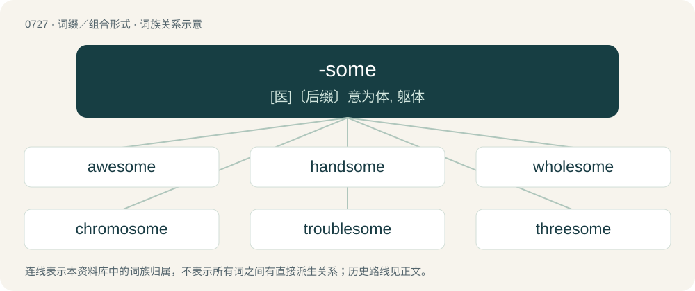

# 0794 · -some — \[医\]〔后缀〕意为体, 躯体

[总目录](../00_总目录_按常用程度.md)

**类型**：词缀／组合形式　｜　**来源语言**：见词源记录

## 核心含义与来源

- 核心含义：\[医\]〔后缀〕意为体, 躯体
- 英文含义：Characterized by some specific condition or quality, usually to a considerable degree.
- 词形：-some

**多个词源／构词路径**：同一拼写可能有不同来源；以下按词性和含义分别列出。

**来源记录 1**（后缀／后置成分；Characterized by some specific condition or quality, usually to a considerable degree.）

From Middle English -som, -sum, from Old English -sum (“same as; -some”), from Proto-West Germanic \*-sam, from Proto-Germanic \*-samaz, from Proto-Germanic \*samaz (“same”). Akin to Saterland Frisian -soam (“-some”), West Frisian -sum (“-some”), Dutch -zaam (“-some”), German Low German -saam (“-some”), German -sam (“-some”), Danish -som, Swedish -sam, Icelandic -samur (“-some”), Gothic -𐍃𐌰𐌼𐍃 (-sams), -𐍃𐌰𐌼𐌰 (-sama). Cognate with Albanian -shëm (“-some”). More at same, some.

**来源记录 2**（后缀／后置成分；Denoting a group with a certain number of members.）

From Middle English -som, from a specialized use of Old English sum (“some, one”) coming after a genitive plural (e.g. hē wæs fēowertiga sum --"he was one of forty", literally "he was forties' some\[one\]"; sixa sum --"one of six, sixsome").

**来源记录 3**（后缀／后置成分；Plus some indeterminate fraction not amounting to the next higher round number or significant digit; and change; -odd.）

From some in its "approximately" sense; more at some § Etymology.

## 词族图

## 单词速览（常用到不常用）

| 单词 | 音标 | 释义 |
|---|---|---|
| [awesome](#w-1) | 英 /ˈɔːsəm/；/ˈɔ.səm/ | a. 引起敬畏的, 可怕的 |
| [handsome](#w-2) | /ˈhæn.səm/ | a. 英俊的, 大方的, 慷慨的, 相当可观的, 美观的, 灵敏的 |
| [wholesome](#w-3) | 英 /ˈhəʊl.səm/；美 /ˈhoʊl.səm/ | a. 有益健康的, 合乎卫生的, 健全的, 有益的, 有生气的, 审慎的 |
| [chromosome](#w-4) | 英 /ˈkɹəʊ.məˌsəʊm/；美 /ˈkɹoʊməˌsoʊm/ | n. 染色体；\[化\] 染色体 |
| [troublesome](#w-5) | /ˈtɹʌbəlsəm/ | a. 麻烦的, 令人讨厌的 |
| [threesome](#w-6) | 英 /ˈθɹiː.səm/；美 /ˈθɹi.səm/ | n. 三人一组, 三人的竞赛 |
| [gruesome](#w-7) | 英 /ˈɡɹuːsəm/；美 /ˈɡɹusəm/ | a. 可怕的, 令人毛骨悚然的, 阴森的 |
| [cumbersome](#w-8) | 英 /ˈkʌmbəsəm/；美 /ˈkʌmbɚsəm/ | a. 笨重的, 麻烦的, 累赘的 |
| [lonesome](#w-9) | 英 /ˈləʊnsəm/；美 /ˈloʊnsəm/ | a. 寂寞的 |
| [tiresome](#w-10) | 英 /ˈtaɪəsəm/；美 /ˈtaɪɚsəm/ | a. 累人的, 烦人的 |
| [fearsome](#w-11) | 英 /ˈfɪəsəm/；美 /ˈfɪɹsəm/ | a. 吓人的, 可怕的, 害怕的 |
| [worrisome](#w-12) | 英 /ˈwʌɹisəm/；美 /ˈwʌɹisəm/ | a. 令人烦恼的, 麻烦的, 劳碌命的 |
| [burdensome](#w-13) | 英 /ˈbɜː.dən.səm/；美 /ˈbɝ.dən.səm/ | a. 累赘的, 恼人的, 繁重的；\[法\] 难于负担的, 压抑的, 累赘的 |
| [foursome](#w-14) | /ˈfɔɹsəm/ | n. 四人的一组, 四人对抗赛；a. 四人做的, 由四组成的 |
| [loathsome](#w-15) | 英 /ˈləʊð.səm/；美 /ˈloʊð.səm/ | a. 讨厌的, 可恶的, 令人憎恶的 |
| [bothersome](#w-16) | 英 /ˈbɒðəsəm/；美 /ˈbɑðɚsəm/ | a. 讨厌的 |
| [ribosome](#w-17) | 英 /ˈɹaɪbəˌsəʊm/；美 /ˈɹaɪbəˌsoʊm/ | n. 核糖体；\[化\] 核蛋白体; 核糖核蛋白体; 核糖体 |
| [buxom](#w-18) | /ˈbʌksəm/ | a. (妇女)丰满的, 健美的 |
| [irksome](#w-19) | /ˈɜɹksəm/ | a. 厌恶的, 讨厌的, 令人厌烦的 |
| [quarrelsome](#w-20) | 英 /ˈkwɒɹəlsəm/；美 /ˈkwɔɹəlsəm/ | a. 喜欢吵架的, 好争论的 |
| [twosome](#w-21) | /ˈtuːsəm/ | n. 两人一组, 两个一组, 两人玩的游戏 |
| [fulsome](#w-22) | /ˈfʊlsəm/ | a. 过度的, 过分的, 令人生厌的 |
| [meddlesome](#w-23) | /ˈmɛdəlsəm/ | a. 爱管闲事的, 好干涉的 |
| [proteasome](#w-24) | /prəʊtiːˈsɒm/ | \[医\]蛋白酶体 |

## 逐词详解

### 1. awesome

**词性**：形容词　｜　**音标**：英 /ˈɔːsəm/；/ˈɔ.səm/

**中文释义**：a. 引起敬畏的, 可怕的

**英文义项**：Causing awe or terror; inspiring wonder or excitement. / Excellent, exciting, remarkable.

**构词拆分**：awe + -some

**词源与演化**：

From awe + -some; compare earlier awful and Middle English eiful (“inducing fright or terror, terrible”), from Old English eġeful (“fearful; inspiring awe”). The oldest meaning of awesome is of “something which inspires awe”, but the word is now also a common colloquial expression. It was originally so used in the United States, where it had featured strikingly in the 1970 film Tora! Tora! Tora!, as used by Japan's Admiral Isoroku Yamamoto to describe the "awesome" industrial potential of the United States. Consequently, as the word popularly became an expression for anything superb, in its original meaning it has tended to be replaced by the related word, awe-inspiring.

**例句**：

> The waterfall in the middle of the rainforest was an awesome sight.

该用例对应义项：Causing awe or terror; inspiring wonder or excitement.

### 2. handsome

**词性**：形容词　｜　**音标**：/ˈhæn.səm/

**中文释义**：a. 英俊的, 大方的, 慷慨的, 相当可观的, 美观的, 灵敏的

**英文义项**：Having a pleasing appearance, good-looking, attractive, particularly / Of a man or boy: attractively manly, having a pleasing face and overall effect.

**构词拆分**：hand + -some

**词源与演化**：

From Middle English handsum, hondsom, equivalent to hand + -some. Compare Dutch handzaam, German Low German handsaam. The original sense was “easy to handle or use”, hence “suitable” and “apt, clever” (mid-16th century), giving rise to the current appreciatory senses (late 16th century).

**例句**：

> I was struck dumb. Here was the most handsome man I’d ever seen in my life coming out of the surf.

该用例对应义项：Of a man or boy: attractively manly, having a pleasing face and overall effect.

### 3. wholesome

**词性**：形容词　｜　**音标**：英 /ˈhəʊl.səm/；美 /ˈhoʊl.səm/

**中文释义**：a. 有益健康的, 合乎卫生的, 健全的, 有益的, 有生气的, 审慎的

**英文义项**：Promoting good physical health and well-being. / Promoting moral and mental well-being.

**构词拆分**：whole + -some；hale (“healthy”) + -some

**词源与演化**：

From earlier holesome, from Middle English holsom, holsum, helsum, halsum, from Old English \*hālsum, \*hǣlsum, from Proto-West Germanic \*hailasam, from Proto-Germanic \*hailasamaz, equivalent to whole + -some or hale (“healthy”) + -some. Cognate with Saterland Frisian heelsoam, Dutch heilzaam, German Low German heelsaam, German heilsam, Icelandic heilsamur, Norwegian Nynorsk helsesam, Swedish hälsosam (“wholesome”).

**例句**：

> Baking apple pie fills the house with a wholesome aroma.

### 4. chromosome

**词性**：名词　｜　**音标**：英 /ˈkɹəʊ.məˌsəʊm/；美 /ˈkɹoʊməˌsoʊm/

**中文释义**：n. 染色体；\[化\] 染色体

**英文义项**：A linear arrangement of condensed DNA and associated proteins (such as chaperone proteins) which contains the genetic material (genome) of an organism.

**构词拆分**：chromo- + -some

**词源与演化**：

19th century: from German Chromosom, ultimately from Ancient Greek χρῶμα (khrôma, “colour”) + σῶμα (sôma, “body”) (because they are stained under the microscope). Equivalent to chromo- + -some.

**例句**：

> Chromosomes store genetic information.

该用例对应义项：A linear arrangement of condensed DNA and associated proteins (such as chaperone proteins) which contains the genetic material (genome) of an organism.

### 5. troublesome

**词性**：形容词　｜　**音标**：/ˈtɹʌbəlsəm/

**中文释义**：a. 麻烦的, 令人讨厌的

**英文义项**：Causing trouble or anxiety.

**构词拆分**：trouble + -some

**词源与演化**：

From trouble + -some.

**例句**：

> The computer has been very troublesome for me. It never works when I need to use it.

该用例对应义项：Causing trouble or anxiety.

### 6. threesome

**词性**：名词　｜　**音标**：英 /ˈθɹiː.səm/；美 /ˈθɹi.səm/

**中文释义**：n. 三人一组, 三人的竞赛

**英文义项**：A group of three people or things. / An instance of sexual activity involving three people.

**构词拆分**：three + -some

**词源与演化**：

From three + -some.

**例句**：

> He wanted to have a threesome with his wife and another woman.

### 7. gruesome

**词性**：形容词　｜　**音标**：英 /ˈɡɹuːsəm/；美 /ˈɡɹusəm/

**中文释义**：a. 可怕的, 令人毛骨悚然的, 阴森的

**英文义项**：Repellently frightful and shocking; ghastly, horrific. / Awful, terrible.

**构词拆分**：grue (“(archaic except Northern England, Scotland) to be frightened; to shudder with fear”) + -some (suffix meaning ‘characterized by some specific condition or quality, usually to a considerable degree’ forming adjectives and nouns)

**词源与演化**：

From grue (“(archaic except Northern England, Scotland) to be frightened; to shudder with fear”) + -some (suffix meaning ‘characterized by some specific condition or quality, usually to a considerable degree’ forming adjectives and nouns), probably popularized by the Scottish novelist and poet Walter Scott (1771–1832): see, for example, the 1816 quotation. cognates \* Danish grusom (“cruel; horrible”) \* Middle Dutch grousaem, grusaem (modern Dutch gruwzaam (“cruel; gruesome”)) \* Middle High German grûsam, grûwesam (modern German grausam (“cruel”)) \* Norwegian Bokmål grusom (“cruel; horrible”)

**例句**：

> The team was so unprepared that the way it played was just gruesome.

该用例对应义项：Awful, terrible.

### 8. cumbersome

**词性**：形容词　｜　**音标**：英 /ˈkʌmbəsəm/；美 /ˈkʌmbɚsəm/

**中文释义**：a. 笨重的, 麻烦的, 累赘的

**英文义项**：Burdensome or hindering, as if a weight or drag; vexatious. / Not easily managed or handled; awkward or clumsy.

**构词拆分**：cumber (“hindrance”) + -some

**词源与演化**：

From Middle English cumbyrsum, cummyrsum; equivalent to cumber (“hindrance”) + -some. Compare encumber and incumbent.

**例句**：

> A slave’s work was as cumbersome as toiling on the fields, or in the mines.

该用例对应义项：Hard, difficult, and demanding to handle or get around with.

### 9. lonesome

**词性**：名词　｜　**音标**：英 /ˈləʊnsəm/；美 /ˈloʊnsəm/

**中文释义**：a. 寂寞的

**英文义项**：Oneself alone.

**构词拆分**：lone + -some

**词源与演化**：

From lone + -some, mid-17th century.

**例句**：

> I sat and watched the cars pass all by my lonesome.

该用例对应义项：Oneself alone.

### 10. tiresome

**词性**：形容词　｜　**音标**：英 /ˈtaɪəsəm/；美 /ˈtaɪɚsəm/

**中文释义**：a. 累人的, 烦人的

**英文义项**：Causing fatigue or boredom; wearisome.

**构词拆分**：tire + -some

**词源与演化**：

From tire + -some.

**例句**：

> Eventually his long stories became tiresome.

该用例对应义项：Causing fatigue or boredom; wearisome.

### 11. fearsome

**词性**：形容词　｜　**音标**：英 /ˈfɪəsəm/；美 /ˈfɪɹsəm/

**中文释义**：a. 吓人的, 可怕的, 害怕的

**英文义项**：Frightening, especially in appearance.

**构词拆分**：fear + -some

**词源与演化**：

From fear + -some. Compare German furchtsam (“fearful”, obsolete also “fearsome”); this is more closely equivalent to English frightsome, however.

**例句**：

> The warriors faced a fearsome enemy.

该用例对应义项：Frightening, especially in appearance.

### 12. worrisome

**词性**：形容词　｜　**音标**：英 /ˈwʌɹisəm/；美 /ˈwʌɹisəm/

**中文释义**：a. 令人烦恼的, 麻烦的, 劳碌命的

**英文义项**：Causing worry; perturbing or vexing. / Inclined to worry.

**构词拆分**：worry + -some

**词源与演化**：

From worry + -some.

**例句**：

> In a particularly worrisome predicament.

该用例对应义项：causing distress or worry or anxiety

### 13. burdensome

**词性**：形容词　｜　**音标**：英 /ˈbɜː.dən.səm/；美 /ˈbɝ.dən.səm/

**中文释义**：a. 累赘的, 恼人的, 繁重的；\[法\] 难于负担的, 压抑的, 累赘的

**英文义项**：Characteristic of a burden; arduous or demanding

**构词拆分**：burden + -some

**词源与演化**：

From burden + -some.

**例句**：

> When life is so burdensome death has become a sought after refuge.

### 14. foursome

**词性**：名词　｜　**音标**：/ˈfɔɹsəm/

**中文释义**：n. 四人的一组, 四人对抗赛；a. 四人做的, 由四组成的

**英文义项**：A group of four, a quartet or a game (such as golf) played by four players, especially by two teams of two. / A sex act between four people.

**构词拆分**：four + -some

**词源与演化**：

From four + -some.

**例句**：

> The foursome teed off before 9 a.m.

该用例对应义项：four people considered as a unit

### 15. loathsome

**词性**：形容词　｜　**音标**：英 /ˈləʊð.səm/；美 /ˈloʊð.səm/

**中文释义**：a. 讨厌的, 可恶的, 令人憎恶的

**英文义项**：Highly offensive; abominable, sickening.

**构词拆分**：loath + -some

**词源与演化**：

From Middle English lothsum, from Old English \*lāþsum, from Proto-West Germanic \*laiþasam, equivalent to loath + -some. Cognate with Middle Low German lêtsam (“arduous”), German leidsam (“sad, sorry”).

**例句**：

> To arms I call my comrades, and defy / the loathsome brood to battle.

### 16. bothersome

**词性**：形容词　｜　**音标**：英 /ˈbɒðəsəm/；美 /ˈbɑðɚsəm/

**中文释义**：a. 讨厌的

**英文义项**：Causing trouble, annoyance, inconvenience, irritation, or perplexity.

**构词拆分**：bother + -some

**词源与演化**：

From bother + -some.

**例句**：

> She found his questions increasingly bothersome.

该用例对应义项：Causing trouble, annoyance, inconvenience, irritation, or perplexity.

### 17. ribosome

**词性**：名词　｜　**音标**：英 /ˈɹaɪbəˌsəʊm/；美 /ˈɹaɪbəˌsoʊm/

**中文释义**：n. 核糖体；\[化\] 核蛋白体; 核糖核蛋白体; 核糖体

**英文义项**：A small organelle found in all cells; involved in the production of proteins by translating messenger RNA.

**构词拆分**：ribo- + -some

**词源与演化**：

From ribo- + -some.

**例句**：

> The ribosome is the site of protein synthesis.

该用例对应义项：an organelle in the cytoplasm of a living cell; they attach to mRNA and move down it one codon at a time and then stop until tRNA brings the required amino acid; when it reaches a stop codon it falls apart and releases the completed protein molecule for use by the cell

### 18. buxom

**词性**：形容词　｜　**音标**：/ˈbʌksəm/

**中文释义**：a. (妇女)丰满的, 健美的

**英文义项**：Having a full, voluptuous figure, especially possessing large breasts. / Full of health, vigour, and good temper.

**构词拆分**：bow (“to bend, bow at the waist”) + -some；buck (“to bend, buckle, kick”) + -some

**词源与演化**：

From Middle English buxom, also ibucsum, ibuhsum (“bendsome, flexible, pliant, obedient”), from Old English bōcsum, \*būhsum, \*ġebūhsum (“bendsome, pliant, obedient”), from Proto-West Germanic \*beuhsam, \*beugsam, equivalent to bow (“to bend, bow at the waist”) + -some or buck (“to bend, buckle, kick”) + -some. Cognate with Scots bowsome (“compliant”), West Frisian bûgsum (“flexible, bendy”), Dutch buigzaam (“flexible, pliant”), German biegsam (“flexible, pliant”).

**例句**：

> Skura was quite buxom and Yanni liked that about her.

### 19. irksome

**词性**：形容词　｜　**音标**：/ˈɜɹksəm/

**中文释义**：a. 厌恶的, 讨厌的, 令人厌烦的

**英文义项**：Marked by irritation or annoyance; disagreeable; troublesome by reason of long continuance or repetition

**构词拆分**：irk + -some

**词源与演化**：

From Middle English irkesome, irksum, equivalent to irk + -some, or perhaps continuing (in altered form) from Old English weorcsum (“painful, hurtful”).

**例句**：

> He has this irksome habit of racing up to red lights, so he has to brake heavily.

该用例对应义项：Marked by irritation or annoyance; disagreeable; troublesome by reason of long continuance or repetition

### 20. quarrelsome

**词性**：形容词　｜　**音标**：英 /ˈkwɒɹəlsəm/；美 /ˈkwɔɹəlsəm/

**中文释义**：a. 喜欢吵架的, 好争论的

**英文义项**：Argumentative; fond of or prone to quarreling.

**构词拆分**：quarrel + -some

**词源与演化**：

From quarrel + -some.

**例句**：

> She's too quarrelsome to participate in a civil conversation.

该用例对应义项：Argumentative; fond of or prone to quarreling.

### 21. twosome

**词性**：形容词　｜　**音标**：/ˈtuːsəm/

**中文释义**：n. 两人一组, 两个一组, 两人玩的游戏

**英文义项**：Being or constituting a pair; two. / Twofold; double.

**构词拆分**：two + -some

**词源与演化**：

From Middle English twosome, equivalent to two + -some. Cognate with Scots twasome, twaesome (“twosome”).

**用法示例／搭配（非完整句）**：

> a twosome dance

该用例对应义项：Performed by two individuals.

### 22. fulsome

**词性**：形容词　｜　**音标**：/ˈfʊlsəm/

**中文释义**：a. 过度的, 过分的, 令人生厌的

**英文义项**：Offensive to good taste, tactless, overzealous, excessive. / Excessively flattering (connoting insincerity).

**构词拆分**：full + -some

**词源与演化**：

From Middle English fulsom, equivalent to full + -some. The meaning has evolved from an original positive connotation "abundant" to a neutral "plump" to a negative "overfed". In modern usage, it can take on any of these inflections. See usage note. The negative sense "offensive, gross; disgusting, sickening" developed secondarily after the 13th century and was influenced by Middle English foul (“foul”). In the 18th century, the word was sometimes even spelled foulsome.

**例句**：

> The fulsome thanks of the war-torn nation lifted our weary spirits.

该用例对应义项：Characterised or marked by fullness; abundant, copious.

### 23. meddlesome

**词性**：形容词　｜　**音标**：/ˈmɛdəlsəm/

**中文释义**：a. 爱管闲事的, 好干涉的

**英文义项**：Characterized or marked by meddling; inclined or having a tendency to meddle or interfere in other people's business.

**构词拆分**：meddle + -some

**词源与演化**：

From meddle + -some.

**例句**：

> If those meddlesome kids hadn't turned me in, I'd have gotten away with my nefarious scheme!

该用例对应义项：Characterized or marked by meddling; inclined or having a tendency to meddle or interfere in other people's business.

### 24. proteasome

**词性**：名词　｜　**音标**：/prəʊtiːˈsɒm/

**中文释义**：\[医\]蛋白酶体

**英文义项**：A complex protein, found in bacterial, archeal and eukaryotic cells, that breaks down other proteins via proteolysis.

**构词拆分**：protease + -some

**词源与演化**：

From protease + -some.
