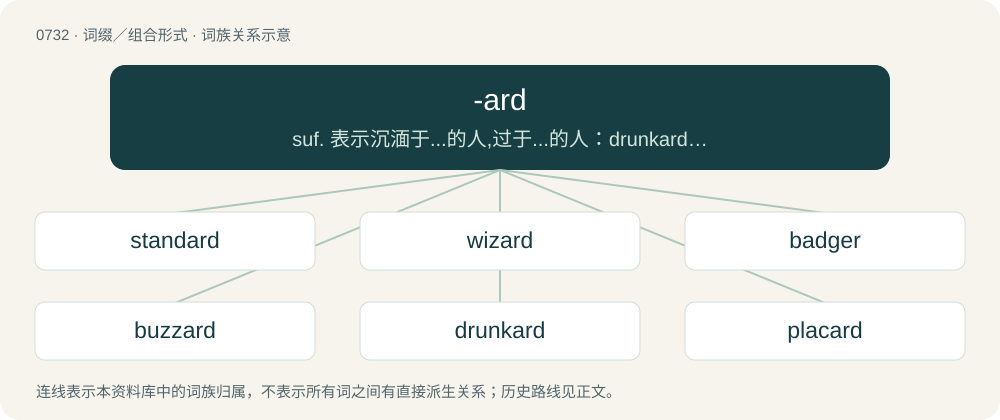

# 0800 · -ard — suf. 表示沉湎于...的人,过于...的人：drunkard,sluggard

[总目录](../00_总目录_按常用程度.md)

**类型**：词缀／组合形式　｜　**来源语言**：见词源记录

## 核心含义与来源

- 核心含义：suf. 表示沉湎于...的人,过于...的人：drunkard,sluggard
- 英文含义：Someone who is in a specified condition (“pejorative agent suffix”).
- 词形：-ard

**来源记录 1**（后缀／后置成分；Someone who is in a specified condition (“pejorative agent suffix”).）

From Middle English -ard, from Old French -ard (suffix), from Frankish \*-hard (“hardy, bold”), from Proto-Germanic \*harduz (“hard”). Cognate with Middle High German -hart. More at hard.

## 词族图

## 单词速览（常用到不常用）

| 单词 | 音标 | 释义 |
|---|---|---|
| [standard](#w-1) | 英 /ˈstændəd/；美 /ˈstændɚd/ | n. 标准, 规格, 旗, 军旗, 本位；a. 标准的, 合规格的；\[计\] 标准 |
| [wizard](#w-2) | 英 /ˈwɪzəd/；美 /ˈwɪzɚd/ | n. 男巫, 术士, 奇才；a. 男巫的, 巫术的；\[计\] 向导 |
| [badger](#w-3) | 英 /ˈbæd͡ʒə/；美 /ˈbæd͡ʒɚ/ | n. 獾, 獾皮毛；vt. 纠缠 |
| [buzzard](#w-4) | 英 /ˈbʌzəd/；美 /ˈbʌzɚd/ | n. 贪婪的人, 做营营声的小虫 |
| [drunkard](#w-5) | 美 /ˈdɹʌŋkɚd/ | n. 酒鬼；\[医\] 嗜酒者 |
| [placard](#w-6) | 英 /ˈplæk.ɑːd/；美 /ˈplæk.ɑɹd/ | n. 公告, 布告, 小牌, 海报；vt. 公布, 布告, 张帖, 贴海报于 |
| [bollard](#w-7) | 美 /ˈbɑləɹd/；/ˈbɒləɹd/ | n. 系船柱 |

## 逐词详解

### 1. standard

**词性**：形容词　｜　**音标**：英 /ˈstændəd/；美 /ˈstændɚd/

**中文释义**：n. 标准, 规格, 旗, 军旗, 本位；a. 标准的, 合规格的；\[计\] 标准

**英文义项**：Falling within an accepted range of size, amount, power, quality, etc. / Growing alone as a free-standing plant; not trained on a post etc.

**构词拆分**：stand + -ard；stand + -er

**词源与演化**：

From Middle English standard, from Old French estandart (“gathering place, battle flag”), from Frankish \*standahard (literally “stand firm, stand hard”), equivalent to stand + -ard. An alternative etymology derives the second element from Frankish \*oʀd (“point, spot, place”) (compare Old French ordé (“pointed”), Old English ord (“point, source, vanguard”), German Standort (“location, place, site, position, base”, literally “standing-point”)). Merged with Middle English standar, stander, standere (“flag, banner”, literally “stander”), equivalent to stand + -er. More at stand, hard, ord. As a hill-naming term possibly a calque from Cumbric; equivalent to Welsh lluman (“standard”), arising with confusion with the hill-naming element llumon (“chimney”).

**例句**：

> This is the standard model, but we offer a variety of customization options.

该用例对应义项：As normally supplied (not optional or modified by any extra requests).

### 2. wizard

**词性**：名词　｜　**音标**：英 /ˈwɪzəd/；美 /ˈwɪzɚd/

**中文释义**：n. 男巫, 术士, 奇才；a. 男巫的, 巫术的；\[计\] 向导

**英文义项**：Someone, usually male, who uses (or has skill with) magic, mystic items, and magical and mystical practices. / One who is especially skilled or unusually talented in a particular field.

**构词拆分**：wise + -ard

**词源与演化**：

From Middle English wysard, wysarde, equivalent to wise + -ard. A uniquely medieval English word with no known morphologically exact cognates in other Germanic languages; did not gain distinct sense of "occultist, magic user" (as opposed to a philosopher or sage) until circa 1500s, aligning roughly with the starting English Renaissance. However, via Proto-Indo-European \*weyd- cognate with Proto-Celtic \*druwits (whence English druid), Proto-Slavic \*vědьma (Polish wiedźma, Russian ве́дьма (védʹma)), Russian веду́н (vedún). The sense of "old (male) virgin" is from a Japanese Internet meme in which virgins who are typically friendless, shy outcasts and loners who don't fit in anywhere legendarily gain magical powers upon reaching 30 years of age; popularized ultimately by 4chan and adjacent online incel spaces. Compare typologically specialist (&lt;&lt; Latin speciō).

**例句**：

> Use the "Add Network Connection" wizard to connect to a network in a series of simple steps.

该用例对应义项：A computer program or script used to simplify complex operations, often for an inexperienced user.

### 3. badger

**词性**：动词　｜　**音标**：英 /ˈbæd͡ʒə/；美 /ˈbæd͡ʒɚ/

**中文释义**：n. 獾, 獾皮毛；vt. 纠缠

**英文义项**：To pester; to annoy persistently; to press.

**构词拆分**：badge + -ard

**词源与演化**：

From Middle English bageard (“marked by a badge”), from bage (“badge”), referring to the animal's badge-like white blaze, equivalent to badge + -ard. Displaced earlier brock, from Old English brocc.

**例句**：

> He kept badgering her about her bad habits.

该用例对应义项：To pester; to annoy persistently; to press.

### 4. buzzard

**词性**：名词　｜　**音标**：英 /ˈbʌzəd/；美 /ˈbʌzɚd/

**中文释义**：n. 贪婪的人, 做营营声的小虫

**英文义项**：Any of several Old World birds of prey of the genus Buteo with broad wings and a broad tail. / Any scavenging bird, such as the American black vulture (Coragyps atratus) or the turkey vulture (Cathartes aura).

**词源与演化**：

From Middle English bosart, from Anglo-Norman buisart, from Old French busart, busard, a derivative ( + -ard) of Old French buison, buson (French buse), possibly from Latin būteō (“hawk”).

**例句**：

> Can you tell the difference between a buzzard and a kite?

### 5. drunkard

**词性**：名词　｜　**音标**：美 /ˈdɹʌŋkɚd/

**中文释义**：n. 酒鬼；\[医\] 嗜酒者

**英文义项**：A person who is habitually drunk.

**构词拆分**：drunk + -ard (“pejorative agent suffix”)

**词源与演化**：

From earlier droncarde, from Middle English \*druncard (attested as a surname, Druncard), possibly from Middle Low German drunkert, equivalent to drunk + -ard (“pejorative agent suffix”). Compare German Trunkart. Compare braggart.

**例句**：

> How far is an Irishman from a drunkard? The breadth of the table.

### 6. placard

**词性**：动词　｜　**音标**：英 /ˈplæk.ɑːd/；美 /ˈplæk.ɑɹd/

**中文释义**：n. 公告, 布告, 小牌, 海报；vt. 公布, 布告, 张帖, 贴海报于

**英文义项**：To affix a placard to, or mark with a placard nearby. / To announce with placards.

**构词拆分**：plaque + -ard

**词源与演化**：

From Middle English placard (“official document”), from Middle French placard, placart, plaquart (“a placard, a writing pasted on a wall”), from the Old French verb plaquer, plaquier (“to stick or paste, roughcast”), from Middle Dutch placken, plecken (“to glue or fasten, plaster, patch”), ultimately from Proto-Germanic \*plaggą (“a piece of cloth, patch”), equivalent to plaque + -ard. Related to Middle Low German placken (“to smear with lime or clay, plaster”), Saterland Frisian Plak, Plakke (“a hit, smack, slap”), German Placken (“a spot, patch”), Icelandic plagg (“a document”), Hebrew פלקט (plakat, “a large sheet of paper, typically with a photo or writing, posted on the wall”), English play. Compare also Modern Dutch plakkaat (“placard”), Saterland Frisian Plakoat (“a placard, poster”). More at play.

**用法示例／搭配（非完整句）**：

> to placard a sale

该用例对应义项：To announce with placards.

### 7. bollard

**词性**：名词　｜　**音标**：美 /ˈbɑləɹd/；/ˈbɒləɹd/

**中文释义**：n. 系船柱

**英文义项**：A strong vertical post of timber or iron, fixed to a wharf, dock, or the deck of a ship, to which the ship's mooring lines or towlines are secured. / A similar post preventing vehicle access to a pedestrian area, to delineate traffic lanes, or used for security purposes.

**构词拆分**：bole + -ard (pejorative or diminutive suffix)

**词源与演化**：

From Middle English bollard, probably from Middle English bole (“tree trunk”), from Old Norse bolr (“stump, trunk”), equivalent to bole + -ard (pejorative or diminutive suffix).

**例句**：

> The boat is tied to a bollard.
