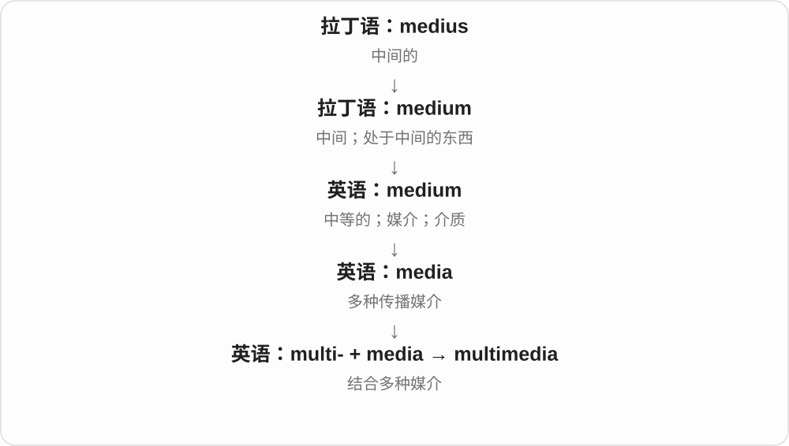
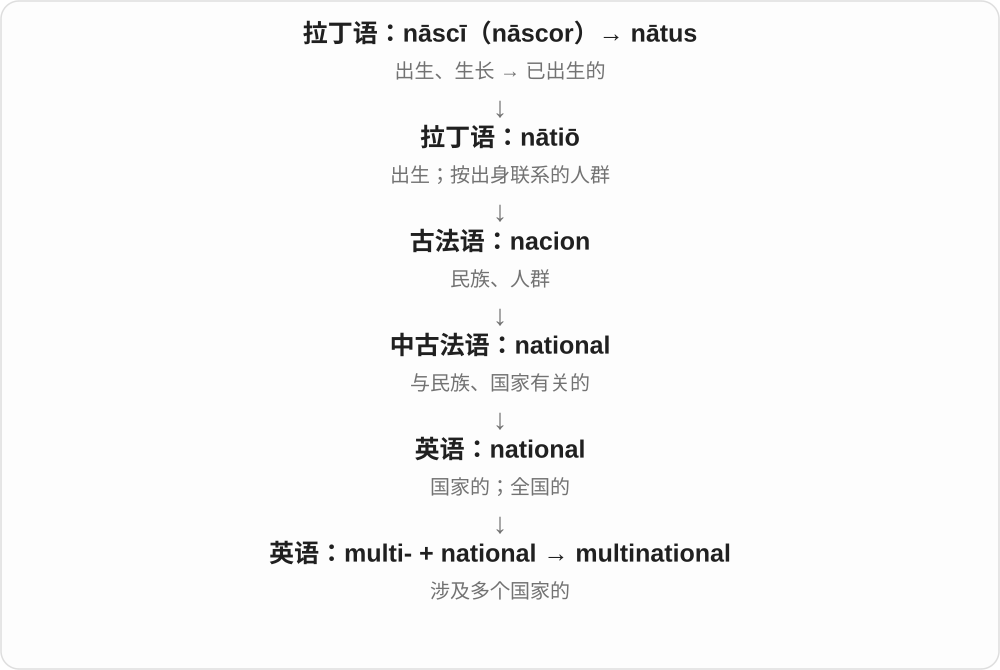
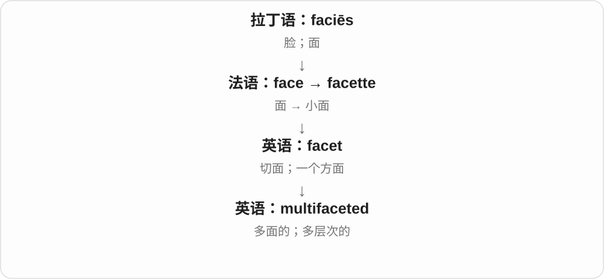
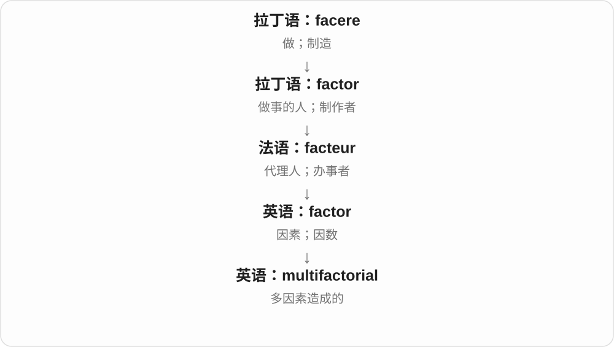

# 0818 · multi- — 多；多个；多次

[逐词精讲目录](../00_逐词精讲目录.md) · [总目录](../00_总目录_按常用程度.md)

## 核心词根与来源

multi- 接拉丁 multus“多”。大量现代英语词直接把它接在已有词前，第二部分告诉你究竟哪里多。multiple、multiply、multiplication 等则有各自的拉丁和法语借入历史，不能全按今天的英语前缀拼接来解释。

**multi- = many：同一结构里有多个成员、功能、层次或参与方。**

一台 multifunction printer 承担多项功能；一个 multiplayer game 容纳多人；几国一起谈是 multilateral talks。

- **数目与增加**：multiple、multiply、multiplication、multiplier、multiplicity、multitude、multimillion、multibillion、multimillionaire
- **人、文化与合作**：multiplayer、multicultural、multilingual、multilingualism、multinational、multiracial、multiethnic、multilateral、multiparty、multidisciplinary、multigenerational、multifamily、multipolar
- **用途、时间与结构**：multipurpose、multifunction、multifunctional、multilevel、multilayer、multilayered、multistage、multiyear、multidimensional、multifaceted、multicellular
- **工具、媒体与分析**：multimedia、multichannel、multitask、multitasking、multiplex、multiplexer、multicore、multiprocessor、multithreading、multimeter、multivitamin、multivariate、multivariable、multifactorial、multicenter
- **颜色**：multicolor、multicolored、multicoloured

## 词形与演化规律

multi- 中的末尾元音常读 /i/，美式部分词也有 /aɪ/。multiple 与 multiply 的词尾和词性不同；multifunction 与 multifunctional 常近义。

## 单词速览（按词族由简到繁）

同一基础词的相关扩展放在一起，先读基础形式，再读扩展；各组之间优先读常用的。具体词源关系见各词讲解。

| 单词 | 音标 | 核心意思 |
|---|---|---|
| [multiple](#w-1) | /ˈmʌltɪpəl/ | 多个的；多重的；倍数 |
| [multiply](#w-6) | /ˈmʌltɪplaɪ/ | 乘；使增多；繁殖 |
| [multiplication](#w-8) | /ˌmʌltɪplɪˈkeɪʃən/ | 乘法；增殖；增加 |
| [multiplier](#w-9) | 英 /ˈmʌltɪplaɪə/；美 /ˈmʌltɪplaɪər/ | 乘数；放大作用的因素或装置 |
| [multiplayer](#w-2) | 英 /ˌmʌltiˈpleɪə/；美 /ˌmʌltiˈpleɪər/ | 多人参与的；多人游戏模式 |
| [multitude](#w-3) | 英 /ˈmʌltɪtjuːd/；美 /ˈmʌltɪtuːd/ | 大量；众多；人群 |
| [multimedia](#w-4) | /ˌmʌltiˈmiːdiə/ | 多媒体；结合多种媒介的 |
| [multinational](#w-5) | /ˌmʌltiˈnæʃənəl/ | 多国的；跨国经营的；跨国公司 |
| [multicultural](#w-7) | 英、美 /ˌmʌltiˈkʌltʃərəl/ | 多元文化的 |
| [multilateral](#w-10) | /ˌmʌltiˈlætərəl/ | 多边的；多方参加的 |
| [multidisciplinary](#w-11) | 英 /ˌmʌltiˈdɪsɪplɪnəri/；美 /ˌmʌltiˈdɪsəpləneri/ | 多学科的 |
| [multilingual](#w-12) | /ˌmʌltiˈlɪŋɡwəl/ | 多语的；会使用多种语言的 |
| [multilingualism](#w-44) | /ˌmʌltiˈlɪŋɡwəlɪzəm/ | 多语使用；多语现象 |
| [multipurpose](#w-13) | 英 /ˌmʌltiˈpɜːpəs/；美 /ˌmʌltiˈpɜːrpəs/ | 多用途的 |
| [multitask](#w-26) | 英 /ˌmʌltiˈtɑːsk/；美 /ˈmʌltiˌtæsk/ | 同时处理多项任务 |
| [multitasking](#w-14) | 英 /ˌmʌltiˈtɑːskɪŋ/；美 /ˈmʌltiˌtæskɪŋ/ | 多任务处理；同时兼顾多件事 |
| [multivariate](#w-15) | 英 /ˌmʌltiˈveəriɪt/；美 /ˌmʌltiˈveriɪt/ | 多变量的；多元的 |
| [multimillion](#w-16) | 英 /ˌmʌltiˈmɪljən/；美 /ˌmʌltiˈmɪljən/ | 数百万的；数百万规模的 |
| [multifaceted](#w-17) | /ˌmʌl.tiˈfæ.sə.tɪd/ | 多面的；多层次的 |
| [multiplicity](#w-18) | 英 /ˌmʌltɪˈplɪsəti/；美 /ˌmʌltɪˈplɪsəti/ | 多样性；众多；多重性 |
| [multidimensional](#w-19) | 英 /ˌmʌltidaɪˈmenʃənəl/、/ˌmʌltidɪˈmenʃənəl/；美也读 /ˌmʌltaɪdɪˈmenʃənəl/ | 多维的；涉及多个方面的 |
| [multiplex](#w-20) | /ˈmʌltɪpleks/ | 多厅影院；多路复用；多重的 |
| [multiplexer](#w-46) | 英 /ˈmʌltɪpleksə/；美 /ˈmʌltɪpleksər/ | 多路复用器；多路选择器 |
| [multiracial](#w-21) | /ˌmʌltiˈreɪʃəl/ | 多种族的；具有多种族背景的 |
| [multifamily](#w-23) | 英 /ˌmʌltiˈfæməli/；美 /ˌmʌltiˈfæməli/，也读 /ˌmʌltaɪˈfæməli/ | 多家庭的；多户住宅的 |
| [multicolor](#w-32) | 英 /ˌmʌltiˈkʌlə/；美 /ˌmʌltiˈkʌlər/ | 多色的；多色印刷的 |
| [multicolored](#w-22) | 英 /ˌmʌltiˈkʌləd/；美 /ˌmʌltiˈkʌlərd/ | 多色的；五彩的〔美式拼写〕 |
| [multichannel](#w-24) | /ˌmʌltiˈtʃænəl/ | 多渠道的；多通道的 |
| [multilevel](#w-25) | /ˌmʌltiˈlevəl/ | 多层的；多级的 |
| [multifunction](#w-37) | /ˌmʌltiˈfʌŋkʃən/ | 多功能的 |
| [multifunctional](#w-27) | /ˌmʌltiˈfʌŋkʃənəl/ | 多功能的 |
| [multivitamin](#w-28) | 英 /ˌmʌltiˈvɪtəmɪn/；美 /ˌmʌltiˈvaɪtəmɪn/ | 复合维生素制剂；含多种维生素的 |
| [multibillion](#w-29) | /ˌmʌltiˈbɪljən/ | 数十亿的；涉及多个十亿单位的 |
| [multicellular](#w-30) | 英 /ˌmʌltiˈseljʊlə/；美 /ˌmʌltiˈseljələr/ | 多细胞的 |
| [multilayer](#w-31) | 英 /ˌmʌltiˈleɪə/；美 /ˌmʌltiˈleɪər/ | 多层的 |
| [multilayered](#w-34) | 英 /ˌmʌltiˈleɪəd/；美 /ˌmʌltiˈleɪərd/ | 有多层的；多层次的 |
| [multimillionaire](#w-33) | 英 /ˌmʌltimɪljəˈneə/；美 /ˌmʌltimɪljəˈner/ | 拥有数百万资产的人；大富翁 |
| [multiparty](#w-35) | 英 /ˌmʌltiˈpɑːti/；美 /ˌmʌltiˈpɑːrti/ | 多党派的；多方参与的 |
| [multiyear](#w-36) | 英 /ˌmʌltiˈjɪə/；美 /ˌmʌltiˈjɪr/ | 持续多年的；跨多年的 |
| [multiethnic](#w-38) | /ˌmʌltiˈeθnɪk/ | 多族群的；多民族的 |
| [multicenter](#w-39) | 英 /ˌmʌltiˈsentə/；美 /ˌmʌltiˈsentər/ | 多中心的 |
| [multicoloured](#w-40) | 英 /ˌmʌltiˈkʌləd/；美 /ˌmʌltiˈkʌlərd/ | 多色的；五彩的〔英式拼写〕 |
| [multistage](#w-41) | /ˌmʌltiˈsteɪdʒ/ | 多阶段的；多级的 |
| [multimeter](#w-42) | 英 /ˈmʌltiˌmiːtə/；美 /ˈmʌltiˌmiːtər/，也读 /ˌmʌlˈtɪmətər/ | 万用表 |
| [multivariable](#w-43) | 英 /ˌmʌltiˈveəriəbəl/；美 /ˌmʌltiˈveriəbəl/ | 多变量的；多元的 |
| [multigenerational](#w-45) | /ˌmʌltiˌdʒenəˈreɪʃənəl/ | 多代人的；跨几代的 |
| [multicore](#w-47) | 英 /ˌmʌltiˈkɔː/；美 /ˌmʌltiˈkɔːr/ | 多核的 |
| [multithreading](#w-48) | /ˌmʌltiˈθredɪŋ/ | 多线程处理 |
| [multifactorial](#w-49) | /ˌmʌltifækˈtɔːriəl/ | 多因素造成的 |
| [multiprocessor](#w-50) | 英 /ˌmʌltiˈprəʊsesə/；美 /ˌmʌltiˈprɑːsesər/ | 多处理器的；多处理器系统 |
| [multipolar](#w-51) | 英 /ˌmʌltiˈpəʊlə/；美 /ˌmʌltiˈpoʊlər/ | 多极的；有多个力量中心的 |

## 逐词讲解

### 1. multiple — 多个的；多重的；倍数

**音标**：/ˈmʌltɪpəl/

**先抓住这个画面**

不是只发生一次、只有一份；数学里也指整倍数。

**怎么拆**

经法语 multiple，接后期拉丁 multiplus：multi-“多” + -plus“重、倍”。英语名词“倍数”后来从形容词发展，不是从 multiply 简单改尾造来。

**怎么变成今天的意思**

**拉丁 multi- + -plus → 后期拉丁 multiplus**  
多 + 重、倍 → 多重的

↓

**法语 multiple → 英语 multiple**  
多个的 → 名词倍数

multiple reasons 是多个理由；a multiple of three 是三的整数倍。multiple choice 是有多个选项供选择，不一定允许选多个答案。

**常见搭配与例句**

multiple copies；multiple causes；multiple choice；a multiple of。

> The error had multiple causes.

这个错误有多个原因。

> Twelve is a multiple of three.

十二是三的倍数。

**别混淆**

many 强调数量多；multiple 只要不止一个就能成立，常用于较正式描述。

### 2. multiply — 乘；使增多；繁殖

**音标**：/ˈmʌltɪplaɪ/

**先抓住这个画面**

让一份变成多份；数学用法则是明确的乘法运算。

**怎么拆**

经法语 multiplier 接拉丁 multiplicāre，来自 multiplex“多重的”。现代词尾看似 -ply，历史上与“折、重”的词族相连，不是 multiple 加 -ly。

**怎么变成今天的意思**

**拉丁 multus／multi- + -plex → multiplex**  
多 + 重、折 → 多重的

↓

**拉丁 multiplicāre → 古法语 multiplier → 中古英语 multeplien → 英语 multiply**  
使增多 → 繁殖、增加；作乘法

multiply six by four 是六乘四；problems multiply 是问题越来越多。乘法结果不一定变大，例如乘零或乘小于一的正数，要把数学定义与词源联想分开。

**常见搭配与例句**

multiply A by B；multiply rapidly；multiply the number of。

> Multiply the length by the width to find the area of the rectangle.

用长乘宽求出矩形面积。

> Small problems can multiply if nobody addresses them.

小问题如果无人处理，可能会越积越多。

**别混淆**

increase 只说增加；multiply 在一般语境常有数量成倍或大量增加的感觉，数学中则精确指乘。

### 3. multiplication — 乘法；增殖；增加

**音标**：/ˌmʌltɪplɪˈkeɪʃən/

**先抓住这个画面**

把“乘、增多”当作一个过程来说。

**怎么拆**

经法语 multiplicacion，借拉丁 multiplicātiō，接 multiplicāre。现代与 multiply 对应，但名词在拉丁语中已形成，不是英语 multiply 直接加 -cation。

**怎么变成今天的意思**

**拉丁 multus／multi- + -plex → multiplex**  
多 + 重、折 → 多重的

↓

**拉丁 multiplicāre → multiplicātiō → 古法语 multiplicacion**  
使增多 → 增加的过程

↓

**中古英语 multiplicacioun → 英语 multiplication**  
增多；数学乘法

a multiplication table 是乘法表；cell multiplication 是细胞增殖。这个词也可说机构、程序等越变越多，不只用于算术。

**常见搭配与例句**

multiplication tables；a multiplication sign；cell multiplication。

> The children practised multiplication with small numbers.

孩子们用小数目练习乘法。

> The report criticised the multiplication of unnecessary procedures.

报告批评了不必要程序的不断增加。

**别混淆**

addition 是加法；multiplication 是乘法。整数乘法可用重复相加入门，但乘法的范围不限整数。

### 4. multiplier — 乘数；放大作用的因素或装置

**音标**：英 /ˈmʌltɪplaɪə/；美 /ˈmʌltɪplaɪər/

**先抓住这个画面**

用它去乘别的量，或用它把某种效果放大。

**怎么拆**

multiply + -er；-er 不只指人，也可指执行作用的量或装置。

**怎么变成今天的意思**

**拉丁 multus／multi- + -plex → multiplex**  
多 + 重、折 → 多重的

↓

**拉丁 multiplicāre → 古法语 multiplier → 中古英语 multeplien → 英语 multiply**  
使增多 → 繁殖、增加；作乘法

↓

**英语 multiply + -er → multiplier**  
用来相乘的数；起放大作用的因素

in six times four, four can be called the multiplier，具体称法随表达方式而定；an economic multiplier 指某项变化带来的连带放大效应，不表示任何投入都必定增加收入。

**常见搭配与例句**

a multiplier effect；a force multiplier；use a multiplier。

> The formula uses a multiplier of two.

这个公式使用二作为乘数。

> Better tools can act as a multiplier of the team’s effort.

更好的工具可以放大团队努力的效果。

**别混淆**

multiple 是倍数，如 twelve is a multiple of three；multiplier 是参与相乘或产生放大作用的因素。

### 5. multiplayer — 多人参与的；多人游戏模式

**音标**：英 /ˌmʌltiˈpleɪə/；美 /ˌmʌltiˈpleɪər/

**先抓住这个画面**

不是一个人独自玩，而是多个玩家进入同一游戏环境。

**怎么拆**

multi- + player“玩家”；英语复合词，player 本身是 play + -er。

**怎么变成今天的意思**

**拉丁 multus → 组合形式 multi-**  
多、许多；多次

↓

**英语借用 multi- 参与构词**  
与已有名词、形容词等相接，表示多个、多方面

↓

**英语 multi- + player → multiplayer**  
多个玩家参与的游戏或模式

a multiplayer game 可以在线，也可以同一设备本地参与；competitive multiplayer 是玩家对抗，cooperative multiplayer 是合作。多人不自动等于互相竞争。

**常见搭配与例句**

a multiplayer game；multiplayer mode；online multiplayer。

> The game includes a cooperative multiplayer mode.

这个游戏包含多人合作模式。

> We played multiplayer together on the same screen.

我们在同一屏幕上一起玩了多人模式。

**别混淆**

multiplayer 说玩家数与互动；multiplatform 说支持的平台数，两个概念不同。

### 6. multitude — 大量；众多；人群

**音标**：英 /ˈmʌltɪtjuːd/；美 /ˈmʌltɪtuːd/

**先抓住这个画面**

眼前不是几件零散的东西，而是一大批。

**怎么拆**

经法语 multitude 或直接借拉丁 multitūdō：multus“多” + -tūdō 状态名词后缀。不是现代 multi- 加英语 attitude 的后半截。

**怎么变成今天的意思**

**拉丁 multus + -tūdō → multitūdō**  
多 → 大量、众多

↓

**法语 multitude／拉丁直接借入 → 中古英语及英语 multitude**  
数量众多；大群人

a multitude of choices 是大量选择；the multitude 可说大众或人群，偏书面。a multitude of 后通常接复数可数名词。

**常见搭配与例句**

a multitude of；a great multitude；a multitude of reasons。

> The city offers a multitude of places to eat.

这座城市有许多用餐去处。

> A multitude gathered outside the hall.

一大群人聚集在大厅外。

**别混淆**

a lot of 更日常；a multitude of 更有数量繁多、铺开一大片的书面感觉。

### 7. multimedia — 多媒体；结合多种媒介的

**音标**：/ˌmʌltiˈmiːdiə/

**先抓住这个画面**

同一段内容既有文字，又有图片、声音或视频，多种表达通道一起工作。

**怎么拆**

multi-（多）+ media（媒介），是现代组合词。

**怎么变成今天的意思**

它看的是呈现手段不止一种，而不只是文件数量很多。十张纯文字页面未必值得称为 multimedia。

**常见搭配与例句**

a multimedia presentation；multimedia content；multimedia software。

> The museum created a multimedia exhibition with films and sound recordings.

博物馆制作了一场包含影片和录音的多媒体展览。

> Students prepared a multimedia presentation about their town.

学生们制作了介绍家乡的多媒体展示。

**别混淆**

audiovisual 特别强调声音与图像；multimedia 还可包括文字、互动等多种形式。

### 8. multinational — 多国的；跨国经营的；跨国公司

**音标**：/ˌmʌltiˈnæʃənəl/

**先抓住这个画面**

multinational 像一张公司地图上同时标着多个国家，人员、业务或参与方分布在多国。

**怎么拆**

multi-（多个）+ national。

**怎么变成今天的意思**

常修饰公司，也可指由多个国家参与的团队。作名词 a multinational 通常是跨国公司。

**常见搭配与例句**

a multinational company；a multinational team；a large multinational。

> She works for a multinational company.

她在一家跨国公司工作。

> A multinational team carried out the research.

一个多国团队开展了这项研究。

**别混淆**

international 强调国家之间；multinational 强调多个国家都在其中。

### 9. multicultural — 多元文化的

**音标**：英、美 /ˌmʌltiˈkʌltʃərəl/

**先抓住这个画面**

同一个地方或群体里，有不止一种文化背景。

**怎么拆**

multi-“多个” + cultural；也可联系 multiculture + -al。

**怎么变成今天的意思**

**拉丁 colere；分词 cultus**  
耕作、照料；居住；尊敬、崇奉

↓

**拉丁 cultūra → 中古法语 culture 及英语借词**  
耕作、培养

↓

**英语 culture**  
培养 → 修养、群体生活方式；生物培养

↓

**英语 cultural + multi- → multicultural**  
包含多种文化的

multicultural city 可以是不同语言、传统和生活方式并存的城市。这个形容词描述多样性，不自动证明不同群体之间已经平等相处。

**常见搭配与例句**

a multicultural society；a multicultural classroom。

> The school serves a multicultural community.

学校服务于一个多元文化社群。

> The festival reflects the city’s multicultural character.

节日体现了这座城市的多元文化特点。

**别混淆**

intercultural 强调文化之间的交流；multicultural 强调存在多种文化。

### 10. multilateral — 多边的；多方参加的

**音标**：/ˌmʌltiˈlætərəl/

**先抓住这个画面**

谈判桌旁坐着不止两方，每方都参与协商。

**怎么拆**

multi- + lateral“侧面的、方面的”，lateral 接拉丁 latus“边、侧”。现代政治用法把一方当作一边。

**怎么变成今天的意思**

**拉丁 multus → 组合形式 multi-**  
多、许多；多次

↓

**英语借用 multi- 参与构词**  
与已有名词、形容词等相接，表示多个、多方面

↓

**英语 multi- + lateral → multilateral**  
涉及多边、多方的

multilateral talks 是多方谈判；a multilateral agreement 涉及多个参与方。常见于国家间合作，也可用于其他组织之间。

**常见搭配与例句**

multilateral talks；multilateral cooperation；a multilateral agreement。

> Several countries joined the multilateral talks.

几个国家参加了多边会谈。

> The problem requires multilateral cooperation.

这个问题需要多方合作。

**别混淆**

bilateral 是双方之间；multilateral 是多方。unilateral 是单方面，不要把它们都译成国际的。

### 11. multidisciplinary — 多学科的

**音标**：英 /ˌmʌltiˈdɪsɪplɪnəri/；美 /ˌmʌltiˈdɪsəpləneri/

**先抓住这个画面**

让不同专业的人带着各自的工具，一起面对同一个问题。

**怎么拆**

multi- + disciplinary“学科的”；这里 discipline 是学科，不是惩罚或纪律处分。

**怎么变成今天的意思**

**拉丁 multus → 组合形式 multi-**  
多、许多；多次

↓

**英语借用 multi- 参与构词**  
与已有名词、形容词等相接，表示多个、多方面

↓

**英语 multi- + disciplinary → multidisciplinary**  
多个学科共同参与的

a multidisciplinary team 可以同时有设计师、工程师和社会研究者。它强调多个学科参与，不自动说明他们的方法已经融合成一种。

**常见搭配与例句**

a multidisciplinary team；multidisciplinary research；a multidisciplinary approach。

> A multidisciplinary team redesigned the public space.

一个多学科团队重新设计了这处公共空间。

> The project needs multidisciplinary expertise.

这个项目需要多个学科的专业知识。

**别混淆**

interdisciplinary 通常更强调学科之间的方法交叉与整合；multidisciplinary 先说明涉及多个学科，实际用法可重叠。

### 12. multilingual — 多语的；会使用多种语言的

**音标**：/ˌmʌltiˈlɪŋɡwəl/

**先抓住这个画面**

菜单有几种语言版本，团队成员用不同语言协作，或一个人在生活中使用几种语言，都能用这个词。

**怎么拆**

multi- 多 + lingual，英语近代构词，后半接拉丁 lingua。比 bilingual 更宽泛，不必把 multi- 硬规定为某个固定数字。

**怎么变成今天的意思**

**拉丁 lingua**  
舌头；说话、语言

↓

**中世纪拉丁 lingualis → 英语 lingual**  
与舌头有关的；与语言有关的

↓

**英语 multi- 多 + lingual → multilingual**  
使用或涉及多种语言的

a multilingual website 是提供多个语言版本的网站；multilingual staff 是能用多种语言提供服务的员工。不同语境对“多语”的界定会有区别。

**常见搭配与例句**

a multilingual website；multilingual staff；a multilingual society；multilingual support。

> The company is building a multilingual support centre.

公司正在建立一个多语客服中心。

> She grew up in a multilingual household.

她在一个使用多种语言的家庭里长大。

**别混淆**

multinational 说涉及多个国家，multilingual 说涉及多种语言；一家单一国家的公司也可以提供多语服务。

### 13. multilingualism — 多语使用；多语现象

**音标**：/ˌmʌltiˈlɪŋɡwəlɪzəm/

**先抓住这个画面**

把几种语言如何共存、被学习和被使用当作一件整体事情来讨论。

**怎么拆**

multilingual + -ism，英语抽象名词；保留 multi- 多和 lingua 语言这一条来源。

**怎么变成今天的意思**

**拉丁 lingua**  
舌头；说话、语言

↓

**中世纪拉丁 lingualis → 英语 lingual**  
与舌头有关的；与语言有关的

↓

**英语 multi- 多 + lingual → multilingual**  
使用或涉及多种语言的

↓

**英语 multilingual + -ism → multilingualism**  
多种语言的使用、共存状态

可用于个人经历、社区、学校或公共服务。它不自动表示每种语言都一样熟练，语言能力还可能随生活场景改变。

**常见搭配与例句**

promote multilingualism；multilingualism in schools；individual multilingualism。

> The exhibition celebrates the city’s multilingualism.

展览展示并赞扬了这座城市的多语文化。

> The policy supports multilingualism in public services.

这项政策支持公共服务中的多语使用。

**别混淆**

linguistic diversity 强调有哪些不同语言及其多样性；multilingualism 更关注多语使用与共存，二者常有关联。

### 14. multipurpose — 多用途的

**音标**：英 /ˌmʌltiˈpɜːpəs/；美 /ˌmʌltiˈpɜːrpəs/

**先抓住这个画面**

同一件东西能用在好几种场合，不必每种用途另买一件。

**怎么拆**

multi- + purpose“用途、目的”；是现代英语组合，不能从 multi- 推出具体有多少用途。

**怎么变成今天的意思**

**拉丁 multus → 组合形式 multi-**  
多、许多；多次

↓

**英语借用 multi- 参与构词**  
与已有名词、形容词等相接，表示多个、多方面

↓

**英语 multi- + purpose → multipurpose**  
能服务多种用途的

a multipurpose room 可开会、上课、办活动；a multipurpose tool 能完成几类工作。词本身不保证每一种用途都一样出色。

**常见搭配与例句**

a multipurpose room；a multipurpose tool；multipurpose furniture。

> The school uses the hall as a multipurpose space.

学校把大厅用作多用途空间。

> A multipurpose tool fits in the side pocket of the bag.

一件多用途工具放得进背包侧袋。

**别混淆**

multifunctional 强调有多项功能；multipurpose 强调用途多，两个角度常重叠。

### 15. multitask — 同时处理多项任务

**音标**：英 /ˌmʌltiˈtɑːsk/；美 /ˈmʌltiˌtæsk/

**先抓住这个画面**

手头不只一件事，需要在几项工作之间安排或切换。

**怎么拆**

现代可拆 multi- + task；计算机名词 multitasking 的记录早于常用动词 multitask，动词可看作从这一用法逆构。不能只因 -ing 像词尾，就断言先有动词。

**怎么变成今天的意思**

**拉丁 multus → 组合形式 multi-**  
多、许多；多次

↓

**英语借用 multi- 参与构词**  
与已有名词、形容词等相接，表示多个、多方面

↓

**英语 multi- + tasking → multitasking；后有动词 multitask**  
多任务执行 → 同时处理几件事

人在工作中 multitask 常包含注意力切换；计算机 multitask 可以通过调度让多个任务并发推进。词本身不承诺每项任务都在同一瞬间执行。

**常见搭配与例句**

learn to multitask；multitask effectively；a computer can multitask。

> I find it harder to multitask when the work is unfamiliar.

工作不熟悉时，我更难同时兼顾多项任务。

> The system can multitask while a large file is downloading.

下载大文件时，系统仍能同时处理其他任务。

**别混淆**

multitask 说任务处理方式；multithread 涉及程序线程结构，不是同义词。

### 16. multitasking — 多任务处理；同时兼顾多件事

**音标**：英 /ˌmʌltiˈtɑːskɪŋ/；美 /ˈmʌltiˌtæskɪŋ/

**先抓住这个画面**

把几项工作放在同一段时间里推进，而不是先彻底做完一件再开始下一件。

**怎么拆**

早期计算机术语 multi- + tasking；后来广用于人的工作安排。现代虽可看成 multitask + -ing，历史名词用法更早。

**怎么变成今天的意思**

**拉丁 multus → 组合形式 multi-**  
多、许多；多次

↓

**英语借用 multi- 参与构词**  
与已有名词、形容词等相接，表示多个、多方面

↓

**英语 multi- + tasking → multitasking**  
先用于计算机并发执行，后用于人的多项活动

multitasking can mean switching between tasks：在人类活动中，常体现为来回切换。这个词只描述处理多项任务，不等于效率一定更高。

**常见搭配与例句**

multitasking ability；support multitasking；the demands of multitasking。

> The new operating system improved multitasking.

新操作系统改进了多任务处理能力。

> She reduced multitasking by checking messages at set times.

她通过定时查看消息，减少了来回兼顾多项任务。

**别混淆**

parallel processing 强调某些工作真正同时执行；multitasking 可以靠轮流分配时间实现。

### 17. multivariate — 多变量的；多元的

**音标**：英 /ˌmʌltiˈveəriɪt/；美 /ˌmʌltiˈveriɪt/

**先抓住这个画面**

不把每个量完全拆开看，而是把几个量放在一起研究它们的共同变化。

**怎么拆**

multi-“多个” + variate；variate 在统计中指变量。这个现代术语不是古拉丁语里已有的整词。

**怎么变成今天的意思**

**拉丁语 varius**  
不同的、多样的；带不同颜色的

↓

**拉丁语 variare → variatus → 英语 variate**  
变化 → 变过的；统计学中的变量或变量取值

↓

**英语 multi- + variate → multivariate**  
同时涉及多个变量

multivariate distribution 是多个随机变量的联合分布。谈回归时，multivariate regression 通常特别指多个响应变量，不应与“一个结果、多个预测因素”混为一谈。

**常见搭配与例句**

multivariate analysis；a multivariate distribution；multivariate regression。

> The course introduces multivariate distributions.

这门课介绍多元分布。

> They used multivariate regression to model two outcomes jointly.

他们用多元响应回归共同建模两个结果变量。

**别混淆**

multivariable regression 通常是多个预测变量；multivariate regression 通常是多个响应变量，虽有文献用法混杂，读时要看模型。

### 18. multimillion — 数百万的；数百万规模的

**音标**：英 /ˌmʌltiˈmɪljən/；美 /ˌmʌltiˈmɪljən/

**先抓住这个画面**

金额或数量已经达到好几个百万，强调规模，而不报一个精确数字。

**怎么拆**

multi-“多” + million；常放在金额复合修饰语中。

**怎么变成今天的意思**

**拉丁语 mille，复数 milia**  
一千、若干个千

↓

**意大利语 mille → milione → 古法语 million**  
加大称词尾，字面是一个大千

↓

**中古英语 milioun → 英语 million**  
一千个一千，即一百万

↓

**英语 multi- + million → multimillion**  
多个百万规模

常见 multimillion-dollar、multimillion-pound 之类修饰语。这里的词形是 multimillion，实际写金额修饰语时通常要按语法加连接号。

**常见搭配与例句**

a multimillion-dollar project；a multimillion-pound investment。

> The city approved a multimillion-dollar restoration project.

市政府批准了一项耗资数百万美元的修复工程。

> The company announced a multimillion-pound investment in new equipment.

公司宣布投入数百万英镑购置新设备。

**别混淆**

million 是确切数位；multimillion 只说明有多个百万，具体数额仍须另查。

### 19. multifaceted — 多面的；多层次的

**音标**：/ˌmʌl.tiˈfæ.sə.tɪd/

**先抓住这个画面**

像一颗有许多切面的宝石，同一件事从不同方向看会露出不同内容，便是 multifaceted。

**怎么拆**

multi-（多）+ facet（小面）+ -ed（具有……的）。

**怎么变成今天的意思**

具体的许多切面被借来形容人的才能、问题的结构或计划的内容。重点是多个方面，而非单纯数量大。

**常见搭配与例句**

a multifaceted problem；a multifaceted approach；a multifaceted career。

> Housing is a multifaceted problem.

住房是一个涉及多方面的问题。

> The exhibition reveals her multifaceted talent.

展览展现了她多方面的才华。

**别混淆**

complicated 是复杂；multifaceted 强调包含若干不同方面，未必混乱难懂。

### 20. multiplicity — 多样性；众多；多重性

**音标**：英 /ˌmʌltɪˈplɪsəti/；美 /ˌmʌltɪˈplɪsəti/

**先抓住这个画面**

一个问题里有很多部分、角度或可能版本。

**怎么拆**

借古法语 multiplicité 或后期拉丁 multiplicitās，后者接 multiplex 的 multiplic- 词干。英语 multiplicity 早于 multiple，不能当作后者才加 -ity 的结果。

**怎么变成今天的意思**

**拉丁 multus／multi- + -plex → multiplex**  
多 + 重、折 → 多重的

↓

**后期拉丁 multiplicitās → 法语 multiplicité／直接借入 → 英语 multiplicity**  
多重的性质；众多与多样

a multiplicity of factors 强调因素很多、彼此可能不同；the multiplicity of meanings 说同一表达有多种含义。数学里还可专指某个对象重复出现的次数。

**常见搭配与例句**

a multiplicity of；a multiplicity of views；the multiplicity of meanings。

> The study considers a multiplicity of factors.

这项研究考虑了多种因素。

> The poem allows a multiplicity of interpretations.

这首诗容许多种解读。

**别混淆**

multitude 更突出大量；multiplicity 更容易同时强调多个方面和复杂性。

### 21. multidimensional — 多维的；涉及多个方面的

**音标**：英 /ˌmʌltidaɪˈmenʃənəl/、/ˌmʌltidɪˈmenʃənəl/；美也读 /ˌmʌltaɪdɪˈmenʃənəl/

**先抓住这个画面**

同一件事要沿几条不同的轴去看，不能只用一个数字或一个角度说清。

**怎么拆**

英语 multi- “多” + dimensional “维度的”；dimensional 来自 dimension，远接拉丁 dīmēnsiō“测量”。不是把 modern dimension 中的 di- 当成“二”再加上“多”。

**怎么变成今天的意思**

**拉丁 dīmētīrī → dīmēnsiō → 英语 dimension**  
测量 → 测量、大小；后来表示维度、方面

↓

**并列构词来源：拉丁 multus → 英语 multi-**  
多，多个

↓

**英语 multi- + dimensional → multidimensional**  
具有多个维度；需要从多个方面考虑

数学和数据分析中，每个维度可对应一个独立坐标或变量；不必想象成看得见的房间方向。说 poverty is multidimensional，是说贫困还涉及教育、健康、居住等方面，不能只看收入。多维也不自动等于“至少四维”，具体维数由语境说明。

**常见搭配与例句**

multidimensional data；a multidimensional problem；a multidimensional character。

> The survey treats quality of life as a multidimensional concept.

这项调查把生活质量看作涉及多个方面的概念。

> Each row is a point in a multidimensional space, with one coordinate for each measurement.

每一行都是多维空间中的一个点，每项测量对应一个坐标。

**别混淆**

multifaceted 也说多方面，常像观察物体的不同侧面；multidimensional 更容易让人想到几个可独立变化的轴。两者在日常评论里可接近，数学中不能随意互换。

### 22. multiplex — 多厅影院；多路复用；多重的

**音标**：/ˈmʌltɪpleks/

**先抓住这个画面**

把几条原本独立的活动放进同一套设施或通道。

**怎么拆**

直接借拉丁 multiplex“多重的”，multi-“多” + -plex“折、重”。现代影院与通信义是后来的专门发展，不能说古罗马已有这些技术意义。

**怎么变成今天的意思**

**拉丁 multus／multi- + -plex → multiplex**  
多 + 重、折 → 多重的

↓

**英语 multiplex**  
多重的 → 多厅影院；多路信号共享传输的技术用法

a multiplex 通常是有多个影厅的影院；to multiplex signals 是让多路信号按一定办法共享传输资源。重点是多路共用，不是把内容永久混得无法分开。

**常见搭配与例句**

a multiplex cinema；multiplex signals；multiplex transmission。

> The new multiplex has eight screens.

新建的多厅影院有八个影厅。

> The system can multiplex several signals onto one link.

系统能把多路信号复用到一条链路上传输。

**别混淆**

cinema 是影院通称；multiplex 突出多个影厅。通信中的 multiplex 与 multiply“相乘”不是同一个动作。

### 23. multiplexer — 多路复用器；多路选择器

**音标**：英 /ˈmʌltɪpleksə/；美 /ˈmʌltɪpleksər/

**先抓住这个画面**

几条输入要共用一个出口，由这个装置安排或选择。

**怎么拆**

multiplex + -er；-er 表执行多路复用功能的装置，不是电影院工作人员。

**怎么变成今天的意思**

**拉丁 multus／multi- + -plex → multiplex**  
多 + 重、折 → 多重的

↓

**英语 multiplex → multiplex + -er → multiplexer**  
多路复用 → 执行复用或选择的装置

数字电路中的 multiplexer 可以根据选择信号从多路输入选一路输出；通信设备中的用法也可指把多路信号组合到共享传输资源的装置。具体工作方式看系统。

**常见搭配与例句**

a digital multiplexer；a multiplexer input；an eight-input multiplexer。

> The multiplexer selects one of the input signals.

多路选择器从输入信号中选出一路。

> The circuit uses a multiplexer to share the output line.

电路使用多路选择器共用输出线路。

**别混淆**

demultiplexer 常做相反方向的分配或分离；multiplexer 不是简单把所有输入电压相加。

### 24. multiracial — 多种族的；具有多种族背景的

**音标**：/ˌmʌltiˈreɪʃəl/

**先抓住这个画面**

群体或个人背景涉及社会中被称为不同种族的身份。

**怎么拆**

multi- + racial“种族的”；race 在这里是社会身份分类，不是赛跑。

**怎么变成今天的意思**

**拉丁 multus → 组合形式 multi-**  
多、许多；多次

↓

**英语借用 multi- 参与构词**  
与已有名词、形容词等相接，表示多个、多方面

↓

**英语 multi- + racial → multiracial**  
涉及多个种族群体或背景的

a multiracial society 说社会中有不同种族群体；a multiracial person 可说个人具有多种族背景。身份称呼依个人及语境，词本身不定义固定生物等级。

**常见搭配与例句**

a multiracial society；a multiracial family；a multiracial cast。

> The film features a multiracial cast.

这部电影的演员来自多个种族背景。

> She writes about growing up in a multiracial family.

她写到自己在多种族背景家庭中成长的经历。

**别混淆**

multiethnic 强调族群、文化传统等背景；multiracial 使用种族身份框架，两者常重叠但并非完全一致。

### 25. multifamily — 多家庭的；多户住宅的

**音标**：英 /ˌmʌltiˈfæməli/；美 /ˌmʌltiˈfæməli/，也读 /ˌmʌltaɪˈfæməli/

**先抓住这个画面**

一栋建筑里分成几个住户单元，各住各的一家；不只是同一个大家庭人数多。

**怎么拆**

multi- 多 + family。

**怎么变成今天的意思**

常修饰 housing、building、property，特别常见于住房与城市规划语境。

**常见搭配与例句**

multifamily housing；a multifamily building。

> The project will add more multifamily housing near the station.

这个项目将在车站附近增加多户住宅。

> The old house was converted into a multifamily building.

老房子被改成了供多户居住的建筑。

**别混淆**

multifamily housing 说多个住户单元；a large family 只是一个家庭人数多。

### 26. multicolor — 多色的；多色印刷的

**音标**：英 /ˌmʌltiˈkʌlə/；美 /ˌmʌltiˈkʌlər/

**先抓住这个画面**

一次呈现多种颜色，常见于设计、显示和印刷说明。

**怎么拆**

有直接借拉丁 multicolor 的分析：multus“多” + color“颜色”；现代同样可按 multi- + color 理解，不必先假定 multicolored 被剪短。

**怎么变成今天的意思**

**拉丁 multus + color → multicolor**  
多 + 颜色 → 多色的

↓

**英语 multicolor**  
多色的；能进行多色输出或印刷的

multicolor printing 是多色印刷；a multicolor display 是多色显示屏。它常在产品或技术名词前作修饰语。

**常见搭配与例句**

multicolor printing；a multicolor display；multicolor designs。

> The printer supports multicolor printing.

这台打印机支持多色打印。

> A multicolor display shows the different routes.

多色显示屏用不同颜色显示各条路线。

**别混淆**

multicolor 与 multicolored 常可近义使用；前者尤其常见于技术、商品说明，后者自然地形容物体本身。

### 27. multicolored — 多色的；五彩的〔美式拼写〕

**音标**：英 /ˌmʌltiˈkʌləd/；美 /ˌmʌltiˈkʌlərd/

**先抓住这个画面**

同一件东西上出现好几种颜色。

**怎么拆**

multi- + colored“有某种颜色的”；colored 接 color + -ed。英式通常写 multicoloured。

**怎么变成今天的意思**

**拉丁 multus → 组合形式 multi-**  
多、许多；多次

↓

**英语借用 multi- 参与构词**  
与已有名词、形容词等相接，表示多个、多方面

↓

**英语 multi- + colored → multicolored**  
带多种颜色的

multicolored lights 是多色灯光；a multicolored scarf 是彩色围巾。不是只要颜色很鲜艳就必须多色，单一亮红色仍可能只是 brightly colored。

**常见搭配与例句**

multicolored lights；a multicolored pattern；multicolored fabric。

> Multicolored lights hung above the street.

街道上方挂着五彩灯饰。

> She wrapped the gift in multicolored paper.

她用彩色纸包好了礼物。

**别混淆**

colorful 可以是颜色丰富，也可比喻人物生动有趣；multicolored 通常只说实际有多种颜色。

### 28. multichannel — 多渠道的；多通道的

**音标**：/ˌmʌltiˈtʃænəl/

**先抓住这个画面**

信息或服务不只走一条路，而是有好几个入口或通道。

**怎么拆**

multi- + channel“渠道、通道”；可以是销售途径，也可以是声音、信号通道。

**怎么变成今天的意思**

**拉丁 multus → 组合形式 multi-**  
多、许多；多次

↓

**英语借用 multi- 参与构词**  
与已有名词、形容词等相接，表示多个、多方面

↓

**英语 multi- + channel → multichannel**  
使用或包含多个渠道、通道的

multichannel retail 可以同时通过门店、网站等销售；multichannel audio 是多声道音频。一个词的具体“通道”是什么，要看行业。

**常见搭配与例句**

multichannel retail；multichannel support；multichannel audio。

> The retailer adopted a multichannel sales strategy.

这家零售商采用了多渠道销售策略。

> The recording uses multichannel audio.

这段录音采用了多声道音频。

**别混淆**

multichannel 只保证有多个渠道；是否把各渠道无缝整合，是另一个问题，不能仅凭名称推断。

### 29. multilevel — 多层的；多级的

**音标**：/ˌmʌltiˈlevəl/

**先抓住这个画面**

像楼梯一样不止一个台阶，也可以是组织或分析中的多个层级。

**怎么拆**

multi- + level“层、级”；现代英语复合词，不说明每层的功能完全一样。

**怎么变成今天的意思**

**拉丁 multus → 组合形式 multi-**  
多、许多；多次

↓

**英语借用 multi- 参与构词**  
与已有名词、形容词等相接，表示多个、多方面

↓

**英语 multi- + level → multilevel**  
包含多个空间层面或组织层级的

a multilevel car park 是多层停车场；multilevel analysis 可同时考虑个人、学校等不同层级。层级可以是实体楼层，也可以是抽象结构。

**常见搭配与例句**

a multilevel structure；multilevel analysis；a multilevel car park。

> The station has a multilevel car park.

车站有一座多层停车场。

> The study uses a multilevel model of students and schools.

研究采用了同时考虑学生和学校层级的模型。

**别混淆**

multistage 侧重先后阶段；multilevel 侧重同时存在的层级，不能一见“多”就互换。

### 30. multifunction — 多功能的

**音标**：/ˌmʌltiˈfʌŋkʃən/

**先抓住这个画面**

一台设备装下几种功能，不只完成一种工作。

**怎么拆**

multi- + function“功能”；作形容词时 function 不需要变成复数。

**怎么变成今天的意思**

**拉丁 multus → 组合形式 multi-**  
多、许多；多次

↓

**英语借用 multi- 参与构词**  
与已有名词、形容词等相接，表示多个、多方面

↓

**英语 multi- + function → multifunction**  
能执行多项功能的

a multifunction printer 可打印、扫描等；a multifunction button 根据操作方式承担不同功能。名称只说明功能不止一个，具体功能须看说明。

**常见搭配与例句**

a multifunction printer；a multifunction device；a multifunction button。

> The office replaced two machines with one multifunction printer.

办公室用一台多功能打印机替换了两台机器。

> The watch has a multifunction button on the side.

手表侧面有一个多功能按钮。

**别混淆**

multipurpose 强调用途，multifunction 强调实际功能模块；二者常有交集。

### 31. multifunctional — 多功能的

**音标**：/ˌmʌltiˈfʌŋkʃənəl/

**先抓住这个画面**

一个空间、物件或部件可以发挥好几种作用。

**怎么拆**

multi- + functional“有某种功能的”；也可与 multifunction 联系理解，但不必认定每次都是后者加 -al。

**怎么变成今天的意思**

**拉丁 multus → 组合形式 multi-**  
多、许多；多次

↓

**英语借用 multi- 参与构词**  
与已有名词、形容词等相接，表示多个、多方面

↓

**英语 multi- + functional → multifunctional**  
具有多种功能的

multifunctional furniture 可收纳、坐卧等；a multifunctional space 可适应不同活动。比单独说 useful 更具体地强调功能种类。

**常见搭配与例句**

multifunctional furniture；a multifunctional space；multifunctional equipment。

> The small flat uses multifunctional furniture to save space.

这套小公寓用多功能家具节省空间。

> The lobby was designed as a multifunctional space.

大厅被设计成一个多功能空间。

**别混淆**

functional 常说能正常发挥作用或偏实用；multifunctional 再增加多种功能这一层意思。

### 32. multivitamin — 复合维生素制剂；含多种维生素的

**音标**：英 /ˌmʌltiˈvɪtəmɪn/；美 /ˌmʌltiˈvaɪtəmɪn/

**先抓住这个画面**

一份产品里配入多种维生素，而不是单独一种。

**怎么拆**

multi- + vitamin；名词是这类制剂，形容词常放在 tablet、supplement 前。

**怎么变成今天的意思**

**拉丁 multus → 组合形式 multi-**  
多、许多；多次

↓

**英语借用 multi- 参与构词**  
与已有名词、形容词等相接，表示多个、多方面

↓

**英语 multi- + vitamin → multivitamin**  
含多种维生素的；这类制剂

a multivitamin tablet 是复合维生素片；产品也可能含矿物质。multi- 只说明有多种，不表示各种维生素都齐全、剂量相同或适合每个人。

**常见搭配与例句**

a multivitamin tablet；a multivitamin supplement；a multivitamin formula。

> The label lists the ingredients in the multivitamin.

标签列出了这款复合维生素的成分。

> The study compared several multivitamin formulations.

这项研究比较了几种复合维生素配方。

**别混淆**

vitamin C 是特定维生素；a multivitamin 是含多种维生素的制剂，两者不是同一层级名称。

### 33. multibillion — 数十亿的；涉及多个十亿单位的

**音标**：/ˌmʌltiˈbɪljən/

**先抓住这个画面**

数额不是一两个百万，而是以好几个十亿来算。

**怎么拆**

multi- + billion；现代英语 billion 通常为十亿，multi- 说明多个这样的单位。

**怎么变成今天的意思**

**拉丁 multus → 组合形式 multi-**  
多、许多；多次

↓

**英语借用 multi- 参与构词**  
与已有名词、形容词等相接，表示多个、多方面

↓

**英语 multi- + billion → multibillion**  
多个十亿单位的规模

a multibillion enterprise 可指价值或规模达数十亿货币单位的企业；实际是哪种币种要看上下文。新闻也常用带连字符的更长复合修饰语。

**常见搭配与例句**

a multibillion business；a multibillion industry；multibillion investment。

> The company grew into a multibillion business.

这家公司发展成了一家规模达数十亿的企业。

> The report examines a multibillion industry.

报告考察了一个规模达数十亿的行业。

**别混淆**

million 是百万，billion 是十亿；不能把 multibillion 误译成数百万。

### 34. multicellular — 多细胞的

**音标**：英 /ˌmʌltiˈseljʊlə/；美 /ˌmʌltiˈseljələr/

**先抓住这个画面**

一个生物体由许多细胞一起组成，而不是只有一个细胞。

**怎么拆**

multi- + cellular“细胞的”，cellular 接 cell；是现代生物学构词，multi- 本身不说明细胞分工有多复杂。

**怎么变成今天的意思**

**拉丁 multus → 组合形式 multi-**  
多、许多；多次

↓

**英语借用 multi- 参与构词**  
与已有名词、形容词等相接，表示多个、多方面

↓

**英语 multi- + cellular → multicellular**  
由多个细胞组成的

plants and animals are multicellular 是说植物、动物由多个细胞组成；一个多细胞生物里的细胞可以承担不同任务。词义说组成，不是体积一定很大。

**常见搭配与例句**

a multicellular organism；multicellular life；multicellular structure。

> A tree is a multicellular organism.

树是一种多细胞生物。

> The lesson compares unicellular and multicellular life.

这节课比较单细胞与多细胞生命。

**别混淆**

unicellular 是单细胞；multicellular 是多细胞。微小不必等于单细胞。

### 35. multilayer — 多层的

**音标**：英 /ˌmʌltiˈleɪə/；美 /ˌmʌltiˈleɪər/

**先抓住这个画面**

像叠好的薄片，一层上面还有别的层。

**怎么拆**

multi- + layer“层”；常在名词前说明材料或结构由多层组成。

**怎么变成今天的意思**

**拉丁 multus → 组合形式 multi-**  
多、许多；多次

↓

**英语借用 multi- 参与构词**  
与已有名词、形容词等相接，表示多个、多方面

↓

**英语 multi- + layer → multilayer**  
含有多层结构的

multilayer packaging 是多层包装；a multilayer coating 是多层涂层。每层可以承担不同任务，不代表每层材质一样。

**常见搭配与例句**

multilayer packaging；a multilayer coating；a multilayer structure。

> The package uses a multilayer film.

包装使用了多层薄膜。

> The diagram shows the multilayer structure of the panel.

图示展示了这块板材的多层结构。

**别混淆**

multilevel 常说层级或楼层；multilayer 更容易让人想到材料叠层，但抽象结构中也可使用。

### 36. multilayered — 有多层的；多层次的

**音标**：英 /ˌmʌltiˈleɪəd/；美 /ˌmʌltiˈleɪərd/

**先抓住这个画面**

既能指材料层层叠起，也能指故事一层之下还有另一层意思。

**怎么拆**

multi- + layered“分层的、有层次的”；现代可同时联系 multilayer，不必把两者看成不同词根。

**怎么变成今天的意思**

**拉丁 multus → 组合形式 multi-**  
多、许多；多次

↓

**英语借用 multi- 参与构词**  
与已有名词、形容词等相接，表示多个、多方面

↓

**英语 multi- + layered → multilayered**  
有多个物理或意义层次的

a multilayered fabric 是多层织物；a multilayered character 是不止一种简单性格的人物。比喻用法强调值得逐层理解。

**常见搭配与例句**

a multilayered story；a multilayered character；a multilayered structure。

> The novel presents a multilayered portrait of family life.

小说从多个层次描绘了家庭生活。

> The jacket has a multilayered lining.

这件夹克有多层衬里。

**别混淆**

complicated 只说复杂；multilayered 更具体地暗示多层意义或结构，不一定难以理解。

### 37. multimillionaire — 拥有数百万资产的人；大富翁

**音标**：英 /ˌmʌltimɪljəˈneə/；美 /ˌmʌltimɪljəˈner/

**先抓住这个画面**

财富超过一个百万单位，达到好几个百万。

**怎么拆**

multi- + millionaire“百万富翁”；millionaire 经法语来源进入英语后，再与 multi- 结合。

**怎么变成今天的意思**

**拉丁 multus → 组合形式 multi-**  
多、许多；多次

↓

**英语借用 multi- 参与构词**  
与已有名词、形容词等相接，表示多个、多方面

↓

**英语 multi- + millionaire → multimillionaire**  
拥有多个百万单位财富的人

a multimillionaire 的财富单位由语境决定；它常说净资产，不必全是银行里的现金。不能直接按中文习惯一概换算成人民币。

**常见搭配与例句**

become a multimillionaire；a self-made multimillionaire〔短语〕；a multimillionaire investor。

> Selling the company made her a multimillionaire.

出售公司使她成为拥有数百万资产的富翁。

> The multimillionaire donated part of his collection to the museum.

这位大富翁把部分藏品捐给了博物馆。

**别混淆**

millionaire 达到百万级；multimillionaire 强调数百万或更多，billionaire 则到十亿级。

### 38. multiparty — 多党派的；多方参与的

**音标**：英 /ˌmʌltiˈpɑːti/；美 /ˌmʌltiˈpɑːrti/

**先抓住这个画面**

桌边有多个党派或参与方，不只一个组织独自决定。

**怎么拆**

multi- + party；这里 party 可以是政党，也可以是协议、诉讼或交谈的一方。

**怎么变成今天的意思**

**拉丁 multus → 组合形式 multi-**  
多、许多；多次

↓

**英语借用 multi- 参与构词**  
与已有名词、形容词等相接，表示多个、多方面

↓

**英语 multi- + party → multiparty**  
多个党派或参与方共同涉及的

a multiparty system 是多党制；multiparty negotiations 是多方谈判，不一定都是政党。不要把所有 party 都理解成聚会。

**常见搭配与例句**

a multiparty system；multiparty elections；multiparty negotiations。

> The country introduced a multiparty electoral system.

这个国家引入了多党参与的选举制度。

> The dispute led to lengthy multiparty negotiations.

这场争议引发了漫长的多方谈判。

**别混淆**

multilateral 常说多边关系；multiparty 直接强调多个参与方，法律、商业场景也常见。

### 39. multiyear — 持续多年的；跨多年的

**音标**：英 /ˌmʌltiˈjɪə/；美 /ˌmʌltiˈjɪr/

**先抓住这个画面**

安排不只覆盖今年，而是延伸好几个年头。

**怎么拆**

multi- + year；作前置修饰语时 year 保持单数形式。

**怎么变成今天的意思**

**拉丁 multus → 组合形式 multi-**  
多、许多；多次

↓

**英语借用 multi- 参与构词**  
与已有名词、形容词等相接，表示多个、多方面

↓

**英语 multi- + year → multiyear**  
时间跨度超过一年的

a multiyear contract 是多年合同；a multiyear study 是跨年研究。它不说明恰好几年，也不等于每年重复一次。

**常见搭配与例句**

a multiyear contract；a multiyear plan；a multiyear study。

> The museum began a multiyear restoration project.

博物馆启动了一个持续多年的修复项目。

> They signed a multiyear supply agreement.

他们签订了多年供货协议。

**别混淆**

annual 是每年一次或年度的；multiyear 是一次安排跨多年。多年项目可以每年提交年度报告。

### 40. multiethnic — 多族群的；多民族的

**音标**：/ˌmʌltiˈeθnɪk/

**先抓住这个画面**

不同历史、语言或文化传统的群体共同组成一个社区。

**怎么拆**

multi- + ethnic“族群的”；不是每个 ethnic group 都对应一个独立国家。

**怎么变成今天的意思**

**拉丁 multus → 组合形式 multi-**  
多、许多；多次

↓

**英语借用 multi- 参与构词**  
与已有名词、形容词等相接，表示多个、多方面

↓

**英语 multi- + ethnic → multiethnic**  
有多个族群共同参与或组成的

a multiethnic neighbourhood 可有多种语言、饮食和文化传统；a multiethnic coalition 是不同族群参加的联盟。只说组成，不保证群体间一定融洽或冲突。

**常见搭配与例句**

a multiethnic society；a multiethnic neighbourhood；a multiethnic coalition。

> The festival reflects the city’s multiethnic character.

节庆体现了这座城市的多族群特色。

> They formed a multiethnic community organisation.

他们成立了一个多族群共同参与的社区组织。

**别混淆**

multinational 通常涉及多个国家；multiethnic 涉及族群，一个国家内部也可以很多族群。

### 41. multicenter — 多中心的

**音标**：英 /ˌmʌltiˈsentə/；美 /ˌmʌltiˈsentər/

**先抓住这个画面**

同一项工作在多个地点或机构共同展开。

**怎么拆**

multi-“多个” + center；英式常写 multicentre。

**怎么变成今天的意思**

**希腊 kéntron → 拉丁 centrum**  
尖点、刺；圆规固定的一点 → 圆心、中心

↓

**法语 centre → 中古英语 centre / center → 英语 center**  
中心；活动或机构的集中地点

↓

**英语 multi- + center → multicenter**  
涉及多个中心的

临床研究里常指多家医院或研究机构按共同方案参与。不等于每家机构都使用同一栋建筑或同一批人员。

**常见搭配与例句**

a multicenter study；a multicenter trial。

> The team conducted a multicenter study across five hospitals.

团队在五家医院开展了一项多中心研究。

> A shared protocol kept the multicenter project consistent.

统一方案让这项多中心项目保持一致。

**别混淆**

international 要跨国；multicenter 只要求有多个中心，可能全在一国。

### 42. multicoloured — 多色的；五彩的〔英式拼写〕

**音标**：英 /ˌmʌltiˈkʌləd/；美 /ˌmʌltiˈkʌlərd/

**先抓住这个画面**

几种颜色拼在一起，形成斑斓的视觉效果。

**怎么拆**

multi- + coloured；与 multicolored 同源同义，只是 colour／color 的拼写差别。

**怎么变成今天的意思**

**拉丁 multus → 组合形式 multi-**  
多、许多；多次

↓

**英语借用 multi- 参与构词**  
与已有名词、形容词等相接，表示多个、多方面

↓

**英语 multi- + coloured → multicoloured**  
具有多种颜色的；英式常用拼写

a multicoloured umbrella 是多色雨伞；multicoloured tiles 是各种颜色的瓷砖。拼写中的 u 不另读一个音。

**常见搭配与例句**

multicoloured tiles；multicoloured balloons；a multicoloured umbrella。

> The children carried multicoloured umbrellas.

孩子们撑着五彩雨伞。

> The wall was covered with multicoloured tiles.

墙面铺满了多色瓷砖。

**别混淆**

multicoloured 与 multicolored 不分颜色数量或色彩风格，只分常用拼写体系。

### 43. multistage — 多阶段的；多级的

**音标**：/ˌmʌltiˈsteɪdʒ/

**先抓住这个画面**

事情分成几段逐步进行，不是一次就全部完成。

**怎么拆**

multi- + stage“阶段、级”；火箭、处理流程、选拔等语境各有具体的阶段。

**怎么变成今天的意思**

**拉丁 multus → 组合形式 multi-**  
多、许多；多次

↓

**英语借用 multi- 参与构词**  
与已有名词、形容词等相接，表示多个、多方面

↓

**英语 multi- + stage → multistage**  
由多个先后阶段或级构成的

a multistage process 有多个处理步骤；a multistage selection procedure 是分几轮筛选。它强调阶段结构，不表示过程一定缓慢。

**常见搭配与例句**

a multistage process；multistage selection；a multistage rocket。

> The application goes through a multistage review process.

申请要经过多阶段审查。

> The experiment uses a multistage filtration system.

实验使用多级过滤系统。

**别混淆**

multilevel 重层级，multistage 重阶段。审批可以多级，也可以多阶段，两种结构有时同时存在。

### 44. multimeter — 万用表

**音标**：英 /ˈmʌltiˌmiːtə/；美 /ˈmʌltiˌmiːtər/，也读 /ˌmʌlˈtɪmətər/

**先抓住这个画面**

同一台表能测几种电学量，所以叫“多种测量的仪表”。

**怎么拆**

multi- + -meter“测量仪”；-meter 接希腊 métron“尺度、测量”。这里不是 multi + metre“多米长”。

**怎么变成今天的意思**

**拉丁 multus → 组合形式 multi-**  
多、许多；多次

↓

**英语借用 multi- 参与构词**  
与已有名词、形容词等相接，表示多个、多方面

↓

**英语 multi- + -meter → multimeter**  
具有多种电学测量功能的仪表

a digital multimeter 是数字万用表，通常可测电压、电流、电阻等；具体功能取决于型号。词源中的“多”不是说它能测所有物理量。

**常见搭配与例句**

a digital multimeter；a multimeter reading；use a multimeter。

> The technician checked the battery voltage with a multimeter.

技术人员用万用表检查了电池电压。

> The multimeter displayed a steady reading.

万用表显示了一个稳定的读数。

**别混淆**

voltmeter 专测电压；multimeter 合并多种测量功能。两者不是大小不同的同类名称。

### 45. multivariable — 多变量的；多元的

**音标**：英 /ˌmʌltiˈveəriəbəl/；美 /ˌmʌltiˈveriəbəl/

**先抓住这个画面**

一个问题有几个可以变化的输入，不是只拧一个旋钮就能描述完。

**怎么拆**

multi-“多个” + variable；英语中直接组合而成。

**怎么变成今天的意思**

**拉丁语 varius**  
不同的、多样的；带不同颜色的

↓

**拉丁语 variare → 后期拉丁语 variabilis → 古法语 variable**  
变化 → 可以变化的

↓

**英语 variable**  
多变的；后来也指变量

↓

**英语 multi- + variable → multivariable**  
涉及多个变量

multivariable calculus 研究多个变量的函数。回归中常说一个结果由多个预测因素共同解释，如房价与面积、位置和楼龄。

**常见搭配与例句**

multivariable calculus；multivariable regression；a multivariable function。

> The model uses multivariable regression to study house prices.

模型用多变量回归研究房价。

> She is taking a course in multivariable calculus.

她正在修一门多元微积分课程。

**别混淆**

multivariate regression 通常有多个响应变量；multivariable regression 常有多个预测变量。不要只用中文“多元”掩盖区别。

### 46. multigenerational — 多代人的；跨几代的

**音标**：/ˌmʌltiˌdʒenəˈreɪʃənəl/

**先抓住这个画面**

祖辈、父辈和晚辈等几代人一起出现在同一生活或故事里。

**怎么拆**

multi- + generational“代际的”；generation 在这里是人的一代，不是机器发电。

**怎么变成今天的意思**

**拉丁 multus → 组合形式 multi-**  
多、许多；多次

↓

**英语借用 multi- 参与构词**  
与已有名词、形容词等相接，表示多个、多方面

↓

**英语 multi- + generational → multigenerational**  
涉及多个人类世代的

a multigenerational household 是多代同住家庭；a multigenerational novel 可以追踪几代人的故事。它不要求每个人都生活在同一年。

**常见搭配与例句**

a multigenerational household；multigenerational living；a multigenerational story。

> The house was designed for multigenerational living.

这栋房子按多代人共同居住的需要设计。

> The novel follows a multigenerational family history.

小说讲述了一个家庭跨越几代人的历史。

**别混淆**

intergenerational 强调代与代之间的联系；multigenerational 强调涉及多代，两者可重叠。

### 47. multicore — 多核的

**音标**：英 /ˌmʌltiˈkɔː/；美 /ˌmʌltiˈkɔːr/

**先抓住这个画面**

一颗处理器里有多个可以执行计算工作的核心。

**怎么拆**

multi- + core“核心”；现代计算机用法由物体中心、核心的比喻发展而来。

**怎么变成今天的意思**

**拉丁 multus → 组合形式 multi-**  
多、许多；多次

↓

**英语借用 multi- 参与构词**  
与已有名词、形容词等相接，表示多个、多方面

↓

**英语 multi- + core → multicore**  
包含多个核心，尤指处理器核心

a multicore processor 可以让合适的任务利用多个核心；有多个核心不意味着每个程序自动按核心数等比例变快。也要看任务是否能分开。

**常见搭配与例句**

a multicore processor；multicore performance；multicore architecture。

> The software was updated to use multicore processors more effectively.

软件更新后能更有效地利用多核处理器。

> This task gains little from multicore hardware.

这个任务从多核硬件中获得的收益不大。

**别混淆**

multithreading 说线程组织或执行；multicore 说硬件核心数。多线程程序可以在单核上通过切换运行。

### 48. multithreading — 多线程处理

**音标**：/ˌmʌltiˈθredɪŋ/

**先抓住这个画面**

一个进程里安排多条执行线索，使不同工作可以交错或同时推进。

**怎么拆**

multi- + threading；thread 原是线，计算机借它表示一条执行线索。不是多根物理电线。

**怎么变成今天的意思**

**拉丁 multus → 组合形式 multi-**  
多、许多；多次

↓

**英语借用 multi- 参与构词**  
与已有名词、形容词等相接，表示多个、多方面

↓

**英语 multi- + threading → multithreading**  
多个执行线程参与工作

multithreading 可让一个线程处理界面、另一个等待数据；在合适硬件与调度下也可并行执行。它需要协调共享数据，线程多本身不保证更快。

**常见搭配与例句**

support multithreading；use multithreading；multithreading issues。

> The application uses multithreading to keep the interface responsive.

应用使用多线程，让界面保持响应。

> The bug appeared only after multithreading was enabled.

这个错误只在启用多线程后才出现。

**别混淆**

multiprocessing 常涉及多个进程；multithreading 强调多个线程，线程通常共享所属进程的资源。

### 49. multifactorial — 多因素造成的

**音标**：/ˌmʌltifækˈtɔːriəl/

**先抓住这个画面**

一个结果像多人合力推出来的车：环境、习惯、条件都参与其中，便可说 multifactorial。

**怎么拆**

multi-（多）+ factor（因素）+ -ial。

**怎么变成今天的意思**

与数学 factorial“阶乘”外观相近，但这里按多个 factor 来理解，常用于解释复杂成因。

**常见搭配与例句**

a multifactorial problem；multifactorial causes；multifactorial analysis。

> Employee turnover is a multifactorial problem.

员工流动是一个受多种因素影响的问题。

> The report takes a multifactorial approach to the decline.

报告从多种因素出发分析下降趋势。

**别混淆**

multifaceted 说多个方面；multifactorial 更明确说多个影响因素或原因。

### 50. multiprocessor — 多处理器的；多处理器系统

**音标**：英 /ˌmʌltiˈprəʊsesə/；美 /ˌmʌltiˈprɑːsesər/

**先抓住这个画面**

让多个处理单元共同参与计算，而不只依赖一个。

**怎么拆**

multi- + processor“处理器”；processor 来自 process + -or，整个词是现代计算机复合词。

**怎么变成今天的意思**

**拉丁 multus → 组合形式 multi-**  
多、许多；多次

↓

**英语借用 multi- 参与构词**  
与已有名词、形容词等相接，表示多个、多方面

↓

**英语 multi- + processor → multiprocessor**  
含多个处理器的系统或结构

a multiprocessor system 是多处理器系统；具体文献对处理器、核心的划分可能不同，读架构说明时要看它的定义。不是只开了几个软件窗口就叫多处理器。

**常见搭配与例句**

a multiprocessor system；multiprocessor architecture；a multiprocessor machine。

> The operating system supports multiprocessor systems.

这个操作系统支持多处理器系统。

> The team tested the workload on a multiprocessor machine.

团队在一台多处理器机器上测试了这项工作负载。

**别混淆**

multicore 强调一颗芯片内多个核心；multiprocessor 强调系统中多个处理器，较广的讨论中两者可能有交集。

### 51. multipolar — 多极的；有多个力量中心的

**音标**：英 /ˌmʌltiˈpəʊlə/；美 /ˌmʌltiˈpoʊlər/

**先抓住这个画面**

不是只有一个中心发号施令，也不是只剩两边对峙。

**怎么拆**

multi- + polar“极的”；pole 从端点、磁极等用法扩展到力量中心。

**怎么变成今天的意思**

**拉丁 multus → 组合形式 multi-**  
多、许多；多次

↓

**英语借用 multi- 参与构词**  
与已有名词、形容词等相接，表示多个、多方面

↓

**英语 multi- + polar → multipolar**  
有多个极或力量中心的

a multipolar world 常说多个大国或地区中心具有影响力的国际格局；物理等领域则有实际的多极结构。政治用法描述力量分布，不保证各方完全平等。

**常见搭配与例句**

a multipolar world；a multipolar order；a multipolar system。

> The essay discusses the possibility of a multipolar world.

文章讨论了多极世界的可能性。

> A multipolar order can involve several centres of influence.

多极格局可以包含多个影响力中心。

**别混淆**

bipolar 是两极，unipolar 是单极；multilateral 说多方参与，multipolar 说力量中心的分布。

## 这一组要分清什么

multi- 只说多个，不保证同时发生、彼此融合或效果更好。multilevel 侧重层级，multistage 侧重阶段；multicore 是硬件核心，多线程 multithreading 是执行结构。

## 串起来练习

从一个物件、一项工作和一次合作各选一个 multi- 词，说明究竟是功能多、任务多还是参与方多；再用 multiply 算一道乘法。
