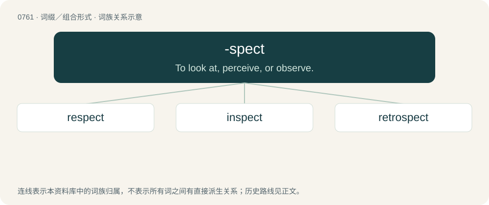

# 0829 · -spect — To look at, perceive, or observe.

[总目录](../00_总目录_按常用程度.md)

**类型**：词缀／组合形式　｜　**来源语言**：见词源记录

## 核心含义与来源

- 核心含义：To look at, perceive, or observe.
- 英文含义：To look at, perceive, or observe.
- 词形：-spect

**来源记录 1**（后缀／后置成分；To look at, perceive, or observe.）

From Latin specio.

## 词族图

## 单词速览（常用到不常用）

| 单词 | 音标 | 释义 |
|---|---|---|
| [respect](#w-1) | 英 /ɹɪˈspɛkt/ | n. 尊敬, 尊重, 问候；vt. 尊敬, 注意, 遵守 |
| [inspect](#w-2) | /ɪnˈspɛkt/ | vt. 检查, 检阅, 检验；vi. 检查 |
| [retrospect](#w-3) | 英 /ˈɹɛtɹəˌspɛkt/ | n. 回顾, 追忆, 回溯；v. 回顾, 追忆 |

## 逐词详解

### 1. respect

**词性**：动词　｜　**音标**：英 /ɹɪˈspɛkt/

**中文释义**：n. 尊敬, 尊重, 问候；vt. 尊敬, 注意, 遵守

**英文义项**：To have respect for. / To have regard for something, to observe a custom, practice, rule or right.

**构词拆分**：re- + -spect

**词源与演化**：

From Middle English respect, from Old French respect, also respit (“respect, regard, consideration”), from Latin respectus (“a looking at, regard, respect”), perfect passive participle of respiciō (“look at, look back upon, respect”), from re- (“back”) + speciō (“to see”), equivalent to re- + -spect. Doublet of respite. The verb is derived from the noun.

**例句**：

> We should respect each other's privacy.

我们应该尊重彼此的隐私。

### 2. inspect

**词性**：动词　｜　**音标**：/ɪnˈspɛkt/

**中文释义**：vt. 检查, 检阅, 检验；vi. 检查

**英文义项**：To examine critically or carefully; especially, to search out problems or determine condition; to scrutinize. / To observe the status or nature of an object beyond what is found obvious upon its initial presentation; to 'view within' the object.

**构词拆分**：in- + -spect

**词源与演化**：

From Latin inspectum, past participle of inspicere (“to look into”), from in (“in”) + specere (“to look at”), equivalent to in- + -spect.

**例句**：

> An engineer will inspect the bridge before it reopens.

工程师将在桥梁重新开放前对其进行检查。

### 3. retrospect

**词性**：名词　｜　**音标**：英 /ˈɹɛtɹəˌspɛkt/

**中文释义**：n. 回顾, 追忆, 回溯；v. 回顾, 追忆

**英文义项**：Consideration of past times.

**构词拆分**：retro- + -spect

**词源与演化**：

Borrowed from Latin retrōspectum, from retrōspicio (“to look back at”), equivalent to retro- + -spect. Compare review.

**例句**：

> In retrospect, maybe I shouldn't have posted that photo in my blog.
