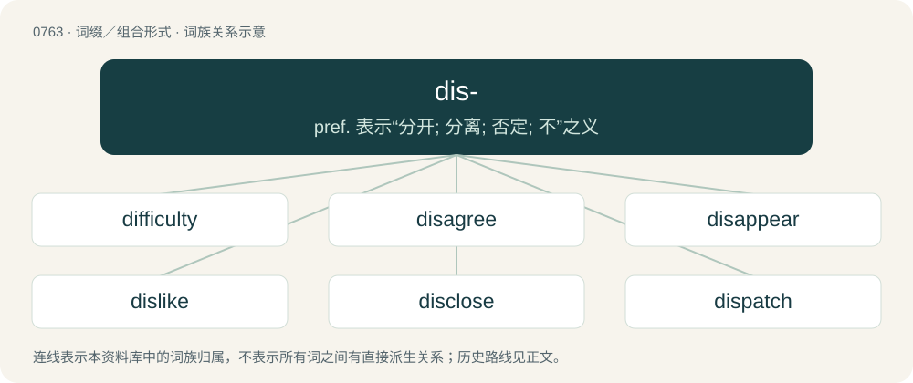

# 0831 · dis- — pref. 表示“分开; 分离; 否定; 不”之义

[总目录](../00_总目录_按常用程度.md)

**类型**：词缀／组合形式　｜　**来源语言**：见词源记录

## 核心含义与来源

- 核心含义：pref. 表示“分开; 分离; 否定; 不”之义
- 英文含义：Not, the reverse of. (Especially forming words with a negative connotation)
- 词形：dis-

**来源记录 1**（前缀／前置成分；Not, the reverse of. (Especially forming words with a negative connotation)）

From Middle English dis-, borrowed from Latin dis-, from Proto-Indo-European \*dwís. Piecewise doublet of bis-; further related to bi-, di-, and twi-. Often confused with the separately inherited prefix dys-.

## 词族图

## 单词速览（常用到不常用）

| 单词 | 音标 | 释义 |
|---|---|---|
| [difficulty](#w-1) | /ˈdɪfɪkəlti/ | n. 困难, 难点 |
| [disagree](#w-2) | 英 /dɪsəˈɡɹiː/；美 /dɪsəˈɡɹi/ | vi. 不一致, 不适宜；\[法\] 抵触, 不同意, 争执 |
| [disappear](#w-3) | 英 /dɪsəˈpɪə/；美 /dɪsəˈpɪɹ/ | vi. 消失, 不见 |
| [dislike](#w-4) | /dɪsˈlaɪk/ | n. 嫌恶；vt. 讨厌, 不喜欢 |
| [disclose](#w-5) | /dɪsˈkləʊz/ | vt. 揭露, 透露；\[法\] 揭发, 揭露, 公开 |
| [dispatch](#w-6) | 英 /dɪˈspæt͡ʃ/；美 /dɪˈspæt͡ʃ/ | vt. 派遣；n. 派遣, 急件；\[计\] 调度 |
| [disagreement](#w-7) | 英 /dɪsəˈɡɹiːmənt/；美 /ˌdɪsəˈɡɹimənt/ | n. 不合, 争论, 不一致；\[法\] 不一致, 不同意, 陪审团的意见不一 |
| [disregard](#w-8) | 英 /dɪsɹɪˈɡɑːd/；美 /dɪsɹɪˈɡɑɹd/ | n. 忽视, 漠视；vt. 忽视, 不顾 |
| [discomfort](#w-9) | 英 /dɪsˈkʌmfət/；美 /dɪsˈkʌmfɚt/ | n. 困苦, 不适；\[医\] 不舒适, 不舒, 烦闷, 不快活 |
| [disrespectful](#w-10) | /dɪs.ɹɪˈspɛkt.fəl/ | a. 失礼的, 无礼的, 不尊敬的 |
| [disrespect](#w-11) | 英 /dɪsɹɪˈspɛkt/ | n. 不敬, 失礼, 无礼 |
| [disable](#w-12) | /dɪsˈeɪbəl/ | vt. 使失去能力, 使残废, (律)使无资格；\[计\] 使无效, 禁止, 关闭 |
| [dishonest](#w-13) | 英 /dɪˈsɒnɪst/；美 /dɪˈsɑnɪst/ | a. 不诚实的；\[法\] 不忠实的, 不诚实的, 欺诈的 |
| [disconnect](#w-14) | /dɪskəˈnɛkt/ | vt. 使分离, 使不相连, 拆开；vi. 断开；\[计\] 断开 |
| [discord](#w-15) | 英 /dɪsˈkɔːd/；美 /dɪsˈkɔɹd/ | 【英文】To untie things which are connected by a cord. |
| [disbelief](#w-16) | 英 /dɪsbɪˈliːf/ | n. 不信, 怀疑 |
| [distrust](#w-17) | 英 /dɪsˈtɹʌst/ | n. 不信任；vt. 不信任 |
| [discard](#w-18) | 英 /dɪsˈkɑːd/；美 /dɪsˈkɑɹd/ | vt. 丢弃, 抛弃；vi. 垫牌；n. 垫牌, 抛弃 |
| [discontent](#w-19) | 英 /ˌdɪskənˈtɛnt/ | n. 不满 |
| [discredit](#w-20) | 英 /dɪsˈkɹɛd.ɪt/ | n. 无信用, 丢脸, 不名誉；vt. 不信, 怀疑, 使丢脸 |
| [disproportionate](#w-21) | 英 /dɪs.pɹəˈpɔː.ʃə.nət/；美 /ˌdɪs.pɹəˈpɔɹ.ʃə.nət/ | a. 不成比例的 |
| [dissatisfaction](#w-22) | 英 /dɪsˌsætɪsˈfækʃən/；美 /dɪsˌsætɪsˈfækʃən/ | n. 不满, 不平 |
| [dissatisfied](#w-23) | /dɪsˈsætɪsˌfaɪd/ | a. 不满的, 显出不满的 |
| [dishonesty](#w-24) | /dɪsˈɒnɪ.sti/ | n. 不诚实；\[法\] 不诚实, 诈欺, 不正 |
| [disorderly](#w-25) | 英 /dɪsˈɔː.də.li/ | a. 无秩序的, 乱的, 骚乱的；\[法\] 妨害治安的, 骚乱的, 无法无天的 |
| [displeasure](#w-26) | 英 /dɪsˈplɛʒə/；美 /dɪsˈplɛʒɚ/ | n. 不愉快, 生气, 不满 |
| [disapprove](#w-27) | 英 /dɪsəˈpɹuːv/ | v. 不赞成 |
| [discontinue](#w-28) | /ˌdɪskənˈtɪnju/ | vi. 中断, 终止, 停止；vt. 使中止 |
| [disqualification](#w-29) | 英 /dɪsˌkwɒlɪfɪˈkeɪʃən/；美 /dɪsˌkwɑːləfɪˈkeɪʃn/ | n. 不适合, 剥夺资格, 不合格, 无资格；\[法\] 无资格, 不合格, 取消资格 |
| [disintegration](#w-30) | 英 /dɪs.ɪn.tɪˈɡɹeɪ.ʃən/；美 /dɪsˌɪnd.əˈɡɹeɪ.ʃən/ | n. 瓦解；\[化\] 破碎; 崩解; 蜕变 |
| [dissimilar](#w-31) | 英 /dɪˈsɪmɪlə(ɹ)/ | a. 不同的, 相异的 |
| [distasteful](#w-32) | 英 /dɪsˈteɪstfəɫ/ | a. 味道差的, 使人不愉快的, 讨厌的 |
| [disinformation](#w-33) | 英 /ˌdɪsɪnfəˈmeɪʃ(ə)n/；美 /ˌdɪsɪnfɚˈmeɪʃən/ | n. 假情报 |
| [disingenuous](#w-34) | /ˌdɪ.sɪnˈd͡ʒɛn.ju.əs/ | a. 不老实的, 不诚实的, 狡猾的 |
| [disqualify](#w-35) | 英 /dɪsˈkwɒlɪfaɪ/；美 /dɪsˈkwɔləfaɪ/ | vt. 使不适合, 取消...资格 |
| [disprove](#w-36) | 英 /dɪsˈpɹuːv/；美 /dɪsˈpɹuv/ | vt. 证明...是不对的, 提出...的反证, 反驳；\[法\] 证明...不成立, 反驳, 驳斥 |
| [disservice](#w-37) | 英 /dɪ(s)ˈsɜːvɪs/；美 /dɪ(s)ˈsɝvɪs/ | n. 伤害, 帮倒忙的行为 |
| [distaste](#w-38) | 美 /(ˌ)dɪsˈteɪst/ | n. 讨厌, 嫌恶 |
| [disinterested](#w-39) | 英 /(ˌ)dɪsˈɪntɹɪstɪd/；美 /dɪsˈɪnt(ə)ɹəstəd/ | a. 无私欲的, 廉洁的, 公平的 |
| [disengage](#w-40) | /ˌdɪsɪŋˈɡeɪd͡ʒ/ | vt. 使脱离, 使松开, 使摆脱约束(或义务等)；vi. 脱离, 解脱 |
| [dishonor](#w-41) | 美 /dɪsˈɑnəɹ/ | n. 不名誉；vt. 玷辱, 使蒙羞 |
| [disintegrate](#w-42) | 英 /dɪsˈɪntɪɡɹeɪt/ | vt. (使)分解, (使)碎裂；\[医\] 分解, 分裂, 蜕变 |
| [disloyal](#w-43) | /disˈlɒiəl/ | a. 不实的, 不义的, 不忠的 |
| [disillusionment](#w-44) | 英 /ˌdɪsɪˈluːʒənmənt/；美 /ˌdɪsɪˈluʒənmənt/ | n. 幻灭,觉醒 |
| [dislodge](#w-45) | 英 /dɪsˈlɒdʒ/ | vt. 逐出, 使移动, 驱逐；vi. 离开原位 |
| [disrepair](#w-46) | 英 /ˌdɪs.ɹɪˈpɛə(ɹ)/；美 /ˌdɪs.ɹɪˈpɛɚ/ | n. 失修, 破损；\[化\] 失修 |
| [disengagement](#w-47) | /ˌdɪs.ɪŋˈɡeɪd͡ʒ.mənt/ | n. 分开, 空闲, 解脱；\[医\] 解脱(分娩) |
| [disown](#w-48) | 英 /dɪsˈəʊn/；美 /dɪsˈoʊn/ | vt. 否认；\[计\] 不认, 驱逐 |
| [dishonour](#w-49) | 英 /dɪsˈɒnə(ɹ)/ | n. 不名誉, 使人丢脸的人/事, 耻辱, 不光彩；vt. 使丧失名誉, 使受耻辱, 使丢脸, 奸污, 拒收, 无法偿付, 拒付 |
| [disorientation](#w-50) | 英 /dɪsˌɔːɹɪənˈteɪʃən/；美 /dɪsˌɔ.ɹi.ɪnˈteɪ.ʃn̩/ | n. 迷向, 迷惑；\[化\] 解取向; 乱取向 |
| [disembark](#w-51) | 英 /ˌdɪs.ɪmˈbɑːk/；美 /ˌdɪs.ɪmˈbɑɹk/ | v. (使)上岸, (使)登陆 |
| [disinfection](#w-52) | /dɪsɪnˈfɛkʃən/ | n. 消毒；\[医\] 消毒 |
| [disobedient](#w-53) | 英 /dɪs.əˈbiː.dɪənt/ | a. 不服从的, 不孝的, 违背的 |
| [disconnection](#w-54) | /ˌdɪs.kəˈnɛk.ʃən/ | n. 分离, 断开, 分开；\[计\] 断开, 拆接, 不连接 |
| [discontinuous](#w-55) | /.diskənˈtinjuəs/ | a. 不连续的, 断续的, 间断的；\[法\] 中断的, 不连续的, 间断的 |
| [discontinuation](#w-56) | /ˈdiskən,tinjuˈeiʃə n/ | n. 停止, 中止, 废止 |
| [dismount](#w-57) | /dɪsˈmaʊnt/ | v. (使)下马；\[计\] 卸除卷 |
| [disavow](#w-58) | /dɪsəˈvaʊ/ | vt. 否认, 否定, 拒绝对...承担责任；\[法\] 不承认, 抵赖, 拒绝对...承担责任 |
| [disuse](#w-59) | /dɪsˈjuːs/ | n. 不被使用, 废弃；vt. 停止使用, 废止 |
| [disassemble](#w-60) | 英 /dɪs.əˈsɛm.bəl/ | vt. 解开, 拆开 |
| [disinterest](#w-61) | 英 /dɪsˈɪntɹɛst/ | n. 无兴趣, 不关心；vt. 使不关心 |
| [disinfect](#w-62) | 英 /dɪs.ɪnˈfɛkt/ | vt. 消毒；\[医\] 消毒 |
| [dispassionate](#w-63) | 英 /dɪsˈpæʃənət/ | a. 冷静的, 不带感情的 |
| [disrepute](#w-64) | 英 /dɪsɹɪˈpjuːt/ | n. 丧失名誉, 坏名声, 不名誉 |
| [disassembly](#w-65) | 英 /dɪsəˈsɛmbli/ | n. 拆卸, 分解；\[计\] 拆卸, 分解 |
| [disbelieve](#w-66) | 英 /dɪsbɪˈliːv/ | v. 不信, 怀疑 |
| [discontinuity](#w-67) | 英 /ˌdɪs.kɒn.tɪˈnjuː.ɪ.ti/；美 /ˌdɪs.kɑn.tɪˈnu.ɪ.ti/ | n. 间断, 中断, 不连续；\[电\] 间断性 |
| [disquiet](#w-68) | /dɪsˈkwaɪ.ɪt/ | vt. 打搅, 使烦恼, 使忧虑, 使不安；n. 不安, 焦虑, 不平静 |
| [discontented](#w-69) | /ˌdɪskənˈtɛntɛd/ | a. 不满意的 |
| [disreputable](#w-70) | /dɪsˈɹɛpjʊtəbəl/ | a. 名誉不好的, 不光彩的, 声名狼藉的 |
| [disenchantment](#w-71) | 英 /ˌdɪsɪnˈtʃɑːntmənt/ | n. 觉醒, 清醒 |
| [disunity](#w-72) | 英 /dɪsˈjuːnɪti/ | n. 不统一 |
| [disillusion](#w-73) | 英 /dɪs.ɪˈluːʒən/ | n. 觉醒, 幻灭；vt. 使醒悟, 使幻想破灭 |
| [disincentive](#w-74) | /ˌdɪsɪnˈsɛntɪv/ | a. 抑制的；n. 抑制因素 |
| [disassociate](#w-75) | 英 /dɪsəˈsəʊʃieɪt/ | v. (使)分离 |
| [disharmony](#w-76) | 英 /dɪsˈhɑːməni/；美 /dɪsˈhɑɹməni/ | n. 不调和, 不一致, 不和谐；\[医\] 不和谐, 失谐, 失调 |
| [disorganization](#w-77) | 英 /dɪsˌɔː(ɹ).ɡənˌaɪˈzeɪ.ʃən/ | n. 组织的破坏, 解体, 瓦解；\[医\] 结构破坏 |
| [dispossession](#w-78) | 英 /dɪspəˈzɛʃn̩/ | n. 强占不动产, 驱逐, 夺取；\[法\] 剥夺, 抢夺, 强占 |
| [disenfranchise](#w-79) | /ˌdɪs.ɪnˈfɹæn.t͡ʃaɪz/ | vt. 剥夺…的公民权（等于disfranchise） |
| [disinclined](#w-80) | 英 /dɪs.ɪŋˈklaɪnd/ | a. 不愿意的, 无意于...的 |
| [disentangle](#w-81) | /.disinˈtængl/ | vi. 解开纠结, 松开, 解决；vt. 解开, 松开 |
| [disambiguation](#w-82) | 英 /dɪsæmˌbɪɡjuːˈeɪʃən/ | \[计\] 澄清, 清除二义性 |
| [displease](#w-83) | /dɪsˈpliːz/ | v. 使不愉快, 使(人)生气 |
| [discolor](#w-84) | /dɪsˈkʰʌlə(ɹ)/ | vi.vt. (使)变色, 污染, (使)褪色；\[计\] 变色, 褪色 |
| [disburse](#w-85) | 美 /dɪsˈbɝs/ | vt. 支付, 支出, 分配；\[经\] 支付, 支出, 偿付 |
| [dislocate](#w-86) | 英 /dɪsləʊˈkeɪt/；美 /dɪsˈloʊkeɪt/ | vt. 脱臼, 弄乱 |
| [disestablishment](#w-87) | /dɪs.ɪsˈtæblɪʃ.mənt/ | n. 解除官职；政教分离 |
| [discoloured](#w-88) | /dɪsˈkʌləd/ | v. 使变色, 使褪色( discolour的过去式和过去分词 ); 变化, 变色, 褪色 |
| [discourteous](#w-89) | 英 /dɪsˈkɜːtɪəs/ | a. 失礼的, 无礼貌的 |
| [disequilibrium](#w-90) | /.disikwiˈlibriəm/ | n. 不均衡, 失调；\[医\] 平衡不稳 |
| [disassociation](#w-91) | /ˌdɪs.əˌsəʊ̯.siˈeɪ̯.ʃən/ | n. 分离, 分裂；\[化\] 离解; 离解作用 |
| [disabuse](#w-92) | 英 /dɪsəˈbjuːz/ | vt. 解迷惑, 使省悟 |

## 逐词详解

### 1. difficulty

**词性**：名词　｜　**音标**：/ˈdɪfɪkəlti/

**中文释义**：n. 困难, 难点

**英文义项**：The state of being difficult, or hard to do. / An obstacle that hinders achievement of a goal.

**构词拆分**：dis- + facile + -ty；difficult + -y

**词源与演化**：

From Middle English difficulte, from Middle French and Anglo-Norman difficulte and their etymon Latin difficultas, from difficul, older form of difficilis (“hard to do, difficult”), from dis- + facilis (“easy”); see difficile and difficult. Equivalent to dis- + facile + -ty. Also analysable as difficult + -y, though the adjective is historically a backformation from the noun.

**例句**：

> My mom is old and has a lot of difficulty (in) remembering all her grandchildren's names.

该用例对应义项：The state of being difficult, or hard to do.

### 2. disagree

**词性**：动词　｜　**音标**：英 /dɪsəˈɡɹiː/；美 /dɪsəˈɡɹi/

**中文释义**：vi. 不一致, 不适宜；\[法\] 抵触, 不同意, 争执

**英文义项**：To fail to agree; to have a different opinion or belief. / To fail to conform or correspond with.

**构词拆分**：dis- + agree

**词源与演化**：

From Middle English disagre (“to refuse to assent to”), from Anglo-Norman disagreer, disagrer, desagreer (“to refuse assent”), from Old French desagreer, desagrëer (“to be disagreeable; to be unpleasant”) (modern French désagréer (“to displease”)); the English word is analysable as dis- + agree.

**例句**：

> My results in the laboratory consistently disagree with yours.

该用例对应义项：To fail to conform or correspond with.

### 3. disappear

**词性**：动词　｜　**音标**：英 /dɪsəˈpɪə/；美 /dɪsəˈpɪɹ/

**中文释义**：vi. 消失, 不见

**英文义项**：To vanish. / To go missing; to become a missing person.

**构词拆分**：dis- + appear

**词源与演化**：

From Middle English disapeeren, equivalent to dis- + appear. Displaced native Old English fordwīnan. Displaced native Old English cwincan, whose causative persists as quench (“put out (fire)”).

**例句**：

> The Chinese government is well-known for disappearing particularly vocal political dissidents.

该用例对应义项：To make vanish; especially, to abduct or murder for political reasons.

### 4. dislike

**词性**：名词　｜　**音标**：/dɪsˈlaɪk/

**中文释义**：n. 嫌恶；vt. 讨厌, 不喜欢

**英文义项**：An attitude or a feeling of distaste or aversion. / Something that a person dislikes (has or feels aversion to).

**构词拆分**：dis- + like

**词源与演化**：

From dis- + like.

**例句**：

> Tell me your likes and dislikes.

该用例对应义项：Something that a person dislikes (has or feels aversion to).

### 5. disclose

**词性**：动词　｜　**音标**：/dɪsˈkləʊz/

**中文释义**：vt. 揭露, 透露；\[法\] 揭发, 揭露, 公开

**英文义项**：To uncover; physically expose to view. / To expose to the knowledge of others; to make known; state openly; reveal (something).

**构词拆分**：By surface analysis, dis- + close

**词源与演化**：

From Middle English disclosen, from Middle French desclos, from Old French desclore, itself from Vulgar Latin disclaudere, from Latin dis- + claudere (“to close, shut”) or as a variant of discludo, discludere (cf. disclude). By surface analysis, dis- + close.

**例句**：

> The auction house would not disclose the price at which the van Gogh had sold.

该用例对应义项：make known to the public information that was previously known only to a few people or that was meant to be kept a secret

### 6. dispatch

**词性**：名词　｜　**音标**：英 /dɪˈspæt͡ʃ/；美 /dɪˈspæt͡ʃ/

**中文释义**：vt. 派遣；n. 派遣, 急件；\[计\] 调度

**英文义项**：A message sent quickly, as a shipment, a prompt settlement of a business, or an important official message sent by a diplomat, government official, military officer, etc. / The act of doing something quickly.

**词源与演化**：

Borrowed from Spanish despachar and/or Italian dispacciare. Further etymology is uncertain. For first element des-, see dis-. Second element probably from either Vulgar Latin \*pactāre (“to fasten"”), \*pactiare or Latin -pedicāre (“to entrap, shackle”), from pedica, from pēs. Ultimately related to impeach through shared Latin root. The first known use in writing (in the past tense, spelled as dispached) is by Bishop Cuthbert Tunstall in 1517. This would be unusually early for a borrowing from a Romance language other than French, but Tunstall had studied in Italy and was Commissioner to Spain, so this word may have been borrowed through diplomatic circles. The alternative spelling despatch was introduced in Samuel Johnson's dictionary, probably by accident. Compare typologically deliver (for the meaning to bring or transport) (&lt; Latin dē- + līberō).

**例句**：

> We must act with dispatch in this matter.

该用例对应义项：The act of doing something quickly.

### 7. disagreement

**词性**：名词　｜　**音标**：英 /dɪsəˈɡɹiːmənt/；美 /ˌdɪsəˈɡɹimənt/

**中文释义**：n. 不合, 争论, 不一致；\[法\] 不一致, 不同意, 陪审团的意见不一

**英文义项**：An argument or debate. / A condition of not agreeing or concurring.

**构词拆分**：dis- + agreement；disagree + -ment

**词源与演化**：

From dis- + agreement or disagree + -ment.

**例句**：

> They had a bit of a disagreement about what color to paint the bedroom, but they have reached a compromise.

该用例对应义项：An argument or debate.

### 8. disregard

**词性**：名词　｜　**音标**：英 /dɪsɹɪˈɡɑːd/；美 /dɪsɹɪˈɡɑɹd/

**中文释义**：n. 忽视, 漠视；vt. 忽视, 不顾

**英文义项**：The act or state of deliberately not paying attention or caring about something.

**构词拆分**：dis- + regard

**词源与演化**：

From dis- + regard. Compare misregard.

**例句**：

> The government's blithe disregard for the needs of disabled people is outrageous.

该用例对应义项：The act or state of deliberately not paying attention or caring about something.

### 9. discomfort

**词性**：名词　｜　**音标**：英 /dɪsˈkʌmfət/；美 /dɪsˈkʌmfɚt/

**中文释义**：n. 困苦, 不适；\[医\] 不舒适, 不舒, 烦闷, 不快活

**英文义项**：Mental or bodily distress. / Something that disturbs one’s comfort; an annoyance.

**构词拆分**：dis- + comfort

**词源与演化**：

From Middle English discomforten, from Anglo-Norman descomforter, equivalent to dis- + comfort.

**例句**：

> Avoid making insensitive comments or jokes that can cause discomfort to others.

### 10. disrespectful

**词性**：形容词　｜　**音标**：/dɪs.ɹɪˈspɛkt.fəl/

**中文释义**：a. 失礼的, 无礼的, 不尊敬的

**英文义项**：Lacking respect. / irrespective, heedless, regardless

**构词拆分**：dis- + respectful

**词源与演化**：

From dis- + respectful.

**例句**：

> Remarks disrespectful of the law.

该用例对应义项：exhibiting lack of respect; rude and discourteous

### 11. disrespect

**词性**：名词　｜　**音标**：英 /dɪsɹɪˈspɛkt/

**中文释义**：n. 不敬, 失礼, 无礼

**英文义项**：A lack of respect, esteem or courteous behavior.

**构词拆分**：dis- + respect

**词源与演化**：

From dis- + respect.

**例句**：

> I assure you, Mr. Ambassador, that we didn't mean any disrespect.

### 12. disable

**词性**：动词　｜　**音标**：/dɪsˈeɪbəl/

**中文释义**：vt. 使失去能力, 使残废, (律)使无资格；\[计\] 使无效, 禁止, 关闭

**英文义项**：To render unable; to take away an ability of, as by crippling. / To impair the physical or mental abilities of; to cause a serious, permanent injury.

**构词拆分**：dis- + able

**词源与演化**：

From dis- + able.

**例句**：

> The pilot had to disable the autopilot of his airplane.

该用例对应义项：To deactivate, to make inoperational (especially of a function of an electronic or mechanical device).

### 13. dishonest

**词性**：形容词　｜　**音标**：英 /dɪˈsɒnɪst/；美 /dɪˈsɑnɪst/

**中文释义**：a. 不诚实的；\[法\] 不忠实的, 不诚实的, 欺诈的

**英文义项**：Not honest; shoddy. / Interfering with honesty.

**构词拆分**：dis- + honest

**词源与演化**：

From Middle English dishoneste (“dishonourable”), from Old French deshoneste, from Latin dehonestus. Equivalent to dis- + honest. Displaced native Old English unsōþfæst.

**例句**：

> There are no dishonest people, only ones who forget to be honest.

### 14. disconnect

**词性**：动词　｜　**音标**：/dɪskəˈnɛkt/

**中文释义**：vt. 使分离, 使不相连, 拆开；vi. 断开；\[计\] 断开

**英文义项**：To sever or interrupt a connection. / To remove the connection between an appliance and an electrical power source.

**构词拆分**：dis- + connect

**词源与演化**：

From dis- + connect.

**例句**：

> My wi-fi got disconnected.

该用例对应义项：To sever or interrupt a connection.

### 15. discord

**词性**：动词　｜　**音标**：英 /dɪsˈkɔːd/；美 /dɪsˈkɔɹd/

**英文义项**：To untie things which are connected by a cord.

**构词拆分**：dis- + cord

**词源与演化**：

From dis- + cord (“tie, bind”).

### 16. disbelief

**词性**：名词　｜　**音标**：英 /dɪsbɪˈliːf/

**中文释义**：n. 不信, 怀疑

**英文义项**：An unpreparedness, unwillingness, or an inability to believe that something is the case. / Astonishment.

**构词拆分**：dis- + belief

**词源与演化**：

From dis- + belief.

**例句**：

> She cried out in disbelief on hearing that terrorists had crashed an airplane into the World Trade Center in New York City.

该用例对应义项：An unpreparedness, unwillingness, or an inability to believe that something is the case.

### 17. distrust

**词性**：名词　｜　**音标**：英 /dɪsˈtɹʌst/

**中文释义**：n. 不信任；vt. 不信任

**英文义项**：Lack of trust or confidence.

**构词拆分**：dis- + trust

**词源与演化**：

From dis- + trust, alteration of the earlier term wantrust.

**例句**：

> Many people have developed a cynical distrust of politicians.

该用例对应义项：Lack of trust or confidence.

### 18. discard

**词性**：动词　｜　**音标**：英 /dɪsˈkɑːd/；美 /dɪsˈkɑɹd/

**中文释义**：vt. 丢弃, 抛弃；vi. 垫牌；n. 垫牌, 抛弃

**英文义项**：To throw away, to reject. / To make a discard; to throw out a card.

**构词拆分**：dis- + card

**词源与演化**：

From dis- + card. Compare Spanish descartar.

**例句**：

> We do not want to discard the article but reshape it.

### 19. discontent

**词性**：名词　｜　**音标**：英 /ˌdɪskənˈtɛnt/

**中文释义**：n. 不满

**英文义项**：Dissatisfaction. / A longing for better times or circumstances.

**构词拆分**：dis- + content

**词源与演化**：

From dis- + content.

**例句**：

> Better to give up possessions than to live in discontent with others.

### 20. discredit

**词性**：动词　｜　**音标**：英 /dɪsˈkɹɛd.ɪt/

**中文释义**：n. 无信用, 丢脸, 不名誉；vt. 不信, 怀疑, 使丢脸

**英文义项**：To harm the good reputation of (a person). / To cause (an idea or piece of evidence) to seem false or unreliable.

**构词拆分**：dis- + credit

**词源与演化**：

From dis- + credit.

**例句**：

> The evidence would tend to discredit such a theory.

该用例对应义项：To cause (an idea or piece of evidence) to seem false or unreliable.

### 21. disproportionate

**词性**：形容词　｜　**音标**：英 /dɪs.pɹəˈpɔː.ʃə.nət/；美 /ˌdɪs.pɹəˈpɔɹ.ʃə.nət/

**中文释义**：a. 不成比例的

**英文义项**：Not proportionate. / Out of proportion.

**构词拆分**：dis- + proportionate

**词源与演化**：

From dis- + proportionate.

**例句**：

> The punishment seemed disproportionate to the crime.

该用例对应义项：Not proportionate.

### 22. dissatisfaction

**词性**：名词　｜　**音标**：英 /dɪsˌsætɪsˈfækʃən/；美 /dɪsˌsætɪsˈfækʃən/

**中文释义**：n. 不满, 不平

**英文义项**：Unhappiness or discontent. / The cause of such feelings.

**构词拆分**：dis- + satisfaction

**词源与演化**：

From dis- + satisfaction.

**例句**：

> Job dissatisfaction results in high turnover.

该用例对应义项：Unhappiness or discontent.

### 23. dissatisfied

**词性**：形容词　｜　**音标**：/dɪsˈsætɪsˌfaɪd/

**中文释义**：a. 不满的, 显出不满的

**英文义项**：Feeling or displaying disappointment or a lack of contentment. / Not satisfied (e.g. with the quality of something).

**构词拆分**：dis- + satisfied

**词源与演化**：

From dis- + satisfied.

**例句**：

> We offer refunds to dissatisfied customers.

该用例对应义项：Not satisfied (e.g. with the quality of something).

### 24. dishonesty

**词性**：名词　｜　**音标**：/dɪsˈɒnɪ.sti/

**中文释义**：n. 不诚实；\[法\] 不诚实, 诈欺, 不正

**英文义项**：The characteristic or condition of being dishonest. / An act which is fraudulent or otherwise dishonest.

**构词拆分**：dis- + honesty；dishonest + -y

**词源与演化**：

From Middle English dishoneste (“disgrace, filth”), from Old French deshoneste, equivalent to dis- + honesty or dishonest + -y.

**例句**：

> He denounced all forms of dishonesty in government.

### 25. disorderly

**词性**：形容词　｜　**音标**：英 /dɪsˈɔː.də.li/

**中文释义**：a. 无秩序的, 乱的, 骚乱的；\[法\] 妨害治安的, 骚乱的, 无法无天的

**英文义项**：Not in order; marked by disorder or disarray. / Not acting in an orderly way, as the functions of the body or mind.

**构词拆分**：disorder + -ly (adjectival suffix)；dis- + orderly

**词源与演化**：

From disorder + -ly (adjectival suffix) or from dis- + orderly.

**例句**：

> The books and papers are in a disorderly state.

该用例对应义项：Not in order; marked by disorder or disarray.

### 26. displeasure

**词性**：名词　｜　**音标**：英 /dɪsˈplɛʒə/；美 /dɪsˈplɛʒɚ/

**中文释义**：n. 不愉快, 生气, 不满

**英文义项**：A feeling of being displeased with something or someone; dissatisfaction; disapproval. / That which displeases; cause of irritation or annoyance; offence; injury.

**构词拆分**：dis- + pleasure

**词源与演化**：

From Old French desplaisir, equivalent to dis- + pleasure. See displease.

**例句**：

> Tom yet again expressed his displeasure over the still ongoing strike.

### 27. disapprove

**词性**：动词　｜　**音标**：英 /dɪsəˈpɹuːv/

**中文释义**：v. 不赞成

**英文义项**：To condemn; to consider wrong or inappropriate; used with of. / To have or express an unfavorable opinion.

**构词拆分**：dis- + approve

**词源与演化**：

From dis- + approve.

**例句**：

> She disapproves of rap music because of its sometimes aggressive lyrics.

该用例对应义项：To condemn; to consider wrong or inappropriate; used with of.

### 28. discontinue

**词性**：动词　｜　**音标**：/ˌdɪskənˈtɪnju/

**中文释义**：vi. 中断, 终止, 停止；vt. 使中止

**英文义项**：To interrupt the continuance of; to put an end to, especially as regards commercial productions; to stop producing, making, or supplying. / To consciously cease the ingestion or administration of (a pharmaceutical drug).

**构词拆分**：dis- + continue

**词源与演化**：

From Old French descontinuer, equivalent to dis- + continue.

**例句**：

> They plan to discontinue that design.

该用例对应义项：To interrupt the continuance of; to put an end to, especially as regards commercial productions; to stop producing, making, or supplying.

### 29. disqualification

**词性**：名词　｜　**音标**：英 /dɪsˌkwɒlɪfɪˈkeɪʃən/；美 /dɪsˌkwɑːləfɪˈkeɪʃn/

**中文释义**：n. 不适合, 剥夺资格, 不合格, 无资格；\[法\] 无资格, 不合格, 取消资格

**英文义项**：The act of disqualifying, or the state of being disqualified / That which disqualifies; that which causes someone to be unfit for a certain purpose or role

**构词拆分**：dis- + qualification

**词源与演化**：

From dis- + qualification.

**例句**：

> Conviction of crime is a disqualification of a person for office.

该用例对应义项：That which disqualifies; that which causes someone to be unfit for a certain purpose or role

### 30. disintegration

**词性**：名词　｜　**音标**：英 /dɪs.ɪn.tɪˈɡɹeɪ.ʃən/；美 /dɪsˌɪnd.əˈɡɹeɪ.ʃən/

**中文释义**：n. 瓦解；\[化\] 破碎; 崩解; 蜕变

**英文义项**：A process by which anything disintegrates. / The condition of anything which has disintegrated.

**构词拆分**：disintegrate + -ion；dis- + integration

**词源与演化**：

From disintegrate + -ion or dis- + integration.

**例句**：

> The sample exhibited an activity of three disintegrations per second.

该用例对应义项：The radioactive decay of a single atom.

### 31. dissimilar

**词性**：形容词　｜　**音标**：英 /dɪˈsɪmɪlə(ɹ)/

**中文释义**：a. 不同的, 相异的

**英文义项**：Not similar; unalike; different.

**构词拆分**：dis- + similar

**词源与演化**：

From dis- + similar.

**例句**：

> A group of very dissimilar people.

该用例对应义项：not similar

### 32. distasteful

**词性**：形容词　｜　**音标**：英 /dɪsˈteɪstfəɫ/

**中文释义**：a. 味道差的, 使人不愉快的, 讨厌的

**英文义项**：Having a bad or foul taste. / Unpleasant.

**构词拆分**：distaste + -ful；dis- + tasteful

**词源与演化**：

From distaste + -ful or dis- + tasteful.

**例句**：

> Scrubbing the floors was a distasteful duty to perform.

该用例对应义项：Unpleasant.

### 33. disinformation

**词性**：动词　｜　**音标**：英 /ˌdɪsɪnfəˈmeɪʃ(ə)n/；美 /ˌdɪsɪnfɚˈmeɪʃən/

**中文释义**：n. 假情报

**英文义项**：To use disinformation.

**构词拆分**：dis- + information

**词源与演化**：

Composed of dis- + information. Attested in the sense “intentional misinformation” in English from 1939. A different usage of disinformation occurred earlier, as early as 1887, as a simple synonym of misinformation.

**例句**：

> A country cannot disinformation its way out of fallen soldiers.

该用例对应义项：To use disinformation.

### 34. disingenuous

**词性**：形容词　｜　**音标**：/ˌdɪ.sɪnˈd͡ʒɛn.ju.əs/

**中文释义**：a. 不老实的, 不诚实的, 狡猾的

**英文义项**：Not honourable; unworthy of honour. / Not ingenuous; not frank or open.

**构词拆分**：dis- + ingenuous

**词源与演化**：

From dis- + ingenuous.

**例句**：

> An ambitious, disingenuous, philistine, and hypocritical operator, who...exemplified...the most disagreeable traits of his time.

该用例对应义项：not straightforward or candid; giving a false appearance of frankness

### 35. disqualify

**词性**：动词　｜　**音标**：英 /dɪsˈkwɒlɪfaɪ/；美 /dɪsˈkwɔləfaɪ/

**中文释义**：vt. 使不适合, 取消...资格

**英文义项**：To make ineligible for something. / To exclude from consideration by the explicit revocation of a previous qualification.

**构词拆分**：dis- + qualify

**词源与演化**：

From dis- + qualify.

**例句**：

> If you swim incorrectly the judges will disqualify you.

### 36. disprove

**词性**：动词　｜　**音标**：英 /dɪsˈpɹuːv/；美 /dɪsˈpɹuv/

**中文释义**：vt. 证明...是不对的, 提出...的反证, 反驳；\[法\] 证明...不成立, 反驳, 驳斥

**英文义项**：To prove to be false or erroneous; to confute; to refute.

**构词拆分**：dis- + prove

**词源与演化**：

From Middle English disproven, dispreven, from Old French desprover, from des- + prover, equivalent to dis- + prove.

**用法示例／搭配（非完整句）**：

> disprove a hypothesis

该用例对应义项：To prove to be false or erroneous; to confute; to refute.

### 37. disservice

**词性**：名词　｜　**音标**：英 /dɪ(s)ˈsɜːvɪs/；美 /dɪ(s)ˈsɝvɪs/

**中文释义**：n. 伤害, 帮倒忙的行为

**英文义项**：Service that results in harm; an (intentionally or unintentionally) unhelpful, harmful action.

**构词拆分**：dis- + service

**词源与演化**：

From dis- + service.

**例句**：

> One renders young people a disservice by heaping unearned rewards on them.

该用例对应义项：Service that results in harm; an (intentionally or unintentionally) unhelpful, harmful action.

### 38. distaste

**词性**：名词　｜　**音标**：美 /(ˌ)dɪsˈteɪst/

**中文释义**：n. 讨厌, 嫌恶

**英文义项**：A feeling of dislike, aversion or antipathy. / Alienation of affection; displeasure; anger.

**构词拆分**：dis- + taste

**词源与演化**：

From dis- + taste.

**例句**：

> He said both men agreed they share an "abhorrence and distaste" for war.

### 39. disinterested

**词性**：形容词　｜　**音标**：英 /(ˌ)dɪsˈɪntɹɪstɪd/；美 /dɪsˈɪnt(ə)ɹəstəd/

**中文释义**：a. 无私欲的, 廉洁的, 公平的

**英文义项**：Having no interest or stake in the outcome, and no conflicts of interest; free of bias, impartial. / Synonym of uninterested (“not interested; not concerned; indifferent”).

**构词拆分**：disinterest (“to cause to be impartial”, verb) + -ed (suffix forming past tense or past participle forms of verbs)；dis- (prefix meaning ‘not’) + interested (“having a stake in; showing interest”, adjective)

**词源与演化**：

From disinterest (“to cause to be impartial”, verb) + -ed (suffix forming past tense or past participle forms of verbs), or from dis- (prefix meaning ‘not’) + interested (“having a stake in; showing interest”, adjective).

**例句**：

> Tom misrepresented himself as a disinterested person with no prior opinions on the matter.

### 40. disengage

**词性**：名词　｜　**音标**：/ˌdɪsɪŋˈɡeɪd͡ʒ/

**中文释义**：vt. 使脱离, 使松开, 使摆脱约束(或义务等)；vi. 脱离, 解脱

**英文义项**：A circular movement of the blade that avoids the opponent's parry

**构词拆分**：dis- + engage

**词源与演化**：

From Middle French désengager ; dis- + engage.

### 41. dishonor

**词性**：名词　｜　**音标**：美 /dɪsˈɑnəɹ/

**中文释义**：n. 不名誉；vt. 玷辱, 使蒙羞

**英文义项**：American standard spelling of dishonour.

**构词拆分**：dis- + honor

**词源与演化**：

From Old French deshonor, equivalent to dis- + honor.

**例句**：

> There's no dishonor in remaining silent when there's nothing to say.

### 42. disintegrate

**词性**：动词　｜　**音标**：英 /dɪsˈɪntɪɡɹeɪt/

**中文释义**：vt. (使)分解, (使)碎裂；\[医\] 分解, 分裂, 蜕变

**英文义项**：To undo the integrity of; to break into parts. / To cause to break up into infinitesimal parts through the use of a disintegrator.

**构词拆分**：dis- + integrate

**词源与演化**：

Recorded since 1785, from dis- + integrate.

**例句**：

> A plastic bag can take up to a thousand years to disintegrate.

### 43. disloyal

**词性**：形容词　｜　**音标**：/disˈlɒiəl/

**中文释义**：a. 不实的, 不义的, 不忠的

**英文义项**：Not loyal, without loyalty.

**构词拆分**：dis- + loyal

**词源与演化**：

From Middle English, from Anglo-Norman desleal, desloial, equivalent to dis- + loyal.

**例句**：

> I may be many things, but disloyal is not one of them.

### 44. disillusionment

**词性**：名词　｜　**音标**：英 /ˌdɪsɪˈluːʒənmənt/；美 /ˌdɪsɪˈluʒənmənt/

**中文释义**：n. 幻灭,觉醒

**英文义项**：A feeling of disappointment, akin to depression, arising from the realization that something is not what it was expected or believed to be, possibly accompanied by philosophical angst from having one's beliefs challenged. / The act of freeing from an illusion; the state of being freed therefrom.

**构词拆分**：dis- + illusion + -ment

**词源与演化**：

From dis- + illusion + -ment.

**例句**：

> There are two things in this war that are causing our disillusionment.

### 45. dislodge

**词性**：动词　｜　**音标**：英 /dɪsˈlɒdʒ/

**中文释义**：vt. 逐出, 使移动, 驱逐；vi. 离开原位

**英文义项**：To remove or force out from a position or dwelling previously occupied. / To move or go from a dwelling or former position.

**构词拆分**：dis- + lodge

**词源与演化**：

From Middle English disloggen, from Old French deslogier. Compare French déloger. Equivalent to dis- + lodge.

**例句**：

> The blow of the hammer was enough to dislodge the loose brick.

### 46. disrepair

**词性**：名词　｜　**音标**：英 /ˌdɪs.ɹɪˈpɛə(ɹ)/；美 /ˌdɪs.ɹɪˈpɛɚ/

**中文释义**：n. 失修, 破损；\[化\] 失修

**英文义项**：The state of being in poor condition, in need of repair.

**构词拆分**：dis- + repair

**词源与演化**：

From dis- + repair.

**例句**：

> The house had fallen into such disrepair that no agent would show it to buyers.

该用例对应义项：The state of being in poor condition, in need of repair.

### 47. disengagement

**词性**：名词　｜　**音标**：/ˌdɪs.ɪŋˈɡeɪd͡ʒ.mənt/

**中文释义**：n. 分开, 空闲, 解脱；\[医\] 解脱(分娩)

**英文义项**：Release or detachment from a physical situation or other involvement. / The release or separation of a chemical.

**构词拆分**：dis- + engage + -ment

**词源与演化**：

From dis- + engage + -ment.

**用法示例／搭配（非完整句）**：

> moral disengagement

该用例对应义项：Release or detachment from a physical situation or other involvement.

### 48. disown

**词性**：动词　｜　**音标**：英 /dɪsˈəʊn/；美 /dɪsˈoʊn/

**中文释义**：vt. 否认；\[计\] 不认, 驱逐

**英文义项**：To refuse to own, or to refuse to acknowledge one’s own. / To repudiate any connection to; to renounce.

**构词拆分**：dis- + own

**词源与演化**：

From dis- + own.

**例句**：

> Lord Capulet and his wife threatened to disown their daughter Juliet if she didn’t go through with marrying Count Paris.

该用例对应义项：To refuse to own, or to refuse to acknowledge one’s own.

### 49. dishonour

**词性**：名词　｜　**音标**：英 /dɪsˈɒnə(ɹ)/

**中文释义**：n. 不名誉, 使人丢脸的人/事, 耻辱, 不光彩；vt. 使丧失名誉, 使受耻辱, 使丢脸, 奸污, 拒收, 无法偿付, 拒付

**英文义项**：Shame or disgrace. / Lack of honour or integrity.

**构词拆分**：dis- + honour

**词源与演化**：

From Old French deshonor, equivalent to dis- + honour.

**例句**：

> You have brought dishonour upon the family.

该用例对应义项：Shame or disgrace.

### 50. disorientation

**词性**：名词　｜　**音标**：英 /dɪsˌɔːɹɪənˈteɪʃən/；美 /dɪsˌɔ.ɹi.ɪnˈteɪ.ʃn̩/

**中文释义**：n. 迷向, 迷惑；\[化\] 解取向; 乱取向

**英文义项**：the loss of one's sense of direction, or of one's position in relationship with the surroundings. / a state of confusion with regard to time, place or identity.

**构词拆分**：dis- + orientation；disorientate + -ation

**词源与演化**：

From dis- + orientation or perhaps disorientate + -ation.

**例句**：

> His disorientation was the result of inattention.

该用例对应义项：confusion (usually transient) about where you are and how to proceed; uncertainty as to direction

### 51. disembark

**词性**：动词　｜　**音标**：英 /ˌdɪs.ɪmˈbɑːk/；美 /ˌdɪs.ɪmˈbɑɹk/

**中文释义**：v. (使)上岸, (使)登陆

**英文义项**：To remove from on board a vessel; to put on shore / To go ashore out of a ship or boat; to leave a train or aircraft.

**构词拆分**：dis- + embark

**词源与演化**：

From dis- + embark.

**例句**：

> The general disembarked the troops.

该用例对应义项：To remove from on board a vessel; to put on shore

### 52. disinfection

**词性**：名词　｜　**音标**：/dɪsɪnˈfɛkʃən/

**中文释义**：n. 消毒；\[医\] 消毒

**英文义项**：Treatment with disinfectant materials in order to destroy harmful microorganisms.

**构词拆分**：dis- + infection

**词源与演化**：

From dis- + infection.

### 53. disobedient

**词性**：形容词　｜　**音标**：英 /dɪs.əˈbiː.dɪənt/

**中文释义**：a. 不服从的, 不孝的, 违背的

**英文义项**：Not obedient.

**构词拆分**：dis- + obedient

**词源与演化**：

From Middle English disobedient, dysobedyent, from Old French desobedient; morphologically, from dis- + obedient.

**例句**：

> That Marionette is a disobedient son who is breaking his father's heart!

### 54. disconnection

**词性**：名词　｜　**音标**：/ˌdɪs.kəˈnɛk.ʃən/

**中文释义**：n. 分离, 断开, 分开；\[计\] 断开, 拆接, 不连接

**英文义项**：Severance of a physical connection. / Unexpected termination of a telephone connection.

**构词拆分**：dis- + connection

**词源与演化**：

From dis- + connection.

**例句**：

> There was a hopeless disconnection between the weary, old teacher and the spirited, young students.

该用例对应义项：Absence of rapport; the nonexistence of, or a breakdown of, effective communication.

### 55. discontinuous

**词性**：形容词　｜　**音标**：/.diskənˈtinjuəs/

**中文释义**：a. 不连续的, 断续的, 间断的；\[法\] 中断的, 不连续的, 间断的

**英文义项**：having breaks or interruptions; intermittent / having at least one discontinuity

**构词拆分**：dis- + continuous

**词源与演化**：

From dis- + continuous.

### 56. discontinuation

**词性**：名词　｜　**音标**：/ˈdiskən,tinjuˈeiʃə n/

**中文释义**：n. 停止, 中止, 废止

**英文义项**：A breach or interruption of continuity. / The process of quitting a course of treatment with a drug.

**构词拆分**：dis- + continuation

**词源与演化**：

From dis- + continuation.

### 57. dismount

**词性**：动词　｜　**音标**：/dɪsˈmaʊnt/

**中文释义**：v. (使)下马；\[计\] 卸除卷

**英文义项**：To (cause to) get off (something). / To make (a mounted drive) unavailable for use.

**构词拆分**：dis- + mount

**词源与演化**：

From dis- + mount, probably a calque of Old French desmonter.

**例句**：

> The VMS operator tried to dismount the Unix hard drive with the DISMOUNT DISK$NFSMOUNT command, instead of umount /mnt/nfshome.

该用例对应义项：To make (a mounted drive) unavailable for use.

### 58. disavow

**词性**：动词　｜　**音标**：/dɪsəˈvaʊ/

**中文释义**：vt. 否认, 否定, 拒绝对...承担责任；\[法\] 不承认, 抵赖, 拒绝对...承担责任

**英文义项**：To strongly and solemnly refuse to own or acknowledge; to deny responsibility for, approbation of, and the like. / To deny; to show the contrary of; to deny legitimacy or achievement of any kind.

**构词拆分**：dis- + avow

**词源与演化**：

From dis- + avow, or from Old French desavouer.

**例句**：

> Because of her dissatisfaction, she now disavows the merits of socialism.

该用例对应义项：To deny; to show the contrary of; to deny legitimacy or achievement of any kind.

### 59. disuse

**词性**：名词　｜　**音标**：/dɪsˈjuːs/

**中文释义**：n. 不被使用, 废弃；vt. 停止使用, 废止

**英文义项**：The state of not being used; neglect.

**构词拆分**：dis- + use

**词源与演化**：

From Old French desuser, equivalent to dis- + use.

**例句**：

> The garden fell into disuse and became overgrown.

该用例对应义项：The state of not being used; neglect.

### 60. disassemble

**词性**：动词　｜　**音标**：英 /dɪs.əˈsɛm.bəl/

**中文释义**：vt. 解开, 拆开

**英文义项**：To take to pieces; to reverse the process of assembly. / To convert machine code to a human-readable, mnemonic form.

**构词拆分**：dis- + assemble

**词源与演化**：

From dis- + assemble.

**例句**：

> To perform the repair it was necessary to disassemble most of the mechanism.

该用例对应义项：To take to pieces; to reverse the process of assembly.

### 61. disinterest

**词性**：名词　｜　**音标**：英 /dɪsˈɪntɹɛst/

**中文释义**：n. 无兴趣, 不关心；vt. 使不关心

**英文义项**：An absence of interest (attention or curiosity). / The absence of interest (bias or stake).

**构词拆分**：dis- + interest

**词源与演化**：

From dis- + interest.

**例句**：

> She eyed him over her martini with cool disinterest.

该用例对应义项：An absence of interest (attention or curiosity).

### 62. disinfect

**词性**：动词　｜　**音标**：英 /dɪs.ɪnˈfɛkt/

**中文释义**：vt. 消毒；\[医\] 消毒

**英文义项**：To sterilize by the use of cleaning agent.

**构词拆分**：dis- + infect

**词源与演化**：

From English dis- + infect, from Middle French desinfecter.

**例句**：

> It's necessary to disinfect the room of a carrier of a contagious disease.

### 63. dispassionate

**词性**：形容词　｜　**音标**：英 /dɪsˈpæʃənət/

**中文释义**：a. 冷静的, 不带感情的

**英文义项**：Not showing, and not affected by, emotion, bias, or prejudice.

**构词拆分**：dis- + passionate

**词源与演化**：

From dis- + passionate.

**例句**：

> A journalist should be a dispassionate reporter of fact.

该用例对应义项：unaffected by strong emotion or prejudice

### 64. disrepute

**词性**：名词　｜　**音标**：英 /dɪsɹɪˈpjuːt/

**中文释义**：n. 丧失名誉, 坏名声, 不名誉

**英文义项**：Loss or want of reputation; ill character.

**构词拆分**：dis- + repute

**词源与演化**：

From dis- + repute.

**例句**：

> The family name fell into disrepute following their son's federal indictment.

### 65. disassembly

**词性**：名词　｜　**音标**：英 /dɪsəˈsɛmbli/

**中文释义**：n. 拆卸, 分解；\[计\] 拆卸, 分解

**英文义项**：The process of disassembling. / The code generated by a disassembler.

**构词拆分**：dis- + assembly

**词源与演化**：

From dis- + assembly.

### 66. disbelieve

**词性**：动词　｜　**音标**：英 /dɪsbɪˈliːv/

**中文释义**：v. 不信, 怀疑

**英文义项**：To not believe; to exercise disbelief. / To actively deny (a statement, opinion or perception).

**构词拆分**：dis- + believe

**词源与演化**：

Coined circa 1640, from dis- + believe. Compare misbelieve.

**例句**：

> If you disbelieve such people, then keep disbelieving them for as long as you live or want.

该用例对应义项：To not believe; to exercise disbelief.

### 67. discontinuity

**词性**：名词　｜　**音标**：英 /ˌdɪs.kɒn.tɪˈnjuː.ɪ.ti/；美 /ˌdɪs.kɑn.tɪˈnu.ɪ.ti/

**中文释义**：n. 间断, 中断, 不连续；\[电\] 间断性

**英文义项**：A lack of continuity, regularity or sequence; a break or gap. / A point in the range of a function at which it is undefined or discontinuous.

**构词拆分**：dis- + continuity

**词源与演化**：

From Late Latin discontinuitās, from discontinuus, equivalent to dis- + continuity.

**例句**：

> The data shows a clear discontinuity in temperature around 1990.

该用例对应义项：A lack of continuity, regularity or sequence; a break or gap.

### 68. disquiet

**词性**：动词　｜　**音标**：/dɪsˈkwaɪ.ɪt/

**中文释义**：vt. 打搅, 使烦恼, 使忧虑, 使不安；n. 不安, 焦虑, 不平静

**英文义项**：To make (someone or something) worried or anxious.

**构词拆分**：dis- + quiet

**词源与演化**：

From dis- + quiet.

**例句**：

> He felt disquieted by the lack of interest the child had shown.

该用例对应义项：To make (someone or something) worried or anxious.

### 69. discontented

**词性**：形容词　｜　**音标**：/ˌdɪskənˈtɛntɛd/

**中文释义**：a. 不满意的

**英文义项**：Experiencing discontent, dissatisfaction. / Of or pertaining to discontent.

**构词拆分**：dis- + contented

**词源与演化**：

From dis- + contented.

**例句**：

> After her injury, Alice was a discontented woman.

该用例对应义项：Experiencing discontent, dissatisfaction.

### 70. disreputable

**词性**：形容词　｜　**音标**：/dɪsˈɹɛpjʊtəbəl/

**中文释义**：a. 名誉不好的, 不光彩的, 声名狼藉的

**英文义项**：Not respectable, lacking repute; discreditable.

**构词拆分**：dis- + reputable

**词源与演化**：

From dis- + reputable.

**例句**：

> In the early 20th century United States, acting was seen as a disreputable profession.

### 71. disenchantment

**词性**：名词　｜　**音标**：英 /ˌdɪsɪnˈtʃɑːntmənt/

**中文释义**：n. 觉醒, 清醒

**英文义项**：The act of disenchanting or the state of being disenchanted. / Freeing from false belief or illusions.

**构词拆分**：dis- + enchantment

**词源与演化**：

From dis- + enchantment. In the social sciences sense a calque of German Entzauberung, as used by sociologist Max Weber.

**例句**：

> Disenchantment with the religion led to a sharp fall in church attendance.

该用例对应义项：Freeing from false belief or illusions.

### 72. disunity

**词性**：名词　｜　**音标**：英 /dɪsˈjuːnɪti/

**中文释义**：n. 不统一

**英文义项**：The lack of unity or cohesion.

**构词拆分**：dis- + unity

**词源与演化**：

From dis- + unity.

**例句**：

> Libya slipped into a period of serious disunity.

### 73. disillusion

**词性**：动词　｜　**音标**：英 /dɪs.ɪˈluːʒən/

**中文释义**：n. 觉醒, 幻灭；vt. 使醒悟, 使幻想破灭

**英文义项**：To free or deprive of illusion; to disenchant.

**构词拆分**：dis- + illusion

**词源与演化**：

From dis- + illusion: literally, the removal or undoing of illusion.

**例句**：

> Disillusion can become itself an illusion if we rest in it.

### 74. disincentive

**词性**：名词　｜　**音标**：/ˌdɪsɪnˈsɛntɪv/

**中文释义**：a. 抑制的；n. 抑制因素

**英文义项**：That which discourages a particular behaviour; a deterrent.

**构词拆分**：dis- + incentive

**词源与演化**：

From dis- + incentive.

**例句**：

> The cold winter wind was definitely a disincentive to cycling.

### 75. disassociate

**词性**：动词　｜　**音标**：英 /dɪsəˈsəʊʃieɪt/

**中文释义**：v. (使)分离

**英文义项**：To separate (oneself); to dissolve one's association with a person, group, or situation. / To separate into smaller discrete units, as with analysis.

**构词拆分**：dis- + associate

**词源与演化**：

From dis- + associate.

**例句**：

> If the whole membership disassociates, the result will be disestablishment.

该用例对应义项：To separate (oneself); to dissolve one's association with a person, group, or situation.

### 76. disharmony

**词性**：名词　｜　**音标**：英 /dɪsˈhɑːməni/；美 /dɪsˈhɑɹməni/

**中文释义**：n. 不调和, 不一致, 不和谐；\[医\] 不和谐, 失谐, 失调

**英文义项**：The absence of harmony or concordance.

**构词拆分**：dis- + harmony

**词源与演化**：

From dis- + harmony.

### 77. disorganization

**词性**：名词　｜　**音标**：英 /dɪsˌɔː(ɹ).ɡənˌaɪˈzeɪ.ʃən/

**中文释义**：n. 组织的破坏, 解体, 瓦解；\[医\] 结构破坏

**英文义项**：The act of disorganizing; destruction of system. / The state of being disorganized

**构词拆分**：dis- + organization

**词源与演化**：

From French désorganiser. Equivalent to dis- + organization.

**用法示例／搭配（非完整句）**：

> the disorganization of the body, or of government

该用例对应义项：The state of being disorganized

### 78. dispossession

**词性**：名词　｜　**音标**：英 /dɪspəˈzɛʃn̩/

**中文释义**：n. 强占不动产, 驱逐, 夺取；\[法\] 剥夺, 抢夺, 强占

**英文义项**：The act of dispossessing someone of something. / The casting out of an evil spirit that has possessed someone; exorcism.

**构词拆分**：dis- + possession

**词源与演化**：

From dis- + possession.

### 79. disenfranchise

**词性**：动词　｜　**音标**：/ˌdɪs.ɪnˈfɹæn.t͡ʃaɪz/

**中文释义**：vt. 剥夺…的公民权（等于disfranchise）

**英文义项**：To deprive someone of a franchise, generally of the right to vote.

**构词拆分**：dis- + enfranchise

**词源与演化**：

From dis- + enfranchise.

**例句**：

> Hooray! We have another dreamy, starry-eyed idealist to disenfranchise and oppress!

### 80. disinclined

**词性**：形容词　｜　**音标**：英 /dɪs.ɪŋˈklaɪnd/

**中文释义**：a. 不愿意的, 无意于...的

**英文义项**：Not inclined; having a disinclination; being unwilling, reluctant.

**构词拆分**：dis- + inclined

**词源与演化**：

From dis- + inclined.

**例句**：

> Disinclined to say anything to anybody.

该用例对应义项：unwilling because of mild dislike or disapproval

### 81. disentangle

**词性**：动词　｜　**音标**：/.disinˈtængl/

**中文释义**：vi. 解开纠结, 松开, 解决；vt. 解开, 松开

**英文义项**：To free something from entanglement; to extricate or unknot. / To unravel; to separate into discrete components or units.

**构词拆分**：dis- + entangle

**词源与演化**：

From dis- + entangle.

**例句**：

> I had to disentangle him from his own shoelaces.

该用例对应义项：To free something from entanglement; to extricate or unknot.

### 82. disambiguation

**词性**：名词　｜　**音标**：英 /dɪsæmˌbɪɡjuːˈeɪʃən/

**中文释义**：\[计\] 澄清, 清除二义性

**英文义项**：The removal of ambiguity. / A page on a wiki containing links to two or more topics with the same name.

**构词拆分**：dis- + ambiguation

**词源与演化**：

From dis- + ambiguation.

**例句**：

> The lexical disambiguation relies on looking ahead to identify possible senses.

该用例对应义项：The removal of ambiguity.

### 83. displease

**词性**：动词　｜　**音标**：/dɪsˈpliːz/

**中文释义**：v. 使不愉快, 使(人)生气

**英文义项**：To make not pleased; to cause a feeling of disapprobation or dislike in; to be disagreeable to; to vex slightly. / To give displeasure or offense.

**构词拆分**：dis- + please

**词源与演化**：

English dis- + please, from Middle English displesen, from Anglo-Norman despleisir, desplere, from Old French desplere (des- + plere).

**例句**：

> That does not seem to displease her.

### 84. discolor

**词性**：动词　｜　**音标**：/dɪsˈkʰʌlə(ɹ)/

**中文释义**：vi.vt. (使)变色, 污染, (使)褪色；\[计\] 变色, 褪色

**英文义项**：To change or lose color.

**构词拆分**：dis- + color

**词源与演化**：

From Middle English discoloren, discoloren, from Old French descolorer, discolorer, equivalent to dis- + color.

**例句**：

> Washing light laundry with dark may cause your clothes to discolor.

该用例对应义项：To change or lose color.

### 85. disburse

**词性**：动词　｜　**音标**：美 /dɪsˈbɝs/

**中文释义**：vt. 支付, 支出, 分配；\[经\] 支付, 支出, 偿付

**英文义项**：To pay out, expend; usually from a public fund or treasury.

**构词拆分**：By surface analysis, dis- + burse (“purse”)

**词源与演化**：

From Old French desbourser (Modern French débourser). By surface analysis, dis- + burse (“purse”).

### 86. dislocate

**词性**：动词　｜　**音标**：英 /dɪsləʊˈkeɪt/；美 /dɪsˈloʊkeɪt/

**中文释义**：vt. 脱臼, 弄乱

**英文义项**：To put something out of its usual place. / To emotionally jar, unsettle, or disorient.

**构词拆分**：dis- + locate

**词源与演化**：

From dis- + locate.

**例句**：

> I don't know what to do if I dislocate a finger.

### 87. disestablishment

**词性**：名词　｜　**音标**：/dɪs.ɪsˈtæblɪʃ.mənt/

**中文释义**：n. 解除官职；政教分离

**英文义项**：The downgrading or dissolution of something that had been established. / Specifically, the removal of state privileges or patronage from a given church; the removal of a policy of having an official governing religion.

**构词拆分**：dis- + establishment + dis- + establish + -ment；dis- + establish + -ment

**词源与演化**：

By surface analysis, dis- + establishment or dis- + establish + -ment.

### 88. discoloured

**词性**：形容词　｜　**音标**：/dɪsˈkʌləd/

**中文释义**：v. 使变色, 使褪色( discolour的过去式和过去分词 ); 变化, 变色, 褪色

**英文义项**：UK standard spelling of discolored.

**构词拆分**：dis- + coloured

**词源与演化**：

From dis- + coloured.

**例句**：

> It was a boy dressed in ragged velveteen breeches, and thin discoloured shirt.

### 89. discourteous

**词性**：形容词　｜　**音标**：英 /dɪsˈkɜːtɪəs/

**中文释义**：a. 失礼的, 无礼貌的

**英文义项**：Impolite; lacking consideration for others.

**构词拆分**：dis- + courteous

**词源与演化**：

From dis- + courteous.

### 90. disequilibrium

**词性**：名词　｜　**音标**：/.disikwiˈlibriəm/

**中文释义**：n. 不均衡, 失调；\[医\] 平衡不稳

**英文义项**：The loss of equilibrium or stability, especially due to an imbalance of forces.

**构词拆分**：dis- + equilibrium

**词源与演化**：

From dis- + equilibrium.

### 91. disassociation

**词性**：名词　｜　**音标**：/ˌdɪs.əˌsəʊ̯.siˈeɪ̯.ʃən/

**中文释义**：n. 分离, 分裂；\[化\] 离解; 离解作用

**英文义项**：dissociation.

**构词拆分**：dis- + association

**词源与演化**：

From dis- + association.

### 92. disabuse

**词性**：动词　｜　**音标**：英 /dɪsəˈbjuːz/

**中文释义**：vt. 解迷惑, 使省悟

**英文义项**：To free (someone) of a misconception or misapprehension; to unveil a falsehood held by (someone).

**构词拆分**：dis- + abuse

**词源与演化**：

From dis- + abuse. Compare French désabuser.

**例句**：

> Nothing could disabuse them of that preposterous notion.
