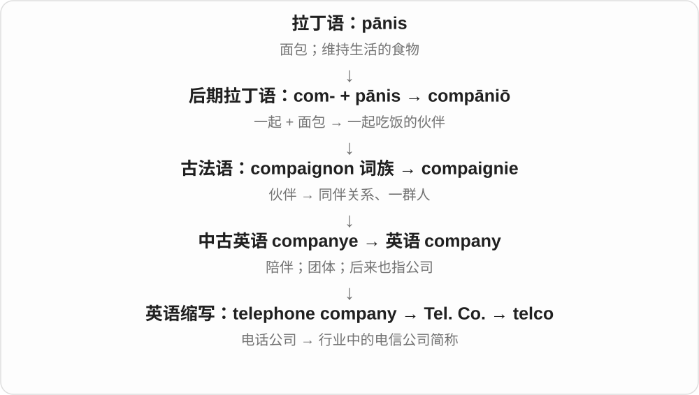

# 0834 · tele- — 远处；跨越距离

[逐词精讲目录](../00_逐词精讲目录.md) · [总目录](../00_总目录_按常用程度.md)

## 核心词根与来源

tele- 来自希腊 têle“远”。不少词是近代利用希腊、拉丁成分创造的技术名词，并不是古希腊人已经拥有这些设备。看后半部分，就知道跨越距离的是声音、图像、文字还是测量。

**TELE = FAR / AT A DISTANCE**

把声音、图像或测量读数送到远处：telephone 传声音，television 传图像，telemetry 把远处读数送回来。telescope 则帮助眼睛观察远方。

- **声音传远**：telephone, telephony, radiotelephone
- **图像与观察**：television, telly, telescope
- **文字和读数**：telegraph, telegram, telemetry
- **想象中的传心**：telepathy, telepathic

## 词形与演化规律

-phone 接声音，-graph 接写与记录，-scope 接观察，-metry 接测量，-pathy 接感受。television 混合希腊来源 tele- 与拉丁来源 vision。telly 是后来的口语缩略，不是另一个独立词根。

## 单词速览（常用到不常用）

| 单词 | 音标 | 核心意思 |
|---|---|---|
| [television](#w-1) | /ˈtelɪvɪʒən/ | 电视；电视节目；电视机 |
| [telephone](#w-2) | 英 /ˈtelɪfəʊn/；美 /ˈteləfoʊn/ | 电话；打电话 |
| [telegraph](#w-3) | 英 /ˈtelɪɡrɑːf/；美 /ˈtelɪɡræf/ | 电报、电报系统；发电报；提前显露意图 |
| [telescope](#w-4) | 英 /ˈtelɪskəʊp/；美 /ˈteləskoʊp/ | 望远镜；伸缩；压缩 |
| [telegram](#w-5) | 英 /ˈtelɪɡræm/；美 /ˈteləɡræm/ | 电报；电报消息 |
| [telly](#w-6) | /ˈteli/ | 电视；电视机〔英式口语〕 |
| [telemetry](#w-7) | 英 /tɪˈlemɪtri/；美 /təˈlemətri/ | 遥测；远程测量数据的传送 |
| [telephony](#w-8) | /təˈlefəni/ | 电话通信；电话技术 |
| [telepathy](#w-9) | /təˈlepəθi/ | 心灵感应；传心术 |
| [telepathic](#w-10) | /ˌtelɪˈpæθɪk/ | 心灵感应的；据称能传心的 |
| [telco](#w-11) | 英 /ˈtelkəʊ/；美 /ˈtelkoʊ/ | 电信公司〔行业简称〕 |
| [telegraphy](#w-12) | /təˈleɡrəfi/ | 电报通信；电报技术 |
| [telegraphic](#w-13) | /ˌtelɪˈɡræfɪk/ | 电报的；像电报一样简短省略的 |
| [telephonic](#w-14) | 英 /ˌtelɪˈfɒnɪk/；美 /ˌteləˈfɑːnɪk/ | 电话的；通过电话进行的 |
| [radiotelephone](#w-15) | 英 /ˌreɪdiəʊˈtelɪfəʊn/；美 /ˌreɪdioʊˈteləfoʊn/ | 无线电话；无线电话机 |

## 逐词讲解

### 1. television — 电视；电视节目；电视机

**音标**：/ˈtelɪvɪʒən/

**先抓住这个画面**

television 的画面是“远处发生的事，被送到眼前来”。它既指技术和媒体，也能指那台设备。

**怎么拆**

tele-（远，希腊语成分）+ vision（视觉，拉丁语词族）；现代跨语言组合，受法语 télévision 影响。

**怎么变成今天的意思**

远距离传送活动图像形成电视。英语中 watch television 常指看电视节目，不特指盯着电视机外壳。

**常见搭配与例句**

watch television；on television；a television programme；a television set。

> We watched the match on television.

我们在电视上看了比赛。

> The hotel room has a small television.

酒店房间里有一台小电视。

**别混淆**

a television 是一台设备；television 不带冠词时常指媒介或节目活动。

### 2. telephone — 电话；打电话

**音标**：英 /ˈtelɪfəʊn/；美 /ˈteləfoʊn/

**先抓住这个画面**

声音不必靠你对着远方大喊，而被设备转成信号送过去。

**怎么拆**

tele- 远 + -phone 声音；现代电传声用法与德语 Telephon 等造词相接，较早法语也用相似词名指远距传声装置。

**怎么变成今天的意思**

**希腊 têle → 构词成分 tele-**  
远处；隔着距离

↓

**希腊来源 tele- + phōnḗ 声音；近代法、德等语言造词**  
让声音跨越距离

↓

**英语 telephone**  
电话；打电话

名词可以是设备或通信方式，动词则是给人打电话。如今口语常简化为 phone；词源不要求设备一定有电线。

**常见搭配与例句**

by telephone；answer the telephone；telephone someone。

> We spoke by telephone before meeting in person.

见面之前，我们先通过电话交谈。

> Please telephone the office if your plans change.

如果计划改变，请打电话通知办公室。

**别混淆**

telephone 传声音；telegraph 原本传编码的信息或文字，二者的后半段不同。

### 3. telegraph — 电报、电报系统；发电报；提前显露意图

**音标**：英 /ˈtelɪɡrɑːf/；美 /ˈtelɪɡræf/

**先抓住这个画面**

文字不必由信使一路送过去，而是变成信号，让远处的人收到；比喻义则像神情提前把心里的消息发了出去。

**怎么拆**

借法语 télégraphe，由希腊来源 télé- 远 + -graphe 写组成；最早用于可视信号装置，后来用于电报，不是一开始就专指电流。

**怎么变成今天的意思**

**希腊 graphein／graphē**  
刻画、写；文字、图画

↓

**希腊 tēle 远 + 写画构件 → 法语 télégraphe**  
远距离传送文字信息的装置

↓

**英语 telegraph**  
早指可视信号传送装置；后包括电报系统，并转为动词

历史中可指设备、通信系统或消息。动词 telegraph a message 是发电报；telegraph disappointment 是把失望明显表露出来，别人还没听你开口就看懂了。

**常见搭配与例句**

a telegraph line；send by telegraph；telegraph a message；telegraph an intention。

> The town was connected to the capital by telegraph.

小镇通过电报与首都联系。

> Her expression telegraphed her disappointment before she spoke.

她还没开口，表情就显露了失望。

**别混淆**

telegram 主要是发出的电报消息；telegraph 常指装置、系统或发送动作。telephone 远传声音。

### 4. telescope — 望远镜；伸缩；压缩

**音标**：英 /ˈtelɪskəʊp/；美 /ˈteləskoʊp/

**先抓住这个画面**

让远处的东西进入可观察的视野，是 telescope 最直接的画面；可伸缩镜筒又带出动词义。

**怎么拆**

tele- 远 + scope 看，来自近代拉丁 tēlescopium，采用希腊来源成分造词。

**怎么变成今天的意思**

**希腊 têle → 构词成分 tele-**  
远处；隔着距离

↓

**近代拉丁 tēlescopium〔tele- + scope 看〕**  
观察远处的仪器

↓

**英语 telescope**  
望远镜；像镜筒一样伸缩、压缩

不只普通光学望远镜，radio telescope 也用于观测。动词可说部件套叠缩短，也可比喻把长时间内容压缩进短篇幅。

**常见搭配与例句**

look through a telescope；a radio telescope；telescope into。

> We looked at the moon through a telescope.

我们通过望远镜观察月亮。

> The film telescopes twenty years of history into two hours.

这部电影把二十年历史压缩进两个小时。

**别混淆**

microscope 看微小事物；telescope 看远处。telescopic 的伸缩义来自仪器结构，不能一律直译“远看”。

### 5. telegram — 电报；电报消息

**音标**：英 /ˈtelɪɡræm/；美 /ˈteləɡræm/

**先抓住这个画面**

把短消息远距离传过去，再由对方收到写下的文字。

**怎么拆**

十九世纪用 tele-“远” + -gram“写下的消息”造词；不是古希腊已经存在的电报名称。

**怎么变成今天的意思**

**希腊语 graphein 与 gramma / grammat-**  
写、画 → 写下或画出的符号、字母

↓

**近代英语 tele- + -gram → telegram**  
远距离传送的文字消息

传统电报通常讲究简短，因为费用与字数等因素有关。今天在历史叙述中更常见；大写 Telegram 也可另作应用名称。

**常见搭配与例句**

send a telegram；receive a telegram；a congratulatory telegram。

> A telegram arrived announcing the ship’s safe return.

一封电报送到了，通知船只已经平安返航。

> She kept the congratulatory telegram in a drawer.

她把那封贺电保存在抽屉里。

**别混淆**

telegraph 是通信系统、装置或发报动作；telegram 是通过它发出的消息。

### 6. telly — 电视；电视机〔英式口语〕

**音标**：/ˈteli/

**先抓住这个画面**

说话随意时，把 television 缩短，再加亲切的小尾巴，就像中文说“看电视”时不用正式设备名称。

**怎么拆**

television 的缩略形式 + -y；这里的 tel- 不是 tell“告诉”。

**怎么变成今天的意思**

**希腊 têle → 构词成分 tele-**  
远处；隔着距离

↓

**tele- + 拉丁来源 vision → television**  
远距离传送图像 → 电视

↓

**英语 television 缩略 + -y → telly**  
电视、电视机的口语称呼

主要学英式口语电视义。俚语中也可能由 hotel/motel 缩成 telly，那是另一来源；谈节目时通常指电视。

**常见搭配与例句**

watch telly；on the telly；turn off the telly。

> There is a good documentary on telly tonight.

今晚电视上有部不错的纪录片。

> Could you turn the telly down a little?

能把电视声音调小一点吗？

**别混淆**

TV 使用范围很广；telly 更有英式随意聊天的感觉。

### 7. telemetry — 遥测；远程测量数据的传送

**音标**：英 /tɪˈlemɪtri/；美 /təˈlemətri/

**先抓住这个画面**

仪器在远处测出温度、位置或设备状态，再把读数送回你这里。

**怎么拆**

tele- 远 + -metry 测量；是现代科学构词，不必先经过英语 meter 这个完整单词。

**怎么变成今天的意思**

**希腊 têle → 构词成分 tele-**  
远处；隔着距离

↓

**tele- + -metry〔希腊来源的测量成分〕**  
从远处取得测量

↓

**英语 telemetry**  
遥测技术；传回的测量数据

航天、设备监测和软件系统都可用。重点是采集并传回数据，不等于远程操纵设备。

**常见搭配与例句**

telemetry data；a telemetry system；transmit telemetry。

> The satellite transmitted telemetry to the ground station.

卫星把遥测数据传回地面站。

> Engineers used telemetry to monitor the equipment during the test.

工程师在测试中利用遥测监控设备状态。

**别混淆**

remote control 是远程发指令；telemetry 是把状态和读数传回来，两者可同时存在。

### 8. telephony — 电话通信；电话技术

**音标**：/təˈlefəni/

**先抓住这个画面**

不只是一部电话，而是把通话送到另一端的一整套技术与业务。

**怎么拆**

telephone + -y；telephone 的 tele- 来自希腊“远”，后半来自“声音”。

**怎么变成今天的意思**

**希腊 phōnḗ〔φωνή〕**  
声音、嗓音；与“说话”的动词相连

↓

**近代 telephone：tele- “远” + -phone “声音”**  
把声音传到远处；相应名称经法语等技术用法发展

↓

**英语 telephone + -y → telephony**  
电话的传声过程、系统和技术

internet telephony 是通过互联网实现语音通信。telephony 着眼于通话系统和服务，不是某个手机品牌，也不限于铜线。重音在第二音节，与 telephone 不同。

**常见搭配与例句**

mobile telephony；internet telephony；telephony services。

> Internet telephony allowed the offices to communicate cheaply.

互联网电话技术让各办公室能低成本通话。

> The course covers the history of mobile telephony.

课程讲授移动电话通信的发展史。

**别混淆**

telephone 是设备或打电话；telephony 是通信领域或技术，通常不可数。

### 9. telepathy — 心灵感应；传心术

**音标**：/təˈlepəθi/

**先抓住这个画面**

故事里两个人不说话、不发消息，却直接知道对方的想法；这类设想叫 telepathy。

**怎么拆**

tele- 远 + -pathy 感受，接希腊 páthos；英语近代造词。

**怎么变成今天的意思**

**希腊 têle → 构词成分 tele-**  
远处；隔着距离

↓

**tele- + -pathy〔接希腊 páthos 感受〕**  
隔着距离感受

↓

**英语 telepathy**  
不用常规感官交流思想的所谓能力

说的是据称无需通常感官通道就能传递思想的能力，并非已经确立的日常通信方式。小说中常见，生活中也可夸张说彼此很默契。

**常见搭配与例句**

communicate by telepathy；a claim of telepathy。

> In the novel, the twins communicate by telepathy.

小说中，这对双胞胎通过心灵感应交流。

> Their perfect timing seemed almost like telepathy.

他们配合的时机如此默契，简直像有心灵感应。

**别混淆**

telecommunications 指通过技术进行的远程通信；telepathy 的设定是直接传心，不能混为已证实技术。

### 10. telepathic — 心灵感应的；据称能传心的

**音标**：/ˌtelɪˈpæθɪk/

**先抓住这个画面**

把 telepathy 变成形容词，用来描写这种交流方式，或故事里拥有这种能力的人。

**怎么拆**

telepathy 对应 -ic 形容词；词尾 -y 改为 -ic，重音也随之变化。

**怎么变成今天的意思**

**希腊 têle → 构词成分 tele-**  
远处；隔着距离

↓

**tele- + -pathy〔接希腊 páthos 感受〕**  
隔着距离感受

↓

**英语 telepathy**  
不用常规感官交流思想的所谓能力

↓

**英语 telepathy → telepathic**  
心灵感应 → 心灵感应的

telepathic powers 是虚构或声称的传心能力。体育评论中 telepathic understanding 通常只是夸张说配合极其默契。

**常见搭配与例句**

telepathic communication；telepathic powers；telepathic understanding。

> The story gives its heroine telepathic powers.

故事赋予女主人公心灵感应能力。

> The two musicians seemed to have a telepathic understanding.

这两位音乐家仿佛心意相通，配合极其默契。

**别混淆**

empathetic 是能理解他人的感受；telepathic 是仿佛直接读取或传递思想，二者不是同一能力。

### 11. telco — 电信公司〔行业简称〕

**音标**：英 /ˈtelkəʊ/；美 /ˈtelkoʊ/

**先抓住这个画面**

把 telephone company 这两个长词压短，变成行业里顺口说的“电信公司”。

**怎么拆**

tel(ephone) + co(mpany)；也与公司名称里 Tel. Co. 的缩写传统有关。与面包词根的联系藏在 company 里，不是 tel 本身。

**怎么变成今天的意思**

新闻和行业讨论中常用，范围可随语境包括固定电话、移动通信和其他电信业务；普通文章写 telecommunications company 更完整。

**常见搭配与例句**

a local telco；a major telco；telco services。

> The local telco is upgrading its network.

当地电信公司正在升级网络。

> Several telcos took part in the industry meeting.

几家电信公司参加了行业会议。

**别混淆**

telco 指企业；telecom 可指电信行业、业务或其相关事物。

### 12. telegraphy — 电报通信；电报技术

**音标**：/təˈleɡrəfi/

**先抓住这个画面**

关注的是怎样把消息编码、传送、再读出来这一整套通信活动，而不是某一封电报。

**怎么拆**

telegraph + -y，英语活动、技术名词；tele- 远，-graphy 记录或传写。

**怎么变成今天的意思**

**希腊 graphein／graphē**  
刻画、写；文字、图画

↓

**希腊 tēle 远 + 写画构件 → 法语 télégraphe**  
远距离传送文字信息的装置

↓

**英语 telegraph**  
早指可视信号传送装置；后包括电报系统，并转为动词

↓

**英语 telegraph + -y → telegraphy**  
借电报系统传递信息的技术与活动

可谈 electrical telegraphy、wireless telegraphy。旧的光学信号系统也属于其历史，不能把所有 telegraphy 都限成有线电报。

**常见搭配与例句**

wireless telegraphy；the history of telegraphy；learn telegraphy。

> The exhibition traces the development of telegraphy.

展览梳理了电报通信的发展。

> Wireless telegraphy allowed ships to exchange coded messages.

无线电报让船只能够交换编码消息。

**别混淆**

telegraph 是设备、系统或动词；telegraphy 是通信技术、方法这一层；telegram 是消息成品。

### 13. telegraphic — 电报的；像电报一样简短省略的

**音标**：/ˌtelɪˈɡræfɪk/

**先抓住这个画面**

旧式电报往往惜字如金，只留下必要信息；telegraphic style 就让句子像这种短讯。

**怎么拆**

telegraph + -ic，英语形容词；后来把电报常见的简短表达方式借来形容语言。

**怎么变成今天的意思**

**希腊 graphein／graphē**  
刻画、写；文字、图画

↓

**希腊 tēle 远 + 写画构件 → 法语 télégraphe**  
远距离传送文字信息的装置

↓

**英语 telegraph**  
早指可视信号传送装置；后包括电报系统，并转为动词

↓

**英语 telegraph + -ic → telegraphic**  
电报方面的；表达简短省略的

telegraphic communication 是电报通信；telegraphic notes 是省掉许多连接词、只记重点的笔记。简短可能有效，也可能让读者得自己补足关系。

**常见搭配与例句**

telegraphic communication；a telegraphic style；telegraphic notes。

> His notes were telegraphic but easy for him to follow.

他的笔记很简略，不过他自己容易看懂。

> The archive contains records of early telegraphic communication.

档案保存了早期电报通信的记录。

**别混淆**

concise 强调精练且保留必要内容；telegraphic 常进一步带省略、片段式表达的感觉。

### 14. telephonic — 电话的；通过电话进行的

**音标**：英 /ˌtelɪˈfɒnɪk/；美 /ˌteləˈfɑːnɪk/

**先抓住这个画面**

把“这件事是通过电话完成的”放到名词前说明。

**怎么拆**

telephone + -ic，去掉词尾 e，重音移到 -phon-。

**怎么变成今天的意思**

**希腊 phōnḗ〔φωνή〕**  
声音、嗓音；与“说话”的动词相连

↓

**近代 telephone：tele- “远” + -phone “声音”**  
把声音传到远处；相应名称经法语等技术用法发展

↓

**英语 telephone + -ic → telephonic**  
与电话有关的；通过电话传递的

telephonic interview 是电话访谈，telephonic communication 是电话通信。这种形容词较正式；日常更常直接说 a phone interview。

**常见搭配与例句**

telephonic communication；a telephonic interview；telephonic contact。

> The report was based on a telephonic interview.

报告依据一次电话访谈写成。

> They maintained telephonic contact throughout the journey.

旅途中他们一直保持电话联系。

**别混淆**

telephonic 说通信方式；phonetic 说语音性质，不是同一个技术领域。

### 15. radiotelephone — 无线电话；无线电话机

**音标**：英 /ˌreɪdiəʊˈtelɪfəʊn/；美 /ˌreɪdioʊˈteləfoʊn/

**先抓住这个画面**

telephone 的声音通信改走无线电链路，于是远处的人不必靠一条直接连接的电话线交流。

**怎么拆**

radio 无线电 + telephone 电话；在已有电话词上明确传输方式。

**怎么变成今天的意思**

**希腊 têle → 构词成分 tele-**  
远处；隔着距离

↓

**希腊来源 tele- + phōnḗ 声音；近代法、德等语言造词**  
让声音跨越距离

↓

**英语 telephone**  
电话；打电话

↓

**英语 radio + telephone → radiotelephone**  
电话 → 通过无线电进行的电话通信装置

常见于航海、航空或通信技术文字。名词重点是无线电传声，不一定特指今天某一款手机。

**常见搭配与例句**

a marine radiotelephone；a radiotelephone link。

> The crew contacted the harbour by radiotelephone.

船员通过无线电话联系了港口。

> The expedition carried a radiotelephone for communication with the base.

探险队携带无线电话，用于与基地通信。

**别混淆**

radio 可泛指无线电或单向广播；radiotelephone 强调供人交谈的声音通信。

## 这一组要分清什么

telemetry 收数据，remote control 发控制指令；telepathy 是所谓心灵感应，不能等同于已确立的通信技术。telephone 与 telegraph 的区别在传声和传信方式。

## 串起来练习

The team used a telescope to observe the sky and a radiotelephone to contact the base. Telemetry carried the instrument readings back.

团队用望远镜观察天空，用无线电话联系基地；仪器读数通过遥测传回。
