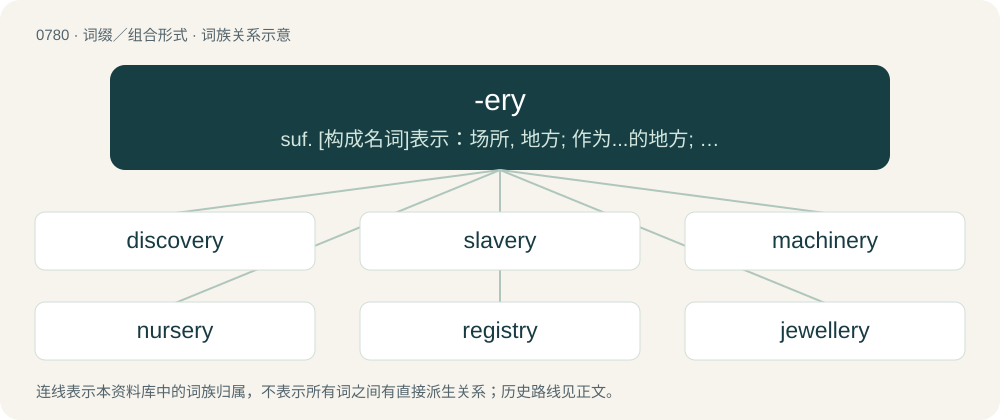

# 0848 · -ery — suf. \[构成名词\]表示：场所, 地方; 作为...的地方; 实践, 动作, 职业, 技术; ...类的产品(或货物); 集体

[总目录](../00_总目录_按常用程度.md)

**类型**：词缀／组合形式　｜　**来源语言**：见词源记录

## 核心含义与来源

- 核心含义：suf. \[构成名词\]表示：场所, 地方; 作为...的地方; 实践, 动作, 职业, 技术; ...类的产品(或货物); 集体
- 英文含义：Added to occupational etc. nouns to form other nouns meaning the "art, craft, or practice of."
- 词形：-ery

**多个词源／构词路径**：同一拼写可能有不同来源；以下按词性和含义分别列出。

**来源记录 1**（后缀／后置成分；Added to occupational etc. nouns to form other nouns meaning the "art, craft, or practice of."）

From Middle English -erie, from Anglo-Norman -erie, which is from -ier + -ie; a suffix forming abstract nouns. The suffix first occurs in loans from Old French into Middle English, but becomes productive within English by the 16th century, in some instances properly a combination of the agent suffix -er with -y as in bakery, brewery, but also as a single suffix in terms like slavery, machinery (which are not derived from slaver or machiner). By surface analysis, -er + -y.

**来源记录 2**（后缀／后置成分；Forming adjectives.）

Alteration of -y.

## 词族图

## 单词速览（常用到不常用）

| 单词 | 音标 | 释义 |
|---|---|---|
| [discovery](#w-1) | 英 /dɪˈskʌv.ɹi/ | n. 发现, 被发现的事物；\[法\] 要求告知, 发现, 发觉 |
| [slavery](#w-2) | /ˈsleɪvəɹi/ | n. 奴隶的身分, 奴隶状态, 奴隶制度；\[法\] 奴隶制度, 奴役, 苦役 |
| [machinery](#w-3) | /məˈʃiːnəɹi/ | n. 机器, 机械装置, 机构；\[化\] 机械 |
| [nursery](#w-4) | 英 /ˈnɜːsəɹi/；美 /ˈnɝsəɹi/ | n. 托儿所, 苗圃, 温床；\[医\] 婴儿室, 托儿所 |
| [registry](#w-5) | 英 /ˈɹɛd͡ʒɪstɹi/ | n. 登记处, 登记名册；\[计\] 登录库 |
| [jewellery](#w-6) | 美 /ˈd͡ʒʊ-/；/ˈd͡ʒuː(ə)lɹi/ | n. 宝石, 贵重饰物, 珠宝, 宝石饰物, 受珍视的人/物, 宝贝, 有价值的人/物 |
| [pottery](#w-7) | 英 /ˈpɒtəɹi/；美 /ˈpɑtəɹi/ | n. 陶器, 陶器厂；\[化\] 陶器 |
| [scenery](#w-8) | /ˈsiːnəɹi/ | n. 风景, 景色, 舞台布景 |
| [bakery](#w-9) | /ˈbeɪ.kə.ɹi/ | n. 面包店 |
| [brewery](#w-10) | /ˈbɹuːəɹi/ | n. 啤酒厂, 酿酒厂；\[经\] 酿造所 |
| [bribery](#w-11) | /ˈbɹaɪbəɹi/ | n. 贿赂行为, 行贿, 受贿；\[经\] 行贿, 受贿 |
| [mockery](#w-12) | 英 /ˈmɒkəɹi/；美 /ˈmɑkəɹi/ | n. 嘲弄, 笑柄, 歪曲 |
| [archery](#w-13) | /ˈɑɹt͡ʃəɹiː/ | n. 射箭术 |
| [distillery](#w-14) | 英 /dɪˈstɪləɹi/ | n. 蒸馏室, 酿酒厂, 酒厂；\[化\] 酒厂; 造酒厂 |
| [fishery](#w-15) | /ˈfɪʃəɹi/ | n. 渔业；\[法\] 捕鱼, 捕鱼权 |
| [forgery](#w-16) | 英 /ˈfɔː.dʒəɹ.ɪ/；美 /ˈfɔːɹ.d͡ʒəɹ.ɪ/ | n. 伪造, 伪造罪, 伪造物；\[经\] 伪造签字, 伪造品 |
| [cookery](#w-17) | /ˈkʊk(ə)ɹi/ | n. 烹调法, 烹调术 |
| [trickery](#w-18) | 美 /ˈtɹɪ.kə.ɹi/ | n. 欺骗, 欺诈, 诡计；\[法\] 诡计, 奸计, 诈骗 |
| [upholstery](#w-19) | 英 /ʌpˈhəʊlstəɹi/ | n. 家具被覆材料, 家具装饰用品业 |
| [midwifery](#w-20) | 英 /mɪdˈwɪfəɹi/；美 /ˈmɪdˌwaɪfəɹi/ | n. 助产术, 产科学；\[医\] 助产学, 产科学 |
| [flowery](#w-21) | 英 /ˈflaʊəɹi/；美 /ˈflaʊəɹi/ | 【英文】A place where flowers grow. |
| [greenery](#w-22) | /ˈɡɹiːnəɹi/ | n. 绿叶, 绿树, 装饰用的绿树枝或叶 |
| [hatchery](#w-23) | 英 /ˈhæt͡ʃəɹi/；美 /ˈhæt͡ʃəɹi/ | n. 孵卵处 |
| [eatery](#w-24) | /ˈiːtəɹi/ | n. 简便饮食店 |
| [debauchery](#w-25) | 英 /dɪˈbɔː.t͡ʃə.ɹi/；美 /dɪˈbɔ.t͡ʃə.ɹi/ | n. 放荡, 堕落 |
| [fuckery](#w-26) | /ˈfʌkəɹi/ | 【英文】Nonsense, bullshit, or underhanded trickery. |
| [gunnery](#w-27) | /ˈɡʌn.əɹ.i/ | n. 火炮制造与射击学, 射击, 炮击, 枪炮制造 |
| [creamery](#w-28) | /ˈkriːməri/ | n. 乳品厂, 乳制品商店；\[建\] 乳油制造厂 |
| [crockery](#w-29) | 英 /ˈkɹɒkəɹi/；美 /ˈkɹɑk(ə)ɹi/ | n. 陶器, 瓦器；\[化\] 土器 |
| [cannery](#w-30) | /ˈkænəri/ | n. 罐头厂；\[机\] 罐头工厂 |
| [drudgery](#w-31) | 英 /ˈdɹʌd͡ʒəɹi/ | n. 苦差事, 苦工 |
| [butchery](#w-32) | /ˈbʊt͡ʃəɹi/ | 【英文】The stereotypical behaviors and accoutrements of a butch lesbian. |
| [thievery](#w-33) | 英 /ˈθiːv.(ə)ɹ.i/ | n. 偷窃, 赃物；\[法\] 偷窃行为, 被窃之物, 偷窃事件 |
| [snobbery](#w-34) | British/Southern/Standard /ˈsnɔbəɹɪj/ | n. 谄上欺下, 势利 |
| [shrubbery](#w-35) | /ˈʃɹʌbəɹi/ | n. 灌木, 灌木林 |
| [nunnery](#w-36) | /ˈnʌn(ə)ɹi/ | n. 女修道院, 尼姑庵 |
| [tannery](#w-37) | /ˈtænəɹi/ | n. 制革厂, 硝皮厂；\[化\] 鞣革厂; 皮革厂 |
| [quackery](#w-38) | 美 /ˈkwækəɹi/ | n. 骗人的治疗, 招摇撞骗, 骗子的行为；\[医\] 江湖医术 |
| [perfumery](#w-39) | /pəˈfjuːm(ə)ri/ | n. 香料类, 香水(总称), 香料制造业 |
| [tracery](#w-40) | /ˈtɹeɪsəɹi/ | n. 窗花格, 装饰线条 |
| [deanery](#w-41) | 英 /ˈdiː.nə.ɹi/ | n. 教区, 院长宅邸 |
| [rookery](#w-42) | /ˈrukəri/ | n. 海豹群, 群栖处, 企鹅群, 贫民窟, 同类人的集中处, 同类物的集中处 |
| [demagoguery](#w-43) | 英 /ˌdɛməˈɡɒɡəɹi/；美 /ˌdɛməˈɡɑɡəɹi/ | n. 煽动, 煽动行为, 散布谣言 |
| [buffoonery](#w-44) | Canada /bəˈfuːnəɹi/ | n. 打诨, 滑稽 |
| [fakery](#w-45) | /-kəri/ | n. 伪造, 赝品, 假货, 伪装, 捏造；\[法\] 伪造, 捏造, 伪装 |
| [thuggery](#w-46) | /ˈθʌɡəɹi/ | n. 谋财害命 |
| [witchery](#w-47) | /ˈwitʃəri/ | n. 巫术, 魅力 |

## 逐词详解

### 1. discovery

**词性**：名词　｜　**音标**：英 /dɪˈskʌv.ɹi/

**中文释义**：n. 发现, 被发现的事物；\[法\] 要求告知, 发现, 发觉

**英文义项**：Something discovered. / The discovering of new things.

**构词拆分**：discover + -ery

**词源与演化**：

from discover + -ery, on the pattern of the pair recover, recovery. Displaced native Old English onfundennes.

**例句**：

> This latest discovery should eventually lead to much better treatments for disease.

该用例对应义项：Something discovered.

### 2. slavery

**词性**：名词　｜　**音标**：/ˈsleɪvəɹi/

**中文释义**：n. 奴隶的身分, 奴隶状态, 奴隶制度；\[法\] 奴隶制度, 奴役, 苦役

**英文义项**：An institution or social practice of owning human beings as property, especially for use as forced laborers. / Forced labor in general, regardless of legality.

**构词拆分**：slave + -ery

**词源与演化**：

From slave + -ery.

**例句**：

> Slavery was abolished in the nineteenth century.

该用例对应义项：An institution or social practice of owning human beings as property, especially for use as forced laborers.

### 3. machinery

**词性**：名词　｜　**音标**：/məˈʃiːnəɹi/

**中文释义**：n. 机器, 机械装置, 机构；\[化\] 机械

**英文义项**：The machines constituting a production apparatus, in a plant etc., collectively. / The working parts of a machine as a group.

**构词拆分**：machine + -ery

**词源与演化**：

From machine + -ery. Compare French machinerie.

**例句**：

> All of the machinery of the law was brought to bear on the investigation.

该用例对应义项：The collective parts of something which allow it to function.

### 4. nursery

**词性**：名词　｜　**音标**：英 /ˈnɜːsəɹi/；美 /ˈnɝsəɹi/

**中文释义**：n. 托儿所, 苗圃, 温床；\[医\] 婴儿室, 托儿所

**英文义项**：Especially in European countries: a room or area in a household set apart for the care of children. / An institution for small children who not yet have begun primary school during daytime (when their parents work); a daycare centre.

**词源与演化**：

From Middle English noricerie, norserye (“children's nursery; state of being fostered or nursed; education, upbringing”) \[and other forms\], from Old French norricerie, nourricerie, from norrice, nourrice (modern French nourrice (“childminder, nanny; wet nurse”)) + -erie (suffix forming feminine nouns). Norrice and nourrice are derived from Late Latin nūtrīcia (“wet nurse”), from Latin nūtrīcius (“that nurses or suckles; nourishing”), from nūtriō (“to breastfeed, nurse, suckle”), possibly ultimately from Proto-Indo-European \*(s)neh₂- (“to flow”). The English word may be analysed as nourice, nurse + -ery (suffix forming nouns meaning ‘place of’).

**例句**：

> Commerce is the nursery of seamen.

该用例对应义项：Something which educates and nurtures.

### 5. registry

**词性**：名词　｜　**音标**：英 /ˈɹɛd͡ʒɪstɹi/

**中文释义**：n. 登记处, 登记名册；\[计\] 登录库

**英文义项**：A building in which things are registered or where registers are kept. / A record; an account; a register.

**构词拆分**：register + -y

**词源与演化**：

A variant of registery, from Middle English regestery (“?a record book; ?a bookmark”), partly from Medieval Latin regesterium, registerium and probably also partly formed with -ery. Equivalent to register + -y.

**例句**：

> In Germany, people can only get married at the registry office.

### 6. jewellery

**词性**：名词　｜　**音标**：美 /ˈd͡ʒʊ-/；/ˈd͡ʒuː(ə)lɹi/

**中文释义**：n. 宝石, 贵重饰物, 珠宝, 宝石饰物, 受珍视的人/物, 宝贝, 有价值的人/物

**英文义项**：Collectively, personal ornamentation such as rings, necklaces, brooches and bracelets, made of precious metals and sometimes set with gemstones. / Any tools, instruments, devices, etc., placed within a drill pipe.

**构词拆分**：jewel + -ery

**词源与演化**：

Inherited from Middle English juelrye, from Old French juelerye, equivalent to jewel + -ery.

**例句**：

> She had more jewellery ornamented about her than any three ladies needed.

该用例对应义项：Collectively, personal ornamentation such as rings, necklaces, brooches and bracelets, made of precious metals and sometimes set with gemstones.

### 7. pottery

**词性**：名词　｜　**音标**：英 /ˈpɒtəɹi/；美 /ˈpɑtəɹi/

**中文释义**：n. 陶器, 陶器厂；\[化\] 陶器

**英文义项**：Fired ceramic wares that contain clay when formed. / A potter's shop or workshop, where pottery is made.

**构词拆分**：pot + -ery

**词源与演化**：

From Old French poterie, from potier (“potter”), from the root of pot, equivalent to pot + -ery. First attested in the 13th century.

**例句**：

> The shelves were lined with pottery of all shapes and sizes.

该用例对应义项：Fired ceramic wares that contain clay when formed.

### 8. scenery

**词性**：名词　｜　**音标**：/ˈsiːnəɹi/

**中文释义**：n. 风景, 景色, 舞台布景

**英文义项**：View, natural features, landscape. / Stage backdrops, property and other items on a stage that give the impression of the location of the scene.

**构词拆分**：scene + -ary；scene + -ery

**词源与演化**：

Earlier scenary, from scene + -ary, but now remodelled as scene + -ery.

**例句**：

> They worked all night painting the scenery.

该用例对应义项：the painted structures of a stage set that are intended to suggest a particular locale

### 9. bakery

**词性**：名词　｜　**音标**：/ˈbeɪ.kə.ɹi/

**中文释义**：n. 面包店

**英文义项**：A place in which bread (and often other baked goods such as cakes) is baked and/or sold. / The trade of a baker.

**构词拆分**：bake + -ery (“place of”)

**词源与演化**：

From bake + -ery (“place of”). Replaced earlier bakehouse. Originally "place for making bread"; as "shop where baked goods are sold", it was believed by British travelers by 1832 to be an American-invented term. Sense 4 is by analogy with cake (“buttocks”).

**例句**：

> He's got a whole damn bakery back there!

该用例对应义项：A large pair of buttocks.

### 10. brewery

**词性**：名词　｜　**音标**：/ˈbɹuːəɹi/

**中文释义**：n. 啤酒厂, 酿酒厂；\[经\] 酿造所

**英文义项**：A building where beer is produced. / A company that brews beer.

**构词拆分**：brew + -ery

**词源与演化**：

From Dutch brouwerij (“brewery”), equivalent to brew + -ery. See also brewhouse.

**例句**：

> We took a day trip to the Guiness Brewery.

该用例对应义项：A building where beer is produced.

### 11. bribery

**词性**：名词　｜　**音标**：/ˈbɹaɪbəɹi/

**中文释义**：n. 贿赂行为, 行贿, 受贿；\[经\] 行贿, 受贿

**英文义项**：The act of giving an illegal payment (a bribe) to a person in an official position as a means of influencing their decisions. / The activity of offering, giving, or accepting such bribes.

**构词拆分**：bribe + -ery

**词源与演化**：

From bribe + -ery.

**例句**：

> The official was arrested on charges of bribery.

该用例对应义项：The activity of offering, giving, or accepting such bribes.

### 12. mockery

**词性**：名词　｜　**音标**：英 /ˈmɒkəɹi/；美 /ˈmɑkəɹi/

**中文释义**：n. 嘲弄, 笑柄, 歪曲

**英文义项**：The action of mocking; ridicule, derision. / Something so lacking in necessary qualities as to inspire ridicule; a laughing-stock.

**构词拆分**：mock + -ery

**词源与演化**：

From Middle English mokkery, from Anglo-Norman mokerie, mokery and Middle French mocquerie, moquerie, from moquer, moker (“to mock”) + -erie (“-ery”), perhaps from Byzantine Greek μωκός (mōkós, “mocker”), perhaps from Arabic مَكْر (makr, “scheme, plot”). Equivalent to mock + -ery.

**例句**：

> The defendant wasn't allowed to speak at his own trial - it was a mockery of justice.

该用例对应义项：Mimicry, imitation, now usually in a derogatory sense; a travesty, a ridiculous simulacrum.

### 13. archery

**词性**：名词　｜　**音标**：/ˈɑɹt͡ʃəɹiː/

**中文释义**：n. 射箭术

**英文义项**：The practice or sport of shooting arrows with a bow. / A group of archers.

**构词拆分**：archer + -ery

**词源与演化**：

From Middle English archerie, from Old French archerie, from archier (“archer”). Equivalent to archer + -ery.

**例句**：

> Both Tom and Mary said that they were very interested in archery.

### 14. distillery

**词性**：名词　｜　**音标**：英 /dɪˈstɪləɹi/

**中文释义**：n. 蒸馏室, 酿酒厂, 酒厂；\[化\] 酒厂; 造酒厂

**英文义项**：A place where distillation takes place, especially the distillation of alcoholic spirits. / A company that distills alcohol.

**构词拆分**：distill + -ery

**词源与演化**：

From distill + -ery (“place of”).

**例句**：

> This distillery uses organic grains and distills its whiskey from scratch.

### 15. fishery

**词性**：名词　｜　**音标**：/ˈfɪʃəɹi/

**中文释义**：n. 渔业；\[法\] 捕鱼, 捕鱼权

**英文义项**：Fishing: the catching, processing and marketing of fish or other seafood. / A place where fish or other seafood are caught: a fishing ground (for example, a territorial one).

**构词拆分**：fish + -ery

**词源与演化**：

From fish + -ery.

**例句**：

> The fishery remained empty and devoid of fish for many centuries.

### 16. forgery

**词性**：名词　｜　**音标**：英 /ˈfɔː.dʒəɹ.ɪ/；美 /ˈfɔːɹ.d͡ʒəɹ.ɪ/

**中文释义**：n. 伪造, 伪造罪, 伪造物；\[经\] 伪造签字, 伪造品

**英文义项**：The act of forging metal into shape. / The act of forging, fabricating, or producing falsely; especially the crime of fraudulently making or altering a writing or signature purporting to be made by another, the false making or material alteration of or addition to a written instrument for the purpose of deceit and fraud.

**构词拆分**：forge + -ery

**词源与演化**：

Recorded since 1574; from forge + -ery, from Middle English forgen, via Anglo-Norman forger, from Old French forgier, from Latin fabricārī (“to frame, construct, fabricate”), itself from fabrica (“workshop; construction”), from faber (“workman, smith”). (fake): Compare typologically Russian кова́рный (kovárnyj), кова́рство (kovárstvo), ко́зни (kózni) (akin to кова́ть (kovátʹ), ку́зница (kúznica)).

**用法示例／搭配（非完整句）**：

> the forgery of horseshoes

该用例对应义项：The act of forging metal into shape.

### 17. cookery

**词性**：名词　｜　**音标**：/ˈkʊk(ə)ɹi/

**中文释义**：n. 烹调法, 烹调术

**英文义项**：The art and practice of preparing food for consumption, especially by the application of heat; cooking.

**构词拆分**：cook + -ery

**词源与演化**：

From Middle English cokerie, kokery, equivalent to cook + -ery.

**例句**：

> Henry was not very good at cookery and most of his meals ended up burned.

该用例对应义项：The art and practice of preparing food for consumption, especially by the application of heat; cooking.

### 18. trickery

**词性**：名词　｜　**音标**：美 /ˈtɹɪ.kə.ɹi/

**中文释义**：n. 欺骗, 欺诈, 诡计；\[法\] 诡计, 奸计, 诈骗

**英文义项**：Deception, deceit or underhanded behavior. / The art of dressing up; imposture, pretense.

**构词拆分**：trick + -ery

**词源与演化**：

From trick + -ery, first recorded in 1719.

**例句**：

> Exercise caution in your business affairs, for the world is full of trickery.

### 19. upholstery

**词性**：名词　｜　**音标**：英 /ʌpˈhəʊlstəɹi/

**中文释义**：n. 家具被覆材料, 家具装饰用品业

**英文义项**：The craft or business of upholstering furniture. / The materials used in upholstering furniture.

**构词拆分**：upholster(er) + -(er)y

**词源与演化**：

First recorded in 1597; from upholster (noun) or upholster(er) + -(er)y or -y.

**例句**：

> Upholstery fabric is thicker and better suited for regular wear.

### 20. midwifery

**词性**：名词　｜　**音标**：英 /mɪdˈwɪfəɹi/；美 /ˈmɪdˌwaɪfəɹi/

**中文释义**：n. 助产术, 产科学；\[医\] 助产学, 产科学

**英文义项**：The practice and science of being a midwife.

**构词拆分**：midwife + -ery

**词源与演化**：

From Middle English medewifry; equivalent to midwife + -ery.

### 21. flowery

**词性**：名词　｜　**音标**：英 /ˈflaʊəɹi/；美 /ˈflaʊəɹi/

**英文义项**：A place where flowers grow.

**构词拆分**：flower + -ery

**词源与演化**：

From flower + -ery.

### 22. greenery

**词性**：名词　｜　**音标**：/ˈɡɹiːnəɹi/

**中文释义**：n. 绿叶, 绿树, 装饰用的绿树枝或叶

**英文义项**：Green foliage or verdure. / Foliage used as decoration.

**构词拆分**：green + -ery

**词源与演化**：

From green + -ery.

**例句**：

> There is less crime in apartment buildings surrounded by trees and greenery.

### 23. hatchery

**词性**：名词　｜　**音标**：英 /ˈhæt͡ʃəɹi/；美 /ˈhæt͡ʃəɹi/

**中文释义**：n. 孵卵处

**英文义项**：A (commercial) facility where eggs, especially those of fish or poultry, are hatched under artificial conditions. / A place where something is fostered or nurtured; a nursery.

**构词拆分**：hatch + -ery

**词源与演化**：

From hatch (verb) + -ery (suffix denoting a place where an art, craft, or practice is carried out).

**例句**：

> The park authorities operated a trout hatchery.

该用例对应义项：a place where eggs are hatched under artificial conditions (especially fish eggs)

### 24. eatery

**词性**：名词　｜　**音标**：/ˈiːtəɹi/

**中文释义**：n. 简便饮食店

**英文义项**：A restaurant or café; a place to purchase and eat food.

**构词拆分**：eat + -ery

**词源与演化**：

From eat + -ery.

**例句**：

> They're at the eatery looking at the menu.

### 25. debauchery

**词性**：名词　｜　**音标**：英 /dɪˈbɔː.t͡ʃə.ɹi/；美 /dɪˈbɔ.t͡ʃə.ɹi/

**中文释义**：n. 放荡, 堕落

**英文义项**：An excessive indulgence in sensual pleasures; scandalous and immoral activities; involving sex, alcohol, or drugs without inhibition.

**构词拆分**：debauch + -ery

**词源与演化**：

From debauch + -ery. First use appears c. 1642.

**例句**：

> The novel depicts the debauchery of the ruling class.

该用例对应义项：An excessive indulgence in sensual pleasures; scandalous and immoral activities; involving sex, alcohol, or drugs without inhibition.

### 26. fuckery

**词性**：名词　｜　**音标**：/ˈfʌkəɹi/

**英文义项**：Nonsense, bullshit, or underhanded trickery. / A brothel.

**构词拆分**：fuck + -ery

**词源与演化**：

From fuck + -ery.

**用法示例／搭配（非完整句）**：

> an endless stream of fuckery

该用例对应义项：Nonsense, bullshit, or underhanded trickery.

### 27. gunnery

**词性**：名词　｜　**音标**：/ˈɡʌn.əɹ.i/

**中文释义**：n. 火炮制造与射击学, 射击, 炮击, 枪炮制造

**英文义项**：The science of guns and gunfire, including aspects of bullet flight and impact. / The design and manufacture of guns, particularly those of a large caliber.

**构词拆分**：gun + -ery

**词源与演化**：

From gun + -ery.

### 28. creamery

**词性**：名词　｜　**音标**：/ˈkriːməri/

**中文释义**：n. 乳品厂, 乳制品商店；\[建\] 乳油制造厂

**英文义项**：A place where dairy products are prepared or sold. / An ice cream parlor.

**构词拆分**：cream + -ery

**词源与演化**：

From French crémerie, reformed as cream + -ery.

### 29. crockery

**词性**：名词　｜　**音标**：英 /ˈkɹɒkəɹi/；美 /ˈkɹɑk(ə)ɹi/

**中文释义**：n. 陶器, 瓦器；\[化\] 土器

**英文义项**：Crocks or earthenware vessels, especially domestic utensils, collectively. / Dishes, plates, and similar tableware collectively, usually made of some ceramic material, used for serving food on and eating from.

**构词拆分**：crocker (“(obsolete) potter”) + -ery (suffix with the sense ‘a class, group, or collection of’ forming nouns)

**词源与演化**：

From crocker (“(obsolete) potter”) + -ery (suffix with the sense ‘a class, group, or collection of’ forming nouns). Crocker is derived from crock (“earthenware or stoneware jar or storage container”) + -er (suffix attached to nouns indicating persons whose occupations are indicated by the nouns); crock is from Middle English crok, crokke (“earthenware jar, pot, or other container; cauldron; belly, stomach”) \[and other forms\], from Old English crocc, crocca (“crock, pot, vessel”) \[and other forms\], from Proto-Germanic \*krukkō, \*krukkô (“vessel”), perhaps from Proto-Indo-European \*grewg- (“vessel”).

**例句**：

> My grandma has a wall of precariously crockery. Their demise is inevitable.

### 30. cannery

**词性**：名词　｜　**音标**：/ˈkænəri/

**中文释义**：n. 罐头厂；\[机\] 罐头工厂

**英文义项**：A factory that produces canned goods.

**构词拆分**：can + -ery

**词源与演化**：

From can + -ery.

**例句**：

> Jim had a summer job cleaning and packing salmon at the fish cannery.

该用例对应义项：A factory that produces canned goods.

### 31. drudgery

**词性**：名词　｜　**音标**：英 /ˈdɹʌd͡ʒəɹi/

**中文释义**：n. 苦差事, 苦工

**英文义项**：Exhausting, menial, and tedious work.

**构词拆分**：drudge (“person who works in a low servile job”) + -ery (suffix meaning ‘the art, craft, or practice of’ forming nouns)

**词源与演化**：

From drudge (“person who works in a low servile job”) + -ery (suffix meaning ‘the art, craft, or practice of’ forming nouns).

**例句**：

> With all its sham, drudgery and broken dreams; it is still a beautiful world.

### 32. butchery

**词性**：名词　｜　**音标**：/ˈbʊt͡ʃəɹi/

**英文义项**：The stereotypical behaviors and accoutrements of a butch lesbian.

**构词拆分**：butch + -ery

**词源与演化**：

From butch + -ery.

### 33. thievery

**词性**：名词　｜　**音标**：英 /ˈθiːv.(ə)ɹ.i/

**中文释义**：n. 偷窃, 赃物；\[法\] 偷窃行为, 被窃之物, 偷窃事件

**英文义项**：The act of theft, the act of stealing.

**构词拆分**：thieve + -ery

**词源与演化**：

From thieve + -ery. Compare Old Frisian deverie ("thievery; theft"; &gt; West Frisian dieverij; Saterland Frisian Däiweräi), Dutch dieverij (“thievery”), German Low German Deveree (“thievery; theft”), German Dieberei (“thievery”), Danish tyveri (“thievery; theft; larceny”), Swedish tjuveri (“thievery”).

**例句**：

> This instance of thievery will not be overlooked.

该用例对应义项：The act of theft, the act of stealing.

### 34. snobbery

**词性**：名词　｜　**音标**：British/Southern/Standard /ˈsnɔbəɹɪj/

**中文释义**：n. 谄上欺下, 势利

**英文义项**：The property or trait of being a snob.

**构词拆分**：snob + -ery

**词源与演化**：

From snob + -ery (noun-forming suffix).

**例句**：

> The English class system is known for its snobbery.

### 35. shrubbery

**词性**：名词　｜　**音标**：/ˈʃɹʌbəɹi/

**中文释义**：n. 灌木, 灌木林

**英文义项**：A planting of shrubs; a wide border to a garden where shrubs are thickly planted; or a similar larger area with a path winding through it. / Shrubs collectively.

**构词拆分**：shrub + -ery

**词源与演化**：

From shrub + -ery.

**例句**：

> The path was lined with thick shrubbery.

该用例对应义项：A planting of shrubs; a wide border to a garden where shrubs are thickly planted; or a similar larger area with a path winding through it.

### 36. nunnery

**词性**：名词　｜　**音标**：/ˈnʌn(ə)ɹi/

**中文释义**：n. 女修道院, 尼姑庵

**英文义项**：Any convent (religious community) or the buildings thereof. / The residence of a female religious community, a monastery or abbey for nuns.

**构词拆分**：nun + -ery

**词源与演化**：

From Middle English nonnery, nonnerie, equivalent to nun + -ery. (brothel): Compare typologically Czech nevěstinec (&lt; nevěstka &lt; nevěsta).

**例句**：

> Every nunnery has its own rules.

### 37. tannery

**词性**：名词　｜　**音标**：/ˈtænəɹi/

**中文释义**：n. 制革厂, 硝皮厂；\[化\] 鞣革厂; 皮革厂

**英文义项**：A place where people tan hides to make leather. / The business of a tanner.

**构词拆分**：tan + -ery

**词源与演化**：

From tan + -ery; compare Old French tannerie.

**例句**：

> The tannery used to discharge effluent straight into the river.

### 38. quackery

**词性**：名词　｜　**音标**：美 /ˈkwækəɹi/

**中文释义**：n. 骗人的治疗, 招摇撞骗, 骗子的行为；\[医\] 江湖医术

**英文义项**：The practice of fraudulent medicine, usually in order to make money or for ego gratification and power; health fraud. / An instance of practicing fraudulent medicine.

**构词拆分**：quack + -ery

**词源与演化**：

From quack + -ery.

**例句**：

> A new online database is fighting medical quackery by helping people easily find out if their doctor has a license.

### 39. perfumery

**词性**：名词　｜　**音标**：/pəˈfjuːm(ə)ri/

**中文释义**：n. 香料类, 香水(总称), 香料制造业

**英文义项**：A shop selling perfumes. / A factory where perfume is made.

**构词拆分**：perfume + -ery

**词源与演化**：

From perfume + -ery.

**例句**：

> The rose is one of the first sent to be used in perfumery.

### 40. tracery

**词性**：名词　｜　**音标**：/ˈtɹeɪsəɹi/

**中文释义**：n. 窗花格, 装饰线条

**英文义项**：Bars or ribs, usually of stone or wood, or other material, that subdivide an opening or stand in relief against a door or wall as an ornamental feature. / A delicate interlacing of lines reminiscent of the architectural ornament.

**构词拆分**：trace + -ery

**词源与演化**：

From trace + -ery.

**例句**：

> To all of this new, strange music, Liszt and Chopin added the wonderful tracery of orientalism.

### 41. deanery

**词性**：名词　｜　**音标**：英 /ˈdiː.nə.ɹi/

**中文释义**：n. 教区, 院长宅邸

**英文义项**：The position held by a dean. / The house in which a dean lives.

**构词拆分**：dean + -ery

**词源与演化**：

From Middle English denerye; equivalent to dean + -ery.

### 42. rookery

**词性**：名词　｜　**音标**：/ˈrukəri/

**中文释义**：n. 海豹群, 群栖处, 企鹅群, 贫民窟, 同类人的集中处, 同类物的集中处

**英文义项**：A colony of breeding birds or other animals. / A crowded tenement.

**构词拆分**：rook + -ery

**词源与演化**：

From rook + -ery, 1725.

### 43. demagoguery

**词性**：名词　｜　**音标**：英 /ˌdɛməˈɡɒɡəɹi/；美 /ˌdɛməˈɡɑɡəɹi/

**中文释义**：n. 煽动, 煽动行为, 散布谣言

**英文义项**：The actions of a demagogue. / Rhetoric that appeals to the prejudices of the people.

**构词拆分**：demagogue + -ery

**词源与演化**：

From demagogue + -ery.

**例句**：

> Transphobic demagoguery inevitably ends up harming cis women like Imane Khelif.

### 44. buffoonery

**词性**：名词　｜　**音标**：Canada /bəˈfuːnəɹi/

**中文释义**：n. 打诨, 滑稽

**英文义项**：The behavior of a buffoon; foolishness, silliness.

**构词拆分**：buffoon + -ery

**词源与演化**：

From buffoon + -ery.

### 45. fakery

**词性**：名词　｜　**音标**：/-kəri/

**中文释义**：n. 伪造, 赝品, 假货, 伪装, 捏造；\[法\] 伪造, 捏造, 伪装

**英文义项**：Fraud or forgery, or an individual instance of this.

**构词拆分**：fake + -ery

**词源与演化**：

From fake + -ery.

### 46. thuggery

**词性**：名词　｜　**音标**：/ˈθʌɡəɹi/

**中文释义**：n. 谋财害命

**英文义项**：The violent, criminal acts that are associated with thugs, and/or the fashion, manner of speaking, and demeanor associated with them.

**构词拆分**：thug + -ery

**词源与演化**：

From thug + -ery.

**例句**：

> Far-right people can only win by lying, cheating, and thuggery.

### 47. witchery

**词性**：名词　｜　**音标**：/ˈwitʃəri/

**中文释义**：n. 巫术, 魅力

**英文义项**：Witchcraft. / An act of witchcraft.

**构词拆分**：witch + -ery

**词源与演化**：

From witch + -ery.
