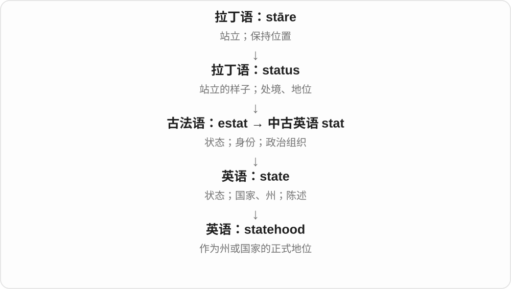

# 0850 · -hood — 身份、状态、人生阶段；群体及其范围

[逐词精讲目录](../00_逐词精讲目录.md) · [总目录](../00_总目录_按常用程度.md)

## 核心词根与来源

-hood 来自古英语 -hād，早期是身份、地位、状态等材料。它与现代 hood 兜帽不是同一个后缀来源，不能拿一个罩子把所有词硬串起来。

**HOOD：把一个人、关系或性质展开成状态、阶段或共同体**

parent 是父母中的一人，parenthood 是为人父母的状态；neighbor 是邻居，neighborhood 是邻里一带。

- **邻里与相邻范围**：neighbor · neighbour · neighborhood · neighbourhood
- **人生阶段与家庭角色**：adulthood · boyhood · girlhood · parenthood · motherhood · fatherhood · widowhood
- **共同身份、组织和地位**：nationhood · statehood · brotherhood · sisterhood · priesthood · knighthood · sainthood
- **性质及其他抽象状态**：likelihood · falsehood · manhood · womanhood · personhood · victimhood
- **neighbor → neighbors：住在近处的人**：neighbor · neighbors · neighborhood
- **neighbor → neighborhood → neighborhoods：邻居与一片片街区**：neighbor · neighborhood · neighborhoods
- **neighbor、neighbour → 相邻的两套 ing 拼写**：neighbor · neighboring · neighbour · neighbouring

## 词形与演化规律

nation + -hood → nationhood；saint + -hood → sainthood；parent + -hood → parenthood；neighbor／neighbour + -hood → neighborhood／neighbourhood。neighborhood 还有较早相应词尾变换的历史。

美式 neighbor 对英式 neighbour，共接古英语 neahgebur 的近、居住者材料；与 neighborhood 配对。

hood 是相邻关系、集合范围的词尾，较早邻里词形有后缀更换历史；现代复数 s。

古英语近加居住者的构词，现代美式常无 u、英式常有 u。

## 单词速览（按词族由简到繁）

同一基础词的相关扩展放在一起，先读基础形式，再读扩展；各组之间优先读常用的。具体词源关系见各词讲解。

| 单词 | 音标 | 核心意思 |
|---|---|---|
| [neighbour](#w-25) | 英 /ˈneɪbə/；美 /ˈneɪbər/ | 邻居；邻近者〔美式常写 neighbor〕 |
| [neighbor](#w-24) | 英 /ˈneɪbə/；美 /ˈneɪbər/ | 邻居；相邻的人、事物〔常见美式拼写〕 |
| [neighborhood](#w-1) | 英 /ˈneɪbəhʊd/；美 /ˈneɪbərhʊd/ | 街区；附近一带；邻里〔常见美式拼写〕 |
| [neighborhoods](#w-27) | 英 /ˈneɪbəhʊdz/；美 /ˈneɪbərhʊdz/ | 街区、邻里地区〔复数，常用美式拼写〕 |
| [neighbors](#w-26) | 英 /ˈneɪbəz/；美 /ˈneɪbərz/ | 邻居；邻近的人、事物〔复数，美式拼写〕 |
| [neighboring](#w-28) | 英 /ˈneɪbərɪŋ/；美 /ˈneɪbərɪŋ/ | 相邻的、邻近的；毗邻〔常用美式拼写〕 |
| [neighbourhood](#w-2) | 英 /ˈneɪbəhʊd/；美 /ˈneɪbərhʊd/ | 街区、邻里；附近〔美式常写 neighborhood〕 |
| [neighbouring](#w-29) | /ˈneɪbərɪŋ/ | 相邻的、邻近的；毗邻〔常用英式拼写〕 |
| [saint](#w-23) | /seɪnt/；人名前常弱读 /sənt/ | 圣徒；圣人；极有耐心、善良的人 |
| [sainthood](#w-20) | /ˈseɪnthʊd/ | 圣徒身份、地位；圣洁无私的状态〔比喻〕 |
| [likelihood](#w-3) | /ˈlaɪklihʊd/ | 可能性；可能发生的程度 |
| [brotherhood](#w-4) | 英 /ˈbrʌðəhʊd/；美 /ˈbrʌðərhʊd/ | 兄弟情谊；同胞关系；兄弟会 |
| [adulthood](#w-5) | 英 /ˈædʌlthʊd/；美 /əˈdʌlthʊd/ | 成年期、成年状态 |
| [parenthood](#w-6) | 英 /ˈpeərənthʊd/；美 /ˈperənthʊd/ | 为人父母的身份、经历 |
| [motherhood](#w-7) | 英 /ˈmʌðəhʊd/；美 /ˈmʌðərhʊd/ | 母亲身份；为母的经历 |
| [priesthood](#w-8) | /ˈpriːsthʊd/ | 圣职；司祭职分；祭司或神父群体 |
| [manhood](#w-9) | /ˈmænhʊd/ | 成年男子的阶段；男子气概 |
| [boyhood](#w-10) | /ˈbɔɪhʊd/ | 男孩时期；童年、少年时代 |
| [statehood](#w-11) | /ˈsteɪthʊd/ | 建州地位；国家地位 |
| [sisterhood](#w-12) | 英 /ˈsɪstəhʊd/；美 /ˈsɪstərhʊd/ | 姐妹关系；女性团结、情谊；女性团体 |
| [falsehood](#w-13) | /ˈfɔːlshʊd/ | 谎言；不实之词；虚假 |
| [fatherhood](#w-14) | 英 /ˈfɑːðəhʊd/；美 /ˈfɑːðərhʊd/ | 父亲身份；为父的经历 |
| [knighthood](#w-15) | /ˈnaɪthʊd/ | 骑士身份、骑士称号；骑士阶层〔集合义〕 |
| [womanhood](#w-16) | /ˈwʊmənhʊd/ | 成年女性阶段；女性身份、共同经历 |
| [personhood](#w-17) | 英 /ˈpɜːsənhʊd/；美 /ˈpɜːrsənhʊd/ | 人格地位；被视为一个人的资格、状态 |
| [victimhood](#w-18) | /ˈvɪktɪmhʊd/ | 受害者处境、受害身份或自我认同 |
| [nationhood](#w-19) | /ˈneɪʃənhʊd/ | 民族或国家的存在状态、身份；形成这种共同体的地位 |
| [widowhood](#w-21) | 英 /ˈwɪdəʊhʊd/；美 /ˈwɪdoʊhʊd/ | 丧偶状态；丧偶后的时期 |
| [girlhood](#w-22) | 英 /ˈɡɜːlhʊd/；美 /ˈɡɜːrlhʊd/ | 女孩时期；少女时代 |

## 逐词讲解

### 1. neighbour — 邻居；邻近者〔美式常写 neighbor〕

**音标**：英 /ˈneɪbə/；美 /ˈneɪbər/

**先抓住这个画面**

住在你附近的人是 neighbour；坐在旁边的人、相邻国家，也能按位置靠近来称呼。

**怎么拆**

承古英语 nēahġebūr，内部是近 + 居住者，经中古英语多种拼写发展。现代英式 neighbour、美式 neighbor 是同词拼写。

**怎么变成今天的意思**

**古英语 nēah 近 + ġebūr 居住者 → nēahġebūr**  
住在近处的人

↓

**中古英语 neighebour 等 → neighbour**  
邻居、邻近者；英式拼写保留 ou

a next door neighbour 隔壁邻居，our neighbours 我们的邻居，neighbouring countries 邻国；字母 gh 在现代常用发音里不单独出声。

**常见搭配与例句**

a neighbour；our neighbours。

> Our neighbour offered to water the plants.

邻居主动提出帮我们给植物浇水。

> I introduced myself to my new neighbours.

我向新邻居作了自我介绍。

**别混淆**

neighbour 是位置、关系称呼，不自动等于朋友；可以互不熟悉，也可能很亲近。

### 2. neighbor — 邻居；相邻的人、事物〔常见美式拼写〕

**音标**：英 /ˈneɪbə/；美 /ˈneɪbər/

**先抓住这个画面**

住得近的人，或地图、列表上挨着的对象，都是从“近旁的那个”来理解。

**怎么拆**

与 neighbour 同词的拼写形式，古英语 nēahgebūr 包含近与居住者的材料。现代 neig(h)-bour 并不是两段现成英语可任意拆换。

**怎么变成今天的意思**

**古英语 nēah + gebūr 的组合**  
近 + 居住者

↓

**neighbor／neighbour**  
邻居；相邻对象的现代拼写

a next-door neighbor 隔壁邻居；our northern neighbor 北边的邻国或邻近对象。动词、修饰语也可说相邻；本页头词采用不带连字符的基础词。

**常见搭配与例句**

a friendly neighbor；neighboring countries。

> Our neighbor helped us carry the boxes upstairs.

邻居帮我们把箱子搬上了楼。

> The two countries are close neighbors.

这两个国家彼此邻近。

**别混淆**

neighbor 与 neighbour 主要是拼写规范不同，不是一个只说人、另一个只说国家。neighborhood 是相邻范围、街区，不能直接替代一个邻居。

### 3. neighborhood — 街区；附近一带；邻里〔常见美式拼写〕

**音标**：英 /ˈneɪbəhʊd/；美 /ˈneɪbərhʊd/

**先抓住这个画面**

不只是隔壁一个人，而是你家周围那片熟悉的街道、店铺和住户，合起来是一片 neighborhood。

**怎么拆**

现代对应 neighbor + -hood，较早的 neighborred 一类形式后来更换为 -hood。这个后缀形成相邻关系、周边范围的集合，不是 hood 兜帽把街区罩起来。

**怎么变成今天的意思**

**早期 neighborred 等邻里词形**  
相邻关系、附近一带

↓

**后缀更换、固定为 neighborhood**  
街区、邻里及附近范围

a quiet neighborhood 安静街区；in the neighborhood 在附近；in the neighborhood of fifty 也可比喻约五十的数值范围。与 neighbourhood 用法对应。

**常见搭配与例句**

a residential neighborhood；in the neighborhood of。

> We moved to a quieter neighborhood last year.

我们去年搬到了一个更安静的街区。

> There is a small library in our neighborhood.

我们住的这一带有一家小图书馆。

**别混淆**

neighbor 是邻居这个人，neighborhood 是邻里、区域；它不是正式行政区划的统一名称，边界常由当地用法决定。

### 4. neighborhoods — 街区、邻里地区〔复数，常用美式拼写〕

**音标**：英 /ˈneɪbəhʊdz/；美 /ˈneɪbərhʊdz/

**先抓住这个画面**

人们各自生活的一片片附近地区，是 neighborhoods。它既能让人想到街道房屋，也常带着生活在那里的邻里关系。

**怎么拆**

现代对应 neighbor + -hood；较早邻里词形有后来换成 -hood 的历史。整个 neighborhood 再加复数 -s，/d/ 后读 /z/；neighbourhoods 是保留 u 的对应拼写。

**怎么变成今天的意思**

**邻居 neighbor；较早邻里词形 → neighborhood**  
邻居关系、周围地区；hood 形成状态、集合范围

↓

**neighborhood + -s → neighborhoods**  
多个街区、邻里地区

different neighborhoods 不同街区；quiet neighborhoods 安静街区；neighborhoods around the station 车站周边街区。

**常见搭配与例句**

old neighborhoods 老街区；walk through the neighborhoods 穿过各片街区。

> We walked through several old neighborhoods.

我们走过了几个老街区。

> The map shows the city’s different neighborhoods.

地图展示了城市里不同的街区。

**别混淆**

neighbors 是人，neighborhoods 是附近的一片地区或邻里整体。-hood 在这里是词尾，与衣服上的兜帽 hood 分开。

### 5. neighbors — 邻居；邻近的人、事物〔复数，美式拼写〕

**音标**：英 /ˈneɪbəz/；美 /ˈneɪbərz/

**先抓住这个画面**

住在近处的人，是 neighbors。地图上、桌面上或系统里挨得近的对象，也能借用这个邻近关系。

**怎么拆**

neighbor + -s，末尾读 /z/；英式对应 neighbours。neighbor、neighbour 接古英语 neahgebur，包含近与居住者的材料，不是今天由两段现代英语临时拼成。

**怎么变成今天的意思**

**古英语 neah 与 gebur 的历史组合 → neighbor／neighbour**  
住在近处的人

↓

**neighbor + -s → neighbors**  
多位邻居；也比喻邻近对象

next door neighbors 隔壁邻居；friendly neighbors 友好的邻居；our nearest neighbors 离我们最近的邻居。

**常见搭配与例句**

neighbors on both sides 两边的邻居；neighbourhood 英式、neighborhood 美式，都是邻里地区名称。

> Our neighbors helped us carry the boxes upstairs.

邻居们帮我们把箱子搬上楼。

> The two countries are close neighbors.

这两个国家彼此相邻。

**别混淆**

neighbors 与 neighbours 是同一个词的拼写差异，不是不同身份。neighborhood 是邻里地区、环境，不能当 neighbors 的另一种复数。

### 6. neighboring — 相邻的、邻近的；毗邻〔常用美式拼写〕

**音标**：英 /ˈneɪbərɪŋ/；美 /ˈneɪbərɪŋ/

**先抓住这个画面**

一个地方旁边就是另一个地方，像互为邻居，是 neighboring。可以形容城市、房屋，也可以说相邻的地块。

**怎么拆**

neighbor 接古英语 neah 近 + gebur 居住者的组合。现代在整个 neighbor 后加完整 -ing，动词过程形式也作形容词；与 neighbouring 对应。

**怎么变成今天的意思**

**古英语近 + 居住者 → neighbor**  
住在近处的人 → 相邻对象、毗邻动作

↓

**neighbor + -ing → neighboring**  
相邻、邻近的；毗邻

neighboring towns 邻近城镇；neighboring countries 邻国；neighboring houses 邻近房屋。

**常见搭配与例句**

a neighboring village 邻村；neighboring fields 相邻田地。

> People from neighboring towns joined the festival.

邻近城镇的人们参加了节庆活动。

> The two neighboring houses share a garden wall.

相邻的两栋房子共用一道花园墙。

**别混淆**

neighboring 常修饰地方、建筑等，不只说人物。形容词用法不需要译成正在做邻居。

### 7. neighbourhood — 街区、邻里；附近〔美式常写 neighborhood〕

**音标**：英 /ˈneɪbəhʊd/；美 /ˈneɪbərhʊd/

**先抓住这个画面**

从一位邻居放大到大家生活的那片地方，就是 neighbourhood；也能说那里的人共同形成的邻里群体。

**怎么拆**

neighbour + -hood，-hood 形成状态、群体、范围名词；本词常突出邻里地区。

**怎么变成今天的意思**

**古英语 nēah 近 + ġebūr 居住者 → nēahġebūr**  
住在近处的人

↓

**中古英语 neighebour 等 → neighbour**  
邻居、邻近者；英式拼写保留 ou

↓

**neighbour + -hood、-ly**  
邻里地区、群体；友好互助的性质

↓

**neighbour + -hood → neighbourhood**  
附近居民所在的地区、邻里

a quiet neighbourhood 安静街区，in the neighbourhood 在附近，the neighbourhood school 社区学校；in the neighbourhood of a number 还可说大约某个数。

**常见搭配与例句**

in the neighbourhood；a quiet neighbourhood。

> There is a small park in our neighbourhood.

我们街区有一座小公园。

> The whole neighbourhood came to the street party.

街坊们都来参加了街头聚会。

**别混淆**

neighbour 是人或邻近者，neighbourhood 常是地区、群体；-hood 在这里不是衣服帽子。

### 8. neighbouring — 相邻的、邻近的；毗邻〔常用英式拼写〕

**音标**：/ˈneɪbərɪŋ/

**先抓住这个画面**

neighbouring 与 neighboring 意思相同，强调旁边、附近的空间关系。保留 u 是拼写传统，不多一层意义。

**怎么拆**

neighbour 继承古英语 neahgebur，内部近加居住者。现代整个词加完整 -ing，保留 ou；与美式常用 neighboring 对应。

**怎么变成今天的意思**

**古英语近、居住者合成 → neighbour**  
邻居、邻近者 → 毗邻

↓

**neighbour + -ing → neighbouring**  
与 neighboring 对应的相邻形式

neighbouring villages 邻近村落；neighbouring rooms 相邻房间；neighbouring areas 邻近地区。

**常见搭配与例句**

a neighbouring farm 邻近农场；neighbouring houses 相邻房屋。

> The path connects two neighbouring villages.

小路连接着两个相邻村落。

> We could hear music from the neighbouring room.

我们能听见隔壁房间传来的音乐。

**别混淆**

neighbour、neighbouring 与 neighbor、neighboring 可成组记。不要因为拼写变体，在同一篇文字里随意来回切换。

### 9. saint — 圣徒；圣人；极有耐心、善良的人

**音标**：/seɪnt/；人名前常弱读 /sənt/

**先抓住这个画面**

宗教中受尊崇的人；日常夸张地说某人好得让人感激。

**怎么拆**

拉丁 sanctus 神圣的，经古英语 sanct 与法语 saint 两线汇合；不能把英语 saint 当成 sanctify 的缩写。

**怎么变成今天的意思**

**拉丁 sancire → sanctus**  
使神圣、确认、制定 → 神圣的、受确认的

↓

**拉丁 sanctus → 古英语 sanct；古法语 saint → 中古英语 saint**  
两条借入线汇合：圣徒、圣人

Saint 放在人名前可缩写 St；宗教中的具体认定随传统而异。You are a saint! 在日常可以只是感谢对方极耐心、乐于帮忙。

**常见搭配与例句**

a patron saint；Saint Peter；You are a saint!。

> The church is named after a local saint.

这座教堂以当地一位圣徒的名字命名。

> You are a saint for helping me move all these boxes.

你帮我搬这么多箱子，真是太好心了。

**别混淆**

saint 是人或称号，holy 是神圣的。no saint 常承认一个人也有缺点，并非指教会正式取消头衔。

### 10. sainthood — 圣徒身份、地位；圣洁无私的状态〔比喻〕

**音标**：/ˈseɪnthʊd/

**先抓住这个画面**

saint 指圣徒或被夸为特别好的人；sainthood 把焦点移到这种身份、地位。日常还可半开玩笑地夸人耐心得像圣人。

**怎么拆**

saint + -hood，后缀表示身份、状态。saint 的历史接拉丁 sanctus 神圣的材料；宗教制度中的圣徒身份与日常夸人的比喻要分开。

**怎么变成今天的意思**

**saint + -hood**  
作为圣徒的身份、状态

↓

**sainthood**  
宗教圣徒地位；圣人般品质的比喻

candidates for sainthood 候选圣徒；the path to sainthood 通往圣徒身份的过程。不同宗教传统有不同概念，不能把一个词的名称当成统一程序。

**常见搭配与例句**

achieve sainthood；a claim to sainthood。

> The documentary examines the history of sainthood.

纪录片探讨了圣徒身份的历史。

> After months of patient help, she jokingly said he deserved sainthood.

他耐心帮忙了好几个月，她开玩笑说他简直该成圣人。

**别混淆**

saint 是人物，sainthood 是状态或地位；kindness 普通善意不必带宗教，也没有 sainthood 那种圣人般的夸张程度。

### 11. likelihood — 可能性；可能发生的程度

**音标**：/ˈlaɪklihʊd/

**先抓住这个画面**

likely 是“很可能”；likelihood 把这个判断变成可以讨论的一件事：发生的可能性有多大。

**怎么拆**

likely 加表示状态的 -hood，中古英语已有 liklihode。早期也表示相似，后来重心转为事情看起来会发生的可能性。

**怎么变成今天的意思**

**英语 likely；-hood**  
看起来相似、可能；状态后缀

↓

**中古英语 liklihode → 英语 likelihood**  
早期相似义；发展为发生的可能性

reduce the likelihood of errors 就是降低出错的可能。in all likelihood 常表示十有八九，而不是数学上百分之百。日常阅读先把它理解为“可能性”即可。

**常见搭配与例句**

the likelihood of doing；the likelihood that…；in all likelihood；a high likelihood。

> Clear labels reduce the likelihood of mistakes.

清楚的标签能降低出错的可能性。

> In all likelihood, the meeting will finish before noon.

会议十有八九会在中午之前结束。

**别混淆**

likeness 是相像，likelihood 是可能性。统计学 likelihood“似然”有专门定义，不应把日常可能性与技术概念不加区分地互换。

### 12. brotherhood — 兄弟情谊；同胞关系；兄弟会

**音标**：英 /ˈbrʌðəhʊd/；美 /ˈbrʌðərhʊd/

**先抓住这个画面**

把像兄弟一样的互相支持作为一种关系来说，也可以指有共同身份的一群人。

**怎么拆**

brother + -hood，状态、关系或群体后缀。现代有情谊与组织两类常见名词义。

**怎么变成今天的意思**

**古英语 brōþor → 中古英语 brother → brother**  
兄弟；日耳曼与印欧古老亲属词

↓

**现代 brother 词族**  
兄弟 → 同伴、兄弟情谊；保留特殊复数 brethren

↓

**brother + -hood → brotherhood**  
兄弟关系 → 兄弟情谊、共同体

a sense of brotherhood 同胞情谊，the brotherhood of humanity 人类同胞关系；特定组织名可大写。

**常见搭配与例句**

a sense of brotherhood；human brotherhood；a bond of brotherhood。

> The shared experience created a strong sense of brotherhood.

共同经历建立了强烈的同伴情谊。

> The speech called for peace and brotherhood.

演讲呼吁和平与同胞情谊。

**别混淆**

brotherhood 不要求所有成员有同一父母；组织、共同体义不是简单家庭成员人数。

### 13. adulthood — 成年期、成年状态

**音标**：英 /ˈædʌlthʊd/；美 /əˈdʌlthʊd/

**先抓住这个画面**

不只叫一个成年人，而是说人生进入成年后的阶段、身份状态。

**怎么拆**

adult + -hood，-hood 表阶段、状态，与 childhood 的词尾同类，不是衣服的兜帽 hood。

**怎么变成今天的意思**

**拉丁语 adolēscere → adultus〔过去分词〕**  
成长 → 已经长成的

↓

**法语 adulte、拉丁语 adultus → 英语 adult**  
长成的；成年人、成年动物

↓

**adult + -hood → adulthood**  
成为成人的阶段、状态

reach adulthood 长到成年，in adulthood 成年后，early adulthood 成年早期。

**常见搭配与例句**

reach adulthood；in adulthood；early adulthood。

> They remained close friends into adulthood.

他们成年后仍是亲密朋友。

> The book follows her from childhood to adulthood.

这本书描写了她从童年到成年的经历。

**别混淆**

adult 人或性质，adulthood 阶段；不说 an adulthood 来指一位成年人。具体研究如何划成年阶段要看上下文。

### 14. parenthood — 为人父母的身份、经历

**音标**：英 /ˈpeərənthʊd/；美 /ˈperənthʊd/

**先抓住这个画面**

不是一次喂饭或一次辅导，而是进入当父母这种人生角色，以及随之而来的生活经历。

**怎么拆**

parent + -hood 状态、身份，与 childhood 的词尾同类；hood 在这里不是连帽衫的帽子。

**怎么变成今天的意思**

**拉丁 pariō、parere → parēns、parentem**  
生出、带来 → 生育者、父母

↓

**古法语、盎格鲁法语 parent → 中古英语 parent**  
父母、亲属等 → 现代父母与照顾孩子的人

↓

**parent + -hood → parenthood**  
为人父母的身份、阶段和体验

the joys of parenthood 为人父母的喜悦，adjust to parenthood 适应父母身份，early parenthood 初为父母阶段。

**常见搭配与例句**

adjust to parenthood；the joys of parenthood；early parenthood。

> They were still adjusting to parenthood.

他们还在适应初为父母的生活。

> The book describes the challenges and joys of parenthood.

这本书描写了为人父母的挑战与喜悦。

**别混淆**

parenthood 侧重角色和经历，parenting 侧重具体养育过程、做法；两者关系密切，镜头位置不同。

### 15. motherhood — 母亲身份；为母的经历

**音标**：英 /ˈmʌðəhʊd/；美 /ˈmʌðərhʊd/

**先抓住这个画面**

说的是当母亲这件事及其生活经验，而不是某一位母亲是谁。

**怎么拆**

mother + -hood 表身份、状态，中古英语已有相应形式。可与 fatherhood 对照，-hood 不表示帽子。

**怎么变成今天的意思**

**古英语 mōdor → 中古英语 moder**  
母亲

↓

**英语 mother**  
母亲；像母亲般照顾；来源、中心等比喻

↓

**mother + -hood → motherhood**  
母亲 → 为母身份及经历

the experience of motherhood 为母经历，adjust to motherhood 适应母亲角色；词本身不规定某个人一定会怎样感受。

**常见搭配与例句**

early motherhood；the experience of motherhood；adjust to motherhood。

> She wrote honestly about the challenges of motherhood.

她坦诚地写出了为母经历中的挑战。

> The book explores different experiences of motherhood.

书中探讨了不同的为母经历。

**别混淆**

motherhood 母亲角色、经历，mothering 偏照料行为；有照料行为不等于一定拥有生物学母亲身份。

### 16. priesthood — 圣职；司祭职分；祭司或神父群体

**音标**：/ˈpriːsthʊd/

**先抓住这个画面**

既可以说这份宗教职务，也可以把担任这份职务的人作为整体来谈。

**怎么拆**

古英语已有 preost + had → preosthad，后来经中古英语传下。现代对应 priest + -hood；-hood 在这里表示身份、职分或群体，不是“帽子”的 hood。

**怎么变成今天的意思**

**希腊 presbys → presbyteros**  
年长的 → 较年长的；名词用法指长者、长老

↓

**晚期拉丁 presbyter**  
教会长老；司祭

↓

**早期借入日耳曼语的缩短形式 → 古英语 preost**  
主持宗教职务的人

↓

**古英语 preost + had → preosthad**  
司祭的身份、职分

↓

**中古英语 presthod 等 → priesthood**  
圣职；担任圣职的群体

enter the priesthood 是进入圣职生活，不是走进一栋叫 priesthood 的建筑。the priesthood of a society 可说该社会的祭司阶层。

**常见搭配与例句**

enter the priesthood；ordination to the priesthood；the ancient priesthood。

> He spent several years preparing to enter the priesthood.

他花了几年时间为进入圣职作准备。

> The book examines the influence of the priesthood in ancient society.

这本书考察了祭司阶层在古代社会中的影响。

**别混淆**

priest 指个人；priesthood 指职分、身份或整体人员。priestly 则是形容词。

### 17. manhood — 成年男子的阶段；男子气概

**音标**：/ˈmænhʊd/

**先抓住这个画面**

从男孩长大成人，也会面对社会对成年男性角色的期待。

**怎么拆**

man + -hood，-hood 表身份、时期或状态；中古英语已有 manhode 等形式。不是 hood“兜帽”套在 man 头上。

**怎么变成今天的意思**

**古英语 man / mann → 中古英语 man**  
人；也用于成年男性

↓

**英语 man**  
男子；部分旧词保留人的泛义

↓

**man + -hood → manhood**  
成年男性的身份、阶段及相关观念

reach manhood 是长大成人；a view of manhood 是对男性角色的看法。某些语境另有身体委婉义，读时按上下文判断。

**常见搭配与例句**

reach manhood；a passage into manhood；ideas of manhood。

> The novel follows him from childhood into manhood.

小说写了他从童年到成年的人生。

> The film questions traditional ideas of manhood.

影片反思了传统的男性角色观念。

**别混淆**

manhood 说阶段或身份，manly 是评价某种举止有男子气概；二者都不表示某一套性格是所有男性必须具备的事实。

### 18. boyhood — 男孩时期；童年、少年时代

**音标**：/ˈbɔɪhʊd/

**先抓住这个画面**

不是某一个男孩，而是一个男性回头看的那段小时候的生活。

**怎么拆**

boy + -hood 表阶段、状态，形成男孩时期名词。-hood 不表示许多男孩组成一队。

**怎么变成今天的意思**

**中古英语 boie、boye**  
年轻男仆、男孩等历史用法，更远来源有分歧

↓

**英语 boy**  
男孩；熟人、同伴等特定语境中的男性称呼

↓

**boy + -hood → boyhood**  
男孩 → 作为男孩的那段时期

a boyhood friend 少年时期的朋友，a boyhood dream 童年梦想；现在讲述者和朋友可能都已成年。

**常见搭配与例句**

a boyhood dream；a boyhood friend；boyhood memories。

> He returned to the town where he had spent his boyhood.

他回到了度过童年的小镇。

> Becoming a pilot had been his boyhood dream.

当飞行员是他儿时的梦想。

**别混淆**

boyhood 特指男孩时期，childhood 范围更宽；boyish 形容像男孩的样子，不是那段时间。

### 19. statehood — 建州地位；国家地位

**音标**：/ˈsteɪthʊd/

**先抓住这个画面**

一个地区被承认为一个州，或被承认为一个国家，这种正式身份叫 statehood。

**怎么拆**

state（州、国家）+ -hood（身份、状态）。

**怎么变成今天的意思**

不是疆域里有多少土地，而是政治组织获得怎样的身份。含义取决于讨论的是联邦里的州，还是国际层面的国家。

**常见搭配与例句**

achieve statehood；a campaign for statehood；the question of statehood。

> The museum describes the territory’s path to statehood.

博物馆介绍了这片领土成为一个州的过程。

> The debate focused on the meaning of statehood.

讨论集中在国家地位的含义上。

**别混淆**

statehood 是地位；independence 是独立。成为某联邦的一州与成为独立国家不是同一件事。

### 20. sisterhood — 姐妹关系；女性团结、情谊；女性团体

**音标**：英 /ˈsɪstəhʊd/；美 /ˈsɪstərhʊd/

**先抓住这个画面**

把彼此当姐妹，互相支持的一种关系；也可指按这种关系组成的一群人。

**怎么拆**

sister + -hood，中古英语已有对应 susterhede 等形式。后缀表关系、状态或群体，与 hood 兜帽不是同一现代功能。

**怎么变成今天的意思**

**古英语 sweostor、相关北欧 systir 等 → 中古英语 suster → sister**  
姐妹；现代词形受同族形式影响

↓

**现代 sister**  
姐姐妹妹；团体姐妹；修女等称呼；平行机构的形容用法

↓

**sister + -hood → sisterhood**  
姐妹关系；女性共同体、情谊

a sense of sisterhood 姐妹般的团结感，a religious sisterhood 女性宗教团体。

**常见搭配与例句**

a sense of sisterhood；a bond of sisterhood；a religious sisterhood。

> The project created a strong sense of sisterhood.

这个项目让大家产生了强烈的姐妹情谊。

> The novel explores friendship and sisterhood.

小说探讨友谊与姐妹情谊。

**别混淆**

sisterhood 关系、团体，sisterly 形容这种关切。women 女性这个类别本身不自动保证彼此有 sisterhood 的情谊。

### 21. falsehood — 谎言；不实之词；虚假

**音标**：/ˈfɔːlshʊd/

**先抓住这个画面**

把“不真”作为一种性质，或者把某句不实的话单独拿出来说。

**怎么拆**

中古英语 falshede，由 false 与 -hood 的早期形式构成；-hood 表状态、性质。

**怎么变成今天的意思**

**拉丁 fallere；完成分词 falsus**  
欺骗、使落空；错误的、虚假的

↓

**拉丁 falsus → 古英语 fals；古法语 fals／faus 又加强使用**  
虚假的、错误的

↓

**中古英语 false + -hede → falshede**  
虚假的性质；不实的话

↓

**英语 falsehood**  
虚假；一条不实陈述

an outright falsehood 是彻头彻尾的不实之词；spread falsehoods 是散播虚假说法。它常有谎言意味，但严格判断说话者是否故意，仍需看具体语境。

**常见搭配与例句**

an outright falsehood；spread falsehoods；expose a falsehood。

> The report repeated a falsehood that had already been corrected.

报告重复了一条已经澄清过的不实说法。

> She checked each claim rather than helping to spread falsehoods.

她逐条核查说法，没有助长不实信息的传播。

**别混淆**

falsehood 可数时指一条不实陈述；falsity 更常集中说“不真实这一性质”。

### 22. fatherhood — 父亲身份；为父的经历

**音标**：英 /ˈfɑːðəhʊd/；美 /ˈfɑːðərhʊd/

**先抓住这个画面**

不只说某个爸爸是谁，而是说当父亲这件事带来的角色、生活和责任。

**怎么拆**

father + -hood，-hood 表身份、状态；中古英语已有相应组合。不是父亲戴的 hood 帽子。

**怎么变成今天的意思**

**古英语 fæder → 中古英语 fader**  
父亲

↓

**英语 father**  
父亲；父亲般的人；创始者、先驱

↓

**father + -hood → fatherhood**  
父亲 → 为父的身份、经历

adjust to fatherhood 适应父亲角色，the joys of fatherhood 为父的快乐；具体经历因人而异。

**常见搭配与例句**

adjust to fatherhood；the responsibilities of fatherhood；early fatherhood。

> He wrote about the surprises of fatherhood.

他写了为父经历中那些出乎意料的事。

> Fatherhood changed the way he planned his time.

当父亲改变了他安排时间的方式。

**别混淆**

father 一个人，fatherhood 一个角色及相关经历；fathers 的复数不是 fatherhood。

### 23. knighthood — 骑士身份、骑士称号；骑士阶层〔集合义〕

**音标**：/ˈnaɪthʊd/

**先抓住这个画面**

knight 说人，knighthood 则把镜头转向这个人获得的身份、称号，也能合称骑士群体。

**怎么拆**

承接古英语 cnihthād、中古英语 knyghthode 等，现代对应 knight + -hood。-hood 在这里表身份、状态，和 childhood 是同类后缀。

**怎么变成今天的意思**

**古英语 cniht**  
男孩、侍从、服役者等旧义

↓

**cnihthād → knyghthode → knighthood**  
骑士身份、称号；现代对应 knight + -hood

receive a knighthood 获授骑士称号，the ideals of knighthood 骑士风范的理想。具体授予制度由相应历史、地区语境决定。

**常见搭配与例句**

receive a knighthood；the ideals of knighthood。

> The biography describes how he received a knighthood.

传记讲到他怎样获授骑士称号。

> The exhibition explores medieval ideas of knighthood.

展览探讨中世纪的骑士观念。

**别混淆**

knighthood 是身份、称号等名词，knightly 是形容词。这里 hood 不指衣服上的帽兜。

### 24. womanhood — 成年女性阶段；女性身份、共同经历

**音标**：/ˈwʊmənhʊd/

**先抓住这个画面**

把作为成年女性的阶段、身份或相关生活经验放在一起谈。

**怎么拆**

woman + -hood，后缀表示阶段、身份、状态；不是头发 hood，也不与衣帽的 hood 义直接相加。

**怎么变成今天的意思**

**古英语 wīfmann：wīf + mann**  
女性 + 人；这里的 wīf 不只等于现代妻子

↓

**中古英语 wifman / wimman / womman → woman**  
女性；现代通常指成年女性

↓

**woman + -hood → womanhood**  
女性 → 成年女性阶段、女性身份

enter womanhood 进入成年女性阶段；experiences of womanhood 女性身份相关经历。文学、社会讨论中会按具体观点使用，不能假设所有人的经历一样。

**常见搭配与例句**

enter womanhood；the experience of womanhood；ideas about womanhood。

> The memoir follows her journey from girlhood into womanhood.

回忆录讲述她从女孩成长为成年女性的历程。

> The essay explores changing ideas about womanhood.

文章探讨女性身份观念的变化。

**别混淆**

girlhood 女孩童年，womanhood 成年女性阶段或身份，motherhood 母亲身份；三者不能当成完全相同的词。

### 25. personhood — 人格地位；被视为一个人的资格、状态

**音标**：英 /ˈpɜːsənhʊd/；美 /ˈpɜːrsənhʊd/

**先抓住这个画面**

问题从这个人叫什么，转成某对象在某套伦理、法律讨论中是否被当作有相应地位的个体。

**怎么拆**

person + -hood，-hood 表身份、状态。不是 personality“个性”的长写法，也不只是成年阶段。

**怎么变成今天的意思**

**拉丁 persōna → 古法语 persone 等**  
戏剧面具、角色；后来的人、个体等义

↓

**中古英语 persoun → 英语 person**  
一个人、个体

↓

**person + -hood → personhood**  
作为人的身份、被承认的地位

哲学、伦理、法律等语境可见。legal personhood 是法律人格地位，具体权利范围由制度决定；抽象讨论与日常识别人不完全相同。

**常见搭配与例句**

legal personhood；the concept of personhood；debates about personhood。

> The seminar examined the concept of personhood.

研讨课探讨了人格地位这一概念。

> The article distinguishes personhood from personality.

文章区分了人格地位与个性。

**别混淆**

personhood 是作为人的地位或状态，personality 是个性；外向与内向都属于个性讨论，不是两种 personhood。

### 26. victimhood — 受害者处境、受害身份或自我认同

**音标**：/ˈvɪktɪmhʊd/

**先抓住这个画面**

把“作为受害者”这一状态放到讨论中心；可以是客观处境，也可以是人怎样看待自己的身份。

**怎么拆**

victim + -hood，状态、身份后缀，不是 hood 帽兜那种实物。

**怎么变成今天的意思**

**拉丁 victima → 法语 victime、英语 victim**  
祭献中的牺牲对象，深源不定

↓

**英语受害者义**  
遭人、事故、处境等伤害的人

↓

**victim + -hood → victimhood**  
受害者状态、身份和相应感受

a sense of victimhood 受害者心态或自觉，shared victimhood 共同受害处境，move beyond victimhood 超越只以受害身份看待自己。

**常见搭配与例句**

a sense of victimhood；shared victimhood；the language of victimhood。

> The essay explores the relationship between memory and victimhood.

文章探讨了记忆与受害身份之间的关系。

> Shared victimhood brought the characters together.

共同的受害处境让这些人物走到了一起。

**别混淆**

victimhood 本身不自动断言受害是假的；有时中性分析处境，有时批评过度以受害定位自己，语气看上下文。

### 27. nationhood — 民族或国家的存在状态、身份；形成这种共同体的地位

**音标**：/ˈneɪʃənhʊd/

**先抓住这个画面**

不只是许多人住在一起，而是把自己、或被视作一个有共同身份的民族、国家共同体；nationhood 讨论这种状态。

**怎么拆**

nation + -hood，后缀形成身份、存在状态的名词；nation 的历史含出生、人群、民族等材料，现代 nationhood 要看民族认同还是国家形成语境。

**怎么变成今天的意思**

**nation + -hood**  
作为民族或国家共同体的状态

↓

**nationhood**  
相关共同身份、地位及形成过程中的目标

a sense of nationhood 民族、国家共同体意识；achieve nationhood 形成相应国家地位。这个词不替代具体政治制度或历史事实的说明。

**常见搭配与例句**

a sense of nationhood；the emergence of nationhood。

> The book explores the symbols that shaped a sense of nationhood.

这本书探讨了塑造民族共同体意识的象征。

> The exhibition traces the region’s path toward nationhood.

展览梳理了该地区走向国家形成的历程。

**别混淆**

statehood 更偏国家、州等政治实体地位；nationhood 还常谈共同身份和民族意识。不同文本会交叠，不宜只背成两个完全相同的建国。

### 28. widowhood — 丧偶状态；丧偶后的时期

**音标**：英 /ˈwɪdəʊhʊd/；美 /ˈwɪdoʊhʊd/

**先抓住这个画面**

widow、widower 是人物称呼，widowhood 是失去配偶后的生活状态或那段时期，可以用于女性，也可用于男性。

**怎么拆**

widow + -hood，承中古英语相应形式；-hood 形成状态、人生阶段名词。

**怎么变成今天的意思**

**古英语 widuwe → 中古英语 widwe → widow**  
失去配偶的女性；更远词源常联系分离，但有不确定性

↓

**后缀人物、状态词**  
widower 丧偶男性；widowhood 丧偶状态、时期

↓

**widow + -hood → widowhood**  
丧偶状态、时期

early widowhood 丧偶初期，years of widowhood 丧偶后的岁月，life in widowhood 丧偶生活。

**常见搭配与例句**

early widowhood；years of widowhood。

> The memoir describes her first years of widowhood.

回忆录描述了她丧偶后的头几年。

> The group offers companionship to people adjusting to widowhood.

这个团体为适应丧偶生活的人提供陪伴。

**别混淆**

-hood 不是衣帽，而是状态；widowhood 不只能在文字里拿来指女性，定义可包含男性丧偶。

### 29. girlhood — 女孩时期；少女时代

**音标**：英 /ˈɡɜːlhʊd/；美 /ˈɡɜːrlhʊd/

**先抓住这个画面**

把一个人作为女孩长大的那段时光，当作人生的一章来看。

**怎么拆**

girl + -hood，-hood 表时期、身份或状态；这里不是头罩 hood 的普通物名。

**怎么变成今天的意思**

**中古英语 gerle / girle / gyrle**  
年轻人，早期可包含男孩、女孩

↓

**英语 girl**  
女孩、少女；部分非正式用法也称成年女性

↓

**girl + -hood → girlhood**  
身为女孩的时期、经历

in her girlhood 在她少女时代，memories of girlhood 少女时期回忆。描写经历，不是精确规定法律年龄段。

**常见搭配与例句**

in one’s girlhood；memories of girlhood；a girlhood friend。

> She spent her girlhood in a small coastal town.

她的少女时代在一座沿海小镇度过。

> The diary preserves memories of her girlhood.

日记保存了她少女时代的回忆。

**别混淆**

girlhood 人生时期，girlish 具有少女特点；一个年长的人仍可有 girlish enthusiasm。

## 这一组要分清什么

neighborhood 不指一个邻居；nationhood 与 statehood 语境有交叠但侧重点不同；likelihood 是可能性，不是喜欢的某种帽子。

## 串起来练习

Parenthood changed how they thought about the neighborhood and its schools.

为人父母后，他们重新看待住的街区和附近学校。
