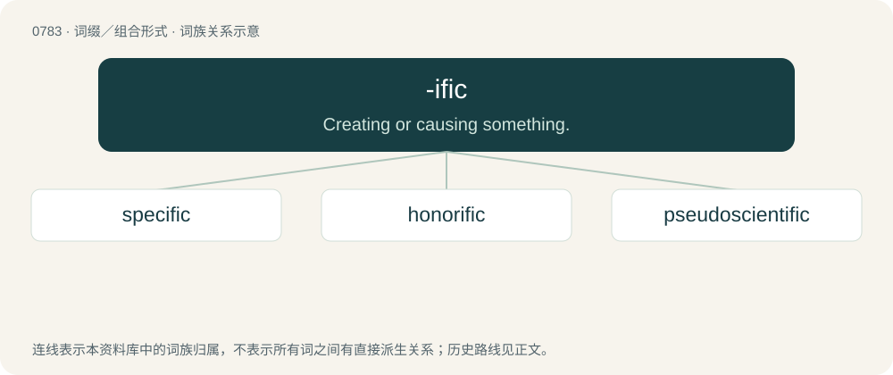

# 0851 · -ific — Creating or causing something.

[总目录](../00_总目录_按常用程度.md)

**类型**：词缀／组合形式　｜　**来源语言**：见词源记录

## 核心含义与来源

- 核心含义：Creating or causing something.
- 英文含义：Creating or causing something.
- 词形：-ific

## 词族图

## 单词速览（常用到不常用）

| 单词 | 音标 | 释义 |
|---|---|---|
| [specific](#w-1) | 英 /spɪˈsɪf.ɪk/；美 /spɪˈsɪf.ɪk/ | n. 特效药, 特性；a. 特殊的, 明确的, 具有特效的, 特定地, 具体地 |
| [honorific](#w-2) | 英 /ˌɒnəˈɹɪfɪk/；美 /ˌɑːnəˈɹɪfɪk/ | a. 尊敬的, 表示敬意的, 敬称的；n. 敬语 |
| [pseudoscientific](#w-3) | 英 /ˌsuː.dəʊ̯ˌsaɪ̯.ənˈtɪf.ɪk/；美 /ˌsu.doʊ̯ˌsaɪ̯.ənˈtɪf.ɪk/ | 伪科学的 |

## 逐词详解

### 1. specific

**词性**：形容词　｜　**音标**：英 /spɪˈsɪf.ɪk/；美 /spɪˈsɪf.ɪk/

**中文释义**：n. 特效药, 特性；a. 特殊的, 明确的, 具有特效的, 特定地, 具体地

**英文义项**：Explicit or definite. / Pertaining to a species, as a taxon or taxa at the rank of species.

**词源与演化**：

From Old French specifique, from Late Latin specificus (“specific, particular”), from Latin speciēs (“kind”) + -ific.

**例句**：

> Quinine is a specific medicine in cases of malaria.

该用例对应义项：Being a remedy for a particular disease on a deeper level, rather than just masking the symptoms.

### 2. honorific

**词性**：名词　｜　**音标**：英 /ˌɒnəˈɹɪfɪk/；美 /ˌɑːnəˈɹɪfɪk/

**中文释义**：a. 尊敬的, 表示敬意的, 敬称的；n. 敬语

**英文义项**：A person's title, such as "Mrs" or "Doctor". / A term of respect; respectful language.

**构词拆分**：honor + -ific

**词源与演化**：

From honor + -ific.

**例句**：

> I think honorific language is the hardest part of Japanese.

### 3. pseudoscientific

**词性**：形容词　｜　**音标**：英 /ˌsuː.dəʊ̯ˌsaɪ̯.ənˈtɪf.ɪk/；美 /ˌsu.doʊ̯ˌsaɪ̯.ənˈtɪf.ɪk/

**中文释义**：伪科学的

**英文义项**：Of, relating to, or employing pseudoscience; not scientific, though purporting to be scientific.

**构词拆分**：pseudoscience + -ific + scientific + pseudo- + scientific

**词源与演化**：

From pseudoscience + -ific, influenced by scientific. By surface analysis, pseudo- + scientific. First attested in 1836.
