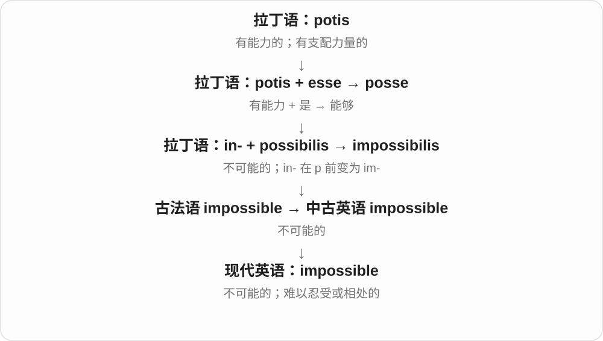
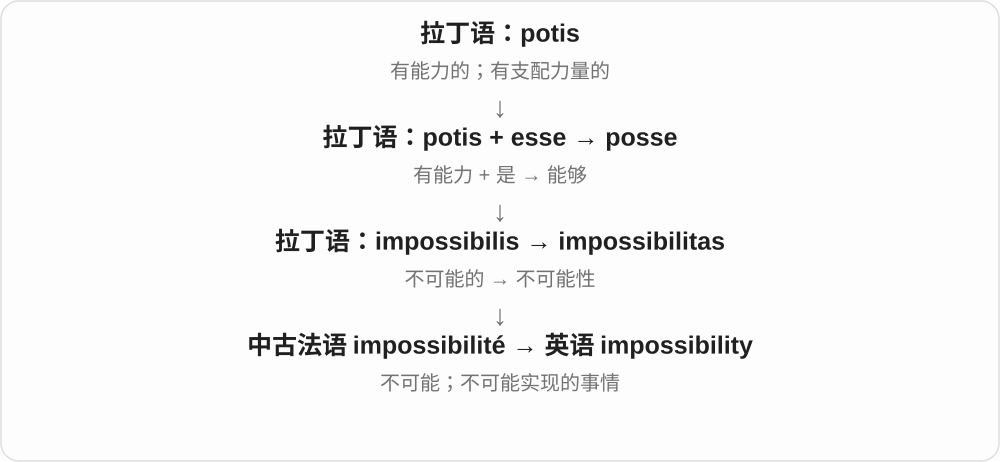
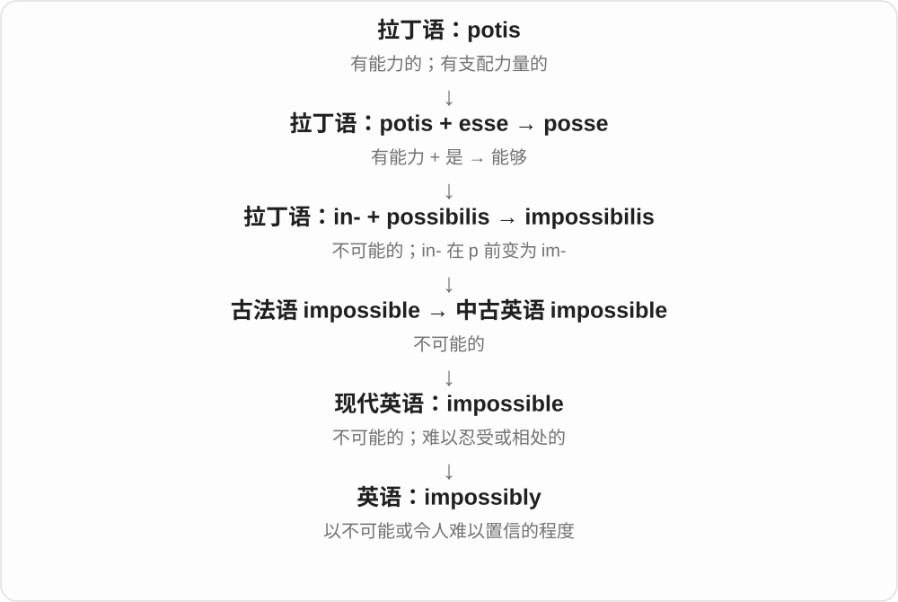

# 0891 · in- (2), il-, im-, ir- — 不、非；否定后面表达的性质

[逐词精讲目录](../00_逐词精讲目录.md) · [总目录](../00_总目录_按常用程度.md)

## 核心词根与来源

这是拉丁语的否定 in-，与表示“进入、在里面”的 in- 分开学。拉丁借词里它在某些辅音前同化，形成 im-、il-、ir-；不能看见英语单词以 in 开头就自动译成“不”。

**IN / IM / IL / IR = NOT**

先有一个性质，再在前面加一个“不”：possible 可能 → impossible 不可能；rational 理性 → irrational 不理性。字母会顺着后面的发音变形，但否定功能保留下来。

- **否定可能性**：impossible, impossibility, impossibly
- **否定健全、理智及口语夸张**：insane, insanity, insanely
- **否定理性或整数比关系**：irrational, irrationally, irrationality
- **否定许可或友好**：illicit, illicitly, inimical

## 词形与演化规律

在 p、b、m 等唇音前常见 im-，在 l 前 il-，在 r 前 ir-。这是已有词族的历史规律，不表示随便给任意英语形容词加这些前缀都能造出标准单词。本页选取否定构词明确的词族，其他已讲词根中的否定词也可横向比较。

## 单词速览（按词族由简到繁）

同一基础词的相关扩展放在一起，先读基础形式，再读扩展；各组之间优先读常用的。具体词源关系见各词讲解。

| 单词 | 音标 | 核心意思 |
|---|---|---|
| [impossible](#w-1) | 英 /ɪmˈpɒsəbəl/；美 /ɪmˈpɑːsəbəl/ | 不可能的；难以忍受或应付的 |
| [impossibility](#w-7) | 英 /ɪmˌpɒsəˈbɪləti/；美 /ɪmˌpɑːsəˈbɪləti/ | 不可能；不可能的事 |
| [impossibly](#w-8) | 英 /ɪmˈpɒsəbli/；美 /ɪmˈpɑːsəbli/ | 难以置信地；令人觉得不可能地；极其 |
| [insane](#w-2) | /ɪnˈseɪn/ | 精神失常的〔旧称〕；极不合理的；惊人的〔口语〕 |
| [insanity](#w-3) | /ɪnˈsænəti/ | 精神失常〔旧称或法律语境〕；荒唐、疯狂之举 |
| [insanely](#w-6) | /ɪnˈseɪnli/ | 极其；离谱地；疯狂地 |
| [irrational](#w-4) | /ɪˈræʃənəl/ | 不理性的；缺乏合理根据的；无理数的 |
| [irrationally](#w-9) | /ɪˈræʃənəli/ | 不理性地；缺乏合理依据地 |
| [irrationality](#w-10) | /ɪˌræʃəˈnæləti/ | 不理性；无理性〔数学〕；不合理之处 |
| [illicit](#w-5) | /ɪˈlɪsɪt/ | 非法的；违禁的；不被社会规范接受的 |
| [illicitly](#w-12) | /ɪˈlɪsɪtli/ | 非法地；违反规定或规范地 |
| [inimical](#w-11) | /ɪˈnɪmɪkəl/ | 有害的；不利的；敌意的 |

## 逐词讲解

### 1. impossible — 不可能的；难以忍受或应付的

**音标**：英 /ɪmˈpɒsəbəl/；美 /ɪmˈpɑːsəbəl/

**先抓住这个画面**

impossible 像一扇完全关上的门；口语中也会夸张地说“这人真让人没办法”。

**怎么拆**

经古法语来自拉丁 impossibilis：否定 in- 在 p 前同化成 im-，加 possibilis；现代清楚对应 im- + possible。

**怎么变成今天的意思**

impossible to finish 是没法完成。You’re impossible! 通常是抱怨对方难相处、不讲道理，并不是说这个人不存在。

**常见搭配与例句**

be impossible to do；make it impossible for；an impossible task；next to impossible。

> Without the key, it was impossible to open the cabinet.

没有钥匙，根本打不开柜子。

> You keep changing your mind—you’re impossible!

你总是改主意，真拿你没办法！

**别混淆**

difficult 表示很难，仍可能做到；impossible 在严格用法中排除可能，口语则可夸张地说难得受不了。

### 2. impossibility — 不可能；不可能的事

**音标**：英 /ɪmˌpɒsəˈbɪləti/；美 /ɪmˌpɑːsəˈbɪləti/

**先抓住这个画面**

impossibility 把“这条路根本走不通”变成可以论证、说明的事实。

**怎么拆**

经中古法语 impossibilité 来自拉丁 impossibilitas；现代可联系 impossible + -ity，不把法语名词画成英语形容词的后代。

**怎么变成今天的意思**

the impossibility of doing something 说明做不到的原因；an impossibility 指一件根本做不到的事。复数也可用于互相矛盾、无法实现的情形。

**常见搭配与例句**

a physical impossibility；the impossibility of doing；a practical impossibility。

> Being in two cities at exactly the same time is a physical impossibility.

同一时刻身处两座城市，在物理上不可能。

> The report explains the impossibility of completing the work in one day.

报告解释了为什么这项工作不可能在一天内完成。

**别混淆**

impossibility 是没有实现空间；improbability 只是可能性很低，不能混作绝对不可能。

### 3. impossibly — 难以置信地；令人觉得不可能地；极其

**音标**：英 /ɪmˈpɒsəbli/；美 /ɪmˈpɑːsəbli/

**先抓住这个画面**

impossibly 常是在正常尺度外再推一截：“高得不像能爬上去，挤得像根本塞不下。”

**怎么拆**

impossible + -ly，词尾 -ble 改为 -bly。

**怎么变成今天的意思**

impossibly small 可以是小得让人难以操作；impossibly beautiful 是带夸张的赞叹，不是在作逻辑判断。常修饰形容词。

**常见搭配与例句**

impossibly difficult；impossibly small；impossibly high。

> The instructions were printed in impossibly small letters.

说明书的字小得让人几乎看不清。

> The summit looked impossibly far away.

山顶看上去远得仿佛根本到不了。

**别混淆**

extremely 只强调程度很高；impossibly 带超过可承受、可相信或可实现范围的感觉。

### 4. insane — 精神失常的〔旧称〕；极不合理的；惊人的〔口语〕

**音标**：/ɪnˈseɪn/

**先抓住这个画面**

sane 原与健全、理智相连，in- 加上否定；口语后来把“不正常到极点”拿来夸张说非常离谱或非常厉害。

**怎么拆**

拉丁 in- 不 + sānus 健全的 → īnsānus，借入英语；不是把 English in“里面”加到 sane 上。

**怎么变成今天的意思**

**拉丁否定前缀 in-；同化形式 im-、il-、ir-**  
不、非；否定后面的性质

↓

**拉丁 in- + sānus → īnsānus → 英语 insane**  
不健全的 → 失常的；后来也夸张说离谱、惊人

an insane price 常说价格离谱；an insane performance 也可能夸表演惊人。旧式精神失常义不是现代医学的一项具体诊断，用它称呼现实中的人容易带贬损。

**常见搭配与例句**

an insane amount；an insane idea；That’s insane!〔口语〕。

> That is an insane amount to pay for a sandwich.

一个三明治卖这个价，实在太离谱了。

> The guitarist’s speed was insane.

那位吉他手的演奏速度快得惊人。

**别混淆**

crazy 也有类似口语夸张；unreasonable 更中性地说不合理，正式描述往往更清楚。

### 5. insanity — 精神失常〔旧称或法律语境〕；荒唐、疯狂之举

**音标**：/ɪnˈsænəti/

**先抓住这个画面**

把 insane 的失常或离谱当作状态来谈；日常说“这太荒唐了”时，经常并没有医学含义。

**怎么拆**

接拉丁 īnsānitās，来自 īnsānus；现代可联系 insane + -ity，但保留拉丁名词的历史路线。

**怎么变成今天的意思**

**拉丁否定前缀 in-；同化形式 im-、il-、ir-**  
不、非；否定后面的性质

↓

**拉丁 īnsānus → īnsānitās → 英语 insanity**  
不健全 → 失常状态

↓

**英语引申用法**  
极端荒唐、不理性的局面或做法

日常夸张与法律专门用法要分开。法律材料里的 insanity 有特定语境，不能用口语“太疯狂”来替代，也不能自动等同于某个疾病名称。

**常见搭配与例句**

the insanity of a plan；pure insanity；a plea of insanity〔法律用语〕。

> Trying to finish all of that in one night would be insanity.

想一晚上把那些事全做完，简直太荒唐。

> The novel explores the apparent insanity of the war around its characters.

小说描写了人物周围那场战争所呈现的荒诞与疯狂。

**别混淆**

irrationality 侧重缺乏合理性；insanity 的日常语气往往更强，另有历史及法律义。

### 6. insanely — 极其；离谱地；疯狂地

**音标**：/ɪnˈseɪnli/

**先抓住这个画面**

把 insane 的夸张感放到形容词前，就像把音量推到很高：“贵得离谱”“好得惊人”。

**怎么拆**

insane + -ly；英语副词。

**怎么变成今天的意思**

**拉丁否定前缀 in-；同化形式 im-、il-、ir-**  
不、非；否定后面的性质

↓

**拉丁 in- + sānus → īnsānus → 英语 insane**  
不健全的 → 失常的；后来也夸张说离谱、惊人

↓

**英语 insane + -ly → insanely**  
失常、极端的 → 极端地；极其

insanely expensive 通常不涉及精神状况，只是强烈说非常贵。语气鲜明、偏口语，正式写作常可用 extremely 或具体数值。

**常见搭配与例句**

insanely expensive；insanely busy；insanely talented。

> The tickets were insanely expensive.

票价贵得离谱。

> She is insanely good at solving these puzzles.

她解这类谜题厉害得惊人。

**别混淆**

very 语气普通；insanely 强烈夸张，既能说好得惊人，也能说糟得离谱。

### 7. irrational — 不理性的；缺乏合理根据的；无理数的

**音标**：/ɪˈræʃənəl/

**先抓住这个画面**

rational 关乎理性或比值，前面的 in- 遇 r 同化为 ir-；这一个否定在日常与数学里走出两种精确含义。

**怎么拆**

拉丁 in- + ratiōnālis → irratiōnālis；借入英语。

**怎么变成今天的意思**

**拉丁否定前缀 in-；同化形式 im-、il-、ir-**  
不、非；否定后面的性质

↓

**拉丁 in- + ratiōnālis → irratiōnālis → 英语 irrational**  
不是理性的；数学中不是有理的

日常 an irrational fear 是缺少合理依据或明显失衡的恐惧。数学里的 irrational number 是不能写成两个整数之比的实数，分母必须非零；不是“这个数不讲道理”。

**常见搭配与例句**

an irrational fear；irrational behaviour；an irrational number。

> He knew the fear was irrational, but it still felt real.

他知道这种恐惧缺乏合理依据，但感受仍很真实。

> The square root of two is an irrational number.

二的平方根是一个无理数。

**别混淆**

emotional 是有情绪的，不自动等于 irrational；有情绪的人仍可以给出合理判断。

### 8. irrationally — 不理性地；缺乏合理依据地

**音标**：/ɪˈræʃənəli/

**先抓住这个画面**

不是只说结果不好，而是说做决定的过程没有充分遵循理由、证据或一致的判断。

**怎么拆**

irrational + -ly；英语副词。

**怎么变成今天的意思**

**拉丁否定前缀 in-；同化形式 im-、il-、ir-**  
不、非；否定后面的性质

↓

**拉丁 in- + ratiōnālis → irratiōnālis → 英语 irrational**  
不是理性的；数学中不是有理的

↓

**英语 irrational + -ly → irrationally**  
不理性的 → 不理性地

可描述行为或反应。说某人 acted irrationally 是评价这次行为，不必把他永久贴成某一类人。

**常见搭配与例句**

act irrationally；behave irrationally；irrationally afraid。

> He admitted that he had reacted irrationally to the news.

他承认自己听到消息后反应不够理性。

> I was irrationally afraid that one small mistake would ruin everything.

我缺乏根据地害怕，一个小错误就会毁掉一切。

**别混淆**

incorrectly 是做错或判断错；irrationally 是推理或反应缺乏合理性，合理过程也可能因信息不足而出错。

### 9. irrationality — 不理性；无理性〔数学〕；不合理之处

**音标**：/ɪˌræʃəˈnæləti/

**先抓住这个画面**

irrational 是性质，irrationality 把这种性质提出来讨论：一个判断是否合理，或一个数能否写成整数之比。

**怎么拆**

irrational + -ity；英语早期已有数学用法，后也用于不合理、荒谬。

**怎么变成今天的意思**

**拉丁否定前缀 in-；同化形式 im-、il-、ir-**  
不、非；否定后面的性质

↓

**拉丁 in- + ratiōnālis → irratiōnālis → 英语 irrational**  
不是理性的；数学中不是有理的

↓

**英语 irrational + -ity → irrationality**  
无理的、不理性的 → 无理性、不理性

数学文章中的 the irrationality of √2 是二的平方根的无理性；讨论行为时，则关心理由与判断。两个场景不可拿日常情绪义硬套。

**常见搭配与例句**

the irrationality of a belief；a proof of irrationality。

> The essay examines the irrationality of judging people by rumours.

文章探讨了仅凭谣言判断他人的不合理性。

> The teacher explained a proof of the irrationality of the square root of two.

老师讲解了二的平方根为无理数的一种证明。

**别混淆**

irrationality 是不理性或无理性；irrationalism 是某种思想立场，后缀变了，讨论对象也变了。

### 10. illicit — 非法的；违禁的；不被社会规范接受的

**音标**：/ɪˈlɪsɪt/

**先抓住这个画面**

lic- 的来源关系到“被允许”，il- 就像在许可上画了一条否定线：这件事不获允许。

**怎么拆**

拉丁 in- 不 + licitus 被允许的 → illicitus，经法语 illicite 借入；n 在 l 前同化。

**怎么变成今天的意思**

**拉丁否定前缀 in-；同化形式 im-、il-、ir-**  
不、非；否定后面的性质

↓

**拉丁 in- + licitus → illicitus → 法语 illicite**  
不被允许的

↓

**英语 illicit**  
非法的；受社会规范禁止的

illicit trade 常指非法交易；an illicit affair 则常说违背婚姻或社会规范的关系，不一定表示当地刑法将其定为犯罪。

**常见搭配与例句**

illicit trade；illicit goods；an illicit affair。

> The report exposed an illicit trade in stolen artworks.

报告揭露了一场买卖被盗艺术品的非法交易。

> The novel centres on an illicit affair.

这部小说围绕一段不被社会规范接受的婚外关系展开。

**别混淆**

illegal 明确指违法；illicit 也可能触犯社会规范。elicit 发音接近却是动词“引出”。

### 11. illicitly — 非法地；违反规定或规范地

**音标**：/ɪˈlɪsɪtli/

**先抓住这个画面**

illicit 说事情不被允许，illicitly 则说明获得、交易或进行某事的方式越过了许可边界。

**怎么拆**

illicit + -ly；英语副词。

**怎么变成今天的意思**

**拉丁否定前缀 in-；同化形式 im-、il-、ir-**  
不、非；否定后面的性质

↓

**拉丁 in- + licitus → illicitus → 法语 illicite**  
不被允许的

↓

**英语 illicit**  
非法的；受社会规范禁止的

↓

**英语 illicit + -ly → illicitly**  
不被允许的 → 以不被允许的方式

常配 acquired、obtained、traded。是否合法或违背哪种规范，要由上下文说明，不是所有偷偷进行的事都能这样称呼。

**常见搭配与例句**

illicitly obtained；illicitly traded；illicitly acquired。

> The gallery returned artworks that had been illicitly obtained.

画廊归还了通过非法方式取得的艺术品。

> The report describes how the goods were illicitly traded across the border.

报告描述了这些货物如何被非法跨境交易。

**别混淆**

secretly 只说秘密地；illicitly 额外说明违反法律、规则或社会规范。

### 12. inimical — 有害的；不利的；敌意的

**音标**：/ɪˈnɪmɪkəl/

**先抓住这个画面**

amīcus 是朋友，加上“不”形成“不友好的、敌对的”；有些条件像站在对立面，会妨碍某事发展。

**怎么拆**

拉丁 in- 不 + amīcus 朋友 → inimīcus；后期拉丁 inimīcālis 借入英语。

**怎么变成今天的意思**

**拉丁否定前缀 in-；同化形式 im-、il-、ir-**  
不、非；否定后面的性质

↓

**拉丁 amīcus → inimīcus → 后期拉丁 inimīcālis**  
朋友 → 不友好的、敌对的

↓

**英语 inimical**  
敌意的；对某事不利的

常用 inimical to，语气正式。对象可以是气候、制度、态度等，不一定是一个怀有敌意的人。

**常见搭配与例句**

inimical to health；inimical to cooperation；an inimical attitude。

> A culture of blame is inimical to honest discussion.

一味追责的氛围不利于坦诚讨论。

> The dry conditions were inimical to the growth of these plants.

干燥的条件不利于这些植物生长。

**别混淆**

hostile 常更直接说敌对；inimical 也常表示某种条件不利、阻碍发展，不要求有主观意图。

## 这一组要分清什么

influence 的 in- 是流入，不是否定。invaluable 是极有价值的，字面否定的是可估量的价值，不能机械猜成没有价值。illicit 与 elicit 要分词性和意思。

## 串起来练习

An irrational decision is not always impossible to reverse. An illicit action is one that crosses a legal or social boundary.

不理性的决定并不总是无法挽回。illicit 所描述的行为则越过了法律或社会规范的边界。
