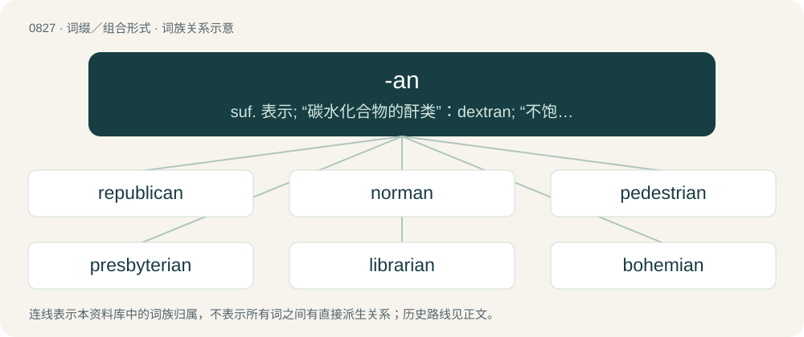

# 0898 · -an — suf. 表示; “碳水化合物的酐类”：dextran; “不饱和的碳化物”：tolan; 用于专有人、地名等后构成通常可兼作名词用的形容词表示“…时期的(人)”, “…地方的(人)”, “在…居住的(人)”, “在…出生的(人)”：American, Asian, Elizabethan, Victorian; 用于表示体制、学科等的词后及宗教或其他流派创

[总目录](../00_总目录_按常用程度.md)

**类型**：词缀／组合形式　｜　**来源语言**：见词源记录

## 核心含义与来源

- 核心含义：suf. 表示; “碳水化合物的酐类”：dextran; “不饱和的碳化物”：tolan; 用于专有人、地名等后构成通常可兼作名词用的形容词表示“…时期的(人)”, “…地方的(人)”, “在…居住的(人)”, “在…出生的(人)”：American, Asian, Elizabethan, Victorian; 用于表示体制、学科等的词后及宗教或其他流派创始人的人名后构成可兼作名词的形容词或单词性的形容词或名词表示“精通…的(人)”, “带有…特征的(人)”, “属于…的(人)”, “信奉…的(人)”, “追随…的(人)”
- 英文含义：Of or pertaining to; an adjectival suffix appended to various words, often nouns, to make an adjective form. (Often added to words of Latin origin, but also used with words of other origins. When a word ends in a, -n is used instead.)
- 词形：-an

**来源记录 1**（后缀／后置成分；Of or pertaining to; an adjectival suffix appended to various words, often nouns, to make an adjective form. (Often added to words of Latin origin, but also used with words of other origins. When a word ends in a, -n is used instead.)）

From Middle English -an, regularly -ain, -ein, -en, from Old French -ain, -ein, or before i, -en (modern French -ain, -en, feminine -aine, -enne), from Latin -ānus (feminine -āna), which forms adjectives of belonging or origin from a noun, being -nus \[cognate with Ancient Greek -νος (-nos)\] preceded by a vowel, from Proto-Indo-European \*-nós. Cognate with English -en. Compare with -in, -ine.

## 词族图

## 单词速览（常用到不常用）

| 单词 | 音标 | 释义 |
|---|---|---|
| [republican](#w-1) | /ɹɪˈpʌblɪkən/ | n. 共和主义者, 共和党员；a. 共和政体的, 共和国的, 共和主义的 |
| [norman](#w-2) | 英 /ˈnɔːmən/；美 /ˈnɔɹmən/ | 【英文】Synonym of normie (“a normal person”). |
| [pedestrian](#w-3) | /pəˈdɛstɹiən/ | n. 行人, 步行者；a. 人行的, 徒步的, 呆板的, 通俗的, 平淡无奇的 |
| [presbyterian](#w-4) | /.prezbiˈtiəriən/ | a. 长老派的, 长老宗的；n. 长老教教友, 长老制支持者 |
| [librarian](#w-5) | 英 /laɪˈbɹɛə̯ɹi.ən/；/laɪˈbɹɛə̯ɹi.ən/ | n. 图书馆员, 图书管理员；\[计\] 程序库管理程序; 程序库生成程序 |
| [bohemian](#w-6) | 美 /boʊˈhimi.ən/ | n. 波希米亚人, 波希米亚语, 放浪者；a. 波希米亚人的, 放浪的, 波希米亚语的 |
| [ovarian](#w-7) | 美 /oʊˈvɛɹi.ən/ | a. 子房的, 卵巢的, 果核的；\[医\] 卵巢的 |
| [moan](#w-8) | 英 /məʊn/；美 /moʊn/ | 【英文】Of or pertaining to a moa. |
| [cosmopolitan](#w-9) | 英 /ˌkɒz.məˈpɒl.ɪ.tən/；美 /ˌkɑz.məˈpɑl.ɪ.tən/ | a. 世界主义的, 世界性的, 全世界的, 遍生的, 不偏狭的, 卓有见识的；n. 世界主义者, 世界性 |
| [sectarian](#w-10) | 英 /sɛkˈtɛəɹi.ən/；美 /sɛkˈtɛɹi.ən/ | a. 宗派的, 党派的, 偏狭的；n. 宗派成员, 闹宗派的人 |
| [totalitarian](#w-11) | 英 /ˌtəʊtalɪˈtɛəɹiən/；美 /ˌtoʊtəlɪˈtɛɹiən/ | a. 极权主义的；n. 极权主义者 |
| [dystopian](#w-12) | 美 /dɪsˈtoʊ.pi.ən/ | a. 反面乌托邦的,反面假想国的 ；n. 反面乌托邦的鼓吹者(或描写者) |
| [veterinarian](#w-13) | 美 /ˌvɛt(ə)ɹəˈnɛɹ.i.ən/ | n. 兽医；\[医\] 兽医 |
| [utopian](#w-14) | 英 /juːˈtəʊ.pi.ən/；美 /juˈtoʊ.pi.ən/ | 【英文】Of or pertaining to or resembling a utopia. |
| [subterranean](#w-15) | /ˌsʌbtəˈɹeɪniən/ | a. 地下的, 秘密的；n. 地下室, 地下工作者 |
| [theologian](#w-16) | 英 /ˌθi.əˈləʊd͡ʒən/；美 /ˌθi.əˈloʊd͡ʒən/ | n. 神学者 |
| [circadian](#w-17) | 英 /səˈkeɪ.dɪ.ən/；美 /sɚˈkeɪ.di.ən/ | a. 24小时生理节奏的 |
| [antiquarian](#w-18) | 美 /ˌæn.tɪˈkwɛɹ.i.ən/ | n. 古文物收藏家, 古董商；a. 古文物的, 古文物研究的 |
| [sylvan](#w-19) | 英 /ˈsɪl.vən/ | a. 森林的, 农村的, 乡村的；\[医\] 邻甲基呋喃, 森林的 |
| [riparian](#w-20) | 英 /ɹʌɪˈpɛːɹɪən/ | a. 河岸的, 生于河岸的；n. 河岸土地所有人 |
| [amphibian](#w-21) | /æmˈfɪbɪən/ | a. 两栖类的, 水陆两用的；n. 两栖动物, 水旱两生植物, 水陆两用飞机 |
| [valedictorian](#w-22) | 英 /ˌvæl.əd.ɪkˈtɔɹ.ɪən/；美 /ˌvæl.ə.dɪkˈtoɹ.i.ən/ | n. 致告别辞者,告别演说者 |
| [contrarian](#w-23) | 英 /kənˈtɹɛə.ɹi.ən/；美 /kənˈtɹɛ.ɹi.ən/ | n. & adj. 采取相反态度（或立场）者（的）, 背道而驰者（的）, （股票买卖中）多数人抛售时反而吃进（或多数人吃进时反而抛售）者（的） |
| [crustacean](#w-24) | /kɹʌsˈteɪʃən/ | a. 甲壳纲的；n. 甲壳纲动物 |
| [publican](#w-25) | 英 /ˈpʌblɪk(ə)n/；美 /ˈpʌblək(ə)n/ | n. 小酒馆老板, 酒店老板, 客栈老板, 征收员 |
| [disciplinarian](#w-26) | 英 /dɪsɪplɪˈnɛəɹɪən/ | a. 惩戒性的, 纪律的；n. 执行纪律者, 厉行纪律的人 |
| [cerulean](#w-27) | /səˈɹuːli.ən/ | a. 蔚蓝的 |
| [protean](#w-28) | 英 /ˈpɹəʊ.tɪ.ən/；美 /ˈpɹoʊ.tɪ.ən/ | a. 千变万化的, 变化不定的, (海神)普罗透斯的；\[化\] ┚(音田) |
| [cetacean](#w-29) | /sɪˈteɪʃən/ | a. 鲸目的, 鲸鱼的；n. 鲸目动物, 鲸鱼 |
| [documentarian](#w-30) | 英 /ˌdɒk.jʊ.mənˈtɛəɹi.ən/；美 /ˌdɑ.kjʊ.mənˈtɛɹi.ən/ | n. 记实小说作者, 记录影片导演(或制片人) |
| [radian](#w-31) | /ˈɹeɪdiən/ | n. 弧度；\[计\] 弧度 |
| [protozoan](#w-32) | 英 /ˌpɹəʊ.təˈzəʊ.ən/；美 /ˌpɹoʊ.təˈzoʊ.ən/ | n. 原生动物；\[医\] 原生动物, 原虫, 原生动物的, 原虫的 |
| [antediluvian](#w-33) | 英 /ˌæn.tɪ.dɪˈluː.vɪ.ən/；美 /ˌæn.ti.dəˈlu.vi.ən/ | a. 大洪水前的, 陈旧的, 过时的；n. 大洪水以前的人, 老迈的人 |
| [centenarian](#w-34) | 英 /ˌsɛntəˈnɛːrɪən/；美 /ˌsɛnəˈnɛɹiən/ | n. 百岁老人；a. 百岁老人的 |
| [molluscan](#w-35) | /mɔˈlʌskən/ | a. \[动\]软体动物的, 似软体动物的 |

## 逐词详解

### 1. republican

**词性**：形容词　｜　**音标**：/ɹɪˈpʌblɪkən/

**中文释义**：n. 共和主义者, 共和党员；a. 共和政体的, 共和国的, 共和主义的

**英文义项**：Advocating or supporting a republic as a form of government, advocating or supporting republicanism. / Of or belonging to a republic.

**构词拆分**：republic + -an

**词源与演化**：

From republic + -an, partly after French républicain.

**例句**：

> The United States shall guarantee to every state in this union a republican form of government.

该用例对应义项：having the supreme power lying in the body of citizens entitled to vote for officers and representatives responsible to them or characteristic of such government

### 2. norman

**词性**：名词　｜　**音标**：英 /ˈnɔːmən/；美 /ˈnɔɹmən/

**英文义项**：Synonym of normie (“a normal person”).

**构词拆分**：normal + -an

**词源与演化**：

From normal + -an, possibly influenced by the given name Norman.

### 3. pedestrian

**词性**：形容词　｜　**音标**：/pəˈdɛstɹiən/

**中文释义**：n. 行人, 步行者；a. 人行的, 徒步的, 呆板的, 通俗的, 平淡无奇的

**英文义项**：Of or intended for those who are walking. / Ordinary, dull; everyday; unexceptional.

**词源与演化**：

From Latin pedester (oblique stem pedestri-) + English -an.

**例句**：

> The choreographer prefers pedestrian movements.

该用例对应义项：Pertaining to ordinary, everyday movements incorporated in postmodern dance.

### 4. presbyterian

**词性**：形容词　｜　**音标**：/.prezbiˈtiəriən/

**中文释义**：a. 长老派的, 长老宗的；n. 长老教教友, 长老制支持者

**英文义项**：Of or pertaining to a presbyter, or to ecclesiastical government by presbyters; relating to those who uphold church government by presbyters; also, to the doctrine, discipline, and worship of a communion so governed.

**构词拆分**：Late Latin presbyterium + -an；presbytery + -an

**词源与演化**：

From Late Latin presbyterium + -an. By surface analysis, presbyter + -ian or presbytery + -an.

**例句**：

> The marriage ceremony was performed according to the rites of the Presbyterian persuasion.

### 5. librarian

**词性**：名词　｜　**音标**：英 /laɪˈbɹɛə̯ɹi.ən/；/laɪˈbɹɛə̯ɹi.ən/

**中文释义**：n. 图书馆员, 图书管理员；\[计\] 程序库管理程序; 程序库生成程序

**英文义项**：The keeper, manager of a library. / One who cares for the publications, files etc. in a library, whether staff or volunteer.

**构词拆分**：library + -an

**词源与演化**：

From library + -an. First attested around 1710.

**例句**：

> I ask the librarian to recommend something new and interesting to me.

### 6. bohemian

**词性**：名词　｜　**音标**：美 /boʊˈhimi.ən/

**中文释义**：n. 波希米亚人, 波希米亚语, 放浪者；a. 波希米亚人的, 放浪的, 波希米亚语的

**英文义项**：A person, especially an artist or writer, who lives an unconventional or nonconformist lifestyle.

**构词拆分**：Bohemia + -an

**词源与演化**：

Borrowed from French bohémien (“person from Bohemia”), from Bohême (“Bohemia”), equivalent to Bohemia + -an.

**例句**：

> My mother was a buzhie, but my father was a Bohemian type.

### 7. ovarian

**词性**：形容词　｜　**音标**：美 /oʊˈvɛɹi.ən/

**中文释义**：a. 子房的, 卵巢的, 果核的；\[医\] 卵巢的

**英文义项**：Relating to the ovaries.

**构词拆分**：ovary + -an

**词源与演化**：

c 1840 ovary + -an

**例句**：

> Mary was diagnosed with ovarian cancer in 2013.

### 8. moan

**词性**：形容词　｜　**音标**：英 /məʊn/；美 /moʊn/

**英文义项**：Of or pertaining to a moa.

**构词拆分**：moa + -an

**词源与演化**：

From moa + -an.

### 9. cosmopolitan

**词性**：形容词　｜　**音标**：英 /ˌkɒz.məˈpɒl.ɪ.tən/；美 /ˌkɑz.məˈpɑl.ɪ.tən/

**中文释义**：a. 世界主义的, 世界性的, 全世界的, 遍生的, 不偏狭的, 卓有见识的；n. 世界主义者, 世界性

**英文义项**：Inclusive; affecting the whole world. / Composed of people from all over the world.

**构词拆分**：cosmopolit(e) + -an

**词源与演化**：

From cosmopolit(e) + -an. Compare metropolitan and megalopolitan.

**例句**：

> His cosmopolitan benevolence impartially extended to all races and to all creeds.

该用例对应义项：composed of people from or at home in many parts of the world; especially not provincial in attitudes or interests

### 10. sectarian

**词性**：形容词　｜　**音标**：英 /sɛkˈtɛəɹi.ən/；美 /sɛkˈtɛɹi.ən/

**中文释义**：a. 宗派的, 党派的, 偏狭的；n. 宗派成员, 闹宗派的人

**英文义项**：Of, relating to, or partial to a sect. / Dogmatic or partisan.

**构词拆分**：Medieval Latin sectarius + -an；sect + -arian

**词源与演化**：

From Medieval Latin sectarius + -an. Its corresponding etymology per the first sense is sect + -arian.

**例句**：

> We were discussing solutions to the sectarian violence between Sunnis and Shias.

该用例对应义项：Of, relating to, or partial to a sect.

### 11. totalitarian

**词性**：形容词　｜　**音标**：英 /ˌtəʊtalɪˈtɛəɹiən/；美 /ˌtoʊtəlɪˈtɛɹiən/

**中文释义**：a. 极权主义的；n. 极权主义者

**英文义项**：Of or relating to a system of government where the people have virtually no authority and the state wields absolute control of every aspect of the country, socially, financially, and politically.

**构词拆分**：totality + -arian

**词源与演化**：

From Italian totalitario (“complete, absolute, totalitarian”) + -an. Equivalent to totality + -arian.

**例句**：

> The divine truth is stronger than totalitarian falsehoods.

该用例对应义项：Of or relating to a system of government where the people have virtually no authority and the state wields absolute control of every aspect of the country, socially, financially, and politically.

### 12. dystopian

**词性**：形容词　｜　**音标**：美 /dɪsˈtoʊ.pi.ən/

**中文释义**：a. 反面乌托邦的,反面假想国的 ；n. 反面乌托邦的鼓吹者(或描写者)

**英文义项**：Of or pertaining to a dystopia. / Dire; characterized by human suffering or misery.

**构词拆分**：dystopia + -an

**词源与演化**：

From dystopia + -an.

**例句**：

> AIDS is one of the dystopian harbingers of the global villages.

该用例对应义项：as bad as can be; characterized by human misery

### 13. veterinarian

**词性**：名词　｜　**音标**：美 /ˌvɛt(ə)ɹəˈnɛɹ.i.ən/

**中文释义**：n. 兽医；\[医\] 兽医

**英文义项**：A medical doctor who treats non-human animals.

**词源与演化**：

From Latin veterīnārius (“cattle doctor”) + -an, from veterīnae (“beasts of burden, draught-”), probably from vehō (“to convey, draw”), or from vetus (“old”). By surface analysis, veterinary + -an.

**例句**：

> How long does it take for a veterinarian to examine a horse?

### 14. utopian

**词性**：形容词　｜　**音标**：英 /juːˈtəʊ.pi.ən/；美 /juˈtoʊ.pi.ən/

**英文义项**：Of or pertaining to or resembling a utopia. / Ideal but often impractical; visionary.

**构词拆分**：utopia + -an

**词源与演化**：

From utopia + -an.

**用法示例／搭配（非完整句）**：

> utopian happiness

该用例对应义项：Of or pertaining to or resembling a utopia.

### 15. subterranean

**词性**：形容词　｜　**音标**：/ˌsʌbtəˈɹeɪniən/

**中文释义**：a. 地下的, 秘密的；n. 地下室, 地下工作者

**英文义项**：Below ground, under the earth, underground. / Secret, concealed.

**构词拆分**：Latin subterrāneus + -an

**词源与演化**：

From Latin subterrāneus + -an. Compare subterrane and subterraneous.

**例句**：

> Subterranean motives for murder.

该用例对应义项：lying beyond what is openly revealed or avowed (especially being kept in the background or deliberately concealed)

### 16. theologian

**词性**：名词　｜　**音标**：英 /ˌθi.əˈləʊd͡ʒən/；美 /ˌθi.əˈloʊd͡ʒən/

**中文释义**：n. 神学者

**英文义项**：A specialist in academic theology. / Someone who studies theology.

**构词拆分**：theology + -an

**词源与演化**：

From Old French theologien, equivalent to theology + -an.

**例句**：

> Seminarians are usually divided into philosophers and theologians, depending on their stage of formation.

该用例对应义项：Someone who studies theology.

### 17. circadian

**词性**：形容词　｜　**音标**：英 /səˈkeɪ.dɪ.ən/；美 /sɚˈkeɪ.di.ən/

**中文释义**：a. 24小时生理节奏的

**英文义项**：Of, relating to, or showing rhythmic behaviour with a period of approximately 24 hours; especially of a biological process.

**词源与演化**：

From Latin circā (“around”) + diēs (“day”) + English -an. Compare circannual.

**例句**：

> At the rate my circadian cycle is shifting, pretty soon I'll miss the bus.

### 18. antiquarian

**词性**：形容词　｜　**音标**：美 /ˌæn.tɪˈkwɛɹ.i.ən/

**中文释义**：n. 古文物收藏家, 古董商；a. 古文物的, 古文物研究的

**英文义项**：Pertaining to antiquaries, or to antiquity.

**构词拆分**：antiquary + -an

**词源与演化**：

From antiquary + -an.

**用法示例／搭配（非完整句）**：

> antiquarian literature

该用例对应义项：Pertaining to antiquaries, or to antiquity.

### 19. sylvan

**词性**：形容词　｜　**音标**：英 /ˈsɪl.vən/

**中文释义**：a. 森林的, 农村的, 乡村的；\[医\] 邻甲基呋喃, 森林的

**英文义项**：Pertaining to the forest, or woodlands. / Residing in a forest or wood.

**构词拆分**：sylva (“silva”) + -an

**词源与演化**：

Borrowed from Medieval Latin sylvanus, possibly via Middle French sylvain, from Latin silvanus, cognate with Latin Silvānus (“Roman god of the woods”), from silva (“forest”), from Proto-Indo-European \*sel-, \*swel- (“beam, board, frame, threshold”). The ⟨y⟩ in sylvanus and its descendants is due to influence from Ancient Greek ῡ̔́λη (hū́lē, “wood, matter”), transliterated in the Latin style as hyle. Analysable as sylva (“silva”) + -an.

**例句**：

> A shady sylvan glade.

该用例对应义项：relating to or characteristic of wooded regions

### 20. riparian

**词性**：形容词　｜　**音标**：英 /ɹʌɪˈpɛːɹɪən/

**中文释义**：a. 河岸的, 生于河岸的；n. 河岸土地所有人

**英文义项**：Of or relating to the bank of a river or stream.

**词源与演化**：

Borrowed from Latin rīpārius (“relating to a riverbank”) + -an.

**例句**：

> Riparian zones are narrow strips of land located along the banks of rivers.

### 21. amphibian

**词性**：形容词　｜　**音标**：/æmˈfɪbɪən/

**中文释义**：a. 两栖类的, 水陆两用的；n. 两栖动物, 水旱两生植物, 水陆两用飞机

**英文义项**：Of or relating to the class Amphibia. / Capable of operating on both land and water; amphibious.

**词源与演化**：

Learned borrowing from Latin amphibius \[from Ancient Greek ἀμφίβιος (amphíbios), from ἀμφίς (amphís, “of both kinds”) + βίος (bíos, “life”)\] + -an.

**例句**：

> A scaly is like a furry whose "fursona" is a reptile or amphibian.

### 22. valedictorian

**词性**：名词　｜　**音标**：英 /ˌvæl.əd.ɪkˈtɔɹ.ɪən/；美 /ˌvæl.ə.dɪkˈtoɹ.i.ən/

**中文释义**：n. 致告别辞者,告别演说者

**英文义项**：The individual in a graduating class who delivers the farewell or valedictory address, often the person who graduates with the highest grades. / The individual in a graduating class who graduates with the highest grades.

**构词拆分**：valedictory (“of a speech made when leaving”) + -an

**词源与演化**：

Formed 1759, from valedictory (“of a speech made when leaving”) + -an.

**例句**：

> Princeton University has announced its first black valedictorian in the Ivy League school’s history.

### 23. contrarian

**词性**：名词　｜　**音标**：英 /kənˈtɹɛə.ɹi.ən/；美 /kənˈtɹɛ.ɹi.ən/

**中文释义**：n. & adj. 采取相反态度（或立场）者（的）, 背道而驰者（的）, （股票买卖中）多数人抛售时反而吃进（或多数人吃进时反而抛售）者（的）

**英文义项**：A person who likes or tends to express a contradicting viewpoint, especially from one held by a majority of people, usually because of nonconformity or spite. / A financial investor who tends to have an opinion of market trends at variance with most others.

**构词拆分**：contrary + -an + libertarian；contrary + -an (suffix forming agent nouns; and meaning of or pertaining to forming adjectives)

**词源与演化**：

From contrary + -an (suffix forming agent nouns; and meaning of or pertaining to forming adjectives), modelled after words like libertarian.

**例句**：

> He likes to adopt a contrarian view just for the hell of it.

### 24. crustacean

**词性**：名词　｜　**音标**：/kɹʌsˈteɪʃən/

**中文释义**：a. 甲壳纲的；n. 甲壳纲动物

**英文义项**：Any arthropod of the subphylum Crustacea, including lobsters, crabs, shrimp, barnacles and woodlice. / Any arthropod of the clade Pancrustacea, which includes hexapods in addition to traditional crustaceans.

**词源与演化**：

From taxonomic name Crustacea + -an.

**例句**：

> The red king crab is a large crustacean.

### 25. publican

**词性**：名词　｜　**音标**：英 /ˈpʌblɪk(ə)n/；美 /ˈpʌblək(ə)n/

**中文释义**：n. 小酒馆老板, 酒店老板, 客栈老板, 征收员

**英文义项**：The landlord (manager or owner) of a public house (“a bar or tavern, often also selling food and sometimes lodging; a pub”). / The manager or owner of a hotel.

**构词拆分**：public (“open to all members of a community”) + -an (suffix forming agent nouns)

**词源与演化**：

Probably from public house (“(Britain) bar or tavern, often also selling food and sometimes lodging, pub”) or public (“open to all members of a community”) + -an (suffix forming agent nouns), apparently originally used humorously.

### 26. disciplinarian

**词性**：名词　｜　**音标**：英 /dɪsɪplɪˈnɛəɹɪən/

**中文释义**：a. 惩戒性的, 纪律的；n. 执行纪律者, 厉行纪律的人

**英文义项**：One who exercises discipline. / One who believes in discipline as a tool for regulation or control.

**构词拆分**：discipline + -arian；disciplinary + -an

**词源与演化**：

From discipline + -arian or disciplinary + -an.

**例句**：

> He is the chief disciplinarian in the school.

该用例对应义项：One who exercises discipline.

### 27. cerulean

**词性**：名词　｜　**音标**：/səˈɹuːli.ən/

**中文释义**：a. 蔚蓝的

**英文义项**：A greenish-blue color. / Any of various lycaenid butterflies of the genus Jamides.

**构词拆分**：Latin caeruleus (“blue”) + -an

**词源与演化**：

From Latin caeruleus (“blue”) + -an, from caelum (“sky, heaven”) + -uleus (diminutive suffix).

### 28. protean

**词性**：形容词　｜　**音标**：英 /ˈpɹəʊ.tɪ.ən/；美 /ˈpɹoʊ.tɪ.ən/

**中文释义**：a. 千变万化的, 变化不定的, (海神)普罗透斯的；\[化\] ┚(音田)

**英文义项**：Exceedingly variable; readily assuming different shapes or forms.

**构词拆分**：Proteus + -an

**词源与演化**：

From Proteus + -an, referring to the Greek warden of sea-beasts, renowned for his ability to change shape.

**例句**：

> An amoeba is a protean animalcule.

该用例对应义项：Exceedingly variable; readily assuming different shapes or forms.

### 29. cetacean

**词性**：形容词　｜　**音标**：/sɪˈteɪʃən/

**中文释义**：a. 鲸目的, 鲸鱼的；n. 鲸目动物, 鲸鱼

**英文义项**：Pertaining to the zoologic infraorder Cetacea, or associated with species falling under that taxonomic hierarchy. / Resembling or relating to large aquatic mammals.

**词源与演化**：

From translingual Cetacea, from Latin cētus (“whale”), + -an.

**例句**：

> The obese woman, ungainly on land, moved with a kind of cetacean grace in the water.

该用例对应义项：Resembling or relating to large aquatic mammals.

### 30. documentarian

**词性**：名词　｜　**音标**：英 /ˌdɒk.jʊ.mənˈtɛəɹi.ən/；美 /ˌdɑ.kjʊ.mənˈtɛɹi.ən/

**中文释义**：n. 记实小说作者, 记录影片导演(或制片人)

**英文义项**：A person whose profession is to create documentary films. / A person who writes software documentation.

**构词拆分**：documentary + -an；document + -arian

**词源与演化**：

From documentary + -an. From document + -arian.

### 31. radian

**词性**：名词　｜　**音标**：/ˈɹeɪdiən/

**中文释义**：n. 弧度；\[计\] 弧度

**英文义项**：In the International System of Units, the derived unit of plane angle: the angle subtended at the centre of a circle by an arc of its circumference equal in length to the radius of the circle.

**构词拆分**：radius + -an

**词源与演化**：

From radius + -an.

### 32. protozoan

**词性**：名词　｜　**音标**：英 /ˌpɹəʊ.təˈzəʊ.ən/；美 /ˌpɹoʊ.təˈzoʊ.ən/

**中文释义**：n. 原生动物；\[医\] 原生动物, 原虫, 原生动物的, 原虫的

**英文义项**：Any of the diverse group of eukaryotes, of the phylum Protozoa, that are primarily unicellular, existing singly or aggregating into colonies, are usually nonphotosynthetic, and are often classified further into phyla according to their capacity for and means of motility, as by pseudopods, flagella, or cilia.

**构词拆分**：translingual Protozoa + -an

**词源与演化**：

From translingual Protozoa + -an, equivalent to proto- + -zoan.

**例句**：

> The numbers of each organism varied from day to day in a way that showed conclusively the essentially trophic nature of the protozoan population.

### 33. antediluvian

**词性**：形容词　｜　**音标**：英 /ˌæn.tɪ.dɪˈluː.vɪ.ən/；美 /ˌæn.ti.dəˈlu.vi.ən/

**中文释义**：a. 大洪水前的, 陈旧的, 过时的；n. 大洪水以前的人, 老迈的人

**英文义项**：Belonging or pertaining to, or existing in, the time prior to the great flood described in Genesis, or (by extension) to a great or destructive flood or deluge described in other mythologies. / Of animals and plants: long extinct; prehistoric.

**构词拆分**：ante- (prefix meaning ‘prior to in time’) + Latin dīluvium (“a flood”) + -an (suffix meaning ‘of or pertaining to’ forming adjectives; and forming agent nouns)；ante- + diluvian

**词源与演化**：

From ante- (prefix meaning ‘prior to in time’) + Latin dīluvium (“a flood”) + -an (suffix meaning ‘of or pertaining to’ forming adjectives; and forming agent nouns), referring the story of Noah’s Ark, through which God rescues Noah, his family, and examples of all the world’s animals from the great flood, which is related in Genesis 6–9 of the Bible. Dīluvium is derived from dīluō (“to wash away”) (from dis- (prefix meaning ‘apart, asunder, in two’) + lavō (“to wash”) (ultimately from Proto-Indo-European \*lewh₃- (“to wash”))) + -ium (suffix forming abstract nouns). The English word is analyzable as ante- + diluvian. Adjective sense 2 (“long extinct”) is from the fact that such animals and plants were originally believed to have perished in the biblical flood referred to above.

**例句**：

> Those ideas are antediluvian.

该用例对应义项：Of attitudes, ideas, etc.: extremely old-fashioned, especially to a laughable extent; antiquated.

### 34. centenarian

**词性**：名词　｜　**音标**：英 /ˌsɛntəˈnɛːrɪən/；美 /ˌsɛnəˈnɛɹiən/

**中文释义**：n. 百岁老人；a. 百岁老人的

**英文义项**：One who or that which is at least 100 years old.

**构词拆分**：centenary (“100 year, 100th anniversary”) + -an (“person”)

**词源与演化**：

From Latin centēnārius + -an, equivalent to centenary (“100 year, 100th anniversary”) + -an (“person”).

**例句**：

> Tom will be a centenarian next year.

### 35. molluscan

**词性**：形容词　｜　**音标**：/mɔˈlʌskən/

**中文释义**：a. \[动\]软体动物的, 似软体动物的

**英文义项**：Pertaining to molluscs.

**词源与演化**：

From phylum name Mollusca + -an.
