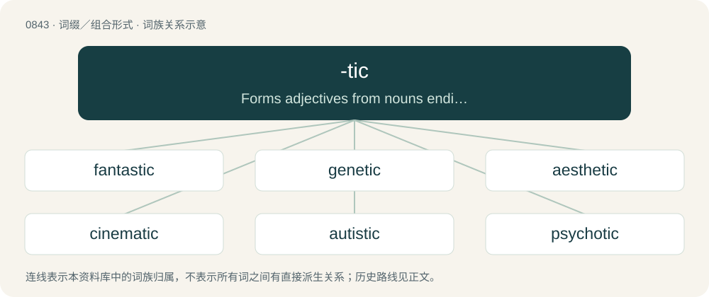

# 0913 · -tic — Forms adjectives from nouns ending with -sis, -o, or -a

[总目录](../00_总目录_按常用程度.md)

**类型**：词缀／组合形式　｜　**来源语言**：见词源记录

## 核心含义与来源

- 核心含义：Forms adjectives from nouns ending with -sis, -o, or -a
- 英文含义：Forms adjectives from nouns ending with -sis, -o, or -a
- 词形：-tic

**来源记录 1**（后缀／后置成分；Forms adjectives from nouns ending with -sis, -o, or -a）

From Ancient Greek -τικός (-tikós).

## 词族图

## 单词速览（常用到不常用）

| 单词 | 音标 | 释义 |
|---|---|---|
| [fantastic](#w-1) | /fænˈtæs.tɪk/ | a. 奇妙的, 稀奇的, 空想的 |
| [genetic](#w-2) | /d͡ʒəˈnɛt.ɪk/ | a. 创始的, 遗传的, 起源的, 遗传学的；\[医\] 生殖的, 遗传的 |
| [aesthetic](#w-3) | 英 /iːsˈθɛ.tɪk/；美 /ɛsˈθɛ.tɪk/ | a. 美学的, 审美的, 有美感的 |
| [cinematic](#w-4) | /sɪnəˈmætɪk/ | a. 电影的, 影片的 |
| [autistic](#w-5) | 英 /ɔːˈtɪs.tɪk/；美 /ɔˈtɪs.tɪk/ | \[医\] 孤独的, 自我中心的 |
| [psychotic](#w-6) | /ˌsaɪˈkɒtɪk/ | a. 精神病的；n. 精神病患者 |
| [enigmatic](#w-7) | 美 /ˌɛnɪɡˈmætɪk/ | a. 费解的, 谜一般的, 高深莫测的 |
| [melodramatic](#w-8) | 英 /ˌmɛl.ə.dɹəˈmæt.ɪk/ | a. 传奇剧风格的, 戏剧似的, 夸张的 |
| [symbiotic](#w-9) | 英 /ˌsɪm.baɪˈɒt.ɪk/；美 /ˌsɪm.baɪˈɑt.ɪk/ | a. 共栖的, 共生的；\[医\] 共生的 |
| [chromatic](#w-10) | 英 /kɹəˈmæt.ɪk/；美 /kɹəˈmæt.ɪk/ | a. 彩色的, 色品的, 易染色的；\[医\] 色的, 易染的, 核染质的 |
| [spastic](#w-11) | 英 /ˈspastɪk/；美 /ˈspæstɪk/ | a. 痉挛的, 痉挛性的, 痉挛引起的, 患痉挛性麻痹的, 突发的；n. 痉挛性麻痹患者, 肌肉痉挛患者 |
| [meiotic](#w-12) | /maiˈɔtik/ | 减数分裂的 |
| [zygomatic](#w-13) | 英 /ˌzʌɪ.ɡə(ʊ)ˈmat.ɪk/；美 /ˌzaɪ.ɡəˈmæt.ɪk/ | a. 颊骨的, 颧骨的；\[医\] 颧的, 颧骨的 |
| [euphemistic](#w-14) | /ˌjuːfəˈmɪstɪk/ | a. 委婉的 |
| [lytic](#w-15) | /ˈlitik/ | a. 溶菌作用的；\[化\] 溶解的; 细胞溶解的; 溶胞的; 溶菌的; 松解的; 分解的 |

## 逐词详解

### 1. fantastic

**词性**：形容词　｜　**音标**：/fænˈtæs.tɪk/

**中文释义**：a. 奇妙的, 稀奇的, 空想的

**英文义项**：Wonderful; marvelous; excellent; extraordinarily good or great (used especially as an intensifier). / Existing in or constructed from fantasy; of or relating to fantasy; fanciful.

**构词拆分**：fantasy + -tic

**词源与演化**：

Borrowed from Middle French fantastique, borrowed from Late Latin phantasticus, borrowed from Ancient Greek φᾰντᾰστῐκός (phăntăstĭkós, “imaginary, fantastic; fictional”), ultimately from Proto-Indo-European \*bʰeh₂- (“to shine”). Equivalent to fantasy + -tic. Doublet of fantastique.

**例句**：

> She had a fantastic view of her own importance that none of her colleagues shared.

该用例对应义项：Existing in or constructed from fantasy; of or relating to fantasy; fanciful.

### 2. genetic

**词性**：形容词　｜　**音标**：/d͡ʒəˈnɛt.ɪk/

**中文释义**：a. 创始的, 遗传的, 起源的, 遗传学的；\[医\] 生殖的, 遗传的

**英文义项**：Relating to genetics or genes. / Caused by genes.

**构词拆分**：By surface analysis, gene + -tic；gen(esis) + -etic

**词源与演化**：

Coined from genesis, similarly to antithesis, antithetic. Reflects Ancient Greek γενετικός (genetikós), from γένεσις (génesis) + -κός (-kós). Ultimately from Ancient Greek γίγνομαι (gígnomai, “I come into being”). By surface analysis, gene + -tic or gen(esis) + -etic.

**例句**：

> Chinese has borrowed several words from English, but it does not have a genetic relationship to English.

该用例对应义项：Based on shared membership in a linguistic family.

### 3. aesthetic

**词性**：形容词　｜　**音标**：英 /iːsˈθɛ.tɪk/；美 /ɛsˈθɛ.tɪk/

**中文释义**：a. 美学的, 审美的, 有美感的

**英文义项**：Concerned with beauty, artistic effect, or appearance. / Beautiful or appealing to one's sense of beauty or art.

**构词拆分**：aesthe(sis) + -tic

**词源与演化**：

From German Ästhetik or French esthétique, both from New Latin aesthēticus, itself borrowed from Ancient Greek αἰσθητικός (aisthētikós, “of sense perception”), from αἰσθάνομαι (aisthánomai, “to feel”); analysable as aesthe(sis) + -tic. Cognates include Proto-Germanic \*awiz (“obvious”), Sanskrit आविस् (āvís, “manifestly, evidently”) and Latin audiō.

**例句**：

> It works well enough, but the shabby exterior offends his aesthetic sensibilities.

该用例对应义项：Concerned with beauty, artistic effect, or appearance.

### 4. cinematic

**词性**：形容词　｜　**音标**：/sɪnəˈmætɪk/

**中文释义**：a. 电影的, 影片的

**英文义项**：Of or relating to the cinema. / Resembling a professional motion picture.

**构词拆分**：cinema + -tic

**词源与演化**：

From cinema + -tic. Compare French cinématique.

**例句**：

> Despite being shot on tiny budget, the student film looked incredibly cinematic.

该用例对应义项：Resembling a professional motion picture.

### 5. autistic

**词性**：形容词　｜　**音标**：英 /ɔːˈtɪs.tɪk/；美 /ɔˈtɪs.tɪk/

**中文释义**：\[医\] 孤独的, 自我中心的

**英文义项**：Having, characteristic of, or relating to autism. / Socially inept, self-absorbed, or stupid.

**构词拆分**：autism + -istic

**词源与演化**：

From autism + -istic or -tic. First attested in 1913. The modern clinical sense is first used in 1943 by Leo Kanner.

**用法示例／搭配（非完整句）**：

> imagine being this autistic over a fictional character

该用例对应义项：Characterized by abnormal and unhealthy focus or persistence, and unhealthy hatred of opposition or criticism. Obsessive.

### 6. psychotic

**词性**：形容词　｜　**音标**：/ˌsaɪˈkɒtɪk/

**中文释义**：a. 精神病的；n. 精神病患者

**英文义项**：Of, related to, or suffering from psychosis. / Out of control, bizarre, or crazy.

**构词拆分**：psychosis + -tic

**词源与演化**：

Derived in English from psychosis + -tic; compare French psychotique, German psychotisch. Attested from the late 19th century. Compare earlier neurotic.

**例句**：

> After experiencing several acute psychotic episodes, Mary was admitted to a mental institution.

### 7. enigmatic

**词性**：形容词　｜　**音标**：美 /ˌɛnɪɡˈmætɪk/

**中文释义**：a. 费解的, 谜一般的, 高深莫测的

**英文义项**：Pertaining to an enigma. / Mysterious.

**构词拆分**：enigma + -tic

**词源与演化**：

From Latin aenigmaticus and French énigmatique, from Ancient Greek αἰνιγματικός (ainigmatikós); equivalent to enigma + -tic.

**例句**：

> The Mona Lisa has an enigmatic smile.

### 8. melodramatic

**词性**：形容词　｜　**音标**：英 /ˌmɛl.ə.dɹəˈmæt.ɪk/

**中文释义**：a. 传奇剧风格的, 戏剧似的, 夸张的

**英文义项**：Of or pertaining to melodrama; like or suitable to a melodrama; unnatural in situation or action. / Exaggeratedly emotional or sentimental.

**构词拆分**：melodrama + -tic

**词源与演化**：

From melodrama + -tic. Modelled after dramatic.

**例句**：

> She wrote him a melodramatic letter, threatening to kill herself.

该用例对应义项：Exaggeratedly emotional or sentimental.

### 9. symbiotic

**词性**：形容词　｜　**音标**：英 /ˌsɪm.baɪˈɒt.ɪk/；美 /ˌsɪm.baɪˈɑt.ɪk/

**中文释义**：a. 共栖的, 共生的；\[医\] 共生的

**英文义项**：Of, or relating to symbiosis; living together. / Of a relationship with mutual benefit between two individuals, organisms, or groups.

**构词拆分**：symbiosis + -tic

**词源与演化**：

From symbiosis + -tic, from Ancient Greek συμβίωσις (sumbíōsis), from σύν (sún, “with”) + βίος (bíos, “life”).

**例句**：

> A lichen is a fungus with symbiotic algae among its cells.

该用例对应义项：Of, or relating to symbiosis; living together.

### 10. chromatic

**词性**：形容词　｜　**音标**：英 /kɹəˈmæt.ɪk/；美 /kɹəˈmæt.ɪk/

**中文释义**：a. 彩色的, 色品的, 易染色的；\[医\] 色的, 易染的, 核染质的

**英文义项**：Characterized or caused by, or relating to, colour or hue. / Brightly coloured; colourful, vivid.

**构词拆分**：chroma + -tic

**词源与演化**：

Borrowed from French chromatique (“chromatic”) or directly from its etymon Latin chrōmaticus, from Ancient Greek χρωματικός (khrōmatikós, “relating to colour; one of the three types of tetrachord in Greek music”), from χρῶμα (khrôma, “colour; pigment; chromatic scale in music; music”) (ultimately from Proto-Indo-European \*gʰer- (“to grind; to rub; to stroke; to remove”), perhaps in the sense of the grinding of pigments) + -τῐκός (-tĭkós, suffix forming adjectives); analysable as chroma + -tic.

**例句**：

> The chromatic thirds in this composition pose a significant technical challenge for the performer.

### 11. spastic

**词性**：形容词　｜　**音标**：英 /ˈspastɪk/；美 /ˈspæstɪk/

**中文释义**：a. 痉挛的, 痉挛性的, 痉挛引起的, 患痉挛性麻痹的, 突发的；n. 痉挛性麻痹患者, 肌肉痉挛患者

**英文义项**：Of, relating to, or affected by spasm. / Of or relating to spastic paralysis.

**构词拆分**：By surface analysis, spasm + -tic

**词源与演化**：

Learned borrowing from Latin spasticus, from Ancient Greek σπαστικός (spastikós, “drawing in”). By surface analysis, spasm + -tic. Cf. French spastique and see also spasm.

**例句**：

> Spastic paralysis is a spastic form of cerebral palsy.

该用例对应义项：relating to or characterized by spasm

### 12. meiotic

**词性**：形容词　｜　**音标**：/maiˈɔtik/

**中文释义**：减数分裂的

**英文义项**：Of or pertaining to meiosis.

**构词拆分**：meio- + -tic

**词源与演化**：

Coined by British biologists John Bretland Farmer and John Edmund Sharrock Moore in 1905 as maiotic in a paper in the Quarterly Journal of Microscopic Science, with the spelling corrected on etymological grounds later that year. Equivalent to meio- + -tic.

### 13. zygomatic

**词性**：形容词　｜　**音标**：英 /ˌzʌɪ.ɡə(ʊ)ˈmat.ɪk/；美 /ˌzaɪ.ɡəˈmæt.ɪk/

**中文释义**：a. 颊骨的, 颧骨的；\[医\] 颧的, 颧骨的

**英文义项**：Of, relating to, or located in the area of the zygomatic bone or zygomatic arch.

**构词拆分**：zygoma + -tic

**词源与演化**：

From zygoma + -tic. Doublet of zygomaticus.

### 14. euphemistic

**词性**：形容词　｜　**音标**：/ˌjuːfəˈmɪstɪk/

**中文释义**：a. 委婉的

**英文义项**：Of or pertaining to euphemism.

**构词拆分**：euphemism + -tic

**词源与演化**：

From euphemism + -tic.

**例句**：

> Most languages have euphemistic expressions to describe death and dying.

### 15. lytic

**词性**：形容词　｜　**音标**：/ˈlitik/

**中文释义**：a. 溶菌作用的；\[化\] 溶解的; 细胞溶解的; 溶胞的; 溶菌的; 松解的; 分解的

**英文义项**：Of, relating to, or causing lysis. / Of or relating to lysin.

**构词拆分**：lysis + -tic；lysin + -tic

**词源与演化**：

From lysis + -tic or lysin + -tic.
