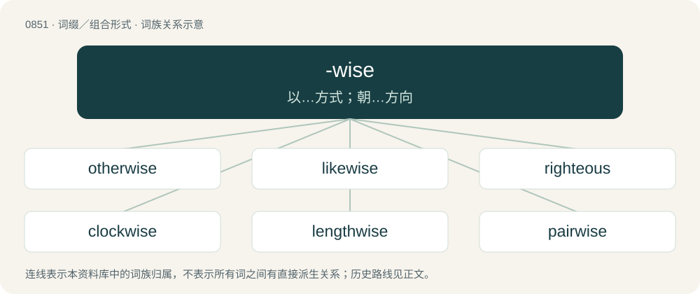

# 0921 · -wise — 以…方式；朝…方向

[总目录](../00_总目录_按常用程度.md)

**类型**：词缀／组合形式　｜　**来源语言**：见词源记录

## 核心含义与来源

- 核心含义：以…方式；朝…方向
- 英文含义：In the direction or orientation of.
- 词形：-wise

**来源记录 1**（后缀／后置成分；In the direction or orientation of.）

From Middle English -wis (“-wise”), from Old English -wīs (“-wise”), from Proto-West Germanic \*-wīs (“-wise”), from Proto-Germanic \*-wīsaz (“-wise”), from Proto-Germanic \*wīsaz (“wise, skilled, knowledgeable”), related to Old English wīs, wīse (“manner, way, fashion”). Cognate with Saterland Frisian -wiese (“-wise”), Dutch -wijs (“-wise”), German -weise (“-wise”), Danish -vis (“-wise”), Norwegian -vis (“-wise”), Swedish -vis (“-wise”), Yiddish ־ווײַז (-vayz, “-wise”). More at wise (“way, manner”).

## 词族图

## 单词速览（常用到不常用）

| 单词 | 音标 | 释义 |
|---|---|---|
| [otherwise](#w-1) | 英 /ˈʌð.əˌwaɪz/；美 /ˈʌð.ɚˌwaɪz/ | adv. 否则, 不同地, 别的方式 |
| [likewise](#w-2) | /ˈlaɪkˌwaɪz/ | adv. 同样地, 也 |
| [righteous](#w-3) | /ˈɹaɪt͡ʃəs/ | a. 公正的, 正义的, 正直的；\[法\] 正直的, 正当的, 正义的 |
| [clockwise](#w-4) | /ˈklɒkwaɪz/ | a. 顺时针方向的；adv. 顺时针方向地 |
| [lengthwise](#w-5) | /ˈleŋθwaiz/ | a. 纵长的；adv. 纵长地 |
| [pairwise](#w-6) | 英 /ˈpɛə.waɪz/；美 /ˈpɛɹ.waɪz/ | 成对\[双\]地, 两个两个地 |
| [streetwise](#w-7) | /ˈstriːtwaɪz/ | n. 在现代化大城市的生存能力 |
| [stepwise](#w-8) | /ˈstepwaiz/ | a. 楼梯式的, 逐步的 |
| [crosswise](#w-9) | /ˈkrɒswaiz/ | adv. 斜地, 成十字状地, 交叉地；\[机\] 十字形向, 横向 |
| [piecewise](#w-10) | /ˈpiːswaiz/ | adv. \[数\]分段地 |
| [edgewise](#w-11) | 英 /ˈɛdʒwaɪz/；美 /ˈɛd͡ʒwaɪz/ | adv. 把刀口朝前地; 沿边 |

## 逐词详解

### 1. otherwise

**词性**：形容词　｜　**音标**：英 /ˈʌð.əˌwaɪz/；美 /ˈʌð.ɚˌwaɪz/

**中文释义**：adv. 否则, 不同地, 别的方式

**英文义项**：Other than supposed; different.

**构词拆分**：other + -wise

**词源与演化**：

From Middle English otherwise, othre wise, from Old English on ōþre wīsan (literally “in (on) other/different manner”); equivalent to other + -wise. Compare West Frisian yn oarwei (“otherwise”), Icelandic öðruvísi (“different”).

**例句**：

> Statistics need lots of information, digital and otherwise.

该用例对应义项：Other than supposed; different.

### 2. likewise

**词性**：副词　｜　**音标**：/ˈlaɪkˌwaɪz/

**中文释义**：adv. 同样地, 也

**英文义项**：In a similar manner. / also; moreover; too.

**构词拆分**：like + -wise

**词源与演化**：

From Middle English lykewise, lykewyse, lyke wyse, lijk wise, a shortened form of Middle English in lik wise (“in like wise”); equivalent to like + -wise. Compare with otherwise.

**例句**：

> It was very nice meeting you, Samantha. ― Likewise, Mr Thompson.

该用例对应义项：The same to you; used as a response.

### 3. righteous

**词性**：形容词　｜　**音标**：/ˈɹaɪt͡ʃəs/

**中文释义**：a. 公正的, 正义的, 正直的；\[法\] 正直的, 正当的, 正义的

**英文义项**：Free from sin or guilt. / Moral and virtuous, perhaps to the point of sanctimony.

**构词拆分**：right + -wise；right + wise (“way, manner”)

**词源与演化**：

From earlier rightuous, rightwose, rightwos, rightwise, from Middle English rightwise, rightwis, from Old English rihtwīs (“righteous, just”), corresponding to right + -wise (with assimilation of second element to -ous), or to right + wise (“way, manner”). Cognate with Scots richtwis (“righteous”), Old High German rehtwīsic (“righteous, just”), Icelandic réttvíss (“righteous, just”). Compare also thefteous, mighteous.

**例句**：

> Human beings should take a righteous path, and so should art. We should promote kindness and beauty through art.

该用例对应义项：Moral and virtuous, perhaps to the point of sanctimony.

### 4. clockwise

**词性**：形容词　｜　**音标**：/ˈklɒkwaɪz/

**中文释义**：a. 顺时针方向的；adv. 顺时针方向地

**英文义项**：Moving clockwise; having rotary motion in the manner of a clock.

**构词拆分**：clock + -wise

**词源与演化**：

From clock + -wise.

**例句**：

> In the southern hemisphere the flow of air around a low-pressure system is clockwise.

该用例对应义项：Moving clockwise; having rotary motion in the manner of a clock.

### 5. lengthwise

**词性**：形容词　｜　**音标**：/ˈleŋθwaiz/

**中文释义**：a. 纵长的；adv. 纵长地

**英文义项**：In the long direction of an oblong object.

**构词拆分**：length + -wise

**词源与演化**：

From length + -wise.

**例句**：

> A lengthwise cut is difficult to saw with hand tools.

该用例对应义项：In the long direction of an oblong object.

### 6. pairwise

**词性**：形容词　｜　**音标**：英 /ˈpɛə.waɪz/；美 /ˈpɛɹ.waɪz/

**中文释义**：成对\[双\]地, 两个两个地

**英文义项**：Occurring in pairs; two at a time.

**构词拆分**：pair + -wise

**词源与演化**：

From pair + -wise.

**例句**：

> They proceeded to make pairwise comparisons.

该用例对应义项：Occurring in pairs; two at a time.

### 7. streetwise

**词性**：形容词　｜　**音标**：/ˈstriːtwaɪz/

**中文释义**：n. 在现代化大城市的生存能力

**英文义项**：Having the necessary knack, personality and instinct for survival in rough, urban environments. / Possessing a style that reflects urban life and microculture.

**构词拆分**：street + -wise

**词源与演化**：

From street + -wise.

**例句**：

> You could tell from the way he spat old Tupac lyrics, loitering in the corner with his homies, flipping that Yankees cap on his head like he couldn't give a damn that he was streetwise enough to melt Will Smith.

该用例对应义项：Possessing a style that reflects urban life and microculture.

### 8. stepwise

**词性**：形容词　｜　**音标**：/ˈstepwaiz/

**中文释义**：a. 楼梯式的, 逐步的

**英文义项**：One (small) step or stage at a time; gradual; piecemeal

**构词拆分**：step + -wise

**词源与演化**：

From step + -wise.

### 9. crosswise

**词性**：形容词　｜　**音标**：/ˈkrɒswaiz/

**中文释义**：adv. 斜地, 成十字状地, 交叉地；\[机\] 十字形向, 横向

**英文义项**：crossing; lying across

**构词拆分**：cross + -wise

**词源与演化**：

From Middle English croswyse, crose wyse, equivalent to cross + -wise.

**例句**：

> The wind blew the branches of the tree crosswise, making it sway.

### 10. piecewise

**词性**：形容词　｜　**音标**：/ˈpiːswaiz/

**中文释义**：adv. \[数\]分段地

**英文义项**：Defined by subfunctions and subdomains

**构词拆分**：piece + -wise

**词源与演化**：

From piece + -wise.

### 11. edgewise

**词性**：副词　｜　**音标**：英 /ˈɛdʒwaɪz/；美 /ˈɛd͡ʒwaɪz/

**中文释义**：adv. 把刀口朝前地; 沿边

**英文义项**：Edgeways. / As if by an edge.

**构词拆分**：edge + -wise

**词源与演化**：

From edge + -wise. Compare English edgeling (“edgeways”) and edgelong.

**例句**：

> Once his boss got started, Jim just couldn’t get a word in edgewise.

该用例对应义项：As if by an edge.
