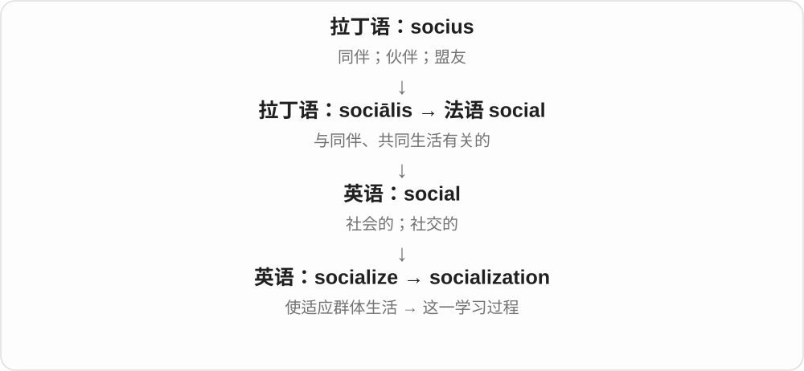
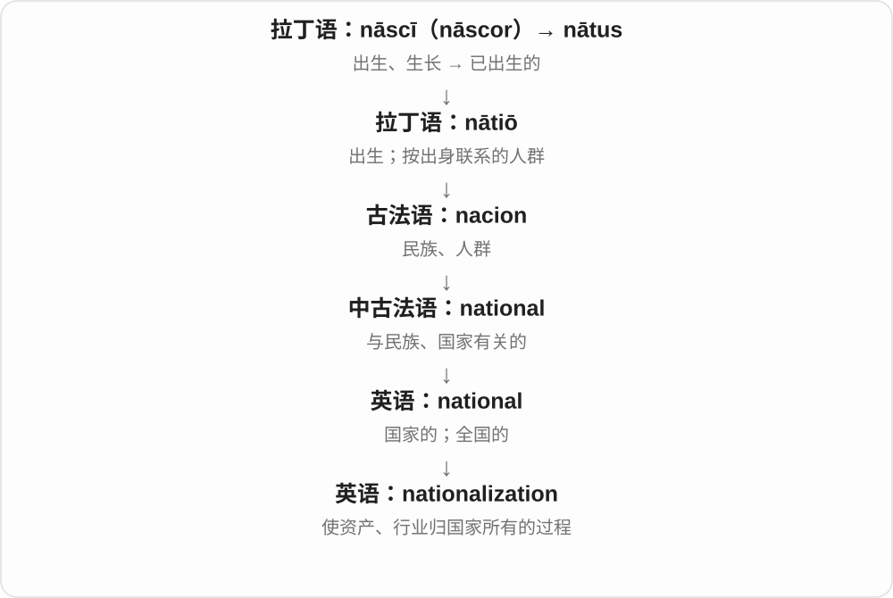
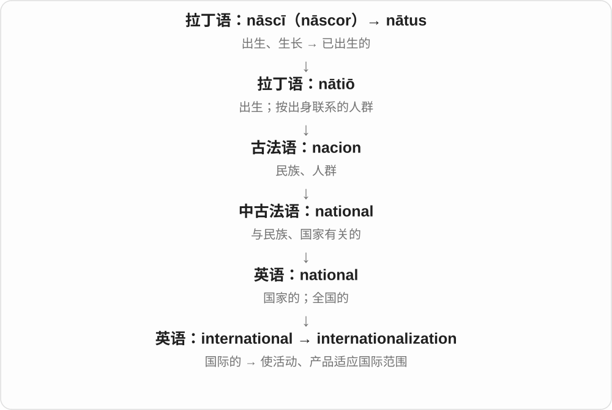
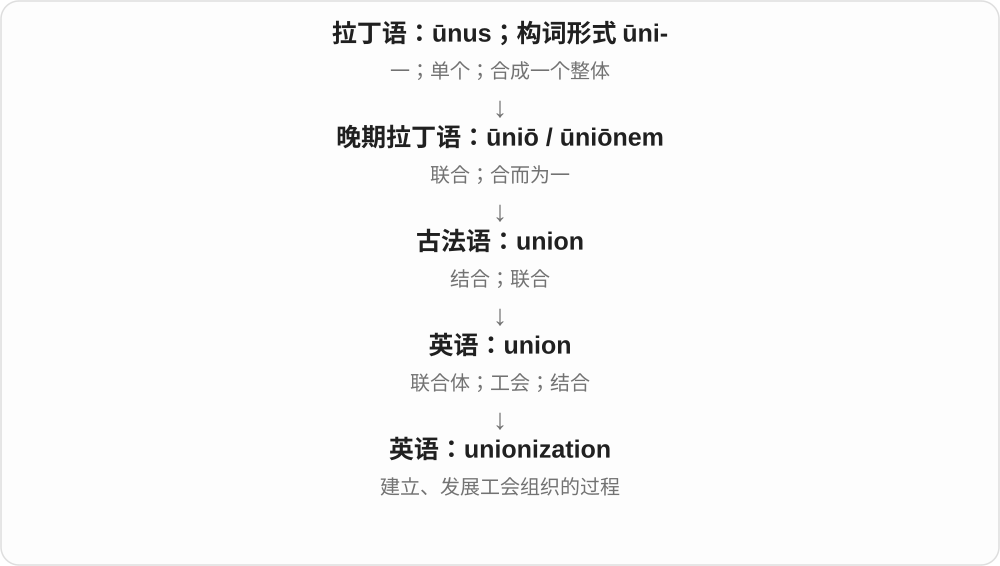
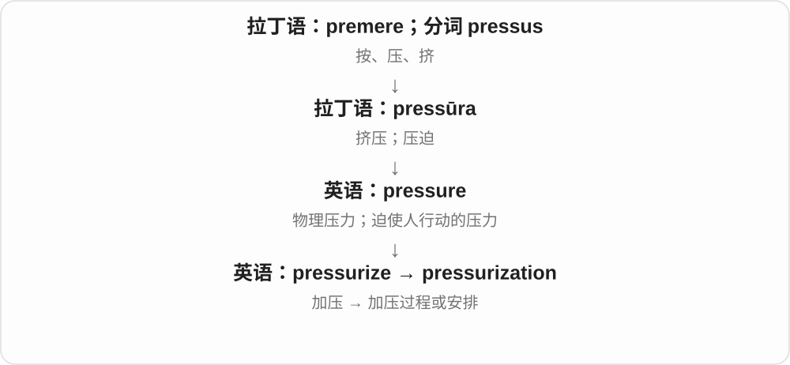
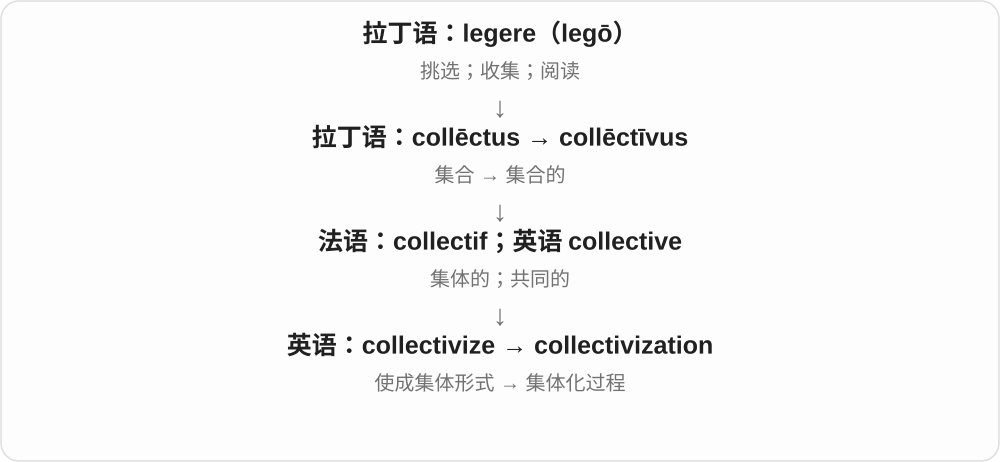
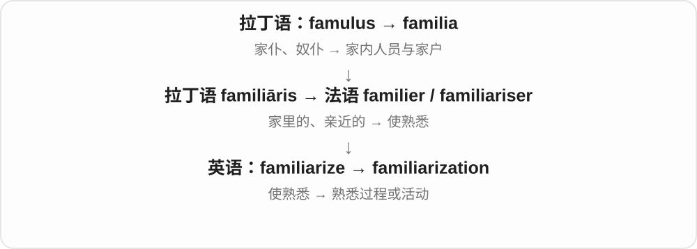

# 0927 · -ization — 把使成为、发生变化的动词转为过程、结果名词

[逐词精讲目录](../00_逐词精讲目录.md) · [总目录](../00_总目录_按常用程度.md)

## 核心词根与来源

尾巴只提示过程或结果，不能代替核心解释：有的是灭菌，有的是把人挤到边缘，有的是把设备做小。还有一些词连同法语名词整体借入，现代可拆不表示英语动词一定先出现。

**-IZATION：某种变化发生了，这件事叫一个名词**

sterile → sterilize → sterilization；marginal → marginalize → marginalization；miniature → miniaturize → miniaturization。

- **无菌、免疫与混合来源**：sterile · sterilize · sterilization · immune · immunize · immunization · hybrid · hybridize · hybridization
- **理性、效率与边缘位置**：rational · rationalize · rationalization · marginal · marginalize · marginalization
- **材料与尺寸变化**：mineral · mineralize · mineralization · miniature · miniaturize · miniaturization · crystallization · vaporization · pressurization
- **形象、规则与文本改写**：demon · demonize · demonization · formalize · formalization · novel · novelize · novelization
- **社会、制度和个人变化**：civilization · socialization · industrialization · commercialization · liberalization · democratization · nationalization · unionization · internationalization · institutionalization · collectivization · centralization · polarization · radicalization · victimization · dehumanization · sexualization · westernization
- **归类、组织与技术变化**：generalization · normalization · criminalization · randomization · regularization · internalization · virtualization · digitalization · popularization · familiarization · periodization
- **sterile → sterilize、sterilise 及过去分词**：sterile · sterilize · sterilise · sterilized · sterilised

## 词形与演化规律

-ize 的希腊、拉丁、法语等构词传统，与 -ation 动作名词词尾结合成 -ization；英式常有 -isation 变体。动词末尾 e 通常去掉。

e 去掉后加完整 ize、ise；两种拼写规则对应，不另编两条词源。

## 单词速览（按词族由简到繁）

同一基础词的相关扩展放在一起，先读基础形式，再读扩展；各组之间优先读常用的。具体词源关系见各词讲解。

| 单词 | 音标 | 核心意思 |
|---|---|---|
| [novel](#w-45) | 英 /ˈnɒvəl/；美 /ˈnɑːvəl/ | 新颖的；新奇的；长篇小说 |
| [novelize](#w-63) | 英 /ˈnɒvəlaɪz/；美 /ˈnɑːvəlaɪz/ | 把……改写成小说、小说化 |
| [novelization](#w-39) | 英 /ˌnɒvəlaɪˈzeɪʃən/；美 /ˌnɑːvələˈzeɪʃən/ | 小说化改写；由电影、剧本等改写的小说 |
| [immune](#w-46) | /ɪˈmjuːn/ | 免疫的；免于、不受某事影响的；免疫系统的 |
| [immunize](#w-59) | /ˈɪmjʊnaɪz/ | 使免疫、使获得免疫保护 |
| [immunization](#w-7) | 英 /ˌɪmjʊnaɪˈzeɪʃən/；美 /ˌɪmjənəˈzeɪʃən/ | 免疫、使获得免疫保护的过程；预防接种〔常见用法〕 |
| [hybrid](#w-47) | /ˈhaɪbrɪd/ | 杂交后代；混合体；混合的；混合动力车 |
| [hybridize](#w-60) | /ˈhaɪbrɪdaɪz/ | 使杂交、杂化；混合不同来源 |
| [hybridization](#w-11) | 英 /ˌhaɪbrɪdaɪˈzeɪʃən/；美 /ˌhaɪbrədəˈzeɪʃən/ | 杂交；杂化；不同来源结合的过程 |
| [demon](#w-48) | /ˈdiːmən/ | 恶魔；内心困扰、恐惧；某方面厉害的人〔比喻〕 |
| [demonize](#w-56) | /ˈdiːmənaɪz/ | 把……妖魔化、描述成邪恶 |
| [demonization](#w-35) | 英 /ˌdiːmənaɪˈzeɪʃən/；美 /ˌdiːmənəˈzeɪʃən/ | 妖魔化，把对象塑造成邪恶形象 |
| [rational](#w-49) | /ˈræʃənəl/ | 理性的、合理的；有理数的〔数学〕 |
| [rationalize](#w-54) | /ˈræʃənəlaɪz/ | 使合理、有条理；调整以提高效率；为行为找借口；使有理化 |
| [rationalization](#w-16) | 英 /ˌræʃənəlaɪˈzeɪʃən/；美 /ˌræʃənələˈzeɪʃən/ | 合理化、整合以提高效率；自圆其说、为行为找理由；有理化 |
| [mineral](#w-50) | /ˈmɪnərəl/ | 矿物；矿物质〔营养等语境〕；矿物的 |
| [mineralize](#w-62) | /ˈmɪnərəlaɪz/ | 使矿化、形成或沉积矿物质；转成无机形态 |
| [mineralization](#w-24) | 英 /ˌmɪnərəlaɪˈzeɪʃən/；美 /ˌmɪnərələˈzeɪʃən/ | 矿化、矿物质形成或沉积；有机物向无机形态转化〔依领域〕 |
| [civilization](#w-1) | 英 /ˌsɪvəlaɪˈzeɪʃən/；美 /ˌsɪvələˈzeɪʃən/ | 文明；某一文明社会；有组织的生活环境 |
| [miniature](#w-51) | 英 /ˈmɪnɪtʃə/；美 /ˈmɪniətʃər/ | 微型的、小型的；缩小模型、小幅肖像画 |
| [miniaturize](#w-61) | /ˈmɪnətʃəraɪz/ | 使小型化、微型化 |
| [miniaturization](#w-32) | /ˌmɪnətʃəraɪˈzeɪʃən/ | 小型化、微型化；小型化成果 |
| [marginal](#w-52) | 英 /ˈmɑːdʒɪnəl/；美 /ˈmɑːrdʒɪnəl/ | 边缘的；很小的、勉强的；边际的〔专门义〕 |
| [marginalize](#w-58) | 英 /ˈmɑːdʒɪnəlaɪz/；美 /ˈmɑːrdʒɪnəlaɪz/ | 使边缘化、排挤到次要位置 |
| [marginalization](#w-18) | 英 /ˌmɑːdʒɪnəlaɪˈzeɪʃən/；美 /ˌmɑːrdʒɪnələˈzeɪʃən/ | 边缘化、被排斥到次要位置的过程或状态 |
| [sterile](#w-53) | 英 /ˈsteraɪl/；美 /ˈsterəl/ | 无菌的；不能生育、繁殖的；无成果、乏味的 |
| [sterilize](#w-55) | 英 /ˈsterɪlaɪz/；美 /ˈsterəlaɪz/ | 使无菌、灭菌；使不能繁殖、施行绝育 |
| [sterilization](#w-4) | 英 /ˌsterɪlaɪˈzeɪʃən/；美 /ˌsterələˈzeɪʃən/ | 灭菌；绝育〔另一用法〕 |
| [sterilized](#w-64) | 英 /ˈsterɪlaɪzd/；美 /ˈsterəlaɪzd/ | 灭菌了、灭菌过的；被绝育的〔按对象〕 |
| [sterilise](#w-66) | /ˈsterɪlaɪz/ | 灭菌；使不育〔sterilize 的拼写变体〕 |
| [sterilised](#w-65) | /ˈsterɪlaɪzd/ | 灭菌了、灭菌过的；被绝育的〔拼写变体，按对象〕 |
| [polarization](#w-2) | 英 /ˌpəʊləraɪˈzeɪʃən/；美 /ˌpoʊlərəˈzeɪʃən/ | 两极分化；偏振；极化 |
| [generalization](#w-3) | 英 /ˌdʒenərəlaɪˈzeɪʃən/；美 /ˌdʒenərələˈzeɪʃən/ | 概括；归纳出的看法；普遍化 |
| [industrialization](#w-5) | 英 /ɪnˌdʌstriəlaɪˈzeɪʃən/；美 /ɪnˌdʌstriəlɪˈzeɪʃən/ | 工业化、工业化过程 |
| [socialization](#w-6) | 英 /ˌsəʊʃəlaɪˈzeɪʃən/；美 /ˌsoʊʃələˈzeɪʃən/ | 社会化；学习社会规范的过程；社交活动 |
| [normalization](#w-8) | 英 /ˌnɔːməlaɪˈzeɪʃən/；美 /ˌnɔːrmələˈzeɪʃən/ | 正常化；归一化；规范化 |
| [commercialization](#w-9) | 英 /kəˌmɜːʃəlaɪˈzeɪʃən/；美 /kəˌmɜːrʃələˈzeɪʃən/ | 商业化；商品化 |
| [liberalization](#w-10) | 英 /ˌlɪbərəlaɪˈzeɪʃən/；美 /ˌlɪbərələˈzeɪʃən/ | 自由化；放宽限制的过程 |
| [victimization](#w-12) | 英 /ˌvɪktɪmaɪˈzeɪʃən/；美也常 /ˌvɪktɪməˈzeɪʃən/ | 使受害、欺凌、迫害；受害经历 |
| [virtualization](#w-13) | 英 /ˌvɜːtʃʊəlaɪˈzeɪʃən/；美 /ˌvɜːrtʃəwələˈzeɪʃən/ | 虚拟化 |
| [democratization](#w-14) | 英 /dɪˌmɒkrətaɪˈzeɪʃən/；美 /dɪˌmɑːkrətəˈzeɪʃən/ | 民主化；让更多人有机会使用或参与 |
| [nationalization](#w-15) | 英 /ˌnæʃənəlaɪˈzeɪʃən/；美 /ˌnæʃənələˈzeɪʃən/ | 国有化 |
| [internationalization](#w-22) | 英 /ˌɪntəˌnæʃənəlaɪˈzeɪʃən/；美 /ˌɪntərˌnæʃənələˈzeɪʃən/ | 国际化 |
| [centralization](#w-17) | 英 /ˌsentrəlaɪˈzeɪʃən/；美 /ˌsentrələˈzeɪʃən/ | 集中化；集权；统一管理 |
| [crystallization](#w-19) | 英 /ˌkrɪstəlaɪˈzeɪʃən/；美 /ˌkrɪstələˈzeɪʃən/ | 结晶、结晶过程；想法逐渐明确成形 |
| [radicalization](#w-20) | 英 /ˌrædɪkəlaɪˈzeɪʃən/；美 /ˌrædɪkələˈzeɪʃən/ | 激进化；立场趋于极端的过程 |
| [unionization](#w-21) | 英 /ˌjuːnjənaɪˈzeɪʃən/；美 /ˌjuːnjənəˈzeɪʃən/ | 工会组织化；成立工会的过程 |
| [criminalization](#w-23) | /ˌkrɪmɪnəlaɪˈzeɪʃən/ | 犯罪化、入罪化的过程或政策 |
| [formalize](#w-57) | 英 /ˈfɔːməlaɪz/；美 /ˈfɔːrməlaɪz/ | 使正式化；明确为规则或文件 |
| [formalization](#w-38) | 英 /ˌfɔːməlaɪˈzeɪʃən/；美 /ˌfɔːrmələˈzeɪʃən/ | 正式确立；形式化、明确化 |
| [randomization](#w-25) | 英 /ˌrændəmaɪˈzeɪʃən/；美 /ˌrændəməˈzeɪʃən/ | 随机化、随机分配的过程 |
| [institutionalization](#w-27) | 英 /ˌɪnstɪˌtjuːʃənəlaɪˈzeɪʃən/；美 /ˌɪnstɪˌtuːʃənələˈzeɪʃən/ | 制度化；长期机构安置；对机构生活的适应 |
| [dehumanization](#w-28) | 英 /ˌdiːhjuːmənaɪˈzeɪʃən/；美 /ˌdiːhjuːmənəˈzeɪʃən/ | 去人性化；非人化 |
| [internalization](#w-29) | 英 /ɪnˌtɜːnəlaɪˈzeɪʃən/ | 内化、内化过程 |
| [pressurization](#w-30) | 英 /ˌpreʃəraɪˈzeɪʃən/；美 /ˌpreʃərəˈzeɪʃən/ | 加压；增压过程或系统 |
| [collectivization](#w-31) | 英 /kəˌlektɪvaɪˈzeɪʃən/；美 /kəˌlektɪvəˈzeɪʃən/ | 集体化 |
| [regularization](#w-33) | 美 /ˌreɡjələrəˈzeɪʃən/；英常读 /ˌreɡjələraɪˈzeɪʃən/ | 规范化；使正式化；正则化〔数学、计算机〕 |
| [vaporization](#w-34) | 英 /ˌveɪpəraɪˈzeɪʃən/；美 /ˌveɪpərəˈzeɪʃən/ | 气化；汽化 |
| [popularization](#w-36) | 英 /ˌpɒpjələraɪˈzeɪʃən/；美 /ˌpɑːpjələrəˈzeɪʃən/ | 普及；推广；通俗化；通俗读物 |
| [sexualization](#w-37) | 英 /ˌsekʃuəlaɪˈzeɪʃən/；美 /ˌsekʃuələˈzeɪʃən/ | 性化；赋予性意味 |
| [westernization](#w-40) | 英 /ˌwestənaɪˈzeɪʃən/；美 /ˌwestərnəˈzeɪʃən/ | 西方化 |
| [digitalization](#w-41) | 英 /ˌdɪdʒɪtəlaɪˈzeɪʃən/；美 /ˌdɪdʒɪtələˈzeɪʃən/ | 数字化；数字技术的采用过程 |
| [familiarization](#w-42) | 英 /fəˌmɪliəraɪˈzeɪʃən/；美 /fəˌmɪljərəˈzeɪʃən/ | 熟悉过程；入门熟悉训练 |
| [periodization](#w-43) | 英 /ˌpɪəriədaɪˈzeɪʃən/；美 /ˌpɪriədəˈzeɪʃən/ | 时期划分；分期训练 |

## 逐词讲解

### 1. novel — 新颖的；新奇的；长篇小说

**音标**：英 /ˈnɒvəl/；美 /ˈnɑːvəl/

**先抓住这个画面**

新鲜、不按老路来的点子是 novel。小说义则经“新鲜故事”那条历史传来，不是所有小说内容都必须离奇。

**怎么拆**

形容词经古法语 novel；小说名词经意大利 novella。两路都接拉丁 novus、novellus，但不是英语形容词直接变成小说名词。

**怎么变成今天的意思**

**拉丁 novus**  
新的

↓

**形容词支线：拉丁 novellus → 古法语 novel → 英语 novel**  
新的 → 新颖的

↓

**名词另支：拉丁 novella → 意大利 novella → 英语 novel**  
新鲜事、故事 → 小说

a novel approach 是新颖做法；a historical novel 是历史小说。形容词常强调相对已有经验的新意，名词说作品类型。

**常见搭配与例句**

a novel idea；a novel approach；read a novel。

> The team proposed a novel way to reduce waste.

团队提出了一种减少浪费的新办法。

> She is reading a novel set in nineteenth-century Paris.

她正在读一本以十九世纪巴黎为背景的小说。

**别混淆**

new 只需新出现或新获得；novel 常含不同寻常的新意。小说也不能和所有 fiction 完全画等号。

### 2. novelize — 把……改写成小说、小说化

**音标**：英 /ˈnɒvəlaɪz/；美 /ˈnɑːvəlaɪz/

**先抓住这个画面**

原来是电影、剧本或真实事件，把它展开为叙述、人物心理和场景文字，写成长篇小说。

**怎么拆**

novel 取小说名词义 + -ize，不是取新奇的形容词就一律译创新。更远小说名词与新故事有关，现代直接构词仍看小说这一义。

**怎么变成今天的意思**

**novel 小说 + -ize → novelize**  
把已有材料写成小说

↓

**novelize + -ation → novelization**  
小说改写过程及其成书作品

novelize a film 把电影改写成小说，novelize a screenplay 将剧本小说化，novelize historical events 把历史事件写成小说。

**常见搭配与例句**

novelize a film；novelize a screenplay；novelize historical events。

> She was hired to novelize the screenplay.

她受聘把剧本改写成小说。

> The author novelized a series of historical events.

作者把一系列历史事件写成了小说。

**别混淆**

novelize 常从其他材料变成小说；把小说拍成电影是 adapt a novel for film，方向相反。

### 3. novelization — 小说化改写；由电影、剧本等改写的小说

**音标**：英 /ˌnɒvəlaɪˈzeɪʃən/；美 /ˌnɑːvələˈzeɪʃən/

**先抓住这个画面**

不仅能说改写这件事，也能拿起一本书说：这是那部电影的小说版。

**怎么拆**

novelize + -ation，形成过程、结果名词。英式也常写 novelisation；不是每一本 novel 小说都必须先有别的媒体版本。

**怎么变成今天的意思**

**novel 小说 + -ize → novelize**  
把已有材料写成小说

↓

**novelize + -ation → novelization**  
小说改写过程及其成书作品

a novelization of the film 电影的小说版，an official novelization 官方小说改编版，screenplay novelization 剧本小说化。

**常见搭配与例句**

a novelization of；an official novelization；screenplay novelization。

> I read the novelization after watching the film.

看完电影后，我读了它的小说改编版。

> The novelization adds scenes that are not in the screenplay.

小说改编版增加了剧本里没有的场景。

**别混淆**

novelization 的改编方向常是影像、剧本等到小说；film adaptation of a novel 则从小说到电影，别把方向颠倒。

### 4. immune — 免疫的；免于、不受某事影响的；免疫系统的

**音标**：/ɪˈmjuːn/

**先抓住这个画面**

先想某种本来会落到身上的影响被挡在外面：免缴义务是早期背景，不受疾病、批评影响是后来不同用法。

**怎么拆**

经法语接拉丁 immūnis，in- 不在 m 前同化为 im-，后半 mūnus 是公共义务、服务等。医学免疫是豁免、免受影响的专门发展。

**怎么变成今天的意思**

**拉丁 in- 不 + mūnus 义务、公共服务 → immūnis**  
免于某种负担、义务

↓

**法语相关形式 → immune**  
豁免 → 不易受某事影响；医学免疫

↓

**immunize / immunization**  
使产生免疫保护；形成保护的过程

immune to criticism 不受批评影响，immune to a particular disease 对特定疾病有免疫力，the immune system 免疫系统。

**常见搭配与例句**

immune to；immune from；the immune system。

> No organization is immune to criticism.

没有哪个组织能免于批评。

> The lesson explains how the immune system recognizes threats.

课程解释免疫系统怎样识别威胁。

**别混淆**

immune 通常说明对什么有保护，不等于对所有疾病绝对不会中招；immune to criticism 又常是比喻。immune system 是整体系统名。

### 5. immunize — 使免疫、使获得免疫保护

**音标**：/ˈɪmjʊnaɪz/

**先抓住这个画面**

不是只知道某种疾病，而是让身体具备应对它的保护；常见通过疫苗形成这种保护。

**怎么拆**

借法语 immuniser，现代对应 immune 去 e + -ize。英式变体 immunise；不能把中间 immun- 拆成 in + 一个现代单词 mun。

**怎么变成今天的意思**

**拉丁 in- 不 + mūnus 义务、公共服务 → immūnis**  
免于某种负担、义务

↓

**法语相关形式 → immune**  
豁免 → 不易受某事影响；医学免疫

↓

**immunize / immunization**  
使产生免疫保护；形成保护的过程

immunize against a disease 针对某种疾病使人获得免疫保护，an immunized population 获得相应免疫保护的人群；也可有使不受影响的比喻。

**常见搭配与例句**

immunize against；be immunized against。

> The campaign aimed to immunize children against measles.

那次活动旨在让儿童获得针对麻疹的免疫保护。

> The textbook explains how vaccines can immunize the body against specific infections.

教材解释疫苗如何让身体获得针对特定感染的免疫保护。

**别混淆**

immunize 侧重使获得免疫保护，vaccinate 侧重接种疫苗的动作。两者常同一场景出现，但概念焦点不同。

### 6. immunization — 免疫、使获得免疫保护的过程；预防接种〔常见用法〕

**音标**：英 /ˌɪmjʊnaɪˈzeɪʃən/；美 /ˌɪmjənəˈzeɪʃən/

**先抓住这个画面**

把获得保护当作一个过程来看。日常免疫接种活动常用这个词，但它强调的不是针扎进去本身，而是形成相应保护。

**怎么拆**

接法语 immunisation，现代对应 immunize + -ation 或 immune + -ization。immunisation 是常见英式拼写。

**怎么变成今天的意思**

**拉丁 in- 不 + mūnus 义务、公共服务 → immūnis**  
免于某种负担、义务

↓

**法语相关形式 → immune**  
豁免 → 不易受某事影响；医学免疫

↓

**immunize / immunization**  
使产生免疫保护；形成保护的过程

an immunization programme 免疫接种项目，immunization records 预防接种记录，routine immunization 常规免疫接种。

**常见搭配与例句**

an immunization programme；immunization records；routine immunization。

> The school asked parents for their children’s immunization records.

学校请家长提供孩子的预防接种记录。

> The chart summarizes the local immunization programme.

图表概述了当地免疫接种项目。

**别混淆**

vaccination 是接种动作，immunization 是获得相应免疫保护的过程，常被日常近义使用；保护程度不由一个词保证绝对。

### 7. hybrid — 杂交后代；混合体；混合的；混合动力车

**音标**：/ˈhaɪbrɪd/

**先抓住这个画面**

把不同来源的材料、血统或工作方式放在同一个东西里；植物可杂交，课程可线上线下混合，汽车可用不同动力系统。

**怎么拆**

接拉丁 hibrida/hybrida 混合血统后代等词。不是英文 high 高 + 某个 brid；现代意义已远超生物繁殖。

**怎么变成今天的意思**

**拉丁 hibrida/hybrida → hybrid**  
混合血统的后代 → 混合来源的东西

↓

**hybrid + -ize → hybridize**  
让不同来源杂交、混合

↓

**hybridize + -ation → hybridization**  
杂交、杂化等专门过程

a hybrid car 混合动力车，a hybrid model 混合模式，hybrid learning 混合式学习，a hybrid of two styles 两种风格的混合体。

**常见搭配与例句**

a hybrid car；a hybrid model；hybrid learning；a hybrid of。

> The course uses a hybrid model of online and classroom learning.

课程采用线上与课堂结合的混合模式。

> The garden contains hybrids with several different flower colours.

花园里有几种花色不同的杂交品种。

**别混淆**

hybrid 不保证混合后一定更好，也不等于纯电动 electric；生物杂交后代也不是必然都不育，要看具体情况。

### 8. hybridize — 使杂交、杂化；混合不同来源

**音标**：/ˈhaɪbrɪdaɪz/

**先抓住这个画面**

hybrid 是混合体，hybridize 是让混合发生。可以育种，也可以把不同设计传统结合。

**怎么拆**

hybrid + -ize。生物学说杂交，化学、分子生物学等说杂化时有各自专门定义，不能直接把所有过程说成动物交配。

**怎么变成今天的意思**

**拉丁 hibrida/hybrida → hybrid**  
混合血统的后代 → 混合来源的东西

↓

**hybrid + -ize → hybridize**  
让不同来源杂交、混合

↓

**hybridize + -ation → hybridization**  
杂交、杂化等专门过程

hybridize two varieties 让两个品种杂交，hybridize different styles 混合不同风格，hybridized materials 杂化材料。

**常见搭配与例句**

hybridize two varieties；hybridize different styles。

> Researchers hybridized two varieties of the plant.

研究人员让这种植物的两个品种杂交。

> The designer hybridized traditional forms with digital techniques.

设计师把传统形式与数字技术结合起来。

**别混淆**

hybridize 与普通 mix 有重叠，但常强调不同来源成分结合成新结构或后代；具体学科里的结构由上下文限定。

### 9. hybridization — 杂交；杂化；不同来源结合的过程

**音标**：英 /ˌhaɪbrɪdaɪˈzeɪʃən/；美 /ˌhaɪbrədəˈzeɪʃən/

**先抓住这个画面**

关注两个原本不同的来源怎样结合：育种中产生后代，其他学科中形成某种混合关系。

**怎么拆**

hybridize + -ation，或按 hybrid + -ization 识别。技术名词不能仅凭后缀推成同一套物理、生物过程。

**怎么变成今天的意思**

**拉丁 hibrida/hybrida → hybrid**  
混合血统的后代 → 混合来源的东西

↓

**hybrid + -ize → hybridize**  
让不同来源杂交、混合

↓

**hybridize + -ation → hybridization**  
杂交、杂化等专门过程

plant hybridization 植物杂交，cultural hybridization 文化混合，orbital hybridization 轨道杂化，DNA hybridization 核酸杂交。

**常见搭配与例句**

plant hybridization；cultural hybridization；orbital hybridization。

> The chapter describes hybridization between related plant varieties.

这一章描述相近植物品种之间的杂交。

> The essay explores cultural hybridization in the city.

文章探讨城市中的文化混合。

**别混淆**

核酸杂交说互补链配对，轨道杂化说数学模型中的轨道组合，二者不等于育种。共同构词感觉是结合，不是操作步骤相同。

### 10. demon — 恶魔；内心困扰、恐惧；某方面厉害的人〔比喻〕

**音标**：/ˈdiːmən/

**先抓住这个画面**

故事里是恶灵；fight your demons 中常是与内心阴影、困扰斗争，不要求真有一只鬼站在身边。

**怎么拆**

经拉丁接希腊 daímōn，旧希腊语可以指神灵、守护力量等，不是一开始只等于邪恶。英语主流恶魔义受后来的宗教、文化使用塑形。

**怎么变成今天的意思**

**希腊 daímōn → 拉丁 daemon/demon → 英语 demon**  
神灵、守护灵等 → 英语常见恶魔义

↓

**英语 demon 的常见比喻**  
困扰人的内在力量；或精力、技能特别突出者

a demon in a story 故事中的恶魔，inner demons 内心困扰，a speed demon 飞车狂、速度狂，a demon at chess 下棋很厉害的人〔口语〕。

**常见搭配与例句**

inner demons；fight one’s demons；a speed demon；a demon at chess。

> A demon guards the gate in the story.

故事里有个恶魔守着大门。

> The memoir describes his struggle with inner demons.

回忆录描述了他与内心困扰的斗争。

**别混淆**

demon 比喻可以负面，也可夸某方面厉害；计算机 daemon 后台进程是相关词源下的专门拼法，不把软件自动当恶魔。

### 11. demonize — 把……妖魔化、描述成邪恶

**音标**：/ˈdiːmənaɪz/

**先抓住这个画面**

不是认真讨论做错了哪件事，而是把对方整个人画成恶魔，让人先害怕、憎恨，再不愿听他的理由。

**怎么拆**

现代对应 demon + -ize，历史也接中世纪拉丁 daemonizō 等形式。旧义可涉及成为或受恶魔影响，现代修辞常说将人描绘为邪恶。

**怎么变成今天的意思**

**希腊 daímōn → 拉丁 daemon/demon → 英语 demon**  
神灵、守护灵等 → 英语常见恶魔义

↓

**demonize 与相应拉丁形式**  
使成恶魔、说成邪恶

↓

**demonization**  
把人、群体等描绘成恶魔般邪恶的过程

demonize opponents 妖魔化对手，demonize a group 妖魔化某群体，demonize technology 把技术描述成万恶来源。

**常见搭配与例句**

demonize opponents；demonize a group；demonize technology。

> The article warns against demonizing people who disagree.

文章提醒不要把意见不同的人妖魔化。

> The film demonizes the rival without exploring his motives.

电影把对手描绘成恶人，却没有探究他的动机。

**别混淆**

demonize 常批评失衡、夸大的邪恶描写，不等于所有 criticize 批评；反对妖魔化也不表示不能指出具体错误。

### 12. demonization — 妖魔化，把对象塑造成邪恶形象

**音标**：英 /ˌdiːmənaɪˈzeɪʃən/；美 /ˌdiːmənəˈzeɪʃən/

**先抓住这个画面**

把单个缺点或分歧，扩大成这个群体、人物全都邪恶的整体画像；demonization 是这套塑造过程。

**怎么拆**

demonize + -ation，或按 demon + -ization 识别。英式也常写 demonisation，常用于评论宣传、公共争论等。

**怎么变成今天的意思**

**希腊 daímōn → 拉丁 daemon/demon → 英语 demon**  
神灵、守护灵等 → 英语常见恶魔义

↓

**demonize 与相应拉丁形式**  
使成恶魔、说成邪恶

↓

**demonization**  
把人、群体等描绘成恶魔般邪恶的过程

the demonization of opponents 对对手的妖魔化，public demonization 公开妖魔化，resist demonization 反对妖魔化描写。

**常见搭配与例句**

the demonization of；public demonization；resist demonization。

> The essay examines the demonization of outsiders.

文章考察外来者怎样被妖魔化。

> She distinguished careful criticism from demonization.

她区分了审慎批评与妖魔化。

**别混淆**

说某种描述是 demonization，是在批评其偏颇，不证明被描述者从未做错；要继续看具体证据和指控。

### 13. rational — 理性的、合理的；有理数的〔数学〕

**音标**：/ˈræʃənəl/

**先抓住这个画面**

判断沿着理由、证据和推理走，而不是只被一时冲动推着走；数学里又抓能写成整数之比。

**怎么拆**

经法语、拉丁 rationalis 接 ratio 推理、计算、比率。现代不能只从 ration 配给口粮的字面推断，虽然它们远处有词族联系。

**怎么变成今天的意思**

**拉丁 ratio → rationalis → 法语、英语 rational**  
推理、计算、比率 → 理性的；可写成比率的

↓

**法语 rationaliser / rationalisation 等 → 英语相应词**  
使有条理、提高效率；为行为找合理说辞

a rational decision 理性决定，a rational explanation 合理解释，rational thought 理性思考，a rational number 有理数。

**常见搭配与例句**

a rational decision；a rational explanation；rational thought；a rational number。

> We need a rational explanation for the change.

我们需要对这个变化作合理解释。

> One half is a rational number.

二分之一是有理数。

**别混淆**

rational 不自动等于 morally right 道德上正确：推理可服务于不同目标。rational number 可写成两个整数之比，分母不能为零。

### 14. rationalize — 使合理、有条理；调整以提高效率；为行为找借口；使有理化

**音标**：/ˈræʃənəlaɪz/

**先抓住这个画面**

把流程理顺可能是真改善；把自己不光彩的决定包装成合理选择，则是另一种 rationalize。

**怎么拆**

借法语 rationaliser，现代对应 rational + -ize。不能因为后缀说使成为，就认定每次 rationalize 都真使判断更理性。

**怎么变成今天的意思**

**拉丁 ratio → rationalis → 法语、英语 rational**  
推理、计算、比率 → 理性的；可写成比率的

↓

**法语 rationaliser / rationalisation 等 → 英语相应词**  
使有条理、提高效率；为行为找合理说辞

rationalize production 整理生产流程提高效率，rationalize a decision 为决定找合理说辞，rationalize the denominator 使分母有理化。

**常见搭配与例句**

rationalize production；rationalize a decision；rationalize the denominator。

> The company rationalized its ordering system to reduce duplicated work.

公司理顺了订货系统，减少重复工作。

> He tried to rationalize the mistake instead of admitting it.

他试图给错误找理由，而不是承认它。

**别混淆**

rationalize 借口义常带自我辩护、遮掩真实动机；justify 更广说证明或说明正当，但也可能被批评。组织调整义不必等于裁员。

### 15. rationalization — 合理化、整合以提高效率；自圆其说、为行为找理由；有理化

**音标**：英 /ˌræʃənəlaɪˈzeɪʃən/；美 /ˌræʃənələˈzeɪʃən/

**先抓住这个画面**

同样叫合理化，可能是流程真的更顺，也可能只是把理由讲得更顺；看原本问题有没有被面对。

**怎么拆**

接法语 rationalisation，现代对应 rationalize + -ation，或 rational + -ization。英式常见 rationalisation。

**怎么变成今天的意思**

**拉丁 ratio → rationalis → 法语、英语 rational**  
推理、计算、比率 → 理性的；可写成比率的

↓

**法语 rationaliser / rationalisation 等 → 英语相应词**  
使有条理、提高效率；为行为找合理说辞

↓

**rationalize → rationalization**  
改造流程、整理理由或数学有理化的过程

industrial rationalization 工业整合增效，a rationalization for failure 为失败作的辩解，rationalization of the denominator 分母有理化。

**常见搭配与例句**

industrial rationalization；a rationalization for；rationalization of the denominator。

> The merger was presented as a rationalization of services.

合并被说成是对服务的整合增效。

> Her explanation sounded more like a rationalization than an honest account.

她的解释听着更像自我辩解，而非坦诚交代。

**别混淆**

rationalization 是借口时，不保证理由真实；效率调整时也不一定指思想辩解。词形相同，使用对象让意思分开。

### 16. mineral — 矿物；矿物质〔营养等语境〕；矿物的

**音标**：/ˈmɪnərəl/

**先抓住这个画面**

地质里是一类有自身成分和结构的自然物质；营养里则常指身体需要的钙、铁等无机元素，不是叫人去吃一块石头。

**怎么拆**

经法语、中世纪拉丁矿石相关形式借入。不要把 min- 强拆成小；mineral 的核心与矿物来源、无机材料相连。

**怎么变成今天的意思**

**中世纪拉丁 minera/minerale → 法语 mineral → mineral**  
矿石、矿物相关名称

↓

**英语 mineral**  
地质矿物；营养所说无机营养元素等

quartz and other minerals 石英等矿物，mineral deposits 矿藏，vitamins and minerals 维生素和矿物质，mineral water 矿泉水。

**常见搭配与例句**

mineral deposits；vitamins and minerals；mineral water。

> The collection includes quartz and several other minerals.

收藏里有石英和几种其他矿物。

> The label lists vitamins and minerals.

标签列出了维生素和矿物质。

**别混淆**

rock 岩石与 mineral 矿物不是同一层概念，一块岩石可含多种矿物。营养 minerals 也不等于整块地质标本。

### 17. mineralize — 使矿化、形成或沉积矿物质；转成无机形态

**音标**：/ˈmɪnərəlaɪz/

**先抓住这个画面**

关键不是把东西塞进矿山，而是成分、结构进入矿物或无机形态；骨组织形成矿物部分，土壤有机养分转无机形态，方向各有专义。

**怎么拆**

mineral + -ize，后缀给使成为、形成或赋予相关性质的方向。具体学科定义不靠一个中文矿化包办。

**怎么变成今天的意思**

**中世纪拉丁 minera/minerale → 法语 mineral → mineral**  
矿石、矿物相关名称

↓

**mineral + -ize → mineralize**  
形成、沉积矿物质；转成无机形态等领域用法

↓

**mineralize + -ation → mineralization**  
矿化过程，具体变化按对象解释

mineralize bone 使骨组织矿化，mineralize organic nutrients 使有机养分转为无机形态，mineralized remains 矿化遗存。

**常见搭配与例句**

mineralized tissue；mineralize organic nutrients；mineralized remains。

> The study tracks how the tissue begins to mineralize.

研究跟踪组织怎样开始矿化。

> Soil microbes help mineralize organic nutrients.

土壤微生物帮助有机养分转成无机形态。

**别混淆**

mineralize 不等于开矿 mine，也不等于把东西越做越小。土壤用法常关注有机养分变为无机形态，不要求形成石块。

### 18. mineralization — 矿化、矿物质形成或沉积；有机物向无机形态转化〔依领域〕

**音标**：英 /ˌmɪnərəlaɪˈzeɪʃən/；美 /ˌmɪnərələˈzeɪʃən/

**先抓住这个画面**

同名过程不一定长成同样的东西：土壤里释放无机养分，骨组织形成矿物部分，遗存被矿物填充或替代，各有对象。

**怎么拆**

mineralize + -ation，也可按 mineral + -ization 识别。不要只因后缀相同，就以为所有领域的矿化是同一具体机制。

**怎么变成今天的意思**

**中世纪拉丁 minera/minerale → 法语 mineral → mineral**  
矿石、矿物相关名称

↓

**mineral + -ize → mineralize**  
形成、沉积矿物质；转成无机形态等领域用法

↓

**mineralize + -ation → mineralization**  
矿化过程，具体变化按对象解释

soil mineralization 土壤矿化，bone mineralization 骨矿化，mineralization of organic matter 有机物矿化。

**常见搭配与例句**

soil mineralization；bone mineralization；mineralization of organic matter。

> Temperature affects the rate of mineralization in the soil.

温度会影响土壤中的矿化速率。

> The diagram shows mineralization during bone formation.

图示展示了骨形成过程中的矿化。

**别混淆**

土壤 mineralization 常指有机养分转成无机形态；矿床形成、组织矿物沉积等义又不同。翻译时要把过程对象保留下来。

### 19. civilization — 文明；某一文明社会；有组织的生活环境

**音标**：英 /ˌsɪvəlaɪˈzeɪʃən/；美 /ˌsɪvələˈzeɪʃən/

**先抓住这个画面**

把一个社会的制度、城市、知识、技术和生活方式放在一起看。

**怎么拆**

现代可拆 civilize + -ation；常用社会文化义与法语 civilisation 的借入有关。英语另有较早的法律用法，不宜把所有义项都画成一次简单派生。

**怎么变成今天的意思**

**拉丁 cīvis**  
公民；共同生活在一个城邦中的人

↓

**拉丁 cīvīlis → 法语 civil → civiliser → civilisation**  
公共生活 → 文明化的过程与状态

↓

**英语 civilization／civilisation**  
文明；一个社会的整体文化与生活方式

ancient civilizations 说古代不同文明；the development of civilization 说文明发展。口语 back to civilization 常是离开偏远处，回到有交通、商店等设施的生活环境。这个词不能简化成“人人都有礼貌”。

**常见搭配与例句**

ancient civilization；the rise of civilization；a centre of civilization；back to civilization。

> The exhibition compares the writing systems of several ancient civilizations.

展览比较了几种古代文明的文字系统。

> After a week in the mountains, they joked that they were returning to civilization.

在山里待了一周后，他们开玩笑说终于要回到文明世界了。

**别混淆**

culture 更常说一个群体的价值、习俗和表达方式；civilization 常从历史尺度看整个社会的组织与成就，两者范围会重叠。

### 20. miniature — 微型的、小型的；缩小模型、小幅肖像画

**音标**：英 /ˈmɪnɪtʃə/；美 /ˈmɪniətʃər/

**先抓住这个画面**

一座能放在桌上的城堡，是 miniature castle。它的历史起点却不是小，而是手稿彩绘：小幅画、精细小作品逐渐把名字带向尺寸。

**怎么拆**

借意大利语 miniatura 手稿彩绘、小幅画，远接拉丁 miniare 涂红色、minium 红色颜料。小的意义还可能受 minor、minimum 等近音词影响；不是原本 mini + ature。

**怎么变成今天的意思**

**拉丁 minium → miniare → 意大利语 miniatura**  
红色颜料 → 手稿着色、彩绘

↓

**英语 miniature**  
小幅画、缩小作品 → 微型的

a miniature model 微缩模型，a miniature portrait 小幅肖像，in miniature 以缩小形式，miniature furniture 微型家具。

**常见搭配与例句**

a miniature model；a miniature portrait；in miniature。

> The museum displayed a miniature of the old town.

博物馆展出了一座老城微缩模型。

> The necklace contained a miniature portrait.

项链里嵌着一幅小肖像。

**别混淆**

miniature 原始词源不等于 minimum 最小值；现代 mini- 反而从 miniature 等材料中抽出。微型模型也不保证内部功能完整。

### 21. miniaturize — 使小型化、微型化

**音标**：/ˈmɪnətʃəraɪz/

**先抓住这个画面**

把原来占一大块地方的设备做得更小；常希望保留主要用途，而不只是把一张照片缩小。

**怎么拆**

miniature 去 e + -ize，形成使成微型的动词；不是随意给 mini 后面接一大串没有意义的字母。英式也写 miniaturise。

**怎么变成今天的意思**

**拉丁 minium → miniare → 意大利语 miniatura**  
红色颜料 → 手稿着色、彩绘

↓

**英语 miniature**  
小幅画、缩小作品 → 微型的

↓

**miniature + -ize / -ization**  
把设备等做小；小型化过程

miniaturize electronic components 使电子元件小型化，miniaturize a device 使设备微型化，miniaturized equipment 微型化设备。

**常见搭配与例句**

miniaturize components；miniaturize a device；miniaturized equipment。

> Engineers miniaturized the sensor for use in a portable device.

工程师把传感器做小，装进便携设备。

> The project aims to miniaturize the existing equipment.

项目旨在让现有设备小型化。

**别混淆**

miniaturize 说尺寸减小，不保证重量、价格、功耗都同时降低；缩小之后的功能取舍要另看。

### 22. miniaturization — 小型化、微型化；小型化成果

**音标**：/ˌmɪnətʃəraɪˈzeɪʃən/

**先抓住这个画面**

把做小这件事当作技术过程：以前一柜子的东西，后来能装进手掌大小的设备。

**怎么拆**

miniaturize + -ation，保留 miniatur- 词干；也可按 miniature + -ization 识别，去末尾 e。

**怎么变成今天的意思**

**拉丁 minium → miniare → 意大利语 miniatura**  
红色颜料 → 手稿着色、彩绘

↓

**英语 miniature**  
小幅画、缩小作品 → 微型的

↓

**miniature + -ize / -ization**  
把设备等做小；小型化过程

the miniaturization of electronics 电子设备小型化，advances in miniaturization 小型化技术进展，component miniaturization 元件小型化。

**常见搭配与例句**

the miniaturization of；advances in miniaturization；component miniaturization。

> Miniaturization made the instrument easier to carry.

小型化让仪器更便于携带。

> The article traces the miniaturization of electronic components.

文章追述电子元件的小型化。

**别混淆**

miniaturization 不等于把功能随便砍掉；也不等于 minimum 数学最小值。是否保留功能、达到多小，由具体设计决定。

### 23. marginal — 边缘的；很小的、勉强的；边际的〔专门义〕

**音标**：英 /ˈmɑːdʒɪnəl/；美 /ˈmɑːrdʒɪnəl/

**先抓住这个画面**

页边、群体边缘是位置；刚过一点线是程度；经济里的 marginal 则常问再增加一单位会多出什么。

**怎么拆**

借中世纪拉丁 marginālis，现代对应 margin + -al。不同义都与边缘、差额有关，但不能全译成不重要。

**怎么变成今天的意思**

**拉丁 margo/margin- → marginālis → marginal**  
边、边缘 → 边缘的、差距很小的

↓

**英语 marginal 的程度、专门用法**  
小幅、接近底线；经济中再增加一单位所带来的变化

marginal notes 页边注，a marginal improvement 小幅改善，marginal land 勉强适宜耕作的土地，marginal cost 边际成本。

**常见搭配与例句**

marginal notes；a marginal improvement；marginal land；marginal cost。

> The new design offers only a marginal improvement.

新设计只带来小幅改善。

> She added marginal notes beside the passage.

她在那段文字旁加了页边注。

**别混淆**

marginal cost 指增加一单位产出带来的额外成本，不是微不足道的成本；a marginal improvement 才通常说改善幅度小。

### 24. marginalize — 使边缘化、排挤到次要位置

**音标**：英 /ˈmɑːdʒɪnəlaɪz/；美 /ˈmɑːrdʒɪnəlaɪz/

**先抓住这个画面**

人还在会议室，却总轮不到他说话；议题还在文件里，却被挤到无人处理的角落。这是影响力和参与空间被推到边上。

**怎么拆**

marginal + -ize，使处于边缘。常说社会群体、观点、议题被削弱地位；统计学另有取边缘分布的专门义。

**怎么变成今天的意思**

**拉丁 margo/margin- → marginālis → marginal**  
边、边缘 → 边缘的、差距很小的

↓

**marginal + -ize → marginalize**  
让人或事退到边缘、失去重要位置

↓

**marginalize + -ation → marginalization**  
被排除、失去参与和发声空间的过程

marginalize a community 使一个群体边缘化，marginalized voices 被忽视的声音，marginalize an issue 把议题挤到次要位置。

**常见搭配与例句**

marginalize a community；marginalized voices；marginalize an issue。

> The new process risks marginalizing smaller organizations.

新流程可能让较小机构更难参与、被挤到边缘。

> Her concerns were marginalized during the discussion.

讨论中，她关心的问题被搁到了次要位置。

**别混淆**

marginalize 不一定把人赶走，剥夺参与、重视、资源也可形成边缘化；marginal improvement 小幅改善不能照成边缘化改善。

### 25. marginalization — 边缘化、被排斥到次要位置的过程或状态

**音标**：英 /ˌmɑːdʒɪnəlaɪˈzeɪʃən/；美 /ˌmɑːrdʒɪnələˈzeɪʃən/

**先抓住这个画面**

把人不断挤出重要的参与、资源和注意范围；不是一句边缘人物标签，而是怎样失去位置的过程。

**怎么拆**

marginalize + -ation，也可按 marginal + -ization 识别。英式变体 marginalisation。

**怎么变成今天的意思**

**拉丁 margo/margin- → marginālis → marginal**  
边、边缘 → 边缘的、差距很小的

↓

**marginal + -ize → marginalize**  
让人或事退到边缘、失去重要位置

↓

**marginalize + -ation → marginalization**  
被排除、失去参与和发声空间的过程

social marginalization 社会边缘化，political marginalization 政治边缘化，the marginalization of local voices 地方声音被忽视、排除。

**常见搭配与例句**

social marginalization；political marginalization；the marginalization of。

> The study examines the social marginalization of older residents.

研究考察年长居民的社会边缘化。

> The consultation aimed to prevent the marginalization of local voices.

协商旨在避免地方声音被排除在重要讨论之外。

**别混淆**

marginalization 不只是住在城市边缘；住中心也可能没有参与机会。它与 physical distance 空间距离不能画等号。

### 26. sterile — 无菌的；不能生育、繁殖的；无成果、乏味的

**音标**：英 /ˈsteraɪl/；美 /ˈsterəl/

**先抓住这个画面**

最老的核心是不产生后代、结不出成果；医学里强调没有可存活微生物，讨论里也可说怎么争都没结果。

**怎么拆**

经法语接拉丁 sterilis 不育、无产出。无菌与不育有繁殖这一概念联系，但现代是不同判断：一个人不育，不等于其身体无菌。

**怎么变成今天的意思**

**拉丁 sterilis → 法语 stérile → sterile**  
不生育、不结果 → 无产出

↓

**sterile + -ize → sterilize**  
使不能繁殖；医学中使达到无菌状态

↓

**sterilize + -ation → sterilization**  
上述处理的过程、结果

sterile equipment 无菌器械，a sterile container 无菌容器，sterile offspring 不能繁殖的后代，a sterile debate 无成果的争论。

**常见搭配与例句**

sterile equipment；a sterile container；a sterile debate。

> The sample was placed in a sterile container.

样品被放进无菌容器。

> The meeting became a sterile debate about definitions.

会议变成一场围着定义空转、没有成果的争论。

**别混淆**

sterile 无菌不只是 visually clean 看着干净；sterile debate 不是没有细菌的辩论，而是空转无成果。

### 27. sterilize — 使无菌、灭菌；使不能繁殖、施行绝育

**音标**：英 /ˈsterɪlaɪz/；美 /ˈsterəlaɪz/

**先抓住这个画面**

把 sterile 这种状态做出来；面对器械说无菌，面对生殖能力则可能说绝育，不能只看一个中文消毒。

**怎么拆**

sterile 去 e + -ize。医学灭菌与绝育是现代不同用法；英式也常见 sterilise。

**怎么变成今天的意思**

**拉丁 sterilis → 法语 stérile → sterile**  
不生育、不结果 → 无产出

↓

**sterile + -ize → sterilize**  
使不能繁殖；医学中使达到无菌状态

↓

**sterilize + -ation → sterilization**  
上述处理的过程、结果

sterilize instruments 给器械灭菌，sterilize containers 给容器灭菌，sterilize an animal 使动物绝育。具体操作不是词尾本身给出的。

**常见搭配与例句**

sterilize instruments；sterilize containers；sterilize an animal。

> The instruments were sterilized before use.

器械使用前经过了灭菌。

> The report distinguishes sterilizing equipment from simply cleaning it.

报告区分了器材灭菌和单纯清洁。

**别混淆**

sterilize 灭菌与 disinfect 消毒不完全相同：前者以去除、消灭所有形式微生物为标准，后者并非都覆盖细菌芽孢。clean 清洁又是另一概念。

### 28. sterilization — 灭菌；绝育〔另一用法〕

**音标**：英 /ˌsterɪlaɪˈzeɪʃən/；美 /ˌsterələˈzeɪʃən/

**先抓住这个画面**

将使无菌或使不能繁殖这件事，作为过程来谈；对象不同，词的中文落点不同。

**怎么拆**

sterilize + -ation，也可认 sterile + -ization；去掉动词末尾 e 再接名词词尾。英式也写 sterilisation。

**怎么变成今天的意思**

**拉丁 sterilis → 法语 stérile → sterile**  
不生育、不结果 → 无产出

↓

**sterile + -ize → sterilize**  
使不能繁殖；医学中使达到无菌状态

↓

**sterilize + -ation → sterilization**  
上述处理的过程、结果

equipment sterilization 设备灭菌，a sterilization process 灭菌过程，surgical sterilization 外科绝育。

**常见搭配与例句**

equipment sterilization；a sterilization process；surgical sterilization。

> The laboratory keeps records of equipment sterilization.

实验室保存设备灭菌记录。

> The chapter discusses sterilization in the history of reproductive medicine.

这一章讨论生殖医学史中的绝育。

**别混淆**

sterilization 不等于所有 cleaning 清洁，也不能一见它就认为是在谈避孕绝育；先看 equipment、surgical 等搭配。

### 29. sterilized — 灭菌了、灭菌过的；被绝育的〔按对象〕

**音标**：英 /ˈsterɪlaɪzd/；美 /ˈsterəlaɪzd/

**先抓住这个画面**

相应处理已经做过，就是 sterilized。器具语境常译灭菌过的，动物等语境另看使不育的用法。

**怎么拆**

sterile 去 e 加 -ize → sterilize，再去词末 e 加完整 -ed → sterilized。/z/ 后 -ed 读 /d/。

**怎么变成今天的意思**

**sterile 去 e + -ize → sterilize**  
使达到 sterile 的相关状态

↓

**sterilize 去 e + -ed → sterilized**  
过去动作、处理后的状态

sterilized equipment 灭菌过的设备；sterilized containers 灭菌过的容器。

**常见搭配与例句**

has been sterilized 已经过相应处理；freshly sterilized 刚灭菌的。

> The label identified the sterilized instruments.

标签标明了灭菌过的器械。

> The record says the equipment was sterilized.

记录写着设备已做过灭菌处理。

**别混淆**

sterilized 与普通 cleaned 的意义侧重不同，不宜都只译成弄干净了。英式也写 sterilised。

### 30. sterilise — 灭菌；使不育〔sterilize 的拼写变体〕

**音标**：/ˈsterɪlaɪz/

**先抓住这个画面**

sterilise 是使某物达到 sterile 状态。器具语境里说灭菌；生育语境里则说使不育，必须按对象分开理解。

**怎么拆**

sterile 经法语接拉丁 sterilis 不育、无产出；英语去 e 加完整 -ise。与 sterilize 是拼写变体，ise 仍读 /aɪz/。

**怎么变成今天的意思**

**拉丁 sterilis → 法语、英语 sterile**  
不育、无产出；后来有无菌用法

↓

**sterile 去 e + -ise → sterilise**  
使达到相应状态；英式常见拼写

sterilise equipment 给设备灭菌；sterilise instruments 给器械灭菌。

**常见搭配与例句**

the verb sterilise 动词 sterilise；sterilise the jars 给罐子灭菌。

> The manual uses the verb sterilise for the equipment.

手册用 sterilise 这个动词描述设备的灭菌处理。

> The instructions say to sterilise the jars.

说明中写着给罐子灭菌。

**别混淆**

无菌与不育是现代不同用法，不能互相代换。这里记词义、构形，按句子中的对象决定译法。

### 31. sterilised — 灭菌了、灭菌过的；被绝育的〔拼写变体，按对象〕

**音标**：/ˈsterɪlaɪzd/

**先抓住这个画面**

sterilised 与 sterilized 表达同样的处理动作或状态。这里沿用 sterilise 的 s 拼写。

**怎么拆**

sterile 去 e 加 -ise → sterilise，再去词末 e 加完整 -ed → sterilised。ise 读 /aɪz/，ed 接成 /d/。

**怎么变成今天的意思**

**sterile + -ise〔去 e〕→ sterilise**  
相应使成动词

↓

**sterilise + -ed〔去 e〕→ sterilised**  
过去式、过去分词的英式常见拼写

sterilised equipment 灭菌过的设备；sterilised containers 灭菌过的容器。

**常见搭配与例句**

was sterilised 经过了相应处理；labelled sterilised 标注为灭菌过的。

> The box was labelled sterilised equipment.

盒子上标着“灭菌过的设备”。

> The record states that the instruments were sterilised.

记录说明器械已做过灭菌处理。

**别混淆**

s 与 z 的拼写对应不改变词义。理解仍先看对象和前后文，再决定是灭菌还是使不育。

### 32. polarization — 两极分化；偏振；极化

**音标**：英 /ˌpəʊləraɪˈzeɪʃən/；美 /ˌpoʊlərəˈzeɪʃən/

**先抓住这个画面**

新闻里看两边越分越开，物理课里则要看说的是光的振动还是电荷的分布。

**怎么拆**

可接 polarize + -ation，也部分借自法语 polarisation；不能一概只画成英语动词的后造名词。

**怎么变成今天的意思**

**希腊 polos → 拉丁 polus**  
旋转轴；轴端

↓

**中世纪拉丁 polaris／法语 polaire**  
极点相关的

↓

**法语 polarisation／英语 polarize + -ation**  
偏振、极化等术语

↓

**社会语境的 polarization**  
立场差异加深、形成两极

political polarization 是政治立场两极化。光的 polarization 涉及电场振动的方向特征；材料中的电极化则涉及电荷分布或偶极取向。这些专业用法应分开，不要只靠“分成两堆”解释全部现象。

**常见搭配与例句**

political polarization；social polarization；polarization of light；electric polarization。

> The study examines increasing political polarization.

这项研究考察日益加深的政治两极化。

> The class used filters to investigate the polarization of light.

课堂上用滤光片研究光的偏振。

**别混淆**

polarization 是过程、状态或现象名称；polarized 是形容已经处于这种状态。光学的偏振不等于把光分成正负电荷。

### 33. generalization — 概括；归纳出的看法；普遍化

**音标**：英 /ˌdʒenərəlaɪˈzeɪʃən/；美 /ˌdʒenərələˈzeɪʃən/

**先抓住这个画面**

刚才从几个点画出的那条线，现在拿来当一句总说法。

**怎么拆**

对应 generalize + -ation，构词中 -ize 变作 -ization；与法语 généralisation 等名词形式也有关。

**怎么变成今天的意思**

**拉丁 genus → generālis**  
种类 → 涉及整体、同类共有的

↓

**法语 general → 中古英语 general**  
普遍的、总体的

↓

**generalize → generalization**  
概括的过程或得出的概括

a broad generalization 是宽泛概括，a sweeping generalization 常嫌一概而论。方法论中的 generalization 也说研究发现推广到其他场景的能力、过程。

**常见搭配与例句**

make a generalization；a broad generalization；a sweeping generalization。

> That is a broad generalization, and there are many exceptions.

这只是一个宽泛概括，例外很多。

> The small sample limits the generalization of the findings.

样本太小，限制了研究发现的推广。

**别混淆**

generalization 可以有依据，也可以过头；stereotype 刻板印象更常是对人群固定、简化的看法。不能把两词当完全同义。

### 34. industrialization — 工业化、工业化过程

**音标**：英 /ɪnˌdʌstriəlaɪˈzeɪʃən/；美 /ɪnˌdʌstriəlɪˈzeɪʃən/

**先抓住这个画面**

把工业逐渐成为生产、经济重要基础的变化过程作为一个现象讨论，可能伴随城市、职业、生活方式变化。

**怎么拆**

与法语 industrialisation 相接，现代可分析 industrial + -ization，或 industrialize 对应的 -ation 名词。不是把英语 industrialize 的完整拼写直接贴上 ation。

**怎么变成今天的意思**

**拉丁 industria → 法语 industriel 等 → industrial**  
勤勉、活动词族 → 劳作的、工业的

↓

**法语 industrialisation、英语相应派生 → industrialization**  
工业发展的转变过程

rapid industrialization 快速工业化，the effects of industrialization 工业化影响，a period of industrialization 工业化时期。

**常见搭配与例句**

rapid industrialization；the effects of industrialization；a period of industrialization。

> Industrialization changed the city’s population and jobs.

工业化改变了城市的人口与就业。

> The course examines the social effects of industrialization.

课程研究工业化的社会影响。

**别混淆**

industrialization 是转变过程，industry 是工业、行业或勤勉等；并非每条行业新闻都是在说工业化进程。

### 35. socialization — 社会化；学习社会规范的过程；社交活动

**音标**：英 /ˌsəʊʃəlaɪˈzeɪʃən/；美 /ˌsoʊʃələˈzeɪʃən/

**先抓住这个画面**

一个人不断从家庭、学校和同伴那里学会“大家怎么一起生活”，这是 socialization 的核心画面。

**怎么拆**

socialize + -ation，也可从 social 与 -ization 理解。

**怎么变成今天的意思**

社会学语境强调学习规范、角色与习惯，不只练习聊天。日常用法也可宽泛指人际接触。

**常见搭配与例句**

childhood socialization；peer socialization；opportunities for socialization。

> Peers play a part in children’s socialization.

同伴在儿童社会化过程中发挥作用。

> The club provides opportunities for socialization.

俱乐部提供与人交往的机会。

**别混淆**

education 可以是正式教学；socialization 包含大量没人专门上课、却在生活中学会的规则。

### 36. normalization — 正常化；归一化；规范化

**音标**：英 /ˌnɔːməlaɪˈzeɪʃən/；美 /ˌnɔːrmələˈzeɪʃən/

**先抓住这个画面**

不是只看某件事已经“正常”，而是关注把它调到某个标准的过程：关系、数值、数据库都可能有各自的标准。

**怎么拆**

英语 normalize 的名词化形式，用 -ation 表过程或结果；也写 normalisation。

**怎么变成今天的意思**

**拉丁 norma**  
木工直角尺；由此指规则、标准

↓

**拉丁 normalis → 英语 normal**  
按直角尺的；合乎规则、常态的；几何中为垂直的

↓

**英语 normal + -ize → normalize**  
使达到常态、共同标准；使被视为正常

↓

**英语 normalize → normalization**  
达到常态或约定标准的过程

数据归一化常让数值可以在共同尺度上比较；数据库规范化则按依赖关系组织表，以减少不必要重复和更新矛盾。两者共享“按规则整理”，但操作并不相同。

**常见搭配与例句**

normalization of relations；data normalization；database normalization。

> Normalization put the measurements on a common scale.

归一化把这些测量值放到了共同尺度上。

> Database normalization reduced the repeated customer details.

数据库规范化减少了重复存储的客户资料。

**别混淆**

normality 是正常状态；normalization 是使之正常化或规范化的过程。不要把数据库中的词义直接套成“所有数字缩到 0 到 1”。

### 37. commercialization — 商业化；商品化

**音标**：英 /kəˌmɜːʃəlaɪˈzeɪʃən/；美 /kəˌmɜːrʃələˈzeɪʃən/

**先抓住这个画面**

把想法、技术或活动接到实际销售和收入上，让它能够作为生意运转。

**怎么拆**

commercialize 与 -ation 对应，也可看作 commercial + -ization；英语名词构词。英式也拼 commercialisation。

**怎么变成今天的意思**

**拉丁语 merx，属格 mercis**  
货物、商品

↓

**拉丁语 commercium；后期拉丁语 commercialis**  
商业往来；商业的

↓

**法语 commerce → 英语 commerce；另一分析经法语 commercial 借入**  
英语 commerce + -al 与法语形容词借入两种分析

↓

**英语 commercial**  
商业的；以营利为目的的

↓

**英语 commercialize → commercialization**  
使商业化 → 商业化过程

技术 commercialization 常是从研究成果走向产品和服务；节日的 commercialization 则可能是在批评商业利益占得太多。

**常见搭配与例句**

the commercialization of research；rapid commercialization。

> The team is preparing the invention for commercialization.

团队正在为把这项发明投入商业应用做准备。

> Residents worried about the commercialization of the traditional festival.

居民担心传统节日变得过于商业化。

**别混淆**

invention 是发明出来；commercialization 还要解决产品、客户、生产和经营等问题。

### 38. liberalization — 自由化；放宽限制的过程

**音标**：英 /ˌlɪbərəlaɪˈzeɪʃən/；美 /ˌlɪbərələˈzeɪʃən/

**先抓住这个画面**

把规则逐步放松、让市场或社会活动有更多选择的这段变化，当成一个过程来讨论。

**怎么拆**

liberalize + -ation，英语动作名词；也可分析为 liberal + -ization。英式常见 liberalisation。

**怎么变成今天的意思**

**拉丁 liber**  
自由的；不受束缚的

↓

**拉丁 liberalis → 古法语 liberal／直接拉丁借入**  
适合自由人的；慷慨的

↓

**中古英语 → 英语 liberal**  
慷慨、宽容；近代又形成政治用法

↓

**英语 liberal + -ize → liberalize**  
使更开放、放宽限制

↓

**英语 liberalize + -ation → liberalization**  
制度、市场等放宽限制的过程

trade liberalization 是贸易自由化；political liberalization 是政治领域限制有所放宽。不同领域不应自动等同，也不一定表示所有限制一次性取消。

**常见搭配与例句**

trade liberalization；market liberalization；economic liberalization。

> The report examines the effects of trade liberalization on small firms.

报告考察贸易自由化对小企业的影响。

> The reforms marked a gradual liberalization of the system.

这些改革标志着制度逐步放宽了限制。

**别混淆**

deregulation 更直接强调撤销或减少监管；liberalization 强调开放和放宽限制，可能同时伴随新的规则安排。

### 39. victimization — 使受害、欺凌、迫害；受害经历

**音标**：英 /ˌvɪktɪmaɪˈzeɪʃən/；美也常 /ˌvɪktɪməˈzeɪʃən/

**先抓住这个画面**

把伤害、排挤某人的整件过程拿出来谈，也可谈承受它留下的处境；不只是一个人的称号。

**怎么拆**

victimize + -ation，对应 victim + -ization；动词末尾 e 在后缀前不保留，重音移到后段。

**怎么变成今天的意思**

**拉丁 victima → 法语 victime、英语 victim**  
祭献中的牺牲对象，深源不定

↓

**英语受害者义**  
遭人、事故、处境等伤害的人

↓

**victimize + -ation → victimization**  
使受害的行为、过程与经历

repeated victimization 反复受害，a fear of victimization 对遭报复迫害的担心，a victimization survey 受害经历调查。

**常见搭配与例句**

repeated victimization；a fear of victimization；a victimization survey。

> The study examines repeated victimization at school.

研究考察了校园中的反复受害经历。

> Workers described a fear of victimization after speaking out.

工人说，发声后他们担心遭到报复迫害。

**别混淆**

victimization 多说发生的伤害、欺凌过程，victimhood 多说受害者处境或自我认同；不能只因中文都能有受害就总互换。

### 40. virtualization — 虚拟化

**音标**：英 /ˌvɜːtʃʊəlaɪˈzeɪʃən/；美 /ˌvɜːrtʃəwələˈzeɪʃən/

**先抓住这个画面**

把硬件资源与使用它们的环境隔开来管理：一台实体机器的资源可以分给多个虚拟环境，各自承担工作。

**怎么拆**

virtual + -ization，也可按 virtualize + -ation 理解，是英语技术名词；不把现代计算机概念直接当成拉丁原义。

**怎么变成今天的意思**

**拉丁 vir**  
成年男子；男人

↓

**拉丁 virtus，词干 virtut-**  
勇气、力量、卓越；品德、效能

↓

**中世纪拉丁 virtualis → 古法语 vertual／直接拉丁借入**  
有力量、有产生效果的能力

↓

**中古英语 virtual → 英语 virtual**  
效果上相当于、实质上的 → 计算机中的虚拟

↓

**英语 virtual + -ization → virtualization**  
建立和管理虚拟资源、虚拟环境的过程或技术

server virtualization 是服务器虚拟化；desktop virtualization 是桌面虚拟化。理解词义先抓“通过一层软件提供资源”，不必把它与某一个厂商或某一种产品绑定。

**常见搭配与例句**

server virtualization；desktop virtualization；a virtualization platform；virtualization software。

> Virtualization allows the lab to run several test environments on one machine.

虚拟化让实验室能在一台机器上运行几个测试环境。

> The course introduces virtualization before discussing cloud services.

这门课先介绍虚拟化，再讨论云服务。

**别混淆**

virtualization 是技术过程；virtual reality 是虚拟现实体验，两者不是同一个概念。cloud computing 与虚拟化常有关联，但不能互作定义。

### 41. democratization — 民主化；让更多人有机会使用或参与

**音标**：英 /dɪˌmɒkrətaɪˈzeɪʃən/；美 /dɪˌmɑːkrətəˈzeɪʃən/

**先抓住这个画面**

原来权力或资源集中在少数人手里，后来参与范围扩大；这个变化过程就是 democratization。

**怎么拆**

democratize + -ation；也可从 democratic 对应的 -ization 派生关系理解。

**怎么变成今天的意思**

**古希腊 krátos**  
力量；权力、支配

↓

**希腊 dêmos + -kratía → dēmokratía**  
人民 + 治理 → 民主政体

↓

**中世纪拉丁 dēmocratia → 法语 démocratie**  
民主制度

↓

**法语 démocratiser → 英语 democratize → democratization**  
使更民主 → 民主化的过程

政治中指制度民主化；技术、教育等场景也可比喻降低门槛。后一种用法不意味着某个工具本身建立了民主政体。

**常见搭配与例句**

the democratization of education；political democratization。

> The book studies democratization after a period of authoritarian rule.

这本书研究威权统治之后的民主化过程。

> Public libraries contributed to the democratization of access to knowledge.

公共图书馆帮助更多人获得接触知识的机会。

**别混淆**

democracy 是制度或理念；democratization 是向它变化的过程，也可指资源普及。

### 42. nationalization — 国有化

**音标**：英 /ˌnæʃənəlaɪˈzeɪʃən/；美 /ˌnæʃənələˈzeɪʃən/

**先抓住这个画面**

nationalization 是把企业或资产的所有权转到国家名下，重点是所有权发生变化。

**怎么拆**

national + -ization，与 nationalize“使国有化”相连。

**怎么变成今天的意思**

nation 的国家意义在这里落到国家所有。并不是只要企业在全国经营，就发生国有化。

**常见搭配与例句**

the nationalization of an industry；a nationalization programme。

> The book examines the nationalization of the railways.

这本书研究了铁路国有化。

> The proposal sparked debate about nationalization.

提案引发了关于国有化的争论。

**别混淆**

nationalization 改变所有权；regulation 是规则和监督，不一定把企业收归国家。

### 43. internationalization — 国际化

**音标**：英 /ˌɪntəˌnæʃənəlaɪˈzeɪʃən/；美 /ˌɪntərˌnæʃənələˈzeɪʃən/

**先抓住这个画面**

internationalization 像把原本只为一个国家设计的活动、业务或产品，打开成能跨国使用和参与的形式。

**怎么拆**

international + -ization，表示向国际范围发展或适应的过程。

**怎么变成今天的意思**

企业和教育中可指增加跨国联系；软件中常指为不同语言、地区的适配准备结构。

**常见搭配与例句**

the internationalization of education；product internationalization；an internationalization strategy。

> The university’s internationalization brought more joint courses.

大学的国际化带来了更多联合课程。

> Internationalization makes it easier to add new languages to the product.

国际化使产品更容易增加新的语言支持。

**别混淆**

localization 是针对某个地区具体适配；internationalization 常先为多地区适配做好基础。

### 44. centralization — 集中化；集权；统一管理

**音标**：英 /ˌsentrəlaɪˈzeɪʃən/；美 /ˌsentrələˈzeɪʃən/

**先抓住这个画面**

原先各自决定的事情，改由一个中心集中处理。

**怎么拆**

受法语 centralisation 影响或直接借入；现代可按 centralize + -ation 理解。

**怎么变成今天的意思**

**希腊 kéntron → 拉丁 centrum**  
尖点、刺；圆规固定的一点 → 圆心、中心

↓

**法语 central → centraliser → centralisation**  
中央的 → 集中到中央 → 集中化

↓

**英语 centralization**  
权力、资源或操作的集中

可以说政府权限、企业采购或数据管理的集中。它只说明组织方向，本身不保证效率一定更高。

**常见搭配与例句**

the centralization of power；data centralization。

> Centralization moved purchasing decisions to the head office.

集中管理把采购决策移到了总部。

> The report discusses the costs of data centralization.

报告讨论了数据集中化的成本。

**别混淆**

concentration 泛指聚集；centralization 更常强调围绕一个管理或组织中心。

### 45. crystallization — 结晶、结晶过程；想法逐渐明确成形

**音标**：英 /ˌkrɪstəlaɪˈzeɪʃən/；美 /ˌkrɪstələˈzeɪʃən/

**先抓住这个画面**

把 crystallize 的变化作为过程来看：材料形成晶体，或想法从散乱慢慢凝成明确形态。

**怎么拆**

对应 crystallize + -ation，也可按 crystal + -ization 认出结构；ll 延续晶体词族的古典词干拼写。英式变体 crystallisation。

**怎么变成今天的意思**

**希腊 krýos → krýstallos**  
寒霜 → 清冰、透明似冰的物质

↓

**拉丁 crystallus 等 → 英语 crystal**  
水晶；后来泛指有序微观结构的晶体，另有精制玻璃用法

↓

**英语派生与比喻**  
crystallize 结晶、形成明确想法；crystallization 过程；crystallography 研究结构

↓

**crystallize + -ation → crystallization**  
结晶过程、结果；思想明确成形的过程

the crystallization of salt 盐的结晶，crystallization from solution 从溶液结晶，the crystallization of an idea 一个想法逐渐成形。

**常见搭配与例句**

the crystallization of；crystallization from solution；the crystallization of an idea。

> The experiment followed the crystallization of salt from solution.

实验跟踪了盐从溶液结晶的过程。

> The meetings helped the crystallization of a shared plan.

这些会议推动了共同计划逐渐明确成形。

**别混淆**

crystallization 不都需要先把整个材料熔化，晶体形成可有不同路线；比喻思想结晶也不自动说观点客观正确。

### 46. radicalization — 激进化；立场趋于极端的过程

**音标**：英 /ˌrædɪkəlaɪˈzeɪʃən/；美 /ˌrædɪkələˈzeɪʃən/

**先抓住这个画面**

把观点一步步走向更激进的变化，当作一个过程来研究。

**怎么拆**

radical + -ization；也与 radicalize 的动词、名词对应。英式可写 radicalisation。

**怎么变成今天的意思**

**拉丁 radix，属格 radicis**  
植物的根；引申为根源、基础

↓

**拉丁 radicalis → 中古英语 radical**  
与根有关 → 根本的、彻底改变的

↓

**英语 radical + -ization → radicalization**  
激进的 → 形成或加深激进立场的过程

political radicalization 可描述运动或群体的立场变化；online radicalization 常讨论网络环境的影响。需要看具体研究怎样界定，不能把所有强烈观点都归入同一过程。

**常见搭配与例句**

political radicalization；online radicalization；the process of radicalization。

> The article examines political radicalization during a period of unrest.

文章研究动荡时期的政治激进化。

> The researchers found no single path to radicalization.

研究人员发现，激进化并不存在单一途径。

**别混淆**

radicalism 是一种取向，radicalization 说变化过程；extremism 强调极端立场，两者相关但不总完全重合。

### 47. unionization — 工会组织化；成立工会的过程

**音标**：英 /ˌjuːnjənaɪˈzeɪʃən/；美 /ˌjuːnjənəˈzeɪʃən/

**先抓住这个画面**

unionization 是把原本各自工作的员工组织起来，通过工会形成集体代表的过程。

**怎么拆**

union + -ization；与 unionize 对应。

**怎么变成今天的意思**

它可谈某个工作场所成立工会，也可谈一个行业的工会覆盖情况。不是所有类型的“联合”都这样称呼。

**常见搭配与例句**

a unionization campaign；rates of unionization；support unionization。

> Employees discussed unionization at an open meeting.

员工们在公开会议上讨论了成立工会。

> The report compares unionization rates across industries.

报告比较了不同行业的工会组织化程度。

**别混淆**

union 是组织本身；unionization 是形成或扩大这种组织的过程。

### 48. criminalization — 犯罪化、入罪化的过程或政策

**音标**：/ˌkrɪmɪnəlaɪˈzeɪʃən/

**先抓住这个画面**

把某种行为纳入犯罪范围这件事，作为一个过程、问题来讨论，而不是在数有几个罪犯。

**怎么拆**

criminalize 去 e 加 -ation，也可从 criminal + -ization 认识。名词命名使犯罪化过程。

**怎么变成今天的意思**

**拉丁语 crīmen、crīmin- → crīminālis**  
指控、罪等 → 与罪有关的

↓

**法语 criminal、criminel → 中古英语 cryminal → criminal**  
犯罪的、刑事的；名词罪犯

↓

**criminalize + -ation → criminalization**  
把行为归入犯罪的过程、做法

the criminalization of an activity 某活动的犯罪化，debate over criminalization 对入罪化的争论。

**常见搭配与例句**

the criminalization of；debate over criminalization；a policy of criminalization。

> The lecture examined the history of criminalization.

讲座研究了犯罪化做法的历史。

> The essay distinguishes social disapproval from criminalization.

文章区分了社会反对与把行为规定为犯罪。

**别混淆**

criminalization 入罪过程，crime 犯罪、criminal 罪犯或刑事性质；名词不是犯罪人数的简称。

### 49. formalize — 使正式化；明确为规则或文件

**音标**：英 /ˈfɔːməlaɪz/；美 /ˈfɔːrməlaɪz/

**先抓住这个画面**

原来大家只是口头说好，现在把它写成正式协议，或整理成一套明确规则。

**怎么拆**

formal + -ize，使具有正式形式；英式也写 formalise。

**怎么变成今天的意思**

可以正式确认合作，也可以把直觉想法表达成严密模型。重点是把形式定清楚。

**常见搭配与例句**

formalize an agreement；formalize a relationship；formalize a theory。

> They signed a contract to formalize the partnership.

他们签订合同，使合作关系正式确立。

> The paper formalizes the idea as a mathematical model.

论文把这个想法表述成一个严格的数学模型。

**别混淆**

formulate 是把内容想清楚、表达出来；formalize 是给它正式或严格的形式。

### 50. formalization — 正式确立；形式化、明确化

**音标**：英 /ˌfɔːməlaɪˈzeɪʃən/；美 /ˌfɔːrmələˈzeɪʃən/

**先抓住这个画面**

原来只是口头默契，现在写成明确规则，是正式确立；原来凭直觉说，现在用清楚符号和步骤表达，是形式化。

**怎么拆**

formalize + -ation，也可按 formal + -ization 看结构。formal 的正式与形式两支会让名词在制度、数学等场景落到不同含义。

**怎么变成今天的意思**

**formal → formalize**  
正式的、形式的 → 正式确立、用明确形式表达

↓

**formalize + -ation → formalization**  
上述确立、表达的过程或成果

the formalization of an agreement 协议正式确立，the formalization of a theory 理论的形式化，formalization of procedures 流程明确化。

**常见搭配与例句**

the formalization of an agreement；the formalization of a theory。

> The document marked the formalization of their partnership.

文件标志着双方合作关系正式确立。

> The paper presents a formalization of the verbal argument.

论文把口头论证作了形式化表达。

**别混淆**

formalization 不等于空走形式的 formalism 在所有语境用法；数学形式化是明确结构，不是把公式排得漂亮就算完成。

### 51. randomization — 随机化、随机分配的过程

**音标**：英 /ˌrændəmaɪˈzeɪʃən/；美 /ˌrændəməˈzeɪʃən/

**先抓住这个画面**

主动给选择、次序、分组加入随机机制，这个安排过程叫 randomization；不是任何看着凌乱的结果都叫做了随机化。

**怎么拆**

random + -ization，可经 randomize 随机化动词再接动作名词；英式也见 randomisation。

**怎么变成今天的意思**

**古法语 randon、randir → 中古英语 randoun、randon**  
疾冲、奔跑、冲劲

↓

**at random 等说法 → random 形容词**  
不朝特定方向 → 无固定目的、随机

↓

**random → randomize → randomization**  
随机性质 → 使随机 → 随机化过程

randomization of order 顺序随机化，randomization procedure 随机分配程序，use randomization 采用随机化。

**常见搭配与例句**

randomization procedure；randomization of order；use randomization。

> The experiment used randomization to assign the tasks.

实验采用随机化来分配任务。

> The report described the randomization procedure.

报告描述了随机分配过程。

**别混淆**

randomization 是过程，randomness 是性质；shuffle 洗牌可实现某种随机化，是否合适取决于具体办法。

### 52. institutionalization — 制度化；长期机构安置；对机构生活的适应

**音标**：英 /ˌɪnstɪˌtjuːʃənəlaɪˈzeɪʃən/；美 /ˌɪnstɪˌtuːʃənələˈzeɪʃən/

**先抓住这个画面**

临时做法逐渐固定下来，或一个人的生活长期被机构安排，都是这个名词可能说的过程。

**怎么拆**

institutionalize + -ation；也可按 institutional + -ization 分析，是英语内部形成的过程名词。

**怎么变成今天的意思**

**拉丁 stare → statuere**  
站立 → 使站稳、设立、安排

↓

**拉丁 in- + statuere → instituere**  
设立、安排、教导

↓

**拉丁 institutio → 古法语 institucion → 英语 institution**  
设立、安排 → 已建立的机构、制度、习惯

↓

**英语 institutional → institutionalize → institutionalization**  
机构、制度相关 → 使固定或入机构 → 这一过程

the institutionalization of a practice 是做法制度化。谈照护时，它也可讨论长期住院、机构安置对生活自主性的影响；必须根据上下文选择中文。

**常见搭配与例句**

the institutionalization of cooperation；long-term institutionalization；a process of institutionalization。

> The chapter traces the institutionalization of public consultation.

这一章追溯了公众咨询逐步制度化的过程。

> The study examines how prolonged institutionalization affected daily independence.

研究考察了长期机构安置如何影响日常生活的自主性。

**别混淆**

institution 是机构或制度本身；institutionalization 是使之形成或把人纳入其中的过程。

### 53. dehumanization — 去人性化；非人化

**音标**：英 /ˌdiːhjuːmənaɪˈzeɪʃən/；美 /ˌdiːhjuːmənəˈzeɪʃən/

**先抓住这个画面**

把活生生的人当成编号、物件或低等对象，从而不再认真对待他们的感受和尊严。

**怎么拆**

dehumanize + -ation；de- 在这里表示剥夺，human 指人的特征、地位与尊严。

**怎么变成今天的意思**

**拉丁语 humanus，与 homo / homin- 同族**  
人的；有教养、有人情味的

↓

**古法语 humain → 英语 human / humane**  
人的，也曾包含仁慈的意思

↓

**英语 de- + human + -ize → dehumanize**  
剥去人的特征或应有待遇

↓

**dehumanize + -ation → dehumanization**  
这种过程或结果

可谈宣传把某群体描绘成不配得到同情，也可谈制度让个人只剩数字。不是指身体真的变成另一物种。

**常见搭配与例句**

the dehumanization of workers；resist dehumanization。

> The novel shows the dehumanization of people reduced to numbers.

小说展示了人被简化成编号后的非人化处境。

> The campaign challenged language that encouraged dehumanization.

这场倡议反对助长去人性化的语言。

**别混淆**

depersonalization 可能指失去个性化，也有特定心理学义；dehumanization 更突出否认人的地位或尊严。

### 54. internalization — 内化、内化过程

**音标**：英 /ɪnˌtɜːnəlaɪˈzeɪʃən/

**先抓住这个画面**

把外部的规则、观念吸收成自己的一部分，这个逐渐发生的过程叫 internalization。

**怎么拆**

internal + -ization，或对应 internalize 的动作名词，形成过程、结果名称。不要把内化直接理解成把一件实物搬进内脏。

**怎么变成今天的意思**

**拉丁 internus、internālis → internal**  
内部的、在里面的

↓

**internal + -ization → internalization**  
从外在信息到内在观念、习惯的过程

the internalization of norms 规范内化，internalization of rules 规则内化，a process of internalization 内化过程。

**常见搭配与例句**

the internalization of；internalization of rules；a process of internalization。

> The chapter discusses the internalization of social norms.

这一章讨论社会规范的内化。

> Repeated practice supported the internalization of the rules.

反复练习帮助规则逐渐内化。

**别混淆**

internalization 内化过程，internalize 是动作，internally 是内部地；了解一条规则不保证已经把它变成自然习惯。

### 55. pressurization — 加压；增压过程或系统

**音标**：英 /ˌpreʃəraɪˈzeɪʃən/；美 /ˌpreʃərəˈzeɪʃən/

**先抓住这个画面**

不是只把空气装进去，而是让一个空间维持需要的压力水平。

**怎么拆**

pressurize + -ation，-ize 对应 -ization；英式也写 pressurisation。

**怎么变成今天的意思**

常见于航空和工程。cabin pressurization 说客舱增压，不只是空调调温。

**常见搭配与例句**

a pressurization system；cabin pressurization；loss of pressurization。

> The crew checked the cabin pressurization system.

机组检查了客舱增压系统。

> The diagram explains how pressurization works.

图示解释了加压如何进行。

**别混淆**

pressurization 管压力；ventilation 管通风换气，相关但不是同义。

### 56. collectivization — 集体化

**音标**：英 /kəˌlektɪvaɪˈzeɪʃən/；美 /kəˌlektɪvəˈzeɪʃən/

**先抓住这个画面**

collectivization 像把原来分别管理的生产单位或土地，改为以集体形式拥有和经营。

**怎么拆**

collective → collectivize → collectivization。

**怎么变成今天的意思**

历史上常用于农业组织变革；具体是否自愿、怎样分配权利，不能只从词本身推定。

**常见搭配与例句**

agricultural collectivization；a policy of collectivization；the effects of collectivization。

> The book studies agricultural collectivization in the twentieth century.

这本书研究二十世纪的农业集体化。

> The chapter examines how collectivization changed village life.

这一章考察集体化如何改变村庄生活。

**别混淆**

collectivism 是思想或原则；collectivization 是改变组织和所有权安排的过程。

### 57. regularization — 规范化；使正式化；正则化〔数学、计算机〕

**音标**：美 /ˌreɡjələrəˈzeɪʃən/；英常读 /ˌreɡjələraɪˈzeɪʃən/

**先抓住这个画面**

给不稳定或不统一的东西加上一套约束，让它更规整、少乱跑。

**怎么拆**

regularize + -ation，也可从 regular + -ization 分析；英式亦拼 regularisation。

**怎么变成今天的意思**

**拉丁语：regere**  
引导、使直；治理

↓

**拉丁语：regula**  
直尺、直条；准则

↓

**拉丁语 regularis；古法语 reguler**  
按准则的

↓

**英语：regular**  
有规律的；通常的；经常来的

↓

**英语：regularize → regularization**  
使合乎规则这一过程

普通语境可指手续、做法变正规。机器学习里常用额外约束或惩罚，减少模型对训练数据的过度贴合；具体方法有多种。

**常见搭配与例句**

regularization of procedures；a regularization term；regularization strength。

> The committee proposed the regularization of several informal procedures.

委员会提议把几项非正式程序规范化。

> We added regularization to reduce overfitting in the model.

我们加入正则化，以减少模型的过拟合。

**别混淆**

normalization 常是调整尺度或分布；regularization 通常增加约束，二者不能只因都译得抽象就混用。

### 58. vaporization — 气化；汽化

**音标**：英 /ˌveɪpəraɪˈzeɪʃən/；美 /ˌveɪpərəˈzeɪʃən/

**先抓住这个画面**

关注从液态进入气态这次状态变化，以及它需要多少能量。

**怎么拆**

vaporize 对应的名词 -ation；英式也写 vaporisation。重音移到 -zation，英美在前面的 -iz- 读音上也常有差别。

**怎么变成今天的意思**

**拉丁 vapor / vaporem**  
热气、蒸气

↓

**古法语 vapor、盎格鲁法语 vapour；也有拉丁直接借入**  
蒸气、湿气

↓

**中古英语 vapour → 现代 vapor / vapour**  
蒸气；现代区分气态物质与雾滴

↓

**英语 vapor + -ize / -ise → vaporize / vaporise**  
变成蒸气或使气化

↓

**英语 vaporize → vaporization**  
气化这一过程

在基础物理中，vaporization 是液体变成气体的总称，可包括表面蒸发和沸腾。heat of vaporization 指完成这种相变所需的热量，不是蒸气本身的温度。

**常见搭配与例句**

heat of vaporization；the rate of vaporization；complete vaporization。

> The experiment measured the energy needed for vaporization.

实验测量了气化所需的能量。

> Boiling and evaporation are two forms of vaporization.

沸腾和蒸发是气化的两种形式。

**别混淆**

evaporation 是气化的一种方式；boiling 是另一种。condensation 则把方向倒过来，让气体变回液体。

### 59. popularization — 普及；推广；通俗化；通俗读物

**音标**：英 /ˌpɒpjələraɪˈzeɪʃən/；美 /ˌpɑːpjələrəˈzeɪʃən/

**先抓住这个画面**

让更多普通人接触或理解某件事的过程，也可以指做成的通俗介绍。

**怎么拆**

popular 词族加 -ization，对应 popularize；英式也常写 popularisation。

**怎么变成今天的意思**

**拉丁 populus**  
人民、人群；更早来源未定

↓

**拉丁 populāris → 古法语 populaire／拉丁借词 → 中古英语 populer**  
属于大众；大众熟知的

↓

**现代英语 popular**  
受欢迎的；大众的；通俗的

↓

**英语 popularize / popular + -ization → popularization**  
推广、通俗化；由此写成的介绍

the popularization of science 是科学普及；a popularization of a theory 可是一部给普通人看的理论介绍。这个词不天然等于粗浅或歪曲。

**常见搭配与例句**

the popularization of；a popularization for general readers。

> The museum plays a role in the popularization of science.

博物馆在科学普及中发挥作用。

> The book is a readable popularization of a difficult theory.

这本书把一个难懂理论写成了好读的通俗介绍。

**别混淆**

popularity 是受欢迎状态；popularization 是使更多人知道、使用或理解的过程。

### 60. sexualization — 性化；赋予性意味

**音标**：英 /ˌsekʃuəlaɪˈzeɪʃən/；美 /ˌsekʃuələˈzeɪʃən/

**先抓住这个画面**

原本可以从多方面看待的人或事，被特别套上性的意义。

**怎么拆**

sexualize + -ation，也可按 sexual + -ization 理解；名词承接赋予性特征的动词。

**怎么变成今天的意思**

**拉丁 sexus**  
性别、雌雄类别；更早是否接“切分”词根仍有争议

↓

**晚期拉丁 sexuālis → 英语 sexual**  
与性别、生殖有关的 → 与性吸引、性行为有关的

↓

**英语 sexual + -ize → sexualize → sexualization**  
赋予性意味 → 这一过程或结果

媒体讨论里常指过分突出性吸引，使人物其他特点被遮住。分析时应说明具体呈现手法，而不是把任何身体描写都当作性化。

**常见搭配与例句**

the sexualization of advertising；media sexualization。

> The essay criticises the sexualization of the character in the adaptation.

文章批评改编作品对这个人物的性化处理。

> The study examines sexualization in product advertising.

研究考察产品广告中的性化现象。

**别混淆**

sexuality 是人的性体验等广义概念；sexualization 是赋予或强化性意味的过程。

### 61. westernization — 西方化

**音标**：英 /ˌwestənaɪˈzeɪʃən/；美 /ˌwestərnəˈzeɪʃən/

**先抓住这个画面**

某地的制度、生活方式或文化做法，逐渐采用通常被认为来自西方的形式。

**怎么拆**

western + -ization，-ize 表使成为、-ation 表过程；英式也拼 westernisation。具体变化必须按对象说明。

**怎么变成今天的意思**

**古英语 west 及 west方向词族**  
西方、西边

↓

**western 的现代派生**  
西部的 → 西部居民、最西边、西方化

↓

**western + -ize + -ation → westernization**  
采用西方相关做法的过程

cultural westernization 文化西方化，the westernization of education 教育的西方化。描述历史、社会过程时常见，可用大写 Westernization。

**常见搭配与例句**

cultural westernization；the westernization of education；a process of westernization。

> The chapter examines the westernization of education during that period.

这一章研究该时期教育的西方化。

> The author distinguishes westernization from modernization.

作者区分了西方化和现代化。

**别混淆**

westernization 不是 modernization 现代化的必然同义词；一句具体说明比笼统说都变西方更有信息。

### 62. digitalization — 数字化；数字技术的采用过程

**音标**：英 /ˌdɪdʒɪtəlaɪˈzeɪʃən/；美 /ˌdɪdʒɪtələˈzeɪʃən/

**先抓住这个画面**

既可能是资料形式的转换，也可能是在说整个服务或流程改变了做法。

**怎么拆**

digitalize + -ation，也可分析为 digital + -ization；保留 digital 的完整词干。

**怎么变成今天的意思**

**拉丁语 digitus → digitalis**  
手指、脚趾 → 与其有关的

↓

**英语 digital**  
与数字有关；后来用于数字技术

↓

**digitalize → digitalization**  
数字化这一过程或变化

digitalization of public services 可以包括网上申请、电子记录和系统间的信息交换。有些商业文章把它与 digitization 区分，前者谈流程、后者谈资料，但普通词典和实际用例也有交叉。理解时先问“什么东西发生了什么改变”。

**常见搭配与例句**

digitalization of services；digitalization of records；digitalization efforts。

> Digitalization allowed residents to submit forms from home.

数字化使居民可以在家提交表格。

> The report examines the costs of digitalization for small businesses.

报告考察了数字化对小企业带来的成本。

**别混淆**

digitalization 不自动等于业务已经变好，也不自动等于全面自动化；这些效果需要上下文另行说明。

### 63. familiarization — 熟悉过程；入门熟悉训练

**音标**：英 /fəˌmɪliəraɪˈzeɪʃən/；美 /fəˌmɪljərəˈzeɪʃən/

**先抓住这个画面**

正式开始之前，先认环境、看操作、试一下，让人不再摸不着头脑。

**怎么拆**

familiarize + -ation，也可分析 familiar + -ization；英式有 familiarisation。

**怎么变成今天的意思**

多见于培训、设备操作和新员工入门。一次 familiarization 不必等于完整专业训练。

**常见搭配与例句**

a familiarization session；equipment familiarization。

> New employees attend a familiarization session on their first day.

新员工第一天参加入门熟悉活动。

> The programme includes familiarization with the laboratory equipment.

项目包括熟悉实验室设备的环节。

**别混淆**

familiarity 是已经熟悉的程度；familiarization 是逐渐熟悉的过程。

### 64. periodization — 时期划分；分期训练

**音标**：英 /ˌpɪəriədaɪˈzeɪʃən/；美 /ˌpɪriədəˈzeɪʃən/

**先抓住这个画面**

把连续历史或训练计划划成几个有特点的阶段。

**怎么拆**

period + -ization，或通过 periodize 派生；不是说划分出的阶段必然自己循环。

**怎么变成今天的意思**

**古希腊 hodós**  
道路、旅程；做事的途径

↓

**希腊 peri- + hodós → períodos**  
绕行一周、循环；有起止的一段

↓

**中古拉丁 periodus → 法语 periode → 英语 period**  
时期、周期；句段与句号等用法

↓

**英语 period → periodize / periodization**  
分成时期 → 分期的做法

历史分期是一种分析框架，边界可能有争议；训练中则指按阶段安排重点、强度或训练量。

**常见搭配与例句**

historical periodization；a periodization model；training periodization。

> The book proposes a new periodization of the region’s history.

这本书提出了该地区历史的一种新分期。

> The coach used periodization to vary the training load across the season.

教练通过分期安排，使赛季各阶段的训练负荷有所变化。

**别混淆**

chronology 排先后日期；periodization 进一步判断哪些事件属于同一个阶段。

## 这一组要分清什么

-ization 不等于所有现代英语都是临时加尾巴；rationalization 可是找借口；marginalization 不只空间边缘；miniature 词源是手稿彩绘一路；novelization 的改写方向要分清。

## 串起来练习

The report discusses miniaturization, not the marginalization of the people doing the work.

报告讨论的是设备小型化，不是把工作人员挤到边缘。
