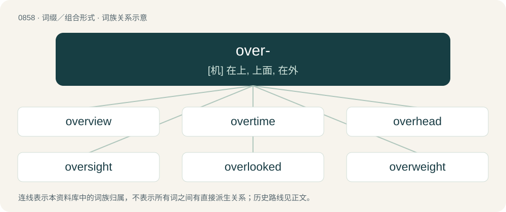

# 0930 · over- — \[机\] 在上, 上面, 在外

[总目录](../00_总目录_按常用程度.md)

**类型**：词缀／组合形式　｜　**来源语言**：见词源记录

## 核心含义与来源

- 核心含义：\[机\] 在上, 上面, 在外
- 英文含义：Above, or higher.
- 词形：over-

**来源记录 1**（前缀／前置成分；Above, or higher.）

From Middle English over-, from Old English ofer-, from Proto-Germanic \*uber, from Proto-Indo-European \*upér. Cognate with Dutch over-, German über-, Swedish över-, Welsh gor-, Spanish sobre-, Armenian վեր- (ver-), Persian ابر (abar-). Doublet of super-, sur-, and hyper-. More at over.

## 词族图

## 单词速览（常用到不常用）

| 单词 | 音标 | 释义 |
|---|---|---|
| [overview](#w-1) | 英 /ˈəʊ.vəˌvjuː/；美 /ˈoʊ.vɚˌvjuː/ | n. 概述, 概观, 总的看法；\[计\] 概述 |
| [overtime](#w-2) | 英 /ˈəʊ.və.taɪm/；美 /ˈoʊ.vɚˌtaɪm/ | n. 超时, 加班, 延长时间；a. 超时的, 加班的；adv. 加班地 |
| [overhead](#w-3) | /ˈəʊvəˌhɛd/ | n. 经常开支, 普通用费, 天花板；a. 在头上的, 高架的；adv. 在头顶上, 在空中, 在高处, 从头到脚全部没入地 |
| [oversight](#w-4) | 英 /ˈəʊvəˌsaɪt/；美 /ˈoʊvɚˌsaɪt/ | n. 勘漏, 失察, 失败, 照料；\[经\] 监督权 |
| [overlooked](#w-5) | /ˌəuvəˈlukt/ | v. 忽视( overlook的过去式和过去分词 ); 监督; 俯视; （对不良现象等）不予理会 |
| [overweight](#w-6) | 英 /ˌəʊvəˈweɪt/；美 /ˌoʊvɚˈweɪt/ | n. 超过重量, 过重, 优势；a. 超过重量的, 超重的；vt. 使超重, 重于, 过于重视 |
| [overlap](#w-7) | /ˌəʊvəˈlæp/ | n. 重叠, 重复, 部分的同时发生；vt. 重叠, 重复, 与...同时发生；vi. 迭盖, 部分的同时发生 |
| [overthrow](#w-8) | 英 /əʊvəˈθɹəʊ/；美 /ˌoʊvɚˈθɹoʊ/ | n. 推翻, 瓦解, 倾覆；vt. 打倒, 推翻, 倾覆 |
| [overhaul](#w-9) | /ˈəʊvəˌhɔːl/ | vt. 分解检查, 翻修, 精细检查, 彻底革新；n. 分解检查, 精细检查, 大检修 |
| [overdose](#w-10) | /ˈəʊvə(ɹ)ˌdəʊs/ | n. 配药量过多；vt. 配药过量, 使过分沉溺 |
| [overlook](#w-11) | 英 /ˈəʊvəˌlʊk/；美 /ˈoʊvəɹˌlʊk/ | vt. 俯瞰, 远眺, 没注意到；n. 眺望, 俯瞰到的景色 |
| [overrated](#w-12) | 英 /ˌəʊvəˈɹeɪtɪd/ | v. 对（质量、能力等）估价过高( overrate的过去式和过去分词 ) |
| [oversee](#w-13) | 英 /ˌəʊ.vəˈsiː/；美 /ˌoʊ.vɚˈsi/ | vt. 向下看, 了望, 监督, 偷看到；\[法\] 监察, 监督, 俯瞰 |
| [overdue](#w-14) | 英 /ˌəʊ.vəˈdju/；美 /ˌoʊ.vəɹˈdu/ | a. 过期的, 未兑的, 迟到的, 早就成熟的；\[经\] 过期未付的 |
| [overload](#w-15) | 英 /ˌəʊvəˈləʊd/；美 /ˌoʊvɚˈloʊd/ | vt. 超载, 过载, 超过负荷；n. 超载, 负荷过多 |
| [overwatch](#w-16) | /.əuvəˈwɒtʃ/ | vt. 看守, 掩护射击 |
| [overboard](#w-17) | /ˈəʊvə(ɹ)ˌbɔː(ɹ)d/ | adv. 自船上落下, 在船外 |
| [override](#w-18) | 英 /əʊ.vəˈɹaɪd/；美 /oʊ.vɚˈɹaɪd/ | vt. 推翻, 无视, 对...有最后发言权, 制服, 践踏, 奔越过；\[经\] 代理佣金, 代销佣金 |
| [oversized](#w-19) | /ˈəuvəˈsaizd/ | a. 过大的, 极大的 |
| [overflow](#w-20) | /ˌəʊvəˈfləʊ/ | n. 溢值, 超值, 泛滥；v. (使)泛滥, (使)溢出, (使)充溢；\[计\] 上溢; 溢出 |
| [overrun](#w-21) | 英 /ˌəʊ.vəˈɹʌn/；美 /ˌoʊ.vɚˈɹʌn/ | n. 蔓延, 风行一时, 超过限度；vt. 蔓延, 蹂躏, 超过, 泛滥；vi. 泛滥, 超载限度 |
| [overtake](#w-22) | 英 /əʊ̯vəːˈteɪ̯k/；美 /oʊ̯vɚˈteɪ̯k/ | vt. 赶上, 突然降临于, 压倒, 代替 |
| [overlay](#w-23) | 英 /ˌəʊ.vəˈleɪ/；美 /ˌoʊvɚˈleɪ/ | n. 覆盖, 覆盖图, 使负担过重；overlie的过去式；\[计\] 覆盖, 覆盖图 |
| [overturn](#w-24) | /ˌəʊvə(ɹ)ˈtɜː(ɹ)n/ | n. 倾覆, 破灭, 革命；vt. 推翻, 颠倒；vi. 翻倒 |
| [overdrive](#w-25) | /ˌəʊvə(ɹ)ˈdɹaɪv/ | vt. 驱使过度, 使工作过度；n. 超速档 |
| [overwhelm](#w-26) | 英 /ˌəʊ.vəˈ(h)wɛlm/；美 /ˌoʊ.vɚˈ(h)wɛlm/ | vt. 淹没, 受打击, 制服, 压倒, 使不知所措；\[法\] 打翻, 倾覆, 覆盖 |
| [overgrown](#w-27) | /.əuvəˈgrəun/ | a. 发育过度的, 生长过大的, 不合身的, 植被蔓生的；overgrow的过去分词 |
| [overcrowded](#w-28) | /ˌəʊvəˈkraʊdɪd/ | a. 挤满的; 过度拥挤的；v. 拥挤(overcrowd的过去式和过去分词) |
| [overcast](#w-29) | 英 /ˈəʊvəˌkɑːst/；美 /ˈoʊvɚ.kæst/ | a. 阴天的, 阴暗的, 愁闷的 |
| [overlord](#w-30) | /ˈəʊvə(ɹ)lɔː(ɹ)d/ | n. 大君主, 最高君主, 霸主；\[法\] 霸权, 霸主地位, 封建君主 |
| [overuse](#w-31) | 英 /ˌəʊvəˈjuːz/；美 /ˌoʊvɚˈjuːz/ | vt. 使用过度；n. 过度使用, 任意驱使 |
| [overpowered](#w-32) | /ˌəʊvəˈpaʊəd/ | 【英文】Overly powerful. |
| [overworked](#w-33) |  | a. 工作过度的；劳累过度的 |
| [overkill](#w-34) | 英 /ˈəʊ.vəˌkɪl/；美 /ˈoʊ.vɚˌkɪl/ | n. 超量毁伤, 过度杀伤威力；vt. 过度地杀伤 |
| [overpass](#w-35) | /ˈəʊvə(ɹ)pæs/ | n. 天桥, 旱桥, 立交桥；vt. 超越, 胜过, 通过, 忽略, 侵犯 |
| [overpower](#w-36) | 英 /əʊvəˈpaʊə/；美 /oʊ.vɚˈpaʊ̯.ɚ/ | vt. 击败, 打胜, 克服 |
| [overdo](#w-37) | 英 /ˌəʊvəˈduː/；美 /ˌoʊvɚˈdu/ | vt. 做得过分, 过度, 夸张, 使过分劳累；vi. 过火 |
| [overdraft](#w-38) | 英 /ˈəʊvədɹɑːft/；美 /ˈoʊvɚdɹæft/ | n. 透支, 透支额, 气流, 过度通风；\[经\] 透支 |
| [overestimate](#w-39) | /ˌəʊvəɹˈɛstɪmeɪt/ | vt. 评价过高, 过高估价；n. 估计过高, 评价过高 |
| [overdone](#w-40) | 英 /ˌəʊ.vəˈdʌn/；美 /ˌoʊ.vɚˈdʌn/ | overdo的过去分词 |
| [overreact](#w-41) | 英 /ˌəʊvəɹiˈækt/；美 /ˌoʊ.vəɹ.ɹiˈækt/ | vi. 反应过度, 反作用过强 |
| [overhang](#w-42) | 英 /əʊvəˈhaŋ/；美 /ˈoʊvəɹˌhæŋ/ | n. 突出部份, 悬垂部份；vt. 悬于...之上, (危险等)逼近；vi. 悬垂, 逼近 |
| [overcoat](#w-43) | 英 /ˈəʊvəkəʊt/；美 /ˈoʊvɚkoʊt/ | n. 外套大衣 |
| [overreaction](#w-44) |  | \[经\] 反应过度 |
| [overused](#w-45) | /ˌəʊvəˈjuːzd/ | v. 使用过度( overuse的过去式和过去分词 ) |
| [overrule](#w-46) | 英 /ˌəʊ.vəˈɹuːl/；美 /ˌoʊ.vɚˈɹul/ | vt. 统治, 威压, 打败, 驳回；\[法\] 否决, 驳回, 批驳 |
| [overpopulation](#w-47) | 英 /ˌəʊvəˌpɒpjʊˈleɪʃn̩/；美 /ˌoʊvɚˌpɑpjəˈleɪʃ(ə)n/ | n. 人口过剩；\[经\] 人口过剩 |
| [overshadow](#w-48) | 英 /ˌəʊ.vəˈʃæd.əʊ/；美 /ˌoʊ.vɚˈʃæd.oʊ/ | vt. 遮阴, 使阴暗, 使失色, 使相形见绌, 使蒙上阴影 |
| [overheat](#w-49) | 英 /ˌəʊvəˈhiːt/；美 /ˌoʊvɚˈhit/ | vt. 使过热；vi. 变得过热 |
| [overthink](#w-50) |  | 【英文】To think or analyze too much. |
| [overzealous](#w-51) | /ˌəʊvəˈzɛləs/ | a. 过分热忱的 |
| [oversize](#w-52) | /ˈəuvəˈsaiz/ | a. 太大的, 超大型的；n. 特大型 |
| [overcooked](#w-53) | /ˌəʊ.vəɹˈkʊkt/ | a. 煮得过久的 |
| [overstate](#w-54) | 英 /ˌəʊ.vəˈsteɪt/；美 /ˌoʊ.vɚˈsteɪt/ | vt. 夸大的叙述, 夸张, 过分强调；\[经\] 多计, 高估 |
| [overprotective](#w-55) | 英 /ˌəʊvəpɹəˈtɛktɪv/；美 /ˌoʊvɚpɹəˈtɛktɪv/ | 过分保护的；袒护的；溺爱有加的 |
| [overhear](#w-56) | 美 /oʊ.vɚˈhɪɚ/ | vt. 无意中听到, 偷听 |
| [overreach](#w-57) | 英 /ˌəʊvəˈɹiːt͡ʃ/；美 /ˌoʊvə(ɹ)ˈɹit͡ʃ/ | vt. 扩展...以上, 过度伸张, 走过头；vi. 伸得过远, 过分, 过火 |
| [overwork](#w-58) | 英 /ˌəʊvəˈwɜːk/；美 /ˌoʊvɚˈwɝk/ | n. 过度操劳的工作, 额外工作；v. (使)工作过度, 使过分劳累 |
| [overlying](#w-59) | /,əuvəˈlaiiŋ/ | 躺在...上面, 压在...上面, 覆在...上面；\[医\] 覆闷死(婴儿卧于成人旁被覆闷而死) |
| [overgrowth](#w-60) | /ˈəuvəgrəuθ/ | n. 繁茂, 蔓延, 过度发育, 增生；\[医\] 生长过度, 肥大 |
| [overshoot](#w-61) | 英 /ˈəʊ.və.ʃuːt/；美 /ˈoʊ.vɚˌʃut/ | vt. 打过头, 越过；vi. 射击越标, 过火；n. 超越目标, 讲话(或行动)过火 |
| [overactive](#w-62) | /ˈəuvəˈræktiv/ | \[医\] 活动过度的 |
| [overcharge](#w-63) | /.əuvəˈtʃɑːdʒ/ | v. 讨价过高, 装载过多, 过度充电, 渲染；n. 超载, 装药过多, 过度充电 |
| [overstatement](#w-64) |  | \[经\] 估值过高, 夸大 |
| [oversold](#w-65) | 英 /ˌəʊ.vəˈsəʊld/；美 /ˌoʊ.vɚˈsoʊld/ | vbl.oversell的过去式及过去分词 |
| [overwrought](#w-66) | 英 /əʊ.vəˈɹɔːt/ | a. 过分劳累的, 过度紧张的, 神经质的, 过度兴奋的, 过分推敲的, 不自然的 |
| [overconfident](#w-67) | /ˌəʊvə(ɹ)ˈkɒnfɪdənt/ | a. 过于自信的, 自负的；\[法\] 过于自信的, 过于自恃的 |
| [oversupply](#w-68) | 英 /əʊvəsəˈplʌɪ/ | vt. 过度供给；n. 过多的供应品 |
| [overwrite](#w-69) | 英 /əʊ.vəˈɹaɪt/；美 /oʊ.vɚˈɹaɪt/ | vi. 写得过多(或长)；vt. 写得过多, 用华丽文体写, 写在...上面；\[计\] 改写 |
| [overexpression](#w-70) | /əʊvərɪkspˈreʃn/ | 超表达 |
| [overhand](#w-71) | /ˈəuvəhænd/ | a. 超手的, 肩上的；adv. 举手过肩；vt. 平式缝纫 |
| [oversimplification](#w-72) |  | n. 过分简单, 过分简单化 |
| [overproduction](#w-73) | /.əuvəprəˈdʌkʃən/ | n. 生产过剩；\[化\] 生产过剩; 超产 |
| [overstep](#w-74) | 英 /ˌəʊvəˈstɛp/；美 /ˌoʊvɚˈstɛp/ | vt. 踏过, 逾越, 超出...的限度；\[法\] 违犯, 逾越 |
| [overground](#w-75) | /ˈəuvəgraund/ | a. 地上的, 为社会所接受的 |
| [overexcited](#w-76) | /ˌəʊvərɪkˈsaɪtɪd/ | v. 使过于激动（或兴奋）, 过度刺激( overexcite的过去式和过去分词 ) |
| [overpay](#w-77) | 美 /oʊ.vɚ.peɪ/ | vt. 多付, 多给报酬；vi. 付得过多 |
| [overconfidence](#w-78) | 美 /oʊvɚˈkɑnfɪdənts/ | n. 自信过强, 自负 |
| [oversimplified](#w-79) | /ˌəʊvərˈsɪmplɪfaɪd/ | v. （使）过分地单纯化( oversimplify的过去式和过去分词 ) |
| [overabundance](#w-80) | 美 /oʊvɚəˈbʌndɪnts/ | n. 过于丰富(或充足), 过多 |
| [overage](#w-81) | /ˈəʊvəɹˈeɪd͡ʒ/ | a. 过老的, 老朽的；n. 商品过剩, 超额, 帐外财产 |
| [overeat](#w-82) | 英 /ˌəʊvə(ɹ)ˈiːt/；美 /ˌoʊvɚˈit/ | vt. (使)吃过量 |
| [overstuffed](#w-83) | 英 /ˈəʊvəstʌft/；美 /ˈoʊvɚstʌft/ | a. 垫得又软又厚的；\[化\] 多油的; 涂油过多的 |
| [overpayment](#w-84) |  | \[法\] 多付, 过付, 逾额付款 |
| [overtone](#w-85) | 英 /ˈəʊ.və.təʊn/；美 /ˈoʊvɚtoʊn/ | n. 泛音, 暗示, 弦外之音, 折光的色彩；\[医\] 陪音, 泛音 |
| [overburden](#w-86) | 英 /ˌəʊ̯vəˈbɜːdn̩/；美 /ˌoʊvɚˈbɝdn̩/ | vt. 装载过多, 负担过多, 使过劳；\[经\] 过重的货物, 重担, 过度的负担 |
| [overpopulated](#w-87) | 美 /ˌoʊvɚˈpɑpjə(ˌ)leɪtɪd/ | a. 人口过多的 |
| [overqualified](#w-88) | /ˌəʊvəˈkwɒlɪfaɪd/ | a. 资历过高的 |
| [overrepresented](#w-89) |  | (overrepresent 的过去分词) vt.使有过多的代表,使代表人数超出比例 |
| [overexposure](#w-90) | /.əuvərikˈspəuʒə/ | n. 曝光过度；\[医\] 感光过度, 露光过度 |
| [overspend](#w-91) | /.əuvəˈspend/ | vt. 过度使用, 花费过多, 使筋疲力尽；vi. 超支 |
| [overworld](#w-92) | /ˈəuvəˈwəːld/ | 上流社会 |
| [overcompensate](#w-93) | /,əuvəˈkɔmpənseit/ | vi. 给予过多的补偿, 过度补偿 |
| [overcook](#w-94) | 美 /oʊ.vɚ.kʊk/ | vt 烹调过分的, 烹调过度的 |
| [overdramatic](#w-95) |  | 夸张的 |
| [overdressed](#w-96) | /ˌəʊvəˈdrest/ | v. （使）穿得太讲究( overdress的过去式和过去分词 ) |
| [overstock](#w-97) | /.əuvəˈstɒk/ | vt. 供给过多, 进货过多, 过剩；n. 供给过多, 库存过剩 |
| [overlong](#w-98) | /ˈəuvəlɔŋ/ | adv. 太长；a. 太长的 |
| [overstay](#w-99) | /ˈəuvəˈstei/ | vt. 呆得超过...的限度；vi. 在(市场)上耽误过久而坐失良机 |
| [overachiever](#w-100) | /ˈəuvərəˈtʃiːvə/ | 成绩超过预料的学生 |
| [overbite](#w-101) | /ˈəʊvə(ɹ)baɪt/ | \[医\] 覆Ж, 覆咬合 |
| [overcapacity](#w-102) | /.əuvəkəˈpæsəti/ | n. 生产能力过剩；\[经\] 生产能力过利, 设备过利 |
| [overconsumption](#w-103) |  | 【英文】Excessive consumption. |
| [overmatched](#w-104) | /ˌəuvəˈmætʃt/ | v. 打败( overmatch的过去式和过去分词 ) |
| [overman](#w-105) | /ˈəuvəmən/ | n. 工头, 师傅, 仲裁人；vt. 人员配置过多 |
| [overripe](#w-106) | /ˈəuvəˈraip/ | a. 过熟的, 衰萎的, 颓废的 |
| [overplay](#w-107) | /,əuvəˈplei/ | vt. 把...做得过分, 过分依赖...的力量, 夸张, 把...演得过火 |
| [oversell](#w-108) | 美 /oʊ.vɚ.sɛl/ | vt. 销售过多, 卖空, 过分吹嘘；vi. 卖空, 吹嘘过分 |
| [overpressure](#w-109) | 英 /ˌəʊ̯.vəˈpɹɛʃ.ə/；美 /ˌoʊ.vɚˈpɹɛʃ.ɚ/ | n. 过压, 超压力；\[化\] 过压; 超压 |
| [overbought](#w-110) | /,əuvəˈbɔːt/ | overbuy的过去式和过去分词；\[经\] 过多地买进, 买空 |
| [oversensitive](#w-111) | /ˈəuvəˈsensitiv/ | a. 过分敏感的 |
| [oversimplify](#w-112) | /.əuvəˈsimplifai/ | v. (使)过分地单纯化 |
| [overclock](#w-113) | /əʊvəkˈlɒk/ | vi. 超频 |
| [overestimation](#w-114) |  | \[经\] 过高的估计 |

## 逐词详解

### 1. overview

**词性**：名词　｜　**音标**：英 /ˈəʊ.vəˌvjuː/；美 /ˈoʊ.vɚˌvjuː/

**中文释义**：n. 概述, 概观, 总的看法；\[计\] 概述

**英文义项**：A brief summary, as of a book or a presentation. / A view from above.

**构词拆分**：over- + view

**词源与演化**：

From over- + view.

**例句**：

> The treasurer gave a brief overview of the financial consequences.

该用例对应义项：a general summary of a subject

### 2. overtime

**词性**：名词　｜　**音标**：英 /ˈəʊ.və.taɪm/；美 /ˈoʊ.vɚˌtaɪm/

**中文释义**：n. 超时, 加班, 延长时间；a. 超时的, 加班的；adv. 加班地

**英文义项**：Working time outside of one's regular hours. / The rate of pay, usually higher, for work done outside of or in addition to regular hours.

**构词拆分**：over- + time

**词源与演化**：

From over- + time.

**例句**：

> That last-second shot ties the game 99-99 and sends it to overtime!

该用例对应义项：An extra period of play when a contest has a tie score at the end of regulation.

### 3. overhead

**词性**：形容词　｜　**音标**：/ˈəʊvəˌhɛd/

**中文释义**：n. 经常开支, 普通用费, 天花板；a. 在头上的, 高架的；adv. 在头顶上, 在空中, 在高处, 从头到脚全部没入地

**英文义项**：Located above, especially over the head. / Kicked over one's own head.

**构词拆分**：over- + head

**词源与演化**：

From Middle English owerheved, over-hed, over hede (adverb), from Old English oferhēafod (adverb), equivalent to over- + head. Compare German Low German overhoopt, överhoopt, German überhaupt. Piecewise doublet of overchief.

**例句**：

> Place your luggage in the overhead lockers.

该用例对应义项：Located above, especially over the head.

### 4. oversight

**词性**：名词　｜　**音标**：英 /ˈəʊvəˌsaɪt/；美 /ˈoʊvɚˌsaɪt/

**中文释义**：n. 勘漏, 失察, 失败, 照料；\[经\] 监督权

**英文义项**：An omission; something that is left out, missed, or forgotten. / Supervision or management.

**构词拆分**：over- + sight

**词源与演化**：

From over- + sight. Verb sense 2 is a semantic loan from German Aufsicht.

**例句**：

> A small oversight at this stage can lead to big problems later.

该用例对应义项：An omission; something that is left out, missed, or forgotten.

### 5. overlooked

**词性**：形容词　｜　**音标**：/ˌəuvəˈlukt/

**中文释义**：v. 忽视( overlook的过去式和过去分词 ); 监督; 俯视; （对不良现象等）不予理会

**英文义项**：Missed, unnoticed.

**构词拆分**：over- + looked

**词源与演化**：

From over- + looked.

**例句**：

> The area where Yanni and Skura had a picnic overlooked his home.

### 6. overweight

**词性**：形容词　｜　**音标**：英 /ˌəʊvəˈweɪt/；美 /ˌoʊvɚˈweɪt/

**中文释义**：n. 超过重量, 过重, 优势；a. 超过重量的, 超重的；vt. 使超重, 重于, 过于重视

**英文义项**：Having a higher weight, especially body fat, than what is generally considered healthy for a given body type and height. / Weighing more than what is allowed for safety or legal commerce.

**构词拆分**：over- + weight

**词源与演化**：

From over- + weight.

**例句**：

> Before her diet, Jane was noticeably overweight, but she shed five kilos in the next two months.

该用例对应义项：Having a higher weight, especially body fat, than what is generally considered healthy for a given body type and height.

### 7. overlap

**词性**：动词　｜　**音标**：/ˌəʊvəˈlæp/

**中文释义**：n. 重叠, 重复, 部分的同时发生；vt. 重叠, 重复, 与...同时发生；vi. 迭盖, 部分的同时发生

**英文义项**：To extend over and partly cover something. / To co-occur, to happen at the same time.

**构词拆分**：over- + lap

**词源与演化**：

From over- + lap. Cognate with Dutch overlap.

**例句**：

> The set (all men) overlaps the set (vegetarians).

该用例对应义项：Of sets: to have some elements in common.

### 8. overthrow

**词性**：动词　｜　**音标**：英 /əʊvəˈθɹəʊ/；美 /ˌoʊvɚˈθɹoʊ/

**中文释义**：n. 推翻, 瓦解, 倾覆；vt. 打倒, 推翻, 倾覆

**英文义项**：To bring about the downfall of (a government, etc.), especially by force; to usurp.

**构词拆分**：over- + throw

**词源与演化**：

From Middle English overthrowen, equivalent to over- + throw. Compare Dutch overdraaien, German überdrehen, Old English oferweorpan (“to overthrow”). For the noun sense, compare Middle English overthrow, overthrowe (“destruction, downfall”), from the verb.

**例句**：

> I hate the current government, but not enough to want to overthrow them.

该用例对应义项：To bring about the downfall of (a government, etc.), especially by force; to usurp.

### 9. overhaul

**词性**：名词　｜　**音标**：/ˈəʊvəˌhɔːl/

**中文释义**：vt. 分解检查, 翻修, 精细检查, 彻底革新；n. 分解检查, 精细检查, 大检修

**英文义项**：A major repair, renovation, or revision. / The process after the fire appears extinguished in which the firefighters search the structure for signs of hot spots that may cause the structure to reignite.

**构词拆分**：over- + haul

**词源与演化**：

From over- + haul.

**例句**：

> The engine required a complete overhaul to run properly.

该用例对应义项：A major repair, renovation, or revision.

### 10. overdose

**词性**：名词　｜　**音标**：/ˈəʊvə(ɹ)ˌdəʊs/

**中文释义**：n. 配药量过多；vt. 配药过量, 使过分沉溺

**英文义项**：An excessive and dangerous dose of a drug.

**构词拆分**：over- + dose

**词源与演化**：

From over- + dose.

**用法示例／搭配（非完整句）**：

> to die of a heroin overdose

该用例对应义项：An excessive and dangerous dose of a drug.

### 11. overlook

**词性**：动词　｜　**音标**：英 /ˈəʊvəˌlʊk/；美 /ˈoʊvəɹˌlʊk/

**中文释义**：vt. 俯瞰, 远眺, 没注意到；n. 眺望, 俯瞰到的景色

**英文义项**：To offer a view (of something) from a higher position. / To fail to notice; to look over and beyond (anything) without seeing it.

**构词拆分**：over- + look

**词源与演化**：

Inherited from Middle English overloken. From Middle English overloken; equivalent to over- + look.

**例句**：

> These errors were overlooked by the proofreaders.

该用例对应义项：To fail to notice; to look over and beyond (anything) without seeing it.

### 12. overrated

**词性**：形容词　｜　**音标**：英 /ˌəʊvəˈɹeɪtɪd/

**中文释义**：v. 对（质量、能力等）估价过高( overrate的过去式和过去分词 )

**英文义项**：Given an undue amount of credit for quality or merit in a field; not necessarily related to popularity.

**构词拆分**：over- + rated

**词源与演化**：

From over- + rated.

**例句**：

> My sister is an overrated singer.

该用例对应义项：Given an undue amount of credit for quality or merit in a field; not necessarily related to popularity.

### 13. oversee

**词性**：动词　｜　**音标**：英 /ˌəʊ.vəˈsiː/；美 /ˌoʊ.vɚˈsi/

**中文释义**：vt. 向下看, 了望, 监督, 偷看到；\[法\] 监察, 监督, 俯瞰

**英文义项**：To survey, look at something in a wide angle. / To supervise, guide, review or direct the actions of a person or group.

**构词拆分**：over- + see

**词源与演化**：

From Middle English overseen, ouverseen, from Old English ofersēon (“to observe, oversee; to overlook, neglect”), equivalent to over- + see.

**例句**：

> Gamekeepers oversee a hunting ground to see to the wildlife's welfare and look for poachers.

该用例对应义项：To inspect, examine.

### 14. overdue

**词性**：形容词　｜　**音标**：英 /ˌəʊ.vəˈdju/；美 /ˌoʊ.vəɹˈdu/

**中文释义**：a. 过期的, 未兑的, 迟到的, 早就成熟的；\[经\] 过期未付的

**英文义项**：Late; especially, past a deadline or too late to fulfill a need.

**构词拆分**：over- + due

**词源与演化**：

From over- + due.

**用法示例／搭配（非完整句）**：

> his library books were three days overdue; my car is overdue for an oil change; she finally left on a long overdue vacation

该用例对应义项：Late; especially, past a deadline or too late to fulfill a need.

### 15. overload

**词性**：动词　｜　**音标**：英 /ˌəʊvəˈləʊd/；美 /ˌoʊvɚˈloʊd/

**中文释义**：vt. 超载, 过载, 超过负荷；n. 超载, 负荷过多

**英文义项**：To load excessively. / To provide too much power to a circuit.

**构词拆分**：over- + load

**词源与演化**：

From over- + load.

**例句**：

> Don't overload the car.

该用例对应义项：place too much a load on

### 16. overwatch

**词性**：动词　｜　**音标**：/.əuvəˈwɒtʃ/

**中文释义**：vt. 看守, 掩护射击

**英文义项**：To watch over. / To watch excessively.

**构词拆分**：over- + watch

**词源与演化**：

From over- + watch. Back-formation from watch over.

**例句**：

> Tom is a Hanzo main in Overwatch.

### 17. overboard

**词性**：形容词　｜　**音标**：/ˈəʊvə(ɹ)ˌbɔː(ɹ)d/

**中文释义**：adv. 自船上落下, 在船外

**英文义项**：Outside of a boat; in the water.

**构词拆分**：over- + board

**词源与演化**：

From Middle English overbord, overborde, equivalent to over- + board.

**例句**：

> He's given to going overboard every time he gets a new idea.

### 18. override

**词性**：动词　｜　**音标**：英 /əʊ.vəˈɹaɪd/；美 /oʊ.vɚˈɹaɪd/

**中文释义**：vt. 推翻, 无视, 对...有最后发言权, 制服, 践踏, 奔越过；\[经\] 代理佣金, 代销佣金

**英文义项**：To ride across or beyond something. / To ride over the top of something, usually forcibly.

**构词拆分**：over- + ride

**词源与演化**：

From Middle English overriden, from Old English oferrīdan, equivalent to over- + ride. Cognate with Dutch overrijden, German überreiten, Danish override.

**例句**：

> In automotive design, safety should override lesser factors such as cosmetics and corner-cutting.

该用例对应义项：To counteract the normal operation of something; to countermand with orders of higher priority.

### 19. oversized

**词性**：形容词　｜　**音标**：/ˈəuvəˈsaizd/

**中文释义**：a. 过大的, 极大的

**英文义项**：Very large; especially of something larger than normal for its type.

**构词拆分**：over- + sized

**词源与演化**：

From over- + sized.

**例句**：

> Elasmosaurs generally have the look of oversized, shellless turtles with long necks.

### 20. overflow

**词性**：动词　｜　**音标**：/ˌəʊvəˈfləʊ/

**中文释义**：n. 溢值, 超值, 泛滥；v. (使)泛滥, (使)溢出, (使)充溢；\[计\] 上溢; 溢出

**英文义项**：To flow over the brim of (a container). / To cover with a liquid, literally or figuratively.

**构词拆分**：over- + flow

**词源与演化**：

From Middle English overflowen, from Old English oferflōwan, equivalent to over- + flow.

**例句**：

> The flash flood overflowed most of the parkland and some homes.

该用例对应义项：To cover with a liquid, literally or figuratively.

### 21. overrun

**词性**：动词　｜　**音标**：英 /ˌəʊ.vəˈɹʌn/；美 /ˌoʊ.vɚˈɹʌn/

**中文释义**：n. 蔓延, 风行一时, 超过限度；vt. 蔓延, 蹂躏, 超过, 泛滥；vi. 泛滥, 超载限度

**英文义项**：To defeat an enemy and invade in great numbers, seizing the enemy positions conclusively. / To infest, swarm over, flow over.

**构词拆分**：over- + run

**词源与演化**：

From over- + run.

**例句**：

> In machinery, a sliding piece is said to overrun its bearing when its forward end goes beyond it.

该用例对应义项：To go beyond; to extend in part beyond.

### 22. overtake

**词性**：动词　｜　**音标**：英 /əʊ̯vəːˈteɪ̯k/；美 /oʊ̯vɚˈteɪ̯k/

**中文释义**：vt. 赶上, 突然降临于, 压倒, 代替

**英文义项**：To pass a slower moving object or entity (on the side closest to oncoming traffic). / To become greater than something else in quantity, worth, etc.

**构词拆分**：over- + take

**词源与演化**：

From Middle English overtaken, likely a replacement alteration (as the Middle English verb taken replaced nimen (“to take”)), of Middle English overnimen (“to overtake”), from Old English oferniman (“to take by surprise, overtake”), equivalent to over- + take.

**例句**：

> A cart with four horses is not able to overtake the human tongue.

### 23. overlay

**词性**：动词　｜　**音标**：英 /ˌəʊ.vəˈleɪ/；美 /ˌoʊvɚˈleɪ/

**中文释义**：n. 覆盖, 覆盖图, 使负担过重；overlie的过去式；\[计\] 覆盖, 覆盖图

**英文义项**：To lay, spread, or apply (something) over or across (something else); to overspread. / To overwhelm; to press excessively upon.

**构词拆分**：over- + lay

**词源与演化**：

From Middle English overleyen, from Old English oferleċġan, from Proto-West Germanic \*obarlaggjan, from Proto-Germanic \*uberlagjaną, equivalent to over- + lay. Cognate with Saterland Frisian uurläze, úurlääse, Dutch overleggen, German Low German overleggen, överleggen, German überlegen, Swedish överlägga, Norwegian overlegge. Compare overlie.

**例句**：

> She will now overlay fruit on top of the crust.

该用例对应义项：To lay, spread, or apply (something) over or across (something else); to overspread.

### 24. overturn

**词性**：动词　｜　**音标**：/ˌəʊvə(ɹ)ˈtɜː(ɹ)n/

**中文释义**：n. 倾覆, 破灭, 革命；vt. 推翻, 颠倒；vi. 翻倒

**英文义项**：To turn over, capsize or upset. / To overthrow or destroy.

**构词拆分**：over- + turn

**词源与演化**：

From Middle English overturnen, equivalent to over- + turn. Compare also Middle English overterven (“to overturn”), see terve.

**例句**：

> Tom bussed people to the capital to try to overturn a free and fair election.

### 25. overdrive

**词性**：动词　｜　**音标**：/ˌəʊvə(ɹ)ˈdɹaɪv/

**中文释义**：vt. 驱使过度, 使工作过度；n. 超速档

**英文义项**：To drive too hard, or far, or beyond strength.

**构词拆分**：over- + drive

**词源与演化**：

From Middle English overdriven, from Old English oferdrīfan, equivalent to over- + drive. Cognate with Saterland Frisian uurdrieuwe (“to overdo, overstate”), Dutch overdrijven (“to exaggerate”), German Low German overdrieven, överdrieven (“to overdo, exaggerate”), German übertreiben (“to overdo, exaggerate”), Norwegian overdrive (“to exaggerate”).

**例句**：

> Tom's incendiary speech kicked the revolution into overdrive.

### 26. overwhelm

**词性**：动词　｜　**音标**：英 /ˌəʊ.vəˈ(h)wɛlm/；美 /ˌoʊ.vɚˈ(h)wɛlm/

**中文释义**：vt. 淹没, 受打击, 制服, 压倒, 使不知所措；\[法\] 打翻, 倾覆, 覆盖

**英文义项**：To engulf, surge over and submerge. / To overpower, crush.

**构词拆分**：over- + whelm

**词源与演化**：

Inherited from Middle English overwhelmen, equivalent to over- + whelm.

**例句**：

> In December 1939 the Soviet Union attacked Finland with overwhelming force.

该用例对应义项：To overpower, crush.

### 27. overgrown

**词性**：形容词　｜　**音标**：/.əuvəˈgrəun/

**中文释义**：a. 发育过度的, 生长过大的, 不合身的, 植被蔓生的；overgrow的过去分词

**英文义项**：Having large numbers of plants which have become too big, and are hence spoiling the picturesqueness of a garden. / Having grown bigger without developing maturity or changing character.

**构词拆分**：over- + grown

**词源与演化**：

From over- + grown.

**例句**：

> He spends so much money on new technology: he's like an overgrown schoolboy buying toys.

该用例对应义项：Having grown bigger without developing maturity or changing character.

### 28. overcrowded

**词性**：形容词　｜　**音标**：/ˌəʊvəˈkraʊdɪd/

**中文释义**：a. 挤满的; 过度拥挤的；v. 拥挤(overcrowd的过去式和过去分词)

**英文义项**：Containing too many occupants for an area of its size.

**构词拆分**：over- + crowded

**词源与演化**：

From over- + crowded.

**例句**：

> He organized his overcrowded schedule and managed to come to see my performance.

### 29. overcast

**词性**：名词　｜　**音标**：英 /ˈəʊvəˌkɑːst/；美 /ˈoʊvɚ.kæst/

**中文释义**：a. 阴天的, 阴暗的, 愁闷的

**英文义项**：A cloud covering all of the sky from horizon to horizon. / A place where one roadway crosses another, specifically where an airway was built across the top of another airway for ventilation purposes.

**构词拆分**：over- + cast

**词源与演化**：

From Middle English overcasten, equivalent to over- + cast. Compare Swedish överkast.

**例句**：

> Some people don't like overcast weather, but I find it comforting.

### 30. overlord

**词性**：名词　｜　**音标**：/ˈəʊvə(ɹ)lɔː(ɹ)d/

**中文释义**：n. 大君主, 最高君主, 霸主；\[法\] 霸权, 霸主地位, 封建君主

**英文义项**：A ruler of other rulers. / Anyone with overarching power or authority in a given domain.

**构词拆分**：over- + lord

**词源与演化**：

From Middle English oferrlaferrd, orlard, our-lord, ouyr-lord, equivalent to over- + lord.

**例句**：

> The crusty old professor was overlord of the history department, and few dared to cross his will.

该用例对应义项：Anyone with overarching power or authority in a given domain.

### 31. overuse

**词性**：动词　｜　**音标**：英 /ˌəʊvəˈjuːz/；美 /ˌoʊvɚˈjuːz/

**中文释义**：vt. 使用过度；n. 过度使用, 任意驱使

**英文义项**：To use too much of (something); to use (it) too often.

**构词拆分**：over- + use

**词源与演化**：

From over- + use.

**例句**：

> The overuse of discounts has cheapened the brand's value over time.

### 32. overpowered

**词性**：形容词　｜　**音标**：/ˌəʊvəˈpaʊəd/

**英文义项**：Overly powerful.

**构词拆分**：over- + powered

**词源与演化**：

From over- + powered.

**例句**：

> Players complained that some of the characters in the game were overpowered and hard to defeat.

该用例对应义项：Overly powerful.

### 33. overworked

**词性**：形容词

**中文释义**：a. 工作过度的；劳累过度的

**英文义项**：Subjected to too much work. / Having been overused such that it has lost its meaning; trite; banal.

**构词拆分**：over- + worked

**词源与演化**：

From over- + worked.

**例句**：

> Overworked and underpaid? Then quit your job and become a pro darts player.

该用例对应义项：Subjected to too much work.

### 34. overkill

**词性**：名词　｜　**音标**：英 /ˈəʊ.vəˌkɪl/；美 /ˈoʊ.vɚˌkɪl/

**中文释义**：n. 超量毁伤, 过度杀伤威力；vt. 过度地杀伤

**英文义项**：A destructive capacity that exceeds that needed to destroy an enemy; especially with nuclear weapons. / Destruction beyond what is necessary to kill, especially in murder.

**构词拆分**：over- + kill

**词源与演化**：

From over- + kill.

**例句**：

> Should I give you yet more homework, or would that be overkill?

该用例对应义项：An unnecessary excess of whatever is needed to achieve a goal.

### 35. overpass

**词性**：名词　｜　**音标**：/ˈəʊvə(ɹ)pæs/

**中文释义**：n. 天桥, 旱桥, 立交桥；vt. 超越, 胜过, 通过, 忽略, 侵犯

**英文义项**：A section of a road or path that crosses over an obstacle, especially another road, railway, etc.

**构词拆分**：over- + pass

**词源与演化**：

From over- + pass.

**例句**：

> The homeless man had built a little shelter, complete with cook-stove, beneath a concrete overpass.

该用例对应义项：A section of a road or path that crosses over an obstacle, especially another road, railway, etc.

### 36. overpower

**词性**：动词　｜　**音标**：英 /əʊvəˈpaʊə/；美 /oʊ.vɚˈpaʊ̯.ɚ/

**中文释义**：vt. 击败, 打胜, 克服

**英文义项**：To subdue someone by superior force. / To excel or exceed in power; to cause to yield; to subdue.

**构词拆分**：over- + power

**词源与演化**：

From over- + power.

**例句**：

> The dish was OK, but the garlic slightly overpowered the herbs.

该用例对应义项：To render imperceptible by means of greater strength, intensity, etc.

### 37. overdo

**词性**：动词　｜　**音标**：英 /ˌəʊvəˈduː/；美 /ˌoʊvɚˈdu/

**中文释义**：vt. 做得过分, 过度, 夸张, 使过分劳累；vi. 过火

**英文义项**：To do too much; to exceed what is proper or true in doing; to carry too far. / To cook for too long.

**构词拆分**：over- + do

**词源与演化**：

From Middle English overdon, from Old English oferdōn, equivalent to over- + do.

**用法示例／搭配（非完整句）**：

> to overdo one’s strength

该用例对应义项：To give (someone or something) too much work; to require too much effort or strength of (someone); to use up too much of (something).

### 38. overdraft

**词性**：名词　｜　**音标**：英 /ˈəʊvədɹɑːft/；美 /ˈoʊvɚdɹæft/

**中文释义**：n. 透支, 透支额, 气流, 过度通风；\[经\] 透支

**英文义项**：The act of overdrawing a bank account. / The amount overdrawn.

**构词拆分**：over- + draft

**词源与演化**：

From over- + draft.

**例句**：

> The bank have given me an overdraft of $2000.

该用例对应义项：The maximum amount that may be overdrawn.

### 39. overestimate

**词性**：动词　｜　**音标**：/ˌəʊvəɹˈɛstɪmeɪt/

**中文释义**：vt. 评价过高, 过高估价；n. 估计过高, 评价过高

**英文义项**：To judge or calculate too highly.

**构词拆分**：over- + estimate

**词源与演化**：

From over- + estimate.

**例句**：

> It's hardly possible to overestimate the political significance of Turkey in this region.

### 40. overdone

**词性**：形容词　｜　**音标**：英 /ˌəʊ.vəˈdʌn/；美 /ˌoʊ.vɚˈdʌn/

**中文释义**：overdo的过去分词

**英文义项**：Cooked too much. / Exaggerated; overwrought.

**构词拆分**：over- + done

**词源与演化**：

From Middle English overdon, from Old English oferdōn, equivalent to over- + done.

**例句**：

> The comic scenes in the play were overdone.

### 41. overreact

**词性**：动词　｜　**音标**：英 /ˌəʊvəɹiˈækt/；美 /ˌoʊ.vəɹ.ɹiˈækt/

**中文释义**：vi. 反应过度, 反作用过强

**英文义项**：To react too much or too intensely.

**构词拆分**：over- + react

**词源与演化**：

From over- + react.

**例句**：

> Please try not to overreact if she drives badly when she is first learning.

该用例对应义项：To react too much or too intensely.

### 42. overhang

**词性**：动词　｜　**音标**：英 /əʊvəˈhaŋ/；美 /ˈoʊvəɹˌhæŋ/

**中文释义**：n. 突出部份, 悬垂部份；vt. 悬于...之上, (危险等)逼近；vi. 悬垂, 逼近

**英文义项**：To hang over (something). / To impend.

**构词拆分**：over- + hang

**词源与演化**：

From Old English oferhangan, corresponding to over- + hang.

**例句**：

> Just as Tom looked up, an icicle fell from overhang of roof.

### 43. overcoat

**词性**：名词　｜　**音标**：英 /ˈəʊvəkəʊt/；美 /ˈoʊvɚkoʊt/

**中文释义**：n. 外套大衣

**英文义项**：A heavy garment worn over other clothes, for protection from cold or weather. / An outer coat, an outer coating (of paint, etc).

**构词拆分**：over- + coat

**词源与演化**：

From over- + coat.

**例句**：

> Wait 24 hours before applying an overcoat.

该用例对应义项：An outer coat, an outer coating (of paint, etc).

### 44. overreaction

**词性**：名词

**中文释义**：\[经\] 反应过度

**英文义项**：A reaction that is excessive.

**构词拆分**：over- + reaction

**词源与演化**：

From over- + reaction.

**例句**：

> She had every right to dump you, but cutting up all your clothes after she did so was an overreaction.

该用例对应义项：A reaction that is excessive.

### 45. overused

**词性**：形容词　｜　**音标**：/ˌəʊvəˈjuːzd/

**中文释义**：v. 使用过度( overuse的过去式和过去分词 )

**英文义项**：Used too much, or too often. / Hackneyed or clichéd.

**构词拆分**：over- + used

**词源与演化**：

From over- + used.

**例句**：

> These words are often overused in academic writing.

### 46. overrule

**词性**：动词　｜　**音标**：英 /ˌəʊ.vəˈɹuːl/；美 /ˌoʊ.vɚˈɹul/

**中文释义**：vt. 统治, 威压, 打败, 驳回；\[法\] 否决, 驳回, 批驳

**英文义项**：To rule over; to govern or determine by superior authority. / To rule or determine in a contrary way; to decide against; to abrogate or alter.

**构词拆分**：over- + rule

**词源与演化**：

From over- + rule.

**例句**：

> Tom's stomach seems to overrule him at every turn.

### 47. overpopulation

**词性**：名词　｜　**音标**：英 /ˌəʊvəˌpɒpjʊˈleɪʃn̩/；美 /ˌoʊvɚˌpɑpjəˈleɪʃ(ə)n/

**中文释义**：n. 人口过剩；\[经\] 人口过剩

**英文义项**：An excessive number of occupants (people, animals, plants, etc.) in a particular area; specifically, when the number of occupants exceeds the ability of that area to provide for them.

**构词拆分**：over- (prefix meaning ‘excessive; excessively’) + population

**词源与演化**：

From over- (prefix meaning ‘excessive; excessively’) + population.

**例句**：

> In the sci-fi movie Soylent Green, there is institutionalized euthanasia because of overpopulation.

### 48. overshadow

**词性**：动词　｜　**音标**：英 /ˌəʊ.vəˈʃæd.əʊ/；美 /ˌoʊ.vɚˈʃæd.oʊ/

**中文释义**：vt. 遮阴, 使阴暗, 使失色, 使相形见绌, 使蒙上阴影

**英文义项**：To obscure something by casting a shadow. / To dominate something and make it seem insignificant.

**构词拆分**：over- + shadow

**词源与演化**：

From Middle English overschadwen, overschadewe, from Old English ofersċeadwian (“to overshadow”), equivalent to over- + shadow. Compare with West Frisian oerskaduwe (“to overshadow”), Dutch overschaduwen (“to overshadow”), German überschatten (“to overshadow”), Gothic 𐌿𐍆𐌰𐍂𐍃𐌺𐌰𐌳𐍅𐌾𐌰𐌽 (ufarskadwjan, “to overshadow”), and more distantly, Old Norse yfirskyggja (“to overshadow”), Danish overskygge (“to overshadow”), Swedish överskugga (“to overshadow”), Old English ofersċūwan (“to overshadow”).

**例句**：

> The English teacher's insensitive comments overshadow the progress and achievements of foreign learners.

### 49. overheat

**词性**：动词　｜　**音标**：英 /ˌəʊvəˈhiːt/；美 /ˌoʊvɚˈhit/

**中文释义**：vt. 使过热；vi. 变得过热

**英文义项**：To heat excessively. / To become excessively hot.

**构词拆分**：By surface analysis, over- + heat

**词源与演化**：

From Middle English overheten. Cognate with German überheizen, überhitzen (“to overheat”), Swedish överhetta (“to overheat”). By surface analysis, over- + heat.

**例句**：

> Don't leave the TV on for too long, it can overheat.

### 50. overthink

**词性**：动词

**英文义项**：To think or analyze too much. / To think too highly (of); overestimate

**构词拆分**：over- + think

**词源与演化**：

From over- + think.

**例句**：

> Don't overthink the problem. It's not that difficult.

该用例对应义项：To think or analyze too much.

### 51. overzealous

**词性**：形容词　｜　**音标**：/ˌəʊvəˈzɛləs/

**中文释义**：a. 过分热忱的

**英文义项**：Too zealous; too enthusiastic or fervent.

**构词拆分**：over- + zealous

**词源与演化**：

From over- + zealous.

**例句**：

> With his overzealous attempts to impress, he only managed to annoy her.

该用例对应义项：Too zealous; too enthusiastic or fervent.

### 52. oversize

**词性**：形容词　｜　**音标**：/ˈəuvəˈsaiz/

**中文释义**：a. 太大的, 超大型的；n. 特大型

**英文义项**：Larger than normal. / Excessively large.

**构词拆分**：over- + size

**词源与演化**：

From over- + size.

**例句**：

> Skura was wearing an oversize Kabyle dress.

### 53. overcooked

**词性**：形容词　｜　**音标**：/ˌəʊ.vəɹˈkʊkt/

**中文释义**：a. 煮得过久的

**英文义项**：Made unpalatable or inedible by cooking for too long. / Done to excess.

**构词拆分**：over- + cooked

**词源与演化**：

From over- + cooked.

**例句**：

> His Elvis impersonation was embarrassingly overcooked.

该用例对应义项：Done to excess.

### 54. overstate

**词性**：动词　｜　**音标**：英 /ˌəʊ.vəˈsteɪt/；美 /ˌoʊ.vɚˈsteɪt/

**中文释义**：vt. 夸大的叙述, 夸张, 过分强调；\[经\] 多计, 高估

**英文义项**：To state or claim too much. / To exaggerate; to state or claim to a greater degree than reality.

**构词拆分**：over- + state

**词源与演化**：

From over- + state.

**例句**：

> He was suggested not to overstate at the interview.

该用例对应义项：To exaggerate; to state or claim to a greater degree than reality.

### 55. overprotective

**词性**：形容词　｜　**音标**：英 /ˌəʊvəpɹəˈtɛktɪv/；美 /ˌoʊvɚpɹəˈtɛktɪv/

**中文释义**：过分保护的；袒护的；溺爱有加的

**英文义项**：Excessively protective, wanting to give too much protection (especially to children).

**构词拆分**：over- + protective

**词源与演化**：

From over- + protective.

**例句**：

> Many of my friends think that Tom and Mary are overprotective parents.

### 56. overhear

**词性**：动词　｜　**音标**：美 /oʊ.vɚˈhɪɚ/

**中文释义**：vt. 无意中听到, 偷听

**英文义项**：To hear something that was not meant for one's ears.

**构词拆分**：over- + hear

**词源与演化**：

From Middle English overheren, from Old English oferhīeran (“to overhear, hear, disobey, disregard, neglect”), equivalent to over- + hear. Cognate with Dutch overhoren (“to hear, hear about”), German überhören (“to not hear, ignore”), Danish overhøre (“to overhear”), Icelandic yfirheyra (“to hear”), Gothic \*𐌿𐍆𐌰𐍂𐌷𐌰𐌿𐍃𐌾𐌰𐌽 (\*ufarhausjan, “to disregard, disobey”) (in 𐌿𐍆𐌰𐍂𐌷𐌰𐌿𐍃𐌴𐌹𐌽𐍃 (ufarhauseins)).

**例句**：

> Tom and Mary were speaking loud enough for John to overhear them.

### 57. overreach

**词性**：动词　｜　**音标**：英 /ˌəʊvəˈɹiːt͡ʃ/；美 /ˌoʊvə(ɹ)ˈɹit͡ʃ/

**中文释义**：vt. 扩展...以上, 过度伸张, 走过头；vi. 伸得过远, 过分, 过火

**英文义项**：To reach above or beyond, especially to an excessive degree. / To defeat or override a person's interest in property; (UK, specifically) of a holder of the legal title of real property: by mortgaging or selling the legal title to a third party, to cause another person's equitable right in the property to be dissolved and to be replaced by an equitable right in the money received from the third party.

**构词拆分**：over- + reach

**词源与演化**：

The verb is from Middle English overrechen (“to rise above; to extend beyond or over; to encroach; to catch, overtake; to reach; to obtain wrongfully (?); to take up (a book) to revise it”) \[and other forms\], equivalent to over- + reach; the noun is derived from the verb or from the phrase to reach over.

### 58. overwork

**词性**：动词　｜　**音标**：英 /ˌəʊvəˈwɜːk/；美 /ˌoʊvɚˈwɝk/

**中文释义**：n. 过度操劳的工作, 额外工作；v. (使)工作过度, 使过分劳累

**英文义项**：To make (someone or something) work too hard. / To work too hard.

**构词拆分**：over- + work

**词源与演化**：

From Middle English overwerken, possibly from Old English oferwyrċan (“to overwork, overlay”), equivalent to over- + work. Cognate with Dutch overwerken (“to overwork”).

**用法示例／搭配（非完整句）**：

> to overwork a horse

该用例对应义项：To make (someone or something) work too hard.

### 59. overlying

**词性**：形容词　｜　**音标**：/,əuvəˈlaiiŋ/

**中文释义**：躺在...上面, 压在...上面, 覆在...上面；\[医\] 覆闷死(婴儿卧于成人旁被覆闷而死)

**英文义项**：lying over or upon something else

**构词拆分**：over- + lying

**词源与演化**：

From over- + lying.

### 60. overgrowth

**词性**：名词　｜　**音标**：/ˈəuvəgrəuθ/

**中文释义**：n. 繁茂, 蔓延, 过度发育, 增生；\[医\] 生长过度, 肥大

**英文义项**：A usually abundant, luxuriant growth over or on something else. / A tangle of growth occurring at the top of trees involving vines and branches, common in jungles.

**构词拆分**：over- + growth

**词源与演化**：

From over- + growth.

### 61. overshoot

**词性**：名词　｜　**音标**：英 /ˈəʊ.və.ʃuːt/；美 /ˈoʊ.vɚˌʃut/

**中文释义**：vt. 打过头, 越过；vi. 射击越标, 过火；n. 超越目标, 讲话(或行动)过火

**英文义项**：The amount by which something goes too far. / The situation where the population of a species exceeds its environment's carrying capacity.

**构词拆分**：over- + shoot

**词源与演化**：

From Middle English overshoten, oversheten (“to shoot beyond, shoot past, pour down from above”), perhaps continuing Old English ofersċēotan (“to shoot down”), equivalent to over- + shoot.

**例句**：

> Let's see if we can predict and correct for the overshoot.

该用例对应义项：The amount by which something goes too far.

### 62. overactive

**词性**：形容词　｜　**音标**：/ˈəuvəˈræktiv/

**中文释义**：\[医\] 活动过度的

**英文义项**：Excessively active.

**构词拆分**：over- + active

**词源与演化**：

From over- + active.

**例句**：

> Fanaticism is the highly volatile mix of narrow-mindedness and overactive imagination.

### 63. overcharge

**词性**：动词　｜　**音标**：/.əuvəˈtʃɑːdʒ/

**中文释义**：v. 讨价过高, 装载过多, 过度充电, 渲染；n. 超载, 装药过多, 过度充电

**英文义项**：To charge (somebody) more money than the correct amount or to surpass a certain limit while charging a bill. / To continue to charge (an electrical device) beyond its capacity.

**构词拆分**：over- + charge

**词源与演化**：

From Middle English overchargen, equivalent to over- + charge.

**用法示例／搭配（非完整句）**：

> to overcharge a description

该用例对应义项：To exaggerate.

### 64. overstatement

**词性**：名词

**中文释义**：\[经\] 估值过高, 夸大

**英文义项**：An exaggeration; a statement in excess of what is reasonable. / The tendency to overstate.

**构词拆分**：overstate + -ment；over- + statement

**词源与演化**：

From overstate + -ment or over- + statement.

**例句**：

> The story he gave was something of an overstatement of the facts.

该用例对应义项：An exaggeration; a statement in excess of what is reasonable.

### 65. oversold

**词性**：形容词　｜　**音标**：英 /ˌəʊ.vəˈsəʊld/；美 /ˌoʊ.vɚˈsoʊld/

**中文释义**：vbl.oversell的过去式及过去分词

**英文义项**：In a stock or commodity market condition where there has been significant trading driving prices down to lower levels, levels which seem overextended or excessive on a short-term basis.

**构词拆分**：over- + sold

**词源与演化**：

From over- + sold.

### 66. overwrought

**词性**：形容词　｜　**音标**：英 /əʊ.vəˈɹɔːt/

**中文释义**：a. 过分劳累的, 过度紧张的, 神经质的, 过度兴奋的, 过分推敲的, 不自然的

**英文义项**：Excessively nervous, excited, tense, angry, anxious, or upset; overemotional; very uneasy. / Elaborate; baroque; overdone.

**构词拆分**：over- + wrought

**词源与演化**：

Past participle of overwork; equivalent to over- + wrought.

**例句**：

> I hate how documentaries dramatise moments in history with overwrought music and B-list actors.

### 67. overconfident

**词性**：形容词　｜　**音标**：/ˌəʊvə(ɹ)ˈkɒnfɪdənt/

**中文释义**：a. 过于自信的, 自负的；\[法\] 过于自信的, 过于自恃的

**英文义项**：Too confident. / Presumptuous, cocksure, rude, and disrespectful.

**构词拆分**：over- + confident

**词源与演化**：

From over- + confident.

**例句**：

> Tom and Mary told John that they thought Alice was overconfident.

### 68. oversupply

**词性**：动词　｜　**音标**：英 /əʊvəsəˈplʌɪ/

**中文释义**：vt. 过度供给；n. 过多的供应品

**英文义项**：To supply more than is needed.

**构词拆分**：over- + supply

**词源与演化**：

From over- + supply.

**例句**：

> We have an oversupply of clothing.

### 69. overwrite

**词性**：动词　｜　**音标**：英 /əʊ.vəˈɹaɪt/；美 /oʊ.vɚˈɹaɪt/

**中文释义**：vi. 写得过多(或长)；vt. 写得过多, 用华丽文体写, 写在...上面；\[计\] 改写

**英文义项**：To destroy (older) data by recording new data over it. / To cover in writing; to write over the top of.

**构词拆分**：over- + write

**词源与演化**：

From over- + write.

**例句**：

> Do you want to overwrite the previous saved data?

### 70. overexpression

**词性**：名词　｜　**音标**：/əʊvərɪkspˈreʃn/

**中文释义**：超表达

**英文义项**：The abnormal or artificial expression of a gene in increased quantity

**构词拆分**：over- + expression

**词源与演化**：

From over- + expression.

### 71. overhand

**词性**：形容词　｜　**音标**：/ˈəuvəhænd/

**中文释义**：a. 超手的, 肩上的；adv. 举手过肩；vt. 平式缝纫

**英文义项**：Executed with the hand brought forward and down from above the shoulders. / Sewn with close, vertical stitches that draw the edges of a seam together.

**构词拆分**：over- + hand

**词源与演化**：

From over- + hand.

**用法示例／搭配（非完整句）**：

> an overhand shuffle of a deck of cards

该用例对应义项：Executed with the hand brought forward and down from above the shoulders.

### 72. oversimplification

**词性**：名词

**中文释义**：n. 过分简单, 过分简单化

**英文义项**：An explanation that excludes important information for the sake of brevity, or of making the explanation or presentation easy to understand. / The process of making such an explanation.

**构词拆分**：over- + simplification

**词源与演化**：

From over- + simplification.

**例句**：

> That's a bit of an oversimplification.

### 73. overproduction

**词性**：名词　｜　**音标**：/.əuvəprəˈdʌkʃən/

**中文释义**：n. 生产过剩；\[化\] 生产过剩; 超产

**英文义项**：The production of more of a commodity than can be used or sold.

**构词拆分**：over- + production

**词源与演化**：

From over- + production.

**例句**：

> The price of cabbage fell because of overproduction.

### 74. overstep

**词性**：动词　｜　**音标**：英 /ˌəʊvəˈstɛp/；美 /ˌoʊvɚˈstɛp/

**中文释义**：vt. 踏过, 逾越, 超出...的限度；\[法\] 违犯, 逾越

**英文义项**：To go too far beyond (a limit); especially, to cross boundaries or exceed norms or conventions. / To take a step in which the foot touches ground too far forward.

**构词拆分**：By surface analysis, over- + step

**词源与演化**：

From Middle English \*oversteppen, from Old English ofersteppan, from Proto-Germanic \*uberstapjaną (“to step over; overstep”). Cognate with Dutch overstappen, German Low German överstappen, German überstapfen, überstepfen. Cf. transgress. By surface analysis, over- + step.

**例句**：

> That color scheme really oversteps the bounds of good taste.

该用例对应义项：To go too far beyond (a limit); especially, to cross boundaries or exceed norms or conventions.

### 75. overground

**词性**：形容词　｜　**音标**：/ˈəuvəgraund/

**中文释义**：a. 地上的, 为社会所接受的

**英文义项**：Above the ground. / Mainstream, not underground.

**构词拆分**：over- + ground

**词源与演化**：

From over- + ground.

**用法示例／搭配（非完整句）**：

> an overground railway

该用例对应义项：Above the ground.

### 76. overexcited

**词性**：形容词　｜　**音标**：/ˌəʊvərɪkˈsaɪtɪd/

**中文释义**：v. 使过于激动（或兴奋）, 过度刺激( overexcite的过去式和过去分词 )

**英文义项**：Excessively excited

**构词拆分**：over- + excited

**词源与演化**：

From over- + excited.

### 77. overpay

**词性**：动词　｜　**音标**：美 /oʊ.vɚ.peɪ/

**中文释义**：vt. 多付, 多给报酬；vi. 付得过多

**英文义项**：To pay too much. / To be more than an ample reward for.

**构词拆分**：over- + pay

**词源与演化**：

From over- + pay.

**例句**：

> Be careful not to overpay when buying second-hand items.

该用例对应义项：To pay too much.

### 78. overconfidence

**词性**：名词　｜　**音标**：美 /oʊvɚˈkɑnfɪdənts/

**中文释义**：n. 自信过强, 自负

**英文义项**：An excessive or unwarranted degree of confidence.

**构词拆分**：over- + confidence

**词源与演化**：

From over- + confidence.

### 79. oversimplified

**词性**：形容词　｜　**音标**：/ˌəʊvərˈsɪmplɪfaɪd/

**中文释义**：v. （使）过分地单纯化( oversimplify的过去式和过去分词 )

**英文义项**：Having been simplified to the point where important information is not conveyed.

**构词拆分**：over- + simplified

**词源与演化**：

From over- + simplified.

### 80. overabundance

**词性**：名词　｜　**音标**：美 /oʊvɚəˈbʌndɪnts/

**中文释义**：n. 过于丰富(或充足), 过多

**英文义项**：An excess of what is needed or is appropriate.

**构词拆分**：over- + abundance

**词源与演化**：

From Middle English overaboundaunce, equivalent to over- + abundance.

**例句**：

> Four-year-olds have an overabundance of energy.

该用例对应义项：a quantity that is more than what is appropriate

### 81. overage

**词性**：形容词　｜　**音标**：/ˈəʊvəɹˈeɪd͡ʒ/

**中文释义**：a. 过老的, 老朽的；n. 商品过剩, 超额, 帐外财产

**英文义项**：Having an age that is greater than a stipulated minimum. / Too old to be of use in a particular situation.

**构词拆分**：over- + age

**词源与演化**：

From over- + age.

### 82. overeat

**词性**：动词　｜　**音标**：英 /ˌəʊvə(ɹ)ˈiːt/；美 /ˌoʊvɚˈit/

**中文释义**：vt. (使)吃过量

**英文义项**：To eat too much. / To eat too much of.

**构词拆分**：over- + eat

**词源与演化**：

From over- + eat.

**例句**：

> I think that as long as I don't overeat, I'll certainly lose weight.

### 83. overstuffed

**词性**：形容词　｜　**音标**：英 /ˈəʊvəstʌft/；美 /ˈoʊvɚstʌft/

**中文释义**：a. 垫得又软又厚的；\[化\] 多油的; 涂油过多的

**英文义项**：Filled beyond capacity. / Of a piece of upholstered furniture, such as a chair or sofa: Covered completely and deeply with upholstery or overstuffing.

**构词拆分**：over- + stuffed

**词源与演化**：

\] From over- + stuffed.

### 84. overpayment

**词性**：名词

**中文释义**：\[法\] 多付, 过付, 逾额付款

**英文义项**：Payment exceeding the amount actually due.

**构词拆分**：over- + payment

**词源与演化**：

From over- + payment.

**例句**：

> The employer sued to recover overpayment of wages.

该用例对应义项：Payment exceeding the amount actually due.

### 85. overtone

**词性**：名词　｜　**音标**：英 /ˈəʊ.və.təʊn/；美 /ˈoʊvɚtoʊn/

**中文释义**：n. 泛音, 暗示, 弦外之音, 折光的色彩；\[医\] 陪音, 泛音

**英文义项**：A tone whose frequency is an integer multiple of another; a member of the harmonic series. / An implicit message (in a film, book, verbal discussion, or similar) perceived as overwhelming the explicit message.

**构词拆分**：over- + tone

**词源与演化**：

From over- + tone, calque of German Oberton.

### 86. overburden

**词性**：动词　｜　**音标**：英 /ˌəʊ̯vəˈbɜːdn̩/；美 /ˌoʊvɚˈbɝdn̩/

**中文释义**：vt. 装载过多, 负担过多, 使过劳；\[经\] 过重的货物, 重担, 过度的负担

**英文义项**：To overload or overtax.

**构词拆分**：over- + burden

**词源与演化**：

From over- + burden.

### 87. overpopulated

**词性**：形容词　｜　**音标**：美 /ˌoʊvɚˈpɑpjə(ˌ)leɪtɪd/

**中文释义**：a. 人口过多的

**英文义项**：Having or consisting of a higher population than can be sustained.

**构词拆分**：over- + populated

**词源与演化**：

First recorded in 1828, predating overpopulate. From over- + populated. Compare earlier overpeopled and overpopulous.

### 88. overqualified

**词性**：形容词　｜　**音标**：/ˌəʊvəˈkwɒlɪfaɪd/

**中文释义**：a. 资历过高的

**英文义项**：Having too many qualifications to be deemed appropriate for a (usually unskilled) job.

**构词拆分**：over- + qualified

**词源与演化**：

From over- + qualified.

**例句**：

> Tom's university degree made him overqualified to work at the public library.

### 89. overrepresented

**词性**：形容词

**中文释义**：(overrepresent 的过去分词) vt.使有过多的代表,使代表人数超出比例

**英文义项**：Represented to an excessive degree, or in excessive numbers.

**构词拆分**：over- + represented

**词源与演化**：

From over- + represented.

### 90. overexposure

**词性**：名词　｜　**音标**：/.əuvərikˈspəuʒə/

**中文释义**：n. 曝光过度；\[医\] 感光过度, 露光过度

**英文义项**：Excessive exposure. / Of a famous person, excessive publicity, publication or reporting regarding that person.

**构词拆分**：over- + exposure

**词源与演化**：

From over- + exposure.

### 91. overspend

**词性**：动词　｜　**音标**：/.əuvəˈspend/

**中文释义**：vt. 过度使用, 花费过多, 使筋疲力尽；vi. 超支

**英文义项**：To spend too much money; especially, to spend more than one earns.

**构词拆分**：over- + spend

**词源与演化**：

From over- + spend.

**例句**：

> To get out of debt, first keep a budget and be careful not to overspend.

该用例对应义项：To spend too much money; especially, to spend more than one earns.

### 92. overworld

**词性**：名词　｜　**音标**：/ˈəuvəˈwəːld/

**中文释义**：上流社会

**英文义项**：The celestial world. / The community of law-abiding citizens.

**构词拆分**：over- + world

**词源与演化**：

From over- + world. Compare underworld.

**例句**：

> I love the overworld music in this game.

### 93. overcompensate

**词性**：动词　｜　**音标**：/,əuvəˈkɔmpənseit/

**中文释义**：vi. 给予过多的补偿, 过度补偿

**英文义项**：To do an excessive amount in one area in an effort to overcome a perceived lack in another area. / To provide with excessive pay or reward for work performed.

**构词拆分**：over- + compensate

**词源与演化**：

From over- + compensate.

### 94. overcook

**词性**：动词　｜　**音标**：美 /oʊ.vɚ.kʊk/

**中文释义**：vt 烹调过分的, 烹调过度的

**英文义项**：To cook for too long or at too high a temperature. / To do something to excess; to overdo; to ruin due to excessive effort.

**构词拆分**：over- + cook

**词源与演化**：

From over- + cook.

**例句**：

> The runner overcooked it on the first lap, and ended up finishing last.

该用例对应义项：To do something to excess; to overdo; to ruin due to excessive effort.

### 95. overdramatic

**词性**：形容词

**中文释义**：夸张的

**英文义项**：Dramatic to excess.

**构词拆分**：over- + dramatic

**词源与演化**：

From over- + dramatic.

**例句**：

> Don't you think you're being a little overdramatic?

### 96. overdressed

**词性**：形容词　｜　**音标**：/ˌəʊvəˈdrest/

**中文释义**：v. （使）穿得太讲究( overdress的过去式和过去分词 )

**英文义项**：Wearing too many clothes for the weather or the occasion. / Wearing clothes too formal or too elaborate for the occasion.

**构词拆分**：over- + dressed

**词源与演化**：

From over- + dressed.

**例句**：

> I felt like I was a bit overdressed since everyone else was wearing jeans.

### 97. overstock

**词性**：动词　｜　**音标**：/.əuvəˈstɒk/

**中文释义**：vt. 供给过多, 进货过多, 过剩；n. 供给过多, 库存过剩

**英文义项**：To stock to an excessive degree.

**构词拆分**：over- + stock

**词源与演化**：

From over- + stock.

### 98. overlong

**词性**：形容词　｜　**音标**：/ˈəuvəlɔŋ/

**中文释义**：adv. 太长；a. 太长的

**英文义项**：Too long; overly long.

**构词拆分**：over- + long

**词源与演化**：

From over- + long.

### 99. overstay

**词性**：动词　｜　**音标**：/ˈəuvəˈstei/

**中文释义**：vt. 呆得超过...的限度；vi. 在(市场)上耽误过久而坐失良机

**英文义项**：To remain present after the agreed or appropriate departure time. / To remain present beyond the limits of.

**构词拆分**：over- + stay

**词源与演化**：

From over- + stay.

**例句**：

> He overstayed his welcome.

该用例对应义项：To remain present beyond the limits of.

### 100. overachiever

**词性**：名词　｜　**音标**：/ˈəuvərəˈtʃiːvə/

**中文释义**：成绩超过预料的学生

**英文义项**：One who overachieves; one who has too much success.

**构词拆分**：overachieve + -er；over- + achiever

**词源与演化**：

From overachieve + -er or over- + achiever.

**例句**：

> Ziri has always tried to be an overachiever.

### 101. overbite

**词性**：名词　｜　**音标**：/ˈəʊvə(ɹ)baɪt/

**中文释义**：\[医\] 覆Ж, 覆咬合

**英文义项**：A malocclusion in which the upper teeth extend over the lower ones.

**构词拆分**：over- + bite

**词源与演化**：

From over- + bite.

### 102. overcapacity

**词性**：名词　｜　**音标**：/.əuvəkəˈpæsəti/

**中文释义**：n. 生产能力过剩；\[经\] 生产能力过利, 设备过利

**英文义项**：A capacity for the production of a commodity or product that is in excess of what is needed.

**构词拆分**：over- + capacity

**词源与演化**：

From over- + capacity.

### 103. overconsumption

**词性**：名词

**英文义项**：Excessive consumption.

**构词拆分**：over- + consumption

**词源与演化**：

From over- + consumption.

### 104. overmatched

**词性**：形容词　｜　**音标**：/ˌəuvəˈmætʃt/

**中文释义**：v. 打败( overmatch的过去式和过去分词 )

**英文义项**：Outclassed; unable to compete

**构词拆分**：over- + matched

**词源与演化**：

From over- + matched.

**例句**：

> Our team was completely overmatched; we lost 10-0.

该用例对应义项：Outclassed; unable to compete

### 105. overman

**词性**：名词　｜　**音标**：/ˈəuvəmən/

**中文释义**：n. 工头, 师傅, 仲裁人；vt. 人员配置过多

**英文义项**：A person who supervises others; a supervisor, especially in a mine.

**构词拆分**：By surface analysis, over- + man

**词源与演化**：

From Middle English overman (“a superior; leader; master”). Compare superman. By surface analysis, over- + man.

### 106. overripe

**词性**：形容词　｜　**音标**：/ˈəuvəˈraip/

**中文释义**：a. 过熟的, 衰萎的, 颓废的

**英文义项**：Excessively ripe; spoiled; gone bad.

**构词拆分**：over- + ripe

**词源与演化**：

From over- + ripe.

**例句**：

> Don't buy overripe fruit. It goes bad really fast.

### 107. overplay

**词性**：动词　｜　**音标**：/,əuvəˈplei/

**中文释义**：vt. 把...做得过分, 过分依赖...的力量, 夸张, 把...演得过火

**英文义项**：To overdo or overact one's effect or role. / To play (a song or record) too frequently, often to the point of causing weariness and annoyance.

**构词拆分**：over- + play

**词源与演化**：

From over- + play.

**例句**：

> The first few shots went wonderfully, but Robin overplayed the last and lost.

该用例对应义项：To accidentally hit (one's golf ball) beyond "the green".

### 108. oversell

**词性**：动词　｜　**音标**：美 /oʊ.vɚ.sɛl/

**中文释义**：vt. 销售过多, 卖空, 过分吹嘘；vi. 卖空, 吹嘘过分

**英文义项**：To agree to sell more of something than one can supply. / To be too eager in attempting to sell something.

**构词拆分**：over- + sell

**词源与演化**：

From over- + sell.

**例句**：

> I don't want to oversell it, but you've got to check out that new restaurant on Third Street.

该用例对应义项：To praise something to excess.

### 109. overpressure

**词性**：名词　｜　**音标**：英 /ˌəʊ̯.vəˈpɹɛʃ.ə/；美 /ˌoʊ.vɚˈpɹɛʃ.ɚ/

**中文释义**：n. 过压, 超压力；\[化\] 过压; 超压

**英文义项**：excess or markedly elevated pressure, especially a transient high pressure due to a shock wave

**构词拆分**：over- + pressure

**词源与演化**：

From over- + pressure.

**例句**：

> The overpressure of the blast kills by lethal concussion.

该用例对应义项：a transient air pressure greater than the surrounding atmospheric pressure

### 110. overbought

**词性**：形容词　｜　**音标**：/,əuvəˈbɔːt/

**中文释义**：overbuy的过去式和过去分词；\[经\] 过多地买进, 买空

**英文义项**：Of a stock or commodity market condition: where there has been significant trading bidding up prices to higher levels, levels which seem overextended or excessive on a short-term basis.

**构词拆分**：over- + bought

**词源与演化**：

From over- + bought.

### 111. oversensitive

**词性**：形容词　｜　**音标**：/ˈəuvəˈsensitiv/

**中文释义**：a. 过分敏感的

**英文义项**：Having excessive sensitivity; reacting to stimuli too readily; thin-skinned.

**构词拆分**：over- + sensitive

**词源与演化**：

From over- + sensitive.

**例句**：

> This doesn't mean Yanni is oversensitive.

### 112. oversimplify

**词性**：动词　｜　**音标**：/.əuvəˈsimplifai/

**中文释义**：v. (使)过分地单纯化

**英文义项**：To explain or present something in a way that excludes important information for the sake of brevity, or of making the explanation or presentation easy to understand.

**构词拆分**：over- + simplify

**词源与演化**：

From over- + simplify.

**例句**：

> He has a tendency to oversimplify complex issues.

### 113. overclock

**词性**：动词　｜　**音标**：/əʊvəkˈlɒk/

**中文释义**：vi. 超频

**英文义项**：To run a processor (CPU), or any electronic logic device, at a speed higher than is recommended by the manufacturer.

**构词拆分**：over- + clock

**词源与演化**：

From over- + clock.

### 114. overestimation

**词性**：名词

**中文释义**：\[经\] 过高的估计

**英文义项**：The act of overestimating. / An overestimate.

**构词拆分**：over- + estimation

**词源与演化**：

From over- + estimation.

**例句**：

> Calling someone a chum simply shows your overestimation of your place in the social hierarchy.
