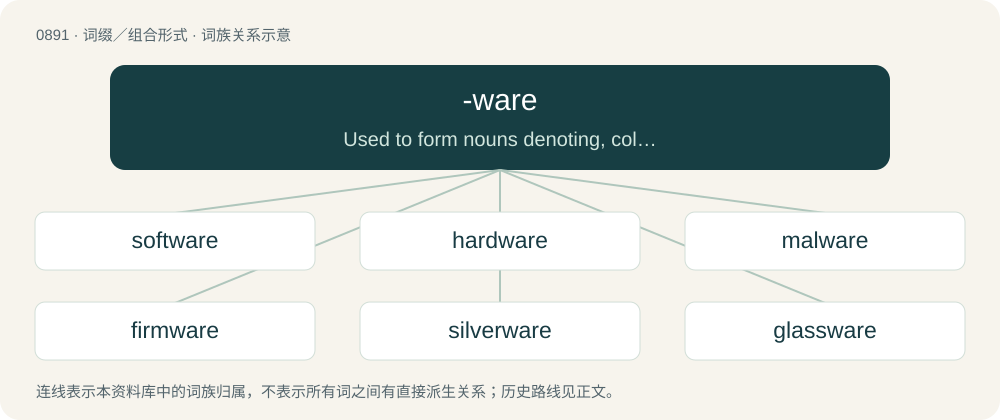

# 0964 · -ware — Used to form nouns denoting, collectively, items made from a particular substance.

[总目录](../00_总目录_按常用程度.md)

**类型**：词缀／组合形式　｜　**来源语言**：见词源记录

## 核心含义与来源

- 核心含义：Used to form nouns denoting, collectively, items made from a particular substance.
- 英文含义：Used to form nouns denoting, collectively, items made from a particular substance.
- 词形：-ware

**多个词源／构词路径**：同一拼写可能有不同来源；以下按词性和含义分别列出。

**来源记录 1**（后缀／后置成分；Used to form nouns denoting, collectively, items made from a particular substance.）

From Middle English ware, from Old English waru, from Proto-West Germanic \*waru, from Proto-Germanic \*warō, with meaning gradually shifting from guard, protection to an object that is in possession, hence meriting attention, guarded, cared for, and protected.

**来源记录 2**（后缀／后置成分；Used to form mass nouns denoting specific classes of computer software, based on use, function, or method of distribution.）

Back-formation from software. See also ware and warehouse.

## 词族图

## 单词速览（常用到不常用）

| 单词 | 音标 | 释义 |
|---|---|---|
| [software](#w-1) | 英 /ˈsɒf(t)ˌwɛə/；美 /ˈsɔf(t)ˌwɛɹ/ | n. 软件；\[计\] 软设备 |
| [hardware](#w-2) | 英 /ˈhɑːdˌwɛə/；美 /ˈhɑɹdˌwɛɹ/ | n. 硬件, 五金器具, 零件；\[计\] 硬件 |
| [malware](#w-3) | 英 /ˈmæl.wɛː/；美 /ˈmæl.wɛəɹ/ | n. 恶意软件; 恶意软件。malware是malicious software的合成形式; 流氓软件 |
| [firmware](#w-4) | /ˈfəːm,weə/ | \[计\] 固件 |
| [silverware](#w-5) | /ˈsɪlvə(ɹ)ˌwɛə(ɹ)/ | n. 银器 |
| [glassware](#w-6) | /ˈglɑːswєə/ | n. 玻璃器具；\[化\] 玻璃器皿; 玻璃仪器 |
| [spyware](#w-7) |  | 间谍软件；后门程式 |
| [ransomware](#w-8) | /ˈɹænsəmˌwɛə(ɹ)/ | 【英文】Malware that holds the data of a computer user for ransom, usually requiring or claiming to require payment to restore access. |
| [cookware](#w-9) | /ˈkjkweə(r)/ | n. &lt;美&gt;\[总称\]烹饪用具,炊具 |
| [middleware](#w-10) | /ˈmidlweə(r)/ | n. \[计\]中间设备,中间件 |
| [freeware](#w-11) | 英 /ˈfɹiːˌwɛə/；美 /ˈfɹiːˌwɛɹ/ | \[计\] 免费软件, 自由软件 |
| [stoneware](#w-12) | /ˈstəunwєə/ | n. 瓷器；\[化\] 炻器 |
| [earthenware](#w-13) | 英 /ˈəːθ(ə)nwɛː/ | n. 陶器；\[化\] 陶器; 土器 |
| [tableware](#w-14) | /ˈteiblwєə/ | n. 餐具 |
| [kitchenware](#w-15) | /ˈkitʃinwєə/ | n. 厨房用具 |
| [shareware](#w-16) |  | \[计\] 试用软件 |
| [dinnerware](#w-17) | /ˈdinəwєə/ | n. 整套餐具 |
| [flatware](#w-18) | /ˈflætwєə/ | n. 扁平餐具 |
| [adware](#w-19) | 英 /ˈædˌwɛə/；美 /ˈædˌwɛɚ/ | n. 广告软件；广告程序 |
| [homeware](#w-20) |  | 【英文】Furnishings for the home, such as furniture and cushions. |

## 逐词详解

### 1. software

**词性**：名词　｜　**音标**：英 /ˈsɒf(t)ˌwɛə/；美 /ˈsɔf(t)ˌwɛɹ/

**中文释义**：n. 软件；\[计\] 软设备

**英文义项**：Encoded computer instructions, usually modifiable (unless stored in some form of unalterable memory such as ROM). / The human beings involved in warfare, as opposed to hardware such as weapons and vehicles.

**构词拆分**：soft + -ware

**例句**：

> Some software will only run on a particular platform.

该用例对应义项：Encoded computer instructions, usually modifiable (unless stored in some form of unalterable memory such as ROM).

### 2. hardware

**词性**：名词　｜　**音标**：英 /ˈhɑːdˌwɛə/；美 /ˈhɑɹdˌwɛɹ/

**中文释义**：n. 硬件, 五金器具, 零件；\[计\] 硬件

**英文义项**：Fixtures, equipment, fasteners, tools, and devices used for general-purpose construction and repair of a structure or object. Also such equipment as sold as stock by a store of the same name, e.g. hardware store. / Equipment.

**构词拆分**：hard + -ware

**词源与演化**：

From Middle English hardware; equivalent to hard + -ware; attested since the mid-15th century.

**例句**：

> He needed a hammer, nails, screws, nuts, bolts and other assorted hardware, so he went to the hardware store.

该用例对应义项：Fixtures, equipment, fasteners, tools, and devices used for general-purpose construction and repair of a structure or object. Also such equipment as sold as stock by a store of the same name, e.g. hardware store.

### 3. malware

**词性**：名词　｜　**音标**：英 /ˈmæl.wɛː/；美 /ˈmæl.wɛəɹ/

**中文释义**：n. 恶意软件; 恶意软件。malware是malicious software的合成形式; 流氓软件

**英文义项**：Software which has been designed to operate in a malicious, undesirable manner.

**构词拆分**：mal- + -ware

**词源与演化**：

From mal- + -ware.

**例句**：

> The files that you are downloading from this website may contain malware.

### 4. firmware

**词性**：名词　｜　**音标**：/ˈfəːm,weə/

**中文释义**：\[计\] 固件

**英文义项**：A permanent form of software that provides a low-level control of computing device hardware. / Software that is intended for such embedded computer applications.

**构词拆分**：firm + -ware

**词源与演化**：

From firm + -ware. Coined in an article in 1967 as an intermediary term between hardware and software.

**例句**：

> The firmware update adds full character support for notifications in eighty languages.

### 5. silverware

**词性**：名词　｜　**音标**：/ˈsɪlvə(ɹ)ˌwɛə(ɹ)/

**中文释义**：n. 银器

**英文义项**：Anything manufactured from silver. / Anything with a silvery colour.

**构词拆分**：silver + -ware

**词源与演化**：

From silver + -ware.

**例句**：

> If you don't keep the silverware polished, it'll lose its luster.

### 6. glassware

**词性**：名词　｜　**音标**：/ˈglɑːswєə/

**中文释义**：n. 玻璃器具；\[化\] 玻璃器皿; 玻璃仪器

**英文义项**：Articles made from glass, especially drinking glasses, jugs and other tableware made of glass.

**构词拆分**：glass + -ware

**词源与演化**：

From glass + -ware.

**例句**：

> He carried the glassware with care.

### 7. spyware

**词性**：名词

**中文释义**：间谍软件；后门程式

**英文义项**：Programs that surreptitiously monitor and report the actions of a computer user.

**构词拆分**：spy + -ware

**词源与演化**：

From spy + -ware.

**例句**：

> Spyware can't distinguish between threatening letters and love letters.

### 8. ransomware

**词性**：名词　｜　**音标**：/ˈɹænsəmˌwɛə(ɹ)/

**英文义项**：Malware that holds the data of a computer user for ransom, usually requiring or claiming to require payment to restore access. / Software that is released as open source only in exchange for payment.

**构词拆分**：ransom + -ware

**词源与演化**：

From ransom + -ware.

**例句**：

> Cybercrime has exploded, with mounting reports of an increase in ransomware attacks.

### 9. cookware

**词性**：名词　｜　**音标**：/ˈkjkweə(r)/

**中文释义**：n. &lt;美&gt;\[总称\]烹饪用具,炊具

**英文义项**：The assorted objects, such as pots, pans, baking sheets, etc., used for cooking

**构词拆分**：cook + -ware

**词源与演化**：

From cook + -ware.

**例句**：

> Avoid using kitchen towels to handle hot cookware; use oven mitts instead.

### 10. middleware

**词性**：名词　｜　**音标**：/ˈmidlweə(r)/

**中文释义**：n. \[计\]中间设备,中间件

**英文义项**：Software that functions at an intermediate layer between applications and operating system or database management system, or between client and server. / Networking software or hardware that is deployed in the middle of, as opposed to serviced by, a packet network to enhance or provide some network function, such as caching, filtering, or firewall functionality.

**构词拆分**：middle + -ware

**词源与演化**：

From middle + -ware.

### 11. freeware

**词性**：名词　｜　**音标**：英 /ˈfɹiːˌwɛə/；美 /ˈfɹiːˌwɛɹ/

**中文释义**：\[计\] 免费软件, 自由软件

**英文义项**：Complete and functional software that does not require payment or other compensation (such as viewing advertising) for its use. Freeware may be a proprietary license with no access to the source code.

**构词拆分**：free + -ware

**词源与演化**：

From free + -ware (clipping of "software"). Coined by Andrew Fluegelman.

### 12. stoneware

**词性**：名词　｜　**音标**：/ˈstəunwєə/

**中文释义**：n. 瓷器；\[化\] 炻器

**英文义项**：A type of pottery that is fired at a high temperature and is dense, opaque and nonporous.

**构词拆分**：stone + -ware

**词源与演化**：

From stone + -ware.

**例句**：

> Earthenware hardens at a lower temperature than another clay called stoneware.

### 13. earthenware

**词性**：名词　｜　**音标**：英 /ˈəːθ(ə)nwɛː/

**中文释义**：n. 陶器；\[化\] 陶器; 土器

**英文义项**：An opaque, semi-porous ceramic made from clay and other compounds.

**构词拆分**：earthen + -ware

**词源与演化**：

From earthen + -ware, first recorded appearance in 1673. Compare Dutch aardewerk (“earthenware”).

**用法示例／搭配（非完整句）**：

> earthenware bowl

该用例对应义项：An opaque, semi-porous ceramic made from clay and other compounds.

### 14. tableware

**词性**：名词　｜　**音标**：/ˈteiblwєə/

**中文释义**：n. 餐具

**英文义项**：The cutlery, crockery and glassware used in setting a table for a meal.

**构词拆分**：table + -ware

**词源与演化**：

From table + -ware.

**例句**：

> While the rest of us toil, the robber barons eat from gilt tableware.

### 15. kitchenware

**词性**：名词　｜　**音标**：/ˈkitʃinwєə/

**中文释义**：n. 厨房用具

**英文义项**：Instruments and utensils found in a kitchen, particularly those associated with the preparation and serving of food.

**构词拆分**：kitchen + -ware

**词源与演化**：

From kitchen + -ware.

**例句**：

> The new chef reorganized the space where we keep the pots, pans, and other kitchenware.

该用例对应义项：Instruments and utensils found in a kitchen, particularly those associated with the preparation and serving of food.

### 16. shareware

**词性**：名词

**中文释义**：\[计\] 试用软件

**英文义项**：A type of software that is distributed without payment but is limited in any combination of functionality, availability, or convenience.

**构词拆分**：share + -ware

**词源与演化**：

From share + -ware. Popularized by Bob Wallace

**例句**：

> Back in the day, programs used to be distributed as shareware.

### 17. dinnerware

**词性**：名词　｜　**音标**：/ˈdinəwєə/

**中文释义**：n. 整套餐具

**英文义项**：The dishes used for serving dinner.

**构词拆分**：dinner + -ware

**词源与演化**：

From dinner + -ware.

**例句**：

> Has the future bride chosen her dinnerware pattern?

### 18. flatware

**词性**：名词　｜　**音标**：/ˈflætwєə/

**中文释义**：n. 扁平餐具

**英文义项**：Eating utensils; cutlery, such as forks, knives and spoons. / Plates, dishes and other relatively flat crockery.

**构词拆分**：flat + -ware

**词源与演化**：

From flat + -ware.

**例句**：

> My in-laws insisted on buying us stainless steel flatware for our wedding.

### 19. adware

**词性**：名词　｜　**音标**：英 /ˈædˌwɛə/；美 /ˈædˌwɛɚ/

**中文释义**：n. 广告软件；广告程序

**英文义项**：A software application that includes advertisements, which are displayed while the software is running. Developers use adware as a source of income and to keep the costs of the software down (usually making it free). Some adware programs can include spyware.

**构词拆分**：ad&gt; + -ware

**词源与演化**：

From ad + -ware.

### 20. homeware

**词性**：名词

**英文义项**：Furnishings for the home, such as furniture and cushions.

**构词拆分**：home + -ware

**词源与演化**：

From home + -ware.
