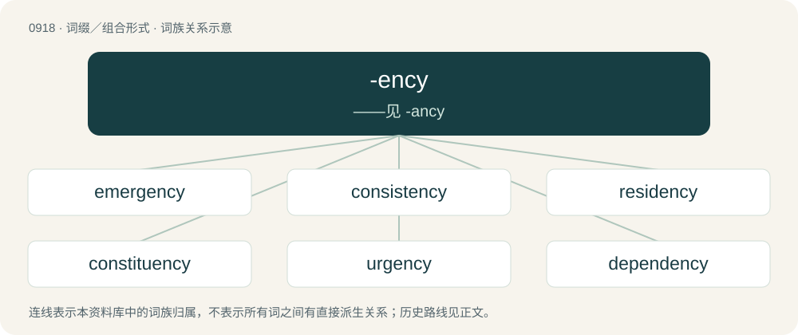

# 0992 · -ency — ——见 -ancy

[总目录](../00_总目录_按常用程度.md)

**类型**：词缀／组合形式　｜　**来源语言**：见词源记录

## 核心含义与来源

- 核心含义：——见 -ancy
- 英文含义：Forming abstract nouns denoting conditions, qualities, or states.
- 词形：-ency

**来源记录 1**（后缀／后置成分；Forming abstract nouns denoting conditions, qualities, or states.）

Ultimately from Latin -entia.

## 词族图

## 单词速览（常用到不常用）

| 单词 | 音标 | 释义 |
|---|---|---|
| [emergency](#w-1) | 英 /ɪˈmɜː(ɹ).dʒən.si/；美 /ɪˈmɝ.d͡ʒən.si/ | n. 紧急状况, 紧急事件, 紧急需要；\[化\] 紧急情况 |
| [consistency](#w-2) | /kənˈsɪs.tən.si/ | n. 坚硬性, 黏稠度, 一致性；\[化\] 稠度; 一致性 |
| [residency](#w-3) | /ˈɹɛzɪdənsi/ | n. 住处；\[法\] 住处, 管辖区 |
| [constituency](#w-4) | /kənˈstɪt͡ʃu.ənsi/ | n. 选民, 顾客, 读者；\[法\] 选区, 全体选民, 选区内的选民 |
| [urgency](#w-5) | 英 /ˈɜː.d͡ʒən.si/；美 /ˈɝ.d͡ʒən.si/ | n. 紧急, 催促；\[法\] 紧急, 迫切, 紧急之事 |
| [dependency](#w-6) | 英 /dɪˈpɛndənsi/ | n. 属国, 保护地, 从属物；\[医\] 从属, 从属部 |
| [proficiency](#w-7) | /pɹəˈfɪʃənsi/ | n. 精通, 熟练, 精练 |
| [latency](#w-8) | 英 /ˈleɪ.tən.si/ | n. 潜伏, 潜在；\[计\] 传输时间, 传输延迟时间 |
| [regency](#w-9) | /ˈɹiːd͡ʒənsi/ | n. 摄政统治, 摄政权, 摄政统治区；\[法\] 摄政, 摄政权, 统治 |
| [resiliency](#w-10) | /riˈziliənsi. -jənsi/ | n. 弹性；跳回 |
| [despondency](#w-11) | 英 /dɪˈspɒndənsi/ | n. 失去勇气, 失望 |

## 逐词详解

### 1. emergency

**词性**：名词　｜　**音标**：英 /ɪˈmɜː(ɹ).dʒən.si/；美 /ɪˈmɝ.d͡ʒən.si/

**中文释义**：n. 紧急状况, 紧急事件, 紧急需要；\[化\] 紧急情况

**英文义项**：A situation which poses an immediate risk and which requires urgent attention. / The department of a hospital that treats emergencies.

**构词拆分**：emergent + -cy；emerge + -ency

**词源与演化**：

Borrowed from Medieval Latin emergentia, from Latin emergens, present participle of emergo (“to emerge, arise, come forth”), equivalent to emergent + -cy or emerge + -ency. Doublet of emergence.

**例句**：

> Cardiac arrest is an emergency requiring medical attention.

该用例对应义项：A situation which poses an immediate risk and which requires urgent attention.

### 2. consistency

**词性**：名词　｜　**音标**：/kənˈsɪs.tən.si/

**中文释义**：n. 坚硬性, 黏稠度, 一致性；\[化\] 稠度; 一致性

**英文义项**：Local coherence. / Correspondence or compatibility.

**构词拆分**：consistence + -y；consist + -ency

**词源与演化**：

By surface analysis, consistent + -cy, consistence + -y or consist + -ency.

**例句**：

> They want to achieve a high degree of consistency in their process and their product.

该用例对应义项：Reliability or uniformity; the quality of being consistent.

### 3. residency

**词性**：名词　｜　**音标**：/ˈɹɛzɪdənsi/

**中文释义**：n. 住处；\[法\] 住处, 管辖区

**英文义项**：The condition of being a resident of a particular place. / The home or residence of a person, especially in the colonies.

**构词拆分**：reside + -ency；resident + -cy

**词源与演化**：

From reside + -ency or resident + -cy.

**例句**：

> The trance DJ was keen to secure a residency in Ibiza.

该用例对应义项：The position of a musical artist who commonly performs at a particular venue.

### 4. constituency

**词性**：名词　｜　**音标**：/kənˈstɪt͡ʃu.ənsi/

**中文释义**：n. 选民, 顾客, 读者；\[法\] 选区, 全体选民, 选区内的选民

**英文义项**：A district represented by one or more elected officials. / The voters within an electoral district.

**构词拆分**：From constituent + -ency.

**词源与演化**：

From constituent + -ency.

**例句**：

> John was elected to parliament from the Bedford constituency.

该用例对应义项：A district represented by one or more elected officials.

### 5. urgency

**词性**：名词　｜　**音标**：英 /ˈɜː.d͡ʒən.si/；美 /ˈɝ.d͡ʒən.si/

**中文释义**：n. 紧急, 催促；\[法\] 紧急, 迫切, 紧急之事

**英文义项**：The quality or condition of being urgent. / Insistence, pressure, urge.

**构词拆分**：urgent + -ency

**词源与演化**：

From urgent + -ency or Latin urgentia.

**例句**：

> I have this sudden urgency to use the toilet.

该用例对应义项：Insistence, pressure, urge.

### 6. dependency

**词性**：名词　｜　**音标**：英 /dɪˈpɛndənsi/

**中文释义**：n. 属国, 保护地, 从属物；\[医\] 从属, 从属部

**英文义项**：A state of dependence; a refusal to exercise initiative. / Something dependent on, or subordinate to, something else

**构词拆分**：dependent + -cy；dependence + -y；depend + -ency

**词源与演化**：

From dependent + -cy or dependence + -y or depend + -ency.

**例句**：

> In the United States' governmental structure, the military is conceived as a dependency under the executive branch.

该用例对应义项：Something dependent on, or subordinate to, something else

### 7. proficiency

**词性**：名词　｜　**音标**：/pɹəˈfɪʃənsi/

**中文释义**：n. 精通, 熟练, 精练

**英文义项**：Ability, skill, competence.

**词源与演化**：

From proficient or its etymon, Latin prōficiēns (present participle of prōficiō), + -ency.

**用法示例／搭配（非完整句）**：

> a test of proficiency in English

该用例对应义项：Ability, skill, competence.

### 8. latency

**词性**：名词　｜　**音标**：英 /ˈleɪ.tən.si/

**中文释义**：n. 潜伏, 潜在；\[计\] 传输时间, 传输延迟时间

**英文义项**：Concealment; the state of being latent; the state of being hidden. / Dormancy; the state of being inactive.

**构词拆分**：latent + -ency

**词源与演化**：

From latent + -ency.

**例句**：

> The disease has a long period of latency.

该用例对应义项：The delay between a stimulus and the response it triggers in an organism.

### 9. regency

**词性**：名词　｜　**音标**：/ˈɹiːd͡ʒənsi/

**中文释义**：n. 摄政统治, 摄政权, 摄政统治区；\[法\] 摄政, 摄政权, 统治

**英文义项**：A system of government that substitutes for the reign of a king or queen when that king or queen becomes unable to rule. / The time during which a regent is in power.

**词源与演化**：

From Middle English regencie (cf. regente), from Medieval Latin regentia, from Latin regēns, present participle of regō. By surface analysis, regent + -cy; compare also + -ency (“abstract-noun suffix”).

**例句**：

> The Regency Hotel was closed indefinitely.

### 10. resiliency

**词性**：名词　｜　**音标**：/riˈziliənsi. -jənsi/

**中文释义**：n. 弹性；跳回

**英文义项**：Synonym of resilience.

**词源与演化**：

From Latin resiliō (“to spring back”) + English -ency.

**例句**：

> Nathan has also noticed the resiliency of her children.

### 11. despondency

**词性**：名词　｜　**音标**：英 /dɪˈspɒndənsi/

**中文释义**：n. 失去勇气, 失望

**英文义项**：The loss of hope or confidence; despair or dejection. / A feeling of depression or disheartenment.

**构词拆分**：despondent + -ency

**词源与演化**：

From Latin dēspondentia, from dēspondēns + -ia. Equivalent to despondent + -ency.
