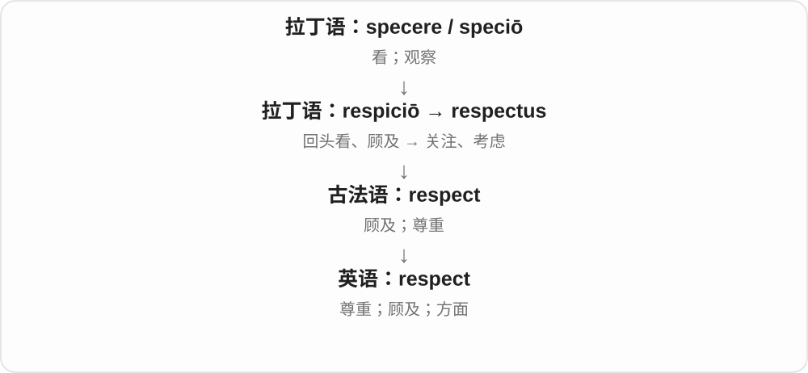
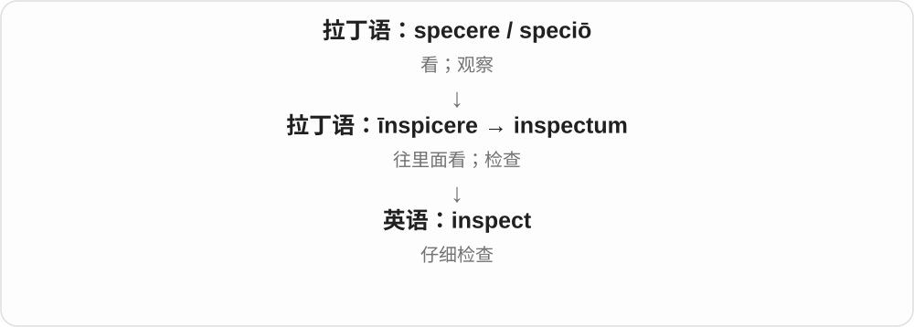

# 0997 · -spect — 看；观察〔拉丁词干〕

[逐词精讲目录](../00_逐词精讲目录.md) · [总目录](../00_总目录_按常用程度.md)

## 核心词根与来源

本页 -spect 标记出现在词尾附近的拉丁 spect- 看，不是一个可以随意接在英语名词后的活跃后缀。inspect、respect、retrospect 各有自己的借入和词义发展。

**SPECT：朝某处看，再发展出不同的注意方式**

检查时仔细看，回顾时朝过去看，尊重则经历了更抽象的变化。

- **检查**：inspect
- **尊重**：respect
- **回顾**：retrospect
- **respect → respects：固定用法 pay respects**：respect · respects

## 词形与演化规律

in-、re-、retro- 在相关古典构词里给观察添加方向；现代 respect 的尊重义不能只当成一次回头看。

复数敬意、问候和方面，需要随搭配理解。

## 单词速览（按词族由简到繁）

同一基础词的相关扩展放在一起，先读基础形式，再读扩展；各组之间优先读常用的。具体词源关系见各词讲解。

| 单词 | 音标 | 核心意思 |
|---|---|---|
| [respect](#w-1) | /rɪˈspekt/ | 尊重；顾及；方面 |
| [respects](#w-4) | /rɪˈspekts/ | 尊重、顾及〔第三人称单数〕；方面、敬意、问候〔复数用法〕 |
| [inspect](#w-2) | /ɪnˈspekt/ | 仔细检查；检验 |
| [retrospect](#w-3) | /ˈretrəspekt/ | 回顾；回想 |

## 逐词讲解

### 1. respect — 尊重；顾及；方面

**音标**：/rɪˈspekt/

**先抓住这个画面**

respect 像认真把别人放进自己的视线：承认他的价值，也顾及他的意愿、界限和权利。

**怎么拆**

拉丁语 re-（回）+ specere（看）形成 respicere；名词 respect 经法语传入，动词由名词发展。

**怎么变成今天的意思**

“回头看、留意”发展为顾及、重视。in this respect 里的 respect 则是“所关注的这一点”，不是尊敬。

**常见搭配与例句**

respect someone’s privacy；have respect for；in many respects。

> Please respect her decision to leave early.

请尊重她提前离开的决定。

> The two designs are similar in several respects.

这两种设计在几个方面很相似。

**别混淆**

respect 不要求你赞同对方。你可以尊重一个人，同时不同意他的判断。

### 2. respects — 尊重、顾及〔第三人称单数〕；方面、敬意、问候〔复数用法〕

**音标**：/rɪˈspekts/

**先抓住这个画面**

把对方的需要、边界放在心上，是 respects。in some respects 把事情分成几个观察方面；pay respects 则是表达敬意、致意。

**怎么拆**

respect 接法语 respect、拉丁 respectus，连 re- 回与 specere 看，较早回头看、顾及。现代加 -s，/t/ 后读 /s/；名词复数有固定搭配发展。

**怎么变成今天的意思**

**拉丁 respicere、respectus → 法语、英语 respect**  
回头看、顾及 → 尊重、考虑

↓

**respect + -s → respects**  
某人尊重；若干方面、表达的敬意

respects your decision 尊重你的决定；in many respects 在许多方面；pay one’s respects 致意、表达敬意。

**常见搭配与例句**

in all respects 在各方面；give someone my respects 代我向某人致意。

> She respects our decision to wait.

她尊重我们再等等的决定。

> The two plans are similar in several respects.

这两个计划在几个方面相似。

**别混淆**

respect 泛说尊重常不可数；respects 在方面、致意这些用法里要整体看搭配。不是每个 respect 都只是把敬意数成一份两份。

### 3. inspect — 仔细检查；检验

**音标**：/ɪnˈspekt/

**先抓住这个画面**

inspect 像把东西翻过来、凑近看，专门找细节、缺陷或不符合要求的地方。

**怎么拆**

in-（向里）+ specere（看）形成拉丁语 inspicere，英语采用其 inspect- 词干。

**怎么变成今天的意思**

“看进去”的画面帮助理解仔细检查，但不要求真的打开物体内部；查看文件也可以 inspect。

**常见搭配与例句**

inspect the damage；inspect a building；inspect closely。

> Please inspect the parcel for damage.

请检查包裹是否有损坏。

> The engineer inspected the bridge after the storm.

暴风雨后，工程师检查了桥梁。

**别混淆**

look at 只是看；inspect 带着检查目的，更细致。

### 4. retrospect — 回顾；回想

**音标**：/ˈretrəspekt/

**先抓住这个画面**

事情已经过去，现在回头看，才更看得清。

**怎么拆**

接拉丁 retrospectum，即 retrospicere“回头看”的分词；历史上是 retro“向后”与 specere“看”组成。现代 -spect 可以和 inspect、prospect 的看联系起来。

**怎么变成今天的意思**

**拉丁语 retro**  
向后、在后面

↓

**拉丁语 retrospicere → retrospectum**  
回头看；表示回看的分词形式

↓

**英语 retrospect**  
回顾、回想过去

最实用的搭配是 in retrospect：以现在掌握的信息回头判断过去。当时觉得不错的计划，in retrospect 可能过于冒险；也可能发现当时的选择其实很明智。

**常见搭配与例句**

in retrospect；seem obvious in retrospect；wise in retrospect。

> In retrospect, the original deadline was far too ambitious.

现在回头看，最初的截止日期定得太勉强了。

> Her quiet decision to stay proved wise in retrospect.

事后看来，她默默决定留下是明智的。

**别混淆**

in retrospect 不自带后悔或批评。regret 是遗憾；retrospect 只是回头看后形成判断。prospect 常把视线放向未来。

## 这一组要分清什么

inspect 是有目的地检查；retrospect 常见 in retrospect 回头看来；respect 则常谈态度或方面。

## 串起来练习

In retrospect, we should have inspected the evidence more carefully.

回头看来，我们本该更仔细检查证据。
