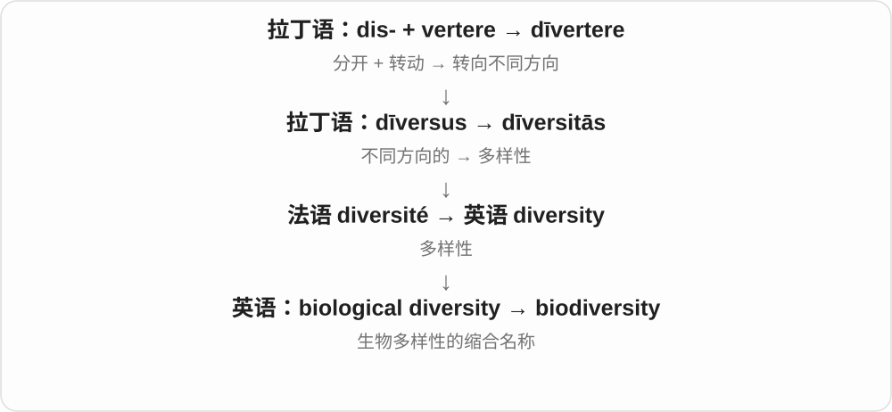

# 1021 · bio-, bi- — 生命；生活；生物过程

[逐词精讲目录](../00_逐词精讲目录.md) · [总目录](../00_总目录_按常用程度.md)

## 核心词根与来源

核心来自希腊 bios“生命、生活、生计”。古代它可以谈一个人的生活方式或一生，近代科学又用 bio- 指各种生命与生物过程。因此 biography 是写一个人的一生，biology 是研究生命，biodegradation 是生物参与分解。大量现代词是科学家用古典材料新造的，不是古希腊就已有今天的技术或学科。

**BIO = LIFE**

先想到一个活着的生命：它有一段经历，会生长、与别的生命相处，也会改变周围环境。bio- 可以把镜头拉近到细胞，也能拉远到整个地球。

- **一个人的一生**：biography, biographical, biographer, biographically, biopic, autobiography, autobiographical
- **研究生命的不同角度**：biology, biological, biologically, biologic, biologist, bioscience, biochemistry, biochemical, biochemist, biochem, microbiology, microbiologist, neurobiology, biophysics, biophysical, biophysicist, biomechanics, biomechanical, bioinformatics, biostatistics, biostatistician, biostatistical
- **生命与身体、医学**：biomedical, biomedicine, biopsy, antibiotic, probiotic, prebiotic, bioavailability, bioactive, biotin, biopharmaceutical, biomarker, biofeedback
- **生命在环境里组成什么**：biosphere, biome, biota, biomass, biodiversity, biotic, abiotic, biotope, biogeography, biogeochemical
- **共同生活与长期整合**：symbiosis, symbiotic, symbiotically, symbiont, endosymbiont, endosymbiosis, microbiome, microbiota
- **借生命过程做事**：biotechnology, biotech, biotechnological, bioengineering, bioreactor, biosensor, biometric, biometrics, bionics, bionic, biomolecule, biomolecular, biopolymer, biocompatible, biocompatibility, biofilm, biosynthesis, biosynthetic
- **环境中的材料、能源与风险**：biodegradable, biodegradation, biodegrade, bioenergy, biofuel, biodiesel, biogas, biohazard, biohazardous, biosafety, biosecurity, bioterrorism, biocide, biocidal, bioaccumulate, bioaccumulation, bioremediation
- **起源、现象与生命观念**：biogenesis, abiogenesis, biogenic, bioluminescence, bioluminescent, biorhythm, astrobiology, exobiology, bioethics, biophilia, biocentrism, biodynamic, macrobiotic

## 词形与演化规律

bio- 常出现在词首，-biotic、-biosis 等形式也在同一生命词族中。前面的限定成分会改变观察角度：micro- 小，aero- 空气，exo- 外部，sym- 共同。a- 在 abiotic 中是否定“生物的”；bi- 表示“二”的另一词根与本组不同。读新词时先抓住生命这一中心，再看它在谈过程、物质、关系、学科还是一种理念。

## 单词速览（按词族由简到繁）

同一基础词的相关扩展放在一起，先读基础形式，再读扩展；各组之间优先读常用的。具体词源关系见各词讲解。

| 单词 | 音标 | 核心意思 |
|---|---|---|
| [biology](#w-2) | 英 /baɪˈɒlədʒi/；美 /baɪˈɑːlədʒi/ | 生物学；某种生物的生命特征 |
| [biological](#w-1) | 英 /ˌbaɪəˈlɒdʒɪkəl/；美 /ˌbaɪəˈlɑːdʒɪkəl/ | 生物的；生物学的；有血缘关系的 |
| [biologically](#w-15) | 英 /ˌbaɪəˈlɒdʒɪkli/；美 /ˌbaɪəˈlɑːdʒɪkli/ | 从生物学上看；通过生物过程 |
| [biologist](#w-12) | 英 /baɪˈɒlədʒɪst/；美 /baɪˈɑːlədʒɪst/ | 生物学家 |
| [biologic](#w-40) | 英 /ˌbaɪəˈlɒdʒɪk/；美 /ˌbaɪəˈlɑːdʒɪk/ | 生物学的；生物制剂〔名词〕 |
| [microbiology](#w-14) | 英 /ˌmaɪkrəʊbaɪˈɒlədʒi/；美 /ˌmaɪkroʊbaɪˈɑːlədʒi/ | 微生物学 |
| [microbiologist](#w-57) | 英 /ˌmaɪkrəʊbaɪˈɒlədʒɪst/；美 /ˌmaɪkroʊbaɪˈɑːlədʒɪst/ | 微生物学家 |
| [neurobiology](#w-37) | 英 /ˌnjʊərəʊˌbaɪˈɒlədʒi/；美 /ˌnʊroʊˌbaɪˈɑːlədʒi/ | 神经生物学 |
| [astrobiology](#w-82) | 英 /ˌæstrəʊbaɪˈɒlədʒi/；美 /ˌæstroʊbaɪˈɑːlədʒi/ | 天体生物学；宇宙生命研究 |
| [exobiology](#w-96) | 英 /ˌeksəʊbaɪˈɒlədʒi/；美 /ˌeksoʊbaɪˈɑːlədʒi/ | 地外生物学；研究地外生命可能性及相关生命条件的学科 |
| [biography](#w-3) | 英 /baɪˈɒɡrəfi/；美 /baɪˈɑːɡrəfi/ | 传记；生平记述 |
| [biographical](#w-9) | 英 /ˌbaɪəˈɡræfɪkəl/；美 /ˌbaɪəˈɡræfɪkəl/ | 传记的；有关某人生平的 |
| [biographically](#w-105) | /ˌbaɪəˈɡræfɪkli/ | 从生平角度；就个人经历而言 |
| [biographer](#w-19) | 英 /baɪˈɒɡrəfə/；美 /baɪˈɑːɡrəfər/ | 传记作者 |
| [autobiography](#w-4) | 英 /ˌɔːtəbaɪˈɒɡrəfi/；美 /ˌɔːtəbaɪˈɑːɡrəfi/ | 自传 |
| [autobiographical](#w-18) | /ˌɔːtəˌbaɪəˈɡræfɪkəl/ | 自传的；取材于本人经历的 |
| [biotic](#w-33) | 英 /baɪˈɒtɪk/；美 /baɪˈɑːtɪk/ | 生物的；由生物造成的 |
| [antibiotic](#w-5) | 英 /ˌæntibaɪˈɒtɪk/；美 /ˌæntibaɪˈɑːtɪk/，anti- 也可读 /ˌæntaɪ-/ | 抗生素；抗生的 |
| [probiotic](#w-39) | 英 /ˌprəʊbaɪˈɒtɪk/；美 /ˌproʊbaɪˈɑːtɪk/ | 益生微生物；益生菌制剂；益生的 |
| [abiotic](#w-58) | 英 /ˌeɪbaɪˈɒtɪk/；美 /ˌeɪbaɪˈɑːtɪk/ | 非生物的；不由生命活动直接构成的 |
| [prebiotic](#w-85) | 英 /ˌpriːbaɪˈɒtɪk/；美 /ˌpriːbaɪˈɑːtɪk/ | 生命出现前的；益生元；益生元的 |
| [macrobiotic](#w-86) | 英 /ˌmækrəʊbaɪˈɒtɪk/；美 /ˌmækroʊbaɪˈɑːtɪk/ | 长寿饮食法的；宏观养生饮食的；古义为长寿的 |
| [biodiversity](#w-6) | 英 /ˌbaɪəʊdaɪˈvɜːsəti/；美 /ˌbaɪoʊdaɪˈvɜːrsəti/ | 生物多样性 |
| [biomedical](#w-7) | 英 /ˌbaɪəʊˈmedɪkəl/；美 /ˌbaɪoʊˈmedɪkəl/ | 生物医学的 |
| [biotechnology](#w-8) | 英 /ˌbaɪəʊtekˈnɒlədʒi/；美 /ˌbaɪoʊtekˈnɑːlədʒi/ | 生物技术 |
| [biotechnological](#w-81) | 英 /ˌbaɪəʊteknəˈlɒdʒɪkəl/；美 /ˌbaɪoʊteknəˈlɑːdʒɪkəl/ | 生物技术的 |
| [biomass](#w-10) | 英 /ˈbaɪəʊmæs/；美 /ˈbaɪoʊˌmæs/ | 生物量；作为能源原料的生物质 |
| [biochem](#w-55) | 英 /ˈbaɪəʊkem/；美 /ˈbaɪoʊkem/ | 生物化学〔口语简称〕 |
| [biochemical](#w-16) | 英 /ˌbaɪəʊˈkemɪkəl/；美 /ˌbaɪoʊˈkemɪkəl/ | 生物化学的；生物化学物质 |
| [biochemist](#w-48) | 英 /ˌbaɪəʊˈkemɪst/；美 /ˌbaɪoʊˈkemɪst/ | 生物化学家 |
| [biochemistry](#w-11) | 英 /ˌbaɪəʊˈkemɪstri/；美 /ˌbaɪoʊˈkemɪstri/ | 生物化学 |
| [biopsy](#w-13) | 英 /ˈbaɪɒpsi/；美 /ˈbaɪɑːpsi/ | 活组织检查；取样活检 |
| [biotech](#w-17) | 英 /ˈbaɪəʊtek/；美 /ˈbaɪoʊtek/ | 生物技术〔简称〕；生物技术公司或行业 |
| [biopic](#w-20) | 英 /ˈbaɪəʊpɪk/；美 /ˈbaɪoʊpɪk/ | 传记电影 |
| [biometric](#w-21) | 英 /ˌbaɪəʊˈmetrɪk/；美 /ˌbaɪoʊˈmetrɪk/ | 生物测量的；生物特征识别的 |
| [biometrics](#w-30) | 英 /ˌbaɪəʊˈmetrɪks/；美 /ˌbaɪoʊˈmetrɪks/ | 生物测量学；生物特征识别技术 |
| [bionic](#w-22) | 英 /baɪˈɒnɪk/；美 /baɪˈɑːnɪk/ | 仿生的；以电子或机电技术辅助身体功能的 |
| [bionics](#w-74) | 英 /baɪˈɒnɪks/；美 /baɪˈɑːnɪks/ | 仿生学；借生物原理解决工程问题的技术 |
| [symbiosis](#w-31) | 英 /ˌsɪmbaɪˈəʊsɪs/；美 /ˌsɪmbaɪˈoʊsɪs/，中间也可读 /bi/ | 共生；密切而持续的共同生活关系 |
| [symbiotic](#w-23) | 英 /ˌsɪmbaɪˈɒtɪk/；美 /ˌsɪmbaɪˈɑːtɪk/，中间也可读 /bi/ | 共生的；相互依存的 |
| [symbiotically](#w-93) | 英 /ˌsɪmbaɪˈɒtɪkli/；美 /ˌsɪmbaɪˈɑːtɪkli/ | 以共生方式；相互依存地 |
| [endosymbiosis](#w-100) | 英 /ˌendəʊˌsɪmbaɪˈəʊsɪs/；美 /ˌendoʊˌsɪmbaɪˈoʊsɪs/ | 内共生 |
| [biosphere](#w-24) | 英 /ˈbaɪəʊsfɪə/；美 /ˈbaɪoʊsfɪr/ | 生物圈 |
| [biosynthesis](#w-26) | 英 /ˌbaɪəʊˈsɪnθəsɪs/；美 /ˌbaɪoʊˈsɪnθəsɪs/ | 生物合成 |
| [biosynthetic](#w-68) | 英 /ˌbaɪəʊsɪnˈθetɪk/；美 /ˌbaɪoʊsɪnˈθetɪk/ | 生物合成的 |
| [biodegrade](#w-90) | 英 /ˌbaɪəʊdɪˈɡreɪd/；美 /ˌbaɪoʊdɪˈɡreɪd/ | 发生生物降解；被生物作用分解 |
| [biodegradable](#w-25) | 英 /ˌbaɪəʊdɪˈɡreɪdəbəl/；美 /ˌbaɪoʊdɪˈɡreɪdəbəl/ | 可生物降解的 |
| [biodegradation](#w-79) | 英 /ˌbaɪəʊˌdeɡrəˈdeɪʃən/；美 /ˌbaɪoʊˌdeɡrəˈdeɪʃən/ | 生物降解 |
| [bioinformatics](#w-27) | 英 /ˌbaɪəʊˌɪnfəˈmætɪks/；美 /ˌbaɪoʊˌɪnfərˈmætɪks/ | 生物信息学 |
| [biome](#w-28) | 英 /ˈbaɪəʊm/；美 /ˈbaɪoʊm/ | 生物群系；大型生态类型 |
| [microbiome](#w-35) | 英 /ˌmaɪkrəʊˈbaɪəʊm/；美 /ˌmaɪkroʊˈbaɪoʊm/ | 微生物组；某环境中的微生物及其整体系统 |
| [biofuel](#w-29) | 英 /ˈbaɪəʊfjuːəl/；美 /ˈbaɪoʊfjuːəl/ | 生物燃料 |
| [biohazard](#w-32) | 英 /ˈbaɪəʊhæzəd/；美 /ˈbaɪoʊˌhæzərd/ | 生物危害；具有生物危害的材料或因素 |
| [biohazardous](#w-101) | 英 /ˌbaɪəʊˈhæzədəs/；美 /ˌbaɪoʊˈhæzərdəs/ | 有生物危害的 |
| [biodiesel](#w-34) | 英 /ˌbaɪəʊˈdiːzəl/；美 /ˌbaɪoʊˈdiːzəl/ | 生物柴油 |
| [biomarker](#w-36) | 英 /ˈbaɪəʊˌmɑːkə/；美 /ˈbaɪoʊˌmɑːrkər/ | 生物标志物；反映生物状态的可测指标 |
| [bioethics](#w-38) | 英 /ˌbaɪəʊˈeθɪks/；美 /ˌbaɪoʊˈeθɪks/ | 生命伦理学 |
| [biophysics](#w-41) | 英 /ˌbaɪəʊˈfɪzɪks/；美 /ˌbaɪoʊˈfɪzɪks/ | 生物物理学 |
| [bioavailability](#w-42) | 英 /ˌbaɪəʊəˌveɪləˈbɪləti/；美 /ˌbaɪoʊəˌveɪləˈbɪləti/ | 生物利用度 |
| [biogas](#w-43) | 英 /ˈbaɪəʊɡæs/；美 /ˈbaɪoʊɡæs/ | 沼气；生物气 |
| [bioengineering](#w-44) | 英 /ˌbaɪəʊˌendʒɪˈnɪərɪŋ/；美 /ˌbaɪoʊˌendʒəˈnɪrɪŋ/ | 生物工程 |
| [biomechanics](#w-45) | 英 /ˌbaɪəʊməˈkænɪks/；美 /ˌbaɪoʊməˈkænɪks/ | 生物力学 |
| [biotin](#w-46) | /ˈbaɪətɪn/ | 生物素，一种B族维生素 |
| [biota](#w-50) | 英 /baɪˈəʊtə/；美 /baɪˈoʊtə/ | 某地区或某时期的生物总体；生物区系 |
| [microbiota](#w-47) | 英 /ˌmaɪkrəʊbaɪˈəʊtə/；美 /ˌmaɪkroʊbaɪˈoʊtə/ | 微生物群；特定环境中的微生物成员 |
| [bioscience](#w-49) | 英 /ˈbaɪəʊsaɪəns/；美 /ˈbaɪoʊsaɪəns/ | 生物科学；生命科学 |
| [biofilm](#w-51) | 英 /ˈbaɪəʊfɪlm/；美 /ˈbaɪoʊfɪlm/ | 生物膜；包裹在胞外基质中的微生物群体 |
| [biophysical](#w-52) | 英 /ˌbaɪəʊˈfɪzɪkəl/；美 /ˌbaɪoʊˈfɪzɪkəl/ | 生物物理的；涉及生物与物理因素的 |
| [biomechanical](#w-53) | 英 /ˌbaɪəʊmɪˈkænɪkəl/；美 /ˌbaɪoʊməˈkænɪkəl/ | 生物力学的 |
| [biopharmaceutical](#w-54) | 英 /ˌbaɪəʊˌfɑːməˈsuːtɪkəl/；美 /ˌbaɪoʊˌfɑːrməˈsuːtɪkəl/ | 生物药物；生物制药的 |
| [biogenesis](#w-56) | /ˌbaɪəʊˈdʒenəsɪs/ | 生源论；生物体内结构或物质的生成 |
| [bioactive](#w-59) | 英 /ˌbaɪəʊˈæktɪv/；美 /ˌbaɪoʊˈæktɪv/ | 有生物活性的；能影响生物过程的 |
| [biofeedback](#w-60) | 英 /ˈbaɪəʊfiːdbæk/；美 /ˈbaɪoʊfiːdˌbæk/ | 生物反馈 |
| [biosecurity](#w-61) | 英 /ˌbaɪəʊsɪˈkjʊərəti/；美 /ˌbaɪoʊsɪˈkjʊrəti/ | 生物安全防护 |
| [biostatistics](#w-62) | 英 /ˌbaɪəʊstəˈtɪstɪks/；美 /ˌbaɪoʊstəˈtɪstɪks/ | 生物统计学 |
| [bioenergy](#w-63) | 英 /ˌbaɪəʊˈenədʒi/；美 /ˌbaɪoʊˈenərdʒi/ | 生物能源；生物质能 |
| [biomedicine](#w-64) | 英 /ˌbaɪəʊˈmedɪsɪn/；美 /ˌbaɪoʊˈmedɪsən/ | 生物医学；以生物科学为基础的医学 |
| [bioterrorism](#w-65) | 英 /ˌbaɪəʊˈterərɪzəm/；美 /ˌbaɪoʊˈterərɪzəm/ | 生物恐怖主义；利用生物因子实施恐怖活动 |
| [biogeography](#w-66) | 英 /ˌbaɪəʊdʒiˈɒɡrəfi/；美 /ˌbaɪoʊdʒiˈɑːɡrəfi/ | 生物地理学 |
| [biomolecular](#w-67) | 英 /ˌbaɪəʊməˈlekjʊlə/；美 /ˌbaɪoʊməˈlekjələr/ | 生物分子的；涉及生物分子层面的 |
| [biosafety](#w-69) | 英 /ˌbaɪəʊˈseɪfti/；美 /ˌbaɪoʊˈseɪfti/ | 生物安全；防止生物相关意外暴露或释放的措施与实践 |
| [bioluminescent](#w-70) | 英 /ˌbaɪəʊˌluːmɪˈnesənt/；美 /ˌbaɪoʊˌluːməˈnesənt/ | 会生物发光的 |
| [bioluminescence](#w-72) | 英 /ˌbaɪəʊˌluːmɪˈnesəns/；美 /ˌbaɪoʊˌluːməˈnesəns/ | 生物发光 |
| [biogeochemical](#w-71) | 英 /ˌbaɪəʊˌdʒiːəʊˈkemɪkəl/；美 /ˌbaɪoʊˌdʒiːoʊˈkemɪkəl/ | 生物地球化学的 |
| [biogenic](#w-73) | 英 /ˌbaɪəʊˈdʒenɪk/；美 /ˌbaɪoʊˈdʒenɪk/ | 生物成因的；由生物产生的 |
| [bioreactor](#w-75) | 英 /ˌbaɪəʊriˈæktə/；美 /ˌbaɪoʊriˈæktər/ | 生物反应器 |
| [bioremediation](#w-76) | 英 /ˌbaɪəʊrɪˌmiːdiˈeɪʃən/；美 /ˌbaɪoʊrɪˌmiːdiˈeɪʃən/ | 生物修复 |
| [biodynamic](#w-77) | 英 /ˌbaɪəʊdaɪˈnæmɪk/；美 /ˌbaɪoʊdaɪˈnæmɪk/，dynamic 也可读 /dɪˈnæmɪk/ | 生物动力农法的；生物动力学的 |
| [symbiont](#w-78) | 英 /ˈsɪmbaɪɒnt/；美 /ˈsɪmbiɑːnt/ | 共生生物；共生者 |
| [endosymbiont](#w-103) | 美 /ˌendoʊˈsɪmbaɪˌɑːnt/，也读 /ˌendoʊˈsɪmbiˌɑːnt/ | 内共生生物；生活在宿主体内的共生者 |
| [biosensor](#w-80) | 英 /ˈbaɪəʊsensə/；美 /ˈbaɪoʊˌsensər/ | 生物传感器 |
| [biocompatible](#w-83) | 英 /ˌbaɪəʊkəmˈpætəbəl/；美 /ˌbaɪoʊkəmˈpætəbəl/ | 具有生物相容性的 |
| [biocompatibility](#w-84) | 英 /ˌbaɪəʊkəmˌpætəˈbɪləti/；美 /ˌbaɪoʊkəmˌpætəˈbɪləti/ | 生物相容性 |
| [bioaccumulate](#w-104) | 英 /ˌbaɪəʊəˈkjuːmjʊleɪt/；美 /ˌbaɪoʊəˈkjuːmjəleɪt/ | 在生物体内累积；使物质在体内累积 |
| [bioaccumulation](#w-87) | 英 /ˌbaɪəʊəˌkjuːmjʊˈleɪʃən/；美 /ˌbaɪoʊəˌkjuːmjəˈleɪʃən/ | 生物累积 |
| [biopolymer](#w-88) | 英 /ˌbaɪəʊˈpɒlɪmə/；美 /ˌbaɪoʊˈpɑːlɪmər/ | 生物聚合物 |
| [biophilia](#w-89) | 英 /ˌbaɪəʊˈfɪliə/；美 /ˌbaɪoʊˈfɪliə/ | 亲生命倾向；对生命和自然的喜爱 |
| [abiogenesis](#w-91) | 英 /ˌeɪbaɪəʊˈdʒenəsɪs/；美 /ˌeɪbaɪoʊˈdʒenəsɪs/ | 非生物起源；生命从非生命物质产生 |
| [biocide](#w-92) | 英 /ˈbaɪəʊsaɪd/；美 /ˈbaɪəˌsaɪd/ | 杀生剂；杀灭或抑制生物的物质 |
| [biocidal](#w-102) | 英 /ˌbaɪəʊˈsaɪdəl/；美 /ˌbaɪoʊˈsaɪdəl/ | 杀生的；能杀灭或抑制生物的 |
| [biostatistician](#w-94) | 英 /ˌbaɪəʊˌstætɪˈstɪʃən/；美 /ˌbaɪoʊˌstætəˈstɪʃən/ | 生物统计学家 |
| [biotope](#w-95) | 英 /ˈbaɪəʊtəʊp/；美 /ˈbaɪəˌtoʊp/ | 生境；环境条件较一致的生物生活区域 |
| [biomolecule](#w-97) | 英 /ˌbaɪəʊˈmɒlɪkjuːl/；美 /ˌbaɪoʊˈmɑːlɪkjuːl/ | 生物分子 |
| [biorhythm](#w-98) | 英 /ˈbaɪəʊrɪðəm/；美 /ˈbaɪoʊˌrɪðəm/ | 生物节律；也指按生日推算状态的所谓周期 |
| [biophysicist](#w-99) | 英 /ˌbaɪəʊˈfɪzɪsɪst/；美 /ˌbaɪoʊˈfɪzɪsɪst/ | 生物物理学家 |
| [biocentrism](#w-106) | 英 /ˌbaɪəʊˈsentrɪzəm/；美 /ˌbaɪoʊˈsentrɪzəm/ | 生命中心主义；同名的宇宙观主张 |
| [biostatistical](#w-107) | 英 /ˌbaɪəʊstəˈtɪstɪkəl/；美 /ˌbaɪoʊstəˈtɪstɪkəl/ | 生物统计的 |

## 逐词讲解

### 1. biology — 生物学；某种生物的生命特征

**音标**：英 /baɪˈɒlədʒi/；美 /baɪˈɑːlədʒi/

**先抓住这个画面**

从一个细胞怎样工作，一直问到生命怎样繁衍和演化。

**怎么拆**

bio- “生命” + -logy；整词经新拉丁 biologia 等近代学术用法进入英语，不是古希腊已经存在的现代学科名称。

**怎么变成今天的意思**

**希腊 légō / lógos**  
选取、收集 → 讲述；话语、说明、道理、计算

↓

**希腊 bíos〔生命〕+ -logía → 新拉丁 biologia**  
近代学术造词：研究生命

↓

**英语 biology**  
研究生物及生命过程；名称经近代科学用法逐渐固定

生物学并不只背动物和植物的名字，还研究结构、功能、遗传、环境关系等。the biology of a species 则是说某物种怎样生长、生活和繁殖。

**常见搭配与例句**

study biology；molecular biology；the biology of a species。

> Our biology lesson began with cells dividing under a microscope.

我们的生物课从显微镜下的细胞分裂开始。

> Understanding the insect’s biology helped explain its seasonal appearance.

了解这种昆虫的生物学特征，有助于解释它为什么在特定季节出现。

**别混淆**

biography 是人的生平记述；biology 是生命科学，同有 bio-，后半的任务不同。

### 2. biological — 生物的；生物学的；有血缘关系的

**音标**：英 /ˌbaɪəˈlɒdʒɪkəl/；美 /ˌbaɪəˈlɑːdʒɪkəl/

**先抓住这个画面**

把原因、过程或关系放到生命活动这一层来看。

**怎么拆**

英语 biology + -ical；重音从名词前部移到 -log-。

**怎么变成今天的意思**

**希腊 légō / lógos**  
选取、收集 → 讲述；话语、说明、道理、计算

↓

**希腊 bíos〔生命〕+ -logía → 新拉丁 biologia**  
近代学术造词：研究生命

↓

**英语 biology**  
研究生物及生命过程；名称经近代科学用法逐渐固定

↓

**英语 biology + -ical → biological**  
生物学相关的；由生命过程形成的

a biological process 可以是发酵或细胞分裂。biological parents 说生育或遗传关系，并不评价谁实际照顾、养育孩子。

**常见搭配与例句**

biological processes；biological diversity；biological parents。

> The study examines the biological processes involved in fermentation.

研究分析了发酵涉及的生物过程。

> She met her biological father as an adult.

她成年后见到了自己的生父。

**别混淆**

biological 说生命或血缘层面；social 说社会关系，两者可以同时影响一个问题。

### 3. biologically — 从生物学上看；通过生物过程

**音标**：英 /ˌbaɪəˈlɒdʒɪkli/；美 /ˌbaɪəˈlɑːdʒɪkli/

**先抓住这个画面**

明确告诉你：这里是在生命机制或遗传关系这一层面说话。

**怎么拆**

biological + -ly；形容词转为说明方式或判断角度的副词。

**怎么变成今天的意思**

**希腊 légō / lógos**  
选取、收集 → 讲述；话语、说明、道理、计算

↓

**希腊 bíos〔生命〕+ -logía → 新拉丁 biologia**  
近代学术造词：研究生命

↓

**英语 biology**  
研究生物及生命过程；名称经近代科学用法逐渐固定

↓

**英语 biology → biological → biologically**  
生物学 → 从生物学层面而言

biologically related 常说有血缘关系；biologically active 则可形容一种物质会对生物系统产生作用。它不等于“天然所以安全”。

**常见搭配与例句**

biologically related；biologically active；biologically important。

> The two children are biologically related but grew up in different homes.

这两个孩子有血缘关系，却在不同家庭长大。

> The researchers measured whether the compound remained biologically active.

研究者测量了这种化合物是否仍具有生物活性。

**别混淆**

biologically 是判断角度或作用方式；naturally 可能只是说自然发生，二者不总能互换。

### 4. biologist — 生物学家

**音标**：英 /baɪˈɒlədʒɪst/；美 /baɪˈɑːlədʒɪst/

**先抓住这个画面**

用观察和实验研究生命怎样运作的人。

**怎么拆**

英语 biology + -ist；学科名转为研究者名称。

**怎么变成今天的意思**

**希腊 légō / lógos**  
选取、收集 → 讲述；话语、说明、道理、计算

↓

**希腊 bíos〔生命〕+ -logía → 新拉丁 biologia**  
近代学术造词：研究生命

↓

**英语 biology**  
研究生物及生命过程；名称经近代科学用法逐渐固定

↓

**英语 biology + -ist → biologist**  
生物学研究者

有人在实验室研究细胞，有人在野外跟踪动物。biologist 范围很宽，不能一律想成穿白衣、拿试管的人。

**常见搭配与例句**

a marine biologist；a field biologist；a molecular biologist。

> The biologist recorded how the frogs responded to changes in temperature.

生物学家记录了青蛙对温度变化的反应。

> A marine biologist joined the team studying the reef.

一位海洋生物学家加入了珊瑚礁研究团队。

**别混淆**

doctor 常指医生或博士；biologist 指研究领域，生物学家并不因此具有临床行医身份。

### 5. biologic — 生物学的；生物制剂〔名词〕

**音标**：英 /ˌbaɪəˈlɒdʒɪk/；美 /ˌbaɪəˈlɑːdʒɪk/

**先抓住这个画面**

形容词谈生命过程；作名词时，常指利用生物来源或生物系统制成的药用产品。

**怎么拆**

biology + -ic；后来形容词转用为名词，通常对应 biological product，不能把名词只译成“生物”。

**怎么变成今天的意思**

**希腊 légō / lógos**  
选取、收集 → 讲述；话语、说明、道理、计算

↓

**希腊 bíos〔生命〕+ -logía → 新拉丁 biologia**  
近代学术造词：研究生命

↓

**英语 biology**  
研究生物及生命过程；名称经近代科学用法逐渐固定

↓

**英语 biology + -ic → biologic**  
生物的、生物学的

↓

**名词 biologic，复数 biologics**  
生物制品、生物制剂

生物制剂可包括疫苗、抗体等不同产品，不是一个单一药物名称。日常一般形容“生物学的”时 biological 更常见；药品讨论中的 a biologic 则是名词。

**常见搭配与例句**

a biologic medicine；biologic activity；the manufacture of biologics。

> The laboratory measured the compound’s biologic activity.

实验室测量了这种化合物的生物活性。

> The facility manufactures a biologic using cultured cells.

这家工厂利用培养的细胞生产一种生物制剂。

**别混淆**

biologic 与 biological 可在形容词用法中接近；a biologic 是产品名称，不能随意删去冠词当学科名。

### 6. microbiology — 微生物学

**音标**：英 /ˌmaɪkrəʊbaɪˈɒlədʒi/；美 /ˌmaɪkroʊbaɪˈɑːlədʒi/

**先抓住这个画面**

把研究视线缩小，去看细菌、微小真菌等肉眼难见的对象及其活动。

**怎么拆**

micro- “微小” + biology；微小的是研究对象，并不是“小规模做一点生物学”。

**怎么变成今天的意思**

**希腊 légō / lógos**  
选取、收集 → 讲述；话语、说明、道理、计算

↓

**希腊 bíos〔生命〕+ -logía → 新拉丁 biologia**  
近代学术造词：研究生命

↓

**英语 biology**  
研究生物及生命过程；名称经近代科学用法逐渐固定

↓

**英语 micro- + biology → microbiology**  
以微生物及相关对象为中心的生物学研究

它既研究致病微生物，也研究发酵、土壤养分循环等过程。领域中也包含病毒研究，因此不要用“是否独立存活”简单划掉所有病毒相关工作。

**常见搭配与例句**

food microbiology；a microbiology laboratory；research in microbiology。

> The microbiology team studied the organisms involved in making yogurt.

微生物学团队研究了制作酸奶时参与发酵的微生物。

> The water samples were sent to the microbiology laboratory.

水样被送往微生物实验室。

**别混淆**

microbiology 范围比 bacteriology 广；后者专门研究细菌。

### 7. microbiologist — 微生物学家

**音标**：英 /ˌmaɪkrəʊbaɪˈɒlədʒɪst/；美 /ˌmaɪkroʊbaɪˈɑːlədʒɪst/

**先抓住这个画面**

研究肉眼通常看不清的生命，怎样生活、变化并影响周围环境。

**怎么拆**

micro-“微小” + biologist“生物学家”；也对应 microbiology 的 -ist 研究者形式。

**怎么变成今天的意思**

**希腊 bios（βίος）**  
生命、一生、生活方式

↓

**近代构词成分 bio-**  
生命；生物；与生物有关的

↓

**现代 micro-“微小”与生物词族组合**  
微生物及其群体

↓

**英语 microbiology 与 microbiologist 词族**  
微生物学；从事微生物研究的人

microbiologist 可能研究环境中的微生物，也可能研究食品、工业或疾病相关问题。职业范围远不止“用显微镜看细菌”，还会分析遗传信息、代谢和群落关系。

**常见搭配与例句**

an environmental microbiologist；a clinical microbiologist；work as a microbiologist。

> The microbiologist studied organisms collected from seawater.

微生物学家研究了从海水中采集的生物。

> A microbiologist joined the food safety team.

一位微生物学家加入了食品安全团队。

**别混淆**

microbiologist 是微生物研究者；microbiome 是研究对象之一，不能用后者称人。

### 8. neurobiology — 神经生物学

**音标**：英 /ˌnjʊərəʊˌbaɪˈɒlədʒi/；美 /ˌnʊroʊˌbaɪˈɑːlədʒi/

**先抓住这个画面**

把神经系统当作活的细胞和网络，研究它怎样发育、传信和改变。

**怎么拆**

neuro- “神经” + biology；neuro- 接希腊 neûron，早期可指筋、腱，科学词中专指神经。

**怎么变成今天的意思**

**希腊 légō / lógos**  
选取、收集 → 讲述；话语、说明、道理、计算

↓

**希腊 bíos〔生命〕+ -logía → 新拉丁 biologia**  
近代学术造词：研究生命

↓

**英语 biology**  
研究生物及生命过程；名称经近代科学用法逐渐固定

↓

**希腊 neûron → 近代 neuro- + 英语 biology → neurobiology**  
研究神经系统的生物机制

研究突触如何传递信号、神经细胞如何连接，都属于这个领域。它可以帮助理解行为，但不等于只凭脑扫描就能读出一个人的所有想法。

**常见搭配与例句**

cellular neurobiology；developmental neurobiology；the neurobiology of learning。

> The course in neurobiology explains how neurons communicate.

神经生物学课程解释了神经元如何传递信息。

> Her laboratory studies the neurobiology of learning.

她的实验室研究学习的神经生物学机制。

**别混淆**

neurology 常指诊治神经系统疾病的临床专科；neurobiology 更突出基础生命机制研究。

### 9. astrobiology — 天体生物学；宇宙生命研究

**音标**：英 /ˌæstrəʊbaɪˈɒlədʒi/；美 /ˌæstroʊbaɪˈɑːlədʒi/

**先抓住这个画面**

把“生命怎样出现、能在哪里存在”这个问题，放到整个宇宙的背景里。

**怎么拆**

astro- “星体、宇宙” + biology；现代交叉学科构词，不是“只研究恒星上的生物”。

**怎么变成今天的意思**

**希腊 légō / lógos**  
选取、收集 → 讲述；话语、说明、道理、计算

↓

**希腊 bíos〔生命〕+ -logía → 新拉丁 biologia**  
近代学术造词：研究生命

↓

**英语 biology**  
研究生物及生命过程；名称经近代科学用法逐渐固定

↓

**英语 astro- + biology → astrobiology**  
研究宇宙中生命的起源、演化、分布与可能环境

研究地球极端环境里的微生物，也可能属于天体生物学，因为它帮助判断别处什么条件可能适合生命。这个领域的存在，不表示已经找到了地外生命。

**常见搭配与例句**

research in astrobiology；an astrobiology mission；questions in astrobiology。

> The astrobiology project studies microbes that survive in very salty water.

这个天体生物学项目研究能在高盐水中生存的微生物。

> Astrobiology connects the search for habitable planets with research on life’s origins.

天体生物学把寻找宜居行星与生命起源研究联系起来。

**别混淆**

astronomy 研究天体与宇宙；astrobiology 把生命问题带入其中，并结合地球上的生物证据。

### 10. exobiology — 地外生物学；研究地外生命可能性及相关生命条件的学科

**音标**：英 /ˌeksəʊbaɪˈɒlədʒi/；美 /ˌeksoʊbaɪˈɑːlədʒi/

**先抓住这个画面**

把关于生命的问题，从地球往外追问：别处可能有生命吗，需要什么条件？

**怎么拆**

exo-“外部” + biology“生物学”；Lederberg 在太空时代推广并使用了这一名称。

**怎么变成今天的意思**

**希腊 bios（βίος）**  
生命、一生、生活方式

↓

**近代构词成分 bio-**  
生命；生物；与生物有关的

↓

**英语 biology 与 exo-“外部”组合**  
地球之外的生命研究

↓

**20世纪 exobiology**  
地外生物学及与生命起源、适生条件有关的研究

exobiology 研究地外生命的可能性，也会研究地球生命起源、极端环境和可识别的生命迹象。它不要求先抓到一个外星生物才有研究对象。现代用法与 astrobiology 大量重叠，机构项目的具体范围可能不同。

**常见搭配与例句**

research in exobiology；an exobiology program；the history of exobiology。

> She studies exobiology and the conditions that might support life elsewhere.

她研究地外生物学，以及其他地方可能支持生命的条件。

> The course links exobiology with research on the origin of life.

这门课把地外生物学与生命起源研究联系起来。

**别混淆**

exo- 指“外部”，在这里是地球之外；exobiology 不是单纯研究地球生物外表的学科。

### 11. biography — 传记；生平记述

**音标**：英 /baɪˈɒɡrəfi/；美 /baɪˈɑːɡrəfi/

**先抓住这个画面**

把一个人怎样走过一生，整理成有依据的故事。

**怎么拆**

bio-“一生” + -graphy“书写”；英语借入学术拉丁 biographia，背后是后期希腊语的组合。

**怎么变成今天的意思**

**希腊 bios + -graphia → 后期希腊 biographia**  
一生 + 书写 → 生平记述

↓

**学术拉丁 biographia → 英语 biography**  
传记；传记写作

a biography of someone 讲某人的经历、选择和所处时代。它可以是一整本书，也可以是简短生平。写得像故事不代表可以随便编；传记的核心仍是真实人物与可考的经历。

**常见搭配与例句**

write a biography of；a biography of the scientist；an authorized biography。

> She is writing a biography of a nineteenth-century explorer.

她正在写一位十九世纪探险家的传记。

> The biography draws on letters and family records.

这部传记使用了书信和家族档案。

**别混淆**

biography 一般由别人写某人的生平；autobiography 是本人写自传。memoir 常围绕记忆中的某段经历展开。

### 12. biographical — 传记的；有关某人生平的

**音标**：英 /ˌbaɪəˈɡræfɪkəl/；美 /ˌbaɪəˈɡræfɪkəl/

**先抓住这个画面**

这段材料告诉你：这个人是谁，经历过什么，人生怎样走到这里。

**怎么拆**

biography 的词干与 -ical 构成形容词；英语记录中 biographical 早于较短的 biographic。

**怎么变成今天的意思**

**希腊 bios + -graphia → 后期希腊 biographia**  
一生 + 书写 → 生平记述

↓

**学术拉丁 biographia → 英语 biography**  
传记；传记写作

↓

**英语 biography → biographical**  
传记、生平 → 有关生平的

biographical details 可以是出生、教育、工作等信息，不一定已经连成一本完整传记。a biographical film 以真实人物的生平为基础，但电影仍可能压缩或改编事件。

**常见搭配与例句**

biographical details；a biographical note；a biographical film。

> Please include a short biographical note.

请附上一段简短的个人生平介绍。

> The archive contains valuable biographical details.

档案中保存了宝贵的生平资料。

**别混淆**

biographical 是关于人生经历的；biological 是关于生命、生物的。只差几个字母，讨论的层面就不同。

### 13. biographically — 从生平角度；就个人经历而言

**音标**：/ˌbaɪəˈɡræfɪkli/

**先抓住这个画面**

理解一段文字时，先回头看看作者当时过着怎样的生活。

**怎么拆**

biographical + -ly，说明采用生平研究的角度或方式。

**怎么变成今天的意思**

**希腊 bios + -graphia → 后期希腊 biographia**  
一生 + 书写 → 生平记述

↓

**学术拉丁 biographia → 英语 biography**  
传记；传记写作

↓

**英语 biographical → biographically**  
有关生平的 → 从生平角度

read a poem biographically 是结合诗人的人生经历来解读，而不是自动认为诗中的“我”就是作者本人。这个副词强调解释角度，不能替代逐项核实的证据。

**常见搭配与例句**

read biographically；interpret biographically；biographically significant。

> The critic reads the poem biographically.

评论者结合诗人的生平来解读这首诗。

> The year was biographically significant because it marked her return home.

从她的生平看，那一年很重要，因为她在那年回到了家乡。

**别混淆**

biographically 是从人生经历出发；historically 是从历史背景出发。两种角度可以结合，范围并不完全一样。

### 14. biographer — 传记作者

**音标**：英 /baɪˈɒɡrəfə/；美 /baɪˈɑːɡrəfər/

**先抓住这个画面**

替一个人的一生找材料、理线索、写出叙述的人。

**怎么拆**

biography 对应的人称形式 -er；不是生物学家，也不是只负责拍照的人。

**怎么变成今天的意思**

**希腊 bios + -graphia → 后期希腊 biographia**  
一生 + 书写 → 生平记述

↓

**学术拉丁 biographia → 英语 biography**  
传记；传记写作

↓

**英语 biography → biographer**  
生平记述 → 写传记的人

biographer 要面对资料之间的矛盾、人物自己的说法和旁人的记忆。一个好的生平解释需要证据，不能只把人物的话全部当成事实。这里 bio- 对应的是“一生”，不是实验室里的生物学。

**常见搭配与例句**

the poet’s biographer；an official biographer；a biographer of。

> Her biographer interviewed colleagues and relatives.

她的传记作者采访了同事和亲属。

> The biographer found a letter that changed his account of the event.

传记作者发现一封信，改变了他对那件事的叙述。

**别混淆**

biographer 写别人的生平；autobiographer 写自己的生平；biologist 研究生物。

### 15. autobiography — 自传

**音标**：英 /ˌɔːtəbaɪˈɒɡrəfi/；美 /ˌɔːtəbaɪˈɑːɡrəfi/

**先抓住这个画面**

别人替你写人生故事是 biography；你以自己的视角讲自己的一生，前面就加 auto-。

**怎么拆**

auto- 自己 + biography 传记，是近代英语组合；bio- 生命 + -graphy 记录。auto- 这里不是自动。

**怎么变成今天的意思**

**希腊 graphein／graphē**  
刻画、写；文字、图画

↓

**希腊 bios 生命 + -graphia → 后期希腊 biographia**  
人的生平记录

↓

**中古拉丁 biographia 等背景 → 英语 biography**  
人物传记

↓

**英语 auto- 自己 + biography → autobiography**  
由本人讲述自己生平的自传

作者和主要叙述对象是同一个人。它可以由别人协助整理，不要求每个字都亲手写；重点在“我讲我自己”。自传也有选择和记忆的局限，并不天然等于完整的客观档案。

**常见搭配与例句**

write an autobiography；publish an autobiography；in her autobiography。

> In her autobiography, she describes the school that changed her life.

她在自传里描述了那所改变她人生的学校。

> He began writing his autobiography after retirement.

退休后，他开始写自传。

**别混淆**

memoir 往往集中于一段经历或主题；autobiography 通常更强调个人生平。autograph 则是亲笔文字、签名。

### 16. autobiographical — 自传的；取材于本人经历的

**音标**：/ˌɔːtəˌbaɪəˈɡræfɪkəl/

**先抓住这个画面**

读小说时发现主人公的经历很像作者本人：作品带有 autobiographical 成分，却不一定整本都是自传。

**怎么拆**

autobiography 转成 -ical 形容词，也可分析为 auto- + biographical；是英语形容词构造。

**怎么变成今天的意思**

**希腊 graphein／graphē**  
刻画、写；文字、图画

↓

**希腊 bios 生命 + -graphia → 后期希腊 biographia**  
人的生平记录

↓

**中古拉丁 biographia 等背景 → 英语 biography**  
人物传记

↓

**英语 auto- 自己 + biography → autobiography**  
由本人讲述自己生平的自传

↓

**英语 autobiography → autobiographical**  
自传性质的；与作者自身经历有关的

可以修饰 novel、essay、detail。autobiographical fiction 允许虚构与真实经历混合，不能把小说每一件事都当成作者生活的记录。

**常见搭配与例句**

an autobiographical novel；autobiographical details；an autobiographical essay。

> The novel contains several autobiographical details.

小说包含几处取材于作者自身经历的细节。

> Her essay is autobiographical, but it focuses on only one summer.

她的文章带有自传性质，不过只聚焦一个夏天。

**别混淆**

biographical 是关于某人生平的；autobiographical 明确加入作者讲自己这一层。

### 17. biotic — 生物的；由生物造成的

**音标**：英 /baɪˈɒtɪk/；美 /baɪˈɑːtɪk/

**先抓住这个画面**

环境中那些正在生活、相互影响的成员，以及它们带来的作用。

**怎么拆**

接希腊 biotikos，经拉丁 bioticus 等形式；可从 bios“生命”理解。

**怎么变成今天的意思**

**希腊 bios（βίος）**  
生命、一生、生活方式

↓

**希腊 biotikos → 拉丁 bioticus**  
与生命有关的

↓

**英语 biotic**  
生命的、生物的

biotic factors 可以是捕食者、竞争者、寄生生物或其他生命活动的影响。它不单指“生物课相关”，而是生态环境中的生物这一面。读到 biotic stress，可想植物受到病原生物、害虫等造成的压力。

**常见搭配与例句**

biotic factors；biotic interactions；biotic stress。

> Predation is a biotic factor affecting the population.

捕食是影响这个种群的生物因素。

> The experiment examined biotic interactions in the soil.

实验考察了土壤中的生物相互作用。

**别混淆**

biotic 是生物方面的；abiotic 是光照、水温、盐度等非生物方面的。

### 18. antibiotic — 抗生素；抗生的

**音标**：英 /ˌæntibaɪˈɒtɪk/；美 /ˌæntibaɪˈɑːtɪk/，anti- 也可读 /ˌæntaɪ-/

**先抓住这个画面**

针对细菌的某些生存环节下手，让它们难以生长或存活。

**怎么拆**

anti-“对抗” + biotic“与生命有关的”，英语与法语 antibiotique 相接；医学中的实际意义比字面更具体。

**怎么变成今天的意思**

**希腊 bios（βίος）**  
生命、一生、生活方式

↓

**希腊 biotikos → 后期拉丁 bioticus → 法语 biotique**  
与生命有关的

↓

**法语 anti- + biotique → antibiotique → 英语 antibiotic 形容词**  
抑制、破坏微生物生命活动的

↓

**英语 antibiotic 名词**  
抗生素

日常医疗中的 antibiotic 通常指用于对付细菌的药物，不是万能的“杀病原体药”。它不能治疗病毒引起的感冒或流感。词根能解释命名的方向，但不能仅凭 anti + bio 推出作用对象和用途。

**常见搭配与例句**

an antibiotic；antibiotic treatment；antibiotic resistance。

> The infection did not respond to that antibiotic.

这种感染对那种抗生素没有反应。

> Antibiotics do not treat the viruses that cause colds.

抗生素不能治疗引起感冒的病毒。

**别混淆**

antibiotic 常针对细菌；antiviral 针对病毒。anti- 相同，后面的作用对象不同。

### 19. probiotic — 益生微生物；益生菌制剂；益生的

**音标**：英 /ˌprəʊbaɪˈɒtɪk/；美 /ˌproʊbaɪˈɑːtɪk/

**先抓住这个画面**

这里不是把微生物赶走，而是利用特定活微生物带来的健康益处。

**怎么拆**

pro-“有利于、支持” + biotic“生命相关的”，属于近代构词，含义随研究发展而明确。

**怎么变成今天的意思**

**希腊 bios（βίος）**  
生命、一生、生活方式

↓

**希腊 biotikos → 拉丁 bioticus**  
与生命有关的

↓

**英语 biotic**  
生命的、生物的

↓

**近代 pro- + biotic → probiotic**  
有利于生命的 → 特定益生微生物及相关制品

科学用法中的 probiotics 是在足够数量下能给宿主带来健康益处的活微生物，既可能是细菌，也可能是酵母。不是所有活菌、发酵食品都自动算 probiotic；效果也不能从一种菌株直接推广到所有产品。

**常见搭配与例句**

a probiotic strain；a probiotic product；probiotic bacteria。

> The study tested one specific probiotic strain.

这项研究测试了一种特定的益生菌株。

> The label lists the probiotic strains in the product.

标签列出了产品中的益生微生物菌株。

**别混淆**

probiotic 是起作用的活微生物；prebiotic 通常是被某些微生物利用、并产生健康益处的物质。

### 20. abiotic — 非生物的；不由生命活动直接构成的

**音标**：英 /ˌeɪbaɪˈɒtɪk/；美 /ˌeɪbaɪˈɑːtɪk/

**先抓住这个画面**

同一片池塘里，鱼和藻类在生活，水温和光照则给它们设置环境条件。

**怎么拆**

a-“非、无” + biotic“生物的”；前面的 a- 是否定构词成分。

**怎么变成今天的意思**

**希腊 bios（βίος）**  
生命、一生、生活方式

↓

**希腊 biotikos → 拉丁 bioticus**  
与生命有关的

↓

**英语 biotic**  
生命的、生物的

↓

**英语 a- + biotic → abiotic**  
非生物的

温度、光照、盐度等属于典型 abiotic factors。它不等于“某处完全没有任何生命”，而是在区分某个因素本身属于生物还是非生物。土壤作为整体同时含有生物成员和非生物成分。

**常见搭配与例句**

abiotic factors；abiotic conditions；abiotic stress。

> Temperature is an important abiotic factor.

温度是一项重要的非生物因素。

> The plants were exposed to abiotic stress from drought.

这些植物承受了干旱带来的非生物胁迫。

**别混淆**

abiotic 不等于 sterile“无菌的”。无菌关注微生物状态，非生物关注因素类别。

### 21. prebiotic — 生命出现前的；益生元；益生元的

**音标**：英 /ˌpriːbaɪˈɒtɪk/；美 /ˌpriːbaɪˈɑːtɪk/

**先抓住这个画面**

一个语境是在问生命出现前的化学；另一个是在说喂养特定微生物的材料。

**怎么拆**

pre-“在前” + biotic；营养学中的专门意义后来发展，不能用同一条中文释义套所有语境。

**怎么变成今天的意思**

**希腊 bios（βίος）**  
生命、一生、生活方式

↓

**希腊 biotikos → 拉丁 bioticus**  
与生命有关的

↓

**英语 biotic**  
生命的、生物的

↓

**英语 pre- + biotic → prebiotic**  
生命出现前的

↓

**后来营养与微生物研究中的 prebiotic**  
被宿主微生物选择性利用并带来健康益处的物质

prebiotic chemistry 研究生命起源前的化学过程；a prebiotic ingredient 则说益生元成分。后者可先想成微生物能利用的“食物”，但正式定义还要求选择性利用和宿主获益，因此不等于所有膳食纤维。

**常见搭配与例句**

prebiotic chemistry；a prebiotic ingredient；prebiotic fiber。

> The laboratory studies prebiotic chemistry.

实验室研究生命起源前的化学过程。

> The researchers tested whether the ingredient had a prebiotic effect.

研究者测试了这种成分是否具有益生元作用。

**别混淆**

probiotic 是活微生物；prebiotic 是它们或其他宿主微生物可利用的某些物质。两个词在营养语境中常一起出现，但不是同一种东西。

### 22. macrobiotic — 长寿饮食法的；宏观养生饮食的；古义为长寿的

**音标**：英 /ˌmækrəʊbaɪˈɒtɪk/；美 /ˌmækroʊbaɪˈɑːtɪk/

**先抓住这个画面**

名字原本向往“长久生活”，后来成为一类特定饮食与生活方式的名称。

**怎么拆**

macro-“长、大” + biotic“生命相关的”，远接希腊 makrobiotikos“长寿的”。

**怎么变成今天的意思**

**希腊 bios（βίος）**  
生命、一生、生活方式

↓

**希腊 makros“长” + bios“生命” → makrobiotikos**  
长久生活的

↓

**英语 macrobiotic；后来指特定饮食生活体系**  
与长寿有关的；长寿饮食法的

a macrobiotic diet 通常强调谷物、蔬菜等食物及特定饮食原则。这个词是流派名称，不能因为字面有“长寿”就当成延长寿命的证明；不同实践者采用的具体饮食限制也可能不同。

**常见搭配与例句**

a macrobiotic diet；macrobiotic food；macrobiotic cooking。

> The book introduces macrobiotic cooking.

这本书介绍长寿饮食法的烹饪方式。

> She wrote an article about the history of macrobiotic diets.

她写了一篇关于长寿饮食法历史的文章。

**别混淆**

macrobiotic 不等于所有 vegetarian“素食的”。一种是特定饮食体系，另一种主要按是否吃肉等来区分。

### 23. biodiversity — 生物多样性

**音标**：英 /ˌbaɪəʊdaɪˈvɜːsəti/；美 /ˌbaɪoʊdaɪˈvɜːrsəti/

**先抓住这个画面**

一片森林不只有“树很多”：树的种类、动物与微生物、同种个体的差异，以及不同栖息环境，都组成它的丰富。

**怎么拆**

bio- 生命 + diversity 多样性；是 biological diversity 的缩合形式，属于现代科学命名。diversity 自己来自拉丁 dīversitās。

**怎么变成今天的意思**

通常包括物种内部、物种之间和生态系统层面的多样性。不能只靠数动物总只数来判断 biodiversity 高不高。

**常见搭配与例句**

protect biodiversity；loss of biodiversity；marine biodiversity。

> The wetland supports a rich variety of life and high biodiversity.

这片湿地支持着丰富的生命类型，生物多样性很高。

> The survey measured biodiversity rather than simply counting birds.

这次调查衡量的是生物多样性，而不是简单数鸟有多少只。

**别混淆**

abundance 是数量多；biodiversity 是多样。一大片只有一种树的林子，树多不等于多样性就高。

### 24. biomedical — 生物医学的

**音标**：英 /ˌbaɪəʊˈmedɪkəl/；美 /ˌbaɪoʊˈmedɪkəl/

**先抓住这个画面**

把对细胞、器官和生命过程的认识，用来研究健康与疾病。

**怎么拆**

bio-“生物” + medical“医学的”，近代英语组合词。

**怎么变成今天的意思**

**希腊 bios（βίος）**  
生命、一生、生活方式

↓

**近代构词成分 bio-**  
生命；生物；与生物有关的

↓

**英语 bio- + medical → biomedical**  
生物与医学相关的

biomedical research 可能研究疾病机制，也可能研究检测或治疗技术。这个词只说明研究与生物医学相关，不意味着成果已经能用于患者，更不意味着已经证实有效。

**常见搭配与例句**

biomedical research；biomedical science；biomedical engineering。

> The institute supports biomedical research.

研究所支持生物医学研究。

> She studied biomedical engineering at university.

她在大学学习生物医学工程。

**别混淆**

biomedical 说学科及研究方向；clinical 常说与患者、临床实践或试验相关。基础研究也可以是 biomedical。

### 25. biotechnology — 生物技术

**音标**：英 /ˌbaɪəʊtekˈnɒlədʒi/；美 /ˌbaɪoʊtekˈnɑːlədʒi/

**先抓住这个画面**

借助细胞、生物或它们产生的物质，完成制造、检测等实际任务。

**怎么拆**

bio-“生命” + technology；现代学科组合；用生物系统与过程实现技术目的。

**怎么变成今天的意思**

**希腊语 tekhnē**  
技艺、手艺、掌握方法的实践能力

↓

**希腊语 tekhnologia → 拉丁化词形 → 英语 technology**  
对技艺的系统论述；后来指工业技术及技术体系

↓

**现代组合 bio- + technology → biotechnology**  
把生物系统和过程用于技术应用

可以涉及发酵、酶、细胞培养等，并不只限于修改基因。名称强调生物过程与实用技术的结合，不是凡与生命有关的研究都叫 biotechnology。

**常见搭配与例句**

industrial biotechnology；biotechnology research；a biotechnology company。

> The course explores the use of enzymes in biotechnology.

这门课探讨酶在生物技术中的应用。

> The company uses biotechnology to improve fermentation processes.

这家公司用生物技术改进发酵工艺。

**别混淆**

bioscience 是生命研究的广泛领域；biotechnology 更突出技术应用。

### 26. biotechnological — 生物技术的

**音标**：英 /ˌbaɪəʊteknəˈlɒdʒɪkəl/；美 /ˌbaɪoʊteknəˈlɑːdʒɪkəl/

**先抓住这个画面**

说明某种方法或应用，利用了生物系统及相关技术。

**怎么拆**

bio- + technological，也与 biotechnology 的 -ical 形容词形式对应。

**怎么变成今天的意思**

**希腊 bios（βίος）**  
生命、一生、生活方式

↓

**近代构词成分 bio-**  
生命；生物；与生物有关的

↓

**英语 bio- + technological → biotechnological**  
与生物技术相关的

a biotechnological process 可以利用细胞、酶或其他生物成分完成生产或处理任务。这个词没有规定必须改造基因；传统发酵与现代细胞工程都可能处在生物技术的大范围内。

**常见搭配与例句**

biotechnological applications；a biotechnological process；biotechnological research。

> The enzyme has several biotechnological applications.

这种酶有几种生物技术用途。

> The company developed a new biotechnological process.

公司开发了一种新的生物技术工艺。

**别混淆**

biotechnological 说明技术领域；biological 更宽，只说与生物有关。

### 27. biomass — 生物量；作为能源原料的生物质

**音标**：英 /ˈbaɪəʊmæs/；美 /ˈbaɪoʊˌmæs/

**先抓住这个画面**

一处有多少生命，不只可以数个数，也可以把它们的质量加起来。

**怎么拆**

bio-“生物” + mass“质量、物质总量”，近代英语组合。

**怎么变成今天的意思**

**希腊 bios（βίος）**  
生命、一生、生活方式

↓

**近代构词成分 bio-**  
生命；生物；与生物有关的

↓

**英语 bio- + mass → biomass**  
生物的总质量；后来也指可利用的生物质原料

生态学中的 biomass 可以说某一区域、某一类生物的总质量，测量时还要说明鲜重、干重等标准。能源语境中 biomass 常指木材、作物残余等生物来源材料。不是名称带 bio，就自动没有环境影响。

**常见搭配与例句**

plant biomass；total biomass；biomass fuel。

> The researchers measured the dry biomass of the plants.

研究者测量了这些植物的干生物量。

> The facility uses wood residues as biomass fuel.

这座设施把木材残余物用作生物质燃料。

**别混淆**

population size 数个体数量；biomass 计质量。同样一百个个体，微生物与大树的生物量差别很大。

### 28. biochem — 生物化学〔口语简称〕

**音标**：英 /ˈbaɪəʊkem/；美 /ˈbaɪoʊkem/

**先抓住这个画面**

课表或聊天里，把很长的 biochemistry 缩成一个顺口的短词。

**怎么拆**

biochemistry 的截短形式；也可从 bio + chem 看出原来的两个部分。

**怎么变成今天的意思**

**希腊 bios（βίος）**  
生命、一生、生活方式

↓

**近代构词成分 bio-**  
生命；生物；与生物有关的

↓

**英语 bio- + chemistry → biochemistry**  
生命中的化学 → 生物化学

↓

**英语 biochemistry → biochem**  
生物化学 → 课堂、聊天等场合的简称

I have biochem tomorrow 常说“我明天有生化课”。它也可以泛指生化学科或相关领域，具体看语境。正式课程名、论文题目中通常写完整的 biochemistry 更清楚。

**常见搭配与例句**

a biochem class；a biochem major；study biochem。

> I have a biochem exam on Friday.

我星期五有生化考试。

> She switched from physics to biochem.

她从物理转到了生物化学专业。

**别混淆**

biochem 是简称，不是另一个独立学科；biotech 通常简称 biotechnology“生物技术”。

### 29. biochemical — 生物化学的；生物化学物质

**音标**：英 /ˌbaɪəʊˈkemɪkəl/；美 /ˌbaɪoʊˈkemɪkəl/

**先抓住这个画面**

说的是生命活动中分子之间发生的事情。

**怎么拆**

bio- + chemical；与 biochemistry 对应，但形容词可直接按这两个成分理解。

**怎么变成今天的意思**

**希腊 bios（βίος）**  
生命、一生、生活方式

↓

**近代构词成分 bio-**  
生命；生物；与生物有关的

↓

**英语 bio- + chemical → biochemical**  
生命、生物 + 化学的 → 生物化学的

a biochemical reaction 是生物系统中的化学反应；a biochemical pathway 则是一串相互衔接的反应步骤。作名词时 a biochemical 指与生命过程相关的化学物质，不等于天然无害。

**常见搭配与例句**

a biochemical reaction；a biochemical pathway；biochemical analysis。

> The enzyme speeds up a biochemical reaction.

这种酶加快了一个生物化学反应。

> The team studied biochemical changes in the cells.

团队研究了细胞中的生物化学变化。

**别混淆**

biochemical 指研究层面或过程性质；biodegradable 指能经生物作用分解。两者不能互换。

### 30. biochemist — 生物化学家

**音标**：英 /ˌbaɪəʊˈkemɪst/；美 /ˌbaɪoʊˈkemɪst/

**先抓住这个画面**

想知道一个细胞为什么这样工作，就去查里面的分子和反应。

**怎么拆**

与 biochemistry 对应的职业名词；可理解为 bio- + chemist，也有从 biochemistry 逆构的分析。

**怎么变成今天的意思**

**希腊 bios（βίος）**  
生命、一生、生活方式

↓

**近代构词成分 bio-**  
生命；生物；与生物有关的

↓

**英语 bio- + chemistry → biochemistry**  
生命中的化学 → 生物化学

↓

**英语 biochemistry 词族 → biochemist**  
生物化学 → 研究生物化学的人

biochemist 可能研究蛋白质、酶、代谢或细胞信号。研究对象虽然是生命，问题常落在具体分子如何结合、变化和发挥作用。这个职业并不自动意味着有临床诊疗资格。

**常见搭配与例句**

a research biochemist；work as a biochemist；a team of biochemists。

> The biochemist tested how the protein binds to another molecule.

生物化学家测试了这种蛋白质如何与另一种分子结合。

> A biochemist joined the project to study the enzyme.

一位生物化学家加入项目，研究这种酶。

**别混淆**

biochemist 研究生命化学；pharmacist 通常指药师，工作和资格要求不同。

### 31. biochemistry — 生物化学

**音标**：英 /ˌbaɪəʊˈkemɪstri/；美 /ˌbaɪoʊˈkemɪstri/

**先抓住这个画面**

把镜头推近到细胞里面，看分子怎样让生命运转。

**怎么拆**

bio-“生物、生命” + chemistry“化学”，英语中用已有构词材料组成学科名称。

**怎么变成今天的意思**

**希腊 bios（βίος）**  
生命、一生、生活方式

↓

**近代构词成分 bio-**  
生命；生物；与生物有关的

↓

**英语 bio- + chemistry → biochemistry**  
生命中的化学 → 生物化学

消化食物、释放能量、复制遗传信息，都涉及分子和化学反应。biochemistry 就研究生命中的这些化学过程。它不是把 biology 和 chemistry 两本课本简单叠起来，而是用化学层面的证据解释生物怎样工作。

**常见搭配与例句**

study biochemistry；a degree in biochemistry；the biochemistry of metabolism。

> She studies the biochemistry of energy production in cells.

她研究细胞产生能量的生物化学过程。

> Biochemistry helps explain how enzymes work.

生物化学帮助解释酶怎样工作。

**别混淆**

biology 范围更广，能研究生态、演化等；biochemistry 尤其关注生命的分子结构与化学过程。

### 32. biopsy — 活组织检查；取样活检

**音标**：英 /ˈbaɪɒpsi/；美 /ˈbaɪɑːpsi/

**先抓住这个画面**

从活体取得一点细胞或组织，再仔细看里面发生了什么。

**怎么拆**

bi-“生命” + -opsy“观察”，经法语 biopsie 进入英语；这里 bi- 不是数字二。

**怎么变成今天的意思**

**希腊 bios（βίος）**  
生命、一生、生活方式

↓

**近代构词成分 bio-**  
生命；生物；与生物有关的

↓

**近代法语 bi- + -opsie → biopsie**  
活体 + 观察 → 活组织检查

↓

**英语 biopsy；后来也作动词**  
活检；对某部位取样活检

biopsy 的关键是取得细胞或组织样本进行检查，可以用显微镜，也可以做其他分析。并不是所有活检都要切下一大块组织。它是检查过程或样本相关用语，不是某一种疾病的名字。

**常见搭配与例句**

have a biopsy；a tissue biopsy；a biopsy sample。

> The sample was sent to the laboratory after the biopsy.

活检后，样本被送到了实验室。

> The doctor explained why a biopsy was needed.

医生解释了为什么需要活检。

**别混淆**

biopsy 取样检查活体材料；autopsy 通常指死后尸检。两词的 -opsy 都与观察有关。

### 33. biotech — 生物技术〔简称〕；生物技术公司或行业

**音标**：英 /ˈbaɪəʊtek/；美 /ˈbaɪoʊtek/

**先抓住这个画面**

把 biotechnology 这个长词缩短，用来谈技术、企业或整个行业。

**怎么拆**

biotechnology 的截短形式；也能从 bio + tech 看出“生物与技术”的组合。

**怎么变成今天的意思**

**希腊 bios（βίος）**  
生命、一生、生活方式

↓

**近代构词成分 bio-**  
生命；生物；与生物有关的

↓

**英语 biotechnology → biotech**  
生物技术 → 简称；再指相关公司、行业

She works in biotech 通常说她在生物技术行业工作。a biotech 则可指一家生物技术公司。它强调技术和产业方向，不一定是制药公司，也可能涉及农业、材料或其他生物应用。

**常见搭配与例句**

work in biotech；a biotech company；the biotech industry。

> She works for a small biotech company.

她在一家小型生物技术公司工作。

> The project brought together researchers from biotech and agriculture.

项目集合了生物技术和农业领域的研究人员。

**别混淆**

biotech 是 biotechnology 的简称；biochem 是 biochemistry 的简称，一个偏技术应用，一个是学科名称。

### 34. biopic — 传记电影

**音标**：英 /ˈbaɪəʊpɪk/；美 /ˈbaɪoʊpɪk/

**先抓住这个画面**

把一个真实人物的人生故事搬上银幕。

**怎么拆**

biographical picture 的缩合；bio 对应传记，pic 是 picture“电影、影片”的缩写。

**怎么变成今天的意思**

**希腊 bios + -graphia → 后期希腊 biographia**  
一生 + 书写 → 生平记述

↓

**学术拉丁 biographia → 英语 biography**  
传记；传记写作

↓

**英语 biographical picture → bio + pic → biopic**  
传记影片 → 缩短为一个词

a biopic about a musician 通常讲一位音乐家的真实人生，同时可能通过演员表演和情节改编来呈现。它不是必须采用访谈、档案镜头的纪录片。按 bio + pic 记读音最直观，不要误拆成 bi + opic。

**常见搭配与例句**

a biopic about；star in a biopic；a musical biopic。

> She plays the scientist in a new biopic.

她在一部新的传记电影中饰演那位科学家。

> The biopic focuses on the singer’s early career.

这部传记电影聚焦于歌手的早期事业。

**别混淆**

biopic 强调真实人物的生平题材；documentary 强调纪录片形式。某部作品可能同时符合两者。

### 35. biometric — 生物测量的；生物特征识别的

**音标**：英 /ˌbaɪəʊˈmetrɪk/；美 /ˌbaɪoʊˈmetrɪk/

**先抓住这个画面**

把身体或行为的特征变成可测量、可比较的数据。

**怎么拆**

bio-“生物” + -metric“测量的”，也与 biometry 对应的 -ic 形式相接。

**怎么变成今天的意思**

**希腊 bios（βίος）**  
生命、一生、生活方式

↓

**近代构词成分 bio-**  
生命；生物；与生物有关的

↓

**英语 bio- + -metric → biometric**  
与生物测量相关的；后来常指身份识别特征

biometric authentication 可使用指纹、面部或某些行为特征核验身份。更早、更宽的用法也可指生物数据测量。这个词说使用哪类特征，不代表系统判断永远正确。

**常见搭配与例句**

biometric data；biometric identification；biometric authentication。

> The device uses biometric authentication.

这台设备使用生物特征认证。

> The study compared biometric measurements across the groups.

研究比较了各组的生物测量数据。

**别混淆**

biometric 是形容词；biometrics 常指相应技术或研究领域。biographic 则是生平资料相关的。

### 36. biometrics — 生物测量学；生物特征识别技术

**音标**：英 /ˌbaɪəʊˈmetrɪks/；美 /ˌbaɪoʊˈmetrɪks/

**先抓住这个画面**

用可重复测得的身体或行为特点，帮助判断“这个人是谁”。

**怎么拆**

bio-“生物”与测量词族、学科词尾 -ics 结合；现代常用于自动身份识别。

**怎么变成今天的意思**

**希腊 bios（βίος）**  
生命、一生、生活方式

↓

**近代构词成分 bio-**  
生命；生物；与生物有关的

↓

**英语生物测量词族 → biometrics**  
生物数据的测量、分析；生物特征识别

用指纹解锁是常见的 biometrics 应用，声音、面部和某些行为模式也可用于识别。技术通常比较当前样本与参考信息，不是凭一个神秘的“身体密码”瞬间知道全部身份。

**常见搭配与例句**

use biometrics；biometrics for identification；biometrics research。

> The system combines biometrics with another authentication method.

系统把生物特征识别与另一种认证方法结合起来。

> She researches the accuracy of biometrics.

她研究生物特征识别的准确性。

**别混淆**

biometrics 不等于 passwords。前者使用身体或行为特征，后者通常使用人记住或持有的秘密字符串。

### 37. bionic — 仿生的；以电子或机电技术辅助身体功能的

**音标**：英 /baɪˈɒnɪk/；美 /baɪˈɑːnɪk/

**先抓住这个画面**

用技术模拟、恢复或辅助某种身体功能。

**怎么拆**

与 bionics 同族，bio- 与 electronic 等材料相结合；不是把 bi- 拆成数字二。

**怎么变成今天的意思**

**希腊 bios（βίος）**  
生命、一生、生活方式

↓

**近代构词成分 bio-**  
生命；生物；与生物有关的

↓

**20世纪 bio- 与 electronics 等构词材料结合 → bionics**  
生物原理与工程技术相接

↓

**英语 bionic**  
仿生的；以技术辅助或增强身体功能的

a bionic hand 通常指能以技术方式模拟部分手部功能的假手。科幻和媒体也常用它形容超常能力，但真实装置的功能要看具体设计，不能因为叫 bionic 就想成无所不能的机械身体。

**常见搭配与例句**

a bionic hand；a bionic limb；bionic technology。

> The team tested a new bionic hand.

团队测试了一种新的仿生手。

> The film gives its hero fictional bionic abilities.

电影为主角设定了虚构的仿生增强能力。

**别混淆**

bionic 说与仿生、身体功能辅助相关；robotic 更直接说机器人或机器人技术。

### 38. bionics — 仿生学；借生物原理解决工程问题的技术

**音标**：英 /baɪˈɒnɪks/；美 /baɪˈɑːnɪks/

**先抓住这个画面**

先观察生命怎样解决问题，再把有用的原理带进工程设计。

**怎么拆**

bio- 与 electronics 等材料结合，20世纪形成 bionics；今天的范围不必限于电子系统。

**怎么变成今天的意思**

**希腊 bios（βίος）**  
生命、一生、生活方式

↓

**近代构词成分 bio-**  
生命；生物；与生物有关的

↓

**20世纪 bio- 与 electronics 等构词材料结合 → bionics**  
生物原理与工程技术相接

bionics 可以借鉴感知、运动或结构原理，帮助设计技术系统。大众也常把它与先进假肢联系起来，但它并不只指“给人装机器手”。关键是生物原理与工程问题的连接。

**常见搭配与例句**

research in bionics；applications of bionics；a bionics laboratory。

> Bionics draws engineering ideas from living systems.

仿生学从生命系统中获取工程设计思路。

> The laboratory works on bionics and assistive devices.

实验室研究仿生技术与辅助装置。

**别混淆**

bionics 常从生命系统寻找工程启发；robotics 研究机器人，两者可以交叉而不完全重合。

### 39. symbiosis — 共生；密切而持续的共同生活关系

**音标**：英 /ˌsɪmbaɪˈəʊsɪs/；美 /ˌsɪmbaɪˈoʊsɪs/，中间也可读 /bi/

**先抓住这个画面**

两种不同生物长期住在一起，彼此的生活联系到了一块。

**怎么拆**

sym- 是 syn-“共同”在 b 前的形式，-biosis 接“生活”；希腊词本来就是共同生活。

**怎么变成今天的意思**

**希腊 syn-“共同” + bios“生活” → symbios、symbiosis**  
共同生活的人；共同生活

↓

**近代生物学采用 symbiosis**  
不同生物之间密切的共同生活关系

生物学广义的 symbiosis 可以包括互利、偏利和寄生关系，并非一定双方都获益；也有文献采用较窄的互利义。日常比喻里通常说相互依存、互相有利。阅读专业文章时要看作者怎样定义。

**常见搭配与例句**

live in symbiosis；a symbiosis between；mutualistic symbiosis。

> The two species live in a form of symbiosis.

这两个物种以一种共生关系共同生活。

> The museum and the local community developed a productive symbiosis.

博物馆与当地社区形成了富有成效的相互依存关系。

**别混淆**

mutualism 明确说双方获益；symbiosis 重点是密切共同生活，广义用法未必互利。

### 40. symbiotic — 共生的；相互依存的

**音标**：英 /ˌsɪmbaɪˈɒtɪk/；美 /ˌsɪmbaɪˈɑːtɪk/，中间也可读 /bi/

**先抓住这个画面**

两个参与者的生活或运作不是完全分开的，而是紧密牵在一起。

**怎么拆**

与 symbiosis 对应的形容词，接共同生活词族与 -ic 形式。

**怎么变成今天的意思**

**希腊 syn-“共同” + bios“生活” → symbios、symbiosis**  
共同生活的人；共同生活

↓

**近代生物学采用 symbiosis**  
不同生物之间密切的共同生活关系

↓

**英语 symbiotic**  
具有共生关系的

a symbiotic relationship 在新闻中常说双方互相帮助或依赖。科学语境中的范围取决于 symbiosis 的定义，不能只看这个形容词就断言双方受益。用到社会关系时，也是在作比喻，不是说两家公司成了一个生物。

**常见搭配与例句**

a symbiotic relationship；symbiotic bacteria；symbiotic partners。

> The plant depends on its symbiotic partners for some nutrients.

这种植物依靠共生伙伴获取某些营养。

> The two organizations have a symbiotic relationship.

这两个组织之间有相互依存的关系。

**别混淆**

symbiotic 不等于 identical。两个参与者可以差别很大，却因不同作用而形成密切关系。

### 41. symbiotically — 以共生方式；相互依存地

**音标**：英 /ˌsɪmbaɪˈɒtɪkli/；美 /ˌsɪmbaɪˈɑːtɪkli/

**先抓住这个画面**

把“它们有共生关系”改成“它们怎样一起生活、运作”。

**怎么拆**

symbiotic + -ally，构成描述方式的副词。

**怎么变成今天的意思**

**希腊 syn-“共同” + bios“生活” → symbios、symbiosis**  
共同生活的人；共同生活

↓

**近代生物学采用 symbiosis**  
不同生物之间密切的共同生活关系

↓

**英语 symbiotic → symbiotically**  
共生的 → 以共生方式

live symbiotically 描述共同生活的方式；work symbiotically 在比喻中说密切配合。是否双方受益仍取决于上下文，不能用副词词尾改变 symbiosis 本身的定义。

**常见搭配与例句**

live symbiotically；interact symbiotically；work symbiotically。

> The organisms live symbiotically within the same habitat.

这些生物在同一生境中以共生方式生活。

> The two departments work symbiotically on the project.

两个部门在项目中紧密配合、相互依存。

**别混淆**

symbiotically 强调关系相互联系；independently 强调各自独立完成或存在。

### 42. endosymbiosis — 内共生

**音标**：英 /ˌendəʊˌsɪmbaɪˈəʊsɪs/；美 /ˌendoʊˌsɪmbaɪˈoʊsɪs/

**先抓住这个画面**

共同生活不只发生在旁边，也可以发生在另一个生物内部。

**怎么拆**

endo-“里面” + symbiosis“共同生活、共生”。

**怎么变成今天的意思**

**希腊 syn-“共同” + bios“生活” → symbios、symbiosis**  
共同生活的人；共同生活

↓

**近代生物学采用 symbiosis**  
不同生物之间密切的共同生活关系

↓

**英语 endo- + symbiosis → endosymbiosis**  
发生于宿主体内的共生关系

endosymbiosis 可说现存生物体内的共生关系，也在演化讨论中解释某些细胞器的来源。线粒体和叶绿体来自细菌祖先的内共生，是重要例子；这不是说随便吞进一个细胞就会产生新细胞器。

**常见搭配与例句**

the theory of endosymbiosis；primary endosymbiosis；an endosymbiosis event。

> Endosymbiosis played an important role in the evolution of eukaryotic cells.

内共生在真核细胞的演化中发挥了重要作用。

> The lecture explained endosymbiosis using the origin of mitochondria.

讲座以线粒体的起源解释内共生。

**别混淆**

endo- 强调内部；ecto- 强调外部。是否互利以及如何演化，需要另看具体关系。

### 43. biosphere — 生物圈

**音标**：英 /ˈbaɪəʊsfɪə/；美 /ˈbaɪoʊsfɪr/

**先抓住这个画面**

把地球上所有生命及其活动环境放在一起，看作一整层相互联系的系统。

**怎么拆**

bio-“生命” + -sphere“球、圈层”；英语借自德语 Biosphäre。

**怎么变成今天的意思**

**希腊 bios（βίος）**  
生命、一生、生活方式

↓

**近代构词成分 bio-**  
生命；生物；与生物有关的

↓

**德语 Biosphäre → 英语 biosphere**  
生命 + 圈层 → 地球的生物圈

biosphere 包括生命存在的陆地、水域以及相关大气环境。它不是大气层之外又套着一个看得见的壳，而是从生命活动角度划分出的整体。气候、水循环和生物活动会在其中相互影响。

**常见搭配与例句**

the Earth’s biosphere；changes in the biosphere；protect the biosphere。

> Changes in climate affect the biosphere.

气候变化会影响生物圈。

> The study examines exchanges of carbon between the biosphere and the atmosphere.

研究考察生物圈与大气之间的碳交换。

**别混淆**

biosphere 是全球层面的整体；biome 是雨林、沙漠等大型生态类型；ecosystem 可以是一片更具体的生态系统。

### 44. biosynthesis — 生物合成

**音标**：英 /ˌbaɪəʊˈsɪnθəsɪs/；美 /ˌbaɪoʊˈsɪnθəsɪs/

**先抓住这个画面**

细胞像一座有分工的工厂，通过酶催化，把原料一步步转成所需分子。

**怎么拆**

bio-“生命、生物” + synthesis“合成”，是现代学术组合。

**怎么变成今天的意思**

**古希腊语 tithenai，词典形 tithemi**  
放、安置、设定

↓

**希腊语 syn- + tithenai → syntithenai → synthesis**  
放在一起 → 组合、综合

↓

**拉丁语 synthesis → 英语 synthesis**  
把部分组合成整体；合成

↓

**现代英语 bio- + synthesis → biosynthesis**  
生命过程中的合成

protein biosynthesis 是蛋白质生物合成；其他代谢物也有自己的合成通路。研究生物合成可以在实验室进行，词中的 bio- 说过程性质，不是说研究一定发生在野外。

**常见搭配与例句**

protein biosynthesis；a biosynthesis pathway；biosynthesis of pigments。

> The diagram outlines the biosynthesis of a plant pigment.

示意图概述了一种植物色素的生物合成。

> The experiment measured changes in protein biosynthesis.

实验测量了蛋白质生物合成的变化。

**别混淆**

photosynthesis 特指利用光能的相关过程；biosynthesis 更广，许多生物合成不直接利用光。

### 45. biosynthetic — 生物合成的

**音标**：英 /ˌbaɪəʊsɪnˈθetɪk/；美 /ˌbaɪoʊsɪnˈθetɪk/

**先抓住这个画面**

某条路线、某种酶或某个过程，属于生物体制造分子的那套工作。

**怎么拆**

bio- + synthetic，与 biosynthesis 的名词关系相对应。

**怎么变成今天的意思**

**古希腊语 tithenai，词典形 tithemi**  
放、安置、设定

↓

**希腊语 syntithenai → synthetikos**  
放在一起 → 与组合有关的

↓

**近代拉丁语 syntheticus／法语 synthétique → 英语 synthetic**  
综合的；后来有合成材料、人工的义

↓

**英语 bio- + synthetic → biosynthetic**  
合成的 → 与生物合成有关的

a biosynthetic pathway 是生物合成通路；biosynthetic enzymes 是参与相关合成的酶。它说明生物化学角色，不等于宣传中的“天然、绝对安全”。

**常见搭配与例句**

a biosynthetic pathway；biosynthetic enzymes；biosynthetic capacity。

> The researchers identified an enzyme in the biosynthetic pathway.

研究者找出了这条生物合成通路中的一种酶。

> The mutation changed the cell’s biosynthetic capacity.

突变改变了细胞的生物合成能力。

**别混淆**

biodegradable 是能被生物降解；biosynthetic 是与生物合成有关，一个说分解，一个说生成。

### 46. biodegrade — 发生生物降解；被生物作用分解

**音标**：英 /ˌbaɪəʊdɪˈɡreɪd/；美 /ˌbaɪoʊdɪˈɡreɪd/

**先抓住这个画面**

让微生物等生物活动真正参与，把材料逐步拆解。

**怎么拆**

bio- + degrade“分解、降解”；与 biodegradation、biodegradable 形成同一现代词族，不凭后缀推定各词出现先后。

**怎么变成今天的意思**

**希腊 bios（βίος）**  
生命、一生、生活方式

↓

**近代构词成分 bio-**  
生命；生物；与生物有关的

↓

**英语 bio- + degrade → biodegrade**  
经生物作用发生分解

The material biodegrades 说材料能够在相关条件下发生这种过程。读到“多久能降解”，还要看是在土壤、水中还是工业处理条件下；不能把某个条件下的结果自动推广到所有环境。

**常见搭配与例句**

biodegrade in soil；biodegrade under certain conditions；biodegrade slowly。

> The material biodegrades under the specified conditions.

这种材料会在指定条件下发生生物降解。

> Some substances biodegrade more slowly in cold environments.

有些物质在寒冷环境中生物降解得更慢。

**别混淆**

biodegrade 不等于 dissolve“溶解”。盐溶进水里，并不因此成为一次生物降解。

### 47. biodegradable — 可生物降解的

**音标**：英 /ˌbaɪəʊdɪˈɡreɪdəbəl/；美 /ˌbaɪoʊdɪˈɡreɪdəbəl/

**先抓住这个画面**

微生物等生物过程能把材料分解，而不只是把它弄碎。

**怎么拆**

bio-“生命、生物过程” + degradable“可降解的”，现代英语合成。

**怎么变成今天的意思**

**拉丁 gradus；gradī / gradior**  
一步、台阶、等级；走、迈步

↓

**晚期拉丁 dē- + gradus → dēgradāre → 法语 dégrader**  
使落到较低等级

↓

**英语 degrade**  
降低地位、尊严或质量；使降解

↓

**英语 degradable → bio- + degradable → biodegradable**  
可降解 → 可通过生物过程分解

是否能降解、需要多久，取决于材料和环境条件。这个词不自动保证在海水里快速消失，也不等同所有堆肥标准。

**常见搭配与例句**

biodegradable packaging；a biodegradable material。

> The researchers tested biodegradable packaging under controlled conditions.

研究者在受控条件下测试了可生物降解包装。

> The label says the film is biodegradable under industrial composting conditions.

标签说明这种薄膜在工业堆肥条件下可生物降解。

**别混淆**

degradable 不限定机制；biodegradable 明确与生物过程有关；compostable 还涉及特定堆肥条件。

### 48. biodegradation — 生物降解

**音标**：英 /ˌbaɪəʊˌdeɡrəˈdeɪʃən/；美 /ˌbaɪoʊˌdeɡrəˈdeɪʃən/

**先抓住这个画面**

材料被生物活动一步步分解，不只是被磨成更小的碎片。

**怎么拆**

bio-“生物作用” + degradation“降解”，其中 degradation 更早接“降级、往下”的词义。

**怎么变成今天的意思**

**希腊 bios（βίος）**  
生命、一生、生活方式

↓

**近代构词成分 bio-**  
生命；生物；与生物有关的

↓

**英语 bio- + degradation → biodegradation**  
经生物作用分解材料的过程

biodegradation 的速度与程度取决于材料和环境条件。一个东西裂开、变脆或碎成微粒，并不能单独证明发生了充分的生物降解。这个词描述过程，不能省略过程所需条件。

**常见搭配与例句**

the rate of biodegradation；biodegradation in soil；test for biodegradation。

> The experiment measured the rate of biodegradation in soil.

实验测量了材料在土壤中的生物降解速度。

> Temperature affected biodegradation in the samples.

温度影响了样本中的生物降解。

**别混淆**

fragmentation 只是碎裂；biodegradation 涉及生物作用造成的分解。composting 还涉及特定堆肥条件。

### 49. bioinformatics — 生物信息学

**音标**：英 /ˌbaɪəʊˌɪnfəˈmætɪks/；美 /ˌbaɪoʊˌɪnfərˈmætɪks/

**先抓住这个画面**

生物数据多到人眼看不过来，就用计算机和统计方法找规律。

**怎么拆**

bio-“生物” + informatics“信息学”，是现代交叉学科名称。

**怎么变成今天的意思**

**希腊 bios（βίος）**  
生命、一生、生活方式

↓

**近代构词成分 bio-**  
生命；生物；与生物有关的

↓

**英语 bio- + informatics → bioinformatics**  
用计算方法组织和分析生物信息

比较大量DNA序列、整理基因数据、分析蛋白质信息，都可能涉及 bioinformatics。它不只是建一个放资料的网站，还包括提出分析方法、判断结果是否可靠。作为学科名，末尾 -s 通常不表示多个学科。

**常见搭配与例句**

bioinformatics analysis；a bioinformatics pipeline；work in bioinformatics。

> The team used bioinformatics to compare the DNA sequences.

团队用生物信息学方法比较DNA序列。

> She develops software for bioinformatics research.

她为生物信息学研究开发软件。

**别混淆**

bioinformatics 重点处理生物信息；biotechnology 更广地利用生物系统和技术实现应用，二者可以交叉。

### 50. biome — 生物群系；大型生态类型

**音标**：英 /ˈbaɪəʊm/；美 /ˈbaɪoʊm/

**先抓住这个画面**

看一大片地区的气候和典型生物，就能把它归入雨林、草原或沙漠等类型。

**怎么拆**

bio-“生命” + -ome，近代生态学构词；-ome 在这里帮助组成表示整体的名词。

**怎么变成今天的意思**

**希腊 bios（βίος）**  
生命、一生、生活方式

↓

**近代构词成分 bio-**  
生命；生物；与生物有关的

↓

**近代 bio- + -ome → biome**  
大型生物群落及其典型环境类别

a desert biome 指沙漠这种大型生态类型，不只是某一只骆驼或某一个沙丘。气候，尤其温度和降水，常影响陆地群系的类型；不同分类体系对水域或边界的划分会有所不同。

**常见搭配与例句**

a forest biome；a desert biome；major terrestrial biomes。

> Grassland is one of the major terrestrial biomes.

草原是主要陆地生物群系之一。

> The class compared the plants found in two different biomes.

班上的学生比较了两个不同生物群系中的植物。

**别混淆**

biome 是生态类型；biota 是某地区的生物总体；biomass 则问它们合起来有多大质量。

### 51. microbiome — 微生物组；某环境中的微生物及其整体系统

**音标**：英 /ˌmaɪkrəʊˈbaɪəʊm/；美 /ˌmaɪkroʊˈbaɪoʊm/

**先抓住这个画面**

把一个环境里的微生物放在一起看，还关心它们携带什么、能做什么、怎样相互作用。

**怎么拆**

micro-“微小” + biome；也有把 microbiota 与 genome 看作相关混成来源的分析，词义在研究中有不同界定。

**怎么变成今天的意思**

**希腊 bios（βίος）**  
生命、一生、生活方式

↓

**近代构词成分 bio-**  
生命；生物；与生物有关的

↓

**现代 micro-“微小”与生物词族组合**  
微生物及其群体

↓

**现代 micro- + biome 等构词分析 → microbiome**  
微生物群体；或连同其基因、活动环境的整体

gut microbiome 常指肠道中的微生物系统。有些文献特别强调其基因集合，另一些把微生物、功能和环境一起纳入；所以不能断言 microbiome 永远只等于“全部基因”。读研究时先看作者的定义。

**常见搭配与例句**

the gut microbiome；a soil microbiome；microbiome research。

> The study compared the gut microbiomes of different participants.

研究比较了不同参与者的肠道微生物组。

> Soil conditions can shape the local microbiome.

土壤条件能够影响当地的微生物组。

**别混淆**

microbiota 通常强调微生物成员；microbiome 常采用更整体的系统或遗传材料视角，但实际用法有重叠。

### 52. biofuel — 生物燃料

**音标**：英 /ˈbaɪəʊfjuːəl/；美 /ˈbaɪoʊfjuːəl/

**先抓住这个画面**

把较近期生物产生的材料，转成能供使用的燃料。

**怎么拆**

bio-“生物来源” + fuel“燃料”，现代能源构词。

**怎么变成今天的意思**

**希腊 bios（βίος）**  
生命、一生、生活方式

↓

**近代构词成分 bio-**  
生命；生物；与生物有关的

↓

**英语 bio- + fuel → biofuel**  
由生物质制成的燃料

乙醇燃料、生物柴油等常被归入 biofuels。这个类别强调原料来源；其实际环境影响仍与种植、加工、运输等有关。煤和石油虽也有远古生命来源，却通常归为化石燃料，不叫 biofuel。

**常见搭配与例句**

produce biofuel；biofuel production；a biofuel blend。

> The facility produces biofuel from plant material.

这座设施用植物材料生产生物燃料。

> The report compares several types of biofuel.

报告比较了几种生物燃料。

**别混淆**

biofuel 是燃料产品；biomass 是可作为原料的生物质，也可有生态学的生物量义。

### 53. biohazard — 生物危害；具有生物危害的材料或因素

**音标**：英 /ˈbaɪəʊhæzəd/；美 /ˈbaɪoʊˌhæzərd/

**先抓住这个画面**

危险来自生物因子或相关材料，而不只是电、热或机械力。

**怎么拆**

bio-“生物” + hazard“危害因素”，现代安全术语。

**怎么变成今天的意思**

**希腊 bios（βίος）**  
生命、一生、生活方式

↓

**近代构词成分 bio-**  
生命；生物；与生物有关的

↓

**英语 bio- + hazard → biohazard**  
来自生物因子的潜在危害

biohazard 可以指潜在感染性材料、某些生物毒素等相关危害。标志提示需要按相应要求处理，并不是说一看见标志就已发生感染。hazard 强调危害源，具体风险还取决于暴露情境。

**常见搭配与例句**

a biohazard warning；biohazard waste；a potential biohazard。

> The container carries a biohazard warning.

容器上贴着生物危害警示。

> The assessment identified a potential biohazard.

评估识别出了一项潜在生物危害。

**别混淆**

biohazard 是危害源或材料；biosafety 是预防相关意外伤害的管理与实践。

### 54. biohazardous — 有生物危害的

**音标**：英 /ˌbaɪəʊˈhæzədəs/；美 /ˌbaɪoʊˈhæzərdəs/

**先抓住这个画面**

用一个形容词说明：这种材料带有需要管理的生物危害。

**怎么拆**

biohazard 与 -ous 形容词形式相接，也可看作 bio- + hazardous。

**怎么变成今天的意思**

**希腊 bios（βίος）**  
生命、一生、生活方式

↓

**近代构词成分 bio-**  
生命；生物；与生物有关的

↓

**英语 biohazard／hazardous 词族 → biohazardous**  
生物危害 → 具有生物危害的

biohazardous waste 指带有相应生物危害的废物，不是所有来自生物的垃圾。这个形容词没有给出统一的危害等级，实际分类仍依材料性质和处理情境而定。

**常见搭配与例句**

biohazardous waste；biohazardous material；biohazardous substances。

> The waste was classified as biohazardous.

这些废物被归类为具有生物危害的废物。

> Only authorized staff entered the area containing biohazardous materials.

只有获授权的工作人员进入了存有生物危害材料的区域。

**别混淆**

biological 只说与生物有关；biohazardous 明确增加了危害性质，不能互换。

### 55. biodiesel — 生物柴油

**音标**：英 /ˌbaɪəʊˈdiːzəl/；美 /ˌbaɪoʊˈdiːzəl/

**先抓住这个画面**

用油脂等生物原料加工出可用于柴油燃料体系的一类燃料。

**怎么拆**

bio-“生物来源” + diesel“柴油”，这里是来源与用途相关名称的组合。

**怎么变成今天的意思**

**希腊 bios（βίος）**  
生命、一生、生活方式

↓

**近代构词成分 bio-**  
生命；生物；与生物有关的

↓

**英语 bio- + diesel → biodiesel**  
由生物油脂等原料加工的柴油类燃料

biodiesel 常由植物油、动物脂肪或废油脂等加工而来，可与石油柴油调配使用。它不是把普通食用油直接倒进发动机。renewable diesel 也可用相近原料，但生产路线和化学组成不同，技术文章会区分两者。

**常见搭配与例句**

biodiesel production；a biodiesel blend；biodiesel fuel。

> The company produces biodiesel from used cooking oil.

公司用废弃食用油生产生物柴油。

> The study compared biodiesel with conventional diesel fuel.

研究比较了生物柴油与传统柴油。

**别混淆**

biodiesel 与 renewable diesel 并非技术上完全相同的词；biofuel 则是更大的类别。

### 56. biomarker — 生物标志物；反映生物状态的可测指标

**音标**：英 /ˈbaɪəʊˌmɑːkə/；美 /ˈbaɪoʊˌmɑːrkər/

**先抓住这个画面**

身体里的变化不一定能直接看到，但可以通过某个可测的信号留下线索。

**怎么拆**

bio-“生物” + marker“标记、指标”，把生物过程与可观测线索联系起来。

**怎么变成今天的意思**

**希腊 bios（βίος）**  
生命、一生、生活方式

↓

**近代构词成分 bio-**  
生命；生物；与生物有关的

↓

**英语 bio- + marker → biomarker**  
标记生物状态或过程的指标

某种分子的水平可以用作 biomarker，帮助研究正常过程、疾病变化或治疗反应。它给出的是线索，是否能用于某项判断需要验证；不能把一个指标升高直接等同于某种疾病已经确诊。

**常见搭配与例句**

a biomarker for；a potential biomarker；measure a biomarker。

> The protein is being studied as a possible biomarker.

研究者正在考察这种蛋白质能否用作生物标志物。

> The team measured changes in the biomarker over time.

团队测量了这一生物标志物随时间的变化。

**别混淆**

symptom 是人感受到或报告的不适等症状；biomarker 是可以客观测量、用来反映状态的指标。

### 57. bioethics — 生命伦理学

**音标**：英 /ˌbaɪəʊˈeθɪks/；美 /ˌbaɪoʊˈeθɪks/

**先抓住这个画面**

技术告诉我们能做什么，生命伦理继续追问：应该怎样做，谁的利益会受影响？

**怎么拆**

bio-“生命” + ethics“伦理学”，近代用来讨论生命科学、医疗和相关实践的价值问题。

**怎么变成今天的意思**

**希腊 bios（βίος）**  
生命、一生、生活方式

↓

**近代构词成分 bio-**  
生命；生物；与生物有关的

↓

**英语 bio- + ethics → bioethics**  
生命科学与医疗中的伦理研究

研究参与者怎样真正知情同意、稀缺医疗资源怎样分配、个人健康资料怎样使用，都可以是 bioethics 的问题。它不只是表达个人好恶，而是把理由、影响和价值冲突说清楚。

**常见搭配与例句**

a bioethics committee；debates in bioethics；study bioethics。

> The course introduces major questions in bioethics.

课程介绍生命伦理学中的主要问题。

> The committee discussed the study’s bioethics concerns.

委员会讨论了这项研究中的生命伦理问题。

**别混淆**

biosafety 关注生物风险防护；bioethics 关注应怎样行动及其价值理由，两个领域可以同时参与一个项目。

### 58. biophysics — 生物物理学

**音标**：英 /ˌbaɪəʊˈfɪzɪks/；美 /ˌbaɪoʊˈfɪzɪks/

**先抓住这个画面**

用力、能量、电和运动等物理概念，研究生命怎样工作。

**怎么拆**

bio-“生物” + physics“物理学”，近代交叉学科构词。

**怎么变成今天的意思**

**希腊 bios（βίος）**  
生命、一生、生活方式

↓

**近代构词成分 bio-**  
生命；生物；与生物有关的

↓

**英语 bio- + physics → biophysics**  
用物理方法研究生物系统

研究蛋白质怎样折叠、分子怎样移动、神经信号怎样传播，都可以涉及 biophysics。对象是生物系统，分析工具来自物理及相关学科；并不是研究“活的物理定律”。

**常见搭配与例句**

molecular biophysics；a course in biophysics；experimental biophysics。

> Biophysics can help explain how proteins change shape.

生物物理学能帮助解释蛋白质怎样改变形状。

> The laboratory combines biophysics with cell biology.

实验室把生物物理学与细胞生物学结合起来。

**别混淆**

biophysics 更强调物理规律和方法；biochemistry 更强调化学成分与反应，实际研究常有重叠。

### 59. bioavailability — 生物利用度

**音标**：英 /ˌbaɪəʊəˌveɪləˈbɪləti/；美 /ˌbaɪoʊəˌveɪləˈbɪləti/

**先抓住这个画面**

吃进去了多少，不等于身体真正能用上多少；还要看它怎样到达作用位置。

**怎么拆**

bio-“生物体” + availability“可利用性”，是把“能够取得、使用”具体化到生物体内。

**怎么变成今天的意思**

**希腊 bios（βίος）**  
生命、一生、生活方式

↓

**近代构词成分 bio-**  
生命；生物；与生物有关的

↓

**英语 bio- + availability → bioavailability**  
生物体内的可利用程度

药物语境中 bioavailability 关注活性成分从制剂中被吸收、到达作用部位的速度和程度。口服后的一些成分可能没有被吸收，或在到达前已被处理掉。因此它不同于包装上写的含量，也不直接等于药效强弱。

**常见搭配与例句**

oral bioavailability；low bioavailability；improve bioavailability。

> The two formulations have different oral bioavailability.

这两种制剂的口服生物利用度不同。

> The study measured the compound’s bioavailability.

研究测量了这种化合物的生物利用度。

**别混淆**

dose 是给了多少；bioavailability 是给进去以后有多少、以多快速度能到达相关位置供作用。

### 60. biogas — 沼气；生物气

**音标**：英 /ˈbaɪəʊɡæs/；美 /ˈbaɪoʊɡæs/

**先抓住这个画面**

有机物被微生物分解时，产生一股含可燃成分的气体。

**怎么拆**

bio-“生物过程” + gas“气体”，现代能源词。

**怎么变成今天的意思**

**希腊 bios（βίος）**  
生命、一生、生活方式

↓

**近代构词成分 bio-**  
生命；生物；与生物有关的

↓

**英语 bio- + gas → biogas**  
生物分解过程产生的混合气体

biogas 常由有机物在缺氧条件下被微生物分解而产生，主要含甲烷和二氧化碳，也会有其他成分。它经过进一步处理可用于能源用途。原始 biogas 不等于纯甲烷，也不与提纯后的 biomethane 完全等同。

**常见搭配与例句**

produce biogas；a biogas plant；biogas production。

> The facility captures biogas from organic waste.

这座设施收集有机废物产生的沼气。

> Biogas can be used to generate electricity.

沼气可用于发电。

**别混淆**

biogas 是混合气体；biomethane 通常强调富集、提纯后的甲烷成分。

### 61. bioengineering — 生物工程

**音标**：英 /ˌbaɪəʊˌendʒɪˈnɪərɪŋ/；美 /ˌbaɪoʊˌendʒəˈnɪrɪŋ/

**先抓住这个画面**

把工程设计的思路用到生命系统，做出能解决实际问题的方法或装置。

**怎么拆**

bio-“生物” + engineering“工程”，现代交叉领域名称。

**怎么变成今天的意思**

**希腊 bios（βίος）**  
生命、一生、生活方式

↓

**近代构词成分 bio-**  
生命；生物；与生物有关的

↓

**英语 bio- + engineering → bioengineering**  
工程方法与生物系统结合

bioengineering 可以涉及生物材料、组织工程、医疗装置或生物过程设计。不同学校和领域的范围并不完全一致，不能一律等同于基因工程。核心是研究之外还要考虑怎样设计、制造和实现功能。

**常见搭配与例句**

a bioengineering department；bioengineering research；advances in bioengineering。

> The bioengineering team developed a new type of tissue scaffold.

生物工程团队开发了一种新的组织支架。

> He studies bioengineering and materials science.

他学习生物工程与材料科学。

**别混淆**

genetic engineering 专门涉及遗传材料的工程改造；bioengineering 的范围更广。

### 62. biomechanics — 生物力学

**音标**：英 /ˌbaɪəʊməˈkænɪks/；美 /ˌbaɪoʊməˈkænɪks/

**先抓住这个画面**

把走路、跳跃、组织受拉等生命现象，放进力与运动的框架里研究。

**怎么拆**

bio-“生命、生物” + mechanics“力学”；是现代组合，不是某个古希腊学科名原样传下来。

**怎么变成今天的意思**

**古希腊语 mekhane；多里斯方言 makhana**  
工具、装置，也可指巧妙办法；更远来源有争议

↓

**希腊、拉丁力学术语 → 英语 mechanics**  
研究力、运动与变形

↓

**英语 bio- + mechanics → biomechanics**  
研究生物系统中的力学

可以研究跑者落地时的受力、骨骼承载，也可研究植物、细胞等生物系统。它不限于运动员，更不是“给生物装机器”的同义词。

**常见搭配与例句**

the biomechanics of walking；sports biomechanics；plant biomechanics。

> The team studied the biomechanics of walking on uneven ground.

团队研究了在不平地面行走的生物力学。

> Plant biomechanics helps explain how stems resist bending.

植物生物力学有助于解释茎秆怎样抵抗弯曲。

**别混淆**

biomechanics 广泛研究生物系统的力学；mechanobiology 常突出力怎样改变细胞和组织的生物行为，两者相交。

### 63. biotin — 生物素，一种B族维生素

**音标**：/ˈbaɪətɪn/

**先抓住这个画面**

它像某些酶工作时需要配上的小零件，参与身体处理营养物质。

**怎么拆**

经德语 Biotin，接希腊 biotos“生命”与化学物质后缀 -in。

**怎么变成今天的意思**

**希腊 bios（βίος）**  
生命、一生、生活方式

↓

**希腊 biotos“生命” + -in → 德语 Biotin**  
以生命词族命名的物质

↓

**英语 biotin**  
生物素，B族维生素之一

biotin 帮助某些酶发挥作用，参与碳水化合物、脂肪和蛋白质等的代谢。它是具体的一种营养素，不是“所有生物营养”的统称。词名中的 bio- 也不能证明额外补充就一定有额外好处。

**常见搭配与例句**

dietary biotin；biotin deficiency；foods containing biotin。

> Biotin is found in a variety of foods.

多种食物中都含有生物素。

> The chapter explains biotin’s role in enzyme activity.

这一章解释了生物素在酶活动中的作用。

**别混淆**

biotin 是生物素；biosynthesis 是生物合成。两词都带 bio-，一个是物质，一个是过程。

### 64. biota — 某地区或某时期的生物总体；生物区系

**音标**：英 /baɪˈəʊtə/；美 /baɪˈoʊtə/

**先抓住这个画面**

把某个地方的动物、植物和微生物放进同一份“居民名单”。

**怎么拆**

经新拉丁 biota，接希腊 biote“生命、生活”及 bios 词族。

**怎么变成今天的意思**

**希腊 bios（βίος）**  
生命、一生、生活方式

↓

**希腊 biote → 新拉丁 biota → 英语 biota**  
生命 → 一定范围中的生物总体

the biota of a lake 说湖里生活的各种生物，不只鱼，也包括植物和微生物。它常强调“有哪些生物”，不把水温、盐度等非生物条件本身算作成员。这里的居民名单只是理解画面。

**常见搭配与例句**

marine biota；soil biota；the local biota。

> Pollution affected the lake’s biota.

污染影响了这座湖的生物群体。

> The survey recorded changes in the local biota.

调查记录了当地生物区系的变化。

**别混淆**

biota 关注生物成员；ecosystem 还包含非生物环境及相互作用。

### 65. microbiota — 微生物群；特定环境中的微生物成员

**音标**：英 /ˌmaɪkrəʊbaɪˈəʊtə/；美 /ˌmaɪkroʊbaɪˈoʊtə/

**先抓住这个画面**

回答的是：在这片皮肤、这段肠道或这团土里，住着哪些微小生物。

**怎么拆**

micro-“微小” + biota“生物总体”，从全部生物缩小到微生物成员。

**怎么变成今天的意思**

**希腊 bios（βίος）**  
生命、一生、生活方式

↓

**近代构词成分 bio-**  
生命；生物；与生物有关的

↓

**现代 micro-“微小”与生物词族组合**  
微生物及其群体

↓

**英语 micro- + biota → microbiota**  
特定环境中的微生物总体

the intestinal microbiota 不是只说一种细菌，而是说肠道的微生物群。不同研究会对纳入的微生物类别作具体界定；它们的组成也会随时间和环境变化，并不是每个人一生不变的一张名单。

**常见搭配与例句**

gut microbiota；skin microbiota；the composition of the microbiota。

> The researchers analyzed the composition of the skin microbiota.

研究者分析了皮肤微生物群的组成。

> The team compared the microbiota of roots and leaves.

团队比较了根和叶片上的微生物群。

**别混淆**

microbiota 说群体成员；a microorganism 说一个微生物个体或一种微生物。

### 66. bioscience — 生物科学；生命科学

**音标**：英 /ˈbaɪəʊsaɪəns/；美 /ˈbaɪoʊsaɪəns/

**先抓住这个画面**

把活的东西以及它们怎样生长、运作、相互影响作为研究对象。

**怎么拆**

bio-“生命” + science；bio- 追溯至希腊语 bios“生命、生活”。

**怎么变成今天的意思**

**拉丁语 scire**  
知道、认识

↓

**拉丁语 sciens → scientia → 古法语 science / escience → 中古英语 science**  
知识、学问

↓

**英语 science**  
从广义知识逐步发展出科学、各门系统研究的现代用法

↓

**英语 bio- + science → bioscience**  
生命相关的科学领域

常见复数 biosciences，用来涵盖生物学、生物化学等一组生命相关学科。它指研究领域，不直接等于某一种生物技术产品。

**常见搭配与例句**

a bioscience degree；bioscience research；the biosciences。

> The program offers training in several areas of bioscience.

这个项目提供多个生物科学领域的训练。

> Students from the biosciences worked together on the project.

来自各门生物科学的学生共同参与了这个项目。

**别混淆**

biotechnology 强调利用生物系统和过程的技术；bioscience 更广地指生命研究。

### 67. biofilm — 生物膜；包裹在胞外基质中的微生物群体

**音标**：英 /ˈbaɪəʊfɪlm/；美 /ˈbaɪoʊfɪlm/

**先抓住这个画面**

许多微生物不再各自漂浮，而是一起住进自己形成的黏性结构里。

**怎么拆**

bio-“生物” + film“薄层、膜”，这里的 film 不是电影。

**怎么变成今天的意思**

**希腊 bios（βίος）**  
生命、一生、生活方式

↓

**近代构词成分 bio-**  
生命；生物；与生物有关的

↓

**英语 bio- + film → biofilm**  
微生物聚集并嵌入基质形成的结构

biofilm 常附着在表面，例如牙菌斑或水中物体表面的某些微生物层；也有其他组织形式。核心是微生物群体与包围它们的基质，不是一层普通塑料薄膜，也不等于单个细胞的细胞膜。

**常见搭配与例句**

biofilm formation；a bacterial biofilm；a surface biofilm。

> A biofilm had formed on the submerged surface.

浸在水中的表面形成了一层生物膜。

> The study examined how the biofilm changed over time.

研究考察了生物膜如何随时间变化。

**别混淆**

biofilm 是微生物群体形成的结构；cell membrane 是单个细胞的边界结构，中文都可能带“膜”却不是同一回事。

### 68. biophysical — 生物物理的；涉及生物与物理因素的

**音标**：英 /ˌbaɪəʊˈfɪzɪkəl/；美 /ˌbaɪoʊˈfɪzɪkəl/

**先抓住这个画面**

把一个生命系统中可以测量的力、能量或物理特性拿出来看。

**怎么拆**

bio- + physical“物理的”，对应 biophysics 的形容词。

**怎么变成今天的意思**

**希腊 bios（βίος）**  
生命、一生、生活方式

↓

**近代构词成分 bio-**  
生命；生物；与生物有关的

↓

**英语 bio- + physics → biophysics**  
用物理方法研究生物系统

↓

**英语 biophysical**  
与生物物理研究或生物和物理因素有关的

biophysical properties 可以是膜的电学性质、组织的弹性等。环境研究中 biophysical environment 也可能把生物和物理环境放在一起说。具体范围要看它修饰的名词。

**常见搭配与例句**

biophysical properties；biophysical measurements；a biophysical model。

> The team measured the membrane’s biophysical properties.

团队测量了细胞膜的生物物理特性。

> The model links biological activity with biophysical conditions.

模型把生物活动与生物物理条件联系起来。

**别混淆**

biophysical 不能简单译成“身体的”。physical exercise 是体育锻炼，biophysical research 是生物物理研究。

### 69. biomechanical — 生物力学的

**音标**：英 /ˌbaɪəʊmɪˈkænɪkəl/；美 /ˌbaɪoʊməˈkænɪkəl/

**先抓住这个画面**

把走路、挥拍或关节运动拆成力、支撑和运动的关系。

**怎么拆**

bio-“生物” + mechanical“力学的”，对应 biomechanics。

**怎么变成今天的意思**

**希腊 bios（βίος）**  
生命、一生、生活方式

↓

**近代构词成分 bio-**  
生命；生物；与生物有关的

↓

**英语 bio- + mechanical → biomechanical**  
与生物体的力学行为有关的

a biomechanical analysis of running 可能研究脚怎样落地、关节承受多大力、身体怎样移动。它不只是说一个动作看着“像机器”，而是用力学方法分析真实生物结构和运动。

**常见搭配与例句**

biomechanical analysis；biomechanical properties；a biomechanical model。

> The team conducted a biomechanical analysis of the athlete’s movement.

团队对运动员的动作进行了生物力学分析。

> The model predicts biomechanical stress in the joint.

模型预测了关节中的生物力学应力。

**别混淆**

biomechanical 是研究角度；mechanical 在日常还可说机械式、缺少思考的动作，不能把这种语气直接带过来。

### 70. biopharmaceutical — 生物药物；生物制药的

**音标**：英 /ˌbaɪəʊˌfɑːməˈsuːtɪkəl/；美 /ˌbaɪoʊˌfɑːrməˈsuːtɪkəl/

**先抓住这个画面**

让生物材料或生物技术参与生产药物。

**怎么拆**

bio- + pharmaceutical“药物、制药的”，现代技术词汇。

**怎么变成今天的意思**

**希腊 bios（βίος）**  
生命、一生、生活方式

↓

**近代构词成分 bio-**  
生命；生物；与生物有关的

↓

**英语 bio- + pharmaceutical → biopharmaceutical**  
生物来源或通过生物技术生产的药物；相关的

a biopharmaceutical 常指生物来源、尤其利用生物技术生产的药物，例如某些治疗性蛋白质。作形容词时可说 biopharmaceutical research“生物制药研究”。它不是一切从植物里找到的日用品，也不自动表示更安全。

**常见搭配与例句**

a biopharmaceutical company；biopharmaceutical research；develop a biopharmaceutical。

> The company develops biopharmaceuticals for several diseases.

公司为几种疾病开发生物药物。

> She works in biopharmaceutical manufacturing.

她从事生物药物制造工作。

**别混淆**

pharmaceutical 泛指药物或制药的；biopharmaceutical 特别指出生物来源、技术或相应产业。

### 71. biogenesis — 生源论；生物体内结构或物质的生成

**音标**：/ˌbaɪəʊˈdʒenəsɪs/

**先抓住这个画面**

一个用法问“生命从哪里来”，另一个用法问“细胞里的东西怎么造出来”。

**怎么拆**

bio- 生命 + genesis 产生；19世纪生源论争论中形成的科学术语。

**怎么变成今天的意思**

**希腊 gígnesthai / génos / génesis**  
产生、出生；出身和种类；形成过程

↓

**现代科学词 bio- + genesis → biogenesis**  
已有生命产生生命；后也用于细胞结构、物质的生成

历史生源论语境强调生命来自已有生命，反对日常条件下腐物凭空生虫等自然发生观。现代 mitochondrial biogenesis 则说线粒体的生成、增生，不是在讨论地球最初生命。

**常见搭配与例句**

mitochondrial biogenesis；ribosome biogenesis。

> The lecture reviewed the historical debate about biogenesis.

讲座回顾了有关生源论的历史争论。

> The study examined mitochondrial biogenesis in muscle cells.

研究考察了肌肉细胞中的线粒体生成。

**别混淆**

abiogenesis 在现代起源研究中讨论非生命到生命的早期过程；不要与旧式“肉腐后凭空长虫”的说法混为一谈。

### 72. bioactive — 有生物活性的；能影响生物过程的

**音标**：英 /ˌbaɪəʊˈæktɪv/；美 /ˌbaɪoʊˈæktɪv/

**先抓住这个画面**

它不是只待在那里，而是会让生物系统发生某种反应。

**怎么拆**

bio-“生物” + active“有活性的、起作用的”。

**怎么变成今天的意思**

**希腊 bios（βίος）**  
生命、一生、生活方式

↓

**近代构词成分 bio-**  
生命；生物；与生物有关的

↓

**英语 bio- + active → bioactive**  
在生物系统中能产生作用的

bioactive compound 可以影响细胞、酶或其他生物过程。这个词只说“能起生物作用”，没有保证作用一定有益，也没有说明需要多少、在什么条件下起作用。读产品宣传时尤其不要把它直接译成“有益健康”。

**常见搭配与例句**

a bioactive compound；bioactive molecules；bioactive substances。

> The extract contains several bioactive compounds.

这种提取物含有几种具有生物活性的化合物。

> The researchers tested whether the molecule was bioactive.

研究者测试了这个分子是否具有生物活性。

**别混淆**

bioactive 说有生物作用；biocompatible 说在特定用途下与生物组织相容。能起作用与适合接触人体是两种判断。

### 73. biofeedback — 生物反馈

**音标**：英 /ˈbaɪəʊfiːdbæk/；美 /ˈbaɪoʊfiːdˌbæk/

**先抓住这个画面**

把原本不容易察觉的身体信号显示出来，让人一边看反馈，一边学习调整。

**怎么拆**

bio-“身体的生理活动” + feedback“反馈”，近代训练和治疗相关用语。

**怎么变成今天的意思**

**希腊 bios（βίος）**  
生命、一生、生活方式

↓

**近代构词成分 bio-**  
生命；生物；与生物有关的

↓

**英语 bio- + feedback → biofeedback**  
把生理信号反馈给本人用于学习调节

biofeedback 常用设备测量某些生理信号，再以图形、声音等形式反馈，让人学习调节相关活动。像练习时有一面显示身体状态的镜子。它是一类方法，不表示每种应用的效果都相同。

**常见搭配与例句**

biofeedback training；a biofeedback session；use biofeedback。

> The session used biofeedback to display changes in muscle tension.

这次训练用生物反馈显示肌肉紧张程度的变化。

> The participant watched the screen during biofeedback training.

参与者在生物反馈训练时观察屏幕。

**别混淆**

monitoring 只是监测；biofeedback 通常还把监测结果给到本人，形成学习和调整的反馈环节。

### 74. biosecurity — 生物安全防护

**音标**：英 /ˌbaɪəʊsɪˈkjʊərəti/；美 /ˌbaɪoʊsɪˈkjʊrəti/

**先抓住这个画面**

防止病原体进入农场或在设施之间传播，或防止有害生物材料被滥用，相关保护叫 biosecurity。

**怎么拆**

bio-（生命、生物）+ security（安全防护）。

**怎么变成今天的意思**

不同领域的使用范围略有差别，农牧业常强调阻断引入和传播，实验室语境还可能强调防止丢失或滥用。

**常见搭配与例句**

biosecurity measures；farm biosecurity；a biosecurity plan。

> Visitors must follow the farm’s biosecurity rules.

访客必须遵守农场的生物安全防护规定。

> The training explains the difference between biosafety and biosecurity.

培训解释了生物安全操作与生物安全防护之间的区别。

**别混淆**

biosafety 常强调防止意外暴露或释放；biosecurity 常关注进入、传播和有意滥用等防护，两者存在重叠。

### 75. biostatistics — 生物统计学

**音标**：英 /ˌbaɪəʊstəˈtɪstɪks/；美 /ˌbaɪoʊstəˈtɪstɪks/

**先抓住这个画面**

看到一组实验数字，先问差异有多可靠、样本够不够、比较是否公平。

**怎么拆**

bio-“生物” + statistics“统计学”，把统计方法用于生物、医学和健康问题。

**怎么变成今天的意思**

**希腊 bios（βίος）**  
生命、一生、生活方式

↓

**近代构词成分 bio-**  
生命；生物；与生物有关的

↓

**英语 bio- + statistics → biostatistics**  
生物、医学数据 + 统计研究

biostatistics 不只是在实验结束后算平均数，也参与研究设计、样本量估计和不确定性分析。它帮助区分观察到的差异与支持某种结论的证据。学科名通常按单数使用。

**常见搭配与例句**

a course in biostatistics；methods in biostatistics；biostatistics and epidemiology。

> Biostatistics helps researchers design reliable studies.

生物统计学帮助研究者设计可靠的研究。

> She took a course in biostatistics before joining the project.

加入项目前，她修读了生物统计学课程。

**别混淆**

biostatistics 是方法领域；a statistic 是某个统计量或统计数字，不能把两者的 -s 一概当复数。

### 76. bioenergy — 生物能源；生物质能

**音标**：英 /ˌbaɪəʊˈenədʒi/；美 /ˌbaɪoʊˈenərdʒi/

**先抓住这个画面**

把植物、木材或有机废弃物等生物来源材料，转成能利用的热、电或燃料。

**怎么拆**

bio-“生命、生物” + energy；能源领域的现代组合。

**怎么变成今天的意思**

**希腊语 ergon**  
工作、行动、做出的事

↓

**希腊语 energeia → 后期拉丁语 energia；法语 énergie**  
活动、发挥作用

↓

**英语 energy**  
起初也指表达的力量，后来用于精力与物理能量

↓

**英语 bio- + energy → bioenergy**  
来自生物质的可利用能源

这里谈的是可测量的能源，不是模糊的神秘生命力。是否减排，还要看原料、土地利用和生产过程。

**常见搭配与例句**

bioenergy production；bioenergy crops；a bioenergy plant。

> The plant produces bioenergy from agricultural waste.

这家工厂用农业废弃物生产生物能源。

> The report compares several sources of bioenergy.

报告比较了几种生物能源来源。

**别混淆**

biomass 是生物质材料；bioenergy 是利用这些材料获得的能量。

### 77. biomedicine — 生物医学；以生物科学为基础的医学

**音标**：英 /ˌbaɪəʊˈmedɪsɪn/；美 /ˌbaɪoʊˈmedɪsən/

**先抓住这个画面**

先弄清身体怎样运转、哪里出了问题，再研究怎样检测和处理。

**怎么拆**

bio-“生物” + medicine“医学”，把生命科学与医学联系起来。

**怎么变成今天的意思**

**希腊 bios（βίος）**  
生命、一生、生活方式

↓

**近代构词成分 bio-**  
生命；生物；与生物有关的

↓

**英语 bio- + medicine → biomedicine**  
以生物科学理解健康与疾病的医学领域

biomedicine 可以指把生物学、生理学知识用于医学的研究和实践。一些文章也用它概括主流现代医学体系。它不是一颗叫“生物”的药，而是理解和处理健康问题的一类知识与方法。

**常见搭配与例句**

advances in biomedicine；research in biomedicine；modern biomedicine。

> The discovery opened a new area of research in biomedicine.

这项发现为生物医学打开了新的研究方向。

> The course links molecular biology with biomedicine.

课程把分子生物学与生物医学联系起来。

**别混淆**

biomedicine 是领域或医学体系；a biopharmaceutical 通常是一种具体生物药物。

### 78. bioterrorism — 生物恐怖主义；利用生物因子实施恐怖活动

**音标**：英 /ˌbaɪəʊˈterərɪzəm/；美 /ˌbaɪoʊˈterərɪzəm/

**先抓住这个画面**

把生物危害当成蓄意伤害和制造恐惧的工具。

**怎么拆**

bio-“生物” + terrorism“恐怖主义”，现代公共安全词汇。

**怎么变成今天的意思**

**希腊 bios（βίος）**  
生命、一生、生活方式

↓

**近代构词成分 bio-**  
生命；生物；与生物有关的

↓

**英语 bio- + terrorism → bioterrorism**  
以生物因子进行的恐怖活动

这个词强调蓄意行为及恐怖活动目的，不是自然发生的疾病暴发，也不是任何实验室意外的同义词。公共卫生文章常讨论如何识别、应对和恢复，词义本身不说明某次事件已被确认属于这一类。

**常见搭配与例句**

bioterrorism preparedness；a suspected bioterrorism incident；responses to bioterrorism。

> The exercise tested preparedness for a bioterrorism incident.

这次演练测试了对生物恐怖事件的准备能力。

> The article distinguishes natural outbreaks from bioterrorism.

文章区分了自然暴发与生物恐怖活动。

**别混淆**

outbreak 是疾病暴发，本身不说明来源或动机；bioterrorism 则包含蓄意恐怖行为这一判断。

### 79. biogeography — 生物地理学

**音标**：英 /ˌbaɪəʊdʒiˈɒɡrəfi/；美 /ˌbaɪoʊdʒiˈɑːɡrəfi/

**先抓住这个画面**

为什么这种生物住在这里，那种生物却只在另一块大陆上？

**怎么拆**

bio-“生物” + geography“地理学”，把生命分布与空间、历史联系起来。

**怎么变成今天的意思**

**希腊 bios（βίος）**  
生命、一生、生活方式

↓

**近代构词成分 bio-**  
生命；生物；与生物有关的

↓

**英语 bio- + geography → biogeography**  
研究生物地理分布及其原因的学科

biogeography 不只画“哪里有什么”的地图，还问分布是怎样形成的：气候、迁移、隔离、地质历史和演化都可能参与。岛屿为何有独特物种，就是典型问题。

**常见搭配与例句**

island biogeography；historical biogeography；the biogeography of a species。

> Island biogeography helps explain patterns of species diversity.

岛屿生物地理学帮助解释物种多样性的分布规律。

> The book examines the biogeography of desert plants.

这本书考察沙漠植物的地理分布及其成因。

**别混淆**

geography 范围包括自然与人文地理；biogeography 专门关注生物分布及其形成原因。

### 80. biomolecular — 生物分子的；涉及生物分子层面的

**音标**：英 /ˌbaɪəʊməˈlekjʊlə/；美 /ˌbaɪoʊməˈlekjələr/

**先抓住这个画面**

把问题缩到分子怎样相遇、结合、变化这一层来研究。

**怎么拆**

bio- + molecular“分子的”，与 biomolecule 词族对应。

**怎么变成今天的意思**

**希腊 bios（βίος）**  
生命、一生、生活方式

↓

**近代构词成分 bio-**  
生命；生物；与生物有关的

↓

**英语 bio- + molecular → biomolecular**  
涉及生命系统中分子的

biomolecular interactions 可以说蛋白质与核酸、蛋白质与其他分子的相互作用。biomolecular science 是研究这些结构和过程的领域，不等于只研究DNA。

**常见搭配与例句**

biomolecular structure；biomolecular interactions；biomolecular engineering。

> The paper describes a new method for studying biomolecular interactions.

论文介绍了一种研究生物分子相互作用的新方法。

> The course focuses on biomolecular structure and function.

课程重点讨论生物分子的结构与功能。

**别混淆**

biomolecular 说明分子层面；biomechanical 说明力学角度。两个角度也可能用于同一个问题。

### 81. biosafety — 生物安全；防止生物相关意外暴露或释放的措施与实践

**音标**：英 /ˌbaɪəʊˈseɪfti/；美 /ˌbaɪoʊˈseɪfti/

**先抓住这个画面**

让人和环境免于工作过程中的意外生物伤害。

**怎么拆**

bio-“生物” + safety“安全”，现代研究与防护词汇。

**怎么变成今天的意思**

**希腊 bios（βίος）**  
生命、一生、生活方式

↓

**近代构词成分 bio-**  
生命；生物；与生物有关的

↓

**英语 bio- + safety → biosafety**  
围绕生物活动与材料的安全实践

实验室语境中 biosafety 重点预防意外暴露和意外释放，涉及风险评估、设施、设备与工作实践。它不是单指一件防护服，也不只是实验开始前填一张表，而是贯穿工作的安全管理。

**常见搭配与例句**

laboratory biosafety；biosafety training；a biosafety assessment。

> All new staff completed biosafety training.

所有新员工都完成了生物安全培训。

> The project included a biosafety assessment.

项目包含了一项生物安全评估。

**别混淆**

在实验室语境中，biosecurity 更强调防止未经授权获取、丢失或蓄意滥用；biosafety 更强调意外风险。

### 82. bioluminescent — 会生物发光的

**音标**：英 /ˌbaɪəʊˌluːmɪˈnesənt/；美 /ˌbaɪoʊˌluːməˈnesənt/

**先抓住这个画面**

不只是身上颜色鲜艳，而是能借生物化学过程发出光。

**怎么拆**

bio- + luminescent“发光的”，与 bioluminescence 对应的形容词。

**怎么变成今天的意思**

**希腊 bios（βίος）**  
生命、一生、生活方式

↓

**近代构词成分 bio-**  
生命；生物；与生物有关的

↓

**英语 bio- + luminescence → bioluminescence**  
生物活动产生光

↓

**英语 bioluminescent**  
具有生物发光能力或性质的

a bioluminescent organism 是会通过生物化学反应发光的生物。描述海面时 bioluminescent water 往往是说水中的生物造成发光现象，并不是水分子本身获得了生命。

**常见搭配与例句**

bioluminescent organisms；bioluminescent plankton；bioluminescent light。

> Some deep-sea animals are bioluminescent.

一些深海动物能够生物发光。

> The glowing water contained bioluminescent organisms.

发光的水中含有能够生物发光的生物。

**别混淆**

bioluminescent 不等于 brightly colored。颜色鲜亮可能靠反射光，并不一定自身发光。

### 83. bioluminescence — 生物发光

**音标**：英 /ˌbaɪəʊˌluːmɪˈnesəns/；美 /ˌbaɪoʊˌluːməˈnesəns/

**先抓住这个画面**

生物通过化学反应，把能量变成自己发出的光。

**怎么拆**

bio-“生物” + luminescence“发光”，把发光过程的来源限定为生物。

**怎么变成今天的意思**

**希腊 bios（βίος）**  
生命、一生、生活方式

↓

**近代构词成分 bio-**  
生命；生物；与生物有关的

↓

**英语 bio- + luminescence → bioluminescence**  
生物活动产生光

萤火虫和许多海洋生物都能表现出 bioluminescence。它不是简单把外面的光反射回来，也不是必须先照灯“充光”。生物发光属于化学发光的一类，具体反应和作用在不同生物间有差别。

**常见搭配与例句**

marine bioluminescence；produce bioluminescence；the chemistry of bioluminescence。

> We observed bioluminescence in the water after dark.

天黑后，我们观察到了水中的生物发光。

> The lecture explained the chemistry behind bioluminescence.

讲座解释了生物发光背后的化学过程。

**别混淆**

fluorescence 通常先吸收外来光再发光；bioluminescence 的能量来自生物化学反应。

### 84. biogeochemical — 生物地球化学的

**音标**：英 /ˌbaɪəʊˌdʒiːəʊˈkemɪkəl/；美 /ˌbaɪoʊˌdʒiːoʊˈkemɪkəl/

**先抓住这个画面**

一个元素可以今天在空气中，明天进植物，后来又回到土壤或水里。

**怎么拆**

bio-“生物” + geo-“地球” + chemical“化学的”，也可直接拆 bio- + geochemical。

**怎么变成今天的意思**

**希腊 bios（βίος）**  
生命、一生、生活方式

↓

**近代构词成分 bio-**  
生命；生物；与生物有关的

↓

**英语 bio- + geochemical → biogeochemical**  
生物过程与地球化学过程共同参与的

biogeochemical cycles 常说碳、氮等元素在生物体和非生物环境之间转移、改变形式的循环。这个词看着长，实际把“生命、地球环境、化学变化”三个观察角度合在了一起。

**常见搭配与例句**

a biogeochemical cycle；biogeochemical processes；biogeochemical cycling。

> Nitrogen moves through a complex biogeochemical cycle.

氮通过复杂的生物地球化学循环转移。

> The researchers studied biogeochemical processes in the wetland.

研究者考察了湿地中的生物地球化学过程。

**别混淆**

biochemical 多关注生物系统内的化学；biogeochemical 进一步把土壤、水、大气等地球环境连起来。

### 85. biogenic — 生物成因的；由生物产生的

**音标**：英 /ˌbaɪəʊˈdʒenɪk/；美 /ˌbaɪoʊˈdʒenɪk/

**先抓住这个画面**

追问一种物质从哪来，答案是生物活动参与了它的形成。

**怎么拆**

bio-“生物” + -genic“产生的、由……产生”，近代科学组合词。

**怎么变成今天的意思**

**希腊 bios（βίος）**  
生命、一生、生活方式

↓

**近代构词成分 bio-**  
生命；生物；与生物有关的

↓

**英语 bio- + -genic → biogenic**  
由生物活动形成的

biogenic methane 指由生物过程产生的甲烷；biogenic sediment 可以涉及生物遗骸等来源。这个词说明成因，不保证材料仍然活着，也不意味着它天然无害。

**常见搭配与例句**

biogenic methane；a biogenic origin；biogenic material。

> The researchers investigated whether the methane was biogenic.

研究者调查了这些甲烷是否由生物过程产生。

> The deposit contains material of biogenic origin.

这层沉积物含有生物成因的材料。

**别混淆**

biogenic 说生物成因；abiogenic 常说非生物成因。organic 在化学里另有定义，不能直接当成同义词。

### 86. bioreactor — 生物反应器

**音标**：英 /ˌbaɪəʊriˈæktə/；美 /ˌbaɪoʊriˈæktər/

**先抓住这个画面**

给细胞或酶一个可控制的工作空间，让生物过程完成预定任务。

**怎么拆**

bio-“生物” + reactor“反应器”，并不是“生物核反应堆”。

**怎么变成今天的意思**

**希腊 bios（βίος）**  
生命、一生、生活方式

↓

**近代构词成分 bio-**  
生命；生物；与生物有关的

↓

**英语 bio- + reactor → bioreactor**  
容纳并控制生物反应的装置

bioreactor 可以用于发酵、细胞培养或其他生物过程。它不只是一只罐子：设计还要考虑生物过程需要的条件及监测。不同用途的装置结构不同，不必都很大。

**常见搭配与例句**

a laboratory bioreactor；a fermentation bioreactor；a bioreactor system。

> The cells were grown in a laboratory bioreactor.

这些细胞在实验室生物反应器中培养。

> The team monitored the bioreactor throughout the experiment.

团队在整个实验过程中监测了生物反应器。

**别混淆**

reactor 泛指反应装置；bioreactor 特别强调生物参与的过程。看到 reactor 不应一律想到核能。

### 87. bioremediation — 生物修复

**音标**：英 /ˌbaɪəʊrɪˌmiːdiˈeɪʃən/；美 /ˌbaɪoʊrɪˌmiːdiˈeɪʃən/

**先抓住这个画面**

借助生物活动，帮助污染环境恢复，而不是只把污染物搬到另一处。

**怎么拆**

bio-“生物作用” + remediation“修复、补救”，现代环境治理构词。

**怎么变成今天的意思**

**希腊 bios（βίος）**  
生命、一生、生活方式

↓

**近代构词成分 bio-**  
生命；生物；与生物有关的

↓

**英语 bio- + remediation → bioremediation**  
利用生物活动处理环境污染

bioremediation 常利用微生物分解或转化污染物，也可能涉及植物等生物。不同污染物和环境条件适用方法不同；某些物质能被降解，某些只能被转化、固定或移除，不能一概说“吃掉就消失”。

**常见搭配与例句**

bioremediation of soil；a bioremediation project；microbial bioremediation。

> The site was selected for a bioremediation study.

这个场地被选作生物修复研究地点。

> The project used bioremediation to reduce contamination in the soil.

项目利用生物修复减少土壤污染。

**别混淆**

biodegradation 是分解过程；bioremediation 是利用相关生物过程实现环境修复的应用。

### 88. biodynamic — 生物动力农法的；生物动力学的

**音标**：英 /ˌbaɪəʊdaɪˈnæmɪk/；美 /ˌbaɪoʊdaɪˈnæmɪk/，dynamic 也可读 /dɪˈnæmɪk/

**先抓住这个画面**

农法语境把农场看作相互联系的整体，但这个词还带着特定流派的含义。

**怎么拆**

bio-“生命” + dynamic“动力、变化相关的”；农业专义与鲁道夫·施泰纳20世纪提出的农法相连。

**怎么变成今天的意思**

**希腊 bios（βίος）**  
生命、一生、生活方式

↓

**近代构词成分 bio-**  
生命；生物；与生物有关的

↓

**英语 bio- + dynamic → biodynamic；发展出特定农业用法**  
生物动力相关的；生物动力农法的

biodynamic farming 不只是一般有机种植，还包含该流派的整体观、特定制剂和一些与月相等相关的实践。这是在解释它主张怎样做，不把其中每一种主张都当成已证实的机制。科学文章中也可能使用更一般的生物动力学义。

**常见搭配与例句**

biodynamic farming；a biodynamic vineyard；biodynamic methods。

> The vineyard follows biodynamic farming methods.

这座葡萄园采用生物动力农法。

> The article compares organic and biodynamic agriculture.

文章比较了有机农业与生物动力农业。

**别混淆**

organic 与 biodynamic 有交集，但不是完全同义；biodynamic 往往指更具体的一套农法理念和实践。

### 89. symbiont — 共生生物；共生者

**音标**：英 /ˈsɪmbaɪɒnt/；美 /ˈsɪmbiɑːnt/

**先抓住这个画面**

在一段长期、紧密的跨物种关系里，某一个参与生物就是一个 symbiont。

**怎么拆**

sym-“一起” + -biont“生活者”；词尾联系希腊语“活着、生活”的形式，是现代生物学构词。

**怎么变成今天的意思**

**希腊来源成分：syn-；bio- / biont-**  
一起；生活、活着的

↓

**英语：sym- + -biont → symbiont**  
共生关系中的参与生物

可以是细菌、真菌等。symbiosis 广义包含多种亲密关系，不都属于互利共生。

**常见搭配与例句**

a bacterial symbiont；a host and its symbiont。

> The insect depends on a bacterial symbiont for certain nutrients.

这种昆虫依靠一种细菌共生体获得某些营养。

> The researchers compared the host with and without its symbiont.

研究人员比较了宿主有无共生体时的情况。

**别混淆**

host 是宿主；symbiont 是共生参与者的名称，具体谁依赖谁要看关系。

### 90. endosymbiont — 内共生生物；生活在宿主体内的共生者

**音标**：美 /ˌendoʊˈsɪmbaɪˌɑːnt/，也读 /ˌendoʊˈsɪmbiˌɑːnt/

**先抓住这个画面**

共同生活的伙伴，住到了另一个生物的身体或细胞里面。

**怎么拆**

endo-“里面” + symbiont“共生者”；-biont 指活着的生物个体。

**怎么变成今天的意思**

**希腊 syn-“共同” + bios“生活” → symbios、symbiosis**  
共同生活的人；共同生活

↓

**近代生物学采用 symbiosis**  
不同生物之间密切的共同生活关系

↓

**英语 symbiont；endo- + symbiont → endosymbiont**  
共生者 → 位于宿主体内的共生者

endosymbiont 说的是参与这种关系的生物，而不是关系本身。有的住在宿主细胞内，有的处在体内其他位置；具体定义随研究对象而定。内共生关系可以涉及营养、保护等多种作用。

**常见搭配与例句**

a bacterial endosymbiont；the host and its endosymbiont；intracellular endosymbionts。

> The insect carries a bacterial endosymbiont.

这种昆虫体内生活着一种细菌内共生者。

> The researchers compared the genomes of the host and its endosymbiont.

研究者比较了宿主及其内共生生物的基因组。

**别混淆**

endosymbiont 是生物成员；endosymbiosis 是内共生关系或过程。

### 91. biosensor — 生物传感器

**音标**：英 /ˈbaɪəʊsensə/；美 /ˈbaɪoʊˌsensər/

**先抓住这个画面**

让某种生物识别或反应先发现目标，再把结果变成可读信号。

**怎么拆**

bio-“生物” + sensor“传感器”，现代测量技术构词。

**怎么变成今天的意思**

**希腊 bios（βίος）**  
生命、一生、生活方式

↓

**近代构词成分 bio-**  
生命；生物；与生物有关的

↓

**英语 bio- + sensor → biosensor**  
利用生物成分或反应进行检测的传感器

严格的技术用法常强调酶、抗体等生物识别成分与信号转换部分的结合。例如某些血糖传感器利用酶相关反应检测葡萄糖。大众语境也可能泛指测生理信号的装置，不能把所有可穿戴设备都按同一严格定义归类。

**常见搭配与例句**

an enzyme biosensor；a glucose biosensor；biosensor development。

> The biosensor detects glucose in the sample.

这个生物传感器检测样本中的葡萄糖。

> The researchers improved the biosensor’s sensitivity.

研究者提高了生物传感器的灵敏度。

**别混淆**

biosensor 的技术核心不只是“放在人身上”，还要看它是否利用生物识别、反应或相关信号机制。

### 92. biocompatible — 具有生物相容性的

**音标**：英 /ˌbaɪəʊkəmˈpætəbəl/；美 /ˌbaɪoʊkəmˈpætəbəl/

**先抓住这个画面**

材料放到预定的生物环境里，能完成用途，并得到可接受的组织反应。

**怎么拆**

bio-“生物系统” + compatible“相容的”，不是“由生物制成”的同义词。

**怎么变成今天的意思**

**希腊 bios（βίος）**  
生命、一生、生活方式

↓

**近代构词成分 bio-**  
生命；生物；与生物有关的

↓

**英语 bio- + compatible → biocompatible**  
与特定生物应用相容的

biocompatible material 常用于医疗材料讨论。相容性与接触位置、持续时间、加工方式和用途有关，不能脱离情境简单说一块材料“对所有人体部位永远安全”。它也不必来自天然来源。

**常见搭配与例句**

a biocompatible material；a biocompatible coating；biocompatible for a specific use。

> The device uses a biocompatible coating.

这个装置使用了具有生物相容性的涂层。

> The material was evaluated to determine whether it was biocompatible for the intended use.

研究评估了这种材料在预定用途下是否具有生物相容性。

**别混淆**

biocompatible 关注接触生物系统后的反应；biodegradable 关注能否被生物作用分解。

### 93. biocompatibility — 生物相容性

**音标**：英 /ˌbaɪəʊkəmˌpætəˈbɪləti/；美 /ˌbaɪoʊkəmˌpætəˈbɪləti/

**先抓住这个画面**

考察材料与生命组织接触以后，双方是否能按预定用途合适地相处。

**怎么拆**

bio- + compatibility“相容性”；与 biocompatible 对应，但名词也可直接按两个成分分析。

**怎么变成今天的意思**

**希腊 bios（βίος）**  
生命、一生、生活方式

↓

**近代构词成分 bio-**  
生命；生物；与生物有关的

↓

**英语 bio- + compatibility → biocompatibility**  
材料或装置在具体应用中的生物相容程度

biocompatibility testing 不是只问材料有没有立刻杀死细胞，而是根据应用评价相关生物反应。接触皮肤的短时用品和长期植入物，所需考虑的情境不同。这个词强调的是一项综合性质。

**常见搭配与例句**

assess biocompatibility；biocompatibility testing；the biocompatibility of a material。

> The team assessed the material’s biocompatibility.

团队评估了材料的生物相容性。

> Manufacturing changes can affect biocompatibility.

制造工艺的变化可能影响生物相容性。

**别混淆**

biocompatibility 不是“人体不会作任何反应”；它关注在具体应用中是否产生合适、可接受的反应。

### 94. bioaccumulate — 在生物体内累积；使物质在体内累积

**音标**：英 /ˌbaɪəʊəˈkjuːmjʊleɪt/；美 /ˌbaɪoʊəˈkjuːmjəleɪt/

**先抓住这个画面**

进来的量长期多于清出去的量，身体里留下的就越来越多。

**怎么拆**

bio-“生物体内” + accumulate“累积”；是 bioaccumulation 词族的动词，不据拆分断言它先于名词。

**怎么变成今天的意思**

**希腊 bios（βίος）**  
生命、一生、生活方式

↓

**近代构词成分 bio-**  
生命；生物；与生物有关的

↓

**英语 bio- + accumulation → bioaccumulation；相应动词 bioaccumulate**  
物质在生物体内随时间累积

↓

**英语 bioaccumulate**  
在生物体内逐渐累积

a chemical can bioaccumulate in fish 说化学物质会在鱼体内累积；fish can bioaccumulate a chemical 则把鱼放到主语位置。两种结构说的是同类现象，并不要求物质沿食物链逐级放大。

**常见搭配与例句**

bioaccumulate in tissue；chemicals that bioaccumulate；organisms bioaccumulate substances。

> The substance can bioaccumulate in fish.

这种物质能够在鱼体内累积。

> Some organisms bioaccumulate contaminants from their environment.

一些生物会把环境中的污染物累积在体内。

**别混淆**

bioaccumulate 关注一个生物体内随时间的累积；biomagnify 关注食物链较高营养级中浓度的增加。

### 95. bioaccumulation — 生物累积

**音标**：英 /ˌbaɪəʊəˌkjuːmjʊˈleɪʃən/；美 /ˌbaɪoʊəˌkjuːmjəˈleɪʃən/

**先抓住这个画面**

一次进入的量可能不多，但排出或分解跟不上，时间久了就积起来。

**怎么拆**

bio-“生物体内” + accumulation“累积”，现代环境科学名词。

**怎么变成今天的意思**

**希腊 bios（βίος）**  
生命、一生、生活方式

↓

**近代构词成分 bio-**  
生命；生物；与生物有关的

↓

**英语 bio- + accumulation → bioaccumulation；相应动词 bioaccumulate**  
物质在生物体内随时间累积

bioaccumulation 可以涉及从水、食物或其他环境来源进入体内的物质。它强调净累积过程，不是只要测到一点物质就说明浓度必然一直上升。具体变化还受摄入、排出、代谢等因素影响。

**常见搭配与例句**

bioaccumulation in organisms；the potential for bioaccumulation；bioaccumulation of contaminants。

> The study assessed the potential for bioaccumulation.

研究评估了发生生物累积的可能性。

> Bioaccumulation can change the concentration of a substance in tissues over time.

生物累积会使组织中某种物质的浓度随时间变化。

**别混淆**

bioaccumulation 与 biomagnification 不完全相同：前者看体内积累，后者看食物网传递中的浓度放大。

### 96. biopolymer — 生物聚合物

**音标**：英 /ˌbaɪəʊˈpɒlɪmə/；美 /ˌbaɪoʊˈpɑːlɪmər/

**先抓住这个画面**

很多小单元连成大分子，而这些大分子由生物产生。

**怎么拆**

bio-“生物” + polymer“聚合物”，对应生物来源的大分子。

**怎么变成今天的意思**

**希腊 bios（βίος）**  
生命、一生、生活方式

↓

**近代构词成分 bio-**  
生命；生物；与生物有关的

↓

**英语 bio- + polymer → biopolymer**  
由生物形成的聚合物

蛋白质、核酸和多糖属于典型 biopolymers。材料宣传里这个词有时用得更宽，因此仍要看具体成分。生物来源、可生物降解、可堆肥是不同判断，不能看到 biopolymer 就把三件事画等号。

**常见搭配与例句**

a natural biopolymer；biopolymer production；a biopolymer material。

> Cellulose is a widely occurring biopolymer.

纤维素是一种广泛存在的生物聚合物。

> The researchers tested the strength of the biopolymer.

研究者测试了这种生物聚合物的强度。

**别混淆**

biopolymer 指材料的生物来源或相应类别；biodegradable 指能否经生物作用分解。

### 97. biophilia — 亲生命倾向；对生命和自然的喜爱

**音标**：英 /ˌbaɪəʊˈfɪliə/；美 /ˌbaɪoʊˈfɪliə/

**先抓住这个画面**

走到树林里，看见枝叶和小动物，会自然地想靠近、观察。

**怎么拆**

bio-“生命” + -philia“喜爱、亲近”；Fromm 使用过这个词，Wilson 后来把它用于人与其他生命的联系。

**怎么变成今天的意思**

**希腊 bios（βίος）**  
生命、一生、生活方式

↓

**近代构词成分 bio-**  
生命；生物；与生物有关的

↓

**现代 bio- + -philia → biophilia**  
对生命的喜爱

↓

**Fromm 与 Wilson 等人的不同讨论**  
爱生命；人对自然和其他生命的亲近倾向

biophilia 可以直接表示对生命、自然的喜爱。在心理学、环境设计等讨论中，它还联系到一种假说：人可能有亲近其他生命的倾向。一个人爱看花鸟很好理解，但这不自动证明所有人都以同样程度、同样方式具有这种倾向。

**常见搭配与例句**

the biophilia hypothesis；human biophilia；an interest in biophilia。

> Her interest in biophilia began with a love of forests.

她因喜爱森林而开始关注亲生命倾向。

> The course examines the biophilia hypothesis in environmental design.

这门课探讨环境设计中的亲生命假说。

**别混淆**

biophilia 强调人与生命的情感联系；biodiversity 指生物多样性，不能因为都带 bio- 就互换。

### 98. abiogenesis — 非生物起源；生命从非生命物质产生

**音标**：英 /ˌeɪbaɪəʊˈdʒenəsɪs/；美 /ˌeɪbaɪoʊˈdʒenəsɪs/

**先抓住这个画面**

问题往前追到第一步：还没有现成生命时，生命怎样开始？

**怎么拆**

a-“非、无” + bio-“生命” + genesis“产生”；可理解为从非生命材料产生生命，不是“生命停止产生”。

**怎么变成今天的意思**

**希腊 bios（βίος）**  
生命、一生、生活方式

↓

**近代构词成分 bio-**  
生命；生物；与生物有关的

↓

**19世纪 bio- + genesis → biogenesis；Huxley 在争论中采用特定义**  
生命的产生；生物来自已有生命

↓

**19世纪 a- 与 bio-、genesis 材料形成 abiogenesis**  
从非生命物质产生生命的观点或过程

↓

**现代生命起源研究中的 abiogenesis**  
研究早期化学体系如何走向生命

旧文献中的 abiogenesis 常牵涉自然发生说；现代研究更常问早期地球如何从化学过程逐步走向生命。它不等于“腐肉会直接长出完整动物”这种旧观念，也不意味着完整历史路径已经被确定。

**常见搭配与例句**

research on abiogenesis；a hypothesis of abiogenesis；the study of abiogenesis。

> Abiogenesis remains a major question in origins-of-life research.

非生物起源仍是生命起源研究中的重大问题。

> The paper discusses chemical pathways relevant to abiogenesis.

论文讨论了与生命从非生命产生有关的化学路径。

**别混淆**

evolution 通常讨论已有生命的变化和多样化；abiogenesis 关注从非生命到生命的起点，两类问题相接而不相同。

### 99. biocide — 杀生剂；杀灭或抑制生物的物质

**音标**：英 /ˈbaɪəʊsaɪd/；美 /ˈbaɪəˌsaɪd/

**先抓住这个画面**

目标是压制某些生物的生长或活动，而不是给它们补充养分。

**怎么拆**

bio-“生命” + -cide“杀灭”，近代科学组合；实际类别也可包括抑制作用。

**怎么变成今天的意思**

**希腊 bios（βίος）**  
生命、一生、生活方式

↓

**近代构词成分 bio-**  
生命；生物；与生物有关的

↓

**近代 bio- + -cide → biocide**  
杀灭或抑制生物的物质

biocide 可涵盖杀藻、杀真菌等用途的物质。名字里的“杀”提示作用方向，不意味着一种产品能杀灭所有生物，也没有说明具体适用场合。它与带 bio- 的“环保、天然”印象尤其不同。

**常见搭配与例句**

a chemical biocide；the effects of a biocide；biocide resistance。

> The study examined the biocide’s effects on algae.

研究考察了这种杀生剂对藻类的影响。

> The researchers compared two biocides.

研究者比较了两种杀生剂。

**别混淆**

biocide 范围较广；antibiotic 在普通医疗语境中主要说抗细菌药物。并非每种杀生剂都是抗生素。

### 100. biocidal — 杀生的；能杀灭或抑制生物的

**音标**：英 /ˌbaɪəʊˈsaɪdəl/；美 /ˌbaɪoʊˈsaɪdəl/

**先抓住这个画面**

把 biocide 的作用变成形容词：这种性质或处理会压制目标生物。

**怎么拆**

与 biocide 对应的 -al 形容词形式，保留 bio- 与 -cid- 的组合。

**怎么变成今天的意思**

**希腊 bios（βίος）**  
生命、一生、生活方式

↓

**近代构词成分 bio-**  
生命；生物；与生物有关的

↓

**近代 biocide 词族 → biocidal**  
杀生剂 → 具有杀生作用的

biocidal activity 指材料或物质表现出的杀灭、抑制生物能力。评价时要说明针对什么生物以及怎样测量；这个形容词不自动等于适合接触人体。

**常见搭配与例句**

biocidal activity；biocidal properties；a biocidal product。

> The material showed biocidal activity in the test.

这种材料在测试中表现出了杀生作用。

> The paper compares the biocidal properties of the coatings.

论文比较了这些涂层的杀生性能。

**别混淆**

biocidal 关注对目标生物的作用；biocompatible 关注特定生物应用中的相容性，方向和判据不同。

### 101. biostatistician — 生物统计学家

**音标**：英 /ˌbaɪəʊˌstætɪˈstɪʃən/；美 /ˌbaɪoʊˌstætəˈstɪʃən/

**先抓住这个画面**

把生物或医学问题转成可检验的比较，并解释数字究竟支持什么。

**怎么拆**

bio- + statistician“统计学家”，与 biostatistics 对应。

**怎么变成今天的意思**

**希腊 bios（βίος）**  
生命、一生、生活方式

↓

**近代构词成分 bio-**  
生命；生物；与生物有关的

↓

**英语 bio- + statistics → biostatistics**  
生物、医学数据 + 统计研究

↓

**英语 biostatistician**  
从事生物统计研究和分析的人

biostatistician 可以在项目开始前协助设计研究，也能在分析时处理缺失数据、误差和模型选择。不是收到数据后替研究“算出想要的答案”的人，而是帮助判断证据强弱的人。

**常见搭配与例句**

consult a biostatistician；a study biostatistician；work with a biostatistician。

> The biostatistician helped calculate the required sample size.

生物统计学家帮助计算了所需样本量。

> A biostatistician reviewed the analysis plan.

一位生物统计学家审核了分析方案。

**别混淆**

biostatistician 关注统计设计和推断；clinician 关注临床诊疗。研究团队常需要两类专业配合。

### 102. biotope — 生境；环境条件较一致的生物生活区域

**音标**：英 /ˈbaɪəʊtəʊp/；美 /ˈbaɪəˌtoʊp/

**先抓住这个画面**

先圈出一块环境相对一致的地方，再看哪些生物共同住在这里。

**怎么拆**

经德语 Biotop，组合 bio-“生命”与希腊 topos“地方”。

**怎么变成今天的意思**

**希腊 bios（βίος）**  
生命、一生、生活方式

↓

**近代构词成分 bio-**  
生命；生物；与生物有关的

↓

**德语 Biotop → 英语 biotope**  
生命 + 地方 → 生物生活的区域

biotope 侧重支持某个生物群落的环境区域，例如条件相近的一片水塘或湿地。它与 habitat 常有重叠；生态学讨论中，habitat 常以某个物种为中心，biotope 更常以一处环境和群落为中心。

**常见搭配与例句**

a freshwater biotope；a coastal biotope；restore a biotope。

> The pond forms a small freshwater biotope.

这个池塘形成了一处小型淡水生境。

> The project aims to restore the damaged biotope.

项目旨在恢复这处受损的生境。

**别混淆**

biotope 更偏向生境这块地方；biocoenosis 更偏向在其中相互作用的生物群落。

### 103. biomolecule — 生物分子

**音标**：英 /ˌbaɪəʊˈmɒlɪkjuːl/；美 /ˌbaɪoʊˈmɑːlɪkjuːl/

**先抓住这个画面**

把生命系统拆到分子层面，蛋白质、糖、脂质等都是其中的材料和参与者。

**怎么拆**

bio-“生物” + molecule“分子”，近代科学组合词。

**怎么变成今天的意思**

**希腊 bios（βίος）**  
生命、一生、生活方式

↓

**近代构词成分 bio-**  
生命；生物；与生物有关的

↓

**英语 bio- + molecule → biomolecule**  
生命系统中的有机分子，常包括大分子

biomolecule 不是一个活细胞，而是生物体内的分子。蛋白质、核酸等是常见例子，小分子也可能包括在内。词前的 bio- 指它与生命系统的联系，并不是说这个分子自己会呼吸、繁殖。

**常见搭配与例句**

a complex biomolecule；the structure of a biomolecule；interactions between biomolecules。

> The technique reveals the structure of a biomolecule.

这项技术揭示了一个生物分子的结构。

> Biomolecules interact in complex networks inside cells.

生物分子在细胞内部通过复杂网络相互作用。

**别混淆**

biomolecule 是分子；microorganism 是微生物。两者尺度和组织层次不同。

### 104. biorhythm — 生物节律；也指按生日推算状态的所谓周期

**音标**：英 /ˈbaɪəʊrɪðəm/；美 /ˈbaɪoʊˌrɪðəm/

**先抓住这个画面**

生命活动有节奏，但不能把每一种画出来的周期曲线都当成可靠规律。

**怎么拆**

bio-“生命、生理活动” + rhythm“节奏、周期”，现代英语组合词。

**怎么变成今天的意思**

**希腊 bios（βίος）**  
生命、一生、生活方式

↓

**近代构词成分 bio-**  
生命；生物；与生物有关的

↓

**现代 bio- + rhythm → biorhythm**  
生命活动的周期性；也被用于特定生日周期说

广义 biorhythm 指周期性的生物或生理活动。另有一种流行说法，按出生日期计算固定的体力、情绪和智力曲线，借此预测人的状态；研究综述没有支持这套预测法。读到这个词，要先看作者说的是可研究的生理节律，还是这种算表方法。

**常见搭配与例句**

daily biorhythms；biological biorhythms；a biorhythm chart。

> The lecture discussed daily biorhythms in animals.

讲座讨论了动物的日常生物节律。

> The website generated a biorhythm chart from a birth date, but that prediction method lacks scientific support.

网站根据出生日期生成了一张周期图，但这种预测方法缺乏科学支持。

**别混淆**

circadian rhythm 特指大约24小时的昼夜节律；所谓生日周期预测不能借真实昼夜节律的存在来证明自己。

### 105. biophysicist — 生物物理学家

**音标**：英 /ˌbaɪəʊˈfɪzɪsɪst/；美 /ˌbaɪoʊˈfɪzɪsɪst/

**先抓住这个画面**

研究生命，但会用测力、测电、建物理模型等方式追问原因。

**怎么拆**

bio- + physicist“物理学家”，也对应 biophysics 的研究者名称。

**怎么变成今天的意思**

**希腊 bios（βίος）**  
生命、一生、生活方式

↓

**近代构词成分 bio-**  
生命；生物；与生物有关的

↓

**英语 bio- + physics → biophysics**  
用物理方法研究生物系统

↓

**英语 biophysicist**  
从事生物物理研究的人

biophysicist 可能有物理、生物、化学等不同背景。称呼强调研究的方法与对象，不意味着他只研究人体，也不意味着所有实验都在宏观尺度进行。

**常见搭配与例句**

a molecular biophysicist；work as a biophysicist；a team of biophysicists。

> The biophysicist measured the forces between the molecules.

生物物理学家测量了分子之间的作用力。

> She trained as a physicist before becoming a biophysicist.

成为生物物理学家之前，她接受的是物理学训练。

**别混淆**

biophysicist 是研究者；physician 是医生。phys- 看着相近，职业含义却不同。

### 106. biocentrism — 生命中心主义；同名的宇宙观主张

**音标**：英 /ˌbaɪəʊˈsentrɪzəm/；美 /ˌbaɪoʊˈsentrɪzəm/

**先抓住这个画面**

在环境伦理里，它把非人类生命也纳入价值讨论；另有人用同一词命名以生命为核心的宇宙观，不能把两者混成一个理论。

**怎么拆**

bio- + centrism；现代组合词，不同领域后来赋予各自的专门意义。

**怎么变成今天的意思**

**希腊 kenteîn / kentéō → kéntron**  
刺、戳 → 尖端、刺针；圆规固定尖端

↓

**希腊 kentrikós；现代 -centric**  
属于中心的；以某物为中心的

↓

**bio- + centrism → biocentrism**  
以生命为中心 → 环境伦理立场；另有同名宇宙观

学习一般环境议题时，先掌握伦理义。若文章谈生命创造宇宙等主张，则需按作者具体理论理解，不能当作这个词的共同科学结论。

**常见搭配与例句**

ethical biocentrism；biocentrism and anthropocentrism。

> The class debated biocentrism as an environmental ethic.

课堂把生命中心主义作为一种环境伦理进行了讨论。

> The author clarified which sense of biocentrism she intended.

作者说明了她使用 biocentrism 时指的是哪一种含义。

**别混淆**

ecocentrism 偏生态整体；biocentrism 通常更关注生命。两个名字相近，却并不总给出同样的伦理判断。

### 107. biostatistical — 生物统计的

**音标**：英 /ˌbaɪəʊstəˈtɪstɪkəl/；美 /ˌbaɪoʊstəˈtɪstɪkəl/

**先抓住这个画面**

说明这一项方法、分析或问题属于生物统计的范围。

**怎么拆**

bio- + statistical“统计的”；与 biostatistics 的学科名相对应。

**怎么变成今天的意思**

**希腊 bios（βίος）**  
生命、一生、生活方式

↓

**近代构词成分 bio-**  
生命；生物；与生物有关的

↓

**英语 bio- + statistics → biostatistics**  
生物、医学数据 + 统计研究

↓

**英语 biostatistical**  
与生物统计方法、分析有关的

a biostatistical analysis 可能估计效应大小及其不确定性，也可能检验预先提出的问题。这个形容词告诉你分析的领域，不能替代检查研究设计是否合适。

**常见搭配与例句**

biostatistical methods；biostatistical analysis；biostatistical support。

> The paper describes the biostatistical methods in detail.

论文详细描述了生物统计方法。

> The project needs additional biostatistical support.

项目需要更多生物统计方面的支持。

**别混淆**

biostatistical 是方法和领域的形容词；statistically significant 是某种统计判断，二者不是同一回事。

## 这一组要分清什么

bio- 只说明与生命有关，不自动表示健康、天然、安全或环保。biota 是生物成员，biotope 是生活环境；biodegradable 说明可被生物分解，仍要看条件和时间；bioluminescence 是生物化学发光，与荧光不同。biophilia、biocentrism 等还涉及假说或价值立场，不能把词根拆出来的字面意思当成科学证明。

## 串起来练习

The biologist studied a pond’s biota and collected samples for biochemical analysis. Her biography later described how this small project led to a lifelong interest in biodiversity.

这位生物学家研究一个池塘里的生物，并采样进行生物化学分析。后来，她的传记写到：这个小项目怎样使她一生都关注生物多样性。
