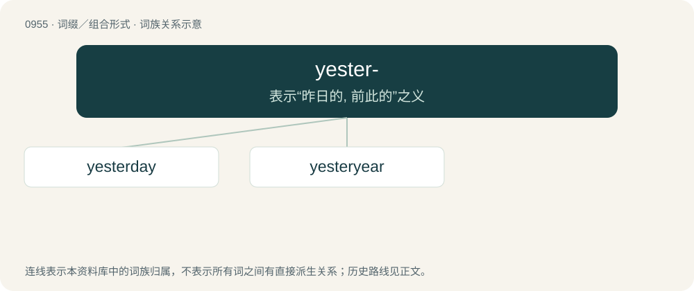

# 1029 · yester- — 表示“昨日的, 前此的”之义

[总目录](../00_总目录_按常用程度.md)

**类型**：词缀／组合形式　｜　**来源语言**：见词源记录

## 核心含义与来源

- 核心含义：表示“昨日的, 前此的”之义
- 英文含义：Belonging to the day preceding the present; next before the present.
- 词形：yester-

**来源记录 1**（前缀／前置成分；Belonging to the day preceding the present; next before the present.）

From Middle English yester-, yister-, from Old English ġeostran-, ġiestran- (“previous day, prior day”), from Proto-West Germanic \*gesteran, from Proto-Germanic \*gesteraz (“yesterday”), from Proto-Indo-European \*dʰǵʰyés (“yesterday”). Compare Dutch gisteren, German gestern (“yesterday”), Gothic 𐌲𐌹𐍃𐍄𐍂𐌰𐌳𐌰𐌲𐌹𐍃 (gistradagis, “tomorrow”), Latin hesternus (“of yesterday”), Ancient Greek χθές (khthés, “yesterday”), Sanskrit ह्यस् (hyás, “yesterday”). More at yesterday.

## 词族图

## 单词速览（常用到不常用）

| 单词 | 音标 | 释义 |
|---|---|---|
| [yesterday](#w-1) | 英 /ˈjɛstədeɪ/；美 /ˈjɛstɹdeɪ/ | n. 昨天；adv. 昨天 |
| [yesteryear](#w-2) | 英 /ˈjɛstəjɪə/；美 /ˈjɛstəɹˌjɪ(ə)ɹ/ | n. 去年, 不久以前；adv. 过去不久的岁月 |

## 逐词详解

### 1. yesterday

**词性**：名词　｜　**音标**：英 /ˈjɛstədeɪ/；美 /ˈjɛstɹdeɪ/

**中文释义**：n. 昨天；adv. 昨天

**英文义项**：The day immediately before today; one day ago. / The past, often in terms of being outdated.

**构词拆分**：by surface analysis, yester- + day

**词源与演化**：

From Middle English yesterday, yisterday, ȝesterdai, ȝisterdai, from Old English ġiestrandæġ, ġister dæġ, ġestor dæġ, ġeostran dæġ (“yesterday”), by surface analysis, yester- + day. Cognate with Scots yisterday, yesterday (“yesterday”), Saterland Frisian jässendeeg, järsendeges (“yesterday”, adverb), West Frisian justerdei (“yesterday”), Dutch gisterdag (“yesterday”), dialectal German gestertag (“yesterday”), Swedish gårdag (“yesterday”), Gothic 𐌲𐌹𐍃𐍄𐍂𐌰𐌳𐌰𐌲𐌹𐍃 (gistradagis, “tomorrow”, adverb). Compare further Dutch gisteren (“yesterday”), German gestern (“yesterday”).

**例句**：

> Yesterday was rainy, but by this morning it had begun to snow.

该用例对应义项：The day immediately before today; one day ago.

### 2. yesteryear

**词性**：名词　｜　**音标**：英 /ˈjɛstəjɪə/；美 /ˈjɛstəɹˌjɪ(ə)ɹ/

**中文释义**：n. 去年, 不久以前；adv. 过去不久的岁月

**英文义项**：Past years; time gone by; yore. / Last year.

**构词拆分**：yester- + year

**词源与演化**：

From yester- + year.

**例句**：

> "One should not give an offering without anything else", says a Kabyle proverb of yesteryear.
