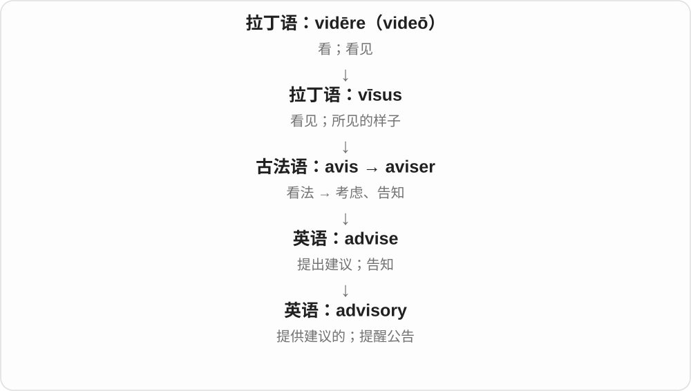
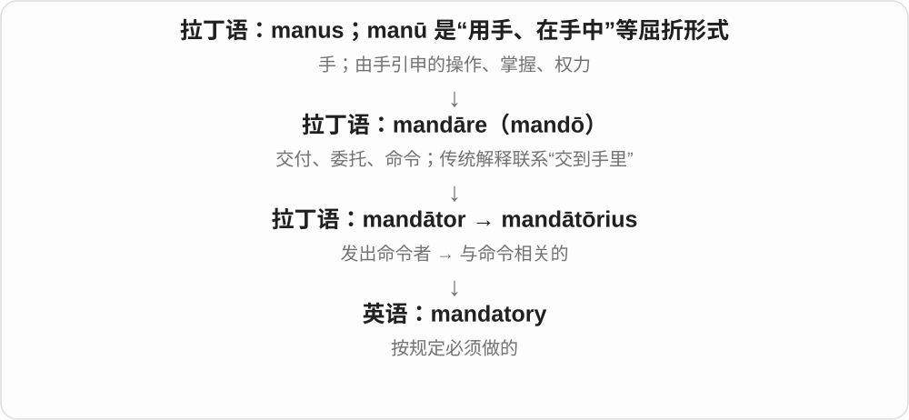
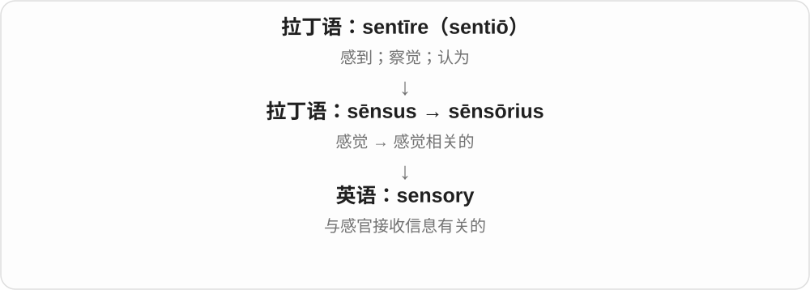
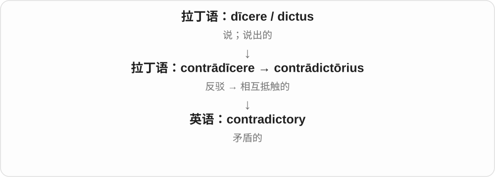
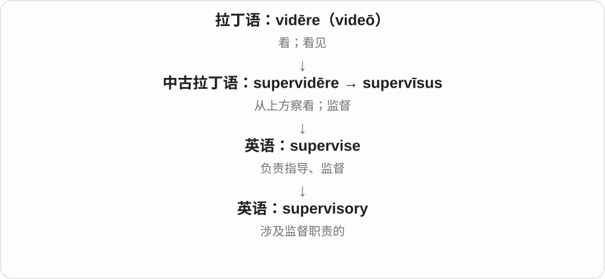
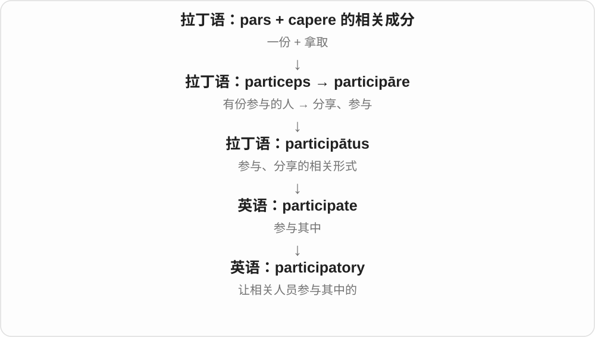

# 1053 · -ory — 与某动作、功能、性质有关的〔常见形容词材料〕

[逐词精讲目录](../00_逐词精讲目录.md) · [总目录](../00_总目录_按常用程度.md)

## 核心词根与来源

常见形容词 -ory 接拉丁 -orius 等历史材料，常与动词词干、分词词干相连，也有完整借词。不能见到结尾就一律翻成一个做某事的地方。

**ORY：把一件事变成作用、性质或关系来修饰别的东西**

exposition 把事讲开，expository writing 就是说明性的写作；retaliatory action 则把行动标明为回击、报复性质。

- **回击与解释、揭示**：retaliate · retaliatory；exposition · expository；reveal · revelation · revelatory
- **体验、运动和作用**：hallucinate · hallucinatory；vibrate · vibratory；stimulate · stimulatory
- **规定、感官与关系**：advisory · mandatory · statutory · sensory · contradictory · discriminatory · supervisory · derogatory
- **其他已有常用形容词**：migratory · participatory · celebratory · inhibitory · congratulatory · investigatory · anticipatory · exculpatory

## 词形与演化规律

retaliate ↔ retaliatory；exposit-／exposition ↔ expository；revelat-／revelation ↔ revelatory；hallucinate ↔ hallucinatory；vibrate ↔ vibratory；stimulate ↔ stimulatory。对应是帮助读词，具体借入史仍看各词。

## 单词速览（按词族由简到繁）

同一基础词的相关扩展放在一起，先读基础形式，再读扩展；各组之间优先读常用的。具体词源关系见各词讲解。

| 单词 | 音标 | 核心意思 |
|---|---|---|
| [reveal](#w-24) | /rɪˈviːl/ | 揭示；透露；显露 |
| [revelatory](#w-17) | 英 /ˌrevəˈleɪtəri/；美 /ˈrevələtɔːri/ 等读法 | 揭示性的；使人获得新认识的 |
| [advisory](#w-1) | 英 /ədˈvaɪzəri/；美 /ədˈvaɪzəri/ | 咨询的；提供建议的；公告、提示 |
| [mandatory](#w-2) | 英 /ˈmændətəri/；美 /ˈmændəˌtɔːri/ | 强制的；必须遵守的 |
| [expose](#w-25) | 英 /ɪkˈspəʊz/；美 /ɪkˈspoʊz/ | 使暴露；揭露；让接触 |
| [exposition](#w-28) | 英 /ˌekspəˈzɪʃən/；美 /ˌekspəˈzɪʃən/ | 阐述、讲解；〔故事〕背景交代；博览会 |
| [expository](#w-16) | 英 /ɪkˈspɒzɪtəri/；美 /ɪkˈspɑːzətɔːri/ | 说明性的；阐释性的 |
| [revelation](#w-26) | /ˌrevəˈleɪʃən/ | 揭露；惊人的发现；启示 |
| [statutory](#w-3) | 英 /ˈstætʃətri/；美 /ˈstætʃətɔːri/ | 法定的；由成文法规定的 |
| [sensory](#w-4) | 英 /ˈsensəri/；美 /ˈsensəri/ | 感官的；感觉系统的 |
| [stimulate](#w-27) | 英 /ˈstɪmjʊleɪt/；美 /ˈstɪmjəleɪt/ | 刺激；激发；促进 |
| [stimulatory](#w-22) | 英 /ˈstɪmjʊlətəri/；美 /ˈstɪmjələtɔːri/ | 起刺激、促进作用的 |
| [contradictory](#w-5) | 英 /ˌkɒntrəˈdɪktəri/；美 /ˌkɑːntrəˈdɪktəri/ | 互相矛盾的 |
| [discriminatory](#w-6) | 英 /dɪˈskrɪmɪnətəri/；美 /dɪˈskrɪmɪnətɔːri/ | 歧视性的、带不公平区别待遇的 |
| [supervisory](#w-7) | 英 /ˌsuːpəˈvaɪzəri/；美 /ˌsuːpərˈvaɪzəri/ | 监督的；管理的 |
| [derogatory](#w-8) | 英 /dɪˈrɒɡətri/；美 /dɪˈrɑːɡətɔːri/ | 贬损的；侮辱性的 |
| [migratory](#w-9) | 英 /ˈmaɪɡrətri/，亦 /maɪˈɡreɪtəri/；美 /ˈmaɪɡrətɔːri/ | 迁徙的；迁移性的 |
| [participatory](#w-10) | 英 /pɑːˈtɪsɪpətəri/；美 /pɑːrˈtɪsəpətɔːri/ | 鼓励共同参与的；参与式的 |
| [retaliate](#w-29) | /rɪˈtælieɪt/ | 报复、反击 |
| [retaliatory](#w-13) | 英 /rɪˈtæliətri/；美 /rɪˈtæliətɔːri/ | 报复性的；反击性的 |
| [celebratory](#w-11) | 英 /ˌselɪˈbreɪtəri/；美 /ˈseləbrətɔːri/ | 庆祝的、带庆祝气氛的 |
| [vibrate](#w-30) | /vaɪˈbreɪt/ | 振动、震动；使振动 |
| [vibratory](#w-20) | 英 /ˈvaɪbrətəri/；美 /ˈvaɪbrətɔːri/ | 振动的；能引起或依靠振动的 |
| [inhibitory](#w-12) | 英 /ɪnˈhɪbɪtəri/；美 /ɪnˈhɪbɪtɔːri/ | 起抑制作用的；抑制性的 |
| [congratulatory](#w-14) | 英 /kənˌɡrætʃəˈleɪtəri/；美 /kənˈɡrætʃələˌtɔːri/ | 祝贺的；道喜的 |
| [investigatory](#w-15) | 英 /ɪnˈvestɪɡətəri/；美 /ɪnˈvestɪɡətɔːri/ | 用于调查的；调查性的〔正式〕 |
| [expound](#w-31) | 英、美 /ɪkˈspaʊnd/ | 详细阐述；解释 |
| [anticipatory](#w-18) | 英 /ænˌtɪsɪˈpeɪtəri/；美 /ænˈtɪsəpətɔːri/ | 预期性的；提前作出的 |
| [hallucinate](#w-32) | /həˈluːsɪneɪt/ | 产生幻觉；感知到并不存在的事物 |
| [hallucinatory](#w-19) | 英 /həˈluːsɪnətəri/；美 /həˈluːsɪnətɔːri/ | 幻觉般的；与幻觉有关或引发幻觉的 |
| [exculpatory](#w-21) | 英 /ɪkˈskʌlpətəri/；美 /ekˈskʌlpəˌtɔːri/ | 有助于证明无责的；开脱责任的 |

## 逐词讲解

### 1. reveal — 揭示；透露；显露

**音标**：/rɪˈviːl/

**先抓住这个画面**

把幕布拉开，原来藏在后面的东西终于能被看见。

**怎么拆**

经古法语 reveler 接拉丁 revelare，由 re- 与 velare 遮盖组成；这里 re- 有撤回遮盖、转为相反状态的作用，不是再盖一次。

**怎么变成今天的意思**

**拉丁 velum**  
帷幕；遮盖物；帆

↓

**拉丁 velare → re- + velare → revelare**  
盖住 → 撤去遮盖、揭示

↓

**古法语 reveler → 英语 reveal**  
使隐藏的东西显现

reveal a secret 是透露秘密；the test revealed a problem 是检查让问题显现；a smile revealed her relief 是笑容流露出她松了口气。未必有人故意公开，也可能是线索自然显示。

**常见搭配与例句**

reveal something to someone；reveal that；reveal how；reveal a problem。

> The scan revealed a crack inside the metal part.

扫描显示，金属零件内部有一条裂缝。

> She refused to reveal the ending of the story.

她不肯透露故事的结局。

**别混淆**

reveal 着眼于原先不知道或看不见的东西变得可知；show 范围更广。revel 是狂欢，别把这个近似拼写词当同一词族。

### 2. revelatory — 揭示性的；使人获得新认识的

**音标**：英 /ˌrevəˈleɪtəri/；美 /ˈrevələtɔːri/ 等读法

**先抓住这个画面**

读完访谈，原来不明白的背景突然亮了：啊，原来是这样。这样的内容可叫 revelatory。

**怎么拆**

借拉丁 revelatorius 一类形容词，接揭开、显露的 reveal／revelation 词族历史，可见 revelat- + -ory。这里不属于 revel 狂欢的来源。

**怎么变成今天的意思**

**拉丁揭示词族与 revelatorius**  
揭开、使人看见真相或内容

↓

**英语 revelatory**  
让人知道此前不明白的东西

a revelatory interview 让人获得新认识的访谈；a revelatory insight 有启发、揭示作用的洞见。可以来自重要新事实，也可只是让读者换个角度看清。

**常见搭配与例句**

a revelatory account；a revelatory insight。

> The interview was revelatory about her early career.

这次访谈让人对她的早期职业经历有了新的了解。

> The comparison provided a revelatory insight into the two designs.

这番比较让人看清了两种设计中此前没注意到的差别。

**别混淆**

revelatory 强调揭示、带来认识，revolutionary 革命性的强调巨大改变；两者都可能让人惊讶，但不是一回事。

### 3. advisory — 咨询的；提供建议的；公告、提示

**音标**：英 /ədˈvaɪzəri/；美 /ədˈvaɪzəri/

**先抓住这个画面**

advisory 像旁边有人给你提供意见，但是否执行还要看谁有决定权；名词还可以是一则提醒。

**怎么拆**

advise + -ory，表示与建议、告知有关。

**怎么变成今天的意思**

an advisory role 主要提供意见；a travel advisory 则是有关出行情况的正式提示。

**常见搭配与例句**

an advisory committee；an advisory role；a travel advisory。

> She serves in an advisory role on the project.

她在项目中担任顾问角色。

> The university issued an advisory about the road closure.

大学发布了有关道路封闭的提示。

**别混淆**

advisory 意见通常与命令有区别，但具体公告的作用仍要看内容，不能只凭这个词断言没有约束。

### 4. mandatory — 强制的；必须遵守的

**音标**：英 /ˈmændətəri/；美 /ˈmændəˌtɔːri/

**先抓住这个画面**

mandatory 像事项旁盖上“必须”的印章：它不是建议，而是规则要求你做。

**怎么拆**

来自晚期拉丁 mandātōrius，联系 mandātor“发令者”和 mandāre；现代可联想 mandate + -ory。

**怎么变成今天的意思**

a mandatory course 是必修课；mandatory attendance 是要求出席。历史文本也有委任统治相关名词义。

**常见搭配与例句**

mandatory training；mandatory attendance；a mandatory requirement。

> Attendance at the safety briefing is mandatory.

安全说明会必须参加。

> The form marks mandatory fields with an asterisk.

表格用星号标出必填项。

**别混淆**

recommended 表示建议采用；mandatory 表示规则要求执行。

### 5. expose — 使暴露；揭露；让接触

**音标**：英 /ɪkˈspəʊz/；美 /ɪkˈspoʊz/

**先抓住这个画面**

把盖子掀开，让原本受保护或被藏住的东西显露出来。

**怎么拆**

经法语 exposer 借入；对应拉丁 ex-“出去” + pōnere 的 expōnere，但词形受 poser〔源于 pausāre〕替换影响。

**怎么变成今天的意思**

**晚期拉丁 pausāre → 古法语 poser**  
使停下、使安放 → 放置

↓

**拉丁 pōnere 及其复合词的影响**  
相似词形和“放置”意义交汇；不是单纯直系音变

↓

**古法语 exposer → 中古英语 exposen → 英语 expose**  
对应拉丁 expōnere“放到外面、展示”的意义

可以把皮肤暴露在阳光下，把谎言揭穿，也可以让学生接触新思想。不是每次 expose 都有羞耻或危险意味。

**常见搭配与例句**

expose something to；expose a lie；be exposed to。

> Removing the panel exposed the wires underneath.

取下盖板后，下面的电线露了出来。

> The course exposes students to different ways of thinking.

这门课程让学生接触不同的思考方式。

**别混淆**

reveal 偏揭示信息；expose 还突出失去遮蔽、直接接触外界。

### 6. exposition — 阐述、讲解；〔故事〕背景交代；博览会

**音标**：英 /ˌekspəˈzɪʃən/；美 /ˌekspəˈzɪʃən/

**先抓住这个画面**

把原先叠着、藏着的信息一层层铺开，让别人看明白；一场博览会则把作品、产品摆出来供公众看。

**怎么拆**

经法语 exposition 接拉丁 expositio，来自 exponere 放出来、陈列的 exposit- 词干：ex- 向外 + ponere 放。和 expound、expose 有共同历史材料，不是 exit 出口加 position。

**怎么变成今天的意思**

**拉丁 exponere → expositio → 法语 exposition**  
放出来、陈列 → 说明、展示

↓

**英语 exposition**  
阐述；背景交代；大型展示活动

a clear exposition of the theory 清楚阐述理论；opening exposition 故事开头的背景交代；a world exposition 世界博览会。看是在讲信息还是实际展览活动。

**常见搭配与例句**

an exposition of；a trade exposition。

> The book offers a clear exposition of the main ideas.

这本书清楚阐述了主要观点。

> The film handles the necessary exposition through a short conversation.

影片通过一段简短对话交代了必要背景。

**别混淆**

exhibition 常说展览，exposition 还常说详细讲解、叙事交代；exposure 暴露、接触等名词和它同族，但现代用法不能互换。

### 7. expository — 说明性的；阐释性的

**音标**：英 /ɪkˈspɒzɪtəri/；美 /ɪkˈspɑːzətɔːri/

**先抓住这个画面**

写作目标是把一个概念讲明白，按步骤、定义、原因铺开，常叫 expository writing。

**怎么拆**

接中世纪拉丁 expositorius，来自拉丁 exponere 陈述、摆出的 exposit- 词干；与 exposition 词族对应 -ory 形容词材料。不是英语 expose 原封不动加 story。

**怎么变成今天的意思**

**拉丁 exponere／exposit- → expositorius**  
摆出、陈述 → 说明性的

↓

**英语 expository**  
以说明、解释为目的的

an expository essay 说明性文章；expository passages 解释背景、知识的段落。也可用于宗教、学术讲解，重点是展开说明。

**常见搭配与例句**

expository writing；an expository essay。

> The students wrote expository essays about local history.

学生们写了介绍地方历史的说明文。

> An expository paragraph explains how the process works.

一个说明性段落解释了这个过程如何运作。

**别混淆**

expository 常强调解释清楚，persuasive 强调说服读者接受主张，narrative 强调叙述事件；一篇文章可以混用多种方式。

### 8. revelation — 揭露；惊人的发现；启示

**音标**：/ˌrevəˈleɪʃən/

**先抓住这个画面**

幕布掀开之后，你得知一件原先完全不知道的事，甚至重新看待整件事情。

**怎么拆**

经古法语 revelacion 或直接来自拉丁 revelatio，接 revelare 揭开；英语名词的记录早于 reveal，不能画成英语动词派生出它。

**怎么变成今天的意思**

**拉丁 velum**  
帷幕；遮盖物；帆

↓

**拉丁 revelare → revelatio**  
揭开 → 揭示、披露

↓

**古法语 revelacion／拉丁语 → 英语 revelation**  
启示；事实的披露或惊人发现

a shocking revelation 是令人震惊的内幕或发现；the trip was a revelation 是这次旅行让人眼界大开。宗教中的 revelation 指启示，大写 Revelation 也用作《启示录》的书名。

**常见搭配与例句**

a revelation about；a revelation that；a shocking revelation；come as a revelation。

> The revelation that the two letters had the same author changed the investigation.

两封信出自同一人之手这一发现，改变了调查方向。

> Hearing her play the piano was a revelation.

听到她弹钢琴，我才惊喜地发现她有这样的才华。

**别混淆**

revelation 不一定是坏消息或丑闻。发现一个熟悉的人原来有惊人才能，也可以说 it was a revelation。

### 9. statutory — 法定的；由成文法规定的

**音标**：英 /ˈstætʃətri/；美 /ˈstætʃətɔːri/

**先抓住这个画面**

之所以必须这样做，是因为相关法律明文规定了。

**怎么拆**

statute + -ory；去末尾不发音的 e 后接后缀。不是 statue“雕像”的形容词。

**怎么变成今天的意思**

**拉丁 stare → statuere**  
站立 → 使站稳、设立、安排

↓

**拉丁 statutum → 古法语 statut / estatut → 英语 statute**  
已经确立的规定 → 成文法规

↓

**英语 statute + -ory → statutory**  
成文法规 → 由法规要求或授权的

a statutory duty 是法定义务；a statutory body 是依法设立或获得法定权力的机构。读到这个词，重点是法律依据，不是某个单位自愿答应。

**常见搭配与例句**

a statutory duty；a statutory requirement；a statutory body。

> The authority has a statutory duty to publish an annual report.

该机构负有发布年度报告的法定义务。

> The guide explains the statutory requirements for registration.

指南说明了登记所需满足的法定要求。

**别混淆**

mandatory 只说强制要求，来源也可能是单位规则；statutory 特别指出成文法依据。

### 10. sensory — 感官的；感觉系统的

**音标**：英 /ˈsensəri/；美 /ˈsensəri/

**先抓住这个画面**

这不是评价人聪不聪明，而是标记信息从感觉通道进入：看到、听到、摸到等。

**怎么拆**

来自拉丁语 sēnsōrius，与 sēnsus“感觉”相连；现代可用 sense 与 -ory 帮助记忆，但英语 sense 不是这条借入链的必经祖先。

**怎么变成今天的意思**

常修饰 information、experience、system。sensory experience 可把光线、声音、味道等一起考虑。

**常见搭配与例句**

sensory information；sensory experience；sensory input。

> The exhibition offers a rich sensory experience.

这场展览提供了丰富的感官体验。

> The brain combines sensory information from different sources.

大脑把不同来源的感觉信息结合起来。

**别混淆**

sensory 说明属于感官领域；sensitive 说明容易察觉或受到影响。sensory system 不等于这个系统一定特别灵敏。

### 11. stimulate — 刺激；激发；促进

**音标**：英 /ˈstɪmjʊleɪt/；美 /ˈstɪmjəleɪt/

**先抓住这个画面**

给原本不够活跃的东西一点推动，让兴趣、思考或活动开始加强。

**怎么拆**

从拉丁 stimulare 催动、刺激的分词 stimulatus 借来；远处的画面是用尖棒轻刺、催促前进。

**怎么变成今天的意思**

**拉丁 stimulus 尖棒、赶牲口的刺棒**  
由戳一下催动，引申为促使行动

↓

**拉丁 stimulare → 分词 stimulatus → 英语 stimulate**  
催动、激发，使活动增强

stimulate interest 是激起兴趣，stimulate growth 是促进增长，stimulate a nerve 是刺激神经。它不一定使人感到兴奋，也不保证结果都是好的。

**常见搭配与例句**

stimulate interest；stimulate discussion；stimulate growth；stimulate the economy。

> The unusual opening question stimulated a lively discussion.

那个不寻常的开场问题激起了一场热烈讨论。

> The new grants are intended to stimulate research in the field.

这些新拨款旨在促进这一领域的研究。

**别混淆**

encourage 常强调鼓励或有利条件；stimulate 更像施加一个能引起反应、增加活动的刺激。

### 12. stimulatory — 起刺激、促进作用的

**音标**：英 /ˈstɪmjʊlətəri/；美 /ˈstɪmjələtɔːri/

**先抓住这个画面**

某个因素像推了一把，让活动、反应或增长更容易起来，可以说有 stimulatory effect。

**怎么拆**

stimulate 的词干 + -ory，远接拉丁 stimulus 刺、驱策工具与相关动词材料。这里 -ory 形成作用性质的形容词，不是一个存放刺激物的房间。

**怎么变成今天的意思**

**stimulate／拉丁 stimulus 词族**  
促动、刺激、推动反应

↓

**stimulat- + -ory → stimulatory**  
起刺激、促进作用的

a stimulatory effect 促进作用；a stimulatory response 相应促动反应，常见于研究、政策等正式文字。实际促进哪一项、多少，需要上下文交代。

**常见搭配与例句**

a stimulatory effect on；stimulatory signals。

> The report discusses the policy’s stimulatory effect on demand.

报告讨论了政策对需求的促进作用。

> The experiment compared stimulatory and inhibitory signals.

实验比较了促进性信号与抑制性信号。

**别混淆**

stimulating 可形容让人觉得有趣、动脑的经历；stimulatory 更常是正式说明某因素具有促进、刺激作用，两者不在所有场合互换。

### 13. contradictory — 互相矛盾的

**音标**：英 /ˌkɒntrəˈdɪktəri/；美 /ˌkɑːntrəˈdɪktəri/

**先抓住这个画面**

你听到两套说法，一套往东，一套往西，没法同时照单全收。这些说法就是 contradictory。

**怎么拆**

来自拉丁语 contrādictōrius；现代也可分析为 contradict + -ory，表示具有抵触性质。

**怎么变成今天的意思**

它用来形容信息、命令、证据甚至感受之间的冲突。描述人时也可能指爱唱反调，但常见搭配仍围绕不一致的信息。

**常见搭配与例句**

contradictory statements；contradictory evidence；mutually contradictory。

> We received contradictory instructions from two managers.

两位经理给了我们相互矛盾的指示。

> The witness gave contradictory accounts of the same event.

证人对同一事件作出了相互矛盾的叙述。

**别混淆**

confusing 只说让人困惑；contradictory 指其中有实质冲突，因而可能让人困惑。

### 14. discriminatory — 歧视性的、带不公平区别待遇的

**音标**：英 /dɪˈskrɪmɪnətəri/；美 /dɪˈskrɪmɪnətɔːri/

**先抓住这个画面**

不是仅有分辨能力，而是某条规则、做法按群体身份给不同人不利待遇；现代最常先遇见这种批评。

**怎么拆**

对应 discriminate + -ory，表示相关性质。更广的与区分有关的技术用法存在，日常社会语境通常说歧视性的。

**怎么变成今天的意思**

**拉丁 discernere → discrīmen / discrīmināre**  
分开、辨别 → 区别、作区分

↓

**拉丁相应形式 → 英语 discriminate/discrimination**  
辨别；按群体特征作不利区别对待

↓

**性质与否定形式**  
discriminatory 歧视性的；indiscriminate 不加分辨的

↓

**discriminate + -ory → discriminatory**  
与区别对待有关 → 常指带偏见的

a discriminatory policy 歧视性政策，discriminatory practices 歧视做法，discriminatory language 带歧视的语言。

**常见搭配与例句**

a discriminatory policy；discriminatory practices；discriminatory language。

> The review identified several discriminatory practices.

审查发现了几种歧视性做法。

> They revised the notice to remove discriminatory language.

他们修改告示，删除带歧视的措辞。

**别混淆**

discriminating 可正面说眼光好、善辨别；discriminatory 在谈人和规则时多负面。不要把 discerning taste 的赞美写成歧视。

### 15. supervisory — 监督的；管理的

**音标**：英 /ˌsuːpəˈvaɪzəri/；美 /ˌsuːpərˈvaɪzəri/

**先抓住这个画面**

supervisory 说明岗位或任务含有看管、指导别人的责任，不只是完成自己的那一份。

**怎么拆**

supervise + -ory，变成描述监督职责的形容词。

**怎么变成今天的意思**

它经常与 role、position、responsibility 连用，把工作性质说清楚。

**常见搭配与例句**

a supervisory role；supervisory duties；supervisory experience。

> She moved into a supervisory position last year.

她去年转到了管理岗位。

> The job requires some supervisory experience.

这个职位要求有一定的管理经验。

**别混淆**

supervisory 是职责性质；supervised 是处在别人监督之下，方向相反。

### 16. derogatory — 贬损的；侮辱性的

**音标**：英 /dɪˈrɒɡətri/；美 /dɪˈrɑːɡətɔːri/

**先抓住这个画面**

一句话不是在指出具体问题，而是在把一个人或群体的价值往下压。

**怎么拆**

来自后期拉丁语 derogatorius，基于 derogare“削减、部分废除”，含 de-“拿走”与 rogare“提议、请求”。先有削减权利、地位的意思，再指贬损声誉。

**怎么变成今天的意思**

**拉丁语 de-**  
离开、向下；也可加强动作或表示解除

↓

**拉丁语 rogare → derogare / derogatus**  
提议、请求 → 削减、减损

↓

**后期拉丁语 derogatorius → 英语 derogatory**  
减损地位 → 说话贬低、侮辱

词典标 derogatory，通常提醒这个称呼带贬低态度；即使说话者声称在开玩笑，也不能自动消除其贬损意味。

**常见搭配与例句**

a derogatory remark；a derogatory term；derogatory comments about。

> The editor removed a derogatory remark about the actor’s appearance.

编辑删去了一句贬损演员外貌的话。

> The dictionary labels the term as derogatory.

词典把这个称呼标为贬义。

**别混淆**

critical 可以是有依据的批评；derogatory 更突出贬低、损害尊严的态度。

### 17. migratory — 迁徙的；迁移性的

**音标**：英 /ˈmaɪɡrətri/，亦 /maɪˈɡreɪtəri/；美 /ˈmaɪɡrətɔːri/

**先抓住这个画面**

按季节或生存需要换地方活动，而不是总待在同一区域。

**怎么拆**

接拉丁 migrat- 词干与 -ory 一系，也可联系拉丁 migratorius；现代与 migrate 对应，描述迁徙习性或过程。

**怎么变成今天的意思**

**拉丁语 migrare**  
从一处迁到另一处

↓

**拉丁语 migrat- 词干与 -ory 一系 → 英语 migratory**  
迁移 → 迁徙的、与迁移有关的

migratory birds 是候鸟；migratory routes 是迁徙路线。也可用于工作人口等流动现象，不能只等同于“会飞的”。同一种动物的不同种群可能有不同迁徙习性。

**常见搭配与例句**

migratory birds；migratory routes；migratory behaviour。

> The island provides shelter for migratory birds.

这座岛为候鸟提供了栖息处。

> Researchers mapped the animals’ migratory routes.

研究人员绘制了这些动物的迁徙路线。

**别混淆**

mobile 只说能移动；migratory 常说有迁移、迁徙习性或规律，不是每次挪动都算迁徙。

### 18. participatory — 鼓励共同参与的；参与式的

**音标**：英 /pɑːˈtɪsɪpətəri/；美 /pɑːrˈtɪsəpətɔːri/

**先抓住这个画面**

规则不把大家只当观众，而是留出位置，让他们一起讨论、决定或制作。

**怎么拆**

participate 的词干 + -ory，表示具有参与性质。

**怎么变成今天的意思**

它通常形容一种方法、制度或活动安排。participatory design 要让实际使用者加入设计过程。

**常见搭配与例句**

participatory design；a participatory approach；participatory democracy。

> The team used a participatory approach to redesign the park.

团队让相关居民共同参与公园改造。

> The workshop includes several participatory activities.

工作坊安排了几项需要大家动手参与的活动。

**别混淆**

participating 描述某个主体正在参与；participatory 描述活动或制度把参与放在重要位置。

### 19. retaliate — 报复、反击

**音标**：/rɪˈtælieɪt/

**先抓住这个画面**

别人先伤害或打压你，你又用行动还回去，这个回击是 retaliate。它解释回应关系，不自动替行为判对错。

**怎么拆**

接拉丁 retaliatus，来自 retaliare；re- 回、还与 talio 对等回报、报复的材料相连，后接动词形式。

**怎么变成今天的意思**

**拉丁 re- 回、还 + talio 对等回报的材料 → retaliare**  
把对方的行为还回去

↓

**retaliatus、retaliatio 等 → retaliate、retaliation**  
因先前伤害而报复；报复行为

retaliate against someone 报复某人；retaliate for an attack 因袭击而报复；retaliate by doing 用某种行动反击。

**常见搭配与例句**

retaliate against；retaliate for；retaliate by doing。

> She refused to retaliate after the insult.

受到侮辱后，她拒绝报复。

> The company retaliated by cancelling the contract.

公司以取消合同作为反击。

**别混淆**

retaliate 含有对先前伤害的回应；attack 只是攻击，不一定是回击。回应也可能加重冲突。

### 20. retaliatory — 报复性的；反击性的

**音标**：英 /rɪˈtæliətri/；美 /rɪˈtæliətɔːri/

**先抓住这个画面**

不是先做一次行动，而是因为对方先动手、先伤害自己，回过头还击；这个回击性质就是 retaliatory。

**怎么拆**

retaliate 的词干 + -ory，远接拉丁相应回报、报复材料。re- 在这条历史里有回返关系，但具体词义不是随便把任何动作再做一次。

**怎么变成今天的意思**

**retaliate**  
针对前面行为作出还击

↓

**retaliat- + -ory → retaliatory**  
报复、还击性质的

retaliatory action 报复行动；a retaliatory measure 反击措施。常见于冲突、政策等叙述，语义包含对前事的反应，不替代正当与否的具体判断。

**常见搭配与例句**

a retaliatory move；retaliatory action。

> Both sides wanted to avoid a cycle of retaliatory actions.

双方都想避免陷入相互报复的循环。

> The manager denied that the schedule change was retaliatory.

经理否认调整排班是出于报复。

**别混淆**

retaliatory 是回击性质，preventive 预防性的把重点放在事前防止；任何发生较晚的行动也不一定就是 retaliatory。

### 21. celebratory — 庆祝的、带庆祝气氛的

**音标**：英 /ˌselɪˈbreɪtəri/；美 /ˈseləbrətɔːri/

**先抓住这个画面**

一顿饭、一种语气、一阵掌声带着终于成了、值得高兴的庆祝意味，不只是普通活动。

**怎么拆**

celebrate 对应 -ory 形成形容词，表示庆祝性质。词尾不是表示历史的 story，英美重音存在不同常用读法。

**怎么变成今天的意思**

**拉丁 celeber → celebrāre、celebrātus → celebrate**  
人多、著名等 → 聚集纪念、赞颂、庆祝

↓

**celebrate 对应 -ory → celebratory**  
带庆祝性质、气氛的

a celebratory dinner 庆祝聚餐，a celebratory mood 庆祝心情，a celebratory drink 庆祝时喝的一杯。

**常见搭配与例句**

a celebratory dinner；a celebratory mood；a celebratory atmosphere。

> They went out for a celebratory dinner.

他们出去聚餐庆祝。

> The room had a celebratory atmosphere.

屋里充满庆祝气氛。

**别混淆**

celebratory 形容庆祝性质，celebration 名词；a celebratory dinner 不是某个名人 celebrity 专用晚餐。

### 22. vibrate — 振动、震动；使振动

**音标**：/vaɪˈbreɪt/

**先抓住这个画面**

手机在桌上嗡嗡响，琴弦在原位快速来回动，都是 vibrate。重点是反复的小幅运动，不是整个东西一路搬走。

**怎么拆**

接拉丁 vibratus，来自 vibrare 摇动、挥动，现代 -ate 形成动词形；与 vibrant 同族，但用法不同。

**怎么变成今天的意思**

**拉丁 vibrare 摇动、挥动 → vibratus、vibratio**  
快速来回运动及相应活动名词

↓

**英语 vibrate、vibration**  
振动；可感到的震动

a phone vibrates 手机振动；a vibrating string 振动的琴弦；vibrate with excitement 可形容兴奋得颤动。

**常见搭配与例句**

vibrate gently；a vibrating string；a phone vibrates。

> My phone vibrated in my pocket.

手机在我口袋里振动了。

> The strings vibrate when you play the instrument.

演奏这件乐器时，琴弦会振动。

**别混淆**

vibrate 是运动过程，vibrant 常说充满活力；a vibrant city 不是整座城市一直物理震动。

### 23. vibratory — 振动的；能引起或依靠振动的

**音标**：英 /ˈvaɪbrətəri/；美 /ˈvaɪbrətɔːri/

**先抓住这个画面**

不是一直朝一个方向走，而是快速来回、上下摆动；用这种运动工作的机器或反馈方式，可叫 vibratory。

**怎么拆**

vibrate 的词干 + -ory，远接拉丁 vibrare 摆动、抖动的材料。与 vibration 振动名词对应，但不是把 vibrator 任何意思都套到所有场景。

**怎么变成今天的意思**

**vibrate／拉丁振动词族**  
来回摆动、抖动

↓

**vibrat- + -ory → vibratory**  
发生、造成或依靠振动的

vibratory motion 振动运动；vibratory feedback 振动反馈；vibratory equipment 振动设备。看修饰的对象是在振动还是用振动产生作用。

**常见搭配与例句**

vibratory motion；vibratory feedback。

> The controller provides vibratory feedback during the game.

游戏过程中，手柄会提供振动反馈。

> The device converts the signal into vibratory motion.

设备把信号转成振动运动。

**别混淆**

vibrant 常说充满活力、色彩鲜明；vibratory 更具体地说振动性质。一个 vibrant city 不等于地面一直振动的城市。

### 24. inhibitory — 起抑制作用的；抑制性的

**音标**：英 /ɪnˈhɪbɪtəri/；美 /ɪnˈhɪbɪtɔːri/

**先抓住这个画面**

某种信号或作用不是推动事情继续，而是在降低它继续发生的可能性，便可说 inhibitory。

**怎么拆**

与 inhibit + -ory 构词对应，也受中世纪拉丁语 inhibītōrius、法语 inhibitoire 一支影响。

**怎么变成今天的意思**

它说作用的方向。神经科学里 inhibitory signal 是降低目标神经元活动倾向的信号；不必等于整个系统停机。

**常见搭配与例句**

an inhibitory effect；an inhibitory signal；inhibitory control。

> The substance had an inhibitory effect on the reaction.

这种物质对反应有抑制作用。

> The diagram marks inhibitory connections in blue.

图中用蓝色标出了抑制性连接。

**别混淆**

inhibitory 是“会起抑制作用的”；inhibited 是“受到抑制的”。一个是作用方向，一个是承受后的状态。

### 25. congratulatory — 祝贺的；道喜的

**音标**：英 /kənˌɡrætʃəˈleɪtəri/；美 /kənˈɡrætʃələˌtɔːri/

**先抓住这个画面**

一封信、一句话或一个拥抱，在向对方传达“你做到了，我替你高兴”。

**怎么拆**

可按 congratulate + -ory 理解；历史记录中形容词早于英语动词，Dictionary.com 给中世纪拉丁 congratulatorius 的借入路线，因此不硬画英语动词先产生它。

**怎么变成今天的意思**

**拉丁 gratus**  
令人喜欢、受欢迎；也指心怀感谢

↓

**拉丁 gratulari**  
表达喜悦、祝贺

↓

**拉丁 con- + gratulari → congratulari**  
一起为喜事高兴、祝贺

↓

**中世纪拉丁 congratulatorius → 英语 congratulatory**  
表达祝贺的；也可按祝贺词干 + -ory 理解

通常修饰 message、letter、speech、hug。语气是为好消息道喜，不是给普通作业作正面评价的通用词。

**常见搭配与例句**

a congratulatory message；congratulatory remarks。

> She received a congratulatory message from her old teacher.

她收到以前老师发来的祝贺信息。

> The captain gave each player a congratulatory hug.

队长拥抱了每位队员，向他们道贺。

**别混淆**

complimentary 赞美优点；congratulatory 针对成就或喜事送上祝贺。

### 26. investigatory — 用于调查的；调查性的〔正式〕

**音标**：英 /ɪnˈvestɪɡətəri/；美 /ɪnˈvestɪɡətɔːri/

**先抓住这个画面**

把调查当作某个机构、程序或行动的任务。

**怎么拆**

investigate 的词干 + -ory“与……有关、用于……的”。

**怎么变成今天的意思**

**拉丁 vestigium**  
脚印、足迹、留下的痕迹

↓

**拉丁 vestigare → in- + vestigare → investigare**  
沿足迹追踪 → 深入查找、调查

↓

**英语 investigate**  
可能由 investigation 逆构，也可能直接接拉丁分词 investigatus

↓

**英语 investigatory**  
以查明事实为目的、与调查有关的

investigatory powers 是为了调查而具有的权限；an investigatory committee 是负责调查的委员会。它在制度和组织语境里比随口聊天更常见。

**常见搭配与例句**

investigatory powers；an investigatory committee；investigatory procedures。

> The committee has limited investigatory powers.

这个委员会的调查权限有限。

> The organisation revised its investigatory procedures.

该组织修订了调查程序。

**别混淆**

investigative 和 investigatory 都能谈调查；常见固定搭配值得整体记，比背一条过硬的中文分界有用。

### 27. expound — 详细阐述；解释

**音标**：英、美 /ɪkˈspaʊnd/

**先抓住这个画面**

把一个想法摊开，一层层说明里面的逻辑。

**怎么拆**

经古法语 espondre 借拉丁 expōnere：ex-“出来” + pōnere“放”；英语词尾 d 是后来的变化，不是独立词根。

**怎么变成今天的意思**

**拉丁语 pōnere；过去分词 positus**  
放、安置；已经放好的

↓

**拉丁 expōnere → 古法语 espondre → 中古英语 expounden**  
摆出来 → 解释、阐明

↓

**英语 expound**  
系统、详细地讲解

expound a theory 可以直接接内容；expound on a topic 也常见。语气比 explain 正式。

**常见搭配与例句**

expound a theory；expound on；expound the meaning of。

> She expounded her theory with three concrete examples.

她用三个具体例子详细阐述了自己的理论。

> The lecturer expounded on the meaning of the passage.

讲师详细解释了这段话的意思。

**别混淆**

propound 是提出主张；expound 是把主张讲清楚。

### 28. anticipatory — 预期性的；提前作出的

**音标**：英 /ænˌtɪsɪˈpeɪtəri/；美 /ænˈtɪsəpətɔːri/

**先抓住这个画面**

针对还没发生的事，身体、情绪或计划先有了反应。

**怎么拆**

英语 anticipate + -ory，形成与预期、准备有关的形容词。词尾是形容词后缀，不是一个独立的 story。

**怎么变成今天的意思**

**拉丁语 ante；古形式 anti-**  
在前面、在……之前

↓

**拉丁语 anticipare → anticipatus**  
anti- 在前 + capere 拿取：事先取得、抢先做

↓

**两种来源分析 → 英语 anticipate**  
借拉丁分词，或由英语更早的 anticipation 逆构

↓

**英语 anticipate + -ory → anticipatory**  
与事先预期、反应或准备有关的

anticipatory planning 是在情况出现前先规划；anticipatory anxiety 则是事情尚未来临，人已经开始担心。它通常出现在较正式的表达里，重点落在反应的时间提前。

**常见搭配与例句**

anticipatory planning；anticipatory action；anticipatory anxiety。

> Anticipatory planning helped the town prepare for the busy holiday season.

提前规划帮助小镇为繁忙的假期作好了准备。

> She felt a surge of anticipatory excitement before the journey.

出发前，她因为期待这次旅行而一阵兴奋。

**别混淆**

anticipated 表示被预计到的，如 anticipated demand；anticipatory 表示这个行动或反应本身是在预先应对。

### 29. hallucinate — 产生幻觉；感知到并不存在的事物

**音标**：/həˈluːsɪneɪt/

**先抓住这个画面**

体验像是真的听见、看见，却没有相应外界来源，这是 hallucinate 的感知画面。它与主动编一个想象故事不同。

**怎么拆**

借拉丁 hallucinatus、alucinatus，来自 alucinari 走神、做梦等材料；现代聚焦幻觉，专业定义比普通想象更具体。

**怎么变成今天的意思**

**拉丁 alucinari、hallucinari 等**  
做梦、走神、误感等旧材料

↓

**英语 hallucinate**  
产生没有对应外部刺激的知觉体验

hallucinate a voice 幻听到声音；begin to hallucinate 开始产生幻觉；AI 语境里也借来形容生成不实内容。

**常见搭配与例句**

begin to hallucinate；hallucinate a voice。

> In the novel, the exhausted traveller begins to hallucinate.

小说里，疲惫的旅人开始产生幻觉。

> She described hallucinating during a high fever.

她描述了高烧时产生幻觉的经历。

**别混淆**

imagine 是想象，通常不必把想象当外界真实知觉；hallucinate 则有感知仿佛真实发生的核心。

### 30. hallucinatory — 幻觉般的；与幻觉有关或引发幻觉的

**音标**：英 /həˈluːsɪnətəri/；美 /həˈluːsɪnətɔːri/

**先抓住这个画面**

灯光、声音、画面像失去现实边界，影评会说 hallucinatory atmosphere；也可在专业文字里描述与幻觉有关的东西。

**怎么拆**

hallucinate 的词干 + -ory，与拉丁 hallucinari 等心神游移、产生错觉的历史材料相关。后缀把它变成性质、作用的形容词。

**怎么变成今天的意思**

**hallucinate 的历史词族**  
心神游移、产生幻觉等

↓

**hallucinat- + -ory → hallucinatory**  
幻觉相关、幻觉般或有相应作用的

a hallucinatory scene 幻觉般的场景；hallucinatory imagery 幻觉式意象。艺术评论里的比喻不等于声称作者或观众发生了具体症状。

**常见搭配与例句**

a hallucinatory atmosphere；hallucinatory imagery。

> The film creates a hallucinatory atmosphere with shifting colours.

影片用不断变化的色彩营造了幻觉般的氛围。

> The novel’s final pages are filled with hallucinatory images.

小说最后几页充满了幻觉般的意象。

**别混淆**

hallucinatory 幻觉般的，imaginary 想象中的，illusory 虚幻、不真实的，侧重点各异；实际发生的表演也可以营造 hallucinatory 效果。

### 31. exculpatory — 有助于证明无责的；开脱责任的

**音标**：英 /ɪkˈskʌlpətəri/；美 /ekˈskʌlpəˌtɔːri/

**先抓住这个画面**

一条信息把“是他干的”这个判断往回拉。

**怎么拆**

英语在 exculpate 的 exculpat- 上接形容词后缀 -ory，表示有解除责备作用的。不要把开头 ex- 当成“前任”。

**怎么变成今天的意思**

**拉丁 culpa**  
过失、责备

↓

**中世纪拉丁 exculpare；exculpat-**  
ex- 去掉 + culpa 责备：解除责任

↓

**英语 exculpate**  
证明无责；为……开脱

↓

**英语 exculpat- + -ory → exculpatory**  
有助于解除责备或责任的

exculpatory evidence 是有利于洗清责任的证据。它可以削弱指控、支持无罪或减轻责任，不必单凭这一条就把所有问题彻底证明完。

**常见搭配与例句**

exculpatory evidence；exculpatory information；potentially exculpatory；an exculpatory statement。

> The investigators found new exculpatory evidence in the phone records.

调查人员在电话记录中发现了新的、有助于洗清责任的证据。

> The timetable was potentially exculpatory because it placed her in another city.

这份时间表可能有助于证明她无责，因为它显示她当时在另一个城市。

**别混淆**

exculpate 是动作，exculpatory 形容证据或陈述的作用。它不是“找借口”的固定贬义词，要看证据是否可靠。

## 这一组要分清什么

expository 说明、解释，不保证是在说服；revelatory 揭示新认识，不等于 revolutionary 巨大变革；vibratory 振动不等于 vibrant 有活力；-ory 不是全都名词场所。

## 串起来练习

The expository chapter offered a revelatory comparison of the two methods.

这一说明性章节通过比较两种方法，让人有了新的认识。
