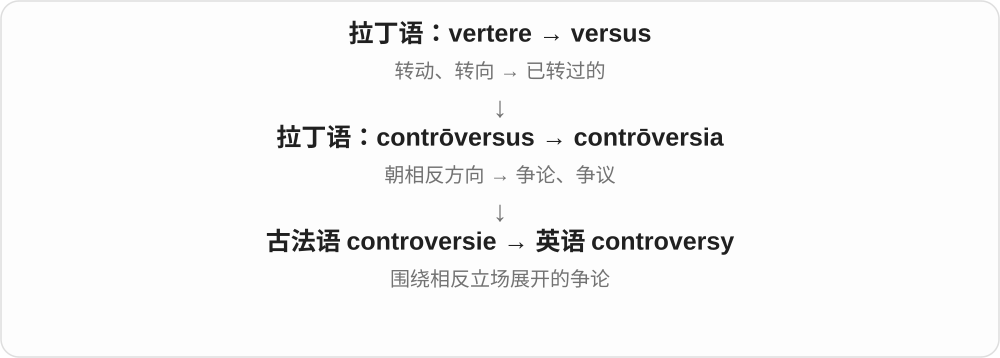
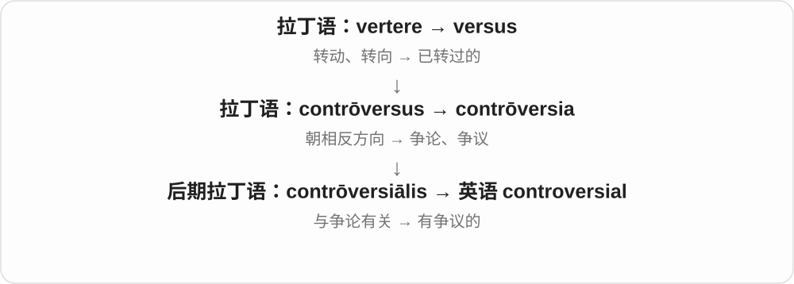
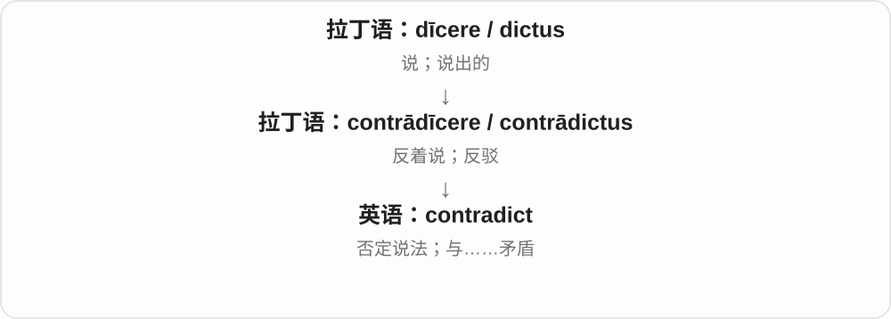
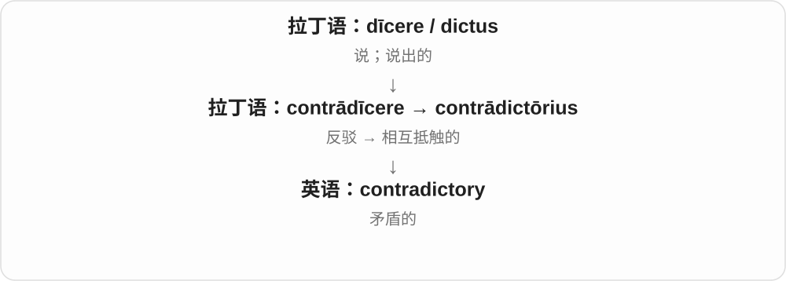

# 1056 · contra- — 对面、相反、反对

[逐词精讲目录](../00_逐词精讲目录.md) · [总目录](../00_总目录_按常用程度.md)

## 核心词根与来源

拉丁 contra 原本表示在对面、相反，也可表示反对。英语中一部分词沿法语、意大利语等路线借入，一部分是现代用 contra- 重新组合；不能把同一词头都想成同一种动作。

**CONTRA = AGAINST, OPPOSITE**

把两个方向相对摆开：话说反了是 contradict，事物的差别相对显出来是 contrast，身体相反一侧是 contralateral。到了规则和医学语境，则出现违反禁令或不宜采用的含义。

- **话或观点相冲**：contradict, contradictory, controversy, controversial
- **通过相对照显出差别**：contrast, contrasting, contrasted, contrastive
- **与规则相抵触**：contravene, contraband
- **预防受孕**：contraception, contraceptive
- **位置在相反一侧**：contralateral
- **有理由不采用某治疗**：contraindicate, contraindication

## 词形与演化规律

contra- 较完整地出现在 contraception、contralateral、contraindication 中；contrast、controversy 等词里的形式经历了各自的借入历史。con- 通常与 together 一支有关，不能见到 contr- 就删成 con- 再解释。

## 单词速览（按词族由简到繁）

同一基础词的相关扩展放在一起，先读基础形式，再读扩展；各组之间优先读常用的。具体词源关系见各词讲解。

| 单词 | 音标 | 核心意思 |
|---|---|---|
| [contrast](#w-1) | 名词：英 /ˈkɒntrɑːst/、美 /ˈkɑːntræst/；动词常读 /kənˈtrɑːst/、/kənˈtræst/ | 对比；明显差异；对照 |
| [contrasting](#w-5) | 英 /kənˈtrɑːstɪŋ/；美 /kənˈtræstɪŋ/ | 形成对比的；截然不同的 |
| [contrasted](#w-8) | 英 /kənˈtrɑːstɪd/；美 /kənˈtræstɪd/ | 被对照的；相对照的 |
| [contrastive](#w-13) | 英 /kənˈtrɑːstɪv/；美 /kənˈtræstɪv/ | 对比性的；具有区别作用的 |
| [controversy](#w-2) | 英 /ˈkɒntrəvɜːsi/、/kənˈtrɒvəsi/；美 /ˈkɑːntrəvɜːrsi/ | 争议；持续的公开争论 |
| [controversial](#w-3) | 英 /ˌkɒntrəˈvɜːʃəl/；美 /ˌkɑːntrəˈvɜːrʃəl/ | 有争议的；容易引起争论的 |
| [contradict](#w-6) | 英 /ˌkɒntrəˈdɪkt/；美 /ˌkɑːntrəˈdɪkt/ | 反驳；与……矛盾 |
| [contradictory](#w-4) | 英 /ˌkɒntrəˈdɪktəri/；美 /ˌkɑːntrəˈdɪktəri/ | 互相矛盾的 |
| [contraception](#w-7) | 英 /ˌkɒntrəˈsepʃən/；美 /ˌkɑːntrəˈsepʃən/ | 避孕 |
| [contraband](#w-9) | 英 /ˈkɒntrəbænd/；美 /ˈkɑːntrəbænd/ | 违禁品；走私货 |
| [contraceptive](#w-10) | 英 /ˌkɒntrəˈseptɪv/；美 /ˌkɑːntrəˈseptɪv/ | 避孕的；避孕药具 |
| [contravene](#w-11) | 英 /ˌkɒntrəˈviːn/；美 /ˌkɑːntrəˈviːn/ | 违反；违背；与……相冲突 |
| [contralateral](#w-12) | 英 /ˌkɒntrəˈlætərəl/；美 /ˌkɑːntrəˈlætərəl/ | 身体对侧的 |
| [contraindicate](#w-15) | 英 /ˌkɒntrəˈɪndɪkeɪt/；美 /ˌkɑːntrəˈɪndɪkeɪt/ | 表明某治疗不宜采用；构成禁忌 |
| [contraindication](#w-14) | 英 /ˌkɒntrəˌɪndɪˈkeɪʃən/；美 /ˌkɑːntrəˌɪndɪˈkeɪʃən/ | 禁忌证；不宜采用某治疗的情况或理由 |

## 逐词讲解

### 1. contrast — 对比；明显差异；对照

**音标**：名词：英 /ˈkɒntrɑːst/、美 /ˈkɑːntræst/；动词常读 /kənˈtrɑːst/、/kənˈtræst/

**先抓住这个画面**

把黑色和白色并排放，差别一下就跳出来。contrast 看的是并置后显出的不同。

**怎么拆**

拉丁语 contrā（对面）+ stāre（站）→ contrāstāre，经法语 contraster 进入。

**怎么变成今天的意思**

从站在对面、抵抗，转向表现彼此差异。照片中的 contrast 是明暗或色彩差别；文章中则可以对照两种观点。

**常见搭配与例句**

in contrast；a sharp contrast；contrast A with B。

> The red door creates a striking contrast with the white wall.

红门与白墙形成鲜明对比。

> The essay contrasts village life with city life.

这篇文章对照了乡村生活和城市生活。

**别混淆**

compare 可以找相同和不同；contrast 重点找不同。名词通常前重音，动词通常后重音。

### 2. contrasting — 形成对比的；截然不同的

**音标**：英 /kənˈtrɑːstɪŋ/；美 /kənˈtræstɪŋ/

**先抓住这个画面**

两个元素同时出现，差别很醒目，就可以说 contrasting colors、contrasting views。

**怎么拆**

contrast + -ing；这里常作形容词，表示正在形成对比关系。

**怎么变成今天的意思**

重点在两者之间的关系，不只是单独说某个东西特殊。搭配常把两种方案、色彩或性格并列。

**常见搭配与例句**

contrasting colors；contrasting styles；two contrasting views。

> The room uses contrasting colors to define separate areas.

房间用对比色划分不同区域。

> The speakers offered contrasting views of the problem.

几位发言者对问题提出了明显不同的看法。

**别混淆**

different 只说不同；contrasting 往往让人想到并排看时差异很明显。

### 3. contrasted — 被对照的；相对照的

**音标**：英 /kənˈtrɑːstɪd/；美 /kənˈtræstɪd/

**先抓住这个画面**

两种情况已经被拿来比较差别，句子就可能用 contrasted；它常出现在被动结构里。

**怎么拆**

contrast + -ed，既是过去式、过去分词，也能作描述性修饰语。

**怎么变成今天的意思**

as contrasted with… 意思是“与……对照而言”。学习时把整个结构记住，比孤立背一个形容词释义更实用。

**常见搭配与例句**

be contrasted with…；as contrasted with…；sharply contrasted。

> The results were contrasted with those of the earlier study.

这些结果与早先研究的结果作了对照。

> The chapter discusses spoken language as contrasted with written language.

这一章把口语与书面语对照起来讨论。

**别混淆**

contrasting 常主动描述两者形成差异；contrasted 更突出有人把它们拿来对照。

### 4. contrastive — 对比性的；具有区别作用的

**音标**：英 /kənˈtrɑːstɪv/；美 /kənˈtræstɪv/

**先抓住这个画面**

专门把两个系统并排来看差别，或某个差别能区分意义，这种作用可叫 contrastive。

**怎么拆**

contrast + -ive，表示具有对比或区别作用。

**怎么变成今天的意思**

语言学常用它描述两种语言的比较，以及能区分意义的特征。机器学习的 contrastive learning 则借用比较差异来学习表示。

**常见搭配与例句**

contrastive analysis；contrastive stress；contrastive learning。

> The course includes a contrastive analysis of English and Chinese.

课程包括英语和汉语的对比分析。

> Contrastive stress can change which part of a sentence is emphasized.

对比重音可以改变句子强调的部分。

**别混淆**

contrasting 是普通的“形成对比的”；contrastive 常是研究方法或技术特征的描述。

### 5. controversy — 争议；持续的公开争论

**音标**：英 /ˈkɒntrəvɜːsi/、/kənˈtrɒvəsi/；美 /ˈkɑːntrəvɜːrsi/

**先抓住这个画面**

围绕同一件事，人们转向相反的方向，各有坚持，争论因此持续下来。

**怎么拆**

拉丁语 contrōversia，来自 contrōversus“朝相反方向”；经法语或直接拉丁语借入。

**怎么变成今天的意思**

通常比一次口角范围大，可以围绕政策、研究或艺术作品。a controversy 是一场争议；without controversy 是没有引起争论。

**常见搭配与例句**

spark controversy；a controversy over；amid controversy。

> The new building design sparked controversy.

新建筑设计引发了争议。

> There is still controversy over how the results should be interpreted.

对于如何解释这些结果，仍存在争论。

**别混淆**

argument 可是一场争吵或一段论证；controversy 常是一个议题引起的多人、持续争论。

### 6. controversial — 有争议的；容易引起争论的

**音标**：英 /ˌkɒntrəˈvɜːʃəl/；美 /ˌkɑːntrəˈvɜːrʃəl/

**先抓住这个画面**

一提出就会有人赞成、有人强烈反对，难以让大家轻松达成共识。

**怎么拆**

源自后期拉丁语 contrōversiālis，与 contrōversia 同支；现代对应 controversy + -al。

**怎么变成今天的意思**

controversial 不自动说明观点错、危险或大胆，只说明它引起明显分歧。描述研究时，仍应另外解释争论点。

**常见搭配与例句**

a controversial decision；a controversial figure；highly controversial。

> The committee postponed its most controversial proposal.

委员会推迟了最有争议的提案。

> The book became controversial because of its account of the war.

这本书因对战争的叙述而引发争议。

**别混淆**

unpopular 是不受欢迎；controversial 常指不同群体态度分裂，不一定所有人都反对。

### 7. contradict — 反驳；与……矛盾

**音标**：英 /ˌkɒntrəˈdɪkt/；美 /ˌkɑːntrəˈdɪkt/

**先抓住这个画面**

一个说是，另一个说不是；或者一条证据与某个说法对不上。这种正面冲突就是 contradict。

**怎么拆**

contra-（反对、相反）+ dīcere（说）→ contrādīcere；英语借用相关分词词干。

**怎么变成今天的意思**

从人与人反着说，扩展到陈述、行为、证据彼此不一致。因此不仅人能 contradict，事实也能。

**常见搭配与例句**

contradict someone；contradict the evidence；contradict oneself。

> The new evidence contradicts his account of the accident.

新证据与他对事故的叙述相矛盾。

> You said the opposite earlier; you are contradicting yourself.

你先前说的正好相反；你在自相矛盾。

**别混淆**

disagree 可以只是立场不同；contradict 更强调否定某个说法或形成不能同时成立的冲突。

### 8. contradictory — 互相矛盾的

**音标**：英 /ˌkɒntrəˈdɪktəri/；美 /ˌkɑːntrəˈdɪktəri/

**先抓住这个画面**

你听到两套说法，一套往东，一套往西，没法同时照单全收。这些说法就是 contradictory。

**怎么拆**

来自拉丁语 contrādictōrius；现代也可分析为 contradict + -ory，表示具有抵触性质。

**怎么变成今天的意思**

它用来形容信息、命令、证据甚至感受之间的冲突。描述人时也可能指爱唱反调，但常见搭配仍围绕不一致的信息。

**常见搭配与例句**

contradictory statements；contradictory evidence；mutually contradictory。

> We received contradictory instructions from two managers.

两位经理给了我们相互矛盾的指示。

> The witness gave contradictory accounts of the same event.

证人对同一事件作出了相互矛盾的叙述。

**别混淆**

confusing 只说让人困惑；contradictory 指其中有实质冲突，因而可能让人困惑。

### 9. contraception — 避孕

**音标**：英 /ˌkɒntrəˈsepʃən/；美 /ˌkɑːntrəˈsepʃən/

**先抓住这个画面**

采取措施，目的是避免怀孕。

**怎么拆**

现代造词，用 contra- 反对、阻止 + conception 的后部；conception 在这里取受孕义，不是想法或构思义。

**怎么变成今天的意思**

**拉丁 contra**  
在对面、相反、反对

↓

**英语 contra- + conception 的后部 → contraception**  
针对受孕采取预防措施 → 避孕

contraception 通常作为不可数名词，谈避孕这件事或方法总称。它说的是预防怀孕，不是终止已经存在的妊娠；读科普时把这个动作方向先分清，比把长单词硬译成几个词根有用。

**常见搭配与例句**

methods of contraception；access to contraception；information about contraception。

> The leaflet explains several methods of contraception.

这份宣传册介绍了几种避孕方法。

> The class discussed how to find reliable information about contraception.

课堂讨论了如何找到可靠的避孕信息。

**别混淆**

contraception 是避孕的总称，a contraceptive 可以是一种避孕药具；abortion 指终止妊娠，是不同概念。

### 10. contraband — 违禁品；走私货

**音标**：英 /ˈkɒntrəbænd/；美 /ˈkɑːntrəbænd/

**先抓住这个画面**

规则明明不准带，这批东西却被带进来、运出去或持有。

**怎么拆**

最终接意大利语 contrabbando：contra 违反 + bando 命令、禁令；英语借入路线涉及法语 contrebande，也有西班牙语路径分析。

**怎么变成今天的意思**

**拉丁 contra**  
在对面、相反、反对

↓

**意大利 contra + bando → contrabbando；法语／西班牙语相关形式**  
违反禁令的交易、走私

↓

**英语 contraband**  
走私货；被禁止带入或持有的物品

机场、监狱或海关语境里的 contraband 都强调物品违反相应规则。东西本身未必处处违法，同一样物品在某个场所可能被禁止。它常作不可数名词，也可作定语，如 contraband goods。

**常见搭配与例句**

seize contraband；smuggle contraband；contraband goods；search for contraband。

> Officers found contraband hidden inside the shipment.

执法人员在这批货物中发现了藏匿的违禁品。

> Visitors were searched for contraband before entering.

访客进入前接受了违禁品检查。

**别混淆**

contraband 是违禁物或走私货，counterfeit 是假冒品；真货也可能因运输或持有方式违规而成为 contraband。

### 11. contraceptive — 避孕的；避孕药具

**音标**：英 /ˌkɒntrəˈseptɪv/；美 /ˌkɑːntrəˈseptɪv/

**先抓住这个画面**

用于避免怀孕的；也可直接指具有这种用途的药物或器具。

**怎么拆**

可按 contraception 的 contracept- 词干 + -ive 理解；也有 contra- + conceptive 的构词分析，重点都是阻止受孕。

**怎么变成今天的意思**

**拉丁 contra**  
在对面、相反、反对

↓

**英语 contra- + conception 的后部 → contraception**  
针对受孕采取预防措施 → 避孕

↓

**英语 contracept- + -ive → contraceptive**  
与避孕有关的；避孕用品

contraceptive methods 中它是形容词，修饰方法；a contraceptive 或 contraceptives 中它是名词，指避孕用品。中文都容易翻成“避孕”，但英语句子里一个要接名词，一个自己就能当名词。

**常见搭配与例句**

a contraceptive method；contraceptive pills；contraceptive use；a range of contraceptives。

> The article compares different contraceptive methods.

这篇文章比较了不同的避孕方法。

> The clinic provides information about contraceptives.

这家诊所提供避孕药具的相关信息。

**别混淆**

contraception 通常不可数，contraceptive 作名词可以数。词义只说明用途，不表示所有方法的效果和适用情形相同。

### 12. contravene — 违反；违背；与……相冲突

**音标**：英 /ˌkɒntrəˈviːn/；美 /ˌkɑːntrəˈviːn/

**先抓住这个画面**

规定把方向画在这里，而实际做法朝相反方向走，这就是 contravene。

**怎么拆**

经中古法语 contravenir 来自晚期拉丁语 contrāvenīre：contrā-（反对、相反）+ venīre（来）。

**怎么变成今天的意思**

主要搭配规则、法律、协议或原则，语气正式。它说做法与要求发生冲突，不只是口头上表示不同意见。

**常见搭配与例句**

contravene a rule；contravene an agreement；contravene the terms of a contract。

> Publishing those details would contravene the confidentiality agreement.

公布那些细节会违反保密协议。

> The proposed design contravenes the building’s height restrictions.

拟议设计违反了这栋建筑的高度限制。

**别混淆**

contravene 直接接宾语，不加 against。circumvent 强调想办法绕开限制；contravene 强调已经违背要求。

### 13. contralateral — 身体对侧的

**音标**：英 /ˌkɒntrəˈlætərəl/；美 /ˌkɑːntrəˈlætərəl/

**先抓住这个画面**

先指定身体一侧，再说与它相反的那一侧。

**怎么拆**

contra- 对面 + lateral 侧面的；lateral 接拉丁 latus、lateris“侧边”。

**怎么变成今天的意思**

**拉丁 contra**  
相反、在对面、反对

↓

**现代 contra- + lateral → contralateral**  
位于身体相反一侧的

如果参照的是左腿，contralateral leg 就是右腿。这个词常见于解剖、影像或运动研究，必须知道正在以哪一侧作参照；它自己不固定等于左边或右边。

**常见搭配与例句**

the contralateral side；the contralateral limb；contralateral movement。

> The researcher compared the injured leg with the contralateral leg.

研究者将受伤腿与对侧腿作了比较。

> The diagram labels the ipsilateral and contralateral sides.

图中标出了同侧和对侧。

**别混淆**

ipsilateral 是同侧，contralateral 是对侧，bilateral 是双侧。三者回答的位置关系不同。

### 14. contraindicate — 表明某治疗不宜采用；构成禁忌

**音标**：英 /ˌkɒntrəˈɪndɪkeɪt/；美 /ˌkɑːntrəˈɪndɪkeɪt/

**先抓住这个画面**

出现了一个理由，把某项治疗的方向从“可考虑”推向“不宜用”。

**怎么拆**

contra- 反对 + indicate 指示、表明；医学里 indicate 可以表示有采用治疗的指征。

**怎么变成今天的意思**

**拉丁 contra**  
相反、在对面、反对

↓

**英语 contra- + indicate → contraindicate**  
给出反对采用某治疗的指征

最常见的是被动 be contraindicated：某药或某操作在特定情况下不宜采用。这个动词说的是使用前或决策时的限制理由，不是已经发生的副作用，也不是说病人“反对”医生。

**常见搭配与例句**

be contraindicated in；be contraindicated for；a condition that contraindicates treatment。

> The doctor explained why the procedure was contraindicated in this case.

医生解释了为什么这种情况下不宜采用该操作。

> The handbook lists conditions that may contraindicate the treatment.

手册列出了可能使该治疗不宜采用的情况。

**别混淆**

indicate 可表示有适应证，contraindicate 表示有禁忌理由；contraindication 是这个理由的名词形式。

### 15. contraindication — 禁忌证；不宜采用某治疗的情况或理由

**音标**：英 /ˌkɒntrəˌɪndɪˈkeɪʃən/；美 /ˌkɑːntrəˌɪndɪˈkeɪʃən/

**先抓住这个画面**

治疗方案面前的一块“此情形下不宜这样做”的提示牌。

**怎么拆**

contra- 反对 + indication 指征；可与 contraindicate 对照学习，但不必把名词历史强行画成动词后造。

**怎么变成今天的意思**

**拉丁 contra**  
相反、在对面、反对

↓

**英语 contra- + indication → contraindication**  
反向的治疗指征 → 禁忌证

它可以是一种疾病、症状或其他情况，因为这些因素使某种治疗可能带来不适当的风险。a contraindication to 后面接不宜采用的治疗。中文虽然常有“症”字，英文概念不限定为一种症状，也可能是更广的条件。

**常见搭配与例句**

a contraindication to；check for contraindications；an absolute contraindication；a relative contraindication。

> The clinician checked for contraindications before recommending the procedure.

临床医生在推荐这项操作前检查了是否存在禁忌证。

> The leaflet has a separate section on contraindications.

说明书单独列有禁忌证一节。

**别混淆**

side effect 是治疗可能带来的副作用，contraindication 是不宜采用治疗的理由；两者处在不同的逻辑位置。

## 这一组要分清什么

contrast 不一定是矛盾，contradict 才是话或证据相抵触。contraband 不等于假货。contraindication 是治疗决策中的禁忌理由，不能与 side effect 混为一谈。

## 串起来练习

The two reports contrast sharply, but a difference in emphasis does not always mean they contradict each other.

这两份报告形成鲜明对比，但侧重点不同并不总意味着它们相互矛盾。
