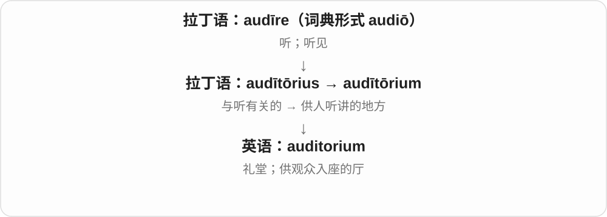

# 1065 · -ium — 拉丁名词形式和科学名称传统，具体类别看整词

[逐词精讲目录](../00_逐词精讲目录.md) · [总目录](../00_总目录_按常用程度.md)

## 核心词根与来源

sodium 联系 soda，potassium 联系 potash，radium 联系射线，iridium 联系彩虹，thorium 借神名。-ium 是命名形式，不能代替物质类别。

**-IUM：名字像科学，不代表全是金属、元素或真实物质**

常用元素按来源线索记；ammonium 铵离子、mycelium 菌丝体、adamantium 虚构金属另外分；auditorium、colloquium 是另一类拉丁名词借词。

- **常用元素与矿物、性质线索**：sodium · aluminium · potassium · calcium · barium · radium · iridium · osmium
- **神话、天体、放射性等名称**：thorium · uranium · plutonium · helium
- **离子、同位素与菌丝结构**：ammonium · deuterium · mycelium
- **拉丁活动、场所名词**：auditorium · colloquium
- **虚构科学材料**：adamantium
- **soda → sodium：材料名称进入元素命名**：soda · sodium
- **stadium：希腊词经拉丁 -ium 形式借入的另一条路线**：stadium · stadiums
- **aluminium、aluminum：同一元素的常见英美名称**：aluminium · aluminum
- **-ium 场所名称及 auditoria 复数**：auditorium · auditoriums · auditoria

## 词形与演化规律

拉丁 -ium 等名词形式进入英语借词；近代科学沿用拉丁化命名 → 大量元素、物质名；现代也用来造虚构科学感名称。

sodium 的名称取 soda 词基加 -ium；soda 的化学物质义与现代汽水义分开，钠与这些化合物不是同一物质。

stadium 保留希腊 stadion 经拉丁 stadium 的借词形式；与近代元素命名分开阅读。stadion 更早来源有争论，这里从长度单位、跑道讲到体育场。

拉丁 alumen、近代 alumina 等命名背景，两种元素名在近代形成不同常用拼法。

auditorium 加 -s 成 auditoriums；auditoria 沿拉丁名词复数形式，不是把字母 a 当新的地点后缀。

## 单词速览（按词族由简到繁）

同一基础词的相关扩展放在一起，先读基础形式，再读扩展；各组之间优先读常用的。具体词源关系见各词讲解。

| 单词 | 音标 | 核心意思 |
|---|---|---|
| [stadium](#w-32) | /ˈsteɪdiəm/ | 体育场；大型有看台的比赛场地 |
| [stadiums](#w-33) | /ˈsteɪdiəmz/ | 体育场〔stadium 的复数〕 |
| [soda](#w-31) | 英 /ˈsəʊdə/；美 /ˈsoʊdə/ | 苏打；苏打水；汽水〔尤其美式用法〕 |
| [sodium](#w-1) | 英 /ˈsəʊdiəm/；美 /ˈsoʊdiəm/ | 钠 |
| [aluminium](#w-4) | 英 /ˌæljəˈmɪniəm/；美式对应 aluminum /əˈluːmɪnəm/ | 铝〔aluminium、aluminum 为常见对应拼法〕 |
| [aluminum](#w-34) | 美式常读 /əˈluːmɪnəm/ | 铝〔常见美式名称〕 |
| [uranium](#w-2) | 英美 /juˈreɪniəm/ | 铀 |
| [calcium](#w-3) | 英 /ˈkælsiəm/；美 /ˈkælsiəm/ | 钙 |
| [potassium](#w-5) | /pəˈtæsiəm/ | 钾 |
| [auditorium](#w-6) | 英 /ˌɔːdɪˈtɔːriəm/；美 /ˌɑːdɪˈtɔːriəm/ | 礼堂；讲堂；观众厅 |
| [auditoriums](#w-35) | 英 /ˌɔːdɪˈtɔːriəmz/；美 /ˌɑːdɪˈtɔːriəmz/ | 礼堂、观众厅〔复数〕 |
| [auditoria](#w-36) | 英 /ˌɔːdɪˈtɔːriə/；美 /ˌɑːdɪˈtɔːriə/ | 礼堂、观众厅〔auditorium 的另一复数〕 |
| [helium](#w-7) | 英美 /ˈhiːliəm/ | 氦 |
| [plutonium](#w-8) | 英 /pluːˈtəʊniəm/；美 /pluːˈtoʊniəm/ | 钚〔元素 Pu，原子序数 94〕 |
| [ammonium](#w-9) | 英 /əˈməʊniəm/；美 /əˈmoʊniəm/ | 铵、铵离子 |
| [radium](#w-11) | /ˈreɪdiəm/ | 镭 |
| [thorium](#w-12) | 英 /ˈθɔːriəm/；美 /ˈθɔːriəm/ | 钍 |
| [iridium](#w-13) | /ɪˈrɪdiəm/ | 铱 |
| [barium](#w-14) | 英 /ˈbeəriəm/；美 /ˈberiəm/ | 钡 |
| [deuterium](#w-15) | 英 /djuːˈtɪəriəm/；美 /duːˈtɪriəm/ | 氘；重氢 |
| [colloquium](#w-17) | 英 /kəˈləʊkwiəm/；美 /kəˈloʊkwiəm/ | 学术讨论会；专题研讨会 |
| [mycelium](#w-18) | /maɪˈsiːliəm/ | 菌丝体 |
| [adamantium](#w-24) | /ˌædəˈmæntiəm/ | 艾德曼金属等虚构坚硬金属名称 |
| [osmium](#w-30) | 英 /ˈɒzmiəm/；美 /ˈɑːzmiəm/ | 锇〔化学元素 Os〕 |

## 逐词讲解

### 1. stadium — 体育场；大型有看台的比赛场地

**音标**：/ˈsteɪdiəm/

**先抓住这个画面**

中间比赛，周围有成排看台让人观看的场地，就是 stadium。名字的早期画面连接跑道与用来量长度的一个单位。

**怎么拆**

借拉丁 stadium，来自希腊 stádion，早有长度单位、跑道等义；现代拼写保留拉丁化 -ium，不能按近代金属命名来解释。希腊词更早来源有不同分析，和表示固定、站立的词族是否直接相接并无一致结论。

**怎么变成今天的意思**

**希腊 stádion → 拉丁 stadium**  
长度单位；相应长度的跑道

↓

**拉丁形式进入英语，拼写后有再拉丁化**  
跑道、竞赛场 → 有看台的大型体育场

a football stadium 足球场；an Olympic stadium 奥林匹克体育场；a packed stadium 坐满观众的体育场。

**常见搭配与例句**

enter the stadium；the stadium’s main entrance。

> The crowd began to enter the stadium an hour before the match.

比赛开始前一小时，观众开始进入体育场。

> The stadium has seats on all four sides of the pitch.

这座体育场在球场四周都有看台座位。

**别混淆**

stadium 常强调比赛场地及观众看台的整体；arena 可说表演、比赛场地，现代也常指室内场馆，具体名称有重合。复数 stadiums 很常用，stadia 也存在。

### 2. stadiums — 体育场〔stadium 的复数〕

**音标**：/ˈsteɪdiəmz/

**先抓住这个画面**

把一座座设有观众看台的比赛场地放在一起说，就是 stadiums。

**怎么拆**

stadium + -s，/m/ 后读 /z/。单数经拉丁 stadium 接希腊 stádion；英语复数 stadiums 直接加 s，另有保留古典变化的 stadia。

**怎么变成今天的意思**

**希腊跑道、长度单位词 → 拉丁 stadium → 英语 stadium**  
跑道 → 体育场

↓

**stadium + -s → stadiums**  
多座体育场

large stadiums 大型体育场；football stadiums 足球场；stadiums across the country 全国各地的体育场。

**常见搭配与例句**

two stadiums near the city；stadiums with covered seating。

> The tournament used stadiums in three different cities.

这项锦标赛使用了三个不同城市的体育场。

> Both stadiums are easy to reach by train.

这两座体育场都很方便坐火车前往。

**别混淆**

stadiums 和 stadia 都可作复数，日常无需一见 -ium 就把所有词强行套成 -a。比如元素名、普通物质名是否可数、怎样变复数，要看具体词。

### 3. soda — 苏打；苏打水；汽水〔尤其美式用法〕

**音标**：英 /ˈsəʊdə/；美 /ˈsoʊdə/

**先抓住这个画面**

这个名字先与碱性物质相连，后来经过 soda water 用来叫有气泡的水和饮料。所以厨房里的 soda 与菜单上的 soda，要分场景理解。

**怎么拆**

经意大利语或中世纪拉丁 soda 等形式传入，早期指碳酸钠及提取相关碱性物质的材料，更远来源未定。饮料义由 soda water 等缩短发展，不能反推每杯汽水都含碳酸钠。

**怎么变成今天的意思**

**意大利语／中世纪拉丁 soda 等 → 英语 soda**  
碳酸钠等碱性物质名称，远源未定

↓

**soda water 等 → 饮料义 soda**  
苏打水；尤其美式语境中的汽水

baking soda 小苏打，即碳酸氢钠；washing soda 洗涤用苏打，通常指碳酸钠；a can of soda 一罐汽水；soda water 苏打水、气泡水。

**常见搭配与例句**

a glass of soda；soda and juice。

> Would you like water, juice, or a soda?

你想喝水、果汁，还是汽水？

> The recipe calls for a small amount of baking soda.

这个食谱需要少量小苏打。

**别混淆**

sodium 是钠元素，soda 的常见化学义说的是相关化合物；名称有联系，物质不能混为一谈。不同地区把汽水叫 soda、pop 或 soft drink，使用习惯不完全相同。

### 4. sodium — 钠

**音标**：英 /ˈsəʊdiəm/；美 /ˈsoʊdiəm/

**先抓住这个画面**

元素名里的 sod- 联系 soda 苏打等旧物质名；食物标签的 sodium 常在说钠含量，不是食物里藏着一块金属。

**怎么拆**

soda 的词基 + -ium，经近代科学命名形成 sodium。名称来源的苏打与元素钠并不是同一物质。

**怎么变成今天的意思**

**拉丁 -ium 等中性名词、名词化形式 → 英语借词**  
事物、场所等名词；不能给所有词统一译成金属

↓

**近代科学沿用拉丁化命名**  
元素、物质名称常用 -ium；命名线索来自矿物、性质、地名、神话等

↓

**soda + -ium → sodium**  
从苏打相关物质名形成的元素名称

sodium content 钠含量，sodium chloride 氯化钠，a sodium atom 钠原子。

**常见搭配与例句**

sodium content；sodium chloride；a sodium atom。

> The label shows the sodium content per serving.

标签标明了每份的钠含量。

> The class drew a sodium atom.

班里画了一个钠原子示意图。

**别混淆**

sodium 钠元素，sodium chloride 是氯化钠化合物；盐的 sodium 含量不等于整份盐的总质量。

### 5. aluminium — 铝〔aluminium、aluminum 为常见对应拼法〕

**音标**：英 /ˌæljəˈmɪniəm/；美式对应 aluminum /əˈluːmɪnəm/

**先抓住这个画面**

同一种轻金属，英式常写 aluminium，美式常写 aluminum；拼写和音节数有区别，不是两种不同元素。

**怎么拆**

沿拉丁 alūmen 明矾、近代 alumina 氧化铝等命名背景，早有 alumium、aluminum、aluminium 的调整。-ium 形式更贴近许多元素的命名模式。

**怎么变成今天的意思**

**拉丁 -ium 等中性名词、名词化形式 → 英语借词**  
事物、场所等名词；不能给所有词统一译成金属

↓

**近代科学沿用拉丁化命名**  
元素、物质名称常用 -ium；命名线索来自矿物、性质、地名、神话等

↓

**alūmen → alumina 等 → alumium、aluminum、aluminium 的近代名称调整**  
明矾、氧化铝相关词基 → 元素铝名称

↓

**英美常见拼法差异**  
aluminium / aluminum，同一元素

aluminium foil 铝箔，an aluminium frame 铝框，an aluminum can 铝罐〔美式〕。

**常见搭配与例句**

aluminium foil；an aluminium frame；an aluminum can。

> The bicycle has an aluminium frame.

自行车有一个铝制车架。

> The American label reads aluminum foil.

美式标签上写着 aluminum foil。

**别混淆**

aluminium/aluminum 是同物对应拼法，alumina 氧化铝是不同化学对象；不要把多一段字母一概当同种词尾变体。

### 6. aluminum — 铝〔常见美式名称〕

**音标**：美式常读 /əˈluːmɪnəm/

**先抓住这个画面**

饮料罐、厨房铝箔里的那种金属，日常就常叫 aluminum；英式常见 aluminium，指的是同一元素。

**怎么拆**

近代化学命名沿拉丁 alumen 明矾、alumina 氧化铝等材料，形成 alumium、aluminum、aluminium 等调整后的名称。aluminum 与 aluminium 是固定名称的常见美英分支。

**怎么变成今天的意思**

**拉丁 alumen → 近代 alumina 等名称 → 元素命名**  
从明矾、氧化铝相关词基命名金属

↓

**aluminum、aluminium 的近代拼法分化**  
常见美式 aluminum；英式 aluminium，所指相同

aluminum foil 铝箔；aluminum cans 铝罐；an aluminum frame 铝制框架。

**常见搭配与例句**

made of aluminum 用铝制成；recycle aluminum 回收铝。

> The frame is made of aluminum.

框架是铝制的。

> She covered the dish with aluminum foil.

她用铝箔盖住了盘子。

**别混淆**

aluminum 通常是材料不可数名词，数制品说 cans、sheets 等。aluminium 的拼写、常用读音也有变化，不只是写字时随手增删一个 i。

### 7. uranium — 铀

**音标**：英美 /juˈreɪniəm/

**先抓住这个画面**

一种天然存在、具有放射性的金属元素；名字借了天王星的光。

**怎么拆**

近代拉丁 uranium 由行星名 Uranus 加元素名常见的 -ium 构成；行星名又接希腊天空之神 Ouranos。这里是纪念式命名，不是说铀来自天王星。

**怎么变成今天的意思**

**希腊 ouranos“天空”及神名 Ouranos → 拉丁化 Uranus**  
天空之神的名字

↓

**行星名 Uranus**  
天王星沿用这个神名

↓

**近代拉丁元素名 uranium → 英语 uranium**  
克拉普罗特以当时新发现的行星为新元素命名

化学符号是 U，原子序数是 92。它常出现在矿产、核燃料和放射性的文章里。1789 年克拉普罗特辨认出一种新元素并命名；真正分离出金属铀是后来的事，不要把两个发现步骤混成一次。

**常见搭配与例句**

uranium ore；uranium deposits；natural uranium；uranium fuel。

> The museum label identifies uranium by the symbol U.

博物馆的说明牌用符号 U 标示铀。

> The report examines the environmental impact of uranium mining.

报告研究了铀矿开采对环境的影响。

**别混淆**

Uranus 是行星专名，首字母大写；uranium 是元素名，通常小写。铀矿石不是一整块纯铀，ore 说明它是含铀的矿物材料。

### 8. calcium — 钙

**音标**：英 /ˈkælsiəm/；美 /ˈkælsiəm/

**先抓住这个画面**

石灰石里的一个元素，被单独识别出来，获得了自己的名字。

**怎么拆**

calc- 石灰 + 元素名后缀 -ium；Davy 在命名时取用了拉丁 calx。

**怎么变成今天的意思**

**拉丁 calx，词干 calc-**  
石灰、石灰石

↓

**近代科学名称 calcium → 英语 calcium**  
以石灰为命名依据的元素钙

化学符号 Ca，和碳 C 不是一回事。营养话题里的 calcium 说钙元素，通常以化合物或离子形式存在，绝不是让人吞一块金属。骨骼、牙齿和许多矿物里都能遇到钙。

**常见搭配与例句**

calcium carbonate；calcium content；a source of calcium。

> The chart compares the calcium content of several foods.

图表比较了几种食物的钙含量。

> Calcium carbonate occurs in limestone.

石灰岩中含有碳酸钙。

**别混淆**

calcium 是钙元素；calorie 是热量单位，来自表示热的另一条词源。不要因为都以 cal- 开头就混在一起。

### 9. potassium — 钾

**音标**：/pəˈtæsiəm/

**先抓住这个画面**

名字往前追到 potash 草木灰制碱的历史；它不是一口锅 pot 变成新金属，而是从含钾物质的旧名接出元素名。

**怎么拆**

potash 的拉丁化 potassa + -ium → potassium。potash 原与锅里处理灰的工艺相关，现代又是含钾肥料等宽泛物质名称。

**怎么变成今天的意思**

**拉丁 -ium 等中性名词、名词化形式 → 英语借词**  
事物、场所等名词；不能给所有词统一译成金属

↓

**近代科学沿用拉丁化命名**  
元素、物质名称常用 -ium；命名线索来自矿物、性质、地名、神话等

↓

**potash → 拉丁化 potassa + -ium → potassium**  
草木灰制碱相关名 → 元素钾

potassium content 钾含量，potassium salts 钾盐，a potassium atom 钾原子。

**常见搭配与例句**

potassium content；potassium salts；a potassium atom。

> The table lists the potassium content of the samples.

表格列出了样本的钾含量。

> The lesson compared potassium with sodium.

课程比较了钾与钠。

**别混淆**

potassium 元素钾，potash 是另一物质类别、工业名称；与 sodium 钠也不同，不能只因都是类似元素尾音而互换。

### 10. auditorium — 礼堂；讲堂；观众厅

**音标**：英 /ˌɔːdɪˈtɔːriəm/；美 /ˌɑːdɪˈtɔːriəm/

**先抓住这个画面**

auditorium 是把许多人聚在一起听演讲、音乐或观看表演的空间，画面重点是台下容纳听众的大厅。

**怎么拆**

来自拉丁语 audītōrium，基础是 audītōrius“与听有关的”；-ium 在这类词里常与地点或空间名称有关。

**怎么变成今天的意思**

从“听的地方”发展为今天的礼堂或观众厅。它可以是一整间大厅，也可指剧院中观众坐的部分，未必包含舞台后台。

**常见搭配与例句**

a school auditorium；a packed auditorium；seats in the auditorium。

> The students gathered in the auditorium for the concert.

学生们聚集到礼堂里听音乐会。

> The auditorium can seat five hundred people.

这个观众厅能容纳五百人就座。

**别混淆**

audience 是人群；auditorium 是人群所在的空间。hall 范围更广，未必专供观看或听讲。

### 11. auditoriums — 礼堂、观众厅〔复数〕

**音标**：英 /ˌɔːdɪˈtɔːriəmz/；美 /ˌɑːdɪˈtɔːriəmz/

**先抓住这个画面**

人们坐下来一起听讲、看演出的大空间，叫 auditorium；几座礼堂或几个观众厅是 auditoriums。

**怎么拆**

auditorium + 英语复数 -s。原词是拉丁听取相关的场所名称，不是现代 audio 后任意添一串字母。

**怎么变成今天的意思**

**拉丁 audire 听 → auditorius 与听有关的 → auditorium**  
供人听讲、聚集的地方

↓

**英语 auditorium**  
礼堂、观众厅；两种复数形式并存

↓

**auditorium + -s → auditoriums**  
多个礼堂、观众厅

school auditoriums 是学校礼堂；a complex with two auditoriums 是有两个观众厅的建筑群。

**常见搭配与例句**

large auditoriums 大礼堂；university auditoriums 大学礼堂。

> The campus has two large auditoriums.

校园里有两个大礼堂。

> Both auditoriums were full for the festival.

音乐节期间两个观众厅都坐满了。

**别混淆**

auditoriums 与 auditoria 都是 auditorium 的复数；不同词尾没有把建筑分成两类。

### 12. auditoria — 礼堂、观众厅〔auditorium 的另一复数〕

**音标**：英 /ˌɔːdɪˈtɔːriə/；美 /ˌɑːdɪˈtɔːriə/

**先抓住这个画面**

看到 auditoria，不是换了一种建筑，而是 auditorium 的复数换成了拉丁式样子。

**怎么拆**

auditorium 的拉丁式复数 auditoria，-ium 对应 -ia；英语也有普通加 -s 的 auditoriums。a 在这里是旧复数材料，不是新造一个地点词根。

**怎么变成今天的意思**

**拉丁 audire 听 → auditorius 与听有关的 → auditorium**  
供人听讲、聚集的地方

↓

**英语 auditorium**  
礼堂、观众厅；两种复数形式并存

↓

**auditorium → auditoria**  
采用拉丁式复数，仍指数个观众厅

two auditoria 就是两个礼堂、观众厅；可与 auditoriums 对照认读。

**常见搭配与例句**

modern auditoria 现代观众厅；several auditoria 几个礼堂。

> The centre contains three auditoria of different sizes.

中心里有三个大小不同的观众厅。

> The university renovated its two oldest auditoria.

大学翻修了两座最老的礼堂。

**别混淆**

auditorium 单数、auditoria 复数；别在 auditoria 后重复再加一个 s。

### 13. helium — 氦

**音标**：英美 /ˈhiːliəm/

**先抓住这个画面**

一种很轻、化学性质很不活泼的气体元素。

**怎么拆**

19 世纪用希腊 hēlios“太阳”加元素名称词尾 -ium 命名，采用新拉丁 helium 形式。它在地球上被分离之前，人们已从太阳光谱发现了它的迹象。

**怎么变成今天的意思**

**希腊 hēlios → helio-**  
太阳；用于近代科学构词

↓

**近代元素命名：heli- + -ium → helium**  
以太阳命名的元素；英语保留这个名称

helium balloons 是充氦气球；液态氦也可用于低温冷却。名字来自太阳，不代表氦只存在于太阳，也不代表它是灼热的“太阳气体”。

**常见搭配与例句**

helium gas；liquid helium；helium balloons；a helium atom。

> The balloons were filled with helium for the celebration.

庆典上的气球充入了氦气。

> The laboratory uses liquid helium to cool a superconducting magnet.

实验室使用液态氦冷却超导磁体。

**别混淆**

hydrogen 是氢，helium 是氦，虽然都很轻，化学性质不同。-ium 常见于元素名，但不能据此认定氦是金属。

### 14. plutonium — 钚〔元素 Pu，原子序数 94〕

**音标**：英 /pluːˈtəʊniəm/；美 /pluːˈtoʊniəm/

**先抓住这个画面**

一个放射性金属元素，名字先借自冥王星，再远远联系到神话名称。

**怎么拆**

二十世纪用天体 Pluto 加元素词尾 -ium 命名：plutonium 在元素表里紧随 neptunium，呼应当时 Pluto 与 Neptune 的天体顺序。Pluto 的神话名远接与财富有关的 Plouton，不是因为金属昂贵而命名。

**怎么变成今天的意思**

**希腊 Plouton 神名，联系 ploutos 财富 → 拉丁 Pluto**  
神话名与财富称号的关联

↓

**天体名 Pluto + -ium → plutonium**  
按天体命名顺序为新元素起名，不由 plutocracy 派生

plutonium 常见于核能、历史和太空探测文章。它是一种具体元素，有不同同位素；例如太空电源资料会见到 plutonium-238。元素名、同位素与某种具体用途不能全部画等号。

**常见搭配与例句**

plutonium isotopes；plutonium oxide；plutonium production。

> The periodic table lists plutonium as element 94.

元素周期表把钚列为第九十四号元素。

> The museum panel explains why plutonium was named after Pluto.

博物馆展板解释了钚为何以冥王星命名。

**别混淆**

uranium 是铀，plutonium 是钚，是不同元素。plutocratic 的财富义不能直接用来解释钚的物理性质。

### 15. ammonium — 铵、铵离子

**音标**：英 /əˈməʊniəm/；美 /əˈmoʊniəm/

**先抓住这个画面**

先想 ammonia 氨再接上一个氢离子，形成常见铵离子；它是一种带电组合，不是周期表里另一种金属元素。

**怎么拆**

新拉丁 ammōnium，现代可对应 ammonia 词基 + -ium。命名沿物质词形模式，但类别需要具体化学知识判断。

**怎么变成今天的意思**

**拉丁 -ium 等中性名词、名词化形式 → 英语借词**  
事物、场所等名词；不能给所有词统一译成金属

↓

**近代科学沿用拉丁化命名**  
元素、物质名称常用 -ium；命名线索来自矿物、性质、地名、神话等

↓

**ammonia 的词基 + -ium → ammōnium → ammonium**  
与氨相关的铵离子名称

the ammonium ion 铵离子，ammonium salts 铵盐，ammonium chloride 氯化铵。

**常见搭配与例句**

the ammonium ion；ammonium salts；ammonium chloride。

> The diagram showed an ammonium ion.

示意图画出了一个铵离子。

> The glossary distinguished ammonia from ammonium.

词汇表区分了氨与铵。

**别混淆**

ammonia 氨与 ammonium 铵不同；-ium 常见于元素名，也不保证本词就是元素。

### 16. radium — 镭

**音标**：/ˈreɪdiəm/

**先抓住这个画面**

名称抓住射线、放射性这个研究特征；不是 radio 收音机后来变出来的金属，二者只是能联系到较早的射线词族。

**怎么拆**

借法语 radium，接 radioactif 等射线、放射性的命名材料与 -ium；较远可联系拉丁 radius 光线、辐条。

**怎么变成今天的意思**

**拉丁 -ium 等中性名词、名词化形式 → 英语借词**  
事物、场所等名词；不能给所有词统一译成金属

↓

**近代科学沿用拉丁化命名**  
元素、物质名称常用 -ium；命名线索来自矿物、性质、地名、神话等

↓

**射线、放射性词基 + -ium → 法语 radium → radium**  
以放射特征形成的元素名

radium research 镭研究，radium compounds 镭化合物，the discovery of radium 镭的发现。

**常见搭配与例句**

the discovery of radium；radium compounds；radium research。

> The exhibition described the discovery of radium.

展览介绍了镭的发现。

> The archive contains early papers on radium.

档案中保存着早期镭研究论文。

**别混淆**

radium 镭，radiation 辐射是现象总称；不是只有镭能产生辐射，词名联系不能替代科学类别。

### 17. thorium — 钍

**音标**：英 /ˈθɔːriəm/；美 /ˈθɔːriəm/

**先抓住这个画面**

名称借了北欧神话 Thor 雷神的名字；是命名者的纪念、联想方式，不是说这种元素会制造神话闪电。

**怎么拆**

Thor 人名 + -ium，形成科学元素名。来自神话不代表物质虚构，thorium 与 adamantium 的现实地位不同。

**怎么变成今天的意思**

**拉丁 -ium 等中性名词、名词化形式 → 英语借词**  
事物、场所等名词；不能给所有词统一译成金属

↓

**近代科学沿用拉丁化命名**  
元素、物质名称常用 -ium；命名线索来自矿物、性质、地名、神话等

↓

**Thor + -ium → thorium**  
借北欧雷神名形成的真实元素名

thorium minerals 含钍矿物，thorium research 钍研究，a thorium sample 钍样本。

**常见搭配与例句**

thorium minerals；thorium research；a thorium sample。

> The mineral sample contained thorium.

矿物样本中含有钍。

> The teacher explained why thorium was named after Thor.

老师解释了钍为何借雷神 Thor 得名。

**别混淆**

thorium 是真实元素名，Thor 神话名是命名来源；不能用故事判断物质是否存在。

### 18. iridium — 铱

**音标**：/ɪˈrɪdiəm/

**先抓住这个画面**

名称抓住某些化合物的多彩外观，联系“彩虹”；不是说金属本身必须像彩虹一样每处变色。

**怎么拆**

经新拉丁 iridium，接希腊、拉丁 iris 彩虹及其词干 irid- + -ium；命名背景在多种盐呈现的颜色。

**怎么变成今天的意思**

**拉丁 -ium 等中性名词、名词化形式 → 英语借词**  
事物、场所等名词；不能给所有词统一译成金属

↓

**近代科学沿用拉丁化命名**  
元素、物质名称常用 -ium；命名线索来自矿物、性质、地名、神话等

↓

**iris、irid-〔彩虹〕+ -ium → iridium**  
按相关盐类的多彩外观命名元素

iridium alloys 铱合金，an iridium layer 含铱层、铱层，iridium compounds 铱化合物。

**常见搭配与例句**

iridium alloys；iridium compounds；an iridium layer。

> The display showed an iridium sample.

展柜里陈列着一个铱样本。

> The article explained the colourful origin of the name iridium.

文章解释了 iridium 这个名字与多彩外观的联系。

**别混淆**

iridium 铱和 iris 虹膜、彩虹等共享较早命名材料，不代表虹膜由铱金属组成。

### 19. barium — 钡

**音标**：英 /ˈbeəriəm/；美 /ˈberiəm/

**先抓住这个画面**

名字抓住“重”，但最初是相关矿物很沉的命名背景，不能只凭名字断言金属钡比所有其他金属都重。

**怎么拆**

baryta、barytes 等矿物名称词基 + -ium，更早接希腊 barýs 重。由矿物名称接出元素名称。

**怎么变成今天的意思**

**拉丁 -ium 等中性名词、名词化形式 → 英语借词**  
事物、场所等名词；不能给所有词统一译成金属

↓

**近代科学沿用拉丁化命名**  
元素、物质名称常用 -ium；命名线索来自矿物、性质、地名、神话等

↓

**希腊 barýs〔重〕→ baryta、barytes 等 + -ium → barium**  
重的矿物命名背景 → 元素钡

barium compounds 钡化合物，barium sulfate 硫酸钡，a barium sample 钡样本。

**常见搭配与例句**

barium compounds；barium sulfate；a barium sample。

> The lesson traced barium back to a word meaning heavy.

课程把 barium 追溯到表示重的词。

> The table compared several barium compounds.

表格比较了几种钡化合物。

**别混淆**

barium 元素名，barium sulfate 是特定化合物；名字里重的来源说矿物历史，不直接规定所有现代性质。

### 20. deuterium — 氘；重氢

**音标**：英 /djuːˈtɪəriəm/；美 /duːˈtɪriəm/

**先抓住这个画面**

还是氢，只是原子核里比最常见的氢多了一个中子。

**怎么拆**

近代用希腊 deuteros 第二构造 deuterium，-ium 是化学名称常见结尾。这里的二对应质量数二，不是两个质子。

**怎么变成今天的意思**

**希腊 deuteros 第二 + 化学命名结尾 -ium**  
近代命名材料

↓

**英语 deuterium**  
质量数为二的氢同位素：氘

氘的原子核有一个质子和一个中子，所以质量数是二；通常记作 ²H 或 D。它仍属于氢元素，因为决定元素身份的是质子数。用“两颗核内粒子”这个画面记，别误记成两个氢原子绑在一起。

**常见搭配与例句**

deuterium atoms；deuterium fuel；deuterium and tritium。

> A deuterium nucleus contains one proton and one neutron.

氘原子核含一个质子和一个中子。

> The experiment compared ordinary hydrogen with deuterium.

实验比较了普通氢与氘。

**别混淆**

deuterium 是氢的一种同位素；hydrogen molecule H₂ 是两个氢原子组成的分子。两者的二不是同一回事。

### 21. colloquium — 学术讨论会；专题研讨会

**音标**：英 /kəˈləʊkwiəm/；美 /kəˈloʊkwiəm/

**先抓住这个画面**

研究者围绕一个问题交流，有人介绍工作，其他人追问和讨论。

**怎么拆**

直接借自拉丁 colloquium 交谈，由 com- 一起 + loqui 说构成；英语后来发展出学术会议义。

**怎么变成今天的意思**

**拉丁 loqui**  
说话

↓

**拉丁 com- + loqui → colloquium**  
一起交谈

↓

**英语 colloquium**  
交流讨论，后来常指学术讨论会

常出现在大学和研究机构。它可能是一场带提问环节的报告，也可能是围绕专题展开的交流活动；并没有固定的人数或时长标准。不要因为同根词 colloquial 指口语，就认为 colloquium 是闲聊。

**常见搭配与例句**

a research colloquium；a departmental colloquium；attend a colloquium。

> The department holds a weekly colloquium on language research.

这个系每周举办一次语言研究讨论会。

> After the colloquium, several students stayed to ask questions.

讨论会结束后，几名学生留下来继续提问。

**别混淆**

lecture 侧重讲授，colloquium 更突出学术交流；具体是否大量讨论仍看活动安排，不靠词名硬判断。

### 22. mycelium — 菌丝体

**音标**：/maɪˈsiːliəm/

**先抓住这个画面**

一根根细丝分支、交连成真菌的营养生长部分，像一张细网；可见蘑菇常只是某些真菌长出的繁殖结构，不是整个真菌的全部。

**怎么拆**

借新拉丁 mycelium，myc- 接真菌词基，-ium 为名词形式；中间 -el- 的具体由来不明，可能受其他科学词重新分析影响，不硬说成已确定的小称。

**怎么变成今天的意思**

**拉丁 -ium 等中性名词、名词化形式 → 英语借词**  
事物、场所等名词；不能给所有词统一译成金属

↓

**myc-〔真菌〕+ -el-〔来源不定〕+ -ium → mycelium**  
新拉丁真菌结构名

a network of mycelium 菌丝体网络，mycelium in the soil 土壤中的菌丝体，fungal mycelium 真菌菌丝体。

**常见搭配与例句**

a network of mycelium；mycelium in the soil；fungal mycelium。

> The diagram showed mycelium spreading through the soil.

示意图显示菌丝体在土壤中蔓延。

> The sample contained a dense network of mycelium.

样本里有一张密集的菌丝体网络。

**别混淆**

hypha 单根菌丝，mycelium 菌丝组成的生长体；不因 -ium 结尾便是矿物、金属。

### 23. adamantium — 艾德曼金属等虚构坚硬金属名称

**音标**：/ˌædəˈmæntiəm/

**先抓住这个画面**

听起来像周期表元素，是故意借科学命名的口气；在小说、漫画等设定里可极坚硬，现实并无因此就出现一种对应元素。

**怎么拆**

adamant 坚不可摧之物、金刚等旧词基 + -ium，造出具有科学物质感的虚构名称。不同作品设定可能不同，词源不保证统一配方。

**怎么变成今天的意思**

**拉丁 -ium 等中性名词、名词化形式 → 英语借词**  
事物、场所等名词；不能给所有词统一译成金属

↓

**近代科学沿用拉丁化命名**  
元素、物质名称常用 -ium；命名线索来自矿物、性质、地名、神话等

↓

**adamant + -ium → adamantium**  
坚硬、金刚的联想 + 科学命名词尾

↓

**现代虚构材料名**  
故事中的超硬金属，非独立真实元素

a fictional metal called adamantium 名为 adamantium 的虚构金属，adamantium claws 艾德曼金属爪〔作品语境〕，an adamantium weapon 虚构材料武器。

**常见搭配与例句**

adamantium claws；a fictional metal called adamantium；an adamantium weapon。

> The character’s claws were made of adamantium.

角色的爪由虚构的艾德曼金属制成。

> The glossary marked adamantium as a fictional material.

词汇表把 adamantium 标为虚构材料。

**别混淆**

adamantium 虚构金属，thorium 神话名借来的真实元素；名称像不像科学不能代替判断存在与否。

### 24. osmium — 锇〔化学元素 Os〕

**音标**：英 /ˈɒzmiəm/；美 /ˈɑːzmiəm/

**先抓住这个画面**

元素名记下了发现时一种相关化合物的强烈气味。

**怎么拆**

希腊 osme 气味 + 元素名称常见的 -ium，形成近代元素名。命名线索是其氧化物的气味，并不是“金属”这个概念本身。

**怎么变成今天的意思**

**希腊 osme**  
气味

↓

**近代元素命名 osmium**  
因相关氧化物气味而得名的锇

锇是一种密度很高的金属。为什么一个金属名字里会藏着“气味”？因为发现和研究过程中，相关的四氧化锇气味很明显。要记住的是命名时注意到的现象，不能据此说所有锇材料都像香水一样散发气味。

**常见搭配与例句**

the element osmium；an osmium alloy；osmium tetroxide。

> The student located osmium in the periodic table.

学生在元素周期表里找到了锇。

> The exhibit explains why osmium was named after a Greek word for smell.

展览解释了锇为何以希腊语中表示气味的词来命名。

**别混淆**

osmium 是元素，osmium tetroxide 是它的一种氧化物。名字的由来不等于元素与化合物有完全一样的性质。

## 这一组要分清什么

aluminium/aluminum 英美对应，alumina 氧化铝另物；ammonium 非元素；helium 非金属；mycelium 真菌；adamantium 虚构。

## 串起来练习

The list included real elements, an ammonium ion and the fictional metal adamantium.

列表包括真实元素、铵离子，以及虚构金属 adamantium。
