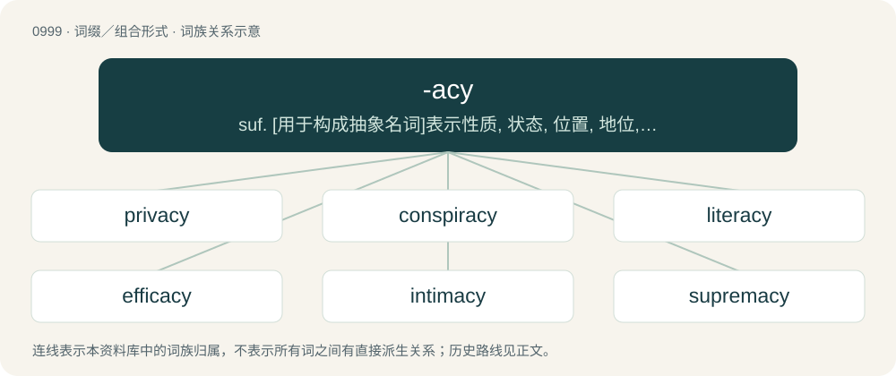

# 1075 · -acy — suf. \[用于构成抽象名词\]表示性质, 状态, 位置, 地位, 职位

[总目录](../00_总目录_按常用程度.md)

**类型**：词缀／组合形式　｜　**来源语言**：见词源记录

## 核心含义与来源

- 核心含义：suf. \[用于构成抽象名词\]表示性质, 状态, 位置, 地位, 职位
- 英文含义：Denoting quality, state, condition.
- 词形：-acy

**来源记录 1**（后缀／后置成分；Denoting quality, state, condition.）

From Latin -ācia or ultimately Latin -ātia. Also a suffixal construction from -ate + -cy.

## 词族图

## 单词速览（常用到不常用）

| 单词 | 音标 | 释义 |
|---|---|---|
| [privacy](#w-1) | 英 /ˈpɹɪv.ə.si/；美 /ˈpɹaɪ.və.si/ | n. 隐私, 隐居, 秘密；\[计\] 个人保密权 |
| [conspiracy](#w-2) | 英 /kənˈspɪɹəsi/ | n. 同谋, 阴谋, 阴谋集团；\[法\] 阴谋, 通谋, 共谋 |
| [literacy](#w-3) | 英 /ˈlɪtəɹəsi/；美 /ˈlɪtəɹəsi/ | n. 读写能力, 识字, 精通文学 |
| [efficacy](#w-4) | 英 /ˈɛf.ɪ.kə.si/ | n. 功效, 效力；\[医\] 效能, 功效, 效验 |
| [intimacy](#w-5) | /ˈɪn.tɪ.mə.si/ | n. 亲密, 熟悉, 亲昵行为(言语)；\[法\] 亲近的行为, 亲密, 隐私 |
| [supremacy](#w-6) | /suˈpɹɛməsi/ | n. 至高无上, 霸权地位, 优势, 至上；\[法\] 至高权力, 无上权力, 霸权 |
| [legitimacy](#w-7) | 英 /ləˈd͡ʒɪtɪməsi/；美 /ləˈd͡ʒɪtɪməsi/ | n. 合法, 正统, 正当；\[法\] 合法性, 正统性, 婚生 |
| [candidacy](#w-8) | 英 /ˈkændɪdəsi/；美 /ˈkændɪdəsi/ | n. 候选人的地位, 候选资格；\[法\] 候选人的身份, 资格 |
| [fallacy](#w-9) | 英 /ˈfæl.ə.si/ | n. 错误的观念(或信念), 谬见, 谬论；\[医\] 错觉, 幻觉, 虚妄 |
| [delicacy](#w-10) | 英 /ˈdɛlɪkəsi/ | n. 细软, 精致, 精美的食品, 娇气, 微妙, 棘手, 娇弱, 灵敏, 灵巧 |
| [lunacy](#w-11) | 英 /ˈluː.nə.si/；美 /ˈluː.nə.si/ | n. 精神失常, 精神病, 疯狂愚蠢的行为；\[医\] 精神错乱(精神病的旧名) |
| [primacy](#w-12) | 英 /ˈpɹaɪ.mə.si/；美 /ˈpɹaɪ.mə.si/ | n. 第一, 首位, 卓越 |
| [adequacy](#w-13) | /ˈædɪkwəsi/ | n. 适当, 足够 |
| [immediacy](#w-14) | /ɪˈmiːdi.əsi/ | n. 直接, 目前, 迫切需要的事物 |
| [surrogacy](#w-15) | 英 /ˈsʌɹəɡəsi/；美 /ˈsɝəɡəsi/ | n. 代孕 |
| [degeneracy](#w-16) | 英 /dɪˈd͡ʒɛnəɹəsi/ | n. 退步, 退化, 堕落；\[化\] 简并度; 简并; 简并性 |
| [intricacy](#w-17) | /ˈɪn.tɹɪ.kə.si/ | n. 纷乱, 复杂, 错综 |
| [episcopacy](#w-18) | 英 /ɪˈpɪskəpəsi/ | n. 主教制度, 主教的职位 |
| [profligacy](#w-19) | 美 /ˈpɹɑflɪɡəsi/ | n. 放荡, 不检点, 浪费 |

## 逐词详解

### 1. privacy

**词性**：名词　｜　**音标**：英 /ˈpɹɪv.ə.si/；美 /ˈpɹaɪ.və.si/

**中文释义**：n. 隐私, 隐居, 秘密；\[计\] 个人保密权

**英文义项**：The state of being secluded from the presence, sight, or knowledge of others. / Freedom from unwanted or undue disturbance of one's private life.

**构词拆分**：From priv(ate) + -acy.

**词源与演化**：

From priv(ate) + -acy.

**例句**：

> Those prying neighbours have robbed me of my sense of privacy.

该用例对应义项：Freedom from unwanted or undue disturbance of one's private life.

### 2. conspiracy

**词性**：名词　｜　**音标**：英 /kənˈspɪɹəsi/

**中文释义**：n. 同谋, 阴谋, 阴谋集团；\[法\] 阴谋, 通谋, 共谋

**英文义项**：An agreement or arrangement between multiple parties to do something harmful, immoral or subversive; an instance of collusion. / An agreement between two or more persons to break the law at some time in the future.

**构词拆分**：conspire + -acy

**词源与演化**：

From Middle English conspiracie, from Anglo-Norman conspiracie, from Latin cōnspīrātiō, from conspire + -acy.

**例句**：

> There are many people who believe in the flat earth conspiracy theory.

### 3. literacy

**词性**：名词　｜　**音标**：英 /ˈlɪtəɹəsi/；美 /ˈlɪtəɹəsi/

**中文释义**：n. 读写能力, 识字, 精通文学

**英文义项**：The ability to read and write. / The ability to understand and evaluate something.

**构词拆分**：liter(ate) + -acy

**词源与演化**：

From liter(ate) + -acy.

**用法示例／搭配（非完整句）**：

> computer literacy

该用例对应义项：The ability to understand and evaluate something.

### 4. efficacy

**词性**：名词　｜　**音标**：英 /ˈɛf.ɪ.kə.si/

**中文释义**：n. 功效, 效力；\[医\] 效能, 功效, 效验

**英文义项**：The ability to produce a desired effect under ideal testing conditions. / A degree of ability to produce a desired effect; effectiveness.

**词源与演化**：

From Old French efficace, from Late Latin efficācia (“efficacy”) (whence -acy), from efficāx (“efficacious”); see efficacious.

**例句**：

> Concern about the safety and efficacy of the vaccine.

该用例对应义项：capacity or power to produce a desired effect

### 5. intimacy

**词性**：名词　｜　**音标**：/ˈɪn.tɪ.mə.si/

**中文释义**：n. 亲密, 熟悉, 亲昵行为(言语)；\[法\] 亲近的行为, 亲密, 隐私

**英文义项**：Feeling or atmosphere of closeness and openness towards someone else, often but not necessarily involving sexuality. / Intimate relationship.

**构词拆分**：From intim(ate) + -acy.

**词源与演化**：

From intim(ate) + -acy.

**例句**：

> He often hastens physical intimacy, much to the chagrin of his dates.

### 6. supremacy

**词性**：名词　｜　**音标**：/suˈpɹɛməsi/

**中文释义**：n. 至高无上, 霸权地位, 优势, 至上；\[法\] 至高权力, 无上权力, 霸权

**英文义项**：The quality of being supreme. / Power over all others.

**构词拆分**：supreme + -acy

**词源与演化**：

From supreme + -acy (a variant of -cy). Compare with supremity and New Latin suprematia.

**用法示例／搭配（非完整句）**：

> white supremacy

该用例对应义项：The ideology that a specified group is superior to others or should have supreme power over them.

### 7. legitimacy

**词性**：名词　｜　**音标**：英 /ləˈd͡ʒɪtɪməsi/；美 /ləˈd͡ʒɪtɪməsi/

**中文释义**：n. 合法, 正统, 正当；\[法\] 合法性, 正统性, 婚生

**英文义项**：The quality or state of being legitimate or valid; validity. / Public acceptance of an institution, such as a government, corporation, or system.

**构词拆分**：From legitim(ate) + -acy.

**词源与演化**：

From legitim(ate) + -acy.

**例句**：

> After decades of inequality and oppression, the regime had lost legitimacy with its own population.

该用例对应义项：Public acceptance of an institution, such as a government, corporation, or system.

### 8. candidacy

**词性**：名词　｜　**音标**：英 /ˈkændɪdəsi/；美 /ˈkændɪdəsi/

**中文释义**：n. 候选人的地位, 候选资格；\[法\] 候选人的身份, 资格

**英文义项**：The state of being a candidate; candidateship.

**构词拆分**：From candid(ate) + -acy.

**词源与演化**：

From candid(ate) + -acy.

**例句**：

> We took the liberty of putting your candidacy on hold.

### 9. fallacy

**词性**：名词　｜　**音标**：英 /ˈfæl.ə.si/

**中文释义**：n. 错误的观念(或信念), 谬见, 谬论；\[医\] 错觉, 幻觉, 虚妄

**英文义项**：Deceptive or false appearance; that which misleads the eye or the mind. / An argument, or apparent argument, which professes to be decisive of the matter at issue, while in reality it is not; a specious argument.

**词源与演化**：

From Middle English fallaci, fallace, fallas, from Old French fallace (whence -acy), from Latin fallācia (“deception, deceit”), from fallāx (“deceptive, deceitful”), from fallere (“to deceive”).

**例句**：

> Affirming the consequent is an example of a formal logical fallacy.

### 10. delicacy

**词性**：名词　｜　**音标**：英 /ˈdɛlɪkəsi/

**中文释义**：n. 细软, 精致, 精美的食品, 娇气, 微妙, 棘手, 娇弱, 灵敏, 灵巧

**英文义项**：The quality of being delicate. / Something appealing, usually a pleasing food, especially a choice dish of a certain culture suggesting rarity and refinement.

**构词拆分**：delic(ate) + -acy

**词源与演化**：

From Middle English delicacie, from Middle English delicat, from Latin delicatus. Equivalent to delic(ate) + -acy.

**用法示例／搭配（非完整句）**：

> a Chinese delicacy

该用例对应义项：Something appealing, usually a pleasing food, especially a choice dish of a certain culture suggesting rarity and refinement.

### 11. lunacy

**词性**：名词　｜　**音标**：英 /ˈluː.nə.si/；美 /ˈluː.nə.si/

**中文释义**：n. 精神失常, 精神病, 疯狂愚蠢的行为；\[医\] 精神错乱(精神病的旧名)

**英文义项**：A cyclical mental disease, apparently linked to the lunar phases. / Insanity implying legal irresponsibility.

**构词拆分**：From lun(atic) + -acy.

**词源与演化**：

From lun(atic) + -acy.

**例句**：

> The thought that robots might take over the world is lunacy.

### 12. primacy

**词性**：名词　｜　**音标**：英 /ˈpɹaɪ.mə.si/；美 /ˈpɹaɪ.mə.si/

**中文释义**：n. 第一, 首位, 卓越

**英文义项**：The state or condition of being prime or first, as in time, place, rank, preference etc. / Excellence; supremacy.

**构词拆分**：By surface analysis, prime + -acy

**词源与演化**：

From Old French primacie, from Medieval Latin primatia (“office of a church primate”), from Latin primas plus a suffix corresponding to -acy. By surface analysis, prime + -acy.

**例句**：

> He argued for the primacy of reason over emotion.

该用例对应义项：The state or condition of being prime or first, as in time, place, rank, preference etc.

### 13. adequacy

**词性**：名词　｜　**音标**：/ˈædɪkwəsi/

**中文释义**：n. 适当, 足够

**英文义项**：The quality of being sufficient, adequate or able to meet the needs.

**构词拆分**：adequate + -acy

**词源与演化**：

From adequ(ate) + -acy.

**例句**：

> His zeal is, of course, unquestionable; his adequacy, however, I doubt.

该用例对应义项：The quality of being sufficient, adequate or able to meet the needs.

### 14. immediacy

**词性**：名词　｜　**音标**：/ɪˈmiːdi.əsi/

**中文释义**：n. 直接, 目前, 迫切需要的事物

**英文义项**：The quality of being immediate, of happening right away. / Lack of mediation; directness.

**构词拆分**：immedi(ate) + -acy

**词源与演化**：

From immedi(ate) + -acy.

**例句**：

> The immediacy of television coverage.

该用例对应义项：lack of an intervening or mediating agency

### 15. surrogacy

**词性**：名词　｜　**音标**：英 /ˈsʌɹəɡəsi/；美 /ˈsɝəɡəsi/

**中文释义**：n. 代孕

**英文义项**：The state or condition of being a surrogate. / The practice of being a surrogate mother.

**构词拆分**：From surrog(ate) + -acy.

**词源与演化**：

From surrog(ate) + -acy.

### 16. degeneracy

**词性**：名词　｜　**音标**：英 /dɪˈd͡ʒɛnəɹəsi/

**中文释义**：n. 退步, 退化, 堕落；\[化\] 简并度; 简并; 简并性

**英文义项**：The state of being degenerate (in all senses). / The ability of one part of the brain to take over another's function without being overexerted.

**构词拆分**：From degener(ate) + -acy.

**词源与演化**：

From degener(ate) + -acy.

**例句**：

> Censorship is a sign of degeneracy.

### 17. intricacy

**词性**：名词　｜　**音标**：/ˈɪn.tɹɪ.kə.si/

**中文释义**：n. 纷乱, 复杂, 错综

**英文义项**：The state or quality of being intricate or entangled. / Perplexity.

**构词拆分**：From intric(ate) + -acy.

**词源与演化**：

From intric(ate) + -acy.

**用法示例／搭配（非完整句）**：

> the intricacy of a cause in controversy

该用例对应义项：The state or quality of being intricate or entangled.

### 18. episcopacy

**词性**：名词　｜　**音标**：英 /ɪˈpɪskəpəsi/

**中文释义**：n. 主教制度, 主教的职位

**英文义项**：The office of bishop and the governance of a church (a religious denomination) by bishops. / Bishops collectively: Synonym of episcopate.

**构词拆分**：episcop (ate) + -acy；episcopa(l) + -cy

**词源与演化**：

From episcop (ate) + -acy and/or episcopa(l) + -cy.

### 19. profligacy

**词性**：名词　｜　**音标**：美 /ˈpɹɑflɪɡəsi/

**中文释义**：n. 放荡, 不检点, 浪费

**英文义项**：Careless wastefulness. / Shameless and immoral behaviour.

**构词拆分**：proflig(ate) + -acy；-ate + -cy

**词源与演化**：

From proflig(ate) + -acy (with -acy a suffixal construction from -ate + -cy), from Latin prōflīgātus, past participle of Latin prōflīgō, from prō- (“forward”) + flīgō (“to strike, dash”) (whence pro-).

**例句**：

> The profligacy that made him the most popular boy in his set eventually led to his family abruptly calling him home.
