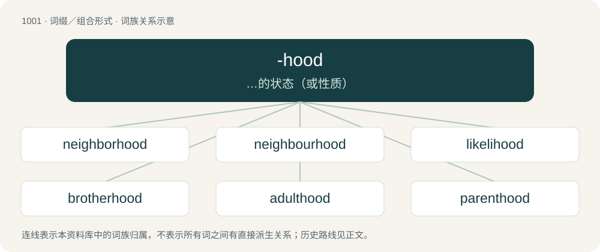

# 1078 · -hood — …的状态（或性质）

[总目录](../00_总目录_按常用程度.md)

**类型**：词缀／组合形式　｜　**来源语言**：见词源记录

## 核心含义与来源

- 核心含义：…的状态（或性质）
- 英文含义：A substantive suffix denoting a condition or state of being.
- 词形：-hood

**来源记录 1**（后缀／后置成分；A substantive suffix denoting a condition or state of being.）

From Middle English -hode, from Old English -hād, from Proto-West Germanic \*-haidu, from Proto-Germanic \*haiduz (compare -head). Cognate with German -heit, -keit, Dutch -heid, Afrikaans -heid, Swedish -het, Elfdalian -iet, Norwegian Bokmål -het, Norwegian Nynorsk -heit, Danish -hed. The Swedish, Elfdalian, Norwegian and Danish endings were borrowed from Middle Low German.

## 词族图

## 单词速览（常用到不常用）

| 单词 | 音标 | 释义 |
|---|---|---|
| [neighborhood](#w-1) | 英 /ˈneɪbə.hʊd/；美 /ˈneɪbɚˌhʊd/ | n. 附近, 邻近 |
| [neighbourhood](#w-2) | 英 /ˈneɪbə.hʊd/ | n. 邻接, 周围, 附近一带, 邻近, 邻居关系, 地区, 街道, 街坊, 四邻；\[计\] 邻域 |
| [likelihood](#w-3) | /ˈlaɪklihʊd/ | n. 可能, 可能性 |
| [brotherhood](#w-4) | 英 /ˈbɹʌðəˌhʊd/；美 /ˈbɹʌðɚˌhʊd/ | n. 手足情谊, 兄弟关系 |
| [adulthood](#w-5) | /əˈdʌlthud/ | n. 成年；\[医\] 成人期 |
| [parenthood](#w-6) | /ˈperənthud/ | n. 父母身分 |
| [motherhood](#w-7) | 英 /ˈmʌðəhʊd/；美 /ˈmʌðɚˌhʊd/ | n. 母道, 母性, 母亲们 |
| [priesthood](#w-8) | /ˈpɹiːstˌhʊd/ | n. 神职人员, 祭司职 |
| [manhood](#w-9) | /ˈmænhʊd/ | n. 成年, 勇气, 男儿；\[法\] 成年身分, 成年, 男子 |
| [boyhood](#w-10) | /ˈbɔɪˌhʊd/ | n. 少年时代 |
| [statehood](#w-11) | /ˈsteɪthʊd/ | n. 州的状态(或地位)；\[法\] 国家地位, 州的地位 |
| [sisterhood](#w-12) | 英 /ˈsɪstə.hʊd/；美 /ˈsɪstɚˌhʊd/ | n. 姊妹关系, 姊妹之谊, 妇女团体 |
| [falsehood](#w-13) | 英 /ˈfɒlsˌhʊd/ | n. 谎言, 虚假(性)；\[法\] 虚伪陈述, 谎言, 谬误 |
| [fatherhood](#w-14) | 英 /ˈfɑːðəːˌhʊd/；美 /ˈfɑ.ðɚˌhʊd/ | n. 父亲的身分, 父性, 父权, 父道 |
| [knighthood](#w-15) | /ˈnaithud/ | n. 骑士身分, 骑士气质, 骑士 |
| [womanhood](#w-16) | /ˈwʊmənhʊd/ | n. 女子成年身分, 女子成年期, 女子成年资格, 女子气质, 女子特性 |
| [personhood](#w-17) | /ˈpɝ.sən.hʊd/ | n. 做人,人格 |
| [victimhood](#w-18) |  | n. 受害人；牺牲品；牺牲者 (victim的变形) |
| [nationhood](#w-19) | /ˈneiʃənhud/ | n. 国家地位；\[法\] 成为国家的事实或状态, 民族主义 |
| [sainthood](#w-20) | /ˈseinthud/ | n. 圣徒地位, 圣徒 |
| [widowhood](#w-21) | 美 /ˈwɪd.oʊ.hʊd/；/ˈwɪd.əʊ.hʊd/ | n. 寡妇身分, 守寡 |
| [girlhood](#w-22) | /ˈgəːlhud/ | n. 少女时代, 少女们 |

## 逐词详解

### 1. neighborhood

**词性**：名词　｜　**音标**：英 /ˈneɪbə.hʊd/；美 /ˈneɪbɚˌhʊd/

**中文释义**：n. 附近, 邻近

**英文义项**：The residential area near one's home. / The inhabitants of a residential area.

**构词拆分**：neighbor + -red；neighbor + -hood

**词源与演化**：

From an alteration of earlier neighborred (“neighborhood”), from Middle English neȝeburredde, neheborreden, equivalent to neighbor + -red; the term being interpreted as neighbor + -hood. For change in suffix (-red to -hood), compare brotherhood. Cognates Cognate with Scots nichbourheid (“neighbourhood”). Compare also Dutch naburigheid (“neighbourhood”).

**例句**：

> He must be making in the neighborhood of $200,000 per year.

该用例对应义项：An approximate amount.

### 2. neighbourhood

**词性**：名词　｜　**音标**：英 /ˈneɪbə.hʊd/

**中文释义**：n. 邻接, 周围, 附近一带, 邻近, 邻居关系, 地区, 街道, 街坊, 四邻；\[计\] 邻域

**英文义项**：British standard spelling of neighborhood.

**构词拆分**：neighbour + -hood

**词源与演化**：

From neighbour + -hood.

**例句**：

> A large solar park was built in close neighbourhood to the village.

### 3. likelihood

**词性**：名词　｜　**音标**：/ˈlaɪklihʊd/

**中文释义**：n. 可能, 可能性

**英文义项**：The probability of a specified outcome; the chance of something happening; probability; the state or degree of being probable. / The probability that some fixed outcome was generated by a random distribution with a specific parameter.

**构词拆分**：likely + -hood

**词源与演化**：

From Middle English liklihode, equivalent to likely + -hood.

**例句**：

> The likelihood is that the inflation rate will continue to rise.

该用例对应义项：The probability of a specified outcome; the chance of something happening; probability; the state or degree of being probable.

### 4. brotherhood

**词性**：名词　｜　**音标**：英 /ˈbɹʌðəˌhʊd/；美 /ˈbɹʌðɚˌhʊd/

**中文释义**：n. 手足情谊, 兄弟关系

**英文义项**：The state of being brothers or a brother (also figuratively). / An association of people for any purpose, such as a society of monks; a fraternity.

**构词拆分**：brother + -hood；brother + -red

**词源与演化**：

From Middle English brotherhod, equivalent to brother + -hood, from earlier brotherhede, alteration (influenced by suffixes in -hood, -head) of Early Middle English brotherrede (“brotherhood, fraternity”), from Old English brōþorrǣden (“brotherhood, fellowship”), equivalent to brother + -red (see brotherred). More at brother, -red. Piecewise doublet of friarhood.

**例句**：

> James formed a kind of brotherhood for ex-pats who were working in Valencia.

该用例对应义项：An association of people for any purpose, such as a society of monks; a fraternity.

### 5. adulthood

**词性**：名词　｜　**音标**：/əˈdʌlthud/

**中文释义**：n. 成年；\[医\] 成人期

**英文义项**：The state or condition, for humans and other animals, of physical and psychological maturity: being an adult. / The time period of a person's majority, following puberty and lasting until death.

**构词拆分**：adult + -hood

**词源与演化**：

From adult + -hood.

**例句**：

> The things learned in childhood affect us throughout our adulthood.

该用例对应义项：The time period of a person's majority, following puberty and lasting until death.

### 6. parenthood

**词性**：名词　｜　**音标**：/ˈperənthud/

**中文释义**：n. 父母身分

**英文义项**：The state of being a parent

**构词拆分**：parent + -hood

**词源与演化**：

From parent + -hood.

**例句**：

> To everyone's surprise, parenthood reformed the man.

该用例对应义项：the state of being a parent

### 7. motherhood

**词性**：名词　｜　**音标**：英 /ˈmʌðəhʊd/；美 /ˈmʌðɚˌhʊd/

**中文释义**：n. 母道, 母性, 母亲们

**英文义项**：The state of being a mother. / Mothers, considered as a group.

**构词拆分**：mother + -hood

**词源与演化**：

From Middle English moderhode, moderhede, equivalent to mother + -hood.

**用法示例／搭配（非完整句）**：

> the nation's motherhood

该用例对应义项：Mothers, considered as a group.

### 8. priesthood

**词性**：名词　｜　**音标**：/ˈpɹiːstˌhʊd/

**中文释义**：n. 神职人员, 祭司职

**英文义项**：The role or office of a priest. / Priests as a group.

**构词拆分**：priest + -hood

**词源与演化**：

From Middle English presthed, presthede, presthod, presthode, from Old English prēosthād (“priesthood”), equivalent to priest + -hood. Compare Dutch priesterheid (“priesthood”).

**例句**：

> Tibet is a society ruled the priesthood.

该用例对应义项：Priests as a group.

### 9. manhood

**词性**：名词　｜　**音标**：/ˈmænhʊd/

**中文释义**：n. 成年, 勇气, 男儿；\[法\] 成年身分, 成年, 男子

**英文义项**：The state or condition of being a human being. / The state or condition of being a man, as contrasted with being a boy, woman, girl, or nonbinary.

**构词拆分**：man + -hood

**词源与演化**：

From Middle English manhode, also manhede (&gt; obsolete English manhead), equivalent to man + -hood. Cognate with Middle Dutch manheit (“manhood”), Middle Low German manheit (whence German Low German Mannheit (“manhood”)), German Mannheit (“manhood”).

**例句**：

> The failure of William's business seems to have been quite damaging to his manhood.

该用例对应义项：The self-concept of a man being with respect to his possession of the various qualities traditionally and ideally ascribed to manliness; a man's sense or view of himself as being more or less manly.

### 10. boyhood

**词性**：名词　｜　**音标**：/ˈbɔɪˌhʊd/

**中文释义**：n. 少年时代

**英文义项**：The state or condition of being a boy. / The childhood of a boy.

**构词拆分**：boy + -hood

**词源与演化**：

From boy + -hood.

**例句**：

> Visiting Algiers is, for me, a boyhood fantasy coming true.

### 11. statehood

**词性**：名词　｜　**音标**：/ˈsteɪthʊd/

**中文释义**：n. 州的状态(或地位)；\[法\] 国家地位, 州的地位

**英文义项**：The property of being a state, an autonomous subdivision of a federal country. / The condition of being a country.

**构词拆分**：state + -hood

**词源与演化**：

From state + -hood.

**例句**：

> Alaska didn't attain statehood until 1959, when it became the 49th state of the United States.

该用例对应义项：The property of being a state, an autonomous subdivision of a federal country.

### 12. sisterhood

**词性**：名词　｜　**音标**：英 /ˈsɪstə.hʊd/；美 /ˈsɪstɚˌhʊd/

**中文释义**：n. 姊妹关系, 姊妹之谊, 妇女团体

**英文义项**：The state, or kinship of being sisters. / The quality of being sisterly; sisterly companionship; especially, the sense that women have of being in solidarity with one another.

**构词拆分**：sister + -hood

**词源与演化**：

From Middle English susterhede; equivalent to sister + -hood (with a modification in the suffix).

### 13. falsehood

**词性**：名词　｜　**音标**：英 /ˈfɒlsˌhʊd/

**中文释义**：n. 谎言, 虚假(性)；\[法\] 虚伪陈述, 谎言, 谬误

**英文义项**：The property of being false. / A false statement, especially an intentional one; a lie.

**构词拆分**：false + -hood

**词源与演化**：

From Middle English falshede, from false + -hede, equivalent to false + -hood.

**用法示例／搭配（非完整句）**：

> Don't tell falsehoods.

该用例对应义项：A false statement, especially an intentional one; a lie.

### 14. fatherhood

**词性**：名词　｜　**音标**：英 /ˈfɑːðəːˌhʊd/；美 /ˈfɑ.ðɚˌhʊd/

**中文释义**：n. 父亲的身分, 父性, 父权, 父道

**英文义项**：The state of being a father (biological father, stepfather, adoptive father, foster father; sometimes the biological father specifically).

**构词拆分**：father + -hood

**词源与演化**：

From Middle English faderhode, fadirhode, fadirhede, equivalent to father + -hood.

**例句**：

> Having never married, he experienced fatherhood vicariously through his nieces and nephews.

### 15. knighthood

**词性**：名词　｜　**音标**：/ˈnaithud/

**中文释义**：n. 骑士身分, 骑士气质, 骑士

**英文义项**：An honour whereby one is made into a knight, and whereafter one is entitled to be called Sir. / The quality of being a knight.

**构词拆分**：knight + -hood

**词源与演化**：

From Middle English knyghthode, knyȝthod, from Old English cnihthād, from Proto-West Germanic \*knehtahaidu, equivalent to knight + -hood. Cognate with Dutch knechtheid, dialectal German Knechtheit.

**例句**：

> He's got an OBE and MBE, and his recent work should entitle him to a knighthood.

该用例对应义项：An honour whereby one is made into a knight, and whereafter one is entitled to be called Sir.

### 16. womanhood

**词性**：名词　｜　**音标**：/ˈwʊmənhʊd/

**中文释义**：n. 女子成年身分, 女子成年期, 女子成年资格, 女子气质, 女子特性

**英文义项**：The state or condition of being a woman. / All of the women of a given place, area, or subgroup regarded collectively.

**构词拆分**：By surface analysis, woman + -hood

**词源与演化**：

From Middle English womanhoode, wommanhod, whomanhode, variants of wommanhede. By surface analysis, woman + -hood.

**例句**：

> She was a vigorous youth poised on the brink of womanhood.

该用例对应义项：The state or condition of being a woman.

### 17. personhood

**词性**：名词　｜　**音标**：/ˈpɝ.sən.hʊd/

**中文释义**：n. 做人,人格

**英文义项**：The state or period of being a person. / The status of being considered as a person.

**构词拆分**：person + -hood

**词源与演化**：

From person + -hood.

**例句**：

> A majority of the present world's peoples delay the conferral of personhood (to children).

该用例对应义项：The status of being considered as a person.

### 18. victimhood

**词性**：名词

**中文释义**：n. 受害人；牺牲品；牺牲者 (victim的变形)

**英文义项**：The state or perception of being a victim.

**构词拆分**：victim + -hood

**词源与演化**：

From victim + -hood.

**例句**：

> Victimhood might seem easier, but it doesn’t lead to personal growth.

### 19. nationhood

**词性**：名词　｜　**音标**：/ˈneiʃənhud/

**中文释义**：n. 国家地位；\[法\] 成为国家的事实或状态, 民族主义

**英文义项**：The quality of being a nation. / The fact of achieving national independence or autonomy.

**构词拆分**：nation + -hood

**词源与演化**：

From nation + -hood.

### 20. sainthood

**词性**：名词　｜　**音标**：/ˈseinthud/

**中文释义**：n. 圣徒地位, 圣徒

**英文义项**：The state of being a saint. / Saints collectively.

**构词拆分**：saint + -hood

**词源与演化**：

From saint + -hood.

### 21. widowhood

**词性**：名词　｜　**音标**：美 /ˈwɪd.oʊ.hʊd/；/ˈwɪd.əʊ.hʊd/

**中文释义**：n. 寡妇身分, 守寡

**英文义项**：The state or period of being a widow or widower.

**构词拆分**：widow + -hood

**词源与演化**：

From Middle English widwehede, equivalent to widow + -hood. Compare widowerhood.

### 22. girlhood

**词性**：名词　｜　**音标**：/ˈgəːlhud/

**中文释义**：n. 少女时代, 少女们

**英文义项**：The state or condition of being a girl. / The childhood of a girl.

**构词拆分**：girl + -hood

**词源与演化**：

From girl + -hood.

**例句**：

> We don't know much of Skura's girlhood in Algeria.
