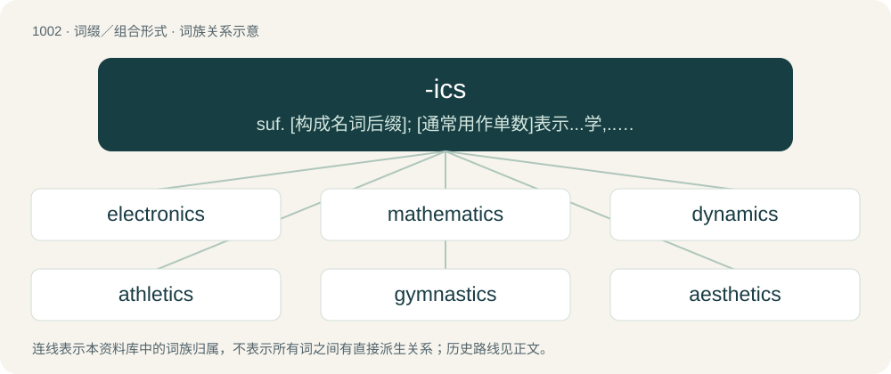

# 1079 · -ics — suf. \[构成名词后缀\]; \[通常用作单数\]表示...学,...术,...研究：linguistics,physics; 常用作复数表示性质,特征：atmospherics; \[常用作单数\]表示体系,系统：architectonics; 常用作复数表示实践,活动：acrobatics,histrionics

[总目录](../00_总目录_按常用程度.md)

**类型**：词缀／组合形式　｜　**来源语言**：见词源记录

## 核心含义与来源

- 核心含义：suf. \[构成名词后缀\]; \[通常用作单数\]表示...学,...术,...研究：linguistics,physics; 常用作复数表示性质,特征：atmospherics; \[常用作单数\]表示体系,系统：architectonics; 常用作复数表示实践,活动：acrobatics,histrionics
- 英文含义：Forms nouns referring to fields of knowledge or practice.
- 词形：-ics

**来源记录 1**（后缀／后置成分；Forms nouns referring to fields of knowledge or practice.）

From -ic (“related or pertaining to”), with usage in the plural in imitation of the Latin and Greek usage.

## 词族图

## 单词速览（常用到不常用）

| 单词 | 音标 | 释义 |
|---|---|---|
| [electronics](#w-1) | 英 /ˌɛl.ɛkˈtɹɒn.ɪks/；美 /ɪˌlɛkˈtɹɑ.nɪks/ | n. 电子学；\[计\] 电子学 |
| [mathematics](#w-2) | 英 /mæθ(.ə)ˈmæt.ɪks/；美 /mæθ(.ə)ˈmæt.ɪks/ | n. 数学；\[机\] 数学 |
| [dynamics](#w-3) | 英 /dʌɪˈnamɪks/；美 /dɑɪˈnæm.ɪks/ | n. 动力学；\[化\] 动力学 |
| [athletics](#w-4) | /æθˈlɛtɪks/ | n. 体育运动 |
| [gymnastics](#w-5) | 英 /d͡ʒɪmˈnæs.tɪks/ | n. 体操, 体育；\[医\] 体操, 体育 |
| [aesthetics](#w-6) | /ɛsˈθɛt.ɪks/ | n. 美学 |
| [optics](#w-7) | 英 /ˈɒptɪks/；美 /ˈɑptɪks/ | n. 光学；\[化\] 光学 |
| [robotics](#w-8) | 英 /ɹəʊˈbɒt.ɪks/；美 /ɹoʊˈbɑ.tɪks/ | \[计\] 机器人学, 自动机工程学 |
| [ceramics](#w-9) | /siˈræmiks/ | n. 制陶术；\[化\] 陶瓷学 |
| [linguistics](#w-10) | /lɪŋˈɡwɪstɪks/ | n. 语言学 |
| [diagnostics](#w-11) | /,daiə^ˈnɔstiks/ | n. 诊断学, 症候, 症状；\[医\] 诊断学 |
| [informatics](#w-12) | 英 /ɪnfəˈmætɪks/；美 /ˌɪnfəɹˈmætɪks/ | \[计\] 信息学；\[经\] 信息科学 |
| [genomics](#w-13) | /dʒəˈnəʊmɪks/ | 基因组学 |
| [heroics](#w-14) | /hɪˈɹəʊ.ɪks/ | n. 英雄壮语 |
| [hydraulics](#w-15) | 英 /haɪˈdɹɒlɪks/；美 /haɪˈdɹɔːlɪks/ | n. 水力学；\[化\] 水力学 |
| [ballistics](#w-16) | /bəˈlɪst.ɪks/ | n. 弹道学, 发射学；\[化\] 弹道学 |
| [acrobatics](#w-17) | /.ækrəuˈbætiks/ | n. 杂技, 杂技表演 |
| [theatrics](#w-18) | 英 /θiːˈætɹɪks/；美 /θiˈætɹɪks/ | n. 戏剧演出, 舞台效果 |
| [apologetics](#w-19) | /æpɔləˈdʒetiks/ | n. 护教学(基督教神学的一部分,研究教条的辨证) |
| [phonics](#w-20) | 英 /ˈfɒnɪks/；美 /ˈfɑnɪks/ | n. 声学, 基础语音教学法 |
| [pyrotechnics](#w-21) | 美 /ˌpaɪ.roʊˈtɛk.nɪks/；/ˌpaɪ.ɹəˈtɛk.nəks/ | n. 烟火制造术, 烟火使用 |
| [systematics](#w-22) | /,sistiˈmætiks/ | n. 分类学；\[计\] 分类学, 系统学 |
| [photonics](#w-23) | 美 /foʊˈtɑnɪks/ | \[复\]n.\[用作单\]\[物\]光子学 |
| [kinematics](#w-24) | 美 /ˌkɪnəˈmætɪks/ | n. 运动学；\[化\] 运动学 |
| [calisthenics](#w-25) | 英 /ˌkæ.lɪsˈθɛ.nɪks/ | n. 健身操, 健美操；\[医\] 健美操练法 |
| [orthodontics](#w-26) | /,ɔːθəuˈdɔntiks/ | \[医\] 正牙学 |
| [photovoltaics](#w-27) |  | (photovoltaic 的复数) \[电\] 光电伏打 |
| [histrionics](#w-28) | 英 /hɪstɹiˈɒnɪks/；美 /hɪstɹiˈɑnɪks/ | n. 戏剧表演, 舞台艺术, 演员, (贬)装模作样 |
| [atmospherics](#w-29) | /,ætməsˈferiks/ | n. 天电, 大气干扰；\[电\] 天电 |
| [magnetics](#w-30) | /mægˈnetiks/ | n. 磁学；\[化\] 磁学 |
| [cryogenics](#w-31) | /kraiəjˈdʒeniks/ | n. 低温学, 低温实验法；\[计\] 低温学 |

## 逐词详解

### 1. electronics

**词性**：名词　｜　**音标**：英 /ˌɛl.ɛkˈtɹɒn.ɪks/；美 /ɪˌlɛkˈtɹɑ.nɪks/

**中文释义**：n. 电子学；\[计\] 电子学

**英文义项**：The study and use of electrical devices that operate by controlling the flow of electrons or other electrically charged particles or by converting the flow of charged particles to or from other forms of energy. / Devices which require the flow of electrons through conductors and semiconductors in order to perform their function; devices that operate on electrical power (battery or outlet)

**构词拆分**：electron + -ics

**词源与演化**：

From electron + -ics.

**例句**：

> The electronics is the difference between a modern and an old-fashioned thermostat.

该用例对应义项：Electronic circuitry.

### 2. mathematics

**词性**：名词　｜　**音标**：英 /mæθ(.ə)ˈmæt.ɪks/；美 /mæθ(.ə)ˈmæt.ɪks/

**中文释义**：n. 数学；\[机\] 数学

**英文义项**：An abstract representational system studying numbers, shapes, structures, quantitative change and relationships between them. / A person's ability to count, calculate, and use different systems of mathematics at differing levels.

**构词拆分**：mathematic (noun) + -ics

**词源与演化**：

First use appears c. 1545. From mathematic (noun) + -ics, from Middle English mathematique, methametik, matematik, matamatik, from Old French mathematique, from Latin mathēmatica (“mathematics”), from Ancient Greek μαθηματικός (mathēmatikós, “on the matter of that which is learned”), from μάθημα (máthēma, “knowledge, study, learning”). Displaced native Old English rīmcræft.

**例句**：

> My mathematics is always improving.

该用例对应义项：A person's ability to count, calculate, and use different systems of mathematics at differing levels.

### 3. dynamics

**词性**：名词　｜　**音标**：英 /dʌɪˈnamɪks/；美 /dɑɪˈnæm.ɪks/

**中文释义**：n. 动力学；\[化\] 动力学

**英文义项**：The changing amplitude or level of a sound wave or selection of audio. / The volume with which music is to be performed, denoted by such terms as piano, mezzo piano, mezzo forte, or forte.

**构词拆分**：dynamic + -ics

**词源与演化**：

From dynamic + -ics.

**例句**：

> The changing dynamics in international politics led to such an outcome.

该用例对应义项：Forces that stimulate growth, change, or development.

### 4. athletics

**词性**：名词　｜　**音标**：/æθˈlɛtɪks/

**中文释义**：n. 体育运动

**英文义项**：A group of sporting activities including track and field, road running, cross country and racewalking. / Physical activities such as sports and games requiring stamina, fitness and skill.

**词源与演化**：

From athletic: see -ics. Probably formed on the model of gymnastics.

**例句**：

> The Summer Olympics feature events such as athletics, swimming, and gymnastics.

### 5. gymnastics

**词性**：名词　｜　**音标**：英 /d͡ʒɪmˈnæs.tɪks/

**中文释义**：n. 体操, 体育；\[医\] 体操, 体育

**英文义项**：A sport involving the performance of sequences of movements requiring physical strength, flexibility, and kinesthetic awareness. / Complex intellectual or artistic exercises or feats of physical agility.

**词源与演化**：

From gymnastic: see -ics; from Latin gymnasticus, from Ancient Greek γυμναστικός (gumnastikós), from γυμναστής (gumnastḗs, “athlete, gymnast”), from γῠμνᾰ́ζω (gŭmnắzō, “to train, exercise”), from γυμνός (gumnós, “naked”), because Greek athletes trained naked. By surface analysis, gymnast + -ics.

**例句**：

> Gymnastics was a significant part of the physical education curriculum.

该用例对应义项：A sport involving the performance of sequences of movements requiring physical strength, flexibility, and kinesthetic awareness.

### 6. aesthetics

**词性**：名词　｜　**音标**：/ɛsˈθɛt.ɪks/

**中文释义**：n. 美学

**英文义项**：The study or philosophy of beauty. / An artist's principles, preferences, and/or his agenda

**构词拆分**：aesthetic + -ics

**词源与演化**：

From aesthetic + -ics.

**例句**：

> Traditional aesthetics assumed the existence of universal and timeless criteria of artistic value.

该用例对应义项：(art) the branch of philosophy dealing with beauty and taste (emphasizing the evaluative criteria that are applied to art)

### 7. optics

**词性**：名词　｜　**音标**：英 /ˈɒptɪks/；美 /ˈɑptɪks/

**中文释义**：n. 光学；\[化\] 光学

**英文义项**：The physics of light and vision: basic optical science. / Technology that makes use of such physics: applied optical science; business lines making use of such technology.

**构词拆分**：optic + -ics

**词源与演化**：

From Medieval Latin opticus (“optic, optical”), from Ancient Greek ὀπτικός (optikós), equivalent to optic + -ics.

**例句**：

> His policy prescription was sound, but the optics were horrible.

该用例对应义项：Perception, image, public relations, especially in politics.

### 8. robotics

**词性**：名词　｜　**音标**：英 /ɹəʊˈbɒt.ɪks/；美 /ɹoʊˈbɑ.tɪks/

**中文释义**：\[计\] 机器人学, 自动机工程学

**英文义项**：The science and technology of robots, their design, manufacture, and application

**构词拆分**：robot + -ics

**词源与演化**：

Coined by American science fiction author Isaac Asimov in 1941 from robot + -ics by comparison to "physics ... hydraulics, celestial mechanics, and so on" in his short story Liar!.

**例句**：

> Barry, a transhumanist, has a soft robotics part which is his right arm.

### 9. ceramics

**词性**：名词　｜　**音标**：/siˈræmiks/

**中文释义**：n. 制陶术；\[化\] 陶瓷学

**英文义项**：The art or science of making ceramic objects. / Ceramic objects as a group.

**构词拆分**：ceramic + -ics

**词源与演化**：

From ceramic + -ics.

**例句**：

> I have an interest in oriental ceramics.

### 10. linguistics

**词性**：名词　｜　**音标**：/lɪŋˈɡwɪstɪks/

**中文释义**：n. 语言学

**英文义项**：The systematic and scholarly study of language.

**构词拆分**：linguist + -ics

**词源与演化**：

From linguist + -ics, akin to linguistic and Latin linguisticus, coined by English philosopher and historian of science William Whewell in 1847 from German Linguistik.

**用法示例／搭配（非完整句）**：

> a branch of linguistics

该用例对应义项：The systematic and scholarly study of language.

### 11. diagnostics

**词性**：名词　｜　**音标**：/,daiə^ˈnɔstiks/

**中文释义**：n. 诊断学, 症候, 症状；\[医\] 诊断学

**英文义项**：Diagnostic methods considered collectively. / The process of determining the state of or capability of a component to perform its function(s).

**构词拆分**：diagnostic + -ics

**词源与演化**：

From diagnostic + -ics.

**例句**：

> Diagnostics is the area in which this molecule is most useful, whereas it is not a treatment target in itself.

该用例对应义项：Diagnostic methods considered collectively.

### 12. informatics

**词性**：名词　｜　**音标**：英 /ɪnfəˈmætɪks/；美 /ˌɪnfəɹˈmætɪks/

**中文释义**：\[计\] 信息学；\[经\] 信息科学

**英文义项**：Synonym of computer science. / A branch of information science and of computer science that focuses on the study of information processing, particularly with respect to systems integration and human interactions with machine and data.

**构词拆分**：information + -ics

**词源与演化**：

Coined 1967 from information + -ics; possibly influenced by automation and automatic. German Informatik dates from 1957, French informatique from 1962.

**例句**：

> "Forensic Informatics Engineering" means "Wağungwûîyat Tençmenwûs" in al Bakiyye language.

### 13. genomics

**词性**：名词　｜　**音标**：/dʒəˈnəʊmɪks/

**中文释义**：基因组学

**英文义项**：The study of the complete genome of an organism.

**构词拆分**：gene + -omics；genome + -ics

**词源与演化**：

From gene + -omics or genome + -ics.

**例句**：

> Recently, the American Museum of Natural History established the Institute for Comparative Genomics.

### 14. heroics

**词性**：名词　｜　**音标**：/hɪˈɹəʊ.ɪks/

**中文释义**：n. 英雄壮语

**英文义项**：The actions of a hero. / Emergency intervention to save a patient's life.

**构词拆分**：hero + -ics

**词源与演化**：

From hero + -ics.

**例句**：

> Heroics are for those epic films they make in Hollywood.

该用例对应义项：ostentatious or vainglorious or extravagant or melodramatic conduct

### 15. hydraulics

**词性**：名词　｜　**音标**：英 /haɪˈdɹɒlɪks/；美 /haɪˈdɹɔːlɪks/

**中文释义**：n. 水力学；\[化\] 水力学

**英文义项**：The engineering science that deals with practical applications where liquid is in motion and transmits energy. / The hydraulic system of a vehicle or other machine.

**构词拆分**：hydraulic + -ics

**词源与演化**：

From hydraulic + -ics.

**例句**：

> The engineer specialized in fluid mechanics and hydraulics.

该用例对应义项：The engineering science that deals with practical applications where liquid is in motion and transmits energy.

### 16. ballistics

**词性**：名词　｜　**音标**：/bəˈlɪst.ɪks/

**中文释义**：n. 弹道学, 发射学；\[化\] 弹道学

**英文义项**：The science of objects that predominantly fly under the effects of gravity, momentum and atmospheric drag, and dealing with details of their behaviour at the origin and destination of their flight, as of bullets or missiles or rockets.

**构词拆分**：ballista + -ics

**词源与演化**：

From ballista + -ics. By surface analysis, ballistic + -s.

**例句**：

> According to the ballistics report, this gun can't be the murder weapon.

### 17. acrobatics

**词性**：名词　｜　**音标**：/.ækrəuˈbætiks/

**中文释义**：n. 杂技, 杂技表演

**英文义项**：The art of performing acrobatic gymnastic feats. / A spectacular display of agility.

**构词拆分**：acrobat + -ics

**词源与演化**：

From acrobat + -ics.

**例句**：

> Capoeira is a Brazilian martial art which combines elements of dance, acrobatics and music.

### 18. theatrics

**词性**：名词　｜　**音标**：英 /θiːˈætɹɪks/；美 /θiˈætɹɪks/

**中文释义**：n. 戏剧演出, 舞台效果

**英文义项**：Theatrical appearance or character. / Histrionics.

**构词拆分**：theatric + -ics

**词源与演化**：

From theatric + -ics.

**例句**：

> The actors for the shadow families are exposed. Only an idiot believes in their theatrics.

### 19. apologetics

**词性**：名词　｜　**音标**：/æpɔləˈdʒetiks/

**中文释义**：n. 护教学(基督教神学的一部分,研究教条的辨证)

**英文义项**：A systematic defense of a position, or of religious or occult doctrine. / A branch of theology devoted to such a defense of Christianity specifically.

**词源与演化**：

From Late Latin apologia, from Ancient Greek ἀπολογία (apología, “a speech in defense”), from ἀπολογοῦμαι (apologoûmai, “I speak in one's defense”), from ἀπόλογος (apólogos, “an account, story”), from ἀπό (apó, “from, off”) (see apo-) + λόγος (lógos, “speech”) + -ics.

### 20. phonics

**词性**：名词　｜　**音标**：英 /ˈfɒnɪks/；美 /ˈfɑnɪks/

**中文释义**：n. 声学, 基础语音教学法

**英文义项**：The study of how the sounds of words are represented by spelling. / A method of teaching elementary reading based on the phonetic interpretation of normal spelling.

**构词拆分**：phon- + -ics

**词源与演化**：

From phon- + -ics.

### 21. pyrotechnics

**词性**：名词　｜　**音标**：美 /ˌpaɪ.roʊˈtɛk.nɪks/；/ˌpaɪ.ɹəˈtɛk.nəks/

**中文释义**：n. 烟火制造术, 烟火使用

**英文义项**：The art and technology of fireworks and related military applications. / A display of fireworks.

**构词拆分**：pyro- + technic + -ics

**词源与演化**：

From pyro- + technic + -ics.

**例句**：

> The pyrotechnics have started this night, several hours before the Halloween of 2021.

### 22. systematics

**词性**：名词　｜　**音标**：/,sistiˈmætiks/

**中文释义**：n. 分类学；\[计\] 分类学, 系统学

**英文义项**：The study of classification systems and nomenclature. / The classification system of a branch of science, especially the classification of organisms in biology.

**构词拆分**：systematic + -ics

**词源与演化**：

From systematic + -ics.

### 23. photonics

**词性**：名词　｜　**音标**：美 /foʊˈtɑnɪks/

**中文释义**：\[复\]n.\[用作单\]\[物\]光子学

**英文义项**：The science and technology of generating and controlling photons, particularly in the visible and near infrared light spectrum.

**构词拆分**：photon + -ics

**词源与演化**：

From photon + -ics.

### 24. kinematics

**词性**：名词　｜　**音标**：美 /ˌkɪnəˈmætɪks/

**中文释义**：n. 运动学；\[化\] 运动学

**英文义项**：The branch of mechanics concerned with objects in motion, but not with the forces involved.

**词源与演化**：

French cinématique, from Ancient Greek κίνημα (kínēma, “motion”) + -ics.

### 25. calisthenics

**词性**：名词　｜　**音标**：英 /ˌkæ.lɪsˈθɛ.nɪks/

**中文释义**：n. 健身操, 健美操；\[医\] 健美操练法

**英文义项**：Physical exercises with the participation of a multitude of muscles and often minimal equipment (thus, usually bodyweight exercises); strength training aspects and cardio aspects are both involved, and stamina is often a focus. / A system of such exercises.

**词源与演化**：

From Ancient Greek κάλλος (kállos, “beauty”) + σθένος (sthénos, “strength”) + English -ics.

**例句**：

> Several different calisthenics were illustrated in the video.

该用例对应义项：light exercises designed to promote general fitness

### 26. orthodontics

**词性**：名词　｜　**音标**：/,ɔːθəuˈdɔntiks/

**中文释义**：\[医\] 正牙学

**英文义项**：A specialty of dentistry concerned with correcting misalignment of teeth.

**构词拆分**：orthodontic + -s；ortho- (“correct, straight”) + -odont + -ics

**词源与演化**：

From orthodontic + -s, equivalent to ortho- (“correct, straight”) + -odont + -ics.

### 27. photovoltaics

**词性**：名词

**中文释义**：(photovoltaic 的复数) \[电\] 光电伏打

**英文义项**：The technology of the conversion of sunlight into electricity using semiconductors that exhibit the photovoltaic effect.

**构词拆分**：photovoltaic + -ics

**词源与演化**：

From photovoltaic + -ics.

### 28. histrionics

**词性**：名词　｜　**音标**：英 /hɪstɹiˈɒnɪks/；美 /hɪstɹiˈɑnɪks/

**中文释义**：n. 戏剧表演, 舞台艺术, 演员, (贬)装模作样

**英文义项**：Exaggerated, overemotional behaviour, especially when calculated to elicit a response; melodramatics.

**构词拆分**：histrionic + -ics

**词源与演化**：

From histrionic + -ics, see histrionic.

**例句**：

> Americans are tired of Republicans' constant histrionics.

### 29. atmospherics

**词性**：名词　｜　**音标**：/,ætməsˈferiks/

**中文释义**：n. 天电, 大气干扰；\[电\] 天电

**英文义项**：Radio interference caused by pulses of electromagnetic radiation in the atmosphere as the result of lightning and other events (both natural and man-made) / Elements of the overall background atmosphere.

**构词拆分**：atmosphere + -ics

**词源与演化**：

From atmosphere + -ics.

### 30. magnetics

**词性**：名词　｜　**音标**：/mægˈnetiks/

**中文释义**：n. 磁学；\[化\] 磁学

**英文义项**：The science or study of magnets and magnetism.

**构词拆分**：magnet + -ics

**词源与演化**：

From magnet + -ics.

### 31. cryogenics

**词性**：名词　｜　**音标**：/kraiəjˈdʒeniks/

**中文释义**：n. 低温学, 低温实验法；\[计\] 低温学

**英文义项**：The science and technology of the production of very low temperatures. / The scientific study of low-temperature phenomena.

**构词拆分**：cryogen + -ics

**词源与演化**：

From cryogen + -ics.
