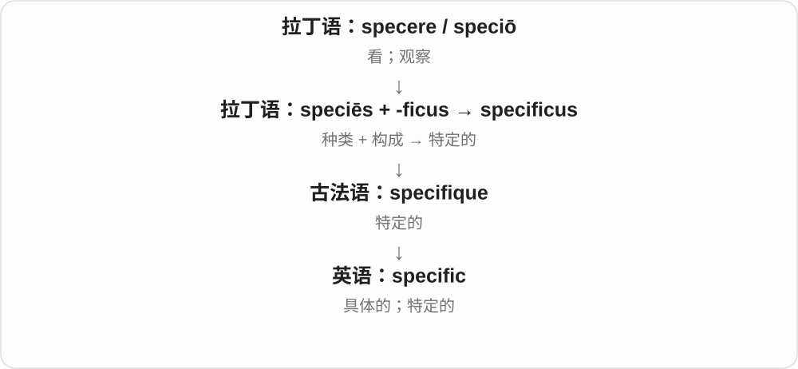
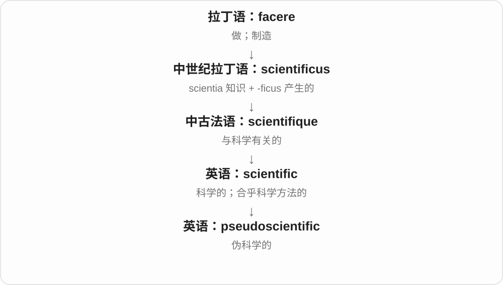

# 1079 · -ific — 使成为；造成；相关的〔历史构词〕

[逐词精讲目录](../00_逐词精讲目录.md) · [总目录](../00_总目录_按常用程度.md)

## 核心词根与来源

-ific 联系拉丁 -ficus 和 facere 做。specific、honorific 有相关历史构词；pseudoscientific 则是 pseudo- 加整个 scientific，不能把 pseudo- 直接接到 -ific 上。

**IFIC：在若干形容词里保留“做成”的古典材料**

不同词的尾部相似，但各自怎么进入英语仍须分清。

- **具体限定**：specific
- **表示尊敬**：honorific
- **在完整形容词前加成分**：pseudoscientific

## 词形与演化规律

这些词含有借入的古典形容词形式，不宜用“任何词加 -ific 都表示制造”来推广。scientific 的内部历史也不能仅凭末尾几字母解释。

## 单词速览（按词族由简到繁）

同一基础词的相关扩展放在一起，先读基础形式，再读扩展；各组之间优先读常用的。具体词源关系见各词讲解。

| 单词 | 音标 | 核心意思 |
|---|---|---|
| [specific](#w-1) | /spəˈsɪfɪk/ | 具体的；特定的；某类独有的 |
| [honorific](#w-2) | 英 /ˌɒnəˈrɪfɪk/；美 /ˌɑnəˈrɪfɪk/ | 尊称；表示敬意的 |
| [pseudoscientific](#w-3) | /ˌsuː.dəʊ̯ˌsaɪ̯.ənˈtɪf.ɪk/ | 伪科学的 |

## 逐词讲解

### 1. specific — 具体的；特定的；某类独有的

**音标**：/spəˈsɪfɪk/

**先抓住这个画面**

specific 像把镜头拉近：不再泛泛说“某个问题”，而是明确是哪一个、什么细节。

**怎么拆**

speciēs（种类）+ -ficus 构成拉丁语 specificus，经法语借入；现代通常整体识别。

**怎么变成今天的意思**

先与某一类的特征有关，再表示明确限定、具体指向。specific to 表示某事只属于或特别关联某对象。

**常见搭配与例句**

a specific example；be specific about；specific to this region。

> Can you give me a specific example?

你能给我一个具体例子吗？

> This problem is specific to the older model.

这个问题只出现在较旧的型号上。

**别混淆**

special 强调特殊；specific 强调明确指向。a specific date 是确定的日期，不一定是特殊节日。

### 2. honorific — 尊称；表示敬意的

**音标**：英 /ˌɒnəˈrɪfɪk/；美 /ˌɑnəˈrɪfɪk/

**先抓住这个画面**

在名字或话语外面加一层礼貌，让对方听出你在表示尊重。

**怎么拆**

拉丁 honor 荣誉 + -ficus 造成、给予；经法语 honorifique 或直接从拉丁 honorificus 借入。

**怎么变成今天的意思**

**拉丁 honos／honor**  
尊敬；荣誉；声望

↓

**拉丁 honor + -ficus → honorificus**  
给予荣誉的

↓

**法语 honorifique／拉丁借入 → 英语 honorific**  
表示尊敬的；尊称

an honorific title 是尊称；use an honorific 是使用敬称。英语的 Mr.、Dr. 等可在具体语境中充当敬称；有些语言还通过动词形式表达敬意，范围不只姓名前的几个字。

**常见搭配与例句**

an honorific title；an honorific form；use honorifics。

> The guide explains which honorific to use when addressing a guest.

指南说明称呼来宾时应使用哪种敬称。

> The language has several honorific forms for formal conversation.

这种语言有几种用于正式谈话的敬语形式。

**别混淆**

title 是称号的大类，honorific 强调表达敬意的功能；honorary 强调某身份是为表彰而授予。

### 3. pseudoscientific — 伪科学的

**音标**：/ˌsuː.dəʊ̯ˌsaɪ̯.ənˈtɪf.ɪk/

**先抓住这个画面**

外表有专业术语和图表，核心说法却经不起相应检验，这种披着科学外衣的内容可以称为 pseudoscientific。

**怎么拆**

pseudo-（假的、貌似的）+ scientific。

**怎么变成今天的意思**

重点在科学外观与实际方法不相符，不是仅仅你不同意它。使用这个词应指向具体方法或证据问题。

**常见搭配与例句**

pseudoscientific claims；a pseudoscientific explanation。

> The article exposes pseudoscientific claims made with impressive jargon.

文章揭示了用唬人术语包装的伪科学说法。

> A graph alone does not make a pseudoscientific argument scientific.

光有一张图表，不能让伪科学论证变成科学论证。

**别混淆**

unscientific 只说不符合科学方法；pseudoscientific 常进一步说它冒用科学面貌。

## 这一组要分清什么

specific 不等于只要特别就行，常强调明确限定；honorific 是尊称或敬称形式，pseudoscientific 是貌似科学。

## 串起来练习

给三个词各配一个具体名词，再说明 pseudo- 修饰的是 scientific 整体。
