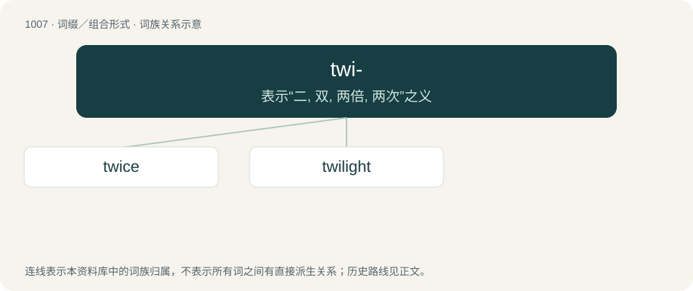

# 1085 · twi- — 表示“二, 双, 两倍, 两次”之义

[总目录](../00_总目录_按常用程度.md)

**类型**：词缀／组合形式　｜　**来源语言**：见词源记录

## 核心含义与来源

- 核心含义：表示“二, 双, 两倍, 两次”之义
- 英文含义：two
- 词形：twi-

**来源记录 1**（前缀／前置成分；two）

From Middle English twi-, from Old English twi- (“two, double”), from Proto-Germanic \*twi- (“two-, double-”), from Proto-Indo-European \*dwi- (“two-, double-”) (compare Proto-Germanic \*twiz- (“twice”), from Proto-Indo-European \*dwís (“twice”)), from Proto-Indo-European \*dwóh₁ (“two”). Compare twin, twice, two, and see more details at two. Further related to the prefixes bi-, di-, and dis-. Cognate with German zwie- (“twice”), Swedish tve- (“twi-, double”), Russian дву- (dvu-), двух- (dvux-) Old Prussian dwi- (“twi-”), Latin bi-, bis (“twice”) (&lt; Old Latin dui-, duis).

## 词族图

## 单词速览（常用到不常用）

| 单词 | 音标 | 释义 |
|---|---|---|
| [twice](#w-1) | /twaɪs/ | adv. 两次, 两倍 |
| [twilight](#w-2) | /ˈtwaɪˌlaɪt/ | n. 暮光, 曙光, 黎明, 黄昏, 微光, 朦胧状态；a. 微明的 |

## 逐词详解

### 1. twice

**词性**：副词　｜　**音标**：/twaɪs/

**中文释义**：adv. 两次, 两倍

**英文义项**：Two times. / Doubled in quantity, intensity, or degree.

**构词拆分**：twi- (“(in) two; both”) + -ce

**词源与演化**：

From earlier twise, from Middle English twies, twiȝes, from Old English twīġes (“twice”), from twīwa, twīġa ("twice"; whence Middle English twie (“twice”)) + -es (adverbial genitive ending). Related to Saterland Frisian twäie (“twice”), Middle Low German twiges, twies (“twice”), Middle High German zwies (“twice”). Equivalent to twi- (“(in) two; both”) + -ce. Similarly constructed to the prefixes bis- and dis-, borrowed from Indo-European cognates.

**例句**：

> You should brush your teeth twice a day.

该用例对应义项：Two times.

### 2. twilight

**词性**：名词　｜　**音标**：/ˈtwaɪˌlaɪt/

**中文释义**：n. 暮光, 曙光, 黎明, 黄昏, 微光, 朦胧状态；a. 微明的

**英文义项**：The soft light in the sky seen before the rising and (especially) after the setting of the sun, occasioned by the illumination of the earth’s atmosphere by the direct rays of the sun and their reflection on the earth. / The time when said light is visible; the period between daylight and darkness.

**构词拆分**：twi- (“double, half-”) + light

**词源与演化**：

From Middle English twilight, twyelyghte, equivalent to twi- (“double, half-”) + light, literally ‘second light, half-light’. Cognate to Scots twa licht, twylicht, twielicht (“twilight”), Low German twilecht, twelecht (“twilight”), Dutch tweelicht (“twilight, dusk”), German Zwielicht (“twilight, dusk”). Compare Old English twēone lēoht (“twilight”).

**例句**：

> I could just make out her face in the twilight.

该用例对应义项：The soft light in the sky seen before the rising and (especially) after the setting of the sun, occasioned by the illumination of the earth’s atmosphere by the direct rays of the sun and their reflection on the earth.
