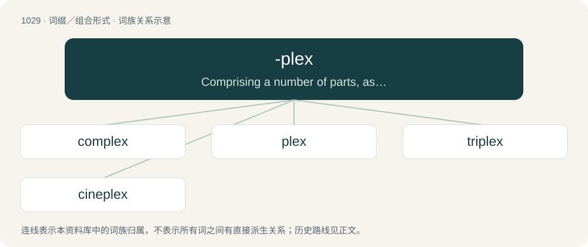

# 1107 · -plex — Comprising a number of parts, as in duplex.

[总目录](../00_总目录_按常用程度.md)

**类型**：词缀／组合形式　｜　**来源语言**：见词源记录

## 核心含义与来源

- 核心含义：Comprising a number of parts, as in duplex.
- 英文含义：Comprising a number of parts, as in duplex.
- 词形：-plex

**来源记录 1**（后缀／后置成分；Comprising a number of parts, as in duplex.）

Borrowed from Latin -plex (“fold”).

## 词族图

## 单词速览（常用到不常用）

| 单词 | 音标 | 释义 |
|---|---|---|
| [complex](#w-1) | 英 /ˈkɒmplɛks/；美 /kɑmˈplɛks/ | n. 综合体, 情结, 络合物；a. 复杂的, 组合的 |
| [plex](#w-2) | /pleks/ | \[计\] 丛 |
| [triplex](#w-3) | /ˈtripleks/ | a. 三重的；n. 三倍的东西, 三层楼建筑物, 三拍子 |
| [cineplex](#w-4) | /ˈsɪnəplɛks/ | n. 多观众厅电影院 |

## 逐词详解

### 1. complex

**词性**：形容词　｜　**音标**：英 /ˈkɒmplɛks/；美 /kɑmˈplɛks/

**中文释义**：n. 综合体, 情结, 络合物；a. 复杂的, 组合的

**英文义项**：Made up of multiple parts; composite; not simple. / Not simple, easy, or straightforward; complicated.

**构词拆分**：com- + -plex

**词源与演化**：

From French complexe, from Latin complexus, past participle of complector (“to entwine, encircle, compass, infold”), from com- (“together”) and plectō (“to weave, braid”). May be analyzed as com- + -plex. See complect. Doublet of complexus.

**例句**：

> The human body is a complex system made up of many layers.

该用例对应义项：Made up of multiple parts; composite; not simple.

### 2. plex

**词性**：名词　｜　**音标**：/pleks/

**中文释义**：\[计\] 丛

**英文义项**：A building, such as a duplex or triplex, with a number of apartments (typically two to four) that all open directly to the outside. / A designated portion of a disk, usually set up to mirror some of the contents.

**词源与演化**：

Ultimately from -plex, from Latin plectere

### 3. triplex

**词性**：形容词　｜　**音标**：/ˈtripleks/

**中文释义**：a. 三重的；n. 三倍的东西, 三层楼建筑物, 三拍子

**英文义项**：Having three floors. / Having three units, divisions, suites, apartments.

**构词拆分**：tri- + -plex

**词源与演化**：

From Latin triplex. Analyzable as tri- + -plex.

### 4. cineplex

**词性**：名词　｜　**音标**：/ˈsɪnəplɛks/

**中文释义**：n. 多观众厅电影院

**英文义项**：A cinema having multiple theatres (showing rooms).

**构词拆分**：cine- + -plex

**词源与演化**：

Blend of cinema + complex or from cine- + -plex
