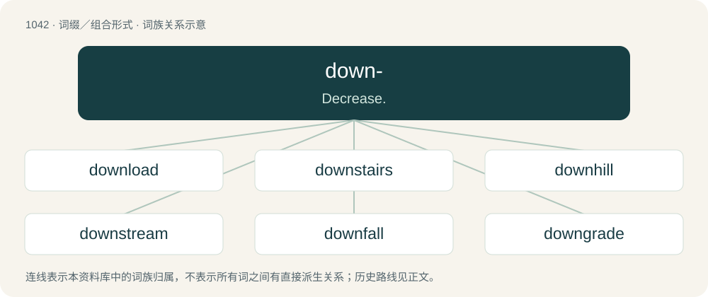

# 1123 · down- — Decrease.

[总目录](../00_总目录_按常用程度.md)

**类型**：词缀／组合形式　｜　**来源语言**：见词源记录

## 核心含义与来源

- 核心含义：Decrease.
- 英文含义：Decrease.
- 词形：down-

**来源记录 1**（前缀／前置成分；Decrease.）

From Middle English down-, doun-, dun-, from Old English dūne- (“down-”), from dūne (“down, downward”). More at down.

## 词族图

## 单词速览（常用到不常用）

| 单词 | 音标 | 释义 |
|---|---|---|
| [download](#w-1) | 美 /ˈdaʊnˌloʊd/；/ˈdaʊnˌləʊd/ | \[计\] 卸载, 下栽 |
| [downstairs](#w-2) | 英 /daʊnˈstɛəz/；美 /daʊnˈstɛɹz/ | n. 楼下；a. 楼下的；adv. 在楼下 |
| [downhill](#w-3) | /ˈdaʊnˌhɪl/ | a. 下坡的；adv. 下坡, 向下 |
| [downstream](#w-4) | /ˌdaʊnˈstɹiːm/ | adv. 下游地；a. 下游的 |
| [downfall](#w-5) | /ˈdaʊnfɔːl/ | n. 衰败, 大雨 |
| [downgrade](#w-6) | /ˌdaʊnˈɡɹeɪd/ | vt. 降低, 贬低；n. 下坡；a. 下坡 |
| [downturn](#w-7) | 英 /ˈdaʊntɜːn/；美 /ˈdaʊntɝn/ | n. (尤指经济方面的)衰退, 下降趋势；\[电\] 低迷时期 |
| [downpour](#w-8) | 英 /ˈdaʊn.pɔː(ɹ)/ | n. 倾盆大雨；注下 |
| [downtrodden](#w-9) | 英 /ˈdaʊnˌtɹɒdən/；美 /ˈdaʊnˌtɹɑdən/ | a. 被蹂躏的, 受压制的 |
| [downwind](#w-10) | Canada /ˌdaʊnˈwɪnd/ | a. 顺风的；adv. 顺风 |
| [downsize](#w-11) | /ˈdaʊnsaɪz/ | vt. 以较小尺寸设计；缩小尺寸；裁减人数 |
| [downfield](#w-12) | /ˈdajnˈfiːld/ | a. & adv.\[美橄\]在前场(的), 向前场(的) |
| [downriver](#w-13) | /ˈdajnˈrivə(r)/ | a. 下游的；adv. 向下游 |
| [downcast](#w-14) | 英 /ˈdaʊnkɑːst/；美 /ˈdaʊnˌkæst/ | a. 气馁的, 沮丧的 |
| [downlink](#w-15) | /ˈdaʊnlɪŋk/ | \[计\] 下行链路 |
| [downtrend](#w-16) | /ˈdauntrend/ | n. 下降趋势 |
| [downdraft](#w-17) | /ˈdaundrɑːft/ | n. &lt;美&gt;=downdraught |
| [downswing](#w-18) | /ˈdajnswiŋ/ | n. 下降趋势；\[经\] 向下摆动 |

## 逐词详解

### 1. download

**词性**：名词　｜　**音标**：美 /ˈdaʊnˌloʊd/；/ˈdaʊnˌləʊd/

**中文释义**：\[计\] 卸载, 下栽

**英文义项**：A file transfer to a given computer or device from a remote one through a network connection. / A file that has been or is intended to be transferred in this way.

**构词拆分**：down- + load

**词源与演化**：

From down- + load. Verbal form first appears c. 1962 in the Wichita Falls (Texas) Times. Nominal form first appears c. 1977 in Scientific American.

**例句**：

> I got the download but it wouldn't work on my computer.

该用例对应义项：A file that has been or is intended to be transferred in this way.

### 2. downstairs

**词性**：形容词　｜　**音标**：英 /daʊnˈstɛəz/；美 /daʊnˈstɛɹz/

**中文释义**：n. 楼下；a. 楼下的；adv. 在楼下

**英文义项**：Located on a lower floor. / Originating in or associated with a lower, embedded clause, as opposed to the matrix clause.

**构词拆分**：down- + stair + -s

**词源与演化**：

From down- + stair + -s.

**例句**：

> The kids sleep in the downstairs bedroom; we sleep in the upstairs one.

该用例对应义项：Located on a lower floor.

### 3. downhill

**词性**：形容词　｜　**音标**：/ˈdaʊnˌhɪl/

**中文释义**：a. 下坡的；adv. 下坡, 向下

**英文义项**：Located towards or at the bottom of a slope or hill. / Going down a slope or a hill.

**构词拆分**：From down- + hill.

**词源与演化**：

From down- + hill.

**例句**：

> That's the hard part of the job done. From now on it's downhill all the way.

该用例对应义项：Easy.

### 4. downstream

**词性**：形容词　｜　**音标**：/ˌdaʊnˈstɹiːm/

**中文释义**：adv. 下游地；a. 下游的

**英文义项**：Toward the lower part of a stream; with the current (of a river, brook, or other flow of fluid). / Occurring later than something else; (also, usually, especially) influenced by something else; being a consequence of something else.

**构词拆分**：down- + stream

**词源与演化**：

From down- + stream.

**例句**：

> Input validation is downstream of input entry in the runtime process.

该用例对应义项：Occurring later than something else; (also, usually, especially) influenced by something else; being a consequence of something else.

### 5. downfall

**词性**：名词　｜　**音标**：/ˈdaʊnfɔːl/

**中文释义**：n. 衰败, 大雨

**英文义项**：A precipitous decline in fortune; death or rapid deterioration, as in status or wealth. / The cause of such a fall; a critical blow or error.

**构词拆分**：down- + fall

**词源与演化**：

From down- + fall. In this spelling, from 16th century; spelled as two words from 13th century.

**例句**：

> Many economic and political reasons led to the downfall of the Roman Empire.

该用例对应义项：A precipitous decline in fortune; death or rapid deterioration, as in status or wealth.

### 6. downgrade

**词性**：动词　｜　**音标**：/ˌdaʊnˈɡɹeɪd/

**中文释义**：vt. 降低, 贬低；n. 下坡；a. 下坡

**英文义项**：To place lower in position. / To reduce in complexity, or remove unnecessary parts; to dumb down.

**构词拆分**：From down- + grade.

**词源与演化**：

From down- + grade.

**例句**：

> Until the bug is resolved, I advise you to downgrade your video card drivers.

### 7. downturn

**词性**：名词　｜　**音标**：英 /ˈdaʊntɜːn/；美 /ˈdaʊntɝn/

**中文释义**：n. (尤指经济方面的)衰退, 下降趋势；\[电\] 低迷时期

**英文义项**：A downward trend, or the beginnings of one.

**构词拆分**：down- + turn

**词源与演化**：

From down- + turn.

**例句**：

> The downturn in the economy made it harder to find jobs.

该用例对应义项：A downward trend, or the beginnings of one.

### 8. downpour

**词性**：名词　｜　**音标**：英 /ˈdaʊn.pɔː(ɹ)/

**中文释义**：n. 倾盆大雨；注下

**英文义项**：A heavy fall of rain.

**构词拆分**：down- + pour

**词源与演化**：

From down- + pour. Compare typologically Czech liják, Polish ulewa, Slovene naliv, Russian ли́вень (lívenʹ) (akin to лить (litʹ)).

**例句**：

> They got caught in a downpour without an umbrella and came back soaked.

该用例对应义项：A heavy fall of rain.

### 9. downtrodden

**词性**：形容词　｜　**音标**：英 /ˈdaʊnˌtɹɒdən/；美 /ˈdaʊnˌtɹɑdən/

**中文释义**：a. 被蹂躏的, 受压制的

**英文义项**：Oppressed, persecuted or subjugated. / Trodden down.

**构词拆分**：down- + trodden

**词源与演化**：

From Middle English \*dountroden, past participle of Middle English dountreden (“to tread down, trample”), equivalent to down- + trodden.

**例句**：

> He has always been an advocate for the poor and downtrodden.

### 10. downwind

**词性**：副词　｜　**音标**：Canada /ˌdaʊnˈwɪnd/

**中文释义**：a. 顺风的；adv. 顺风

**英文义项**：in the same direction as the wind is blowing / positioned relative to something in such a way that it can be smelled in the wind

**构词拆分**：down- + wind

**词源与演化**：

From down- + wind.

**例句**：

> I don't want to live downwind from a pig farm.

该用例对应义项：positioned relative to something in such a way that it can be smelled in the wind

### 11. downsize

**词性**：动词　｜　**音标**：/ˈdaʊnsaɪz/

**中文释义**：vt. 以较小尺寸设计；缩小尺寸；裁减人数

**英文义项**：To reduce in size or number. / To reduce the workforce of.

**构词拆分**：From down- + size.

**词源与演化**：

From down- + size.

**例句**：

> Joe and Edna moved to a bungalow after deciding to downsize when the children had left home.

该用例对应义项：To reduce in size or number.

### 12. downfield

**词性**：形容词　｜　**音标**：/ˈdajnˈfiːld/

**中文释义**：a. & adv.\[美橄\]在前场(的), 向前场(的)

**英文义项**：Towards the lower part of a field. / Toward the defending team's end of the playing field.

**构词拆分**：From down- + field.

**词源与演化**：

From down- + field.

**例句**：

> He threw to a downfield receiver.

该用例对应义项：toward or in the defending team's end of the playing field

### 13. downriver

**词性**：形容词　｜　**音标**：/ˈdajnˈrivə(r)/

**中文释义**：a. 下游的；adv. 向下游

**英文义项**：Closer to the mouth of a river.

**构词拆分**：down- + river

**词源与演化**：

From down- + river.

**例句**：

> My house is downriver to his.

该用例对应义项：Closer to the mouth of a river.

### 14. downcast

**词性**：形容词　｜　**音标**：英 /ˈdaʊnkɑːst/；美 /ˈdaʊnˌkæst/

**中文释义**：a. 气馁的, 沮丧的

**英文义项**：Of the eyes, a facial expression, etc.: looking downwards, usually as a sign of discouragement, sadness, etc., or sometimes modesty. / Of a person or thing: cast or thrown to the ground.

**构词拆分**：down- (prefix meaning ‘lower direction or position’) + cast (“that has been thrown”, adjective)

**词源与演化**：

The adjective is derived from Middle English doun-casten, \*adoun-casten (“(adjective) cast down, dejected; (verb) to break down (something); to overcome (someone); to overturn (something)”), from down (“in a downward direction; (figurative) to destruction”), adoun (“downward”) + casten (“to throw (something), fling, hurl; to overcome (someone), defeat, overpower; \[etc.\]”) (from Old Norse kasta (“to cast, throw”), from Proto-Germanic \*kastōną (“to throw”), from \*kas- (“to throw, toss; to bring up”); further etymology uncertain), modelled similarly to other constructions in Middle English such as adoun-throwen (“to throw down”) and adoun-werpen (“to throw down”)). The English word is analysable as down- (prefix meaning ‘lower direction or position’) + cast (“that has been thrown”, adjective). The noun is derived from the adjective.

**例句**：

> She went out of the room with downcast eyes.

### 15. downlink

**词性**：名词　｜　**音标**：/ˈdaʊnlɪŋk/

**中文释义**：\[计\] 下行链路

**英文义项**：The transmission of a signal from a satellite to a receiving station on earth; or the means of this transmission. / The transmission of data from a network, usually wireless, to the user.

**构词拆分**：From down- + link.

**词源与演化**：

From down- + link.

### 16. downtrend

**词性**：名词　｜　**音标**：/ˈdauntrend/

**中文释义**：n. 下降趋势

**英文义项**：Any gradual movement towards a lower state or value.

**构词拆分**：down- + trend

**词源与演化**：

From down- + trend.

**例句**：

> The stock market took a long time to recover from the downtrend.

该用例对应义项：Any gradual movement towards a lower state or value.

### 17. downdraft

**词性**：名词　｜　**音标**：/ˈdaundrɑːft/

**中文释义**：n. &lt;美&gt;=downdraught

**英文义项**：A strong, downward air current; an air pocket or air hole.

**构词拆分**：From down- + draft.

**词源与演化**：

From down- + draft.

**例句**：

> A powerful downdraft sent the plane plunging.

### 18. downswing

**词性**：名词　｜　**音标**：/ˈdajnswiŋ/

**中文释义**：n. 下降趋势；\[经\] 向下摆动

**英文义项**：The portion of any movement along an arc or curve, heading in a lower direction.

**构词拆分**：From down- + swing.

**词源与演化**：

From down- + swing.

**例句**：

> Hold your head steady and keep your eye on the golf ball during your downswing.

该用例对应义项：The portion of any movement along an arc or curve, heading in a lower direction.
