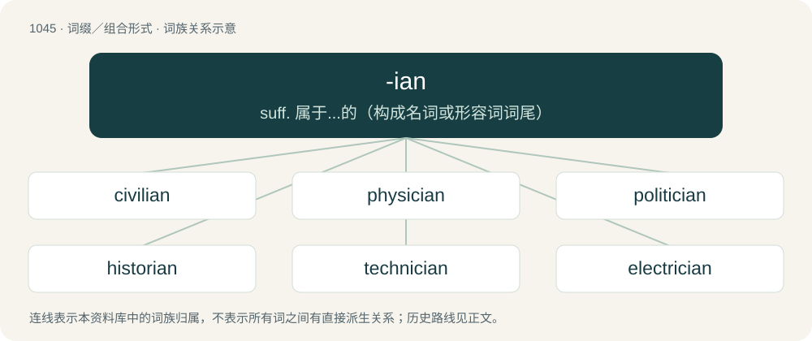

# 1127 · -ian — suff. 属于...的（构成名词或形容词词尾）

[总目录](../00_总目录_按常用程度.md)

**类型**：词缀／组合形式　｜　**来源语言**：见词源记录

## 核心含义与来源

- 核心含义：suff. 属于...的（构成名词或形容词词尾）
- 英文含义：From, related to, or like.
- 词形：-ian

**多个词源／构词路径**：同一拼写可能有不同来源；以下按词性和含义分别列出。

**来源记录 1**（后缀／后置成分；From, related to, or like.）

From Latin -iānus, which forms adjectives of belonging or origin from a noun.

**来源记录 2**（后缀／后置成分；A romanization of the Armenian surname suffix -յան (-yan).）

From Armenian -յան (-yan), from Old Armenian -եան (-ean).

## 词族图

## 单词速览（常用到不常用）

| 单词 | 音标 | 释义 |
|---|---|---|
| [civilian](#w-1) | /sɪˈvɪl.jən/ | n. 平民, 民法专家；a. 平民的, 百姓的, 民用的 |
| [physician](#w-2) | 英 /fɪˈzɪʃn̩/；美 /fəˈzɪʃən/ | n. 医师, 内科医师, 解除痛苦者；\[医\] 主治医师 |
| [politician](#w-3) | 英 /ˌpɒl.ɪˈtɪʃ.ən/；美 /ˌpɑ.ləˈtɪʃ.ən/ | n. 政客, 政治家, 从事党派政治的人；\[法\] 政客, 政治家 |
| [historian](#w-4) | 英 /hɪˈstɔːɹɪən/；美 /hɪˈstɔɹi.ən/ | n. 历史学家, 记事者 |
| [technician](#w-5) | /tɛkˈnɪʃən/ | n. 技师；\[化\] 技师 |
| [electrician](#w-6) | 英 /ɪˌlɛkˈtɹɪʃ(ə)n/；美 /ɪˌlɛkˈtɹɪʃən/ | n. 电学家, 电气技师, 电工；\[化\] 电工; 电气工人 |
| [mammalian](#w-7) | 美 /məˈmeɪl.jən/ | n. 哺乳动物；a. 哺乳动物的 |
| [avian](#w-8) | /ˈeɪvi.ən/ | a. 鸟类的；n. 鸟 |
| [pediatrician](#w-9) | 英 /piːdɪəˈtɹɪʃ(ə)n/；美 /ˌpidi.əˈtɹɪʃ(ə)n/ | n. 儿科医生, 儿科专家；\[医\] 儿科医师, 儿科学家 |
| [egalitarian](#w-10) | 英 /ɪˌɡæl.ɪˈtɛə.ɹi.ən/；美 /ɪˌɡæl.ɪˈtɛɹ.i.ən/ | a. 平等主义的；n. 平等主义 |
| [clinician](#w-11) | /klɪˈnɪʃən/ | \[医\] 临床医师, 临证医师 |
| [unitarian](#w-12) | 英 /ˌjuːnɪˈtɛəɹi.ən/；美 /ˌjunəˈtɛɹi.ən/ | 【英文】Espousing a unitary view of God. |
| [draconian](#w-13) | 英 /dɹəˈkəʊ.ni.ən/；美 /dɹəˈkoʊ.ni.ən/ | a. 严厉的, 残酷的 |
| [statistician](#w-14) | /ˌstætɪsˈtɪʃn̩/ | n. 统计员, 统计学家；\[经\] 统计家 |
| [reptilian](#w-15) | 英 /ɹɛpˈtɪliən/；美 /ɹɛpˈtɪljən/ | a. 爬虫类的, 像爬虫的, 卑鄙的；n. 爬行动物 |
| [tactician](#w-16) | /tækˈtɪʃən/ | n. 战术家, 谋士 |
| [episcopalian](#w-17) | 英 /ɪpɪskəpeɪliən/；美 /əˌpɪskəˈpeɪliən/ | a. 主教制度的, 主教的；n. 主教派的人, 主教派会员, 美国圣公会教徒 |
| [academician](#w-18) | 英 /əˌka.dəˈmɪʃ.n̩/；美 /ˌæ.kə.dəˈmɪʃ.n̩/ | n. 学会会员, 院士, 学究, 大学生, 学者 |
| [abelian](#w-19) | 美 /əˈbi.li.ən/ | 【英文】Of an algebraic structure (usually a group or algebra), having a commutative defining operation. |
| [thespian](#w-20) | 美 /ˈθɛzbi.ən/；/ˈθɛspi.ən/ | 【英文】Of, or relating to drama and acting; dramatic, theatrical. |
| [arcadian](#w-21) | /ɑɹˈkeɪdɪən/ | a. 阿卡迪亚的；田园牧歌式的, 田园的 |
| [logician](#w-22) | /ləˈd͡ʒɪʃən/ | n. 论理学者, 逻辑学家 |
| [isthmian](#w-23) | /ˈisθmiən/ | n. 地峡区域之居民；a. 地峡的,靠近地峡的,形成地峡的 |
| [palladian](#w-24) | /pəˈleidjən/ | a. （智慧女神）帕拉斯·雅典娜的；智慧的, 学问的；帕拉弟奥建筑风格式的 |
| [subclavian](#w-25) | /səbˈkleɪ.vi.ən/ | a. 锁骨下的；\[医\] 锁骨下的 |
| [stygian](#w-26) | 英 /ˈstɪd͡ʒ.i.ən/ | 【英文】Infernal or hellish. |

## 逐词详解

### 1. civilian

**词性**：名词　｜　**音标**：/sɪˈvɪl.jən/

**中文释义**：n. 平民, 民法专家；a. 平民的, 百姓的, 民用的

**英文义项**：A person following the pursuits of civil life, especially one who is not an active member of the armed forces. / A person who does not belong to a particular group or engage in a particular activity, an outsider.

**构词拆分**：civil + -ian

**词源与演化**：

From Middle English cyvylien, from Old French civilien. Equivalent to civil + -ian.

**例句**：

> Three civilians were apprehended by the soldiers and taken away in a military vehicle.

该用例对应义项：A person following the pursuits of civil life, especially one who is not an active member of the armed forces.

### 2. physician

**词性**：名词　｜　**音标**：英 /fɪˈzɪʃn̩/；美 /fəˈzɪʃən/

**中文释义**：n. 医师, 内科医师, 解除痛苦者；\[医\] 主治医师

**英文义项**：A practitioner of physic, i.e. a specialist in internal medicine, especially as opposed to a surgeon; a practitioner who treats with medication rather than with surgery. / A medical doctor trained in human medicine.

**构词拆分**：physic + -ian

**词源与演化**：

From Middle English fisicien, from Old French fisicïen (“physician”) (modern French physicien (“physicist”)), from fisique (“art of healing”), from Latin physica (“natural science”), from Ancient Greek φυσική ἐπιστήμη (phusikḗ epistḗmē, “knowledge of nature”), from φυσικός (phusikós, “pertaining to nature”). Displaced native Middle English læche, leche, archaic English leech (“physician”). Morphologically physic + -ian.

**例句**：

> My physician advised me to refrain from alcohol for the time being.

### 3. politician

**词性**：名词　｜　**音标**：英 /ˌpɒl.ɪˈtɪʃ.ən/；美 /ˌpɑ.ləˈtɪʃ.ən/

**中文释义**：n. 政客, 政治家, 从事党派政治的人；\[法\] 政客, 政治家

**英文义项**：One engaged in politics, especially an elected or appointed government official. / Specifically, one who regards elected political office as a career.

**构词拆分**：politic + -ian

**词源与演化**：

From politic + -ian.

**例句**：

> Only real politicians are interested in this issue.

该用例对应义项：A politically active or interested person.

### 4. historian

**词性**：名词　｜　**音标**：英 /hɪˈstɔːɹɪən/；美 /hɪˈstɔɹi.ən/

**中文释义**：n. 历史学家, 记事者

**英文义项**：A writer of history. / One who studies or researches history.

**构词拆分**：histor(y) + -ian

**词源与演化**：

From Middle English historian, historien, from Old French historien, from Latin historia (“story, history”), equivalent to histor(y) + -ian. More at history.

**例句**：

> The art historian wrote an essay about the ancient Greek vase.

### 5. technician

**词性**：名词　｜　**音标**：/tɛkˈnɪʃən/

**中文释义**：n. 技师；\[化\] 技师

**英文义项**：A person who studies or practises technology; an expert in a particular technology.

**构词拆分**：technic + -ian

**词源与演化**：

From technic + -ian.

**例句**：

> The lift technician found the reason the lift wasn't working.

该用例对应义项：A person who studies or practises technology; an expert in a particular technology.

### 6. electrician

**词性**：名词　｜　**音标**：英 /ɪˌlɛkˈtɹɪʃ(ə)n/；美 /ɪˌlɛkˈtɹɪʃən/

**中文释义**：n. 电学家, 电气技师, 电工；\[化\] 电工; 电气工人

**英文义项**：A tradesperson who installs, repairs and maintains electrical wiring and equipment.

**构词拆分**：electric + -ian

**词源与演化**：

From electric + -ian.

**例句**：

> You don't need to contact an electrician to replace a light switch.

### 7. mammalian

**词性**：形容词　｜　**音标**：美 /məˈmeɪl.jən/

**中文释义**：n. 哺乳动物；a. 哺乳动物的

**英文义项**：Of, or pertaining to, mammals. / Like a mammal.

**构词拆分**：mammal + -ian

**词源与演化**：

From mammal + -ian.

**例句**：

> By their appearance, dolphins might look like fish, but they actually belong to the mammalian family.

### 8. avian

**词性**：形容词　｜　**音标**：/ˈeɪvi.ən/

**中文释义**：a. 鸟类的；n. 鸟

**英文义项**：Characteristic of or pertaining to birds, or to bird-like or flying creatures.

**词源与演化**：

From Latin avis (“bird”) + -ian.

**例句**：

> Avian flu is not particularly prevalent in well-developed countries like the U.K.

### 9. pediatrician

**词性**：名词　｜　**音标**：英 /piːdɪəˈtɹɪʃ(ə)n/；美 /ˌpidi.əˈtɹɪʃ(ə)n/

**中文释义**：n. 儿科医生, 儿科专家；\[医\] 儿科医师, 儿科学家

**英文义项**：A physician that specializes in pediatrics; the medical care of infants, children, adolescents, and young adults.

**构词拆分**：pediatric + -ian

**词源与演化**：

From pediatric + -ian.

**例句**：

> I know that Tom wants to become a pediatrician.

### 10. egalitarian

**词性**：形容词　｜　**音标**：英 /ɪˌɡæl.ɪˈtɛə.ɹi.ən/；美 /ɪˌɡæl.ɪˈtɛɹ.i.ən/

**中文释义**：a. 平等主义的；n. 平等主义

**英文义项**：Characterized by social equality and equal rights for all people.

**词源与演化**：

From French égalitaire + -ian.

**例句**：

> Bonobos are also different in that they have a more egalitarian and cooperative society than chimpanzees.

### 11. clinician

**词性**：名词　｜　**音标**：/klɪˈnɪʃən/

**中文释义**：\[医\] 临床医师, 临证医师

**英文义项**：Any healthcare practitioner working at the point of care, in clinical practice (e.g., physicians in clinical medicine, nurses in nursing practice, or allied health providers in practice). / Someone who conducts a clinic; an expert or skilled practitioner in a particular field, such as business or education. In this sense, a clinician is someone who provides practical advice or hands-on assistance to others in a specific area of expertise. For example, a business clinician might be an experienced consultant who helps companies improve their operations, while an education clinician might be a skilled teacher who provides professional development and support to other educators.

**构词拆分**：clinic + -ian

**词源与演化**：

From French clinicien, equivalent to clinic + -ian.

**例句**：

> Please instruct the patient to visit a clinician.

### 12. unitarian

**词性**：形容词　｜　**音标**：英 /ˌjuːnɪˈtɛəɹi.ən/；美 /ˌjunəˈtɛɹi.ən/

**英文义项**：Espousing a unitary view of God. / Espousing a unitary view of national government.

**构词拆分**：unitary + -ian

**词源与演化**：

From unitary + -ian.

**用法示例／搭配（非完整句）**：

> the unitarian position on executive power

该用例对应义项：Espousing a unitary view of national government.

### 13. draconian

**词性**：形容词　｜　**音标**：英 /dɹəˈkəʊ.ni.ən/；美 /dɹəˈkoʊ.ni.ən/

**中文释义**：a. 严厉的, 残酷的

**英文义项**：Very severe, cruel, or harsh.

**词源与演化**：

From Latin Dracō (stem Dracōn-) + -ian, from Ancient Greek Δράκων (Drákōn), after the Athenian lawmaker Draco, known for making harsh laws. See δράκων (drákōn, “dragon”).

**例句**：

> The mayor announced draconian budget cuts today.

该用例对应义项：Very severe, cruel, or harsh.

### 14. statistician

**词性**：名词　｜　**音标**：/ˌstætɪsˈtɪʃn̩/

**中文释义**：n. 统计员, 统计学家；\[经\] 统计家

**英文义项**：A person who compiles, interprets, or studies statistics. / A mathematician with a specialty of statistics.

**构词拆分**：statistic + -ian

**词源与演化**：

From statistic + -ian.

**例句**：

> I'm casting aspersions on his competency as a statistician.

### 15. reptilian

**词性**：形容词　｜　**音标**：英 /ɹɛpˈtɪliən/；美 /ɹɛpˈtɪljən/

**中文释义**：a. 爬虫类的, 像爬虫的, 卑鄙的；n. 爬行动物

**英文义项**：Of or relating to the members of the class Reptilia (reptiles). / Reptilelike.

**构词拆分**：reptile + -ian

**词源与演化**：

From reptile + -ian, replacing earlier reptilious and adjectival reptile.

**例句**：

> Tom's eyes are strange. I think he might be a reptilian.

### 16. tactician

**词性**：名词　｜　**音标**：/tækˈtɪʃən/

**中文释义**：n. 战术家, 谋士

**英文义项**：A person skilled in the planning and execution of tactics.

**构词拆分**：tactic + -ian

**词源与演化**：

Either borrowed from French tacticien or derived as tactic + -ian.

**例句**：

> A renowned tactician, Christopher Columbus once downed an entire pirate fleet by stealing all of their fruits and vegetables, thus giving them scurvy.

### 17. episcopalian

**词性**：形容词　｜　**音标**：英 /ɪpɪskəpeɪliən/；美 /əˌpɪskəˈpeɪliən/

**中文释义**：a. 主教制度的, 主教的；n. 主教派的人, 主教派会员, 美国圣公会教徒

**英文义项**：episcopal: pertaining to a bishop of any church / Episcopalian

**构词拆分**：episcopal + -ian

**词源与演化**：

From episcopal + -ian.

**例句**：

> Nietzsche, belatedly discovered by a world beset by terrors too great for it and mysteries too profound, becomes almost respectable, nay, almost Episcopalian!

### 18. academician

**词性**：名词　｜　**音标**：英 /əˌka.dəˈmɪʃ.n̩/；美 /ˌæ.kə.dəˈmɪʃ.n̩/

**中文释义**：n. 学会会员, 院士, 学究, 大学生, 学者

**英文义项**：A member (especially a senior one) of the faculty at a college or university; an academic. / A member or follower of an academy, or society for promoting science, art, or literature, such as the French Academy, or the Royal Academy of Arts.

**构词拆分**：academic + -ian；academic + -ian (“one skilled in”)

**词源与演化**：

From academic + -ian (“one skilled in”), partly after French académicien.

**例句**：

> Though brilliant, the academician was notorious for his lack of practical sense.

### 19. abelian

**词性**：形容词　｜　**音标**：美 /əˈbi.li.ən/

**英文义项**：Of an algebraic structure (usually a group or algebra), having a commutative defining operation. / Of a binary function, commutative.

**例句**：

> Every subgroup of an abelian group is abelian.

### 20. thespian

**词性**：形容词　｜　**音标**：美 /ˈθɛzbi.ən/；/ˈθɛspi.ən/

**英文义项**：Of, or relating to drama and acting; dramatic, theatrical.

**词源与演化**：

From Latin Thespis, from the name of the Ancient Greek actor Thespis (fl. 6th century BCE), from Θέσπις (Théspis) + -ian.

**例句**：

> The movie director had thespian cooperation.

该用例对应义项：of or relating to drama

### 21. arcadian

**词性**：形容词　｜　**音标**：/ɑɹˈkeɪdɪən/

**中文释义**：a. 阿卡迪亚的；田园牧歌式的, 田园的

**英文义项**：Pertaining to an arcade. / Furnished with arcades.

**构词拆分**：arcade + -ian

**词源与演化**：

From arcade + -ian.

**例句**：

> A country life of arcadian contentment.

该用例对应义项：(used with regard to idealized country life) idyllically rustic

### 22. logician

**词性**：名词　｜　**音标**：/ləˈd͡ʒɪʃən/

**中文释义**：n. 论理学者, 逻辑学家

**英文义项**：A person who studies or teaches logic.

**构词拆分**：logic + -ian

**词源与演化**：

From Middle English logicien, logissian, from Old French logicien. Equivalent to logic + -ian.

**用法示例／搭配（非完整句）**：

> “To the logician all things should be seen exactly as they are.” ― “The Greek Interpreter”, by Sir Arthur Conan Doyle, 1894

该用例对应义项：A person who studies or teaches logic.

### 23. isthmian

**词性**：形容词　｜　**音标**：/ˈisθmiən/

**中文释义**：n. 地峡区域之居民；a. 地峡的,靠近地峡的,形成地峡的

**英文义项**：Of or pertaining to an isthmus, especially to the Isthmus of Corinth in Greece.

**构词拆分**：isthmus + -ian

**词源与演化**：

From isthmus + -ian.

### 24. palladian

**词性**：形容词　｜　**音标**：/pəˈleidjən/

**中文释义**：a. （智慧女神）帕拉斯·雅典娜的；智慧的, 学问的；帕拉弟奥建筑风格式的

**英文义项**：Containing tetravalent palladium.

**构词拆分**：palladium + -ian

**词源与演化**：

From palladium + -ian.

### 25. subclavian

**词性**：形容词　｜　**音标**：/səbˈkleɪ.vi.ən/

**中文释义**：a. 锁骨下的；\[医\] 锁骨下的

**英文义项**：Relating to or denoting an artery or vein which serves the neck and arm on the left or right side of the body.

**构词拆分**：New Latin subclavius + -ian

**词源与演化**：

From New Latin subclavius + -ian, from sub- (“under”) + clavicula (“collar bone, clavicle”) + -ius (adjectival suffix).

**例句**：

> I was struck on the shoulder by a bullet, which shattered the bone and grazed the subclavian artery.

### 26. stygian

**词性**：形容词　｜　**音标**：英 /ˈstɪd͡ʒ.i.ən/

**英文义项**：Infernal or hellish. / Dark and gloomy.

**构词拆分**：Latin stygius + -ian

**词源与演化**：

From Latin stygius + -ian, from Ancient Greek Στύγιος (Stúgios, “relating to Styx”), from Στύξ (Stúx, “Styx, chief river of underworld”).

**例句**：

> Heavenly ire / ne'er sent a pest more loathsome; ne'er were seen / worse plagues to issue from the Stygian mire.
