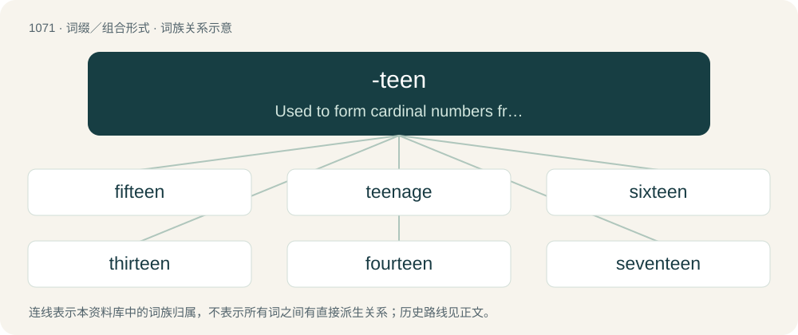

# 1151 · -teen — Used to form cardinal numbers from thirteen to nineteen.

[总目录](../00_总目录_按常用程度.md)

**类型**：词缀／组合形式　｜　**来源语言**：见词源记录

## 核心含义与来源

- 核心含义：Used to form cardinal numbers from thirteen to nineteen.
- 英文含义：Used to form cardinal numbers from thirteen to nineteen.
- 词形：-teen

**来源记录 1**（后缀／后置成分；Used to form cardinal numbers from thirteen to nineteen.）

From Middle English -tene, from Anglian Old English -tēne (compare West Saxon -tīene), from an inflected form of Proto-West Germanic \*tehun, from Proto-Germanic \*tehun (“ten”).

## 词族图

## 单词速览（常用到不常用）

| 单词 | 音标 | 释义 |
|---|---|---|
| [fifteen](#w-1) | 英 /ˈfɪf.tiːn/ | num. 十五, 十五个 |
| [teenage](#w-2) | 英 /ˈtiːneɪd͡ʒ/ | a. 十三岁到十九岁的 |
| [sixteen](#w-3) | 英 /ˈsɪks.tiːn/ | num. 十六, 十六个 |
| [thirteen](#w-4) | 英 /ˌθɜːˈtiːn/；美 /ˌθɝtˈtin/ | num. 十三, 十三个 |
| [fourteen](#w-5) | 英 /ˈfɔː.tiːn/；美 /ˈfɔɹ.tin/ | num. 十四, 十四个 |
| [seventeen](#w-6) | 英 /ˈsɛv.ən.tiːn/ | num. 十七, 十七个 |
| [eighteen](#w-7) | 英 /ˈeɪ.tiːn/；美 /ˈeɪ(t).tin/ | num. 十八, 十八个 |
| [nineteen](#w-8) | 英 /ˈnaɪntiːn/；美 /ˈnaɪnˌtin/ | num. 十九, 十九个 |
| [umpteen](#w-9) | 英 /ˈʌmp.tiːn/ | a. 无数的 |

## 逐词详解

### 1. fifteen

**词性**：名词　｜　**音标**：英 /ˈfɪf.tiːn/

**中文释义**：num. 十五, 十五个

**英文义项**：An Irish traybake made with crushed digestive biscuits, marshmallows and glacé cherries combined with condensed milk and desiccated coconut.

**构词拆分**：five + -teen

**词源与演化**：

From Middle English fiftene, from Old English fīftīene, fīftēne, from Proto-Germanic \*fimftehun. Cognate with West Frisian fyftjin, Dutch vijftien, German fünfzehn, Danish femten. Equivalent to five + -teen.

**例句**：

> If you buy this, I will give you a fifteen percent discount.

### 2. teenage

**词性**：形容词　｜　**音标**：英 /ˈtiːneɪd͡ʒ/

**中文释义**：a. 十三岁到十九岁的

**英文义项**：Of or relating to an age between thirteen and nineteen years old.

**构词拆分**：-teen + age

**词源与演化**：

From -teen + age. First attested in 1921.

**例句**：

> Fred's teenage years were the most difficult of times.

该用例对应义项：Of or relating to an age between thirteen and nineteen years old.

### 3. sixteen

**词性**：数词　｜　**音标**：英 /ˈsɪks.tiːn/

**中文释义**：num. 十六, 十六个

**英文义项**：The cardinal number occurring after fifteen and before seventeen, represented in Arabic numerals as 16 and in Roman numerals as XVI.

**构词拆分**：six + -teen

**词源与演化**：

Inherited from Middle English sextene, sixtene, from Old English sixtīene, from Proto-Germanic \*sehstehun. Cognate with West Frisian sechstjin, Dutch zestien, German sechzehn, Danish seksten. Equivalent to six + -teen.

**例句**：

> Even though Tom is only sixteen, he looks like he's over twenty.

### 4. thirteen

**词性**：数词　｜　**音标**：英 /ˌθɜːˈtiːn/；美 /ˌθɝtˈtin/

**中文释义**：num. 十三, 十三个

**英文义项**：The cardinal number occurring after twelve and before fourteen: ten and three.

**构词拆分**：three + -teen

**词源与演化**：

From Middle English thirttene, variant (through metathesis) of thrittene, from Old English þrēotīene, from Proto-Germanic \*þritehun, compound of \*þrīz (“three”) + \*tehun (“teen”). Cognate with West Frisian trettjin, Dutch dertien, German dreizehn, Danish tretten. Equivalent to three + -teen.

**例句**：

> There are thirteen cards of each of the four suits in a deck of playing cards.

该用例对应义项：The cardinal number occurring after twelve and before fourteen: ten and three.

### 5. fourteen

**词性**：名词　｜　**音标**：英 /ˈfɔː.tiːn/；美 /ˈfɔɹ.tin/

**中文释义**：num. 十四, 十四个

**英文义项**：A group of fourteen items.

**构词拆分**：four + -teen

**词源与演化**：

From Middle English fourtene, from Old English fēowertīene, from Proto-Germanic \*fedurtehun. Cognate with West Frisian fjirtjin, Dutch veertien, German vierzehn, Danish fjorten. Equivalent to four + -teen.

**例句**：

> His father had asked the same question the year he was fourteen.

### 6. seventeen

**词性**：数词　｜　**音标**：英 /ˈsɛv.ən.tiːn/

**中文释义**：num. 十七, 十七个

**英文义项**：The cardinal number occurring after sixteen and before eighteen, represented in Roman numerals as XVII and in Arabic numerals as 17.

**构词拆分**：seven + -teen

**词源与演化**：

Inherited from Middle English seventene, from Old English seofontīene, from Proto-Germanic \*sebuntehun. Cognate with Dutch zeventien, West Frisian santjin, German siebzehn, Danish sytten. Equivalent to seven + -teen

**例句**：

> A boy of seventeen is often as tall as his father.

### 7. eighteen

**词性**：数词　｜　**音标**：英 /ˈeɪ.tiːn/；美 /ˈeɪ(t).tin/

**中文释义**：num. 十八, 十八个

**英文义项**：The cardinal number occurring after seventeen and before nineteen, represented in Roman numerals as XVIII and in Arabic numerals as 18.

**构词拆分**：eight + -teen

**词源与演化**：

From Middle English eightetene, eiȝtene, ehtetene, from Old English eahtatīene, eahtatēne, from Proto-Germanic \*ahtōutehun. Cognate with West Frisian achttjin, Dutch achttien, German achtzehn, Danish atten. Equivalent to eight + -teen.

**例句**：

> If he could pass for eighteen years old, he'd join the army.

### 8. nineteen

**词性**：数词　｜　**音标**：英 /ˈnaɪntiːn/；美 /ˈnaɪnˌtin/

**中文释义**：num. 十九, 十九个

**英文义项**：The cardinal number occurring after eighteen and before twenty, represented in Roman numerals as XIX and in Arabic numerals as 19. It is the last/largest of the "teens".

**构词拆分**：nine + -teen

**词源与演化**：

From Middle English nyntene, nynetene, from Old English niġontīene, niġontēne, from Proto-Germanic \*newuntehun. Cognate with Dutch negentien, Low German negenteihn, Hunsrik neinzen, German neunzehn, Danish nitten. Equivalent to nine + -teen

**例句**：

> It's amazing that he won the championship at the age of nineteen.

### 9. umpteen

**词性**：限定词　｜　**音标**：英 /ˈʌmp.tiːn/

**中文释义**：a. 无数的

**英文义项**：Relatively large but unspecified in number.

**构词拆分**：ump (“a colloquial name for the dash "—" in Morse code”) + -teen

**词源与演化**：

From ump (“a colloquial name for the dash "—" in Morse code”) + -teen. Unrelated to ump as in umpire, and simply a mnemonic rhyming aid.

**例句**：

> She's taking umpteen friends with her to the party.

该用例对应义项：Relatively large but unspecified in number.
