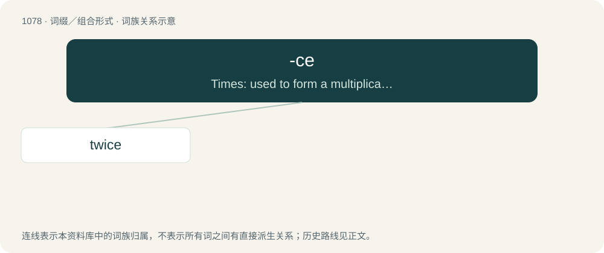

# 1157 · -ce — Times: used to form a multiplicative numeral from a cardinal numeral.

[总目录](../00_总目录_按常用程度.md)

**类型**：词缀／组合形式　｜　**来源语言**：见词源记录

## 核心含义与来源

- 核心含义：Times: used to form a multiplicative numeral from a cardinal numeral.
- 英文含义：Times: used to form a multiplicative numeral from a cardinal numeral.
- 词形：-ce

## 词族图

## 单词速览（常用到不常用）

| 单词 | 音标 | 释义 |
|---|---|---|
| [twice](#w-1) | /twaɪs/ | adv. 两次, 两倍 |

## 逐词详解

### 1. twice

**词性**：副词　｜　**音标**：/twaɪs/

**中文释义**：adv. 两次, 两倍

**英文义项**：Two times. / Doubled in quantity, intensity, or degree.

**构词拆分**：twi- (“(in) two; both”) + -ce

**词源与演化**：

From earlier twise, from Middle English twies, twiȝes, from Old English twīġes (“twice”), from twīwa, twīġa ("twice"; whence Middle English twie (“twice”)) + -es (adverbial genitive ending). Related to Saterland Frisian twäie (“twice”), Middle Low German twiges, twies (“twice”), Middle High German zwies (“twice”). Equivalent to twi- (“(in) two; both”) + -ce. Similarly constructed to the prefixes bis- and dis-, borrowed from Indo-European cognates.

**例句**：

> You should brush your teeth twice a day.

该用例对应义项：Two times.
