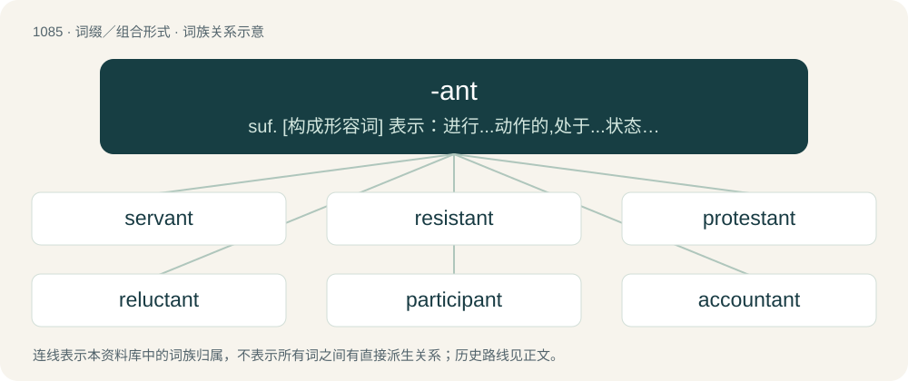

# 1163 · -ant — suf. \[构成形容词\] 表示：进行...动作的,处于...状态的,促进...作用的：repentant, triumphant, expectorant; 有...的,显示...的,做...的：defiant, radiant; \[构成名词\]表示进行...动作的人,施行...作用者,...者(人或物):accountant, assistant, occu

[总目录](../00_总目录_按常用程度.md)

**类型**：词缀／组合形式　｜　**来源语言**：见词源记录

## 核心含义与来源

- 核心含义：suf. \[构成形容词\] 表示：进行...动作的,处于...状态的,促进...作用的：repentant, triumphant, expectorant; 有...的,显示...的,做...的：defiant, radiant; \[构成名词\]表示进行...动作的人,施行...作用者,...者(人或物):accountant, assistant, occupant
- 英文含义：The agent noun derived from verb.
- 词形：-ant

**来源记录 1**（后缀／后置成分；The agent noun derived from verb.）

From Middle English -ant, -aunt, partly from Old French -ant, from Latin -āns; and partly (in adjectival derivations) continuing Middle English -ant, a variant of -and, -end, from Old English -ende (present participle ending), see -and. False cognate of Malay and Indonesian -an (and so all its Austronesian cognates), and Arabic ان (“adjective forming suffix”).

## 词族图

## 单词速览（常用到不常用）

| 单词 | 音标 | 释义 |
|---|---|---|
| [servant](#w-1) | 英 /ˈsɜːvənt/；美 /ˈsɝvənt/ | n. 仆人, 有用物, 公务员, 雇员；\[法\] 受雇人, 服务者, 公务员 |
| [resistant](#w-2) | /ɹəˈzɪstənt/ | n. 抵抗者, 反抗者；a. 抵抗的, 反抗的, 耐...的 |
| [protestant](#w-3) |  | 【英文】Protesting. |
| [reluctant](#w-4) | /ɹɪˈlʌktənt/ | a. 不情愿的, 勉强的；\[法\] 不愿的, 勉强的, 难以处理的 |
| [participant](#w-5) | 英 /pɑːˈtɪsɪpənt/；美 /pɑːɹˈtɪsəpənt/ | n. 参加者, 参与者；a. 有份的, 参加的, 参与的 |
| [accountant](#w-6) | 美 /əˈkaʊn.tənt/ | n. 会计人员, 会计师；\[经\] 会计师, 会计人员 |
| [rampant](#w-7) | /ˈɹæm.pənt/ | a. 猖獗的, 蔓生的, 猛烈的, 跃立作扑击状的 |
| [compliant](#w-8) | 英 /kəmˈplʌɪənt/；美 /kəmˈplaɪənt/ | a. 顺从的, 屈从的；\[电\] 适用于, 配合...使用 |
| [reliant](#w-9) | /riˈlaiənt/ | a. 依赖的, 信赖的 |
| [informant](#w-10) | 英 /ɪnˈfɔːmənt/；美 /ɪnˈfɔɹmənt/ | n. 提供消息者, 密告者, 被调查者；\[经\] 填报人, 被征询人 |
| [levant](#w-11) | /lɪˈvænt/ | vi. 躲债；\[法\] 逃亡, 躲避, 躲债 |
| [coolant](#w-12) | /ˈkuːlənt/ | n. 冷却剂；\[计\] 冷却剂 |
| [claimant](#w-13) | 英 /ˈkleɪ.mənt/ | n. 提出要求者, 原告；\[经\] 索赔人, 债权人 |
| [assailant](#w-14) | /əˈseɪlənt/ | n. 攻击者；\[法\] 攻击者, 行凶者 |
| [lubricant](#w-15) | 英 /ˈluːbɹɪkənt/；美 /ˈlubɹəkənt/ | a. 润滑的；n. 润滑物, 润滑油, 润滑剂 |
| [buoyant](#w-16) | /ˈbɔɪ.ənt/ | a. 有浮力的, 心情愉快的；\[经\] 降而复升的, 保持高价的, 遂之而升的 |
| [propellant](#w-17) | /prəuˈpelənt/ | n. 推进剂, 发射火药, 推进者；\[化\] 火药 |
| [determinant](#w-18) | 英 /dɪˈtɜːmɪnənt/；美 /dɪˈtɝmɪnənt/ | n. 决定物, 决定因素；a. 决定性的；\[计\] 判定 |
| [ascendant](#w-19) | 英 /əˈsɛnd(ə)nt/；美 /əˈsɛndənt/ | n. 支配地位, 优势, 运星；a. 上升的, 占优势的 |
| [cognizant](#w-20) | 英 /ˈkɒɡnɪzənt/；/ˈkɔɡnɪzənt/ | a. 察知的, 认识到的, 有认识能力的；\[法\] 审理的, 审理权的, 有权审理的 |
| [disinfectant](#w-21) | /dɪs.ɪnˈfɛktənt/ | a. 消毒的, 杀菌的；n. 消毒剂, 杀菌剂 |
| [hydrant](#w-22) | /ˈhaɪdɹənt/ | n. 给水栓, 水龙头, 消火栓 |
| [irritant](#w-23) | /ˈɪɹɪtənt/ | a. 刺激的, 刺激性的；n. 刺激物, 刺激剂 |
| [pollutant](#w-24) | 英 /pəˈl(j)uːtənt/；美 /pəˈl(j)utənt/ | n. 污染物质；\[法\] 污染物 |
| [retardant](#w-25) | /riˈtɑːdənt/ | n. 抑止剂；\[机\] 阻滞剂 |
| [depressant](#w-26) | 英 /dɪˈpɹɛsənt/ | a. 有镇静作用的；n. 镇静剂 |
| [debutant](#w-27) | 英 /ˈdɛbjuːtənt/ | n. 初次登台的人, 初进社交界的人 |
| [sealant](#w-28) | /ˈsiːlənt/ | n. 密封剂；\[化\] 密封胶 |
| [celebrant](#w-29) | /ˈsɛlɪbɹənt/ | n. 主持仪式的人, 主持弥撒的教父 |
| [luxuriant](#w-30) | 英 /lʌɡˈzjʊəɹi.ənt/；美 /ləɡˈʒʊɹi.ənt/ | a. 繁茂的, 丰富的, 肥沃的, 华丽的；\[医\] 过盛的, 过多的 |
| [reactant](#w-31) | /riˈæktənt/ | n. 反应物；\[化\] 反应物 |
| [avoidant](#w-32) | /əˈvɔɪdənt/ | a. \[心\]回避反应的 |
| [suppressant](#w-33) | /səˈpɹɛs.ənt/ | \[化\] 抑制剂 |
| [dopant](#w-34) | /ˈdəʊpənt/ | n. 掺杂物, 掺杂剂；\[计\] 掺杂物 |
| [accelerant](#w-35) | 英 /əkˈsɛləɹ(ə)nt/；美 /əkˈsɛləɹənt/ | n. 促进剂, 加速进程的东西；a. 促进的, 加速的 |

## 逐词详解

### 1. servant

**词性**：名词　｜　**音标**：英 /ˈsɜːvənt/；美 /ˈsɝvənt/

**中文释义**：n. 仆人, 有用物, 公务员, 雇员；\[法\] 受雇人, 服务者, 公务员

**英文义项**：One who is hired to perform regular household or other duties, and receives compensation. As opposed to a slave. / One who serves another, providing help in some manner.

**构词拆分**：serve + -ant

**词源与演化**：

From Middle English servaunt, from Old French servant, from the present participle of the verb servir. Doublet of sergeant and servient. Morphologically serve + -ant. Displaced native Old English þeġn.

**例句**：

> She is quite the humble servant, the poor in this city owe much to her but she expects nothing.

该用例对应义项：One who serves another, providing help in some manner.

### 2. resistant

**词性**：形容词　｜　**音标**：/ɹəˈzɪstənt/

**中文释义**：n. 抵抗者, 反抗者；a. 抵抗的, 反抗的, 耐...的

**英文义项**：Which makes resistance or offers opposition. / Which is not affected or overcome by a disease, drug, chemical or atmospheric agent, extreme of temperature, etc.

**构词拆分**：resist + -ant

**词源与演化**：

From French résistant; equivalent to resist + -ant.

**例句**：

> The infection is resistant to antibiotics.

该用例对应义项：Which is not affected or overcome by a disease, drug, chemical or atmospheric agent, extreme of temperature, etc.

### 3. protestant

**词性**：形容词

**英文义项**：Protesting.

**构词拆分**：protest + -ant

**词源与演化**：

See Protestant. The legal sense either has the same source or is simply protest + -ant.

**例句**：

> The Catholic Bible contains everything in the Protestant Bible plus several other books.

### 4. reluctant

**词性**：形容词　｜　**音标**：/ɹɪˈlʌktənt/

**中文释义**：a. 不情愿的, 勉强的；\[法\] 不愿的, 勉强的, 难以处理的

**英文义项**：Not wanting to take some action; unwilling to do something. / Tending to match as little text as possible.

**词源与演化**：

Learned borrowing from Latin reluctāns (whence -ant), present participle of reluctor (“to struggle against, oppose, resist”), from re- (“back”) + luctor (“to struggle”) (whence re-.

**例句**：

> Surprisingly, our new dog is a reluctant ball-retriever.

该用例对应义项：Not wanting to take some action; unwilling to do something.

### 5. participant

**词性**：名词　｜　**音标**：英 /pɑːˈtɪsɪpənt/；美 /pɑːɹˈtɪsəpənt/

**中文释义**：n. 参加者, 参与者；a. 有份的, 参加的, 参与的

**英文义项**：One who participates. / A human subject in a scientific experiment, such as a clinical trial

**构词拆分**：particip(ate) + -ant

**词源与演化**：

From stem of particip(ate) + -ant, borrowed from Middle French participant, from Latin participāns, present participle of participō; see participate. Displaced native Old English dǣlnimend (literally “part taker”).

**例句**：

> In this study, participants were randomly assigned to either a control arm or a treatment arm.

该用例对应义项：A human subject in a scientific experiment, such as a clinical trial

### 6. accountant

**词性**：名词　｜　**音标**：美 /əˈkaʊn.tənt/

**中文释义**：n. 会计人员, 会计师；\[经\] 会计师, 会计人员

**英文义项**：One who renders account; one accountable. / A reckoner, or someone who maintains financial matters for a person(s).

**构词拆分**：account + -ant

**词源与演化**：

From Middle English, from Middle French acuntant. Equivalent to account + -ant. First attested in the mid 15th century.

**例句**：

> Is it possible to pass the tax accountant exam by self study?

### 7. rampant

**词性**：形容词　｜　**音标**：/ˈɹæm.pənt/

**中文释义**：a. 猖獗的, 蔓生的, 猛烈的, 跃立作扑击状的

**英文义项**：Rearing on both hind legs with the forelegs extended. / Rearing up, especially on its hind leg(s), with a foreleg raised and in profile.

**构词拆分**：ramp + -and；ramp + -ant

**词源与演化**：

From Middle English rampand, rampend, present participle of rampen (“to rise by climbing, shoot up, sprout, sty, ascend”), from Old French ramper (“to creep, climb”) (see below), equivalent to ramp + -and or ramp + -ant. Recorded since 1382, "standing on the hind legs" (as in heraldry), later, "fierce, ravenous" (1387). Compare Scots rampand (“rampant”). Alternatively from Middle English \*rampant, from Old French rampant, the present participle of ramper (“to creep, climb”), equivalent to ramp + -ant. Old French ramper derives from Frankish \*rampōn, \*hrampōn (“to hook, grapple, climb”), from \*rampa, \*hrampa (“hook, claw, talon”), from Proto-Germanic \*hrempaną (“to curve, shrivel, shrink, wrinkle”).

**例句**：

> The Vienna riding school displays splendid rampant movement.

该用例对应义项：Rearing on both hind legs with the forelegs extended.

### 8. compliant

**词性**：形容词　｜　**音标**：英 /kəmˈplʌɪənt/；美 /kəmˈplaɪənt/

**中文释义**：a. 顺从的, 屈从的；\[电\] 适用于, 配合...使用

**英文义项**：Willing to comply; submissive; willing to do what someone wants. / Compatible with or following guidelines, specifications, rules, or laws.

**构词拆分**：comply + -ant

**词源与演化**：

From comply + -ant.

**例句**：

> The workplace is compliant with the Americans with Disabilities Act.

该用例对应义项：Compatible with or following guidelines, specifications, rules, or laws.

### 9. reliant

**词性**：形容词　｜　**音标**：/riˈlaiənt/

**中文释义**：a. 依赖的, 信赖的

**英文义项**：Having reliance on somebody or something.

**构词拆分**：rely + -ant

**词源与演化**：

From rely + -ant.

**例句**：

> Flanders is more reliant on the export of cars and diamonds than Walloonia.

### 10. informant

**词性**：名词　｜　**音标**：英 /ɪnˈfɔːmənt/；美 /ɪnˈfɔɹmənt/

**中文释义**：n. 提供消息者, 密告者, 被调查者；\[经\] 填报人, 被征询人

**英文义项**：One who relays confidential information to someone, especially to the police; an informer. / A native speaker who acts as a linguistic reference for a language being studied. The informant demonstrates native pronunciation, provides grammaticality judgments regarding linguistic well-formedness, and may also explain cultural references and other important contextual information.

**构词拆分**：inform + -ant

**词源与演化**：

From inform + -ant.

**例句**：

> The death of this informant could compromise the success of this operation.

### 11. levant

**词性**：名词　｜　**音标**：/lɪˈvænt/

**中文释义**：vi. 躲债；\[法\] 逃亡, 躲避, 躲债

**英文义项**：A disappearing or absconding after losing a bet.

**词源与演化**：

Transferral use of Levant, from French levant. Compare French faire voile en Levant (“to sail eastward”), literally: set the sail with the Levant, an easterly wind that blows in the Mediterranean Sea. Ultimately from Latin levō + -ant.

**例句**：

> Jews are an ancient tribal people who originated in the Levant.

### 12. coolant

**词性**：名词　｜　**音标**：/ˈkuːlənt/

**中文释义**：n. 冷却剂；\[计\] 冷却剂

**英文义项**：A medium, usually fluid, used to draw heat from an object.

**构词拆分**：cool + -ant

**词源与演化**：

From cool + -ant.

**例句**：

> Coolant is used in car engines and industrial processes, where excess heat could cause machine damage.

该用例对应义项：A medium, usually fluid, used to draw heat from an object.

### 13. claimant

**词性**：名词　｜　**音标**：英 /ˈkleɪ.mənt/

**中文释义**：n. 提出要求者, 原告；\[经\] 索赔人, 债权人

**英文义项**：One who claims; one who makes a claim. / A person receiving money from the government, in a form of unemployment benefits, disability benefits or similar.

**构词拆分**：claim + -ant

**词源与演化**：

From Old French and Anglo-Norman clamant, present participle of the verb clamer and its variants, from Latin clāmō (“to cry out”), equivalent to claim + -ant. Compare clamant.

**例句**：

> He was a claimant to the throne.

该用例对应义项：someone who claims a benefit or right or title

### 14. assailant

**词性**：名词　｜　**音标**：/əˈseɪlənt/

**中文释义**：n. 攻击者；\[法\] 攻击者, 行凶者

**英文义项**：Someone who attacks or assails another violently, or criminally. / A hostile critic or opponent.

**构词拆分**：assail + -ant

**词源与演化**：

From Old French assaillant, from the verb assaillir, from Late Latin assalīre, from Latin ad (“to, towards”) + salīre (“to jump”). Equivalent to assail + -ant.

**例句**：

> Sami summoned every ounce of strength to try to overcome his assailant.

### 15. lubricant

**词性**：名词　｜　**音标**：英 /ˈluːbɹɪkənt/；美 /ˈlubɹəkənt/

**中文释义**：a. 润滑的；n. 润滑物, 润滑油, 润滑剂

**英文义项**：A substance used to reduce friction between objects or surfaces. / A personal lubricant.

**构词拆分**：lubricate + -ant

**词源与演化**：

From lubricate + -ant.

**例句**：

> It can be used as a lubricant for machines or electronic parts.

### 16. buoyant

**词性**：形容词　｜　**音标**：/ˈbɔɪ.ənt/

**中文释义**：a. 有浮力的, 心情愉快的；\[经\] 降而复升的, 保持高价的, 遂之而升的

**英文义项**：Having buoyancy; able to float. / Lighthearted and lively.

**构词拆分**：buoy + -ant

**词源与演化**：

From buoy + -ant.

**例句**：

> I’m in a buoyant mood.

该用例对应义项：Lighthearted and lively.

### 17. propellant

**词性**：名词　｜　**音标**：/prəuˈpelənt/

**中文释义**：n. 推进剂, 发射火药, 推进者；\[化\] 火药

**英文义项**：fuel, oxidizer, reaction mass or mixture for one or more engines (especially internal combustion engines or jet engines) that is carried within a vehicle prior to use / the compressed gas in a pressurised container (especially an aerosol can) that is used to expel its content

**构词拆分**：propel + -ant

**词源与演化**：

From propel + -ant.

**例句**：

> Today’s spacecraft use rockets and rockets use large quantities of propellant.

### 18. determinant

**词性**：名词　｜　**音标**：英 /dɪˈtɜːmɪnənt/；美 /dɪˈtɝmɪnənt/

**中文释义**：n. 决定物, 决定因素；a. 决定性的；\[计\] 判定

**英文义项**：A determining factor; an element that determines the nature of something. / A scalar that encodes certain characteristics of a given transformation matrix; the unique scalar function over square matrices which is distributive over matrix multiplication, multilinear in the rows and columns, and takes the value 1 for the unit matrix; abbreviated as: det.

**构词拆分**：determine + -ant

**词源与演化**：

Borrowed from French déterminant, equivalent to determine + -ant.

**例句**：

> Education is an important determinant of one's outlook on life.

该用例对应义项：a determining or causal element or factor

### 19. ascendant

**词性**：名词　｜　**音标**：英 /əˈsɛnd(ə)nt/；美 /əˈsɛndənt/

**中文释义**：n. 支配地位, 优势, 运星；a. 上升的, 占优势的

**英文义项**：The degree of the zodiac or point of the ecliptic which rises in an eastern direction above the horizon at a particular moment (especially the moment of a person's birth), which is supposed to have a commanding influence on a person's fortune and life; a horoscope. / Chiefly in in the ascendant: an act of ascending or rising.

**构词拆分**：ascend (verb) + -ant (suffix forming adjectives from verbs with the sense of ‘doing \[the verbal actions\]’)

**例句**：

> One man has the ascendant over another.

该用例对应义项：Synonym of ascendancy (“commanding influence; dominant control; superiority, supremacy”).

### 20. cognizant

**词性**：形容词　｜　**音标**：英 /ˈkɒɡnɪzənt/；/ˈkɔɡnɪzənt/

**中文释义**：a. 察知的, 认识到的, 有认识能力的；\[法\] 审理的, 审理权的, 有权审理的

**英文义项**：Aware; fully informed; having understanding of a fact. / Sapient; self-aware.

**构词拆分**：cognizance + -ant

**词源与演化**：

A new formation from cognizance + -ant; first attested in the 19th century. Compare Old French conoissant (present participle of conoistre; modern French connaissant), from Latin cognōscentem (accusative singular present participle of cōgnōscō).

**例句**：

> The defendant is cognizant that this is a serious charge.

该用例对应义项：Aware; fully informed; having understanding of a fact.

### 21. disinfectant

**词性**：形容词　｜　**音标**：/dɪs.ɪnˈfɛktənt/

**中文释义**：a. 消毒的, 杀菌的；n. 消毒剂, 杀菌剂

**英文义项**：Serving to kill germs or viruses.

**构词拆分**：disinfect + -ant

**词源与演化**：

From disinfect + -ant, borrowed from French désinfectant.

**例句**：

> I washed repeatedly with a disinfectant soap but I still caught the flu.

该用例对应义项：Serving to kill germs or viruses.

### 22. hydrant

**词性**：名词　｜　**音标**：/ˈhaɪdɹənt/

**中文释义**：n. 给水栓, 水龙头, 消火栓

**英文义项**：An outlet from a liquid/fluid main often consisting of an upright pipe with a valve attached from which fluid (e.g. water or fuel) can be tapped.

**构词拆分**：hydr- + -ant

**词源与演化**：

An irregular formation: hydr- + -ant, originally US English. By surface analysis, hydrate + -ant.

**例句**：

> Absorbing information on the internet is like drinking water from a fire hydrant.

### 23. irritant

**词性**：形容词　｜　**音标**：/ˈɪɹɪtənt/

**中文释义**：a. 刺激的, 刺激性的；n. 刺激物, 刺激剂

**英文义项**：Causing irritation or inflammation. / Rendering null and void; conditionally invalidating.

**构词拆分**：irritate + -ant

**词源与演化**：

From French irritant, equivalent to irritate + -ant.

### 24. pollutant

**词性**：名词　｜　**音标**：英 /pəˈl(j)uːtənt/；美 /pəˈl(j)utənt/

**中文释义**：n. 污染物质；\[法\] 污染物

**英文义项**：A foreign substance that makes something dirty, or impure, especially waste from human activities.

**构词拆分**：pollute + -ant

**词源与演化**：

From pollute + -ant.

**例句**：

> We can conclude that this phenomenon is not related to either pollutant.

### 25. retardant

**词性**：形容词　｜　**音标**：/riˈtɑːdənt/

**中文释义**：n. 抑止剂；\[机\] 阻滞剂

**英文义项**：Serving to impede (slow down) the action of something

**构词拆分**：retard (“to slow down”) + -ant

**词源与演化**：

Borrowed from French retardant, equivalent to retard (“to slow down”) + -ant.

### 26. depressant

**词性**：名词　｜　**音标**：英 /dɪˈpɹɛsənt/

**中文释义**：a. 有镇静作用的；n. 镇静剂

**英文义项**：A pharmacological substance which decreases neuronal or physiological activity. / An agent that inhibits the flotation of a mineral or minerals.

**构词拆分**：depress + -ant

**词源与演化**：

From depress + -ant.

**例句**：

> Alcohol acts first as a stimulant and then as a depressant.

该用例对应义项：A pharmacological substance which decreases neuronal or physiological activity.

### 27. debutant

**词性**：名词　｜　**音标**：英 /ˈdɛbjuːtənt/

**中文释义**：n. 初次登台的人, 初进社交界的人

**英文义项**：A person (especially a male) who débuts, or appears for the first time.

**构词拆分**：debut + -ant

**词源与演化**：

From French débutant, equivalent to debut + -ant.

### 28. sealant

**词性**：名词　｜　**音标**：/ˈsiːlənt/

**中文释义**：n. 密封剂；\[化\] 密封胶

**英文义项**：Any material used to seal a surface so as to prevent passage of a fluid. / A mixture of polymers, fillers, and pigments used to fill and seal joints where moderate movement is expected.

**构词拆分**：seal + -ant

**词源与演化**：

From seal + -ant.

**例句**：

> Wood left outdoors should be dried off and properly finished with sealant before the rot sets in.

### 29. celebrant

**词性**：名词　｜　**音标**：/ˈsɛlɪbɹənt/

**中文释义**：n. 主持仪式的人, 主持弥撒的教父

**英文义项**：A person who officiates at a religious ceremony, especially a marriage or the Eucharist. / A person who conducts formal ceremonies in the community, particularly weddings, baby namings, renewals of wedding vows and funerals.

**构词拆分**：celebrate + -ant

**词源与演化**：

From French célébrant, from Latin celebrāns, present participle of celebrō, equivalent to celebrate + -ant.

**例句**：

> The celebrant asked whether anyone present knew of any reason why the bride and groom should not be married.

### 30. luxuriant

**词性**：形容词　｜　**音标**：英 /lʌɡˈzjʊəɹi.ənt/；美 /ləɡˈʒʊɹi.ənt/

**中文释义**：a. 繁茂的, 丰富的, 肥沃的, 华丽的；\[医\] 过盛的, 过多的

**英文义项**：Abundant in growth or detail. / Overdeveloped at the expense of essential organs.

**构词拆分**：luxury + -ant

**词源与演化**：

Borrowed from Latin lūxuriāns, present participle of lūxuriō, itself from lūxuria (“luxury, excess”). Equivalent to luxury + -ant.

**例句**：

> Charming was the chirp of the grasshoppers, delightful was the bleating of the flocks, luxuriant the aspect of the fields.

### 31. reactant

**词性**：名词　｜　**音标**：/riˈæktənt/

**中文释义**：n. 反应物；\[化\] 反应物

**英文义项**：Any of the participants present at the start of a chemical reaction, specifically one that is consumed during the reaction.

**构词拆分**：react + -ant

**词源与演化**：

From react + -ant.

**例句**：

> A step change in the feed rate of one reactant results in a gradual change in the reaction rate.

### 32. avoidant

**词性**：形容词　｜　**音标**：/əˈvɔɪdənt/

**中文释义**：a. \[心\]回避反应的

**英文义项**：Exhibiting avoidance; avoiding something.

**构词拆分**：avoid + -ant

**词源与演化**：

From avoid + -ant.

**例句**：

> His avoidant tendencies led him to isolate himself.

### 33. suppressant

**词性**：名词　｜　**音标**：/səˈpɹɛs.ənt/

**中文释义**：\[化\] 抑制剂

**英文义项**：A substance that suppresses.

**构词拆分**：suppress + -ant

**词源与演化**：

From suppress + -ant.

### 34. dopant

**词性**：名词　｜　**音标**：/ˈdəʊpənt/

**中文释义**：n. 掺杂物, 掺杂剂；\[计\] 掺杂物

**英文义项**：A substance added in small amounts to a pure material, such as semiconductor, to alter its original electrical or optical properties; a doping agent.

**构词拆分**：dope + -ant

**词源与演化**：

From dope + -ant.

**例句**：

> The dopant that gives rubies their red color is chromium.

### 35. accelerant

**词性**：名词　｜　**音标**：英 /əkˈsɛləɹ(ə)nt/；美 /əkˈsɛləɹənt/

**中文释义**：n. 促进剂, 加速进程的东西；a. 促进的, 加速的

**英文义项**：In the context of fire protection, a substance that accelerates the development of a fire, especially some hydrocarbon-based fuel used to spread a fire caused by arson. / A substance used to catalyze the vulcanization of rubber.

**构词拆分**：accelerate + -ant (suffix forming agent nouns from verbs, or forming adjectives with senses of being prone or tending to do the actions of verbs)

**词源与演化**：

From accelerate + -ant (suffix forming agent nouns from verbs, or forming adjectives with senses of being prone or tending to do the actions of verbs).

**例句**：

> The police were able to determine that an accelerant was used in the fire.
