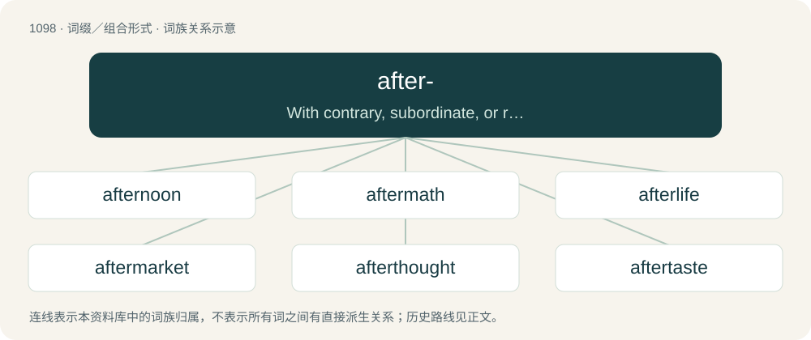

# 1174 · after- — With contrary, subordinate, or remote effect, denoting hindrance, setback, inferiority, etc.

[总目录](../00_总目录_按常用程度.md)

**类型**：词缀／组合形式　｜　**来源语言**：见词源记录

## 核心含义与来源

- 核心含义：With contrary, subordinate, or remote effect, denoting hindrance, setback, inferiority, etc.
- 英文含义：With contrary, subordinate, or remote effect, denoting hindrance, setback, inferiority, etc.
- 词形：after-

**来源记录 1**（前缀／前置成分；With contrary, subordinate, or remote effect, denoting hindrance, setback, inferiority, etc.）

From after (adverb and preposition), and also continuing Middle English after-, efter-, æfter-, from Old English æfter- (“after, behind, against”). Cognate with Scots efter-, West Frisian efter-, Dutch achter-, German after-, Swedish efter-. More at after.

## 词族图

## 单词速览（常用到不常用）

| 单词 | 音标 | 释义 |
|---|---|---|
| [afternoon](#w-1) | 英 /ˌɑːf.təˈnuːn/；美 /ˌæf.tɚˈnun/ | n. 午后, 下午 |
| [aftermath](#w-2) | 英 /ˈɑːf.təˌmæθ/；美 /ˈæf.tɚˌmæθ/ | n. 结果, 后果；\[法\] 后果, 结果 |
| [afterlife](#w-3) | 英 /ˈɑːftəˌlaɪf/；美 /ˈæftɚˌlaɪf/ | n. 来世, 下半生 |
| [aftermarket](#w-4) | /ˈɑːftə.mɑːkit. ˈæf-/ | n. 零件市场；二级市场（等于secondary market） |
| [afterthought](#w-5) | 美 /ˈæft.ɚ.θɔt/ | n. 事后的想法 |
| [aftertaste](#w-6) | 美 /ˈæftɚˌteɪst/ | n. 回味, 余韵 |
| [afterglow](#w-7) | /ˈɑːftəglou/ | n. 晚霞, 夕照；\[医\] 滞光, 余辉 |
| [aftershock](#w-8) | 美 /ˈæftɜɹʃɔk/ | n. 余震 |
| [aftershave](#w-9) | /ˈɑːftəʃeɪv/ | n. 须后水；修脸润肤露 |
| [aftercare](#w-10) | 英 /ˈɑːf.tə(ɹ).kɛə(ɹ)/；美 /ˈæf.təɹ.kɛɹ/ | n. 病后的照顾调养, 释放后的安置 |
| [afterschool](#w-11) | /ˈɑːftəskuːl/ | a. 课外的,供课外活动用的 |
| [afterword](#w-12) | 英 /ˈɑːf.tə.wɜːd/；美 /ˈæf.tɚˌwɝd/ | n. 后记 |
| [afterburner](#w-13) | 美 /ˈæf.tɚˌbɚ.nɚ/ | n. 加力燃烧室；\[机\] 后燃器 |
| [afterbirth](#w-14) | 美 /ˈæf.tɚ.bɚθ/ | n. 胞衣；\[法\] 遗腹子, 胎胞 |

## 逐词详解

### 1. afternoon

**词性**：名词　｜　**音标**：英 /ˌɑːf.təˈnuːn/；美 /ˌæf.tɚˈnun/

**中文释义**：n. 午后, 下午

**英文义项**：The part of the day from noon or lunchtime until sunset, evening, or suppertime or 6pm. / The later part of anything, often with implications of decline.

**构词拆分**：after- + noon

**词源与演化**：

From Middle English afternone, after-non, equivalent to after- + noon.

**例句**：

> He spent a quiet afternoon in the park.

该用例对应义项：the part of the day between noon and evening

### 2. aftermath

**词性**：名词　｜　**音标**：英 /ˈɑːf.təˌmæθ/；美 /ˈæf.tɚˌmæθ/

**中文释义**：n. 结果, 后果；\[法\] 后果, 结果

**英文义项**：That which happens after, that which follows, usually of strongly negative connotation in most contexts, implying a preceding catastrophe.

**构词拆分**：after- + math

**词源与演化**：

From after- + math (“a mowing”).

**例句**：

> In contrast to most projections of the aftermath of nuclear war, in this there is no rioting or looting.

该用例对应义项：That which happens after, that which follows, usually of strongly negative connotation in most contexts, implying a preceding catastrophe.

### 3. afterlife

**词性**：名词　｜　**音标**：英 /ˈɑːftəˌlaɪf/；美 /ˈæftɚˌlaɪf/

**中文释义**：n. 来世, 下半生

**英文义项**：A conscious existence after death; a supernatural life that follows one's natural life, in some worldviews. / The place believed to be inhabited by people who have died.

**构词拆分**：after- + life

**词源与演化**：

From after- + life.

**例句**：

> They say that life begins at 40, but right now I'm more interested in the afterlife that begins at 65!

该用例对应义项：The part of a person's life that follows a particular stage or event; later life.

### 4. aftermarket

**词性**：名词　｜　**音标**：/ˈɑːftə.mɑːkit. ˈæf-/

**中文释义**：n. 零件市场；二级市场（等于secondary market）

**英文义项**：The market for further goods and services, such as replacement parts and accessories, subsequent to the sale of a product such as an automobile or computer. / The industry that serves that market.

**构词拆分**：after- + market

**词源与演化**：

From after- + market.

### 5. afterthought

**词性**：名词　｜　**音标**：美 /ˈæft.ɚ.θɔt/

**中文释义**：n. 事后的想法

**英文义项**：A reflection after an act; a later or subsequent thought, action, or expedient. / Something additional to the original plan or concept.

**构词拆分**：after- + thought

**词源与演化**：

From after- + thought, probably modelled on forethought. Compare also the verb afterthink.

**例句**：

> This whole remodeling was an afterthought; we were only going to paint and call it good.

该用例对应义项：Something additional to the original plan or concept.

### 6. aftertaste

**词性**：名词　｜　**音标**：美 /ˈæftɚˌteɪst/

**中文释义**：n. 回味, 余韵

**英文义项**：A taste of something that persists when it is no longer present. / The persistence of the taste of something no longer present.

**构词拆分**：after- + taste

**词源与演化**：

From after- + taste.

**例句**：

> Many people think certain artificial sweeteners have an unpleasant aftertaste.

该用例对应义项：The persistence of the taste of something no longer present.

### 7. afterglow

**词性**：名词　｜　**音标**：/ˈɑːftəglou/

**中文释义**：n. 晚霞, 夕照；\[医\] 滞光, 余辉

**英文义项**：The glow seen in the sky after sunset. / The light emitted by an incandescent object while cooling.

**构词拆分**：after- + glow

**词源与演化**：

From after- + glow.

**例句**：

> There's an afterglow with singing after the evening worship.

该用例对应义项：An afterparty.

### 8. aftershock

**词性**：名词　｜　**音标**：美 /ˈæftɜɹʃɔk/

**中文释义**：n. 余震

**英文义项**：An earthquake that follows in the same vicinity as another, usually larger, earthquake (the "mainshock"). / By extension, any result or consequence following a major event.

**构词拆分**：after- + shock

**词源与演化**：

From after- + shock.

**例句**：

> The aftershock from the earthquake knocked my bookshelf over.

### 9. aftershave

**词性**：名词　｜　**音标**：/ˈɑːftəʃeɪv/

**中文释义**：n. 须后水；修脸润肤露

**英文义项**：a lotion, gel, or liquid used after finishing shaving

**构词拆分**：after- + shave

**词源与演化**：

From after- + shave.

**例句**：

> Don't tell me you don't like this aftershave.

### 10. aftercare

**词性**：名词　｜　**音标**：英 /ˈɑːf.tə(ɹ).kɛə(ɹ)/；美 /ˈæf.təɹ.kɛɹ/

**中文释义**：n. 病后的照顾调养, 释放后的安置

**英文义项**：The care given to a patient during recovery from an operation or after hospitalization. / Services and support offered to a customer for the goods or service they have purchased.

**构词拆分**：after- + care

**词源与演化**：

From after- + care.

**例句**：

> Aftercare involves providing comfort and support to partners after a scene.

### 11. afterschool

**词性**：形容词　｜　**音标**：/ˈɑːftəskuːl/

**中文释义**：a. 课外的,供课外活动用的

**英文义项**：Taking place immediately after school classes. / Of or pertaining to a program intended to care for and educate children in the time immediately after school classes.

**构词拆分**：after- + school

**词源与演化**：

From after- + school.

### 12. afterword

**词性**：名词　｜　**音标**：英 /ˈɑːf.tə.wɜːd/；美 /ˈæf.tɚˌwɝd/

**中文释义**：n. 后记

**英文义项**：an epilogue. / a postscript.

**构词拆分**：after- + word

**词源与演化**：

From after- + word. Compare foreword.

### 13. afterburner

**词性**：名词　｜　**音标**：美 /ˈæf.tɚˌbɚ.nɚ/

**中文释义**：n. 加力燃烧室；\[机\] 后燃器

**英文义项**：A device in a jet engine which injects fuel into the exhaust system to increase the thrust.

**构词拆分**：after- + burner

**词源与演化**：

From after- + burner.

**例句**：

> The fighter jet used the afterburner to elude the enemy aircraft.

### 14. afterbirth

**词性**：名词　｜　**音标**：美 /ˈæf.tɚ.bɚθ/

**中文释义**：n. 胞衣；\[法\] 遗腹子, 胎胞

**英文义项**：The placenta and other material expelled via the birth canal following childbirth or parturition in mammals.

**构词拆分**：after- + birth

**词源与演化**：

From after- + birth (in the sense of delivery). Cognate with Danish efterbyrd (“afterbirth”), Swedish efterbörd (“afterbirth”). Compare also afterburden, afterburthen.
