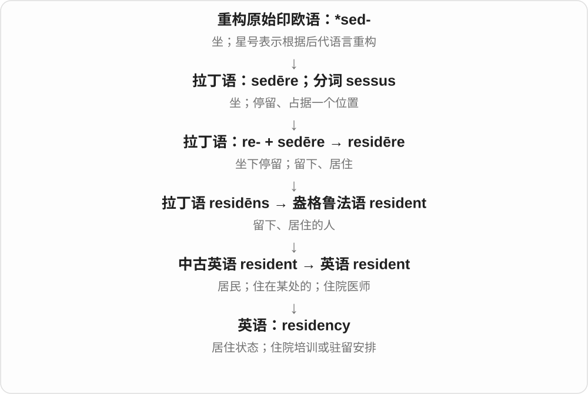

# 1186 · -ency — 状态、性质；有时指相应人群、范围

[逐词精讲目录](../00_逐词精讲目录.md) · [总目录](../00_总目录_按常用程度.md)

## 核心词根与来源

-ency 远接拉丁 -entia 等名词材料，许多词经法语或学术传入，也在英语中形成新词。和 -ent 的对应有帮助，但不能看见 -ency 就以为总是某个人的职业。

**ENCY：从某种性质、角色转到状态或群体**

latent 是潜伏、未显现，latency 可以说那种状态，也可说等到系统响应的延迟；constituent 是组成者、选民，constituency 可说选民群体、选区。

- **未显现与延迟**：latent · latency
- **组成、代表与范围**：constituent · constituency
- **性质和程度**：consistency · proficiency · resiliency
- **紧急、居住与其他状态**：emergency · urgency · residency · dependency · regency · despondency

## 词形与演化规律

latent ↔ latency；constituent ↔ constituency；consistent ↔ consistency；proficient ↔ proficiency。实际词有借入、后续派生等不同路径，换词尾是现代识形对应。

## 单词速览（按词族由简到繁）

同一基础词的相关扩展放在一起，先读基础形式，再读扩展；各组之间优先读常用的。具体词源关系见各词讲解。

| 单词 | 音标 | 核心意思 |
|---|---|---|
| [emergency](#w-1) | 英 /ɪˈmɜːdʒənsi/；美 /ɪˈmɜːrdʒənsi/ | 紧急情况；突发急事 |
| [consistency](#w-2) | /kənˈsɪstənsi/ | 一致性；稳定性；稠度、质地 |
| [residency](#w-3) | /ˈrezɪdənsi/ | 居住资格或状态；驻留项目；住院医师培训期 |
| [constituent](#w-12) | /kənˈstɪtjuənt/，美式也常 /kənˈstɪtʃuənt/ | 组成部分；选区选民；组成的 |
| [constituency](#w-4) | /kənˈstɪtʃuənsi/，亦有 /tj/ 读法 | 选区；选民群体；支持、服务的特定人群 |
| [urgency](#w-5) | 英 /ˈɜːdʒənsi/；美 /ˈɜrdʒənsi/ | 紧迫性；紧迫感 |
| [dependency](#w-6) | 英、美 /dɪˈpendənsi/ | 依赖；依赖关系；依赖项；属地 |
| [proficiency](#w-7) | /pɹəˈfɪʃənsi/ | 熟练程度；精通 |
| [latent](#w-13) | /ˈleɪtənt/ | 潜在的；潜伏、尚未显现的 |
| [latency](#w-8) | /ˈleɪtənsi/ | 潜伏状态；〔系统等〕延迟、响应等待时间 |
| [regency](#w-9) | 英、美 /ˈriːdʒənsi/ | 摄政；摄政时期；摄政风格 |
| [resiliency](#w-10) | 英 /rɪˈzɪliənsi/；美 /rɪˈzɪljənsi/ | 回弹性；韧性、恢复能力 |
| [despondency](#w-11) | 英 /dɪˈspɒndənsi/；美 /dɪˈspɑːndənsi/ | 灰心；意志消沉 |

## 逐词讲解

### 1. emergency — 紧急情况；突发急事

**音标**：英 /ɪˈmɜːdʒənsi/；美 /ɪˈmɜːrdʒənsi/

**先抓住这个画面**

事情突然冒出来，而且不能照原计划慢慢等，需要及时应对。

**怎么拆**

接拉丁 ēmergere“出现”、分词 ēmergēns 的词族；也按 emerge + -ency 分析。

**怎么变成今天的意思**

**拉丁 mergere，分词 mersus**  
浸入、沉下去

↓

**拉丁 ē- / ex-“出” + mergere → ēmergere**  
从浸没中出来、浮现

↓

**英语 emergency**  
突然出现的情况 → 需要立即应对的紧急情况

emergency exit 是紧急出口；an emergency meeting 是为紧急事项召开的会议。与 emergence 同根，但现代 emergency 已把重点放在情况的紧迫性。

**常见搭配与例句**

in an emergency；an emergency exit；emergency services。

> Keep the emergency exit clear.

请保持紧急出口畅通。

> The team held an emergency meeting that evening.

团队当晚召开了紧急会议。

**别混淆**

urgent 是形容事情急；emergency 是紧急情形本身。普通新情况可以 emerge，却未必构成 an emergency。

### 2. consistency — 一致性；稳定性；稠度、质地

**音标**：/kənˈsɪstənsi/

**先抓住这个画面**

一边看前后能否对得上，一边也可摸材料有没有均匀的“身骨”。

**怎么拆**

上溯中世纪拉丁 consistentia 或拉丁 consistentem；现代可分析成 consistent 的名词形式。早期物理上的坚实、稠密义并非从“逻辑一致”硬比喻出来。

**怎么变成今天的意思**

**拉丁 sistere〔与 stāre“站”相关〕**  
使站住、放置；站定、停住

↓

**拉丁 con- + sistere → consistere**  
站在一起、站稳 → 组成、相符合

↓

**拉丁 consistentem／中世纪拉丁 consistentia → 英语 consistency**  
坚实、稠密程度 → 一致性；现代也与 consistent 对应

做事有 consistency 是标准稳定；检查故事的 consistency 是看前后矛盾；the consistency of cream 则说奶油般的稠度。这三个场景共同关心部分能否稳稳合在一起。

**常见搭配与例句**

maintain consistency；consistency between accounts；a thick consistency。

> We need greater consistency in how these requests are handled.

这些请求的处理方式需要更一致。

> Add water until the paste has the consistency of thick cream.

加水，直到糊状物达到浓奶油般的稠度。

**别混淆**

consistency 说稳定协调，也可说稠度；frequency 只说出现次数多不多，不保证每次质量一致。

### 3. residency — 居住资格或状态；驻留项目；住院医师培训期

**音标**：/ˈrezɪdənsi/

**先抓住这个画面**

residency 像被允许或安排在一个地方持续待上一段时间，可能为了生活，也可能为了培训或创作。

**怎么拆**

英语 reside + -ency 或 resident + -cy 的派生分析；没有必要虚构一个后来的拉丁借入环节。

**怎么变成今天的意思**

medical residency 是医生毕业后的住院培训；an artist residency 是艺术家驻留项目。residency requirements 是关于居住资格的条件。

**常见搭配与例句**

complete a residency；an artist residency；residency requirements。

> She completed her residency at a teaching hospital.

她在一家教学医院完成了住院医师培训。

> The writer spent three months on an artist residency.

这位作家参加了三个月的艺术家驻留项目。

**别混淆**

residence 可具体指住所；residency 更常说资格、状态或在机构中的一段驻留安排。

### 4. constituent — 组成部分；选区选民；组成的

**音标**：/kənˈstɪtjuənt/，美式也常 /kənˈstɪtʃuənt/

**先抓住这个画面**

一个整体由哪些部分组成；一个代表又代表着哪些人。

**怎么拆**

来自拉丁 constituens，属 constituere 的现在分词；con- 与 statuere 形成建立、组成的动词，不是英语 constitute 任意换字母。

**怎么变成今天的意思**

**拉丁 stare → statuere**  
站立 → 使站稳、设立、安排

↓

**拉丁 con- + statuere → constituere → constituens**  
设立、组成 → 组成的、设立者

↓

**英语 constituent〔名词、形容词〕**  
选区选民；组成部分、组成的

chemical constituents 是化学成分；a representative’s constituents 是该代表所代表的选民，政治报道里也常泛指其服务的选区居民。constituent parts 是构成整体的各部分。

**常见搭配与例句**

constituent parts；chemical constituents；meet with constituents。

> The analysis identified the main constituents of the mixture.

分析确定了混合物的主要成分。

> The representative holds regular meetings with her constituents.

这位代表定期与她的选区选民见面。

**别混淆**

component 常说零件、组成部分；constituent 还能指选民。constituency 是选区或支持群体，通常不是一个人。

### 5. constituency — 选区；选民群体；支持、服务的特定人群

**音标**：/kənˈstɪtʃuənsi/，亦有 /tj/ 读法

**先抓住这个画面**

议员代表的不只是一块地图上的范围，也是一群住在那里、有投票关系的人；constituency 可说选区，也可说那群人。

**怎么拆**

constituent 组成者、选民的词干与 -ency 形成群体、范围名词。远接拉丁 constituere 建立、组成的材料；不是 constitution 完整词直接删字母。

**怎么变成今天的意思**

**constituent 的选民、组成者义 + -ency**  
相应群体或代表范围

↓

**constituency**  
选区；选民；某组织所面向的人群

a rural constituency 农村选区；serve a broad constituency 服务广泛人群。超出选举时，也可说某机构的支持者、受众等，要看文本。

**常见搭配与例句**

an electoral constituency；a broad constituency。

> She visited schools across her constituency.

她走访了选区内各地的学校。

> The museum serves a broad constituency, from schoolchildren to researchers.

博物馆服务的人群很广，从学童到研究人员都有。

**别混淆**

constituent 可数时指其中一个选民、组成部分；constituency 则指范围或群体。district 泛指地区，不一定具有选举代表关系。

### 6. urgency — 紧迫性；紧迫感

**音标**：英 /ˈɜːdʒənsi/；美 /ˈɜrdʒənsi/

**先抓住这个画面**

不是简单说“这事急”，而是把“有多急、为什么得快办”当作一件事来谈。

**怎么拆**

通常分析为 urgent 的名词化，-ent 对应 -ency；也有词源说明联系拉丁 urgentia。

**怎么变成今天的意思**

**拉丁 urgere**  
压迫、催逼、推动

↓

**拉丁 urgent- → 法语／英语 urgent**  
催逼、急迫的

↓

**urgent → urgency**  
紧急状态、迫切程度或感觉

a sense of urgency 是紧迫感；as a matter of urgency 是作为急事处理。说 lacking urgency 常是在批评做事慢悠悠，没有意识到时间紧。

**常见搭配与例句**

a sense of urgency；the urgency of the situation；with urgency；as a matter of urgency。

> Her voice conveyed the urgency of the situation.

她的声音传达出形势有多紧迫。

> The team needs a greater sense of urgency.

团队需要更强的紧迫感。

**别混淆**

emergency 常指具体紧急事件，urgency 是迫切的程度或感觉。工作有 urgency，不必一定出现了 emergency。

### 7. dependency — 依赖；依赖关系；依赖项；属地

**音标**：英、美 /dɪˈpendənsi/

**先抓住这个画面**

要让 A 运作，先得有 B：B 就可能是 A 的一个依赖项。这比笼统说“依赖”更容易数出具体的连接。

**怎么拆**

英语依 dependent 配出 -cy 名词，早期有受法语拼写影响的 dependancy；现代 dependency 成为常见形式。其软件义是后来的应用，不是古拉丁专门术语。

**怎么变成今天的意思**

**拉丁 pendēre；相关动词 pendere**  
悬垂；使悬挂、称量

↓

**拉丁 dependere 的分词 dependens；法语 dependant**  
依附、依赖的

↓

**英语 dependent／名词也拼 dependant**  
需要依靠的；受供养的人

↓

**英语 dependent → dependency**  
依赖状态；进一步指依赖的事物或附属地区

↓

**现代技术用法**  
完成任务或运行程序所需的前提、组件

软件说 install the dependencies，是安装程序需要的组件。项目说 a task dependency，是任务之间的先后或前提关系。历史、地理语境的 a dependency 则可指受另一国管辖的属地。

**常见搭配与例句**

software dependencies；a dependency on；a task dependency；resolve a dependency。

> The application cannot start because a required dependency is missing.

应用无法启动，因为缺少一个必要的依赖组件。

> The project plan shows the dependencies between tasks.

项目计划展示了任务之间的依赖关系。

**别混淆**

dependence 常说依赖这种状态；dependency 也能数成 one dependency、several dependencies。别把所有 dependency 都译成成瘾。

### 8. proficiency — 熟练程度；精通

**音标**：/pɹəˈfɪʃənsi/

**先抓住这个画面**

从看说明书一步步做，到能稳稳当当地独立完成：这种达到的熟练水平就是 proficiency。

**怎么拆**

由 proficient 构成性质名词；词族追溯到 proficere“向前做、取得进展”。

**怎么变成今天的意思**

学习不断向前推进，形成某项技能的扎实能力。proficiency 强调能用出来，而不是只知道术语。

**常见搭配与例句**

language proficiency；proficiency in English；demonstrate proficiency。

> The test measures proficiency in written English.

这项考试衡量英语写作熟练程度。

> Her proficiency improved with daily practice.

每天练习使她越来越熟练。

**别混淆**

knowledge 是知识；proficiency 强调运用技能时的熟练度。

### 9. latent — 潜在的；潜伏、尚未显现的

**音标**：/ˈleɪtənt/

**先抓住这个画面**

东西已经藏在那里，只是还没露出来或发挥出来：一个人有潜在能力，一场争论下面有潜伏的不满。

**怎么拆**

经法语 latent 接拉丁 latens，来自 latere 藏着、未显露。不是 late 迟加 -nt；它和 late 的现代拼写相似不能证明同源。

**怎么变成今天的意思**

**拉丁 latere → latens → 法语 latent**  
藏着 → 隐藏、未显现的

↓

**英语 latent**  
潜在、暂未显露的

latent talent 潜能；latent tension 潜在紧张；latent heat 潜热是物理专门用语。不同领域的潜伏有具体条件，不能一概理解为毫无作用。

**常见搭配与例句**

latent potential；latent tension。

> The project revealed her latent talent for design.

这个项目显露了她潜在的设计才能。

> There was latent tension beneath their polite conversation.

他们客气的谈话下面藏着紧张气氛。

**别混淆**

hidden 只说看不见；latent 常强调尚未表现、激活或被发现。late 是迟，latent 不是稍微迟到的。

### 10. latency — 潜伏状态；〔系统等〕延迟、响应等待时间

**音标**：/ˈleɪtənsi/

**先抓住这个画面**

按下按钮，等一会儿画面才动：从触发到可观察的响应，中间那段等待就是系统语境里常说的 latency。

**怎么拆**

latent 的词干与 -ency 形成状态名词，远接拉丁隐藏材料；由尚未显现的状态，也形成刺激、输入到响应之间的时间用法。

**怎么变成今天的意思**

**latent + -ency 的对应**  
潜伏、未显现的状态

↓

**latency 的时间用法**  
触发与响应之间的等待、延迟

low latency 低延迟；network latency 网络延迟。实际测的是单程、往返或其他环节，要看上下文，不能只看同一个词就默认同一指标。

**常见搭配与例句**

network latency；reduce latency；low latency。

> High latency made the video call difficult.

较高的延迟让视频通话变得困难。

> The engineers measured the latency between a button press and the response.

工程师测量了按下按钮到系统响应之间的延迟。

**别混淆**

bandwidth 带宽偏单位时间能传多少，latency 偏要等多久；路很宽、能过很多车，不代表每辆车瞬间到达。

### 11. regency — 摄政；摄政时期；摄政风格

**音标**：英、美 /ˈriːdʒənsi/

**先抓住这个画面**

关注的是代管王权这段安排或时期；英语里还常借这个时期来形容建筑、家具和服饰风格。

**怎么拆**

来自中世纪拉丁语 regentia，经中古英语借入，联系 regens“治理的”；现代可与 regent + -cy 对应，不能因此断言是英语新造词。

**怎么变成今天的意思**

**拉丁语：regere**  
引导、使直；治理

↓

**拉丁语 regens → 中世纪拉丁语 regentia**  
治理者 → 治理、摄政

↓

**英语：regency**  
摄政安排或时期

大写 Regency 常特指英国摄政时期及相关文化风格。摄政者暂时代管，并不是王位必然空缺。

**常见搭配与例句**

during the regency；Regency architecture；a regency council。

> A council exercised power during the regency.

摄政期间由一个委员会行使权力。

> The house is admired for its elegant Regency architecture.

这座房屋以优雅的摄政时期建筑风格受到赞赏。

**别混淆**

interregnum 是统治者或领导交接间的空档；regency 有人在替君主行使权力。

### 12. resiliency — 回弹性；韧性、恢复能力

**音标**：英 /rɪˈzɪliənsi/；美 /rɪˈzɪljənsi/

**先抓住这个画面**

依然是受压后弹回、受挫后能调整的那种能力，只是名词换用了 -ency 的形式。

**怎么拆**

与 resilience 同源，英语中形成 resiliency 这一抽象名词变体。可对照 resilient 与 -ency 的构词关系，不必假设它代表另一种完全不同的心理特质。

**怎么变成今天的意思**

**拉丁 salire**  
跳、跃起；复合词中常变成 -silire

↓

**拉丁 re- + salire → resilire**  
向后跳、弹回去

↓

**拉丁 resiliens 的词干 + 英语 -ence → resilience**  
弹回、回弹能力

↓

**英语 resilience → resiliency**  
表示同类性质的名词变体

resiliency 常见于材料、社区、经济等话题，与 resilience 大体同义。实际写作更应遵循所在学科、组织的习惯，不要硬分成一个“短期”、一个“长期”。

**常见搭配与例句**

the resiliency of rubber；community resiliency；improve network resiliency。

> Repeated use gradually reduced the cushion’s resiliency.

反复使用逐渐降低了坐垫的回弹性。

> Backup power improved the hospital’s resiliency during outages.

备用电源提高了医院在停电期间维持和恢复运作的能力。

**别混淆**

resilience 和 resiliency 的主要区别常是用词习惯；具体论文若自行规定术语范围，按该文定义理解。

### 13. despondency — 灰心；意志消沉

**音标**：英 /dɪˈspɒndənsi/；美 /dɪˈspɑːndənsi/

**先抓住这个画面**

不只是难过，而是觉得继续努力也未必有用，原先支撑自己的劲头在往下沉。

**怎么拆**

与 despondent 对应，接拉丁 despondere“放弃、灰心”的分词词干；有拉丁 despondentia 借入和英语 -cy 名词化两种分析。

**怎么变成今天的意思**

**拉丁语 spondere，分词 sponsus**  
郑重承诺、作担保

↓

**拉丁 de- + spondere → despondere**  
许诺给出、许婚；也有放弃、灰心义

↓

**拉丁 despondens / despondentia**  
灰心的；灰心状态

↓

**英语 despondency〔亦可联系 despondent 与 -cy〕**  
因失去希望而消沉

常用于叙事中描述挫折后的心境。它不必是完全绝望，也不是单凭一个词就确定临床诊断。

**常见搭配与例句**

a feeling of despondency；sink into despondency。

> A sense of despondency spread through the team after the announcement.

消息公布后，球队中弥漫着灰心的情绪。

> A supportive letter helped ease her despondency.

一封鼓励的信缓解了她的消沉。

**别混淆**

despair 常强调彻底失去希望；despondency 更突出心气低落、难以继续努力。

## 这一组要分清什么

latency 等多久，bandwidth 能传多少；constituency 不一定只指地图范围；consistency、proficiency 等是性质名词，不能按人来翻译。

## 串起来练习

The engineer found a latent problem that was increasing latency.

工程师找到了一个尚未显露、却在增加延迟的问题。
