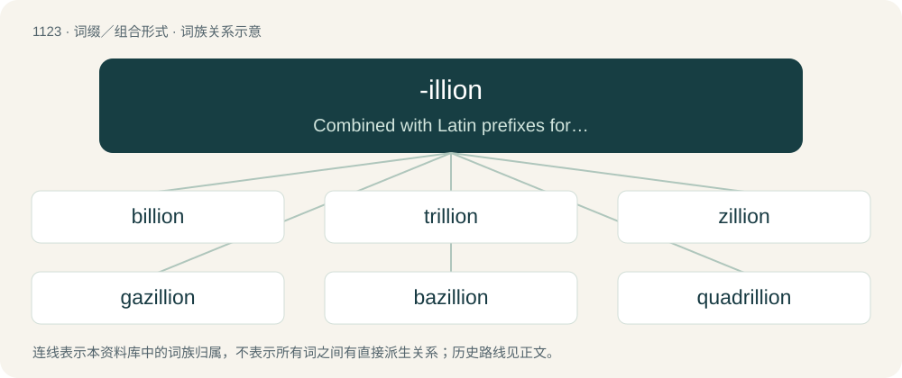

# 1203 · -illion — Combined with Latin prefixes for names of integers in order to form names of powers of a million.

[总目录](../00_总目录_按常用程度.md)

**类型**：词缀／组合形式　｜　**来源语言**：见词源记录

## 核心含义与来源

- 核心含义：Combined with Latin prefixes for names of integers in order to form names of powers of a million.
- 英文含义：Combined with Latin prefixes for names of integers in order to form names of powers of a million.
- 词形：-illion

**来源记录 1**（后缀／后置成分；Combined with Latin prefixes for names of integers in order to form names of powers of a million.）

Back-formation from million, then used in billion, trillion, quadrillion, each from French, ultimately from Italian mille (“thousand”) and the augmentative suffix -one. -illion was segmented from million as if mi- was a prefix, and -illion the stem.

## 词族图

## 单词速览（常用到不常用）

| 单词 | 音标 | 释义 |
|---|---|---|
| [billion](#w-1) | /ˈbɪljən/ | num. 十亿, 十亿个 |
| [trillion](#w-2) | /ˈtɹɪljən/ | n. 大量；\[经\] 兆 |
| [zillion](#w-3) | /ˈzɪljən/ | n. 无限大的数字 |
| [gazillion](#w-4) | /ɡəˈzɪljən/ | n. &lt;口&gt;许许多多 |
| [bazillion](#w-5) | 英 /bəˈzɪlɪən/ | 许许多多；无数 |
| [quadrillion](#w-6) | 英 /kwɒˈdɹɪl.jən/；美 /kwɑˈdɹɪl.i.ən/ | n. 千的五次方, 百万之四次方；a. 千之五次方的 |

## 逐词详解

### 1. billion

**词性**：数词　｜　**音标**：/ˈbɪljən/

**中文释义**：num. 十亿, 十亿个

**英文义项**：a thousand million (logic: 1,000 × 1,000²): 1 followed by nine zeros, 10⁹. / A million million (logic: 1,000,000²): a 1 followed by twelve zeros (10¹²); a thousand milliard.

**构词拆分**：bi- (“two”) + -illion

**词源与演化**：

From French billion, equivalent to bi- (“two”) + -illion.

**例句**：

> There were billions of people at the concert.

该用例对应义项：An unspecified very large number.

### 2. trillion

**词性**：数词　｜　**音标**：/ˈtɹɪljən/

**中文释义**：n. 大量；\[经\] 兆

**英文义项**：A million (times a) million: 1 followed by twelve zeros, 10¹². / A million (times a) million (times a) million: 1 followed by eighteen zeros, 10¹⁸.

**构词拆分**：tri- + -illion

**词源与演化**：

Borrowed from French trillion, from French tri- (“three”) + -illion, equivalent to tri- + -illion. The noun was coined by American basketball player Harvey Pollack, because of the way the numbers read across a basketball box score.

**例句**：

> There were trillions of people at the concert.

该用例对应义项：An unspecified very large number.

### 3. zillion

**词性**：名词　｜　**音标**：/ˈzɪljən/

**中文释义**：n. 无限大的数字

**英文义项**：An unspecified large number (of).

**词源与演化**：

See -illion. An arbitrary coinage, appearing by 1916, on analogy of million, billion, trillion.

**例句**：

> I've told you a zillion times not to do that.

### 4. gazillion

**词性**：名词　｜　**音标**：/ɡəˈzɪljən/

**中文释义**：n. &lt;口&gt;许许多多

**英文义项**：An unspecified large number (of).

**词源与演化**：

See -illion

### 5. bazillion

**词性**：名词　｜　**音标**：英 /bəˈzɪlɪən/

**中文释义**：许许多多；无数

**英文义项**：An unspecified large number (of).

**词源与演化**：

1939. Variation of zillion. See -illion.

### 6. quadrillion

**词性**：名词　｜　**音标**：英 /kwɒˈdɹɪl.jən/；美 /kwɑˈdɹɪl.i.ən/

**中文释义**：n. 千的五次方, 百万之四次方；a. 千之五次方的

**英文义项**：Any very large number, exceeding normal description.

**构词拆分**：quadri- (“four”) + -illion

**词源与演化**：

From French quadrillion, from quadri- (“four”) + -illion. By surface analysis, quadr- + -illion.

**例句**：

> In England they call a septillion a quadrillion.

该用例对应义项：the number that is represented as a one followed by 24 zeros
