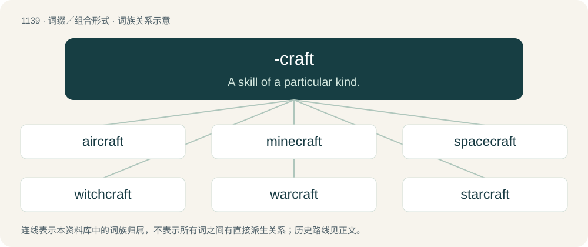

# 1219 · -craft — A skill of a particular kind.

[总目录](../00_总目录_按常用程度.md)

**类型**：词缀／组合形式　｜　**来源语言**：见词源记录

## 核心含义与来源

- 核心含义：A skill of a particular kind.
- 英文含义：A skill of a particular kind.
- 词形：-craft

**多个词源／构词路径**：同一拼写可能有不同来源；以下按词性和含义分别列出。

**来源记录 1**（后缀／后置成分；A skill of a particular kind.）

From Middle English -craft, -creft, from Old English -cræft (“art or skill in”), from cræft (“art, skill”). More at craft.

**来源记录 2**（后缀／后置成分；A vehicle of a particular type.）

From craft (“vehicle, vessel”).

**来源记录 3**（后缀／后置成分；A Minecraft mod or server with a particular theme.）

Back-formation from Minecraft; ultimately from etymology 1 above.

## 词族图

## 单词速览（常用到不常用）

| 单词 | 音标 | 释义 |
|---|---|---|
| [aircraft](#w-1) | 英 /ˈɛə.kɹɑːft/；美 /ˈɛɚ.kɹæft/ | n. 航空器, 飞机；\[机\] 航空器 |
| [minecraft](#w-2) | 英 /ˈmaɪnˌkɹɑːft/；美 /ˈmaɪnˌkɹæft/ | 【英文】A warship which lays naval mines. |
| [spacecraft](#w-3) | 美 /ˈspeɪsˌkɹæft/ | n. 航天飞船 |
| [witchcraft](#w-4) | 英 /ˈwɪt͡ʃkɹɑːft/；美 /ˈwɪt͡ʃkɹæft/ | n. 巫术, 魔法, 魔力 |
| [warcraft](#w-5) | 英 /ˈwɔːkɹɑːft/；美 /ˈwɔɹkɹæft/ | n. 军用飞机, 军舰, 战略和战术, 兵法 |
| [starcraft](#w-6) | /ˈstɑːkrɑːft. -kræft/ | n. 占星学 |
| [watercraft](#w-7) | 美 /ˈwɔtɚkɹæft/ | n. 水性, 船舶, 驾船技术 |
| [hovercraft](#w-8) | 英 /ˈhɒv.ə.kɹɑːft/；美 /ˈhʌvɚ.kɹæft/ | n. 气垫船 |
| [statecraft](#w-9) | /ˈsteitkræft/ | n. 治国才能 |
| [schoolcraft](#w-10) | /ˈskuːlkrɑːft;-kræft/ | n. &lt;古&gt;学校教的知识 |
| [stagecraft](#w-11) | /ˈsteidʒkrɑːft; -kræft/ | n. 演剧技巧 |
| [woodcraft](#w-12) | /ˈwudkræft/ | n. 森林生活技巧, 木工技术 |
| [bushcraft](#w-13) | /ˈbjʃkrɑːft/ | n. 丛林谋生知识和技能(如寻找水和食物、觅路或寻找遮蔽处等) |
| [tradecraft](#w-14) | /ˈtredkræft/ | 谍报技术 |
| [handcraft](#w-15) | 美 /ˈhændˌkɹæft/ | vt. 用手工造 |

## 逐词详解

### 1. aircraft

**词性**：名词　｜　**音标**：英 /ˈɛə.kɹɑːft/；美 /ˈɛɚ.kɹæft/

**中文释义**：n. 航空器, 飞机；\[机\] 航空器

**英文义项**：A vehicle capable of atmospheric flight due to interaction with the air, such as buoyancy or lift. / One that can carry a person or persons.

**构词拆分**：air + -craft

**词源与演化**：

From air + -craft.

**用法示例／搭配（非完整句）**：

> aircraft manufacturer

该用例对应义项：A vehicle capable of atmospheric flight due to interaction with the air, such as buoyancy or lift.

### 2. minecraft

**词性**：名词　｜　**音标**：英 /ˈmaɪnˌkɹɑːft/；美 /ˈmaɪnˌkɹæft/

**英文义项**：A warship which lays naval mines.

**构词拆分**：mine + -craft

**词源与演化**：

From mine + -craft.

**例句**：

> Just because Minecraft is flat doesn’t mean that the Earth is flat too!

### 3. spacecraft

**词性**：名词　｜　**音标**：美 /ˈspeɪsˌkɹæft/

**中文释义**：n. 航天飞船

**英文义项**：A vehicle that travels through space.

**构词拆分**：space + -craft

**词源与演化**：

From space + -craft.

**例句**：

> Against all expectations, the Apollo spacecraft made it safely back to Earth.

### 4. witchcraft

**词性**：名词　｜　**音标**：英 /ˈwɪt͡ʃkɹɑːft/；美 /ˈwɪt͡ʃkɹæft/

**中文释义**：n. 巫术, 魔法, 魔力

**英文义项**：The practice of witches; magic, sorcery, or the use of supernatural powers to influence or predict events. / Black magic; the use of witchcraft for evil means.

**构词拆分**：witch + -craft

**词源与演化**：

From Middle English wicchecraft, wicchecreft, from Old English wiċċecræft, equivalent to witch + -craft.

**例句**：

> The Bible warns against the use of witchcraft and sorcery.

该用例对应义项：Black magic; the use of witchcraft for evil means.

### 5. warcraft

**词性**：名词　｜　**音标**：英 /ˈwɔːkɹɑːft/；美 /ˈwɔɹkɹæft/

**中文释义**：n. 军用飞机, 军舰, 战略和战术, 兵法

**英文义项**：The art or skill of conducting a war. / A warship.

**构词拆分**：war + -craft (skill)；war + -craft (vehicle)

**词源与演化**：

From Middle English werrecraft, equivalent to war + -craft (skill) or war + -craft (vehicle).

**例句**：

> This senate candidate also plays World of Warcraft.

### 6. starcraft

**词性**：名词　｜　**音标**：/ˈstɑːkrɑːft. -kræft/

**中文释义**：n. 占星学

**英文义项**：The art of interpreting or reading the stars, astrology.

**构词拆分**：star + -craft

**词源与演化**：

From star + -craft, the latter part from Old English -cræft (“-craft”).

### 7. watercraft

**词性**：名词　｜　**音标**：美 /ˈwɔtɚkɹæft/

**中文释义**：n. 水性, 船舶, 驾船技术

**英文义项**：Any vessel with implements designed to move it in arbitrary direction through one or various bodies of water: a boat, ship, sea scooter, or similar vehicle. / Skill in boating, swimming, or other water-related sports.

**构词拆分**：water + -craft (vehicle)；water + -craft (skill)

**词源与演化**：

From water + -craft (vehicle) or water + -craft (skill).

**例句**：

> A gunboat is a naval watercraft.

### 8. hovercraft

**词性**：名词　｜　**音标**：英 /ˈhɒv.ə.kɹɑːft/；美 /ˈhʌvɚ.kɹæft/

**中文释义**：n. 气垫船

**英文义项**：A vehicle supported on a cushion of air, able to traverse many different types of terrain and travel over water, used for transport.

**构词拆分**：hover + -craft

**词源与演化**：

From hover + -craft. Originally a trademark by Saunders-Roe Limited, a British aero- and marine-engineering company.

**例句**：

> What is the difference between a hovercraft and a motor boat?

### 9. statecraft

**词性**：名词　｜　**音标**：/ˈsteitkræft/

**中文释义**：n. 治国才能

**英文义项**：Synonym of statesmanship (“the ability to guide a state well”).

**构词拆分**：state + -craft

**词源与演化**：

From state + -craft.

### 10. schoolcraft

**词性**：名词　｜　**音标**：/ˈskuːlkrɑːft;-kræft/

**中文释义**：n. &lt;古&gt;学校教的知识

**英文义项**：The art or practice of education.

**构词拆分**：school + -craft

**词源与演化**：

From school + -craft.

### 11. stagecraft

**词性**：名词　｜　**音标**：/ˈsteidʒkrɑːft; -kræft/

**中文释义**：n. 演剧技巧

**英文义项**：The skills of the theater. / A specific skill of the theater.

**构词拆分**：stage + -craft

**词源与演化**：

From stage + -craft.

**例句**：

> To be a professional actor you need to learn stagecraft.

该用例对应义项：The skills of the theater.

### 12. woodcraft

**词性**：名词　｜　**音标**：/ˈwudkræft/

**中文释义**：n. 森林生活技巧, 木工技术

**英文义项**：Any of the skills related to a woodland habitat, especially those relating to outdoor survival; these skills collectively. / The art or skill of wood carving.

**构词拆分**：wood + -craft

**词源与演化**：

From wood + -craft.

### 13. bushcraft

**词性**：名词　｜　**音标**：/ˈbjʃkrɑːft/

**中文释义**：n. 丛林谋生知识和技能(如寻找水和食物、觅路或寻找遮蔽处等)

**英文义项**：The skills needed to survive in the bush, and by extension in any natural environment.

**构词拆分**：bush + -craft

**词源与演化**：

From bush + -craft.

### 14. tradecraft

**词性**：名词　｜　**音标**：/ˈtredkræft/

**中文释义**：谍报技术

**英文义项**：The skills acquired through experience of a trade. / The methods used in espionage and clandestine operations.

**构词拆分**：trade + -craft

**词源与演化**：

From trade + -craft.

**例句**：

> Instructional designers are trained in something that might be called tradecraft.

该用例对应义项：skill acquired through experience in a trade; often used to discuss skill in espionage

### 15. handcraft

**词性**：名词　｜　**音标**：美 /ˈhændˌkɹæft/

**中文释义**：vt. 用手工造

**英文义项**：handicraft

**构词拆分**：hand + -craft

**词源与演化**：

From Middle English handcrafte, handecraft, hond-craft, from Old English handcræft, equivalent to hand + -craft. Cognate with Dutch handkracht, German Handkraft.

**例句**：

> This area is famous for its handcraft business.
