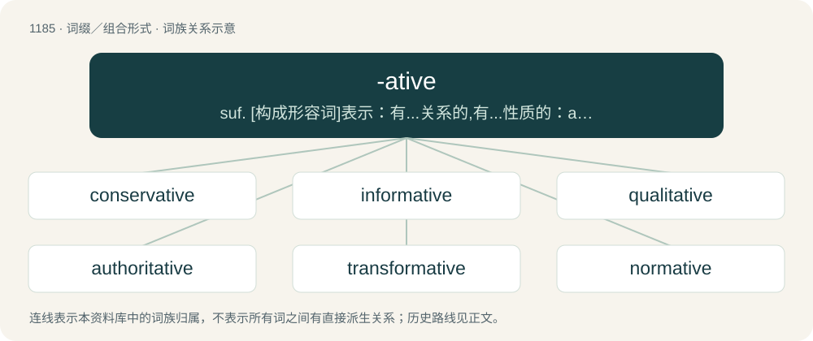

# 1263 · -ative — suf. \[构成形容词\]表示：有...关系的,有...性质的：authoritative,decorative; 有...倾向的：talkative,informative

[总目录](../00_总目录_按常用程度.md)

**类型**：词缀／组合形式　｜　**来源语言**：见词源记录

## 核心含义与来源

- 核心含义：suf. \[构成形容词\]表示：有...关系的,有...性质的：authoritative,decorative; 有...倾向的：talkative,informative
- 英文含义：of, related to, or associated with the thing specified
- 词形：-ative

**来源记录 1**（后缀／后置成分；of, related to, or associated with the thing specified）

From -ate + -ive.

## 词族图

## 单词速览（常用到不常用）

| 单词 | 音标 | 释义 |
|---|---|---|
| [conservative](#w-1) | 英 /kənˈsɜːvətɪv/；美 /kənˈsɝvətɪv/ | 【英文】Cautious, moderate. |
| [informative](#w-2) | 英 /ɪnˈfɔːmətɪv/；美 /ɪnˈfoɹmətɪv/ | a. 提供消息的, 见闻广博的 |
| [qualitative](#w-3) | 英 /ˈkwɒl.ɪ.tə.tɪv/；美 /ˈkwɑ.ləˌteɪ.tɪv/ | a. 性质的, 质的, 定性的 |
| [authoritative](#w-4) | 英 /ɔːˈθɒɹɪtətɪv/；美 /əˈθɔɹɪˌteɪtɪv/ | a. 权威性的, 官方的, 命令式的；\[法\] 官方的, 当局的, 权威的 |
| [transformative](#w-5) | 英 /trɑːnsˈfɔːmətɪv/；美 /tɹænsˈfɔɹmətɪv/ | a. 有改革能力的, 起改造作用的 |
| [normative](#w-6) | 英 /ˈnɔːmətɪv/；美 /ˈnoɹmətɪv/ | a. 合乎规范的, 标准的, 规范的；\[法\] 标准的, 规范的, 合乎规范的 |
| [oxidative](#w-7) | 美 /ˈɑk.səˌdeɪ.tɪv/ | a. 氧化的 |
| [talkative](#w-8) | 英 /ˈtɔː.kə.tɪv/；美 /ˈtɔ.kə.ɾɪv/ | a. 喜欢说话的, 饶舌的, 多嘴的 |
| [restorative](#w-9) | /ɹɪˈstɒɹətɪv/ | a. 恢复健康的, 滋补的；n. 兴奋药, 补药 |
| [exploitative](#w-10) | 美 /ɛkˈsplɔɪtətɪv/；/ɪkˈsplɔɪtətɪv/ | a. 开发的, 剥削的, (糟蹋地)利用的 |
| [performative](#w-11) | /pəˈfɔːmətiv/ | a. \[语\]\[哲\](表)述行(为)的 ；n. \[语\]述行语,述行成分 |
| [accusative](#w-12) | 英 /əˈkjuːzətɪv/；美 /əˈkjuzətɪv/ | a. 宾格的；n. 宾格 |
| [commutative](#w-13) | /kəˈmjuːtətiv/ | a. 交替的, 交换的；\[法\] 交换的, 代替的, 互相的 |
| [determinative](#w-14) | /diˈtəːminətiv/ | a. 决定的, 限定的；n. 决定物, 限定词 |
| [summative](#w-15) | 英 /ˈsʌm.ə.tɪv/；美 /ˈsʌm.ə.tɪv/ | a. 总结性；总结的 |

## 逐词详解

### 1. conservative

**词性**：形容词　｜　**音标**：英 /kənˈsɜːvətɪv/；美 /kənˈsɝvətɪv/

**英文义项**：Cautious, moderate. / Tending to resist change or innovation.

**构词拆分**：conserve + -ative

**词源与演化**：

Borrowed from Middle French conservatif, from Latin cōnservō (“to preserve”). Equivalent to conserve + -ative.

**例句**：

> The curriculum committee at this university is extremely conservative.

该用例对应义项：Tending to resist change or innovation.

### 2. informative

**词性**：形容词　｜　**音标**：英 /ɪnˈfɔːmətɪv/；美 /ɪnˈfoɹmətɪv/

**中文释义**：a. 提供消息的, 见闻广博的

**英文义项**：Providing information; especially, providing useful or interesting information. / Of a standard or specification, not specifying requirements, but merely providing information.

**构词拆分**：inform + -ative

**词源与演化**：

From inform + -ative.

**例句**：

> I read a very informative newspaper article on that subject last week.

该用例对应义项：Providing information; especially, providing useful or interesting information.

### 3. qualitative

**词性**：形容词　｜　**音标**：英 /ˈkwɒl.ɪ.tə.tɪv/；美 /ˈkwɑ.ləˌteɪ.tɪv/

**中文释义**：a. 性质的, 质的, 定性的

**英文义项**：Of descriptions or distinctions based on some quality rather than on some quantity. / Of a form of analysis that yields the identity of a compound.

**构词拆分**：quality + -ative

**词源与演化**：

From Late Latin (or Medieval Latin) quālitātīvus. Equivalent to quality + -ative.

**例句**：

> Qualitative analysis determines the chemical constituents of a substance or mixture.

该用例对应义项：involving distinctions based on qualities

### 4. authoritative

**词性**：形容词　｜　**音标**：英 /ɔːˈθɒɹɪtətɪv/；美 /əˈθɔɹɪˌteɪtɪv/

**中文释义**：a. 权威性的, 官方的, 命令式的；\[法\] 官方的, 当局的, 权威的

**英文义项**：Arising or originating from a figure of authority. / Highly accurate or definitive; treated or worthy of treatment as a scholarly authority.

**构词拆分**：authority + -ative

**词源与演化**：

From authorit(y) + -ative.

**例句**：

> The authoritative rules in this school come not from the headmaster but from the aged matron.

该用例对应义项：Arising or originating from a figure of authority.

### 5. transformative

**词性**：形容词　｜　**音标**：英 /trɑːnsˈfɔːmətɪv/；美 /tɹænsˈfɔɹmətɪv/

**中文释义**：a. 有改革能力的, 起改造作用的

**英文义项**：That causes a transformation; causing a notable and lasting change / Chiefly in transformative-generative: of or relating to a theory of generative grammar in which defined operations called transformations produce new sentences from existing ones; transformational.

**构词拆分**：transform + -ative

**词源与演化**：

From Medieval Latin transformātīvus (“transformative”), from Latin trānsfōrmātus (“transformed”) + -īvus (suffix attached to the perfect passive participial stems of verbs, forming deverbal adjectives meaning ‘doing or related to doing \[the verb\]’). Trānsfōrmātus is the perfect passive participle of trānsfōrmō (“to transform”), from trāns- (prefix meaning ‘across; beyond; through’) + fōrmō (“to fashion, form, format, shape”) (from fōrma (“appearance, figure, form, shape”); further etymology unknown, perhaps related to Ancient Greek μορφή (morphḗ, “a form, shape”)). The English word is analysable as transform + -ative.

**例句**：

> This transformative experience showed me the incredible potential we possess.

### 6. normative

**词性**：形容词　｜　**音标**：英 /ˈnɔːmətɪv/；美 /ˈnoɹmətɪv/

**中文释义**：a. 合乎规范的, 标准的, 规范的；\[法\] 标准的, 规范的, 合乎规范的

**英文义项**：Of or pertaining to a norm or standard. / Conforming to a norm or norms.

**词源与演化**：

From Latin norma + -ative. Compare French normatif.

**用法示例／搭配（非完整句）**：

> normative behaviour

该用例对应义项：Conforming to a norm or norms.

### 7. oxidative

**词性**：形容词　｜　**音标**：美 /ˈɑk.səˌdeɪ.tɪv/

**中文释义**：a. 氧化的

**英文义项**：Of, relating to, or produced by oxidation.

**构词拆分**：oxide + -ative；oxidate + -ive

**词源与演化**：

From oxide + -ative or oxidate + -ive.

### 8. talkative

**词性**：形容词　｜　**音标**：英 /ˈtɔː.kə.tɪv/；美 /ˈtɔ.kə.ɾɪv/

**中文释义**：a. 喜欢说话的, 饶舌的, 多嘴的

**英文义项**：Tending to talk a lot. / Speaking openly and honestly, neglecting privacy and consequences.

**构词拆分**：talk + -ative

**词源与演化**：

From Middle English talkatyve, equivalent to talk + -ative.

**用法示例／搭配（非完整句）**：

> a talkative TV show

该用例对应义项：Tending to talk a lot.

### 9. restorative

**词性**：形容词　｜　**音标**：/ɹɪˈstɒɹətɪv/

**中文释义**：a. 恢复健康的, 滋补的；n. 兴奋药, 补药

**英文义项**：Serving to restore.

**构词拆分**：restore + -ative

**词源与演化**：

From Middle English restoratif, restoratyve, from Old French restoratif, restauratif and Medieval Latin restaurātīvus. Equivalent to restore + -ative.

**例句**：

> After a long day working in the fields Clarence took comfort in a restorative pint of beer.

该用例对应义项：Serving to restore.

### 10. exploitative

**词性**：形容词　｜　**音标**：美 /ɛkˈsplɔɪtətɪv/；/ɪkˈsplɔɪtətɪv/

**中文释义**：a. 开发的, 剥削的, (糟蹋地)利用的

**英文义项**：In the nature of exploitation; acting to exploit someone or something / Of or relating to exploitation.

**构词拆分**：exploit + -ative

**词源与演化**：

From exploit + -ative. Compare exploitive.

**例句**：

> We are protesting the company's exploitative policies.

该用例对应义项：In the nature of exploitation; acting to exploit someone or something

### 11. performative

**词性**：形容词　｜　**音标**：/pəˈfɔːmətiv/

**中文释义**：a. \[语\]\[哲\](表)述行(为)的 ；n. \[语\]述行语,述行成分

**英文义项**：Being enacted as it is said. / Insincere, inauthentic or disingenuous; done solely or largely as a performance, to produce an impression or enhance one's reputation.

**构词拆分**：perform + -ative

**词源与演化**：

From perform + -ative.

**例句**：

> Saying "I do" as part of a wedding ceremony is performative, enacting a marriage.

该用例对应义项：Being enacted as it is said.

### 12. accusative

**词性**：形容词　｜　**音标**：英 /əˈkjuːzətɪv/；美 /əˈkjuzətɪv/

**中文释义**：a. 宾格的；n. 宾格

**英文义项**：Producing accusations; in a manner that reflects a finding of fault or blame / Applied to the case (as the fourth case of Latin, Lithuanian and Greek nouns) which expresses the immediate object on which the action or influence of a transitive verb has its limited influence. Other parts of speech, including secondary or predicate direct objects, will also influence a sentence’s construction. In German the case used for direct objects.

**构词拆分**：accuse + -ative

**词源与演化**：

First attested in the mid 15th century. From Middle English accusative, from Anglo-Norman accusatif or Middle French acusatif or from Latin accūsātīvus (“having been blamed”), from accūsō (“to blame”). Equivalent to accuse + -ative. The Latin form is a mistranslation of the Ancient Greek grammatical term αἰτιᾱτική (aitiātikḗ, “expressing an effect”). This term actually comes from αἰτιᾱτός (aitiātós, “caused”) + -ῐκός (-ĭkós, adjective suffix), but was reanalyzed as coming from αἰτιᾱ- (aitiā-), the stem of the verb αἰτιάομαι (aitiáomai, “to blame”), + -τῐκός (-tĭkós, verbal adjective suffix).

**例句**：

> Russian has six basic cases: nominative, genitive, dative, accusative, instrumental and prepositional.

### 13. commutative

**词性**：形容词　｜　**音标**：/kəˈmjuːtətiv/

**中文释义**：a. 交替的, 交换的；\[法\] 交换的, 代替的, 互相的

**英文义项**：Such that the order in which the operands are taken does not affect their image under the operation. / Having a commutative operation.

**词源与演化**：

From French commuter (“to substitute or switch”) + -ative (“tending to”). See commute.

**例句**：

> Addition and multiplication are commutative operations but subtraction and division are not.

该用例对应义项：Such that the order in which the operands are taken does not affect their image under the operation.

### 14. determinative

**词性**：形容词　｜　**音标**：/diˈtəːminətiv/

**中文释义**：a. 决定的, 限定的；n. 决定物, 限定词

**英文义项**：That determines something. / Sufficient to decide something (such as a question of fact or of law).

**构词拆分**：determine + -ative

**词源与演化**：

From Middle French déterminatif. Equivalent to determine + -ative.

**例句**：

> When assigning custody, the preference of the child will be considered, but it is not determinative.

该用例对应义项：Sufficient to decide something (such as a question of fact or of law).

### 15. summative

**词性**：形容词　｜　**音标**：英 /ˈsʌm.ə.tɪv/；美 /ˈsʌm.ə.tɪv/

**中文释义**：a. 总结性；总结的

**英文义项**：Synonym of additive. / Synonym of summary (adjective).

**构词拆分**：sum + -ative

**词源与演化**：

From sum + -ative.

**用法示例／搭配（非完整句）**：

> summative assessment

该用例对应义项：Denoting forms of assessment used to quantify educational outcomes.
