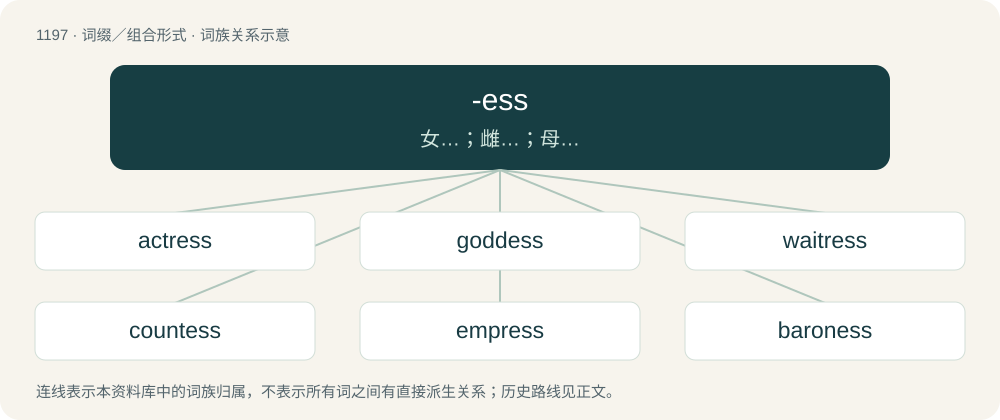

# 1274 · -ess — 女…；雌…；母…

[总目录](../00_总目录_按常用程度.md)

**类型**：词缀／组合形式　｜　**来源语言**：见词源记录

## 核心含义与来源

- 核心含义：女…；雌…；母…
- 英文含义：Used to form female equivalents.
- 词形：-ess

**多个词源／构词路径**：同一拼写可能有不同来源；以下按词性和含义分别列出。

**来源记录 1**（后缀／后置成分；Used to form female equivalents.）

From Middle English -esse, borrowed from Old French -esse, from Late Latin -issa, from Ancient Greek -ισσα (-issa). Displaced Old English -en (feminine suffix of nouns).

**来源记录 2**（后缀／后置成分；Used to form nouns from adjectives.）

From Old French -esse, from Latin -itia.

**来源记录 3**（后缀／后置成分；Used to form proper nouns from nouns.）

From Middle English -eis, a borrowing from Old French -eis, a locative suffix descended from Latin -ensis. The French and Middle English suffixes created nouns describing a freeman of a fortified town, but in Modern English this is found only in proper nouns, particularly in certain surnames. Cognates include Italian -ese, and English English -ese is a doublet.

## 词族图

## 单词速览（常用到不常用）

| 单词 | 音标 | 释义 |
|---|---|---|
| [actress](#w-1) | /ˈæk.tɹɪs/ | n. 女演员 |
| [goddess](#w-2) | 英 /ˈɡɒdɛs/；美 /ˈɡɑdəs/ | n. 女神, 美女, 受崇拜的女性 |
| [waitress](#w-3) | /ˈweɪ.tɹɪs/ | n. 女侍者, 女服务员 |
| [countess](#w-4) | /ˈkaʊntɪs/ | n. 伯爵夫人, 女伯爵 |
| [empress](#w-5) | /ˈɛmpɹəs/ | n. 皇后, 女皇 |
| [baroness](#w-6) | 英 /ˌbæ.ɹəˈnɛs/ | n. 男爵夫人, 女性男爵 |
| [heiress](#w-7) | /ɛəˈɹɛs/ | n. 嗣女, 女继承人；\[法\] 女继承人 |
| [priestess](#w-8) | 英 /ˈpriːstɛs/；美 /ˈpristɪs/ | n. 女神职人员, 女祭司 |
| [governess](#w-9) | 英 /ˈɡʌvənəs/；美 /ˈɡʌvɚnəs/ | n. 女家庭教师 |
| [seamstress](#w-10) | traditional /ˈsɛm(p).stɹɪs/ | n. 女裁缝, 做针线活的妇女 |
| [lioness](#w-11) | /ˈlaɪ.ə.nɪs/ | n. 雌狮 |
| [stewardess](#w-12) | 英 /stjuː.əˈdɛs/；美 /ˈstu.ɚ.dɪs/ | n. 空中小姐, 女管理人, 女管家 |
| [enchantress](#w-13) | 英 /ɪnˈtʃɑːntɹɪs/；美 /ɪnˈt͡ʃæntɹɪs/ | n. 妖妇, 女巫 |
| [huntress](#w-14) | /ˈhʌntɹɪs/ | n. 女猎人 |
| [tigress](#w-15) | /ˈtaɪ.ɡɹɪs/ | n. 母虎, 雌虎 |
| [deaconess](#w-16) | 英 /ˌdiːkəˈnɛs/ | n. 女执事, 牧师的女助手 |
| [temptress](#w-17) | /ˈtɛmp.tɹɛs/ | n. 诱惑男人的女性 |
| [songstress](#w-18) | 美 /ˈsɑŋɡ.stɹɪs/ | n. 女歌手, 女诗人 |
| [shepherdess](#w-19) | /ˈʃepədis/ | 牧羊女 |
| [patroness](#w-20) | 英 /ˈpeɪtɹənɪs/ | n. 女性保护人, 女资助人, 女主顾；\[法\] 女保护人, 女庇护人 |
| [seductress](#w-21) | /sɪˈdʌktɹɛs/ | \[法\] 具有勾引力的女人, 勾引男性的女人 |
| [prioress](#w-22) | /ˈpraiəris/ | n. 大女修道院副院长, 小女修道院院长 |
| [giantess](#w-23) | 英 /ˈd͡ʒaɪəntɛs/ | n. 女巨人 |
| [adulteress](#w-24) | /əˈdʌltəris/ | n. 奸妇；\[法\] 奸妇 |
| [poetess](#w-25) | 英 /ˌpəʊ.ɪˈtɛs/；美 /ˈpoʊ.ɪˌtɛs/ | n. 女诗人 |

## 逐词详解

### 1. actress

**词性**：名词　｜　**音标**：/ˈæk.tɹɪs/

**中文释义**：n. 女演员

**英文义项**：A female who performs on the stage or in films.

**构词拆分**：actor + -ess

**词源与演化**：

From actor + -ess. Probably formed independently of Middle French actrice.

**例句**：

> Sami used to tell Layla that she needed to be an actress.

### 2. goddess

**词性**：名词　｜　**音标**：英 /ˈɡɒdɛs/；美 /ˈɡɑdəs/

**中文释义**：n. 女神, 美女, 受崇拜的女性

**英文义项**：A female deity. / An incredibly beautiful, gorgeous, sexy, attractive woman honored and adored for her beauty or of superior charm and intelligence.

**构词拆分**：god + -ess

**词源与演化**：

From Middle English goddesse, equivalent to god + -ess, formed about 1350. The figurative meaning is first found in Edmund Spenser's Shepheardes calender (1579). Displaced Old English gyden.

**例句**：

> Artemis was the goddess of chastity, virginity, hunting, the moon and nature.

### 3. waitress

**词性**：名词　｜　**音标**：/ˈweɪ.tɹɪs/

**中文释义**：n. 女侍者, 女服务员

**英文义项**：A female attendant who serves customers in a restaurant, café, or similar.

**构词拆分**：waiter + -ess

**词源与演化**：

From waiter + -ess.

**例句**：

> a waitress in a cocktail bar.

该用例对应义项：A female attendant who serves customers in a restaurant, café, or similar.

### 4. countess

**词性**：名词　｜　**音标**：/ˈkaʊntɪs/

**中文释义**：n. 伯爵夫人, 女伯爵

**英文义项**：The wife of a count or earl. / A woman holding the rank of count or earl in her own right; a female holder of an earldom.

**构词拆分**：count + -ess

**词源与演化**：

From Anglo-Norman cuntesse, Old French contesse, from Latin comitissa; equivalent to count + -ess. Doublet of contessa.

**例句**：

> Elizabeth Millicent Leveson-Gower is 24th Countess of Sutherland; her son will be the 25th Earl.

该用例对应义项：A woman holding the rank of count or earl in her own right; a female holder of an earldom.

### 5. empress

**词性**：名词　｜　**音标**：/ˈɛmpɹəs/

**中文释义**：n. 皇后, 女皇

**英文义项**：The female monarch (ruler) of an empire. / The wife or widow of an emperor or equated ruler.

**构词拆分**：emperor + -ess

**词源与演化**：

From Middle English emperice, emperesse, from Anglo-Norman and Old French empereriz, from Latin imperatrix, equivalent to emperor + -ess. Doublet of imperatrix. Compare modern French impératrice.

**例句**：

> Despite her title of Empress of India, Queen Victoria never went there herself.

### 6. baroness

**词性**：名词　｜　**音标**：英 /ˌbæ.ɹəˈnɛs/

**中文释义**：n. 男爵夫人, 女性男爵

**英文义项**：The wife of a baron. / A woman holding a baronial title in her own right; a female ruler of a barony.

**构词拆分**：baron + -ess

**词源与演化**：

From Middle English baronesse; equivalent to baron + -ess.

**例句**：

> You've still got time, dear baroness.

### 7. heiress

**词性**：名词　｜　**音标**：/ɛəˈɹɛs/

**中文释义**：n. 嗣女, 女继承人；\[法\] 女继承人

**英文义项**：A woman who has a right of inheritance or who stands to inherit. / A woman who has received an inheritance.

**构词拆分**：heir + -ess

**词源与演化**：

From heir + -ess.

**例句**：

> Daniel made Amanda the sole heiress to his fortune.

### 8. priestess

**词性**：名词　｜　**音标**：英 /ˈpriːstɛs/；美 /ˈpristɪs/

**中文释义**：n. 女神职人员, 女祭司

**英文义项**：A woman with religious duties and responsibilities in certain religions. / A female Christian priest or minister, typically in a Protestant, Old Catholic, or independent Catholic denomination.

**构词拆分**：priest + -ess

**词源与演化**：

From priest + -ess. Compare Middle English preesteresse (“priestess”). Piecewise doublet of presbyteress.

**例句**：

> The serpent-god's image is carried in an annual procession by a celibate priestess.

### 9. governess

**词性**：名词　｜　**音标**：英 /ˈɡʌvənəs/；美 /ˈɡʌvɚnəs/

**中文释义**：n. 女家庭教师

**英文义项**：A woman paid to educate children in their own home. / A female governor.

**构词拆分**：govern(or) + -ess

**词源与演化**：

From Middle English governesse, a contracted form of governeresse, from Old French governeresse (“female ruler or administrator”). In later senses, equivalent to govern(or) + -ess.

**例句**：

> Old rich families used to employ a governess to look after their children.

### 10. seamstress

**词性**：名词　｜　**音标**：traditional /ˈsɛm(p).stɹɪs/

**中文释义**：n. 女裁缝, 做针线活的妇女

**英文义项**：A woman who sews clothes professionally.

**构词拆分**：seamster + -ess

**词源与演化**：

From seamster + -ess.

**例句**：

> She designs her clothes and then has a seamstress make them.

### 11. lioness

**词性**：名词　｜　**音标**：/ˈlaɪ.ə.nɪs/

**中文释义**：n. 雌狮

**英文义项**：A female lion (animal). / A female lion (famous person regarded with interest and curiosity).

**构词拆分**：lion + -ess

**词源与演化**：

From Middle English leonesse, lyonesse, from Old French leonesse, lionesse; equivalent to lion + -ess.

**例句**：

> The giraffe spread its legs and swung its neck at the lioness.

### 12. stewardess

**词性**：名词　｜　**音标**：英 /stjuː.əˈdɛs/；美 /ˈstu.ɚ.dɪs/

**中文释义**：n. 空中小姐, 女管理人, 女管家

**英文义项**：A female flight attendant (a member of the crew of an airplane who is responsible for the comfort and safety of its passengers). / A woman who works at housekeeping and passenger service aboard a ship, yacht, or other type of boat that carries passengers.

**构词拆分**：steward + -ess

**词源与演化**：

From steward + -ess (feminine suffix).

**例句**：

> The stewardess asked if there was a doctor on the flight.

### 13. enchantress

**词性**：名词　｜　**音标**：英 /ɪnˈtʃɑːntɹɪs/；美 /ɪnˈt͡ʃæntɹɪs/

**中文释义**：n. 妖妇, 女巫

**英文义项**：A woman, especially an attractive one, skilled at using magic; an alluring witch. / A beautiful, charming and irresistible woman.

**构词拆分**：enchanter + -ess

**词源与演化**：

From Middle English enchaunteresse, from Old French enchanteresse; equivalent to enchanter + -ess.

**例句**：

> His desire for that enchantress led him to financial ruin.

该用例对应义项：A femme fatale.

### 14. huntress

**词性**：名词　｜　**音标**：/ˈhʌntɹɪs/

**中文释义**：n. 女猎人

**英文义项**：A female hunter.

**构词拆分**：hunter + -ess

**词源与演化**：

A variant of hunteress, from Middle English hunteras, hunteres, hunteresse, equivalent to hunter + -ess, possibly on the model of the likes of mistress.

**例句**：

> The horse of the fair huntress showed symptoms of impatience and restiveness.

### 15. tigress

**词性**：名词　｜　**音标**：/ˈtaɪ.ɡɹɪs/

**中文释义**：n. 母虎, 雌虎

**英文义项**：A female tiger; a she-tiger.

**构词拆分**：tiger + -ess

**词源与演化**：

From French tigresse, corresponding to tiger + -ess.

**例句**：

> You are a tigress in bed.

### 16. deaconess

**词性**：名词　｜　**音标**：英 /ˌdiːkəˈnɛs/

**中文释义**：n. 女执事, 牧师的女助手

**英文义项**：A non-clerical role for women in some churches. / A female deacon.

**构词拆分**：deacon + -ess

**词源与演化**：

Inherited from Middle English dekenesse; equivalent to deacon + -ess.

### 17. temptress

**词性**：名词　｜　**音标**：/ˈtɛmp.tɹɛs/

**中文释义**：n. 诱惑男人的女性

**英文义项**：An alluring woman who seduces or exploits men. / A woman considered sexually attractive by men.

**构词拆分**：tempter + -ess

**词源与演化**：

From tempter + -ess.

**例句**：

> Marilyn Monroe, the iconic temptress of the 20th century.

该用例对应义项：A woman considered sexually attractive by men.

### 18. songstress

**词性**：名词　｜　**音标**：美 /ˈsɑŋɡ.stɹɪs/

**中文释义**：n. 女歌手, 女诗人

**英文义项**：A female singer. / A female songbird.

**构词拆分**：songster + -ess

**词源与演化**：

From songster + -ess. Compare West Frisian sjongeres (“songstress”), Dutch zangeres (“songstress”).

### 19. shepherdess

**词性**：名词　｜　**音标**：/ˈʃepədis/

**中文释义**：牧羊女

**英文义项**：A female shepherd. / A large and deep armchair with a cushion.

**构词拆分**：shepherd + -ess

**词源与演化**：

From Middle English scheperdesse, shepperdesse; equivalent to shepherd + -ess.

**例句**：

> The princess disguised herself as a simple shepherdess.

### 20. patroness

**词性**：名词　｜　**音标**：英 /ˈpeɪtɹənɪs/

**中文释义**：n. 女性保护人, 女资助人, 女主顾；\[法\] 女保护人, 女庇护人

**英文义项**：A female patron goddess or saint. / A woman who sponsors or supports a given activity, person etc.; a female patron.

**构词拆分**：patron + -ess

**词源与演化**：

From Middle English patronesse, from Late Latin patronissa, from Classical Latin patrōnus; equivalent to patron + -ess.

**例句**：

> Madame de Pompadour was a patroness of the arts.

### 21. seductress

**词性**：名词　｜　**音标**：/sɪˈdʌktɹɛs/

**中文释义**：\[法\] 具有勾引力的女人, 勾引男性的女人

**英文义项**：A woman skilled in and practiced at seduction. / A woman who seduces.

**构词拆分**：seductor + -ess

**词源与演化**：

From seductor + -ess.

**例句**：

> Even though she didn't think of herself as a seductress, her effect on men showed she was one.

该用例对应义项：A woman who seduces.

### 22. prioress

**词性**：名词　｜　**音标**：/ˈpraiəris/

**中文释义**：n. 大女修道院副院长, 小女修道院院长

**英文义项**：A nun in charge of a priory (usually lower in rank than an abbess); mother superior.

**构词拆分**：prior + -ess

**词源与演化**：

From Middle English prieresse, priorasse, priores, prioresse, priorisse, priouresse, priures, priuresse, prowres, pryoras, pryorys, pryowresse, from Medieval Latin priōrissa and Old French prioresse, prieuresse; equivalent to prior + -ess.

### 23. giantess

**词性**：名词　｜　**音标**：英 /ˈd͡ʒaɪəntɛs/

**中文释义**：n. 女巨人

**英文义项**：A female giant.

**构词拆分**：giant + -ess

**词源与演化**：

From Middle English geauntesse, geaunesse, from Old French; equivalent to giant + -ess.

### 24. adulteress

**词性**：名词　｜　**音标**：/əˈdʌltəris/

**中文释义**：n. 奸妇；\[法\] 奸妇

**英文义项**：A female adulterer, a married woman or wife who commits adultery.

**构词拆分**：adulter (noun) + -ess

**词源与演化**：

From adulter (noun) + -ess. In later use typically apprehended as the female equivalent corresponding to adulterer instead.

### 25. poetess

**词性**：名词　｜　**音标**：英 /ˌpəʊ.ɪˈtɛs/；美 /ˈpoʊ.ɪˌtɛs/

**中文释义**：n. 女诗人

**英文义项**：A female poet.

**构词拆分**：poet + -ess

**词源与演化**：

From poet + -ess. Compare Middle English poetresse (“poetess”).

**例句**：

> Do you know Umm Qirfa, the 80-year-old Arab poetess who was murdered by Muhammad?
