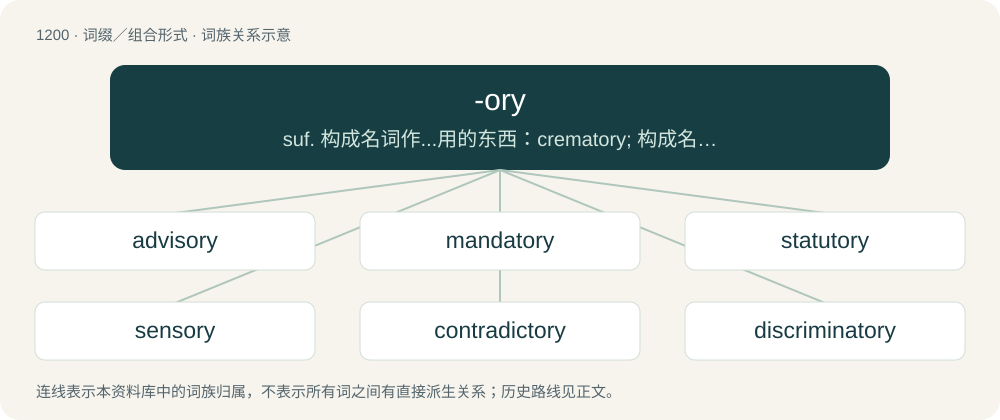

# 1279 · -ory — suf. 构成名词作...用的东西：crematory; 构成名词...的地方：laboratory; 构成形容词...性质的,与...有关的：contradictory

[总目录](../00_总目录_按常用程度.md)

**类型**：词缀／组合形式　｜　**来源语言**：见词源记录

## 核心含义与来源

- 核心含义：suf. 构成名词作...用的东西：crematory; 构成名词...的地方：laboratory; 构成形容词...性质的,与...有关的：contradictory
- 英文含义：Added to nouns and verbs (often Latinate) to form adjectives meaning “of”, “pertaining to”, or “serving for”.
- 词形：-ory

**多个词源／构词路径**：同一拼写可能有不同来源；以下按词性和含义分别列出。

**来源记录 1**（后缀／后置成分；Added to nouns and verbs (often Latinate) to form adjectives meaning “of”, “pertaining to”, or “serving for”.）

From Middle English -orie, from the Latin adjective suffix -tōrius. By surface analysis, -or + -y.

**来源记录 2**（后缀／后置成分；Added to nouns and verbs (often Latinate) to form nouns meaning “that which pertains to or serves for”.）

From the Latin noun suffix -tōrium. By surface analysis, -or + -y.

## 词族图

## 单词速览（常用到不常用）

| 单词 | 音标 | 释义 |
|---|---|---|
| [advisory](#w-1) | 英 /ədˈvaɪzəɹi/；美 /ædˈvaɪz(ə)ɹi/ | a. 顾问的, 咨询的, 劝告的；\[法\] 劝告的, 忠告的, 咨询的 |
| [mandatory](#w-2) | 英 /ˈmæn.də.t(ə)ɹi/；美 /ˈmæn.dəˌtɔɹ.i/ | a. 命令的, 托管的；\[经\] 受托者, 命令者 |
| [statutory](#w-3) | 英 /ˈstætjʊt(ə)ɹɪ/；美 /ˈstæt͡ʃəˌtɔɹi/ | a. 法令的, 法定的, 可依法惩处的；\[经\] 法定的 |
| [sensory](#w-4) | 英 /ˈsɛn.sə.ɹi/ | a. 知觉的, 感觉的, 传递感觉的；\[医\] 感觉的 |
| [contradictory](#w-5) | 英 /ˌkɒntɹəˈdɪkt(ə)ɹi/；美 /ˌkɑntɹəˈdɪktəɹi/ | a. 反驳的, 反对的, 抗辩的；n. 矛盾因素, 对立物 |
| [discriminatory](#w-6) | 英 /dɪsˈkɹɪmɪnət(ə)ɹɪ/；美 /dɪsˈkɹɪmɪnəˌtɔɹi/ | a. 有辨识力的, 有差别的 |
| [supervisory](#w-7) | /ˌsuːpə(ɹ)ˈvaɪzəɹɪ/ | a. 管理的, 监督的, 管理人的；\[经\] 监督的, 管理的 |
| [derogatory](#w-8) | 英 /dɪˈɹɒɡətɹi/；美 /dɪˈɹɑɡəˌtɔɹi/ | a. 贬损的；\[法\] 毁损的, 减损的 |
| [migratory](#w-9) | 英 /ˌmaɪˈɡɹeɪ.tə.ɹi/；美 /ˈmaɪ.ɡɹəˌtɔɹ.i/ | a. 迁移的, 流浪的 |
| [participatory](#w-10) | 英 /pɑːˈtɪsɪpətəɹi/；美 /pɑɹˈtɪs.ɪ.pəˌtoɹ.i/ | a. 吸引参与的, 供人分享的 |
| [celebratory](#w-11) | 英 /ˌsɛlɪˈbɹeɪtəɹi/；美 /ˈsɛləbɹəˌtɔːɹi/ | a. 快乐的, 兴高采烈的 |
| [inhibitory](#w-12) | /inˈhibitəri/ | a. 禁止的, 抑制的；\[医\] 抑制的 |
| [retaliatory](#w-13) | /ɹɪˈtælɪət(ə)ɹi/ | a. 报复的；\[经\] 报复性的 |
| [congratulatory](#w-14) | 英 /kɒŋˌɡɹæt͡ʃuːˈleɪtəɹiː/；美 /kənˈɡɹæt͡ʃələˌtɔɹi/ | a. 庆祝的, 祝贺的 |
| [investigatory](#w-15) | /inˈvesti^eitəri/ | a. 调查的, 审查的 |
| [expository](#w-16) | 英 /ɛkˈspɒzɪtəɹi/；美 /ɛkˈspɑzəˌtɔɹi/ | a. 说明的, 解释的 |
| [revelatory](#w-17) | /ˈrevələtəri/ | a. 揭示性的, 启示性的, 启示的 |
| [anticipatory](#w-18) | 英 /anˌtɪsɪˈpeɪtəɹi/；美 /ænˌtɪsəpəˈtɔri/ | a. 期待着的, 先行的, 提早发生的；\[计\] 先行 |
| [hallucinatory](#w-19) | 英 /həˈluː.sɪ.nə.tər.i/；美 /həˈluː.sɪ.nə.tɔːr.i/ | a. 幻觉的, 引起幻觉的 |
| [vibratory](#w-20) | /ˈvaibrətəri/ | a. 振动的, 振动性的；\[医\] 振动的, 震动的 |
| [exculpatory](#w-21) | 英 /ɪksˈkʌl.pə.tɹi/；美 /ɛksˈkʌl.pəˌtɔ.ɹi/ | a. 辩解的, 辩明无罪的；\[法\] 开脱罪责的, 申明无罪的, 昭雪的 |
| [stimulatory](#w-22) | 英 /ˈstɪm.jʊ.lə.t(ə)ɹi/；美 /ˈstɪm.jə.ləˌtɔɹi/ | a. 刺激, 激励, 激发, 鼓舞, 促进, 鼓励, 起刺激作用 |
| [crematory](#w-23) | /ˈkremətəri/ | n. 火葬场, (尸体或垃圾的)焚化炉；a. 火葬的 |

## 逐词详解

### 1. advisory

**词性**：形容词　｜　**音标**：英 /ədˈvaɪzəɹi/；美 /ædˈvaɪz(ə)ɹi/

**中文释义**：a. 顾问的, 咨询的, 劝告的；\[法\] 劝告的, 忠告的, 咨询的

**英文义项**：Able to give advice. / Containing advice; advising.

**构词拆分**：advise + -ory

**词源与演化**：

From advise + -ory.

**例句**：

> The advisory committee could only offer advice, but since that was almost always accepted they had real power.

该用例对应义项：Able to give advice.

### 2. mandatory

**词性**：形容词　｜　**音标**：英 /ˈmæn.də.t(ə)ɹi/；美 /ˈmæn.dəˌtɔɹ.i/

**中文释义**：a. 命令的, 托管的；\[经\] 受托者, 命令者

**英文义项**：obligatory; required or commanded by authority. / Of, being or relating to a mandate.

**构词拆分**：mandate + -ory

**词源与演化**：

From Late Latin mandatorius (“of or belonging to a mandator”), from mandātor (“one who commands”), equivalent to mandate + -ory; see mandate.

**例句**：

> Attendance at a school is usually mandatory for children.

该用例对应义项：obligatory; required or commanded by authority.

### 3. statutory

**词性**：形容词　｜　**音标**：英 /ˈstætjʊt(ə)ɹɪ/；美 /ˈstæt͡ʃəˌtɔɹi/

**中文释义**：a. 法令的, 法定的, 可依法惩处的；\[经\] 法定的

**英文义项**：Of, relating to, enacted or regulated by a statute.

**构词拆分**：statute + -ory

**词源与演化**：

From statute + -ory.

**例句**：

> A statutory age limit.

该用例对应义项：prescribed or authorized by or punishable under a statute

### 4. sensory

**词性**：形容词　｜　**音标**：英 /ˈsɛn.sə.ɹi/

**中文释义**：a. 知觉的, 感觉的, 传递感觉的；\[医\] 感觉的

**英文义项**：Of the physical senses or sensation. / Conveying nerve impulses from the sense organs to the nerve centers.

**构词拆分**：sense + -ory

**词源与演化**：

From sense + -ory.

**用法示例／搭配（非完整句）**：

> sensory neurons

该用例对应义项：Conveying nerve impulses from the sense organs to the nerve centers.

### 5. contradictory

**词性**：形容词　｜　**音标**：英 /ˌkɒntɹəˈdɪkt(ə)ɹi/；美 /ˌkɑntɹəˈdɪktəɹi/

**中文释义**：a. 反驳的, 反对的, 抗辩的；n. 矛盾因素, 对立物

**英文义项**：That contradicts something, such as an argument. / That is itself a contradiction.

**构词拆分**：contradict + -ory

**词源与演化**：

Borrowed from Late Latin contradictorius, from Latin contradico. Equivalent to contradict + -ory.

**例句**：

> The Bible can be interpreted in many different, and often contradictory, ways.

### 6. discriminatory

**词性**：形容词　｜　**音标**：英 /dɪsˈkɹɪmɪnət(ə)ɹɪ/；美 /dɪsˈkɹɪmɪnəˌtɔɹi/

**中文释义**：a. 有辨识力的, 有差别的

**英文义项**：Of or pertaining to discrimination (in all senses). / Showing prejudice or bias.

**构词拆分**：discriminate + -ory

**词源与演化**：

From discriminate + -ory.

**用法示例／搭配（非完整句）**：

> be discriminatory towards/against someone

该用例对应义项：Showing prejudice or bias.

### 7. supervisory

**词性**：形容词　｜　**音标**：/ˌsuːpə(ɹ)ˈvaɪzəɹɪ/

**中文释义**：a. 管理的, 监督的, 管理人的；\[经\] 监督的, 管理的

**英文义项**：Of, pertaining to, or in the capacity of a supervisor

**构词拆分**：supervise + -ory

**词源与演化**：

From supervise + -ory.

**例句**：

> The police major is the highest rank in the supervisory and enforcement corps.

### 8. derogatory

**词性**：形容词　｜　**音标**：英 /dɪˈɹɒɡətɹi/；美 /dɪˈɹɑɡəˌtɔɹi/

**中文释义**：a. 贬损的；\[法\] 毁损的, 减损的

**英文义项**：Disparaging. / Tending to derogate

**构词拆分**：derogate + -ory

**词源与演化**：

Borrowed from Late Latin dērogātōrius, from Latin dērogō; corresponding to derogate + -ory.

**例句**：

> The drunken men made derogatory remarks toward the women in the club.

### 9. migratory

**词性**：形容词　｜　**音标**：英 /ˌmaɪˈɡɹeɪ.tə.ɹi/；美 /ˈmaɪ.ɡɹəˌtɔɹ.i/

**中文释义**：a. 迁移的, 流浪的

**英文义项**：Migrating. / Roving; wandering; nomadic.

**构词拆分**：migrate + -ory

**词源与演化**：

Borrowed from Latin migrātōrius or migrate + -ory.

**用法示例／搭配（非完整句）**：

> migratory habits; a migratory life

该用例对应义项：Roving; wandering; nomadic.

### 10. participatory

**词性**：形容词　｜　**音标**：英 /pɑːˈtɪsɪpətəɹi/；美 /pɑɹˈtɪs.ɪ.pəˌtoɹ.i/

**中文释义**：a. 吸引参与的, 供人分享的

**英文义项**：Relating to participation. / Open to participation.

**构词拆分**：participate + -ory

**词源与演化**：

From participate + -ory.

**用法示例／搭配（非完整句）**：

> participatory behavior

该用例对应义项：Relating to participation.

### 11. celebratory

**词性**：形容词　｜　**音标**：英 /ˌsɛlɪˈbɹeɪtəɹi/；美 /ˈsɛləbɹəˌtɔːɹi/

**中文释义**：a. 快乐的, 兴高采烈的

**英文义项**：Having the manner of, or forming part of, a celebration.

**构词拆分**：celebrate + -ory

**词源与演化**：

From celebrate + -ory.

**例句**：

> Tonight, the two of us are having a celebratory get-together.

### 12. inhibitory

**词性**：形容词　｜　**音标**：/inˈhibitəri/

**中文释义**：a. 禁止的, 抑制的；\[医\] 抑制的

**英文义项**：That inhibits. / Of, or relating to an inhibitor.

**构词拆分**：inhibit + -ory

**词源与演化**：

From late 15th century (early modern English). Formed as inhibit + -ory or adapted from Medieval Latin inhibitōrius and Middle French inhibitoire.

**用法示例／搭配（非完整句）**：

> the inhibitory action of the pneumogastric on the respiratory center

该用例对应义项：That inhibits.

### 13. retaliatory

**词性**：形容词　｜　**音标**：/ɹɪˈtælɪət(ə)ɹi/

**中文释义**：a. 报复的；\[经\] 报复性的

**英文义项**：Relating to or part of a retaliation.

**构词拆分**：retaliate + -ory

**词源与演化**：

From retaliate + -ory.

**例句**：

> The hostile forces were at an impasse; neither could attack with enough force and still defend against the retaliatory counterattack.

该用例对应义项：Relating to or part of a retaliation.

### 14. congratulatory

**词性**：形容词　｜　**音标**：英 /kɒŋˌɡɹæt͡ʃuːˈleɪtəɹiː/；美 /kənˈɡɹæt͡ʃələˌtɔɹi/

**中文释义**：a. 庆祝的, 祝贺的

**英文义项**：Serving to congratulate.

**构词拆分**：congratulate + -ory

**词源与演化**：

From congratulate + -ory.

**例句**：

> When the counter value reaches the assigned 'lucky-number' it displays a congratulatory message.

### 15. investigatory

**词性**：形容词　｜　**音标**：/inˈvesti^eitəri/

**中文释义**：a. 调查的, 审查的

**英文义项**：Aimed at investigating.

**构词拆分**：investigate + -ory

**词源与演化**：

From investigate + -ory.

### 16. expository

**词性**：形容词　｜　**音标**：英 /ɛkˈspɒzɪtəɹi/；美 /ɛkˈspɑzəˌtɔɹi/

**中文释义**：a. 说明的, 解释的

**英文义项**：Serving to explain, explicate, or elucidate; expositive; of or relating to exposition.

**构词拆分**：exposition + -ory

**词源与演化**：

From exposit(ion) + -ory.

**例句**：

> Practicing expository writing will teach you to explain complex concepts clearly.

该用例对应义项：Serving to explain, explicate, or elucidate; expositive; of or relating to exposition.

### 17. revelatory

**词性**：形容词　｜　**音标**：/ˈrevələtəri/

**中文释义**：a. 揭示性的, 启示性的, 启示的

**英文义项**：Of, pertaining to, or in the nature of a revelation. / Prophetic (especially of doom); apocalyptic.

**构词拆分**：By surface analysis, revelat(e) + -ory

**词源与演化**：

Borrowed from Latin revēlātōrius. By surface analysis, revelat(e) + -ory.

### 18. anticipatory

**词性**：形容词　｜　**音标**：英 /anˌtɪsɪˈpeɪtəɹi/；美 /ænˌtɪsəpəˈtɔri/

**中文释义**：a. 期待着的, 先行的, 提早发生的；\[计\] 先行

**英文义项**：Characterized by anticipation.

**构词拆分**：anticipate + -ory

**词源与演化**：

From anticipate + -ory.

**例句**：

> The children were all wearing anticipatory grins as the cake was served.

该用例对应义项：Characterized by anticipation.

### 19. hallucinatory

**词性**：形容词　｜　**音标**：英 /həˈluː.sɪ.nə.tər.i/；美 /həˈluː.sɪ.nə.tɔːr.i/

**中文释义**：a. 幻觉的, 引起幻觉的

**英文义项**：Partaking of, or tending to produce, hallucination.

**构词拆分**：hallucinate + -ory

**词源与演化**：

From hallucinate + -ory.

**例句**：

> The film created a hallucinatory atmosphere with its colors and sounds.

该用例对应义项：Partaking of, or tending to produce, hallucination.

### 20. vibratory

**词性**：形容词　｜　**音标**：/ˈvaibrətəri/

**中文释义**：a. 振动的, 振动性的；\[医\] 振动的, 震动的

**英文义项**：Causing or exhibiting vibrations. / Of or relating to vibrations of a spiritual, etheric, or astral nature.

**构词拆分**：vibrate + -ory

**词源与演化**：

From vibrate + -ory.

### 21. exculpatory

**词性**：形容词　｜　**音标**：英 /ɪksˈkʌl.pə.tɹi/；美 /ɛksˈkʌl.pəˌtɔ.ɹi/

**中文释义**：a. 辩解的, 辩明无罪的；\[法\] 开脱罪责的, 申明无罪的, 昭雪的

**英文义项**：Tending to excuse or clear of wrongdoing.

**构词拆分**：exculpate + -ory (suffix forming adjectives with the sense ‘of or pertaining to, serving for’)

**词源与演化**：

From exculpate + -ory (suffix forming adjectives with the sense ‘of or pertaining to, serving for’). Exculpate is derived from Medieval Latin exculpātus, perfect passive participle of exculpō (“to free from blame, exculpate”), from ex- (prefix meaning ‘out, away’) + culpa (“defect, fault; crime”) (ultimately from Proto-Indo-European \*kʷelp-). Cognate with Spanish exculpatorio.

**例句**：

> Tom has been acquitted, thanks to exculpatory statements from witnesses, but there is no trace of the real culprit.

### 22. stimulatory

**词性**：形容词　｜　**音标**：英 /ˈstɪm.jʊ.lə.t(ə)ɹi/；美 /ˈstɪm.jə.ləˌtɔɹi/

**中文释义**：a. 刺激, 激励, 激发, 鼓舞, 促进, 鼓励, 起刺激作用

**英文义项**：stimulative; serving to stimulate

**构词拆分**：stimulate + -ory

**词源与演化**：

From stimulate + -ory.

### 23. crematory

**词性**：形容词　｜　**音标**：/ˈkremətəri/

**中文释义**：n. 火葬场, (尸体或垃圾的)焚化炉；a. 火葬的

**英文义项**：Pertaining to the act of cremating bodies.

**构词拆分**：From cremate + -ory.

**词源与演化**：

From cremate + -ory.

**例句**：

> They offered me a job in a crematory, which I refused.
