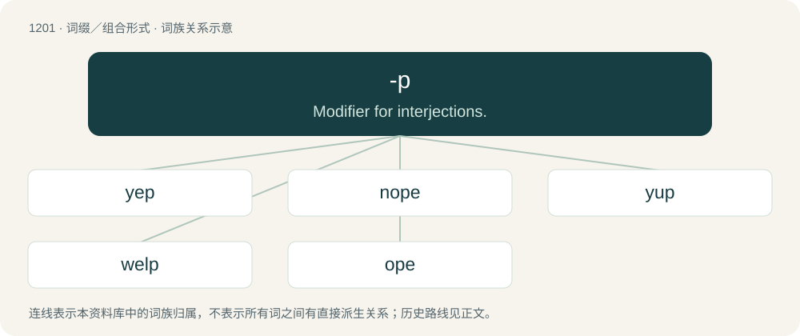

# 1281 · -p — Modifier for interjections.

[总目录](../00_总目录_按常用程度.md)

**类型**：词缀／组合形式　｜　**来源语言**：见词源记录

## 核心含义与来源

- 核心含义：Modifier for interjections.
- 英文含义：Modifier for interjections.
- 词形：-p

**来源记录 1**（后缀／后置成分；Modifier for interjections.）

A glottal stop denoting abruptness followed by mouth closure for end of utterance: \[ʔp̚\]. Represented as ⟨p⟩ due to prominent glottal reinforcement in English.

## 词族图

## 单词速览（常用到不常用）

| 单词 | 音标 | 释义 |
|---|---|---|
| [yep](#w-1) | /jɛp/ | adv. 是（美国俚语=yes） |
| [nope](#w-2) | 英 /nəʊp/；美 /noʊp/ | adv. 不, 不是 |
| [yup](#w-3) | /jʌp/ | int. \[俚\]是的（等于yes） |
| [welp](#w-4) | /wɛlp/ | 【英文】Well. Typically used to express exasperation, a matter-of-fact or unenthusiastic attitude, or helpless acceptance of something surprising. |
| [ope](#w-5) | 英 /əʊp/；美 /oʊp/ | v. 开放, 自由进出 |

## 逐词详解

### 1. yep

**词性**：名词　｜　**音标**：/jɛp/

**中文释义**：adv. 是（美国俚语=yes）

**英文义项**：Yes.

**构词拆分**：yeah + -p

**词源与演化**：

Representing yeah pronounced with the mouth snapped closed at the end (yeah + -p). Compare yup and nope. Compare also German jap (“yep”).

**例句**：

> I'll take that as a yep, then.

该用例对应义项：Yes.

### 2. nope

**词性**：名词　｜　**音标**：英 /nəʊp/；美 /noʊp/

**中文释义**：adv. 不, 不是

**英文义项**：A negative reply, no. / An intensely undesirable thing, such as a circumstance or an animal, eliciting immediate repulsion without possibility of further consideration.

**构词拆分**：no + -p

**词源与演化**：

Representing no pronounced with the mouth snapped closed at the end. Luick instead claims it represents a realisation of no with final \[ʔ\], with a purported reduction of /p/ to \[ʔ\] before syllabic liquids providing a model for the spelling of \[ʔ\] as -pe, but it is more parsimonious to assume that the -pe directly represents attested realisations with \[p̚\]. Therefore no + -p. Compare yep/yup.

**例句**：

> I'll take that as a nope, then.

该用例对应义项：A negative reply, no.

### 3. yup

**词性**：名词　｜　**音标**：/jʌp/

**中文释义**：int. \[俚\]是的（等于yes）

**英文义项**：A yes; an affirmative answer.

**构词拆分**：yeah + -p

**词源与演化**：

Representing yeah pronounced with the mouth snapped closed at the end (excrescent /p/): yeah + -p.

**例句**：

> Yup, it seems like even the doctor was about to throw in the towel.

### 4. welp

**词性**：感叹词　｜　**音标**：/wɛlp/

**英文义项**：Well. Typically used to express exasperation, a matter-of-fact or unenthusiastic attitude, or helpless acceptance of something surprising.

**构词拆分**：well + -p

**词源与演化**：

Representing well pronounced with the mouth snapped closed at the end: well + -p.

**例句**：

> Welp, that there is a genuine piss bottle circa 1987. Southerly's is asking $1.7 million.

### 5. ope

**词性**：感叹词　｜　**音标**：英 /əʊp/；美 /oʊp/

**中文释义**：v. 开放, 自由进出

**英文义项**：An exclamation of surprise; oops.

**构词拆分**：oh + -p

**词源与演化**：

Representing oh pronounced with the mouth snapped closed at the end (IPA⁽ᵏᵉʸ⁾: /oʊp/, \[oʊp̚\]) (excrescent /p/); therefore oh + -p.

**例句**：

> Ope, let me just squeeze past ya there.

该用例对应义项：An exclamation of surprise; oops.
