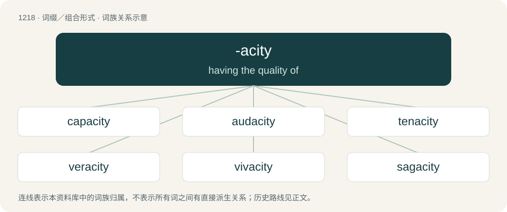

# 1298 · -acity — having the quality of

[总目录](../00_总目录_按常用程度.md)

**类型**：词缀／组合形式　｜　**来源语言**：见词源记录

## 核心含义与来源

- 核心含义：having the quality of
- 英文含义：having the quality of
- 词形：-acity

**来源记录 1**（后缀／后置成分；having the quality of）

From (1) Middle French -acité, from Latin -ācitās, from oblique stem of -āx, -ācis + -i- + -tās and (2) suffixal construction from Latin -ācea + -ity.

## 词族图

## 单词速览（常用到不常用）

| 单词 | 音标 | 释义 |
|---|---|---|
| [capacity](#w-1) | 英 /kəˈpæsɪti/；美 /kəˈpæsɪti/ | n. 容量, 能力, 才能, 资格；\[计\] 容量 |
| [audacity](#w-2) | 英 /ɔːˈdæ.sɪ.ti/；美 /ɔˈdæ.sɪ.ti/ | n. 大胆, 厚颜无耻 |
| [tenacity](#w-3) | 英 /təˈnæs.ɪ.ti/；美 /təˈnæsəti/ | n. 固执, 不屈不挠, 顽固, 黏性, 韧性；\[机\] 坚轫 |
| [veracity](#w-4) | 英 /vəˈɹæ.sɪ.ti/；美 /vəˈɹæ.sə.ti/ | n. 说话老实, 老实, 诚实 |
| [vivacity](#w-5) | /vɪˈvæsɪti/ | n. 快活, 活泼, 精神充沛 |
| [sagacity](#w-6) | /səˈɡæ.sə.ti/ | n. 睿智, 聪敏 |

## 逐词详解

### 1. capacity

**词性**：名词　｜　**音标**：英 /kəˈpæsɪti/；美 /kəˈpæsɪti/

**中文释义**：n. 容量, 能力, 才能, 资格；\[计\] 容量

**英文义项**：The ability to hold, receive, or absorb. / A measure of such ability; volume.

**词源与演化**：

From Middle English capacite, from Old French capacite, from Latin capācitās (whence -acity), from capāx (“able to hold much”), from capiō (“to hold, to contain, to take, to understand”).

**例句**：

> Its capacity rating was 150 tons per hour, but its actual maximum capacity was 200 tons per hour.

该用例对应义项：The maximum that can be produced on a machine or in a facility or group.

### 2. audacity

**词性**：名词　｜　**音标**：英 /ɔːˈdæ.sɪ.ti/；美 /ɔˈdæ.sɪ.ti/

**中文释义**：n. 大胆, 厚颜无耻

**英文义项**：Insolent boldness, especially when imprudent or unconventional. / Fearlessness, intrepidity or daring, especially with confident disregard for personal safety, conventional thought, or other restrictions.

**词源与演化**：

From Middle English audacite, from Medieval Latin audācitās (whence -acity), from Latin audāx (“bold”), from audeō (“to be bold, to dare”).

**例句**：

> Somebody never pays his loans, yet he has the audacity to ask the bank for money.

该用例对应义项：Insolent boldness, especially when imprudent or unconventional.

### 3. tenacity

**词性**：名词　｜　**音标**：英 /təˈnæs.ɪ.ti/；美 /təˈnæsəti/

**中文释义**：n. 固执, 不屈不挠, 顽固, 黏性, 韧性；\[机\] 坚轫

**英文义项**：The quality or state of being tenacious, or persistence of purpose; tenaciousness. / The quality of bodies which keeps them from parting without considerable force, as distinguished from brittleness, fragility, mobility, etc.

**词源与演化**：

From Middle French ténacité, from Latin tenācitās (whence -acity).

**例句**：

> It will take a lot of patience and tenacity to complete this project.

### 4. veracity

**词性**：名词　｜　**音标**：英 /vəˈɹæ.sɪ.ti/；美 /vəˈɹæ.sə.ti/

**中文释义**：n. 说话老实, 老实, 诚实

**英文义项**：The quality of speaking or stating the truth; truthfulness. / Something that is true; a truthful statement; a truth.

**词源与演化**：

From Middle French véracité, from Old French veracitie, from Medieval Latin vērācitās (“truthfulness”) (whence -acity), from Latin vērāx (“truthful, speaking truth”), from vērus (“true, real”). See very.

**例句**：

> I want to convince myself of the veracity of this story.

### 5. vivacity

**词性**：名词　｜　**音标**：/vɪˈvæsɪti/

**中文释义**：n. 快活, 活泼, 精神充沛

**英文义项**：The quality or state of being vivacious.

**词源与演化**：

From Latin vīvācitās (whence -acity).

**例句**：

> Some secret sorrow, or the brooding spirit of some moody passion, had quenched the light and ingenuous vivacity of youth.

### 6. sagacity

**词性**：名词　｜　**音标**：/səˈɡæ.sə.ti/

**中文释义**：n. 睿智, 聪敏

**英文义项**：The quality of being sage, wise, or able to make good decisions; the quality of being perceptive, astute or insightful. / Keen sense of smell.

**构词拆分**：sagac(ious) + -ity

**词源与演化**：

From French sagacité, from Latin sagācitās (“sagaciousness”), from sagāx (“of quick perception, acute, sagacious”) (whence -acity), from sāgiō (“to perceive by the senses”). Equivalent to sagac(ious) + -ity.

**例句**：

> I fear my loose tongue has belied any pretentions I had of sagacity.
