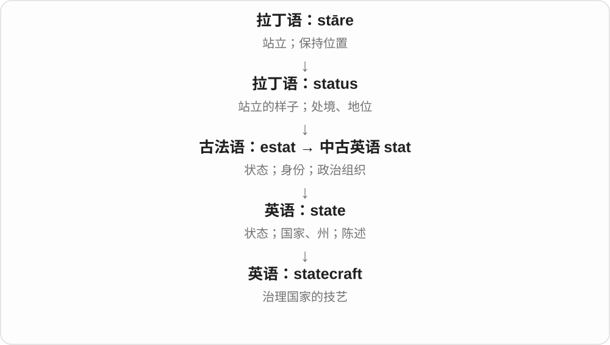

# 1305 · -craft — 技艺、制作；特定领域载具

[逐词精讲目录](../00_逐词精讲目录.md) · [总目录](../00_总目录_按常用程度.md)

## 核心词根与来源

接古英语 craeft 技艺、技能，复合时发展出特定领域的技艺、实践等关系。载具名称与 craft 的船只等用法相连，各词在英语中继续形成。

**-CRAFT：一门做事本领；有些词又表示整类载具**

stagecraft 是把戏搬上舞台的技艺，woodcraft 是木工、林野本领等；aircraft、spacecraft 则已经固定为飞行器、航天器名称。

- **基础手艺与制作**：craft · handcraft · handicraft · craftsman · craftsmanship
- **各领域本领**：stagecraft · statecraft · woodcraft · bushcraft · tradecraft · witchcraft
- **载具名称**：aircraft · spacecraft · watercraft · hovercraft

## 词形与演化规律

craft 可独立用；前面加领域材料形成 stagecraft、statecraft 等。aircraft、watercraft、spacecraft 取载具分支，不都说某门技术。

## 单词速览（按词族由简到繁）

同一基础词的相关扩展放在一起，先读基础形式，再读扩展；各组之间优先读常用的。具体词源关系见各词讲解。

| 单词 | 音标 | 核心意思 |
|---|---|---|
| [aircraft](#w-1) | 英 /ˈeəkrɑːft/；美 /ˈerkræft/ | 航空器；飞行器 |
| [craft](#w-16) | 英 /krɑːft/；美 /kræft/ | 手艺、技艺；手工活动；精心制作；船艇、飞行器 |
| [craftsman](#w-17) | 英 /ˈkrɑːftsmən/；美 /ˈkræftsmən/ | 熟练工匠、手艺人；技艺高超的创作者 |
| [craftsmanship](#w-18) | 英 /ˈkrɑːftsmənʃɪp/；美 /ˈkræftsmənʃɪp/ | 手艺；精湛工艺；制作技艺 |
| [handicraft](#w-19) | 英 /ˈhændikrɑːft/；美 /ˈhændikræft/ | 手工艺；手工艺品 |
| [handcraft](#w-15) | 英 /ˈhændkrɑːft/；美 /ˈhændkræft/ | 手工艺；手工制作 |
| [spacecraft](#w-3) | 英 /ˈspeɪskrɑːft/；美 /ˈspeɪskræft/ | 航天器 |
| [witchcraft](#w-4) | 英 /ˈwɪtʃkrɑːft/；美 /ˈwɪtʃkræft/ | 巫术、魔法技艺 |
| [watercraft](#w-7) | 英 /ˈwɔːtəkrɑːft/；美 /ˈwɔːtərkræft/ | 水上交通工具；船艇；水上技能〔另义〕 |
| [hovercraft](#w-8) | 英 /ˈhɒvəkrɑːft/；美 /ˈhʌvərkræft/，也读 /ˈhɑːvərkræft/ | 气垫船、气垫运载工具 |
| [statecraft](#w-9) | 英 /ˈsteɪtkrɑːft/；美 /ˈsteɪtkræft/ | 治国之术；处理国家事务的技巧 |
| [stagecraft](#w-11) | 英 /ˈsteɪdʒkrɑːft/；美 /ˈsteɪdʒkræft/ | 舞台艺术、技术；舞台表现技艺 |
| [woodcraft](#w-12) | 英 /ˈwʊdkrɑːft/；美 /ˈwʊdkræft/ | 林野生活技能；木作、木雕技艺 |
| [bushcraft](#w-13) | 英 /ˈbʊʃkrɑːft/；美 /ˈbʊʃkræft/ | 野外生活、野外生存技能 |
| [tradecraft](#w-14) | 英 /ˈtreɪdkrɑːft/；美 /ˈtreɪdkræft/ | 行业专门技巧；尤指情报工作的专业技艺 |

## 逐词讲解

### 1. aircraft — 航空器；飞行器

**音标**：英 /ˈeəkrɑːft/；美 /ˈerkræft/

**先抓住这个画面**

只要是用于在空气中飞行的交通器具，就可能进入这个大类。

**怎么拆**

air + craft；craft 在这里沿用船只、运载工具的用法，不是手工艺品。

**怎么变成今天的意思**

**希腊 aer，属格 aeros**  
空气

↓

**拉丁 aer → 法语 air → 英语 air**  
空气

↓

**air + craft → aircraft**  
空中运载工具 → 航空器

飞机、直升机、滑翔机等都可称 aircraft。它既是可数名词，又是单复数同形：one aircraft、three aircraft，不加一个 s。

**常见搭配与例句**

a passenger aircraft；a military aircraft；several aircraft；an aircraft engine。

> Several aircraft were parked near the hangar.

几架航空器停在机库附近。

> The aircraft can carry both passengers and cargo.

这架飞机既能载客，也能运货。

**别混淆**

airplane 是 aircraft 的一种；helicopter 也是 aircraft，但通常不叫 airplane。用更宽的类名时，范围会变化。

### 2. craft — 手艺、技艺；手工活动；精心制作；船艇、飞行器

**音标**：英 /krɑːft/；美 /kræft/

**先抓住这个画面**

把东西做好的一门本领是 craft，把文章、器物细细安排出来也可 craft。谈一艘船、一架飞行器时，它又是固定的载具词。

**怎么拆**

接古英语 cræft 力量、本领，技能义很早。舟船义可能联系行业、航海本领等旧用法，具体形成不定；不能只说凡手工做的东西都叫一艘 craft。

**怎么变成今天的意思**

**古英语 cræft → craft**  
力量、本领 → 技能、手艺、行业

↓

**熟练制作与巧计**  
craft 动词精心制作；crafty 也发展为善于耍手腕

↓

**器物、舟船与飞行器**  
craft 舟船义的具体形成有不同分析；后来用于水上、空中、太空载具

learn a craft 学一门手艺，arts and crafts 美术手工，craft a speech 精心撰写演讲，small craft 小型船艇，spacecraft 航天器。

**常见搭配与例句**

learn a craft；arts and crafts；craft a speech；small craft。

> She learned her craft from an experienced potter.

她向一位有经验的陶艺师学艺。

> He carefully crafted his reply.

他细细斟酌了自己的回复。

> Several small craft were moored near the pier.

几艘小艇停在码头附近。

**别混淆**

craft 的技能义不只手工，也可说写作、表演等本领。载具义单复数常同形，一艘 craft、多艘 craft；其他手工活动复数 crafts 又有不同用法。

### 3. craftsman — 熟练工匠、手艺人；技艺高超的创作者

**音标**：英 /ˈkrɑːftsmən/；美 /ˈkræftsmən/

**先抓住这个画面**

不是随便动过手的人，而是掌握一门手艺、能把东西做得讲究的人；也可夸写作等工作有工匠般技法。

**怎么拆**

craft 技艺 + 连接成分 -s- + man 人，历史联系 craft 的所有格形式。这里的 s 不是做手艺这个动词的第三人称。

**怎么变成今天的意思**

**古英语 -es 等所有格形式 → 中古英语 -s/-es**  
某物的、与某物有关的关系

↓

**在复合词中固化为连接成分 -s-**  
前后两部分连成一个名称；较新词也可类推形成

↓

**craft + -s- + man → craftsman**  
从事一门技艺、擅长手艺的人

a skilled craftsman 熟练工匠，a master craftsman 大师级手艺人，a literary craftsman 文字技法娴熟的作者；复数 craftsmen。

**常见搭配与例句**

a skilled craftsman；a master craftsman；craftsmen at work。

> A skilled craftsman repaired the old wooden chair.

一位熟练工匠修好了那把旧木椅。

> The novelist is a careful craftsman of dialogue.

这位小说家写对白很讲究技巧。

**别混淆**

craftsman 强调手艺、技巧，crafty 则常说狡猾，不能只见 craft 就以为是同样评价。泛指人也可用 craftsperson、artisan。

### 4. craftsmanship — 手艺；精湛工艺；制作技艺

**音标**：英 /ˈkrɑːftsmənʃɪp/；美 /ˈkræftsmənʃɪp/

**先抓住这个画面**

桌子的接缝严丝合缝，雕花细致，细节能看出制作者的功夫；这份工艺水平就是 craftsmanship。

**怎么拆**

craftsman + -ship。这里把工匠、有手艺的人相关的身份、职责、技能或整体状态作为名词来谈；具体落点看用法。

**怎么变成今天的意思**

**craftsman**  
工匠、有手艺的人

↓

**craftsmanship**  
手艺；精湛工艺；制作技艺

常赞物品制作的技能、精细程度，也可比喻文章、电影等创作的娴熟技巧。

**常见搭配与例句**

fine craftsmanship；traditional craftsmanship。

> The cabinet shows exceptional craftsmanship.

这个柜子体现了非凡的制作工艺。

> The film combines strong storytelling with visual craftsmanship.

影片既会讲故事，视觉制作也很见功夫。

**别混淆**

craftsmanship 常强调技艺和精细制作；craft 指手艺、工艺门类，也可说小型制作活动，不能每次直接互换。

### 5. handicraft — 手工艺；手工艺品

**音标**：英 /ˈhændikrɑːft/；美 /ˈhændikræft/

**先抓住这个画面**

手与材料一点点配合，把东西做出来。可说这种技艺，也可说做出来的编织物、陶器等作品。

**怎么拆**

古英语 handcræft，hand 手 + craft 技艺。中古形式出现中间 i，可能受 handiwork 影响；不把整词硬说成现代 handy 方便的 + craft。

**怎么变成今天的意思**

**古英语 cræft → craft**  
力量、本领 → 技能、手艺、行业

↓

**hand + craft → handcræft → handicraft**  
手的技艺；中间元音形式受类推影响

↓

**活动转作品用法**  
手工艺，也指相应制品

traditional handicrafts 传统手工艺、手工艺品，a handicraft workshop 手工艺工作坊，local handicrafts 当地手工制品。

**常见搭配与例句**

traditional handicrafts；a handicraft workshop；local handicrafts。

> The museum exhibits traditional handicrafts from the region.

博物馆展出该地区的传统手工艺品。

> She teaches handicraft at the community centre.

她在社区中心教手工艺。

**别混淆**

handicraft 不是机械批量产品的自动通称，也不只说成品；art、craft 的边界在讨论中可有交叠，先看语境是否强调手工技艺。

### 6. handcraft — 手工艺；手工制作

**音标**：英 /ˈhændkrɑːft/；美 /ˈhændkræft/

**先抓住这个画面**

用双手和技巧把材料变成有用或好看的东西。

**怎么拆**

hand + craft，接古英语 handcræft、中古英语 handcrafte 等；craft 是技艺，不是飞机、船等另一义。

**怎么变成今天的意思**

**古英语 hand → 中古英语 hand / hond**  
手；与操作、工作者相关的用法

↓

**古英语 handcræft → 中古英语 handcrafte → handcraft**  
手工技艺；手工制作

traditional handcraft 是传统手工艺，也可作动词 handcraft a table。handicraft 是相近的常见形式，按具体词条理解。

**常见搭配与例句**

traditional handcraft；a handcraft workshop；handcraft furniture。

> The workshop teaches traditional handcraft.

工作坊教授传统手工艺。

> Local artists handcraft the wooden toys.

当地艺人手工制作这些木玩具。

**别混淆**

handcraft 是技艺或动作，handcrafted 是手工制成的；craftsperson 是从事技艺的人，不是同一词性。

### 7. spacecraft — 航天器

**音标**：英 /ˈspeɪskrɑːft/；美 /ˈspeɪskræft/

**先抓住这个画面**

能在太空中运行的飞行器，可以载人，也可以只搭载仪器。

**怎么拆**

space + craft；craft 在这种组合中是交通工具、飞行器，不是手工艺。

**怎么变成今天的意思**

**拉丁语 spatium**  
空间、范围、距离；也指一段时间，远源尚有不同解释

↓

**古法语 espace / 盎格鲁法语 space → 中古英语 space → 现代 space**  
空间、间隔、时间段；后来包括太空和抽象活动领域

↓

**英语 space + craft → spacecraft**  
太空中的航行器

one spacecraft、two spacecraft 通常同形。探测器、载人飞船等都可称 spacecraft，不能把它限定为有人乘坐的大船。

**常见搭配与例句**

launch a spacecraft；an uncrewed spacecraft；a spacecraft in orbit。

> The spacecraft sent new images back to Earth.

航天器向地球传回了新的图像。

> Two spacecraft were launched during the mission.

这次任务发射了两艘航天器。

**别混淆**

spaceship 更容易让人想到飞船形象；spacecraft 是更宽的技术用语。

### 8. witchcraft — 巫术、魔法技艺

**音标**：英 /ˈwɪtʃkrɑːft/；美 /ˈwɪtʃkræft/

**先抓住这个画面**

witch 是施法的人，witchcraft 是那个人所施展、学习的一套技艺或实践。craft 在这里是本领，不是船。

**怎么拆**

witch + craft 技艺，古英语 wiċċecræft 已有这个组合，经中古英语延续到现代。

**怎么变成今天的意思**

**古英语 wicce、wicca，联系 wiccian**  
施巫术者；更早来源未定

↓

**中古英语 wicche → witch**  
巫术人物，现代常指女巫，也有不同文化、自我称谓用法

↓

**witch + craft → witchcraft**  
巫术实践、技艺

practise witchcraft 施行巫术，accused of witchcraft 被指控施巫术，a history of witchcraft 巫术史。也可夸张说某技术神奇得像魔法。

**常见搭配与例句**

practise witchcraft；accused of witchcraft。

> The novel mixes witchcraft with everyday village life.

小说把巫术和日常乡村生活交织在一起。

> The museum explains how accusations of witchcraft spread.

博物馆解释巫术指控怎样传播。

**别混淆**

历史中的巫术指控不等于被指控者真的做过所说的事；witchcraft 的含义也会随时代、文化变化。

### 9. watercraft — 水上交通工具；船艇；水上技能〔另义〕

**音标**：英 /ˈwɔːtəkrɑːft/；美 /ˈwɔːtərkræft/

**先抓住这个画面**

把能在水上航行的船艇统称起来；craft 在这里常是交通工具。

**怎么拆**

water + craft；craft 可表船艇等载具，也有技艺义，故水上技能是另一条用法，不把两条硬串成单一路径。

**怎么变成今天的意思**

**water；craft〔载具；另一义为技艺〕**  
并列组合部分

↓

**watercraft**  
水上船艇；另可指水上活动技艺

personal watercraft 常说小型个人水上载具，various types of watercraft 各类船艇。单复数常同形。

**常见搭配与例句**

personal watercraft；small watercraft；types of watercraft。

> The exhibition includes several types of traditional watercraft.

展览包含几类传统船艇。

> Small watercraft moved quietly across the lake.

小船艇静静驶过湖面。

**别混淆**

watercraft 泛称水上载具，waterworks 供水设施；都有 water 但不是同一类机器。

### 10. hovercraft — 气垫船、气垫运载工具

**音标**：英 /ˈhɒvəkrɑːft/；美 /ˈhʌvərkræft/，也读 /ˈhɑːvərkræft/

**先抓住这个画面**

向下送气，在底部形成一层托起船体的气垫，像在地面、水面上方薄薄垫了一层空气。它能移动，不是永远悬在原地。

**怎么拆**

hover 悬在表面上方 + craft 运载工具。最初的商标等命名后来成为通用称呼；现代材料、用途不局限一个品牌。

**怎么变成今天的意思**

**器物、舟船与飞行器**  
craft 舟船义的具体形成有不同分析；后来用于水上、空中、太空载具

↓

**hover + craft → hovercraft**  
靠空气垫支承、在表面上方移动的工具

a passenger hovercraft 客运气垫船，a rescue hovercraft 救援气垫船，a hovercraft crossing 气垫船渡行。单复数常同形。

**常见搭配与例句**

a passenger hovercraft；a rescue hovercraft。

> The hovercraft crossed the shallow water.

气垫船驶过浅水区。

> Two hovercraft were shown in the transport exhibition.

交通展上展示了两艘气垫船。

**别混淆**

hovercraft 不是 helicopter 的另一名字；气垫支承与旋翼直接提供主要升力的分类不同，也不能只因 hover 就断定它不前进。

### 11. statecraft — 治国之术；处理国家事务的技巧

**音标**：英 /ˈsteɪtkrɑːft/；美 /ˈsteɪtkræft/

**先抓住这个画面**

把国家事务当作需要判断、协调和经验的手艺，statecraft 指的就是这套本领。

**怎么拆**

state（国家）+ craft（技艺）。

**怎么变成今天的意思**

craft 在这里不是工艺品，而是熟练做事的技术。谈判、结盟、政策安排都可能是 statecraft 的组成部分。

**常见搭配与例句**

the art of statecraft；diplomacy and statecraft；a lesson in statecraft。

> The biography examines her approach to statecraft.

这部传记研究了她处理国家事务的方法。

> Diplomacy is an important part of statecraft.

外交是治国之术的重要部分。

**别混淆**

statecraft 偏实践判断与技巧；political science 是研究政治的学科。

### 12. stagecraft — 舞台艺术、技术；舞台表现技艺

**音标**：英 /ˈsteɪdʒkrɑːft/；美 /ˈsteɪdʒkræft/

**先抓住这个画面**

把一场戏真正呈现在台上所需的技巧，包括布景、灯光、安排和表演呈现等。

**怎么拆**

stage 舞台 + craft 技艺，形成剧场实践的集合称呼。不同课程、评论里侧重技术或表现能力可有差别。

**怎么变成今天的意思**

**古法语 estage 居处、位置 → 中古英语 stage**  
所处位置、平台

↓

**现代 stage**  
表演舞台；发展阶段；组织上演活动

↓

**stage + craft → stagecraft**  
舞台实践技艺 → 舞台艺术、技术

learn stagecraft 学舞台技艺，stagecraft skills 舞台技术能力；不只雕刻一件舞台工艺品。

**常见搭配与例句**

learn stagecraft；stagecraft skills；effective stagecraft。

> The course introduces students to lighting and other stagecraft skills.

课程向学生介绍灯光及其他舞台技术。

> The production impressed us with its imaginative stagecraft.

演出富有想象力的舞台呈现给我们留下深刻印象。

**别混淆**

stagecraft 舞台实现与表现，playwriting 剧本写作；两种创作工作相互配合但不相同。

### 13. woodcraft — 林野生活技能；木作、木雕技艺

**音标**：英 /ˈwʊdkrɑːft/；美 /ˈwʊdkræft/

**先抓住这个画面**

wood 指树林时，是在林子里辨路、扎营等本领；指木材时，则是动手做木器的手艺。

**怎么拆**

wood + craft 技艺，两个 wood 义项支撑两种用法。需要从户外活动还是手工制作的语境判断。

**怎么变成今天的意思**

**古英语 wudu、widu → 中古英语 wode**  
树木、树林；木材

↓

**英语 wood**  
木头这种材料；一片树林

↓

**wood + craft → woodcraft**  
林中技能；木材加工技艺

learn woodcraft 学林野生活技能，woodcraft skills 可依语境指户外本领或木作技巧。说明具体活动更清楚。

**常见搭配与例句**

woodcraft skills；learn woodcraft；a woodcraft course。

> The camp teaches woodcraft, including shelter building and navigation.

营地教授搭建庇护处、辨路等林野技能。

> The workshop introduces woodcraft through simple carving projects.

工坊用简单雕刻项目介绍木作技艺。

**别混淆**

woodcraft 不只等于 woodworking；前者在户外教育中也可讲林野技能，后者更明确加工木材。

### 14. bushcraft — 野外生活、野外生存技能

**音标**：英 /ˈbʊʃkrɑːft/；美 /ˈbʊʃkræft/

**先抓住这个画面**

离开现成房屋和设施，靠辨环境、搭住所、处理野外生活需要的手艺；craft 抓住熟练本领，不是船。

**怎么拆**

bush 荒野、天然林地 + craft 技能，组合成野外生活技能名。bush 取区域环境义，不只在一棵灌木旁操作。

**怎么变成今天的意思**

**中古英语 bush；接日耳曼语灌木词族**  
灌木、灌丛、小树林

↓

**英语 bush**  
灌木；the bush 在澳洲等语境说天然植被地带、荒野

↓

**bush + craft → bushcraft**  
在自然环境生活、应对的技能

learn bushcraft 学野外技能，bushcraft skills 野外生活本领，a bushcraft course 野外技能课程。

**常见搭配与例句**

learn bushcraft；bushcraft skills；a bushcraft course。

> The camp offers an introductory bushcraft course.

营地提供野外技能入门课程。

> Her interest in bushcraft began with learning about local plants.

她从了解当地植物开始，对野外生活技能产生了兴趣。

**别混淆**

bushcraft 侧重生活、应对自然环境的技能；hiking 是徒步活动，去徒步不代表已掌握全部 bushcraft。

### 15. tradecraft — 行业专门技巧；尤指情报工作的专业技艺

**音标**：英 /ˈtreɪdkrɑːft/；美 /ˈtreɪdkræft/

**先抓住这个画面**

一门行当里，内行熟悉、外行未必知道的做事技巧；间谍小说、情报报道中特别常见。

**怎么拆**

trade 行业 + craft 技艺，组合成行内专业技巧。现代常聚焦情报工作，不是把 trade 交易和 craft 手工摆件硬凑。

**怎么变成今天的意思**

**中古低地德语 trade 路径、轨迹 → 中古英语 trade**  
道路、做事的途径

↓

**现代 trade**  
惯常活动、行业 → 手艺、职业；商业交易

↓

**trade + craft → tradecraft**  
某行业的技艺 → 专门职业技巧

intelligence tradecraft 情报工作技艺，journalistic tradecraft 新闻工作技巧；这里只解释词义，不展开具体秘密行动方法。

**常见搭配与例句**

intelligence tradecraft；professional tradecraft；learn the tradecraft。

> The novel focuses on the tradecraft of intelligence work.

小说聚焦情报工作的专业技艺。

> The veteran reporter taught younger colleagues the tradecraft of the profession.

资深记者向年轻同事传授本行的专业技巧。

**别混淆**

tradecraft 说行内技艺，trademark 是商标；craft 在这里不是单指工艺品。

## 这一组要分清什么

aircraft 常见单复数同形；手工 craft 作具体手艺等可有 crafts。商标、游戏名和冷僻专名不为词尾相同而扩列。

## 串起来练习

The exhibition celebrates craftsmanship in traditional handcraft.

展览赞颂传统手工制作中的精湛技艺。
