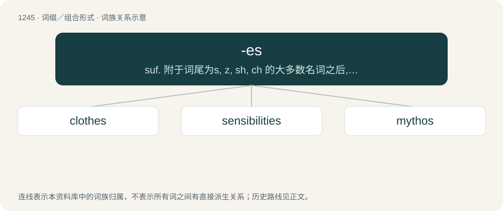

# 1328 · -es — suf. 附于词尾为s, z, sh, ch 的大多数名词之后,或词尾由y变为i,f变为v的一些名词之后,以及某些词尾为o的名词之后,构成复数,asses, whizzes, ashes, witches, dandies, duties calves, heroes, mosquitoes, potatoes; 附于一些源自希腊语的名词后, 构成复数; 附

[总目录](../00_总目录_按常用程度.md)

**类型**：词缀／组合形式　｜　**来源语言**：见词源记录

## 核心含义与来源

- 核心含义：suf. 附于词尾为s, z, sh, ch 的大多数名词之后,或词尾由y变为i,f变为v的一些名词之后,以及某些词尾为o的名词之后,构成复数,asses, whizzes, ashes, witches, dandies, duties calves, heroes, mosquitoes, potatoes; 附于一些源自希腊语的名词后, 构成复数; 附于词尾为s, z, sh, ch 的大多数动词之后, 或词尾由y变为i, 以及某些词尾为o的动词之后, 构成陈述语气第三人称单数现在时
- 英文含义：ch, when pronounced as /tʃ/: glitch→glitches (but psych→psychs)
- 词形：-es

**多个词源／构词路径**：同一拼写可能有不同来源；以下按词性和含义分别列出。

**来源记录 1**（后缀／后置成分；ch, when pronounced as /tʃ/: glitch→glitches (but psych→psychs)）

From Middle English -es, from Old English -as. More at -s.

**来源记录 2**（后缀／后置成分；that end in (t)ch pronounced as /tʃ/: impeach→impeaches (but psych→psychs)）

From Middle English -es, -is, from Old English -es, -as, Northern variants of -est, -ast (second person singular indicative ending). Replaced Middle English -eth, from Old English -eþ, -aþ. The falling together of the second and third person singular verb forms in Old English is believed to be due to Scandinavian influence, where the employment of the same verbal endings for both 2nd and 3rd singular indicative follows a similar pattern to that seen in Old Norse (e.g. þú masar, hann masar; þú þekkir, hann þekkir; etc.).

## 词族图

## 单词速览（常用到不常用）

| 单词 | 音标 | 释义 |
|---|---|---|
| [clothes](#w-1) | 英 /kləʊ(ð)z/；美 /kloʊ(ð)z/ | n. 衣服 |
| [sensibilities](#w-2) | 英 /ˌsɛn(t)sɪˈbɪlɪtiːz/；美 /ˌsɛn(t)səˈbɪlətiz/ | n. 识别力( sensibility的名词复数 ); 敏感性; 灵敏性; （易生气或易受刺激的）感情 |
| [mythos](#w-3) | 英 /ˈmɪθɒs/；美 /ˈmɪθoʊs/ | n. 神话, 主题 |

## 逐词详解

### 1. clothes

**词性**：名词　｜　**音标**：英 /kləʊ(ð)z/；美 /kloʊ(ð)z/

**中文释义**：n. 衣服

**英文义项**：Items of clothing; apparel. / The covering of a bed; bedclothes.

**构词拆分**：cloth + -es

**词源与演化**：

From Middle English clothes, cloþes (plural of cloth, cloþ (“cloth, garment”)), from Old English clāþas (“clothes”, plural of clāþ (“cloth”)), equivalent to cloth + -es. Cognate with Scots clathes, claes (“clothes”), Dutch klederen, kleren (“clothes”), German Kleider (“clothes”), Danish klæder (“clothes”), Swedish kläder (“clothes”), Norwegian Bokmål klær (“clothes”), Norwegian Nynorsk klede (“clothes”), Faroese klæði, klæðir (“clothes”).

**例句**：

> He always bought his clothes at the same store.

该用例对应义项：clothing in general

### 2. sensibilities

**词性**：名词　｜　**音标**：英 /ˌsɛn(t)sɪˈbɪlɪtiːz/；美 /ˌsɛn(t)səˈbɪlətiz/

**中文释义**：n. 识别力( sensibility的名词复数 ); 敏感性; 灵敏性; （易生气或易受刺激的）感情

**英文义项**：Capabilities to have emotions; feelings.

**构词拆分**：sensibility + -es (suffix forming pluralia tantum; and regular plural forms of nouns)

**词源与演化**：

From sensibility + -es (suffix forming pluralia tantum; and regular plural forms of nouns).

**例句**：

> This is sure to offend the sensibilities of any decent human being.

### 3. mythos

**词性**：名词　｜　**音标**：英 /ˈmɪθɒs/；美 /ˈmɪθoʊs/

**中文释义**：n. 神话, 主题

**英文义项**：Anything transmitted by word of mouth, such as a fable, legend, narrative, story, or tale (especially a poetic tale). / A story or set of stories relevant to or having a significant truth or meaning for a particular culture, religion, society, or other group; a myth, a mythology.

**词源与演化**：

Borrowed from Late Latin mȳthos (“myth”), from Ancient Greek μῦθος (mûthos, “report, tale, story”). Doublet of myth. The plural form mythoi is from Ancient Greek μῦθοι (mûthoi), and the form mythoses from mythos + -es.
