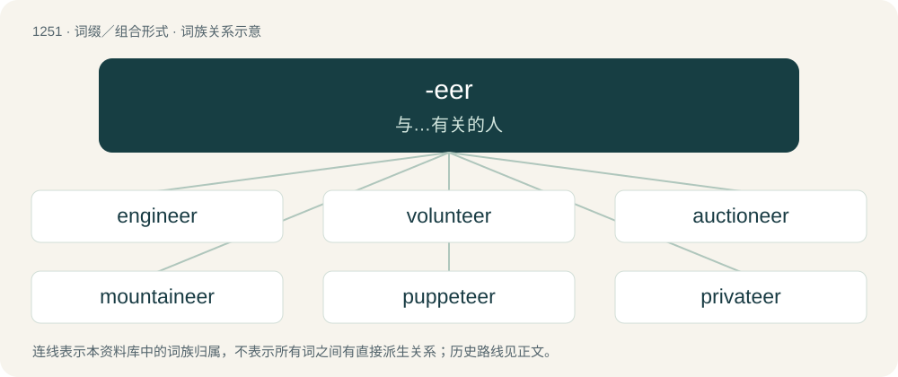

# 1336 · -eer — 与…有关的人

[总目录](../00_总目录_按常用程度.md)

**类型**：词缀／组合形式　｜　**来源语言**：见词源记录

## 核心含义与来源

- 核心含义：与…有关的人
- 英文含义：Used to form an occupational noun denoting someone associated with, concerned with, or engaged in a specified activity.
- 词形：-eer

**来源记录 1**（后缀／后置成分；Used to form an occupational noun denoting someone associated with, concerned with, or engaged in a specified activity.）

From Middle French -ier. Doublet of -ar, -ary, -ier, and -yer.

## 词族图

## 单词速览（常用到不常用）

| 单词 | 音标 | 释义 |
|---|---|---|
| [engineer](#w-1) | 英 /ˌɛn(d)ʒɪˈnɪə/；美 /ˌɛnd͡ʒɪˈnɪ(ə)ɹ/ | n. 工程师, 工兵；vt. 设计, 监造, 精明地处理, 策划 |
| [volunteer](#w-2) | 英 /ˌvɒl(ə)nˈtɪə/；美 /ˌvɑlənˈtɪɹ/ | n. 志愿者；a. 志愿的；v. 自愿 |
| [auctioneer](#w-3) | /.ɒːkʃəˈniə/ | n. 拍卖商；vt. 拍卖 |
| [mountaineer](#w-4) | 英 /ˌmaʊn.tɪnˈɪə̯(ɹ)/；美 /ˌmaʊn.tɪnˈɪɹ/ | n. 登山家, 山地人；vi. 登山 |
| [puppeteer](#w-5) | 英 /ˌpʌpɪˈtɪə/；美 /ˌpʌpəˈtɪ(ə)ɹ/ | n. 操纵木偶的人 |
| [privateer](#w-6) | 英 /ˌpɹaɪ.vəˈtɪə/；美 /ˌpɹaɪ.vəˈtɪɚ/ | n. 武装民船, 私掠船；\[法\] 私掠船, 私掠船长 |
| [gazetteer](#w-7) | 英 /ˌɡæzəˈtɪə/；美 /ˌɡæzəˈtɪəɹ/ | n. 地名辞典, 公报作者 |
| [racketeer](#w-8) | /ˌɹækɪˈtɪə(ɹ)/ | n. 敲诈者, 骗子；v. 诈骗钱财 |
| [rocketeer](#w-9) | /,rɔkiˈtiə/ | n. 火箭专家, 火箭设计者 |
| [profiteer](#w-10) | /ˌpɹɒfɪˈtɪə(ɹ)/ | n. 获暴利的人, 奸商；vi. 获暴利, 赚大钱 |

## 逐词详解

### 1. engineer

**词性**：名词　｜　**音标**：英 /ˌɛn(d)ʒɪˈnɪə/；美 /ˌɛnd͡ʒɪˈnɪ(ə)ɹ/

**中文释义**：n. 工程师, 工兵；vt. 设计, 监造, 精明地处理, 策划

**英文义项**：A soldier engaged in designing or constructing military works for attack or defence, or other engineering works. / A person professionally engaged in the technical design and construction of large-scale private and public works such as bridges, buildings, harbours, railways, roads, etc.; a civil engineer.

**构词拆分**：engine + -er (occupational suffix)；engine + -eer (suffix forming nouns denoting people associated with, concerned with, or engaged in specified activities)

**词源与演化**：

The noun is derived from: \* Middle English enginour (“one who designs, constructs, or operates military works for attack or defence, etc.; machine designer”) \[and other forms\], from Anglo-Norman enginour, engigneour \[and other forms\], and Middle French and Old French engigneor, engigneour, engignier (“one who designs, constructs, or operates military works for attack or defence; architect; carpenter; craftsman; designer; planner; one who deceives or schemes”) (modern French ingénieur), from engin (“contraption, device; machine; invention; creativity, ingenuity; intelligence; deception, ruse, trickery”) + -eor, -or (suffix forming agent nouns); engin is derived from Latin ingenium (“innate or natural quality, nature; intelligence, natural capacity; ability, skill, talent; (Medieval Latin) engine; machine”), from in- (prefix meaning ‘in, inside, within’) + gignere (the present active infinitive of gignō (“to bear, beget, give birth to; to cause, produce, yield”), ultimately from Proto-Indo-European \*ǵenh₁- (“to beget, give birth to; to produce”)) + -ium (suffix forming abstract nouns); and \* from engine + -er (occupational suffix); and \* from engine + -eer (suffix forming nouns denoting people associated with, concerned with, or engaged in specified activities), possibly modelled after Middle French ingénieur (a variant of Middle French, Old French engigneour; see above), and Italian ingegniere (“engineer”) (obsolete; modern Italian ingegnere). The verb is derived from the noun. Cognates \* Medieval Latin, Late Latin ingeniārius (“engineer”) \* Medieval Latin ingeniator (“one constructing or using an engine”) \* Old Occitan engenhador, enginhador \* Portuguese engenhador (obsolete), engenheiro (“engineer”) \* Spanish engeñero (obsolete), ingeniero (“engineer”)

**用法示例／搭配（非完整句）**：

> a political engineer

该用例对应义项：Preceded by a qualifying word: a person who uses abilities or knowledge to manipulate events or people.

### 2. volunteer

**词性**：名词　｜　**音标**：英 /ˌvɒl(ə)nˈtɪə/；美 /ˌvɑlənˈtɪɹ/

**中文释义**：n. 志愿者；a. 志愿的；v. 自愿

**英文义项**：One who enters into, or offers themselves for, any service of their own free will, especially when done without pay. / One who enters into military service voluntarily (but who, when in service, is subject to discipline and regulations like other soldiers), as opposed to a conscript.

**构词拆分**：voluntary + -eer

**词源与演化**：

Borrowed from Middle French voluntaire, from Latin voluntārius (“willing, voluntary”); or from voluntary + -eer.

**例句**：

> The volunteers at the nature reserve meet up ever other Sunday to help its upkeep.

该用例对应义项：One who enters into, or offers themselves for, any service of their own free will, especially when done without pay.

### 3. auctioneer

**词性**：名词　｜　**音标**：/.ɒːkʃəˈniə/

**中文释义**：n. 拍卖商；vt. 拍卖

**英文义项**：An individual who conducts an auction on behalf of a vendor, accepting bids to find the best price for the vendor.

**构词拆分**：auction + -eer

**词源与演化**：

From auction + -eer.

**例句**：

> The auctioneer spoke too fast to be understood.

### 4. mountaineer

**词性**：名词　｜　**音标**：英 /ˌmaʊn.tɪnˈɪə̯(ɹ)/；美 /ˌmaʊn.tɪnˈɪɹ/

**中文释义**：n. 登山家, 山地人；vi. 登山

**英文义项**：A person who lives in a mountainous area (often with the connotation that such people are outlaws or uncivilized). / A person who climbs mountains for sport or pleasure.

**构词拆分**：mountain + -eer

**词源与演化**：

From mountain + -eer.

**例句**：

> Many tried to carry out the deed of the intrepid mountaineer.

### 5. puppeteer

**词性**：名词　｜　**音标**：英 /ˌpʌpɪˈtɪə/；美 /ˌpʌpəˈtɪ(ə)ɹ/

**中文释义**：n. 操纵木偶的人

**英文义项**：A person who uses a puppet. / Someone who is manipulative and thus able to get people to do what they want or to make events develop in the way they want in a puppet-like manner.

**构词拆分**：puppet + -eer

**词源与演化**：

From puppet + -eer.

**例句**：

> The Puppeteer aliens in Larry Niven's Known Space sci-fi franchise secretly manipulate the human gene pool for the quality of luck.

### 6. privateer

**词性**：名词　｜　**音标**：英 /ˌpɹaɪ.vəˈtɪə/；美 /ˌpɹaɪ.vəˈtɪɚ/

**中文释义**：n. 武装民船, 私掠船；\[法\] 私掠船, 私掠船长

**英文义项**：A privately owned warship that acted under a letter of marque to attack enemy merchant ships and take possession of their cargo. / An officer or any other member of the crew of such a ship; a government-sanctioned pirate.

**构词拆分**：private + -eer

**词源与演化**：

From private + -eer probably after volunteer, shortened from the original term "private man-of-war".

**例句**：

> A privateer is not a pirate.

### 7. gazetteer

**词性**：动词　｜　**音标**：英 /ˌɡæzəˈtɪə/；美 /ˌɡæzəˈtɪəɹ/

**中文释义**：n. 地名辞典, 公报作者

**英文义项**：Synonym of gazette (“to announce the status of (someone) in an official gazette”).

**构词拆分**：gazette + -eer

**词源与演化**：

The noun is borrowed from French gazettier (archaic), gazetier (“journalist, newspaperman”) + English -eer (suffix forming agent nouns denoting people associated with or engaged in a specified activities). Gazettier, gazetier are derived from gazette (“newspaper”) + -ier (suffix denoting a profession); and gazette from Italian gazzetta, from Venetan gazeta, from gazeta dele novità (literally “a gazeta of news”) (referring to the cost of the newspaper, a gazeta being a Venetian coin of little value, whence English gazet (obsolete)), possibly a diminutive of Latin gaza (“riches, treasure; treasury”), ultimately from Old Median \*ganǰam (“treasure; wealth”). The English word is analysable as gazette + -eer. The verb is derived from the noun.

### 8. racketeer

**词性**：名词　｜　**音标**：/ˌɹækɪˈtɪə(ɹ)/

**中文释义**：n. 敲诈者, 骗子；v. 诈骗钱财

**英文义项**：One who commits crimes (especially fraud, bribery, loan sharking, extortion etc.) to aid in running a shady or illegal business. / One who instigates or has involvement with a racket.

**构词拆分**：racket + -eer

**词源与演化**：

From racket + -eer.

### 9. rocketeer

**词性**：名词　｜　**音标**：/,rɔkiˈtiə/

**中文释义**：n. 火箭专家, 火箭设计者

**英文义项**：Somebody who designs, launches, operates, or travels in a rocket.

**构词拆分**：rocket + -eer

**词源与演化**：

From rocket + -eer.

### 10. profiteer

**词性**：名词　｜　**音标**：/ˌpɹɒfɪˈtɪə(ɹ)/

**中文释义**：n. 获暴利的人, 奸商；vi. 获暴利, 赚大钱

**英文义项**：One who makes an unreasonable profit not justified by cost or risk, a rent-seeker.

**构词拆分**：profit + -eer

**词源与演化**：

From profit + -eer.
