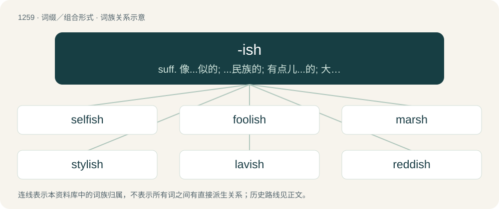

# 1345 · -ish — suff. 像...似的; ...民族的; 有点儿...的; 大约...

[总目录](../00_总目录_按常用程度.md)

**类型**：词缀／组合形式　｜　**来源语言**：见词源记录

## 核心含义与来源

- 核心含义：suff. 像...似的; ...民族的; 有点儿...的; 大约...
- 英文含义：Typical of, similar to, being like.
- 词形：-ish

**多个词源／构词路径**：同一拼写可能有不同来源；以下按词性和含义分别列出。

**来源记录 1**（后缀／后置成分；Typical of, similar to, being like.）

From Middle English -isch, -issh, from Old English -isċ (“-ish”, suffix), from Proto-West Germanic \*-isk, from Proto-Germanic \*-iskaz (“-ish”), from Proto-Indo-European \*-iskos. Cognate with Dutch -s; German -isch (whence Dutch -isch); Norwegian, Danish, and Swedish -isk or -sk; Lithuanian -iškas; Russian -ский (-skij); and the Ancient Greek diminutive suffix -ίσκος (-ískos). Doublet of -esque and -ski.

**来源记录 2**（后缀／后置成分；An ending found on some verbs; see usage notes.）

From Middle English -ishen, -ischen, -issen, from Old French -iss-, -is- (a termination of the stem of some forms \[present participle, etc.\] of certain verbs), from Latin -ēscere, -īscere (an inchoative suffix), the formative -esc-, -isc- (-sc-, Greek -σκ- (-sk-)) being ultimately cognate with English -ish (Etymology 1). See -esce, -escent, etc.

## 词族图

## 单词速览（常用到不常用）

| 单词 | 音标 | 释义 |
|---|---|---|
| [selfish](#w-1) | /ˈsɛl.fɪʃ/ | a. 自私的, 利己主义的, 自我中心的 |
| [foolish](#w-2) | /ˈfuː.lɪʃ/ | a. 愚蠢的, 傻的 |
| [marsh](#w-3) | 英 /mɑːʃ/；美 /mɑɹʃ/ | n. 沼泽, 湿地；a. 沼泽的 |
| [stylish](#w-4) | /ˈstaɪlɪʃ/ | a. 现代风格的, 流行的, 潇洒的 |
| [lavish](#w-5) | /ˈlævɪʃ/ | a. 大方的, 丰富的, 浪费的；vt. 浪费, 滥用, 慷慨给予 |
| [reddish](#w-6) | /ˈɹɛdɪʃ/ | a. 微红的, 略带红色的 |
| [cornish](#w-7) | /ˈkɔːniʃ/ | a. 康沃尔人的；康沃尔郡的 |
| [sluggish](#w-8) | /ˈslʌɡɪʃ/ | a. 偷懒的, 懒惰的, 迟钝的；\[经\] 萧条的, 呆滞的 |
| [yellowish](#w-9) | 英 /ˈjɛləʊɪʃ/；美 /ˈjɛlɔʊɪʃ/ | a. 淡黄的, 微黄的 |
| [bullish](#w-10) | /ˈbʊlɪʃ/ | a. 似公牛的, 看涨的, 上扬的；\[经\] 行情看涨的 |
| [brownish](#w-11) | /ˈbɹaʊnɪʃ/ | a. 呈褐色的 |
| [greenish](#w-12) | /ˈɡɹiːnɪʃ/ | a. 呈绿色的 |
| [whitish](#w-13) | /ˈwaɪtɪʃ/ | a. 发白的, 带白色的 |
| [gibberish](#w-14) | /ˈd͡ʒɪ.bə.ɹɪʃ/ | n. 快而不清的语, 胡扯 |
| [hellish](#w-15) | 英 /ˈhɛlɪʃ/ | a. 地狱的, 凶恶的, 令人毛骨悚然的 |
| [bluish](#w-16) | /ˈbluːɪʃ/ | a. 带蓝色的 |
| [blackish](#w-17) | 英 /ˈblækɪʃ/ | a. 带黑色的 |
| [devilish](#w-18) | /ˈdɛvəlɪʃ/ | a. 魔鬼似的, 该咒骂的, 可恶的, 邪恶的, 凶暴的, 异常的, 过分的, 非常的；adv. (非正式)非常, 过分地, 极 |
| [bearish](#w-19) | /ˈbєəriːʃ/ | a. 如熊的, 粗暴的；\[经\] 熊市 |
| [feverish](#w-20) | 英 /ˈfiː.və.ɹɪʃ/；美 /ˈfi.vɚ.ɪʃ/ | a. 发热的, 极度兴奋的, 不安的 |
| [boyish](#w-21) | /ˈbɔɪ.ɪʃ/ | a. 男孩的, 像男孩的 |
| [moorish](#w-22) | 英 /ˈmɔːɹɪʃ/ | 【英文】Resembling or characteristic of a moor; abounding in moorland. |
| [pinkish](#w-23) | /ˈpɪŋkɪʃ/ | a. 略带桃色的 |
| [purplish](#w-24) | /ˈpəːpliʃ/ | a. 略带紫色的 |
| [nightmarish](#w-25) | /ˈnait,meəriʃ/ | a. 梦魇似的, 可怕的, 经常使人恐惧的 |
| [brackish](#w-26) | /ˈbɹækɪʃ/ | a. 有盐味的, 令人不快的；\[机\] 微有碱味的 |
| [skittish](#w-27) | /ˈskɪtɪʃ/ | a. 易惊的, 轻佻的, 三心二意的, 不可靠的, 羞怯的, 活泼的, 爱蹦跳的, 活跃的 |
| [grayish](#w-28) | /ˈɡɹeɪ.ɪʃ/ | a. 浅灰色的, 微带灰色的 |
| [ticklish](#w-29) | 英 /ˈtɪk(ə)lɪʃ/ | a. 易倒的, 不稳定的, 难对付的, 怕痒的 |
| [amateurish](#w-30) | /ˈæ.mə.t͡ʃʊɚ.ɪʃ/ | a. 业余的, 外行的, 不熟练的 |
| [cartoonish](#w-31) | /kɑːˈtuːnɪʃ/ | a. 动画片似的 |
| [bookish](#w-32) | 英 /ˈbʊkɪʃ/；/ˈbuːkɪʃ/ | a. 好读书的, 书呆子的 |
| [brutish](#w-33) | 英 /ˈbɹuːt.ɪʃ/ | a. 畜生般的, 愚钝的, 粗野的, 残忍的, 野蛮的 |
| [freakish](#w-34) | /ˈfɹiːkɪʃ/ | a. 朝三暮四的, 见异思迁的, 畸形的 |
| [smallish](#w-35) | /ˈsmɒːliʃ/ | a. 有点小的, 短小的 |
| [snobbish](#w-36) | /ˈsnɒbɪʃ/ | a. 自命不凡的, 势利的 |
| [girlish](#w-37) | 英 /ˈɡɜː.lɪʃ/；美 /ˈɡɝ.lɪʃ/ | a. 少女的, 少女似的, 适于女子的 |
| [fiendish](#w-38) | /ˈfiːndɪʃ/ | a. 恶魔似的 |
| [elvish](#w-39) | /ˈɛlvɪʃ/ | a. 小精灵的, 淘气的 |
| [hawkish](#w-40) | 英 /ˈhɔːkɪʃ/；/ˈhɔkɪʃ/ | a. 像鹰的, 鹰派的, 强硬派的 |
| [sheepish](#w-41) | /ˈʃiːpɪʃ/ | a. 懦弱的, 羞怯的 |
| [ghoulish](#w-42) | /ˈɡuː.lɪʃ/ | a. 食尸鬼似的, 残忍的 |
| [boorish](#w-43) | /ˈbʊəɹɪʃ/ | a. 粗野的, 粗鄙的 |
| [longish](#w-44) | /ˈlɒŋiʃ/ | a. 稍长的, 略长的 |
| [prudish](#w-45) | /ˈpɹuːdɪʃ/ | a. 拘守礼仪的, 过分规矩的, 表面正经的 |
| [harish](#w-46) |  | n. (Harish)人名；(以、尼、印、斐、毛里求)哈里什 |
| [thuggish](#w-47) | /ˈθʌɡɪʃ/ | \[法\] 暗杀的, 杀人的, 暴行的 |
| [newish](#w-48) | /ˈnjuːiʃ/ | a. 尚新的 |
| [brandish](#w-49) | /ˈbɹændɪʃ/ | vt. 挥, 挥舞；n. 挥舞 |
| [churlish](#w-50) | 英 /ˈtʃɜːlɪʃ/；美 /ˈt͡ʃɝːlɪʃ/ | a. 粗野的 |
| [slavish](#w-51) | /ˈsleɪvɪʃ/ | a. 奴隶的, 奴性的, 盲从的 |
| [beamish](#w-52) | /ˈbiːmɪʃ/ | a. 春风得意的 |
| [impish](#w-53) | /ˈɪmpɪʃ/ | a. 心地不良的, 顽皮的 |
| [modish](#w-54) | /ˈməʊdɪʃ/ | a. 流行的, 时髦的 |
| [roguish](#w-55) | 英 /ˈɹəʊɡɪʃ/；美 /ˈɹoʊɡɪʃ/ | a. 流氓的, 无赖的, 恶作剧的；\[法\] 不诚实的, 流氓的, 恶作剧的 |
| [standoffish](#w-56) | 英 /stænˈdɒf.ɪʃ/；美 /stænˈdɔ.fɪʃ/ | a. 冷淡的 |
| [popish](#w-57) | 英 /ˈpəʊpɪʃ/；美 /ˈpoʊpɪʃ/ | a. 天主教的 |
| [roundish](#w-58) | /ˈraundiʃ/ | a. 略圆的 |
| [coquettish](#w-59) | /kɒˈketiʃ/ | a. 卖弄风情的 |
| [cultish](#w-60) |  | 狂热的 |
| [peckish](#w-61) | 英 /ˈpɛk.ɪʃ/ | a. 有点饥饿的, 想要吃的, 急躁的 |
| [rakish](#w-62) | /ˈɹeɪkɪʃ/ | a. 轻快的, 潇洒的, 放荡的 |
| [youngish](#w-63) | /ˈjʌŋiʃ/ | a. 还年轻的, 还幼小的 |

## 逐词详解

### 1. selfish

**词性**：形容词　｜　**音标**：/ˈsɛl.fɪʃ/

**中文释义**：a. 自私的, 利己主义的, 自我中心的

**英文义项**：Holding one's own self-interest as the standard for decision making. / Having excessive or exclusive regard and concern for one's own well-being, profit or pleasure, with little or no consideration for others.

**构词拆分**：self + -ish

**词源与演化**：

From self + -ish. Compare Danish selvisk (“selfish”), Swedish självisk (“selfish”).

**例句**：

> Selfish men were...trying to make capital for themselves out of the sacred cause of civil rights.

该用例对应义项：concerned chiefly or only with yourself and your advantage to the exclusion of others

### 2. foolish

**词性**：形容词　｜　**音标**：/ˈfuː.lɪʃ/

**中文释义**：a. 愚蠢的, 傻的

**英文义项**：Lacking good sense or judgement as a general trait; unwise; stupid. / Not based on good sense or judgement; as a fool would do or conclude.

**构词拆分**：fool + -ish

**词源与演化**：

From Middle English folisch; equivalent to fool + -ish.

**例句**：

> It's foolish to think that smoking has little to do with cancer.

### 3. marsh

**词性**：名词　｜　**音标**：英 /mɑːʃ/；美 /mɑɹʃ/

**中文释义**：n. 沼泽, 湿地；a. 沼泽的

**英文义项**：An area of low, wet land, often with tall grass or herbaceous plants.

**构词拆分**：mere (“sea, body of water”) + -ish

**词源与演化**：

From Middle English mersch, from Old English mersċ, merisċ, from Proto-West Germanic \*marisk, derived from \*mari, equivalent to mere (“sea, body of water”) + -ish. Doublet of marish, morass, and merse. Cognate with West Frisian mersk, Dutch meers (“grassland, meadow”) and Dutch moeras, German Marsch. More at mere.

**例句**：

> Čepkeliai Marsh consists mainly of bog.

该用例对应义项：An area of low, wet land, often with tall grass or herbaceous plants.

### 4. stylish

**词性**：形容词　｜　**音标**：/ˈstaɪlɪʃ/

**中文释义**：a. 现代风格的, 流行的, 潇洒的

**英文义项**：Having style. / Having elegance or taste or refinement in manners or dress.

**构词拆分**：style + -ish

**词源与演化**：

From style + -ish.

**例句**：

> A little less posh but every bit as stylish as Lord Peter Wimsey.

该用例对应义项：having elegance or taste or refinement in manners or dress

### 5. lavish

**词性**：形容词　｜　**音标**：/ˈlævɪʃ/

**中文释义**：a. 大方的, 丰富的, 浪费的；vt. 浪费, 滥用, 慷慨给予

**英文义项**：Expending or bestowing profusely; profuse; prodigal. / Superabundant; excessive.

**构词拆分**：lave + -ish

**词源与演化**：

From Middle English laves, lavas, lavage (“extravagant, wasteful, prodigal”), from lavas (“excessive abundance”), from Old French lavasse, lavache (“torrent of rain”); possibly later conflated in some senses by Middle English laven (“to pour out”), equivalent to lave + -ish. Compare Scots lawage, lavisch, lavish (“unrestrained, excessively prodigal, extravagant”). Compare also English lavy (“lavish, liberal”), Dutch lafenis (“lavishness”).

**用法示例／搭配（非完整句）**：

> lavish of money; lavish of praise

该用例对应义项：Expending or bestowing profusely; profuse; prodigal.

### 6. reddish

**词性**：形容词　｜　**音标**：/ˈɹɛdɪʃ/

**中文释义**：a. 微红的, 略带红色的

**英文义项**：Somewhat red.

**构词拆分**：red + -ish

**词源与演化**：

From Middle English redisch; equivalent to red + -ish.

**例句**：

> What color is your urine: bright, tawny, reddish or golden brown?

### 7. cornish

**词性**：形容词　｜　**音标**：/ˈkɔːniʃ/

**中文释义**：a. 康沃尔人的；康沃尔郡的

**英文义项**：cornlike; resembling corn

**构词拆分**：corn + -ish

**词源与演化**：

From corn + -ish.

**例句**：

> Welsh, Cornish and Breton are all closely related.

### 8. sluggish

**词性**：形容词　｜　**音标**：/ˈslʌɡɪʃ/

**中文释义**：a. 偷懒的, 懒惰的, 迟钝的；\[经\] 萧条的, 呆滞的

**英文义项**：Habitually idle and lazy; slothful; dull; inactive / Slow; having little motion.

**构词拆分**：slug + -ish

**词源与演化**：

From slug + -ish.

**例句**：

> Inflation has been rising despite a sluggish economy.

该用例对应义项：Exhibiting economic decline, inactivity, slow, or subnormal growth.

### 9. yellowish

**词性**：形容词　｜　**音标**：英 /ˈjɛləʊɪʃ/；美 /ˈjɛlɔʊɪʃ/

**中文释义**：a. 淡黄的, 微黄的

**英文义项**：Somewhat yellow in colour.

**构词拆分**：yellow + -ish

**词源与演化**：

From Middle English ȝelowisch; equivalent to yellow + -ish.

**例句**：

> Everyone knows that the moon is only a block of yellowish cheese.

### 10. bullish

**词性**：形容词　｜　**音标**：/ˈbʊlɪʃ/

**中文释义**：a. 似公牛的, 看涨的, 上扬的；\[经\] 行情看涨的

**英文义项**：Having a muscular physique, built ‘like a bull’. / Aggressively self-confident or assertive; bullheaded.

**构词拆分**：bull + -ish

**词源与演化**：

From bull + -ish.

**例句**：

> He was heavily criticised for his bullish behaviour.

该用例对应义项：Aggressively self-confident or assertive; bullheaded.

### 11. brownish

**词性**：形容词　｜　**音标**：/ˈbɹaʊnɪʃ/

**中文释义**：a. 呈褐色的

**英文义项**：Of a colour which resembles brown; somewhat brown.

**构词拆分**：brown + -ish

**词源与演化**：

From brown + -ish.

**例句**：

> When he turned the spigot, brownish water came gushing out.

### 12. greenish

**词性**：形容词　｜　**音标**：/ˈɡɹiːnɪʃ/

**中文释义**：a. 呈绿色的

**英文义项**：Somewhat green in color.

**构词拆分**：green + -ish

**词源与演化**：

From Middle English grenisch, grenysch, equivalent to green + -ish.

**例句**：

> There are greenish stone chairs next to the tree next to the teahouse.

### 13. whitish

**词性**：形容词　｜　**音标**：/ˈwaɪtɪʃ/

**中文释义**：a. 发白的, 带白色的

**英文义项**：Somewhat white, pale or almost white.

**构词拆分**：white + -ish

**词源与演化**：

From Middle English whitisch, whytyssh, equivalent to white + -ish.

**例句**：

> The flowers of dwarf goat's beards have a whitish color.

### 14. gibberish

**词性**：名词　｜　**音标**：/ˈd͡ʒɪ.bə.ɹɪʃ/

**中文释义**：n. 快而不清的语, 胡扯

**英文义项**：Speech or writing that is unintelligible, incoherent or meaningless. / Needlessly obscure or overly technical language.

**词源与演化**：

First attested mid-16th century. Origin obscure. Possibly from \*gibber, of onomatopoeic origin imitating to the sound of chatter, possibly from or influenced by jabber, + -ish denoting the name of a language (compare English, Finnish, Spanish, etc.). The verb gibber, first attested circa 1600, is usually regarded as a back-formation from gibberish.

**例句**：

> That photo is clearly AI-generated. Just look at the gibberish on her badge!

### 15. hellish

**词性**：形容词　｜　**音标**：英 /ˈhɛlɪʃ/

**中文释义**：a. 地狱的, 凶恶的, 令人毛骨悚然的

**英文义项**：infernal, related or similar to hell. / causing great pain, discomfort or distress.

**构词拆分**：hell + -ish

**词源与演化**：

From hell + -ish.

**例句**：

> I woke up from a hellish noise coming from the house next door.

该用例对应义项：causing great pain, discomfort or distress.

### 16. bluish

**词性**：形容词　｜　**音标**：/ˈbluːɪʃ/

**中文释义**：a. 带蓝色的

**英文义项**：Having a tint or hue similar to the colour blue. / Somewhat depressed; sad.

**构词拆分**：blue + -ish

**词源与演化**：

From Middle English blewissh, blewisch (also Middle English bloysh), equivalent to blue + -ish.

**例句**：

> The corners of his lips showed a bluish tinge that really worried the nurse.

### 17. blackish

**词性**：形容词　｜　**音标**：英 /ˈblækɪʃ/

**中文释义**：a. 带黑色的

**英文义项**：somewhat black

**构词拆分**：black + -ish

**词源与演化**：

From Middle English blackysshe, blakkyssh, equivalent to black + -ish.

**例句**：

> His knee turned a ghastly blackish purple from the swelling.

### 18. devilish

**词性**：形容词　｜　**音标**：/ˈdɛvəlɪʃ/

**中文释义**：a. 魔鬼似的, 该咒骂的, 可恶的, 邪恶的, 凶暴的, 异常的, 过分的, 非常的；adv. (非正式)非常, 过分地, 极

**英文义项**：Resembling a devil. / Evil, wicked.

**构词拆分**：devil + -ish

**词源与演化**：

From Middle English develissh, develyssh, equivalent to devil + -ish. Cognate with Saterland Frisian düvelsk, düüwelsk (“devilish”), West Frisian duvelsk (“devilish”), Dutch duivels (“devilish”), German Low German düvelsk (“devilish”), German teuflisch (“devilish”), Danish djævelsk (“devilish”), Swedish djävulsk (“devilish”), Norwegian djevelsk (“devilish”).

**例句**：

> I had a devilish time moving the wardrobe downstairs.

该用例对应义项：Excessive, extreme.

### 19. bearish

**词性**：形容词　｜　**音标**：/ˈbєəriːʃ/

**中文释义**：a. 如熊的, 粗暴的；\[经\] 熊市

**英文义项**：Resembling or likened to a bear, typically in being rough, surly, or clumsy. / Characterized by or expecting falling prices.

**构词拆分**：bear + -ish

**词源与演化**：

From bear + -ish.

### 20. feverish

**词性**：形容词　｜　**音标**：英 /ˈfiː.və.ɹɪʃ/；美 /ˈfi.vɚ.ɪʃ/

**中文释义**：a. 发热的, 极度兴奋的, 不安的

**英文义项**：Having a fever, an elevated body temperature. / Filled with excess energy.

**构词拆分**：fever + -ish

**词源与演化**：

From fever + -ish.

**例句**：

> The illness made him feverish, so they applied cold compresses.

该用例对应义项：Having a fever, an elevated body temperature.

### 21. boyish

**词性**：形容词　｜　**音标**：/ˈbɔɪ.ɪʃ/

**中文释义**：a. 男孩的, 像男孩的

**英文义项**：Like a stereotypical boy in appearance or demeanor. / Relating to a boy, or occurring in boyhood.

**构词拆分**：boy + -ish

**词源与演化**：

From boy + -ish.

**例句**：

> People disliked his boyish and juvenile behaviour.

该用例对应义项：Like a stereotypical boy in appearance or demeanor.

### 22. moorish

**词性**：形容词　｜　**音标**：英 /ˈmɔːɹɪʃ/

**英文义项**：Resembling or characteristic of a moor; abounding in moorland.

**构词拆分**：moor + -ish

**词源与演化**：

From moor + -ish.

**例句**：

> Moorish influence is evident in the music and architecture of this land.

### 23. pinkish

**词性**：形容词　｜　**音标**：/ˈpɪŋkɪʃ/

**中文释义**：a. 略带桃色的

**英文义项**：Somewhat pink.

**构词拆分**：pink + -ish

**词源与演化**：

From pink + -ish.

**例句**：

> The first light of dawn tinged the clouds with a pinkish hue.

### 24. purplish

**词性**：形容词　｜　**音标**：/ˈpəːpliʃ/

**中文释义**：a. 略带紫色的

**英文义项**：Somewhat purple in colour/color.

**构词拆分**：purple + -ish

**词源与演化**：

From purple + -ish.

**例句**：

> Some purplish fish are swimming fast in the creek.

### 25. nightmarish

**词性**：形容词　｜　**音标**：/ˈnait,meəriʃ/

**中文释义**：a. 梦魇似的, 可怕的, 经常使人恐惧的

**英文义项**：Resembling a nightmare.

**构词拆分**：nightmare + -ish

**词源与演化**：

From nightmare + -ish.

**例句**：

> Bruno had a nightmarish story to tell.

### 26. brackish

**词性**：形容词　｜　**音标**：/ˈbɹækɪʃ/

**中文释义**：a. 有盐味的, 令人不快的；\[机\] 微有碱味的

**英文义项**：Of water, salty or slightly salty, as a mixture of fresh and sea water, such as that found in estuaries. / Distasteful; unpleasant; not appealing to the taste.

**词源与演化**：

From Scottish brack (from Middle Dutch brac (“brackish”)) + -ish. Cognate with Dutch brak (“brackish”), German Low German brack, brakerg, brakig (“brackish”), German brackig (“brackish”), Danish brak (“brackish”), Swedish bräck (“brackish”), Norwegian brakk (“brackish”). Perhaps a distant doublet of brook.

**例句**：

> A thin brackish gruel.

该用例对应义项：distasteful and unpleasant; spoiled by mixture

### 27. skittish

**词性**：形容词　｜　**音标**：/ˈskɪtɪʃ/

**中文释义**：a. 易惊的, 轻佻的, 三心二意的, 不可靠的, 羞怯的, 活泼的, 爱蹦跳的, 活跃的

**英文义项**：Easily scared or startled; timid. / Wanton; changeable; fickle.

**构词拆分**：skite (“to move lightly and hurriedly; to move suddenly, particularly in an oblique direction (Scotland, Northern England)”) + -ish

**词源与演化**：

Probably from skite (“to move lightly and hurriedly; to move suddenly, particularly in an oblique direction (Scotland, Northern England)”) + -ish; compare skitter.

**例句**：

> The dog likes people he knows, but he is skittish around strangers.

该用例对应义项：Easily scared or startled; timid.

### 28. grayish

**词性**：形容词　｜　**音标**：/ˈɡɹeɪ.ɪʃ/

**中文释义**：a. 浅灰色的, 微带灰色的

**英文义项**：Somewhat gray.

**构词拆分**：gray + -ish

**词源与演化**：

From gray + -ish.

**例句**：

> A grayish fish is calmly swimming in the stream.

### 29. ticklish

**词性**：形容词　｜　**音标**：英 /ˈtɪk(ə)lɪʃ/

**中文释义**：a. 易倒的, 不稳定的, 难对付的, 怕痒的

**英文义项**：Sensitive or susceptible to being tickled. / Touchy, sensitive, or delicate.

**构词拆分**：tickle + -ish

**词源与演化**：

From tickle + -ish.

**例句**：

> She is ticklish only on her tummy and the bottoms of her feet.

该用例对应义项：Sensitive or susceptible to being tickled.

### 30. amateurish

**词性**：形容词　｜　**音标**：/ˈæ.mə.t͡ʃʊɚ.ɪʃ/

**中文释义**：a. 业余的, 外行的, 不熟练的

**英文义项**：Suggesting or reflecting the efforts of an amateur; not seeming professional or polished.

**构词拆分**：amateur + -ish

**词源与演化**：

From amateur + -ish.

**例句**：

> A very amateurish job.

该用例对应义项：lacking professional skill or expertise

### 31. cartoonish

**词性**：形容词　｜　**音标**：/kɑːˈtuːnɪʃ/

**中文释义**：a. 动画片似的

**英文义项**：Exaggerated or caricatured, in the manner of a cartoon.

**构词拆分**：cartoon + -ish

**词源与演化**：

From cartoon + -ish. Piecewise doublet of cartoonesque.

**例句**：

> She was grinning a big, cartoonish grin.

该用例对应义项：Exaggerated or caricatured, in the manner of a cartoon.

### 32. bookish

**词性**：形容词　｜　**音标**：英 /ˈbʊkɪʃ/；/ˈbuːkɪʃ/

**中文释义**：a. 好读书的, 书呆子的

**英文义项**：Fond of reading or studying, especially said of someone lacking social skills as a result. / Characterized by a method of expression generally found in books.

**构词拆分**：book + -ish

**词源与演化**：

From book + -ish.

**例句**：

> A bookish farmer who always had a book in his pocket.

该用例对应义项：characterized by diligent study and fondness for reading

### 33. brutish

**词性**：形容词　｜　**音标**：英 /ˈbɹuːt.ɪʃ/

**中文释义**：a. 畜生般的, 愚钝的, 粗野的, 残忍的, 野蛮的

**英文义项**：Of, or in the manner of a brute. / Bestial; lacking human sensibility.

**构词拆分**：brute + -ish

**词源与演化**：

From brute + -ish.

**例句**：

> A dull and brutish man.

该用例对应义项：resembling a beast; showing lack of human sensibility

### 34. freakish

**词性**：形容词　｜　**音标**：/ˈfɹiːkɪʃ/

**中文释义**：a. 朝三暮四的, 见异思迁的, 畸形的

**英文义项**：Resembling a freak. / Strange, unusual, abnormal or bizarre.

**构词拆分**：freak + -ish

**词源与演化**：

From freak + -ish.

**例句**：

> What freakish weather we are having lately in these parts.

该用例对应义项：Capricious, unpredictable.

### 35. smallish

**词性**：形容词　｜　**音标**：/ˈsmɒːliʃ/

**中文释义**：a. 有点小的, 短小的

**英文义项**：Somewhat small.

**构词拆分**：small + -ish

**词源与演化**：

From Middle English smalish, equivalent to small + -ish.

### 36. snobbish

**词性**：形容词　｜　**音标**：/ˈsnɒbɪʃ/

**中文释义**：a. 自命不凡的, 势利的

**英文义项**：Having the property of being a snob; arrogant and pretentious; smugly superior or dismissive of perceived inferiors.

**构词拆分**：snob + -ish

**词源与演化**：

From snob + -ish.

**例句**：

> It was a snobbish club full of preppy airheads.

### 37. girlish

**词性**：形容词　｜　**音标**：英 /ˈɡɜː.lɪʃ/；美 /ˈɡɝ.lɪʃ/

**中文释义**：a. 少女的, 少女似的, 适于女子的

**英文义项**：Like (that of) a girl; feminine.

**构词拆分**：girl + -ish

**词源与演化**：

From girl + -ish.

**例句**：

> Her girlish complexion belied the fact that she was over forty.

### 38. fiendish

**词性**：形容词　｜　**音标**：/ˈfiːndɪʃ/

**中文释义**：a. 恶魔似的

**英文义项**：Sinister; evil; like a fiend. / Very difficult.

**构词拆分**：fiend + -ish

**词源与演化**：

From fiend + -ish.

**例句**：

> The detective was puzzled by the fiendish plot to steal the diamonds.

该用例对应义项：Sinister; evil; like a fiend.

### 39. elvish

**词性**：形容词　｜　**音标**：/ˈɛlvɪʃ/

**中文释义**：a. 小精灵的, 淘气的

**英文义项**：Of or having to do with elves; elven.

**构词拆分**：elf + -ish

**词源与演化**：

Inherited from Middle English elvisch, from Old English ielfisċ. Equivalent to elf + -ish.

**例句**：

> My Elvish is rusty, but I think he's saying he means us no harm.

### 40. hawkish

**词性**：形容词　｜　**音标**：英 /ˈhɔːkɪʃ/；/ˈhɔkɪʃ/

**中文释义**：a. 像鹰的, 鹰派的, 强硬派的

**英文义项**：Resembling a hawk in appearance or behaviour. / Supportive of warlike foreign policy; bellicose; inclined toward military action.

**构词拆分**：hawk + -ish

**词源与演化**：

From hawk + -ish.

**例句**：

> The Prime Minister could count on the support of a hawkish majority in Parliament to support the invasion.

该用例对应义项：Supportive of warlike foreign policy; bellicose; inclined toward military action.

### 41. sheepish

**词性**：形容词　｜　**音标**：/ˈʃiːpɪʃ/

**中文释义**：a. 懦弱的, 羞怯的

**英文义项**：Having the characteristics of a sheep, as meekness, shyness, or docility. / Shy, meek, ashamed or embarrassed.

**构词拆分**：sheep + -ish

**词源与演化**：

From Middle English schepische, shepisse, shepisshe; equivalent to sheep + -ish.

**用法示例／搭配（非完整句）**：

> a sheepish girl

该用例对应义项：Shy, meek, ashamed or embarrassed.

### 42. ghoulish

**词性**：形容词　｜　**音标**：/ˈɡuː.lɪʃ/

**中文释义**：a. 食尸鬼似的, 残忍的

**英文义项**：Of or pertaining to ghouls. / Of or pertaining to corpses and graverobbing.

**构词拆分**：ghoul + -ish

**词源与演化**：

From ghoul + -ish.

**例句**：

> Rifling through a dead man's belongings is ghoulish.

### 43. boorish

**词性**：形容词　｜　**音标**：/ˈbʊəɹɪʃ/

**中文释义**：a. 粗野的, 粗鄙的

**英文义项**：Behaving as a boor; rough in manners.

**构词拆分**：boor + -ish

**词源与演化**：

From boor + -ish.

**例句**：

> I thought it would be boorish to challenge his identity without warning.

### 44. longish

**词性**：形容词　｜　**音标**：/ˈlɒŋiʃ/

**中文释义**：a. 稍长的, 略长的

**英文义项**：Somewhat long.

**构词拆分**：long + -ish

**词源与演化**：

From long + -ish.

**例句**：

> It was a longish time before I received a reply to my letter.

该用例对应义项：Somewhat long.

### 45. prudish

**词性**：形容词　｜　**音标**：/ˈpɹuːdɪʃ/

**中文释义**：a. 拘守礼仪的, 过分规矩的, 表面正经的

**英文义项**：Of excessive propriety; easily offended or shocked, especially by sexual matters.

**构词拆分**：prude + -ish

**词源与演化**：

From prude + -ish.

**例句**：

> You are afraid of a male talking about other males. You come from a different more prudish religious background and yet a different generation.

### 46. harish

**词性**：形容词

**中文释义**：n. (Harish)人名；(以、尼、印、斐、毛里求)哈里什

**英文义项**：Like a hare.

**构词拆分**：hare + -ish

**词源与演化**：

From hare + -ish.

**例句**：

> The Bronze Age settlement was discovered during road construction near the town of Harish, some 50 kilometers north of Tel Aviv.

### 47. thuggish

**词性**：形容词　｜　**音标**：/ˈθʌɡɪʃ/

**中文释义**：\[法\] 暗杀的, 杀人的, 暴行的

**英文义项**：Characterized by thuggery; behaving in a violent or intimidating way; appearing to be violent or intimidating.

**构词拆分**：thug + -ish

**词源与演化**：

From thug + -ish.

**例句**：

> Their thuggish manner made continuing negotiations very difficult.

该用例对应义项：Characterized by thuggery; behaving in a violent or intimidating way; appearing to be violent or intimidating.

### 48. newish

**词性**：形容词　｜　**音标**：/ˈnjuːiʃ/

**中文释义**：a. 尚新的

**英文义项**：Somewhat new

**构词拆分**：new + -ish

**词源与演化**：

From new + -ish.

### 49. brandish

**词性**：动词　｜　**音标**：/ˈbɹændɪʃ/

**中文释义**：vt. 挥, 挥舞；n. 挥舞

**英文义项**：To move or swing a weapon back and forth, particularly if demonstrating anger, threat or skill. / To bear something with ostentatious show.

**构词拆分**：brand + -ish

**词源与演化**：

From Middle English braundischen, from Old French brandiss-, stem of brandir (“to flourish a sword”), from Frankish \*brandijan, from Frankish \*brand (“firebrand; sword”), from Proto-Germanic \*brandaz (“fire; flame; sword”), whence Old English brand (“firebrand; torch”); equivalent to brand + -ish. More at brand.

**例句**：

> He brandished his sword at the pirates.

该用例对应义项：To move or swing a weapon back and forth, particularly if demonstrating anger, threat or skill.

### 50. churlish

**词性**：形容词　｜　**音标**：英 /ˈtʃɜːlɪʃ/；美 /ˈt͡ʃɝːlɪʃ/

**中文释义**：a. 粗野的

**英文义项**：Of or pertaining to a serf, peasant, or rustic. / Rude, surly, ungracious.

**构词拆分**：churl + -ish

**词源与演化**：

From Middle English cherlisch, cherlissh, from late Old English ċeorlisċ, ċierlisċ (“of or pertaining to churls”), equivalent to churl + -ish. Piecewise doublet of ceorlish.

**例句**：

> Churlish as a bear.

该用例对应义项：having a bad disposition; surly

### 51. slavish

**词性**：形容词　｜　**音标**：/ˈsleɪvɪʃ/

**中文释义**：a. 奴隶的, 奴性的, 盲从的

**英文义项**：In the manner of a slave; abject. / Utterly faithful; totally lacking originality, creativity, or reflection.

**构词拆分**：slave + -ish

**词源与演化**：

From slave + -ish.

**用法示例／搭配（非完整句）**：

> slavish observation of rules

该用例对应义项：Utterly faithful; totally lacking originality, creativity, or reflection.

### 52. beamish

**词性**：形容词　｜　**音标**：/ˈbiːmɪʃ/

**中文释义**：a. 春风得意的

**英文义项**：Radiantly beaming; happy; cheerful.

**构词拆分**：beam + -ish

**词源与演化**：

From beam + -ish.

### 53. impish

**词性**：形容词　｜　**音标**：/ˈɪmpɪʃ/

**中文释义**：a. 心地不良的, 顽皮的

**英文义项**：Mischievous; of or befitting an imp.

**构词拆分**：imp + -ish

**词源与演化**：

From imp + -ish.

**例句**：

> That impish man over there is my ex-husband.

### 54. modish

**词性**：形容词　｜　**音标**：/ˈməʊdɪʃ/

**中文释义**：a. 流行的, 时髦的

**英文义项**：Conforming with fashion or style. / In the current mode.

**构词拆分**：mode + -ish

**词源与演化**：

From mode + -ish.

**例句**：

> My sister-in-law lived through the poverty of her modish Western religion.

### 55. roguish

**词性**：形容词　｜　**音标**：英 /ˈɹəʊɡɪʃ/；美 /ˈɹoʊɡɪʃ/

**中文释义**：a. 流氓的, 无赖的, 恶作剧的；\[法\] 不诚实的, 流氓的, 恶作剧的

**英文义项**：Unprincipled or unscrupulous. / Mischievous and playful.

**构词拆分**：rogue + -ish

**词源与演化**：

From rogue + -ish.

**例句**：

> He was a tall boy, with curly brown hair, roguish hazel eyes, and a mouth twisted into a teasing smile.

### 56. standoffish

**词性**：形容词　｜　**音标**：英 /stænˈdɒf.ɪʃ/；美 /stænˈdɔ.fɪʃ/

**中文释义**：a. 冷淡的

**英文义项**：Aloof; reserved; unsociable and unfriendly.

**构词拆分**：stand off + -ish

**词源与演化**：

From stand off + -ish.

**例句**：

> When I look him, I see a standoffish man.

### 57. popish

**词性**：形容词　｜　**音标**：英 /ˈpəʊpɪʃ/；美 /ˈpoʊpɪʃ/

**中文释义**：a. 天主教的

**英文义项**：of or pertaining to Roman Catholicism / acting like, or holding beliefs similar to, the pope.

**构词拆分**：pope + -ish

**词源与演化**：

From pope + -ish.

### 58. roundish

**词性**：形容词　｜　**音标**：/ˈraundiʃ/

**中文释义**：a. 略圆的

**英文义项**：Somewhat round.

**构词拆分**：round + -ish

**词源与演化**：

From round + -ish.

**例句**：

> Compared to Roman script, Japanese script seems more roundish and organic.

### 59. coquettish

**词性**：形容词　｜　**音标**：/kɒˈketiʃ/

**中文释义**：a. 卖弄风情的

**英文义项**：Of, being, or characteristic of a young, flirtatious girl.

**构词拆分**：coquette + -ish

**词源与演化**：

From coquett(e) + -ish.

### 60. cultish

**词性**：形容词

**中文释义**：狂热的

**英文义项**：Resembling or characteristic of a cult.

**构词拆分**：cult + -ish

**词源与演化**：

From cult + -ish.

**用法示例／搭配（非完整句）**：

> a cultish movement

该用例对应义项：Resembling or characteristic of a cult.

### 61. peckish

**词性**：形容词　｜　**音标**：英 /ˈpɛk.ɪʃ/

**中文释义**：a. 有点饥饿的, 想要吃的, 急躁的

**英文义项**：mildly hungry / irritable; crotchety

**构词拆分**：peck (verb) + -ish

**词源与演化**：

From peck (verb) + -ish. From late 18th century.

**例句**：

> After that run, I'm feeling a bit peckish.

该用例对应义项：mildly hungry

### 62. rakish

**词性**：形容词　｜　**音标**：/ˈɹeɪkɪʃ/

**中文释义**：a. 轻快的, 潇洒的, 放荡的

**英文义项**：Dashingly, carelessly, or sportingly unconventional or stylish; jaunty; characterized by a devil-may-care unconventionality; having a somewhat disreputable quality or appearance. / Like a rake; dissolute; profligate.

**构词拆分**：rake + -ish

**词源与演化**：

From rake (“man habituated to immoral conduct”) + -ish.

**用法示例／搭配（非完整句）**：

> a hat worn at a rakish angle

该用例对应义项：Dashingly, carelessly, or sportingly unconventional or stylish; jaunty; characterized by a devil-may-care unconventionality; having a somewhat disreputable quality or appearance.

### 63. youngish

**词性**：形容词　｜　**音标**：/ˈjʌŋiʃ/

**中文释义**：a. 还年轻的, 还幼小的

**英文义项**：Somewhat young.

**构词拆分**：young + -ish

**词源与演化**：

From young + -ish.

**例句**：

> In spite of his youngish appearance, he had much experience.

该用例对应义项：Somewhat young.
